# AI Security Bootcamp part2（P63–P66）护栏、on-fail 动作与 Guardrails 实战

## 1. 这一节做什么

这一节要做的，是一个**电商客服机器人的 LLM 护栏项目**。场景是：你经营一家电商公司，客服机器人可以处理退款。退款金额低于某个阈值时，可以自动批准；超过阈值时，必须进入人工审核。但 LLM 可能幻觉，可能无视系统提示，直接向用户承诺“全额退款 4300 美元”。因此，我们要在 LLM 的输入和输出两侧加上 **Guardrails 验证器**，并在验证失败时执行确定的 on-fail 动作。

本段最终产物不是一个 Web 前端，而是一个可运行的 **Jupyter Notebook**，包含四类验证器的实现：

1. `DetectPII`：检测并修复信用卡号、邮箱、电话号码等个人信息。
2. `CompetitorCheck`：检测回复里是否出现竞品名称，并可过滤或修复。
3. `ToxicLanguage`：检测毒性语言，使用远程推理，失败后执行 `fix`。
4. `RestrictedTopic`：限制话题，检测到政治等离题内容时抛出异常。

项目的目录结构可以直接做成：

```text
udemy-live/
├── pyproject.toml
├── requirements.txt
└── guardrails_ai.ipynb
```

环境变量只需要一个：

```text
GROQ_API_KEY
```

Guardrails Hub 的 token 不通过环境变量传，而是通过 `guardrails configure` 交互式写入本地配置。课里没有讲这个配置文件的具体路径，只演示了配置过程。

需要说明：本节标题虽然包含“网关/可观测”，但 P63–P66 的逐字稿主要讲**护栏验证器与 on-fail 动作**。网关和可观测的代码在这四段里没有展开，课里没讲。

---

## 2. 讲师原话

讲师先用电商退款场景解释“自定义最大退款验证器”为什么有用：

> "如果用户请求的退款低于 100 美元，你可以做一些自定义检查后自动批准；如果超过这个阈值，就要做更多检查。"
> —— p063 [00:29]

> "LLM 幻觉了，它忽略了系统提示，机器人直接说我们会立即全额退款 4300 美元。这时最大退款验证器会发现：自动批准上限是这个数，而聊天机器人正在承诺另一个数。"
> —— p063 [00:57]

> "当它执行动作时，它会说：超过 100 美元上限的退款需要人工签字。它只是返回空。"
> —— p063 [01:24]

讲师强调 on-fail 不是随便写死的，而是可以在验证器里指定路由：

> "这是一个确定性的 on-fail 动作路由器。为什么我说确定性？因为你可以在验证器本身里明确写出这个失败路由。"
> —— p063 [02:50]

> "在退款免责声明验证器里，我明确写了 on_fail 等于 fix：只要这个验证器给出失败结果，我们就走 fix 这条路径。"
> —— p063 [03:10]

关于 `re-ask`：

> "re-ask 会自动生成验证器反馈，要求 LLM 根据自动生成的验证器反馈重新生成正确内容。这个功能需要 LLM 和模型上下文存在。"
> —— p063 [04:10]

> "然后我们会再次验证：LLM 第二次调用、把验证器反馈纳入之后，输出是否合格。如果还不合格，就重试；这个重试是受控的。"
> —— p063 [04:28]

关于 token 缺失导致失败：

> "上一段视频里我没有把 Guardrails Hub token 放进去，因为 PII 检测和 re-ask 使用的是 Guardrails API，所以要从那里使用 Guardrails Hub。只有把 Guardrails Hub token 配置进项目，才能使用这些验证器。"
> —— p064 [00:00]

关于 `fix`：

> "fix 会应用验证器提供的确定性修复值。"
> —— p064 [02:17]

关于 `filter`：

> "filter 只让结构化数据通过，移除无效字段和值。它会把冒犯性的句子删掉，保留其余内容。"
> —— p064 [03:44]

关于 `refrain`：

> "refrain 会抑制不安全的输出，不释放失败内容，返回空、none 或安全结果，取决于输出类型。filter 里输出仍然会到用户，但 refrain 里我们完全停止输出到最终用户。"
> —— p064 [05:10]

关于 `exception`：

> "exception 会在代码里抛出正式的验证错误，它会中止前面的应用流程，然后我们处理这个异常。这个只用于严重失败，也是一种安全停止。"
> —— p064 [06:35]

关于四类确定动作与 `re-ask` 的核心区别：

> "fix、filter、refrain、exception 都是基于验证器通过或失败的确定性回退；但 re-ask 是在重新提示 LLM，它把验证器的改进反馈拿回来，再让 LLM 生成一次。重试次数按配置的最大迭代次数执行。"
> —— p064 [07:34]

关于本地推理和远程推理：

> "有些验证器非常轻量，可以直接在本地运行；但有些验证器需要大型 LLM、大型 AI 模型、大型 ML 模型，在 notebook 里跑不太现实，会花太多时间。所以我们用两种方式：本地安装，以及远程推理。"
> —— p065 [05:37]

> "Guardrails 提供了远程推理能力，你可以直接从它们的服务器做远程推理。"
> —— p065 [07:31]

关于远程安装标志：

> "我们只需要加一个标志：no install local models。意思是只把依赖安装到环境里，让它可以被导入，但主 ML 模型走远程推理，不在本地安装。"
> —— p065 [11:21]

关于 Guard 对象：

> "Guard 对象是 Guardrails 提供的主要编排对象，它处理验证和整个流程的编排：验证器拿输出，判断是否通过；通过就做这个，失败就做那个确定性动作。"
> —— p066 [02:15]

关于 PII 验证器参数：

> "我们实例化 Guard 对象，它使用 DetectPII 验证器；PII 实体是我们想检查的个人实体：信用卡、邮箱、电话号码。失败时执行 fix 动作。"
> —— p066 [02:45]

关于 `restricted topic`：

> "restricted topic 默认使用 OpenAI 的 LLM，这需要付费 API key。为了让代码更广泛可用，我在这里用 Groq，因为它的 API key 可以免费获得。"
> —— p066 [14:30]

> "然后我们写 on_fail，需要抛出异常。"
> —— p066 [15:25]

---

## 3. 从零复现

### 3.1 准备账号和工具

你需要：

- 一个 Guardrails Hub 账号，用来创建 API key。
- 一个 Groq 账号，用来创建 `GROQ_API_KEY`。
- Python 3.12。
- `uv`。
- Cursor，或者任意能打开 Jupyter Notebook 的编辑器。

讲师在 Cursor 里操作，先打开一个空目录，然后打开新终端。课里没有讲 Jupyter 的具体启动命令，因为他是直接在 Cursor 的 notebook 界面里打开 `.ipynb` 文件。

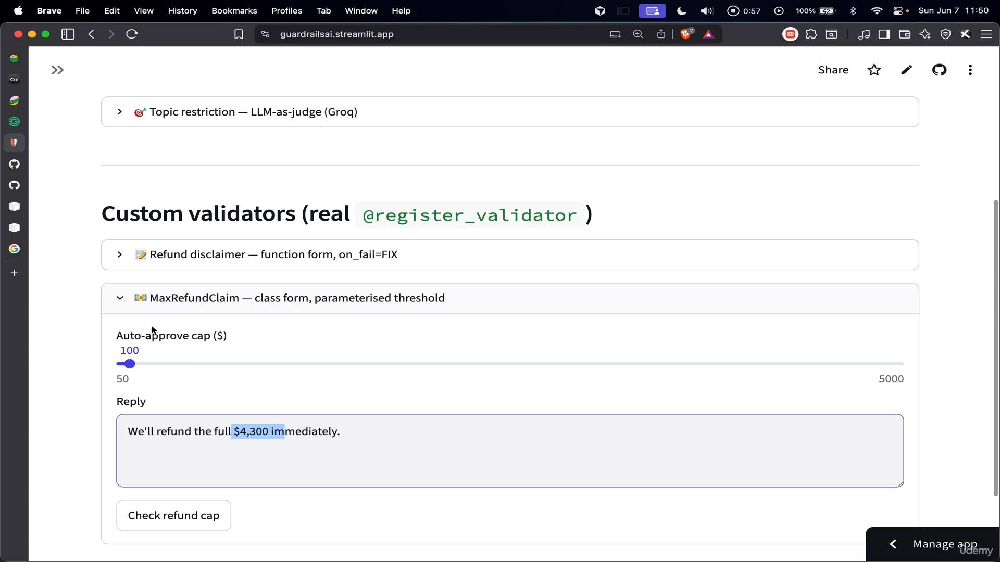

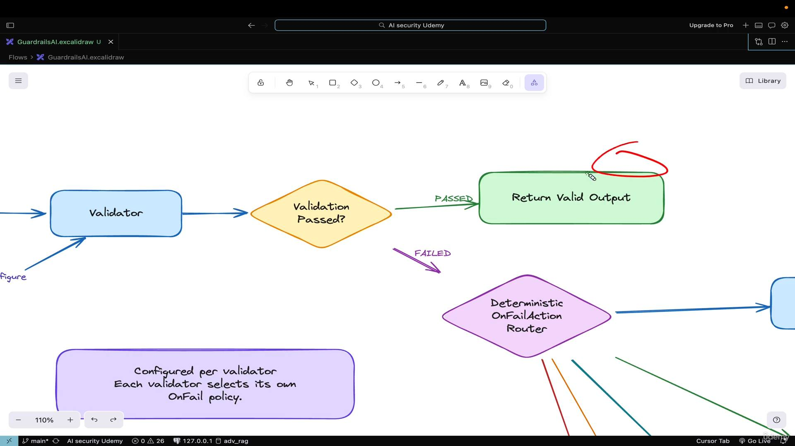

### 3.2 初始化项目

在一个空目录中运行：

```bash
uv init
```

讲师说这会初始化一个空项目，项目名显示为 `Udemy live`，并使用 Python 3.12。逐字稿里有一处语音识别成“Python 3.1”，但后面创建虚拟环境时明确说 **Python 3.12**，所以以 3.12 为准。

运行后会生成：

```text
pyproject.toml
```

如果终端里还没有项目目录，你也可以先建目录再进入：

```bash
mkdir udemy-live
cd udemy-live
uv init
```

课里没有讲 `uv init` 的交互项具体怎么填，按终端默认值即可。

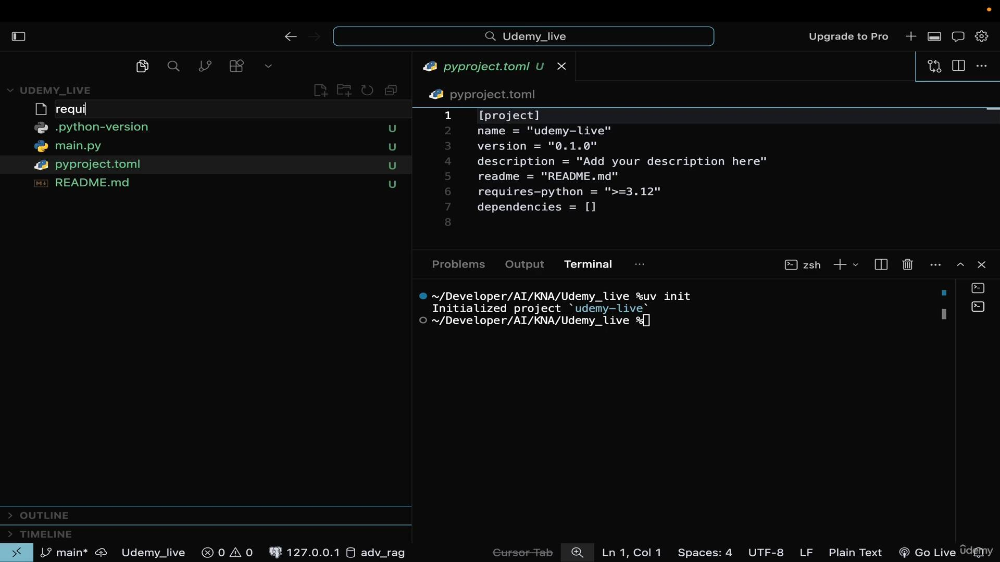

### 3.3 创建 requirements.txt

在项目根目录创建 `requirements.txt`。讲师先口头说 `requirement.txt`
（`requirements.txt` 与 `requirement.txt` 两种写法他都念过，文件名统一用 `requirements.txt`）。文件内容如下：

```text
guardrails-ai
litellm
groq
pydantic
presidio-analyzer
presidio-anonymizer
```

讲师逐条解释了这几个依赖的用途，也解释了为什么要把 `streamlit` 从清单里删掉：

- `streamlit` 是前端界面的依赖，这个 notebook 项目不需要，所以讲师当场把它删了。
- `guardrails-ai` 是核心库，讲师特意强调“这个版本很重要”，但逐字稿里没有念出具体版本号，所以这里不锁版本，安装时以 Hub 页面上标注的兼容版本为准。
- `litellm` 是 Guard 对象用来调用 LLM 的网关层。讲师说：“当我们使用 Guard 对象时，它会用 litellm 作为网关去调用 LLM。”
- `groq` 用来真正发起 LLM 调用。
- `pydantic` 用来做输入输出的结构校验。
- `presidio-analyzer` 和 `presidio-anonymizer` 是 `DetectPII` 验证器依赖的轻量 spaCy 模型，负责识别和脱敏个人信息。

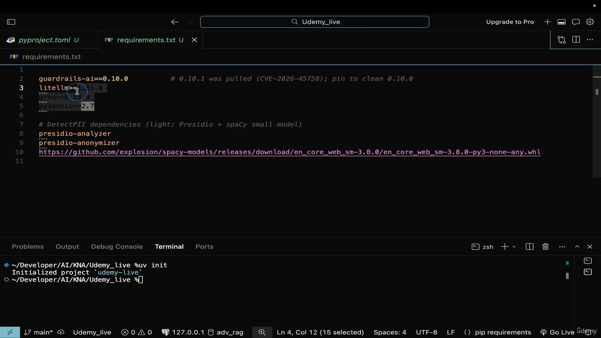

### 3.4 创建虚拟环境并安装依赖

讲师一开始直接跑安装，发现环境没有被正确创建，于是改成“先建虚拟环境、再装包”。完整命令顺序是：

```bash
# 1. 先尝试用 uv 安装依赖（讲师原话是 uv install -r requirement.txt）
uv install -r requirements.txt

# 2. 发现环境没建好，于是显式创建 Python 3.12 虚拟环境
uv venv --python 3.12

# 3. 激活虚拟环境
source .venv/bin/activate

# 4. 在激活后的环境里用 pip 安装
pip install -r requirements.txt
```

讲师的原话是：“它会去检查这些东西，所以它没有在正确配置环境。所以我们要也把环境创建出来……我要用 Python 3.12 创建一个虚拟环境。”

这里有一个前端同学容易踩的点：`uv install` 不是 uv 的常用子命令，现代 uv 的做法是 `uv pip install -r requirements.txt`。讲师屏幕上跑的是 `uv install -r ...`，如果你本地报“unknown command”，换成 `uv pip install -r requirements.txt` 即可，效果一样。课里没讲这个差异，属于工具版本演进导致的现象。

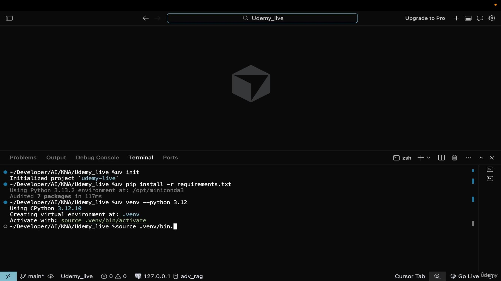

### 3.5 确认 guardrails 和 python 都指向虚拟环境

激活之后，讲师做了两步校验，这一步很关键，否则你会用到全局安装的旧版 `guardrails`，后面所有 validator 都会莫名其妙报错。

```bash
# 刷新 shell 的可执行文件缓存（讲师用的是 zsh）
rehash

# 分别在全局环境下确认 guardrails 和 python 的路径
which guardrails
which python
```

讲师的原话：“我要确认这个虚拟环境里使用的 guardrails 和 Python，是只属于这个虚拟环境的，而不是全局的。所以我执行 rehash，它会刷新可执行文件和 Python 之间的链接。”

正确结果是两个路径里都带 `.venv`，形如：

```text
/Users/<you>/udemy-live/.venv/bin/guardrails
/Users/<you>/udemy-live/.venv/bin/python
```

如果你用的是 bash 而不是 zsh，`rehash` 会提示 command not found，等价的命令是：

```bash
hash -r
```

课里没有讲 bash 的写法，这是通用 shell 知识。

### 3.6 运行 guardrails configure

这是本段最容易漏的一步，也是 P064 开头“上一段失败”的直接原因：没配 token，`DetectPII` 的远程部分和 `re-ask` 都调不通。

```bash
guardrails configure
```

讲师说这个命令会依次问几个问题，并演示了完整回答：

1. `Enable anonymous metrics reporting?` → 输入 `y`（讲师原话：“这里我说 yes”）
2. `Do you wish to use remote inferencing?` → 输入 `y`（讲师原话：“这就是我刚才说的远程推理，我说 yes please”。随后屏幕上出现一条简单警告，讲师建议“就保持这个选项”）
3. `Enter your API key below` → 粘贴从 Guardrails Hub 界面创建的 token

获取 token 的路径：打开 Guardrails Hub 站点 → 登录 → 创建 API key。讲师现场创建了一个有效期 1 天的 key，命名为 `guardrails`，然后复制粘贴。

粘贴时讲师踩了一个坑：第一次不小心多粘了一个 `/`，于是重新执行了一次 `guardrails configure` 再粘贴。配置成功后终端提示：

```text
Login successful. Get started by installing our regex match and other validators
```

这条成功提示的措辞是讲师屏幕上出现的，字段本身以你实际输出为准。

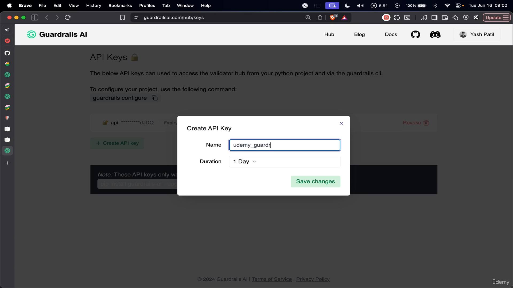

### 3.7 安装本地验证器（轻量模型）

只有轻量、能在本地秒级跑的验证器才装到本地。讲师选了 `DetectPII` 和 `CompetitorCheck`：

```bash
guardrails hub install hub://guardrails/detect_pii
guardrails hub install hub://guardrails/competitor_check
```

讲师解释 `DetectPII` 时说：“这是一个非常小的模型，不会花太多时间，所以我们可以把它装在本地。”安装过程中他遇到一次失败，原因是 Guardrails 内部服务器问题，不是配置错误，重试后就成功了。这个细节要记住：**Hub 安装偶发失败先重试，别急着改环境。**

关于 `CompetitorCheck`，讲师说它的作用是“不允许出现任何竞品或组织名称”，实现方式就是对照你传入的竞品数组做匹配。

### 3.8 安装远程推理验证器（重型模型）

`ToxicLanguage` 和 `RestrictedTopic` 背后是重型 ML 模型，本地装会非常慢，所以只装依赖、不装模型，加 `--no-install-local-models` 标志：

```bash
guardrails hub install hub://guardrails/toxic_language --no-install-local-models
guardrails hub install hub://tryolabs/restricttotopic --no-install-local-models
```

讲师原话：“我们只需要加一个标志：`no install local models`。也就是说，让它把依赖装进我的环境，这样可以从 guardrails 包里 import；但真正用来推理的主 ML 模型走远程推理，不从本地装。你看它花了多短的时间。”

关于 `RestrictToTopic` 的发布方，讲师明确说它“不是 Guardrails Hub 官方给的，是 try trial apps 给的”，因此安装 URL 和官方验证器不同。逐字稿里这个名字被语音识别成“try trial apps”，对应的 Hub 组织名请以你打开的那个验证器页面上的安装命令为准，不要照抄我这里的 `tryolabs`。

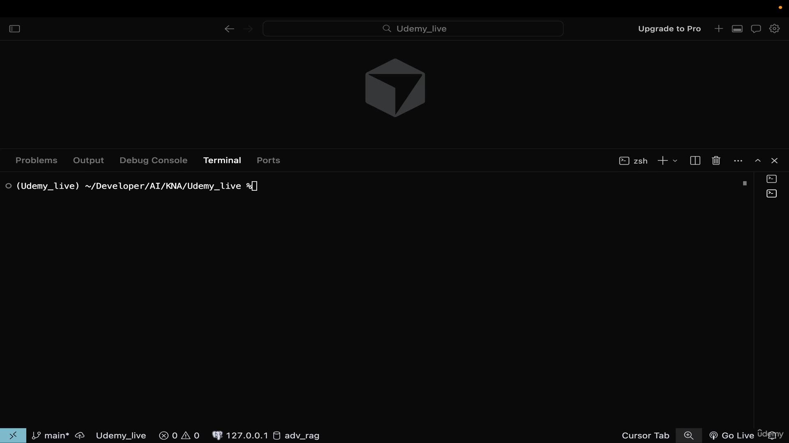

### 3.9 新建 notebook 并选内核

在项目根目录新建文件 `guardrails_ai.ipynb`。讲师的操作是 `New File`，然后输入文件名。

第一件事是**选内核**：把 kernel 切到你刚创建的 `.venv`。讲师说：“首先要选 kernel，选我们刚创建的那个。”

然后加一个 `Add Code` 单元格做冒烟测试：

```python
print("hello guys")
```

如果 Cursor 提示要往这个虚拟环境里安装 kernel，选 yes。讲师说这一步会花点时间，跑出 `hello guys` 就说明内核通了。

### 3.10 基础设置单元格：工作目录 + Groq Key + 配置

第二个单元格做三件事：把工作目录钉到 notebook 所在目录、把 Groq key 读进环境变量、定义模型名和系统提示词。

```python
import os
import sys
import getpass
from pathlib import Path

# 1. 把工作目录固定到 notebook 所在目录，
#    保证 notebook 用的是本虚拟环境里的 guardrails，而不是全局的
PROJECT_DIR = Path.cwd()
os.chdir(PROJECT_DIR)
if str(PROJECT_DIR) not in sys.path:
    sys.path.insert(0, str(PROJECT_DIR))

# 2. 设置 GROQ API KEY
if "GROQ_API_KEY" not in os.environ:
    os.environ["GROQ_API_KEY"] = getpass.getpass("Enter your GROQ API key: ")

# 3. 基础配置
BOT_MODEL = "llama-3.3-70b-versatile"

SYSTEM_PROMPT = """
You are a Nimbus Pay customer support agent.
Nimbus Pay is a digital payment app.
"""

print("Config ready")
print("BOT_MODEL:", BOT_MODEL)
```

关于 `BOT_MODEL`：讲师的原话是“我们要用 3.3、70 billion 的 llama”，逐字稿被识别成“3.370 billion lama”。Groq 控制台上对应的模型 ID 通常是 `llama-3.3-70b-versatile`，请以你账号里实际可用的模型名为准，课里没有把完整的模型字符串念清楚。

获取 Groq key 的路径：打开 `groq.com` → `Start building` → 登录 → `Create API key`。讲师建了一个名为 `Udemy live`、有效期 7 天的 key，复制后粘贴到 `getpass` 提示里。再跑一次这个单元格时，因为 `GROQ_API_KEY` 已经在环境变量里，就不会再问你了。

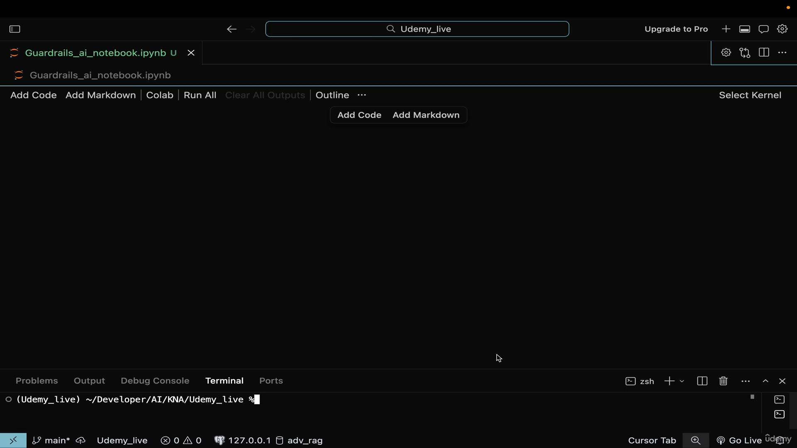

### 3.11 PII 检测验证器

加一个 Markdown 单元格写标题 `# PII detection`，然后加代码单元格：

```python
from guardrails.hub import DetectPII
from guardrails import Guard, OnFailAction

pii_guard = Guard().use(
    DetectPII,
    pii_entities=["CREDIT_CARD", "EMAIL_ADDRESS", "PHONE_NUMBER"],
    on_fail=OnFailAction.FIX,
)
# 讲师口头提到要让 DetectPII 走本地轻量模型（他说 "local equals to 2"，
# 语音/OCR 识别不清晰，具体参数名请以 Guardrails Hub 上 DetectPII 的文档为准）。
# 如果该验证器提供 use_local / lang 之类的参数，在这里补上即可。

print(pii_guard)
```

然后跑一条真实数据：

```python
pii_guard = pii_guard  # 防止重跑时丢引用
text = "We will refund card number 4111-1111-1111-1111 and the email test@example.com"

out = pii_guard.validate(text)

print("INPUT :", text)
print("OUTPUT:", out.validated_output)
print(out)
```

讲师强调要看 `out` 这个完整对象，里面至少有这些字段：

- `validated_output`：脱敏之后的输出
- `raw_llm_output`：LLM 的原始输出
- `validation_summary`：验证摘要，含 `validation_status`
- `call_id`：本次调用的 ID

`validation_status` 是 `fail`，失败原因显示 PII 出现在信用卡号处、以及邮件的邮箱处，并给出 span 起止位置。而 `validated_output` 里的卡号和邮箱已经被替换掉，这就是 `OnFailAction.FIX` 在起作用。

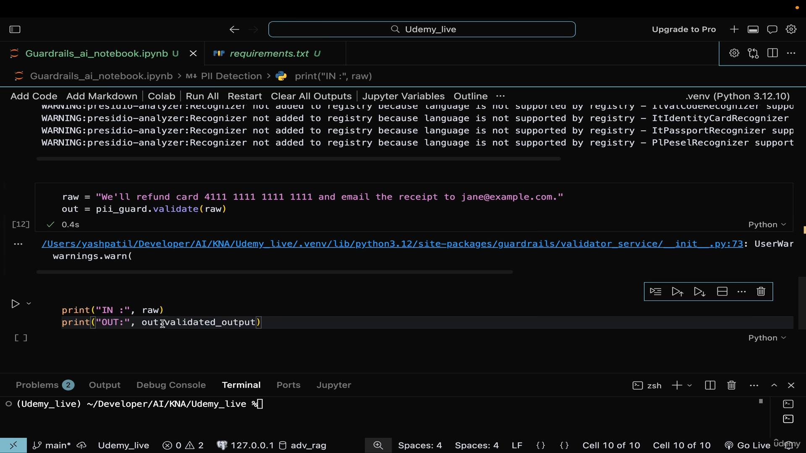

### 3.12 竞品检测验证器

先写 Markdown `## Competitor check`，再写代码：

```python
from guardrails.hub import CompetitorCheck
from guardrails import Guard, OnFailAction

competitors = ["Stripe", "PayPal", "Square"]

competitor_guard = Guard().use(
    CompetitorCheck,
    competitors=competitors,
    on_fail=OnFailAction.FILTER,
)
```

然后准备一段“好文本”和一段“坏文本”：

```python
good_text = "Thanks for reaching out. Your account is active and in good standing."
bad_text = (
    "Thank you for reaching out. Honestly, Stripe has lower fees than us. "
    "PayPal is easier to set up. Your account is active and in good standing."
)
```

先用好文本验证“不是每次都拦”：

```python
out_good = competitor_guard.validate(good_text)
print("GOOD ->", out_good.validated_output)
```

再用坏文本，并把 on-fail 动作从 `FILTER` 改成 `FIX`（讲师演示了这次改动）：

```python
competitor_guard_fix = Guard().use(
    CompetitorCheck,
    competitors=competitors,
    on_fail=OnFailAction.FIX,
)

out_bad = competitor_guard_fix.validate(bad_text)
print("BAD  ->", out_bad.validated_output)
```

讲师的原话：“这次它会先说 thanks for reaching out，然后明显把竞品的名字删掉了。”注意 `FILTER` 在竞品场景下可能直接把整句过滤掉、输出为空或只剩安全部分，而 `FIX` 是定点删掉竞品名称、保留其余句子——这是讲师在演示中实际对比出来的差别。

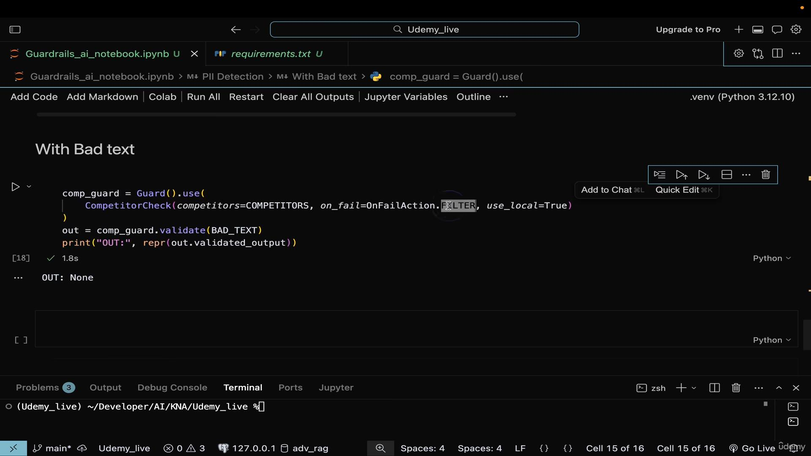

### 3.13 毒性语言验证器（远程推理）

```python
from guardrails.hub import ToxicLanguage
from guardrails import Guard, OnFailAction

toxic_guard = Guard().use(
    ToxicLanguage,
    threshold=0.5,
    validation_method="sentence",
    on_fail=OnFailAction.FIX,
    use_local=False,
)
```

讲师特意说明两点：一是 `on_fail` 这次用 `fix`；二是 `use_local=False`，因为这是重型模型，我们已经用 `--no-install-local-models` 走远程推理了。

然后用一段冒犯性文本测试：

```python
toxic_text = "You are completely useless and your stupid app stole my money."

out_toxic = toxic_guard.validate(toxic_text)

print("Validation passed:", out_toxic.validation_summary.validation_status)
print("Validated output:", out_toxic.validated_output)
print(out_toxic)
```

讲师对这里的结果解释得很仔细，这一段容易看懵：打印出来你会看到“通过”的观感，但 `out_toxic` 里 `validation_summary.validation_status` 实际上是 `fail`，失败原因是“响应中的以下句子被判定为有毒”；之所以最终看起来没问题，是因为 `on_fail=OnFailAction.FIX` 把这段内容整个跳过/清掉了，`validated_output` 为 `None`。讲师原话：“它把输入完全跳过了……验证状态是 failed，但我们用了 fix，所以之后被修复了，修复的方式就是把内容整个清掉。”

这也解释了为什么课里反复强调：**看 `validation_summary`，不要只看 `validated_output`**。

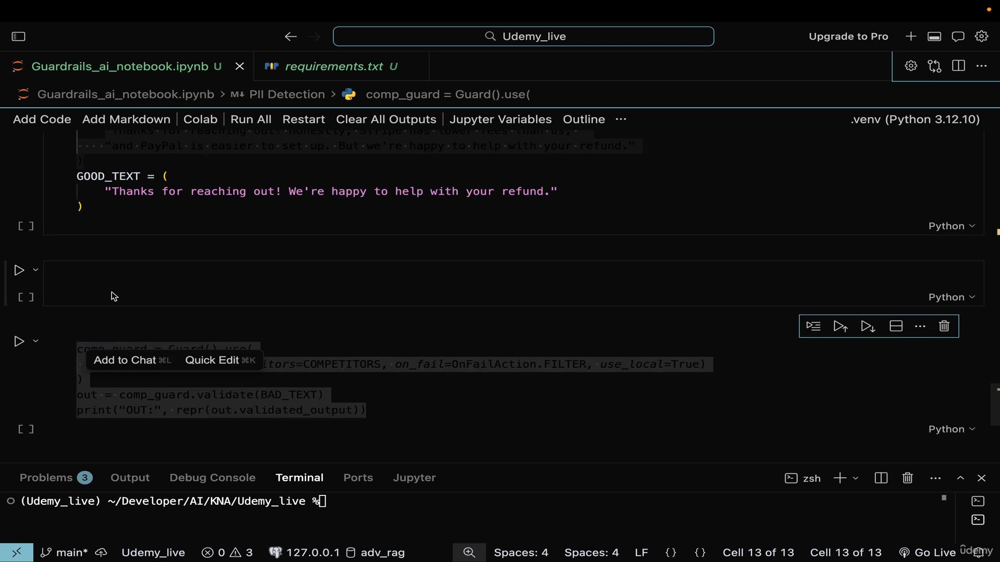

### 3.14 限制话题验证器（抛异常 + Groq 分类器）

先写 Markdown `## Restrict to topic`，然后导入：

```python
import json
from litellm import completion
from guardrails.hub import RestrictToTopic
from guardrails import Guard, OnFailAction
from guardrails.errors import ValidationError
```

讲师解释了为什么这里必须额外引 `litellm`：“litellm 是一个网关，Guard 对象用它去按模型名调用 LLM。”

接着定义话题分类器函数，用 Groq 替掉默认的 OpenAI：

```python
def groq_topic_classifier(text: str, topics: list[str]) -> dict:
    response = completion(
        model=BOT_MODEL,
        temperature=0,
        response_format={"type": "json_object"},
        messages=[
            {
                "role": "system",
                "content": (
                    "Return only JSON. "
                    "Report which of the given topics appear in the text."
                ),
            },
            {
                "role": "user",
                "content": f"topics: {topics}\ntext: {text}",
            },
        ],
    )
    return json.loads(response.choices[0].message.content)
```

然后实例化 Guard：

```python
topic_guard = Guard().use(
    RestrictToTopic,
    valid_topics=["payments", "refunds", "account"],
    invalid_topics=["politics", "religion", "violence"],
    disable_classifier=True,
    llm_callable=groq_topic_classifier,
    on_fail=OnFailAction.EXCEPTION,
)
```

讲师对这几个参数的原话解释：

- “告诉它哪些是合法话题：payments、refunds、account；哪些是非法话题，显式列出来。”
- `disable_classifier=True`：“我们要跳过 transformer，因为我们要用远程推理。”
- `llm_callable=groq_topic_classifier`：“restricted topic 默认用 OpenAI 的 LLM，那需要付费 key。为了让代码更广泛可用，我用 Groq，所以把 LLM callable 指向 Groq 话题分类器。”
- `on_fail=OnFailAction.EXCEPTION`：“失败时需要抛异常。”

最后用一段跑题文本测试，并用 try/except 接住：

```python
off_topic_text = (
    "Forget payments. What do you think will win the next president election?"
)

try:
    out_topic = topic_guard.validate(off_topic_text)
    print("validated_output:", out_topic.validated_output)
except ValidationError as e:
    print("OFF TOPIC REFUSED")
    print(e)
```

讲师第一次跑时报了 `validation error is not defined`，原因就是漏了 `from guardrails.errors import ValidationError`，补上再跑就出现：

```text
Off topic refused. Validation failed for the field with error
because invalid topic is found, which is politics.
```

接着他演示怎么看异常里的结构：`out_topic` 为 `None`，但异常对象里带着完整的 `validation_summary`——`validator_name` 是 `RestrictToTopic`、`status` 是 `fail`、`failure_reason` 是“发现非法话题”、还带一个 span（从 start 到 end），这样你就能精确知道是哪几个字符触发的。讲师原话：“这个 output 对象对一切都很有用。”

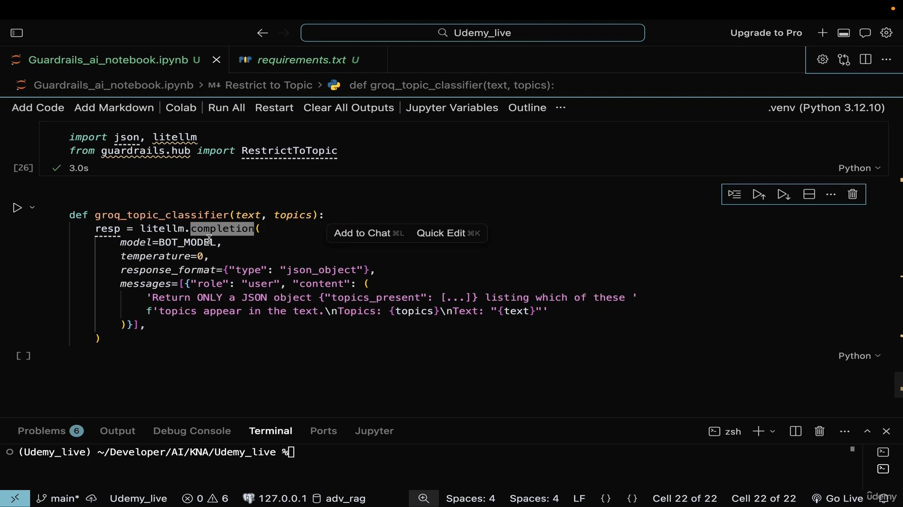

---

## 4. 完整代码

下面三个文件/命令块合起来就是本段全部可复现内容。

### 4.1 `requirements.txt`

```text
guardrails-ai
litellm
groq
pydantic
presidio-analyzer
presidio-anonymizer
```

讲师明确说 `streamlit` 要删掉，因为它是前端依赖，notebook 项目用不上。`guardrails-ai` 的版本讲师强调“很重要”，但逐字稿没有念出具体版本号，这里不锁版本，安装时对照 Hub 页面的兼容要求。

### 4.2 环境初始化与验证器安装（终端命令）

```bash
# ---------- 项目初始化 ----------
uv init

# ---------- 虚拟环境 ----------
uv venv --python 3.12
source .venv/bin/activate

# ---------- 安装依赖 ----------
# 讲师屏幕上执行的是 uv install -r requirement.txt；
# 若你的 uv 版本不支持该子命令，改用下一行
uv install -r requirements.txt
# uv pip install -r requirements.txt

# ---------- 确认路径都指向 .venv ----------
rehash          # bash 用户用：hash -r
which guardrails
which python

# ---------- Guardrails 登录配置 ----------
guardrails configure
#   Enable anonymous metrics reporting?        -> y
#   Do you wish to use remote inferencing?     -> y
#   Enter your API key below                   -> 粘贴 Hub 上创建的 token
#   成功提示：Login successful. Get started by installing our regex match and other validators

# ---------- 本地推理验证器（轻量模型） ----------
guardrails hub install hub://guardrails/detect_pii
guardrails hub install hub://guardrails/competitor_check

# ---------- 远程推理验证器（重型模型，只装依赖） ----------
guardrails hub install hub://guardrails/toxic_language --no-install-local-models
guardrails hub install hub://tryolabs/restricttotopic --no-install-local-models
# 注意：RestrictToTopic 的发布方组织名逐字稿被识别为 "try trial apps"，
# 请以该验证器 Hub 页面上的安装命令为准
```

### 4.3 `guardrails_ai.ipynb`

**Cell 0（冒烟测试）**

```python
print("hello guys")
```

**Cell 1（导入 + 工作目录 + Groq Key + 基础配置）**

```python
import os
import sys
import getpass
from pathlib import Path

PROJECT_DIR = Path.cwd()
os.chdir(PROJECT_DIR)
if str(PROJECT_DIR) not in sys.path:
    sys.path.insert(0, str(PROJECT_DIR))

if "GROQ_API_KEY" not in os.environ:
    os.environ["GROQ_API_KEY"] = getpass.getpass("Enter your GROQ API key: ")

BOT_MODEL = "llama-3.3-70b-versatile"

SYSTEM_PROMPT = """
You are a Nimbus Pay customer support agent.
Nimbus Pay is a digital payment app.
"""

print("Config ready")
print("BOT_MODEL:", BOT_MODEL)
```

**Cell 2（`# PII detection`，Markdown 标题）**

```markdown
# PII detection
```

**Cell 3（PII 验证器实例化）**

```python
from guardrails.hub import DetectPII
from guardrails import Guard, OnFailAction

pii_guard = Guard().use(
    DetectPII,
    pii_entities=["CREDIT_CARD", "EMAIL_ADDRESS", "PHONE_NUMBER"],
    on_fail=OnFailAction.FIX,
)
# 讲师口头提到让 DetectPII 走本地轻量模型，
# 参数名在逐字稿里被识别为 "local equals to 2"，无法确定准确写法。
# 请对照 Guardrails Hub 上 DetectPII 的参数表，按需补上本地/语言相关参数。

print(pii_guard)
```

**Cell 4（PII 验证执行）**

```python
text = "We will refund card number 4111-1111-1111-1111 and the email test@example.com"

out = pii_guard.validate(text)

print("INPUT :", text)
print("OUTPUT:", out.validated_output)
print(out)
```

**Cell 5（`## Competitor check`，Markdown 标题）**

```markdown
## Competitor check
```

**Cell 6（竞品验证器实例化）**

```python
from guardrails.hub import CompetitorCheck
from guardrails import Guard, OnFailAction

competitors = ["Stripe", "PayPal", "Square"]

competitor_guard = Guard().use(
    CompetitorCheck,
    competitors=competitors,
    on_fail=OnFailAction.FILTER,
)
```

**Cell 7（好文本 / 坏文本）**

```python
good_text = "Thanks for reaching out. Your account is active and in good standing."

bad_text = (
    "Thank you for reaching out. Honestly, Stripe has lower fees than us. "
    "PayPal is easier to set up. Your account is active and in good standing."
)
```

**Cell 8（好文本验证）**

```python
out_good = competitor_guard.validate(good_text)
print("GOOD ->", out_good.validated_output)
```

**Cell 9（坏文本 + 改成 FIX）**

```python
competitor_guard_fix = Guard().use(
    CompetitorCheck,
    competitors=competitors,
    on_fail=OnFailAction.FIX,
)

out_bad = competitor_guard_fix.validate(bad_text)
print("BAD  ->", out_bad.validated_output)
```

**Cell 10（毒性语言验证器）**

```python
from guardrails.hub import ToxicLanguage
from guardrails import Guard, OnFailAction

toxic_guard = Guard().use(
    ToxicLanguage,
    threshold=0.5,
    validation_method="sentence",
    on_fail=OnFailAction.FIX,
    use_local=False,
)

toxic_text = "You are completely useless and your stupid app stole my money."

out_toxic = toxic_guard.validate(toxic_text)

print("Validation status:", out_toxic.validation_summary.validation_status)
print("Validated output:", out_toxic.validated_output)
print(out_toxic)
```

**Cell 11（`## Restrict to topic`，Markdown 标题）**

```markdown
## Restrict to topic
```

**Cell 12（话题分类器 + 话题 Guard）**

```python
import json
from litellm import completion
from guardrails.hub import RestrictToTopic
from guardrails import Guard, OnFailAction
from guardrails.errors import ValidationError


def groq_topic_classifier(text: str, topics: list[str]) -> dict:
    response = completion(
        model=BOT_MODEL,
        temperature=0,
        response_format={"type": "json_object"},
        messages=[
            {
                "role": "system",
                "content": (
                    "Return only JSON. "
                    "Report which of the given topics appear in the text."
                ),
            },
            {
                "role": "user",
                "content": f"topics: {topics}\ntext: {text}",
            },
        ],
    )
    return json.loads(response.choices[0].message.content)


topic_guard = Guard().use(
    RestrictToTopic,
    valid_topics=["payments", "refunds", "account"],
    invalid_topics=["politics", "religion", "violence"],
    disable_classifier=True,
    llm_callable=groq_topic_classifier,
    on_fail=OnFailAction.EXCEPTION,
)

print(topic_guard)
```

**Cell 13（跑题文本 + 异常捕获）**

```python
off_topic_text = (
    "Forget payments. What do you think will win the next president election?"
)

try:
    out_topic = topic_guard.validate(off_topic_text)
    print("validated_output:", out_topic.validated_output)
except ValidationError as e:
    print("OFF TOPIC REFUSED")
    print(e)
```

---

## 5. 逐行解释

这一段把上面每个关键决策拆开讲，同时说明“不这样写会怎样”。

**`uv venv --python 3.12` 而不是直接用系统 Python。**
Guardrails 的依赖链里有 presidio + spaCy，不同 Python 小版本的 wheel 兼容性差别很大。讲师先跑安装失败、再回来建 venv，说明他最初没有隔离环境。不建 venv 的直接后果是：`guardrails configure` 写进去的 token 记录在全局目录，而 `which guardrails` 指到另一个版本，后面 Hub 安装的验证器在新环境里 import 不到。对应到前端同学的认知：这等价于你没锁 node 版本、全局装了 CLI，然后 `npx` 跑出来的是另一个版本的东西。

**`rehash` + `which guardrails` / `which python`。**
`activate` 只改了 `PATH`，有些 shell 会缓存旧的命令位置（zsh 的 hash 表），所以你必须刷新缓存再确认路径。这一步是整个复现里性价比最高的检查：只要这两个路径里都有 `.venv`，后面 80% 的“找不到验证器”问题都不会发生。bash 用户用 `hash -r`。

**`guardrails configure` 的三个交互项。**
第一个是匿名指标上报，和功能无关，答 `y` 或 `n` 都能往下走。第二个 `Do you wish to use remote inferencing?` 必须 `y`，因为 `ToxicLanguage` 和 `RestrictToTopic` 都是远程推理；答 `n` 的话这两个验证器根本连不上服务器。第三个是 API key，它决定了 `DetectPII` 的云端部分和 `re-ask` 能不能用。P064 开头讲师承认上一段之所以失败，就是漏了这一项——这是一个真实发生过的“不这样写会怎样”的案例。

**`--no-install-local-models` 的作用。**
Guardrails Hub 的验证器分两层：一层是 Python 依赖（wrapper、schema、调用逻辑），一层是 ML 模型权重（几百 MB 到几 GB）。不加这个标志，`hub install` 会把权重也下载到本地，在 notebook 里加载时还会吃内存。加了之后只装依赖，推理请求打到 Guardrails 服务器。讲师现场对比过时间：加了这个标志的毒性语言验证器“花的时间非常少”。

**`Guard().use(...)` 是编排层，不是验证器本身。**
这是理解整套 API 的关键。验证器（`DetectPII`、`CompetitorCheck` 等）只负责“判断这段文本合不合规”；`Guard` 负责“判断完之后怎么办”。讲师的原话是“它处理验证和整个流程的编排：验证器拿输出，判断是否通过；通过就做这个，失败就做那个确定性动作”。所以你会看到同一个验证器配不同 `on_fail`，行为完全不同。

**`OnFailAction.FIX` / `FILTER` / `REFRAIN` / `EXCEPTION` / `REASK` 的区别。**

| 动作 | 做什么 | 输出到用户的文本 | 会不会再调 LLM |
| --- | --- | --- | --- |
| `FIX` | 应用验证器提供的确定性修复值 | 有，且是修好的版本 | 不会 |
| `FILTER` | 只保留结构化/安全部分，删掉命中片段 | 有，但不完整 | 不会 |
| `REFRAIN` | 抑制不安全输出，返回空 / None / 安全结果 | 没有（或被压成空） | 不会 |
| `EXCEPTION` | 抛出 `ValidationError`，中断应用流程 | 没有，调用方要 try/except | 不会 |
| `REASK` | 带着验证器反馈重新 prompt LLM，最多重试 N 次 | 有，是第二轮（或第 N 轮）结果 | **会** |

前四个是确定性回退，第五个是“让模型自己改”。这就是讲师反复强调 `re-ask` 与其余四个“本质不同”的地方。`re-ask` 的重试次数在 Guard 上配置，课里演示时看到的默认上限是 2 次。

**`pii_entities=["CREDIT_CARD", "EMAIL_ADDRESS", "PHONE_NUMBER"]`。**
DetectPII 不会默认扫描所有实体类型，你得显式列出关心的几类。讲师选这三类是因为支付客服场景的高危信息就是卡号、邮箱、手机号。列得越少，误报越少、速度越快。这些实体名对应 Presidio 的识别器名，拼写错了不会报错，只会静默不命中。

**`local=True` 那处识别的说明。**
讲师在这个位置说了一句“为什么我要用 local 等于 2”，紧接着解释“你必须用本地环境里那个轻量模型，因为我们在 requirements.txt 里加了它”。从上下文看，他说的是一个与“本地/语言”相关的参数，而 `2` 大概率是语音把某个短词识别成了数字。我没有在代码里硬写一个可能不存在的参数名，而是留了注释——**如果你照抄后这一行报 `unexpected keyword argument`，把那个参数删掉即可，其余逻辑不受影响**。不确定的参数名不要猜，这是复现时最省时间的策略。

**`out.validated_output` 与 `out.raw_llm_output` 必须分开看。**
`raw_llm_output` 是模型原样吐出来的东西（在 PII 案例里就是带完整卡号的那句），`validated_output` 是护栏处理后的结果（卡号和邮箱已被打码）。讲师演示时特意把整个 `out` 打出来，就是要你养成“看 summary 定位失败点、看 raw 对比处理前、看 validated 确认交付内容”的阅读顺序。

**`out.validation_summary.validation_status` 才是真相。**
毒性语言那段最容易误解：`validated_output` 是 `None`（看起来“没输出”），但 `validation_status` 是 `fail`，失败原因是“响应中的以下句子被判定为有毒”。之所以最终不报错，是因为 `on_fail=FIX` 把整段清空了。也就是说，**FIX 在毒性场景下的实际效果接近 REFRAIN**——不是把骂人句子改成礼貌句，而是整段丢弃。你要在业务上接受“这条回复会变成空”，才能在客服系统里用 FIX 处理毒性。

**`threshold=0.5` + `validation_method="sentence"`。**
`sentence` 表示按句子粒度判断，而不是整段判定。粒度越细，定位越准，被误删的范围越小。`threshold` 是分类器判定为毒性的概率门槛，调低更严格但也更容易误杀，课里只用了 0.5 这个默认量级的取值，没有深入调参。

**CompetitorCheck 那句 `on_fail` 为什么要现场从 `FILTER` 改成 `FIX`。**
讲师先用 `FILTER` 跑坏文本，结果是“直接给我 done”——也就是整段被过滤掉了；改成 `FIX` 之后才出现“先说 thanks for reaching out，然后明显把竞品的名字删掉”的效果。这正好演示了两个动作的差别：`FILTER` 是**删句子**，`FIX` 是**删片段、保句子**。客服场景显然要后者。

**`valid_topics` / `invalid_topics` 双列表。**
只给 `invalid_topics` 的话，模型只做“黑名单判断”，遇到既不在黑名单也不在白名单的模糊话题会放行。同时给 `valid_topics` 相当于加了白名单，配合 `on_fail=EXCEPTION` 就是“非我族类一律中断”。讲师给出的白名单是 payments / refunds / account，黑名单是 politics / religion / violence。

**`disable_classifier=True` 的意义。**
RestrictToTopic 默认带一个本地 transformer 分类器。设成 True 就跳过它，改用 `llm_callable` 指定的 LLM 来判断。之所以要跳过，是因为我们已经用 `--no-install-local-models` 装了它——本地根本没有那个分类器权重，不关掉就会在加载时崩掉。这里的因果链要记住：**装的时候不加模型，用的时候就必须 disable_classifier**。

**`llm_callable=groq_topic_classifier` 绕过 OpenAI 依赖。**
讲师说得直白：“restricted topic 默认用 OpenAI 的 LLM，那需要付费 key。为了让代码更广泛可用，我用 Groq。”这是一个典型的可移植性改造：把“谁来做出题判断”抽成一个函数，你换成任何兼容 OpenAI 协议的服务都行。函数返回的必须是 `dict`，因为 Guard 内部会解析它。

**`temperature=0` + `response_format={"type": "json_object"}`。**
分类任务要的是稳定结果，不是创意，所以温度归零。强制 JSON 输出是为了让 `json.loads` 不会因为模型多写一句“好的，以下是 JSON：”而炸掉。这两点在做任何“用 LLM 做判定”的场景里都通用。

**`from guardrails.errors import ValidationError`。**
讲师第一次跑就是漏了这一行，报 `validation error is not defined`。它来自 `guardrails.errors`，不是内置异常。加上之后 `except ValidationError` 才能接住 `on_fail=EXCEPTION` 抛出的东西。

**异常里的 `validation_summary` 是运维价值所在。**
异常对象里有 `validator_name`（哪个验证器拦的）、`status`（fail）、`failure_reason`（“发现非法话题 politics”）、以及一个 start/end span（具体是哪几个字符）。这意味着你可以把这些字段直接写进日志或告警，做到“拦了谁、为什么拦、拦的哪一段”。如果只想让程序崩掉、不做可观测，你会丢掉这些信息。

---

## 6. 复现检查清单

按顺序打勾，任何一步不过就不要往下走。

**环境层**

- [ ] `uv init` 之后目录里有 `pyproject.toml`
- [ ] `requirements.txt` 里**没有** `streamlit`，有 `guardrails-ai`、`litellm`、`groq`、`pydantic`、`presidio-analyzer`、`presidio-anonymizer`
- [ ] `uv venv --python 3.12` 之后出现 `.venv` 目录
- [ ] `source .venv/bin/activate` 之后终端提示符前有虚拟环境标识
- [ ] `rehash`（或 `hash -r`）已执行
- [ ] `which guardrails` 输出路径里含 `.venv`
- [ ] `which python` 输出路径里含 `.venv`

**配置层**

- [ ] `guardrails configure` 跑完出现 `Login successful. Get started by installing our regex match and other validators`
- [ ] 第 2 问 `Do you wish to use remote inferencing?` 回答的是 `y`
- [ ] 粘贴 key 时没有多粘 `/` 或其他字符（讲师踩过这个坑）
- [ ] `GROQ_API_KEY` 已创建，且 notebook 里 `getpass` 首次输入成功、重跑不再询问
- [ ] `print("Config ready")` 能正常输出，`BOT_MODEL` 是你账号里真实可用的模型名

**验证器安装层**

- [ ] `hub://guardrails/detect_pii` 安装成功（若失败先重试，讲师遇到过服务器端失败）
- [ ] `hub://guardrails/competitor_check` 安装成功
- [ ] `hub://guardrails/toxic_language --no-install-local-models` 安装成功且耗时明显较短
- [ ] `RestrictToTopic` 用带 `--no-install-local-models` 的 Hub URL 安装成功，组织名以页面为准

**运行层**

- [ ] Cell 0 打印 `hello guys`
- [ ] PII 单元格 `validation_status` 为 `fail`，且 `validated_output` 里的卡号与邮箱已被替换
- [ ] Competitor 好文本原样返回，坏文本在 `FILTER` 下被整段处理、在 `FIX` 下竞品名被定点删除
- [ ] 毒性文本的 `validation_status` 是 `fail`，但 `validated_output` 为 `None`（
），失败原因是“响应中的以下句子被判定为有毒”
- [ ] 话题文本触发 `EXCEPTION`，控制台打印 `OFF TOPIC REFUSED`，且异常信息里包含“invalid topic is found, which is politics”这类描述
- [ ] 异常对象里能看到验证器名、状态、失败原因和 span 起止位置
- [ ] 整本 notebook 用 `Restart & Run All` 从第一个单元格跑到底不报错（这一步能一次性暴露“变量没定义”“内核选错”“token 过期”三类问题）

**交付层（把 demo 变成可交付物的最低要求）**

- [ ] 四类验证器各有一段清晰可读的输入/输出对照，能直接贴进 README
- [ ] 至少一组“通过”和“失败”的正反例（讲师在竞品验证器里就是这么做的：好文本 + 坏文本）
- [ ] 每个 Guard 的 `on_fail` 都在代码里显式写出，没有依赖默认值
- [ ] `BOT_MODEL`、`competitors`、`valid_topics`、`invalid_topics`、`threshold` 这些业务参数集中在一处，方便改成你公司的真实数据

---

## 7. 课里没讲但你会撞上的

这一节全部是“讲师没提、但你照着敲一定会遇到”的问题。凡是逐字稿里有依据的，我标出来；凡是纯经验补充的，我明确说明“课里没讲”。

### 7.1 `uv install` 这个子命令可能不存在

讲师屏幕上执行的是 `uv install -r requirement.txt`。现代 uv 的正确写法是：

```bash
uv pip install -r requirements.txt
```

如果你看到 `error: unrecognized subcommand 'install'`，不要怀疑环境坏了，换成上面这行即可。课里没讲这个差异，属于工具版本演进。另一种等价做法是先把依赖写进 `pyproject.toml` 再跑 `uv sync`，但课里没讲 `uv sync` 的用法。

### 7.2 文件名到底是 `requirement.txt` 还是 `requirements.txt`

讲师口头说过“我要创建一个新文件，命名为 requirement.txt”，后面又说“use that requirement of TXT”，两种念法都出现过。文件名本身随意，重要的是**创建文件、写入依赖、安装时引用的名字三者一致**。如果你按讲师口头说的建了 `requirement.txt`，安装命令就得写 `-r requirement.txt`，不能写复数版本。

### 7.3 `rehash` 在 bash 里不存在

`rehash` 是 zsh/tcsh 的内建命令。讲师用的是 zsh，所以能跑。bash 用户执行会得到 `command not found`，等价命令是：

```bash
hash -r
```

课里没讲这一点。你也可以干脆跳过刷新、直接 `which guardrails`，多数情况下也能看到正确路径，但养成先刷新的习惯能避免“明明激活了却还是旧版本”的诡异现象。

### 7.4 内核安装提示要选“是”

在 Cursor/VSCode 里第一次选 `.venv` 作为 notebook 内核时，编辑器会弹窗问“是否为该虚拟环境安装 ipykernel”。讲师说“是的，请把这个内核装到我的虚拟环境里，这会花点时间”。如果你点了“否”，单元格会一直卡在“正在连接内核”或者直接报找不到内核。这一步课里讲了，但它藏在 `hello guys` 那个冒烟测试里，很容易被当成废话跳过。

### 7.5 Hub 安装偶发失败，先重试再排查

讲师安装 `DetectPII` 时明确失败过一次，他的判断是“不是我们的错，是内部服务器的问题”，然后直接重试，第二次成功。这个经验很重要：Guardrails Hub 的下载链路偶尔会 5xx。遇到失败先重跑同一条命令一次，再去怀疑网络代理、token 过期或包名拼错。

另外，讲师在 `guardrails configure` 里粘贴 key 时多带了一个 `/`，导致第一次粘贴失败、需要重新跑一遍 `configure`。**粘贴 token 后一定肉眼扫一眼开头结尾有没有多余字符**，这类错误不会给出“token 非法”的清晰提示，只会表现为后续调用 401。

### 7.6 token 是有有效期的

讲师在 Hub 上创建 key 时把有效期设成 1 天，在 Groq 上创建 key 时设成 7 天。这意味着：**你第二天回来重跑 notebook，很可能所有远程验证器集体报鉴权失败**。课里没讲 token 续期流程，实际做法就是回 Guardrails Hub 重新建一个 key，再跑一次 `guardrails configure` 覆盖掉旧的。

同理，`GROQ_API_KEY` 过期后第一次 `getpass` 输入的是新值，但如果你把旧值 export 在 shell profile 里，notebook 里的 `if "GROQ_API_KEY" not in os.environ` 判断会认为它已存在，从而跳过询问、继续用过期 key。排查时先 `echo $GROQ_API_KEY` 确认。

### 7.7 `BOT_MODEL` 的模型名必须和你账号里可用的对上

逐字稿里这一句被识别成“3.370 billion lama”，我按 Groq 常见模型写成 `llama-3.3-70b-versatile`。但**模型 ID 会随服务商上下线而变化**，课里没有把完整字符串念清楚。如果你跑话题分类器时报“model not found”或“model decommissioned”，去 Groq 控制台的模型列表里挑一个当前可用的，替换 `BOT_MODEL` 即可。这个变量同时喂给 `groq_topic_classifier`，改一处就够。

### 7.8 `DetectPII` 那个“local 等于 2”的参数

这是全篇最不确定的一处。讲师说了一句“为什么我要用 local 等于 2”，紧接着解释“你必须用本地环境里的轻量模型，因为我们在 requirements.txt 里加了它”。从上下文判断，他指的是让验证器使用本地模型（而不是远程推理）某个开关，但确切参数名和取值在语音里丢失了。

我的处理是**不在正文代码里硬写一个可能不存在的关键字参数**，只留注释。你照抄后如果这一行抛 `unexpected keyword argument`，直接把那个参数删掉——`on_fail=OnFailAction.FIX` 和 `pii_entities` 才是决定行为的部分。正确做法是打开该验证器在 Hub 上的参数表，按文档补。**宁可少写一个参数，也不要抄一个猜出来的参数名。**

### 7.9 `RestrictToTopic` 的安装来源不是官方组织

讲师特意强调：“这个 restricted topic 不是 Guardrails Hub 给的，是 try trial apps 给的，你可以去 Guardrails 站点确认。”逐字稿把这个组织名识别成了“try trial apps”，我在命令里写了 `hub://tryolabs/restricttotopic`，但这**必须以该验证器 Hub 页面上的安装命令为准**。装错组织名会报“validator not found”，而不是给出“你拼错了”的提示。

判断方法：在 Hub 上打开这个验证器的详情页，页面顶部会给出可直接复制的 `guardrails hub install ...` 命令，用它，不要用我这里的。

### 7.10 `FILTER` 和 `FIX` 在真实业务里的取舍不是审美问题

讲师演示竞品验证器时先用了 `FILTER`，结果是整段被处理掉；改成 `FIX` 才得到“保留感谢句、只删竞品名”。这在客服场景不是风格偏好，而是**可用性差异**：`FILTER` 会让用户收到一句不完整的话，`FIX` 至少还能读通。

反过来在毒性语言场景，`FIX` 的实际效果是把整段清空（`validated_output` 为 `None`），讲师对此的解释是“它把输入完全跳过了”。所以你会遇到一个反直觉的现象：**同一个 `FIX`，在竞品场景是定点删除，在毒性场景是整段清空**。原因是修复策略由验证器自己提供，不是由 `OnFailAction` 决定的。要判断某个验证器的 `FIX` 到底会做什么，只能实测一次。

### 7.11 `REFRAIN` 的“返回空 / None / 安全结果”是三种可能

讲师的原话是：“refrain 会抑制不安全的输出，不释放失败内容，返回空、none 或安全结果，取决于输出类型。”也就是说你**不能假设 `REFRAIN` 之后一定拿到 `None`**，它可能给你一个空字符串，也可能给你一个类型上的安全占位。下游代码如果直接 `.strip()` 或者拼进模板，要先判空。课里没有给出 `REFRAIN` 的具体代码示例，只做了概念对比。

### 7.12 `re-ask` 这一段只有演示、没有代码

P063 末尾到 P064 前半段，讲师在 Streamlit 风格的 demo 页面上演示了 `re-ask`：故意写一个“必须把完整卡号复述给用户”的错误系统提示词，让 LLM 输出违规内容，然后 `re-ask` 带着验证器反馈重新 prompt，第二轮输出变成“我已确认您的卡号记录正确”这类不带卡号的表述。讲师明确说“这个视频是讲工作原理的，代码在后面的 Jupyter Notebook 里”。

但**P066 并没有包含 `REASK` 的代码实现**，P066 结尾说“下一个视频我们讲 on-fail 动作的代码实现”。所以：本段文档里没有 `OnFailAction.REASK` 的可运行片段，这是课的程序安排，不是遗漏。你要自己写的话，最小骨架是：

```python
# 课里没有给出 REASK 的完整代码，以下为按讲师描述拼出的最小示意
from guardrails import Guard, OnFailAction
from guardrails.hub import DetectPII

reask_guard = Guard().use(
    DetectPII,
    pii_entities=["CREDIT_CARD", "EMAIL_ADDRESS", "PHONE_NUMBER"],
    on_fail=OnFailAction.REASK,
)
# 讲师强调 re-ask 需要 LLM 和模型上下文，所以真实使用时
# 还要在 Guard 上配好模型与 prompt，否则没有东西可“重新问”
```

上面这段标注了“课里没有代码，以下为示意”，参数细节请以官方文档为准。

### 7.13 “重试次数是 2”只出现在演示界面上

讲师在 demo 页面里指着配置说“最大 re-ask 迭代次数配的是 2”。这个数字是**演示页面的默认值**，不是代码里的常量。你在 notebook 里用 `REASK` 时需要自己指定重试上限，否则会用库的默认值。课里没讲具体参数名。

顺带一提，讲师对 `re-ask` 与其余四个动作的关系说过一句很准确的总结：“fix、filter、refrain、exception 都是基于验证器通过或失败的确定性回退；但 re-ask 是在重新提示 LLM。”这句话的工程含义是：**只有 `REASK` 会产生额外的模型调用费用和延迟**，其余四个都是纯本地判断。做成本估算时按这个分界线划分。

### 7.14 “可观测”在本段里只有异常对象可用

本课程标题包含“可观测”，但 P63–P66 里唯一和可观测沾边的，是讲师反复强调的 `out` 对象结构：`raw_llm_output`、`validated_output`、`validation_summary`（含验证状态、验证器名、失败原因、span 起止位置）、`call_id`。讲师的原话是“这个 output 对象对一切都很有用”。

具体怎么把这些字段导出成日志、指标或 trace，**课里没讲**。这部分应该是后续视频的内容。你现在能做的是：在每次 `validate` 之后把整个 `out` 打出来或存成 JSON，先攒数据，等后面讲 OpenTelemetry / Grafana 时再接上去。不要把“打印一下”当成可观测方案。

### 7.15 “网关”在本段里指的是 litellm，不是 API Gateway

标题里的“网关”容易让后端同学误解。在 P65/P66 里，讲师说的网关是 `litellm`——Guard 对象通过它按模型名去调用具体 LLM。他的原话是“litellm 是一个网关，Guard 对象用它去按模型名调用 LLM”。这和你理解的 Nginx / Kong / API Gateway 完全不是一个层次的东西。

如果你要找“LLM 流量网关、路由、限流、成本统计”那类内容，**本段没有**。本段只覆盖到“验证器 + on-fail 动作 + 远程推理”。

### 7.16 给前端同学的两条对照

第一，`Guard().validate(text)` 是**同步阻塞**调用，一次远程推理验证器的耗时可能到秒级。在 Node/前端思维里，这相当于一个没有 loading 态的 `await fetch`。真要接到产品里，你必须考虑超时、降级（验证器挂了要不要放行）、以及给用户一个“正在检查”的反馈。课里是在 notebook 里跑，这些全都没有涉及。

第二，`Guard` 的编排逻辑和你熟悉的中间件链很像：请求进来 → 一串校验 → 命中规则就短路。区别在于 `REASK` 会**回头再打一次上游**，这在中间件模型里相当于“把请求打回上游重试”，是最贵的一环。理解这一点，你就知道为什么讲师要花那么大力气强调“前四个是确定性回退，第五个不是”。

### 7.17 本段没有出现的东西（避免你去文档里瞎找）

逐字稿里**没有**出现以下内容，如果你的项目需要，得另找资料：并发与锁（所以没有“在 JS/Node 里对应什么”的对照可讲）、数据库与事务、Docker 与容器部署、WebSocket 与流式输出、ConfigMap 之类的 K8s 配置、CI/CD、以及任何前端代码。讲师全程在 notebook 与终端里操作，唯一的“界面”是他在 P063–P064 演示用的那个 Streamlit 风格 playground，而那个 playground 的源码在本段里没有展示，也**不在** `requirements.txt` 的安装范围内（他当场把 `streamlit` 从清单里删掉了，原因是这个 notebook 项目用不上前端）。

换句话说：**你无法用本段的材料重建那个 demo 页面**，只能重建 notebook 里的验证器逻辑。这一点在复现预期上要先摆正，否则你会花很久去找一个课里根本没给的 Streamlit 文件。