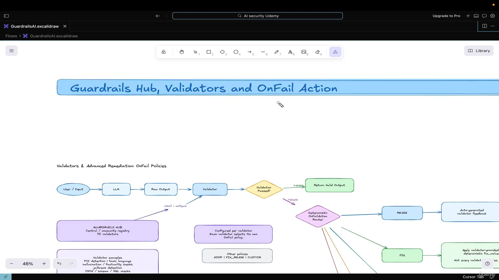

# AI Security Bootcamp part2：护栏 on-fail 动作与结构化输出校验（P067–P069）

> 说明：这三段课是**在 Jupyter Notebook 里继续写 Guardrails AI 的实现代码**，不是白板讲解。逐字稿是讲师对着屏幕边敲边说，很多代码只念了「我正在写……」「这里用 parse 方法」而没有逐字念出字面量；本段也**没有 OCR 结果**。因此第 4 节的代码是**按口述结构还原的完整可运行 notebook**，凡是逐字稿没有念出的字面量（模型型号、system prompt 原文、邮件正文、好/坏样例文本），我都用注释标出来「课里没讲，可按此替换」。涉及 Guardrails 具体 API 名称的地方（`for_pydantic` / `num_reask` / `guard(...)` 是否接受 `messages`），在 P069 讲师口述的形态与新版本文档有差异，第 7 节专门列了坑。

---

## 1. 这一节做什么

这一段要交付两样东西，都在同一个 Jupyter Notebook 里：

**第一件（P067–P068）：把 Guardrails 的五种 on-fail 动作全部跑一遍，亲眼看到同一个 validator 在不同 `on_fail` 下输出形态的差异。**

讲师的办法很省事：固定用同一个 validator —— **competitor check（竞品检查）**，只改 `on_fail` 参数，然后对比输出。这样做的好处是**控制变量**：vendor、prompt、样例文本全都不动，唯一变化的只有 `on_fail` 这一个入参，所以两次跑出来的差异就一定来自 on-fail 动作本身的语义，而不是模型换了个脾气。如果像通常的教程那样每个动作配一套不同的 validator，你很难分清到底是 validator 变了，还是动作变了。

五种动作依次是：

| on_fail 动作 | 讲师观察到的结果 | 复现的 cell |
|---|---|---|
| `FIX` | 校验失败，但输出里多了一段「被修复过的 validated output」，修复内容由 validator 决定 | P067 后半 |
| `FILTER` | 校验失败，单字段输入时输出直接是 `None` | P067 末尾 |
| `REFRAIN` | 校验失败，单字段输入时输出也是 `None`（和 FILTER 看起来一样） | P067 末尾 |
| `FILTER` vs `REFRAIN`（结构化输入） | FILTER 只把**出问题的那个字段**剔掉，其余字段留下；REFRAIN 整条输出变成 `null` | P068 前半 |
| `EXCEPTION` | 抛出校验异常，代码走 `try/except` 的 except 分支 | P068 中段 |
| `REASK` | 不走确定性动作，而是带着校验反馈**回去重新调一次模型**，`num_reask=2` 时能看到两轮迭代 | P068 后段 |

这里有个关键判断（讲师反复强调）：**FILTER 和 REFRAIN 在「单字符串输入」时看起来一模一样（都是 `None`），只有换成结构化 JSON 输出，才能看出区别**。所以 P067 结尾必须补一个 pydantic 结构化输出的实验，否则这一节等于没做。

**第二件（P069）：用 Guardrails AI 做输入/输出的结构校验 —— 从一段「杂乱文本」抽成「有类型的对象」。**

P069 开头先看 demo：把一段客户抱怨的纯文本丢进去，出来的是一个带 `category` / `urgency` / `needs_human` 等字段的结构化 ticket；同一段结构化数据可以直接进后面的数据管道。然后讲师拆解 Guardrails 内部是怎么做到的：

1. 非结构化输入 → 2. 抽取提示（extraction prompt）+ pydantic 蓝图（blueprint）→ 3. 用蓝图创建 guard → 4. 如果模型支持 tool/function calling，就把 schema 转成**函数定义注册成工具**，让模型按参数吐结构化结果；不支持就走「把 schema 塞进 system prompt」的兜底 → 5. 拿到结果后再做 JSON 类型检查、schema 约束、自定义 validator 校验 → 不通过就回到第 4 步重试。

然后在 Notebook 里落地：定义 `RefundRequest` 蓝图（`customer_name` / `amount` / `reason` / `category`，其中 `category` 用 `Literal` 限定取值），用 `Guard.for_pydantic(RefundRequest)` 建 guard，把一封客户邮件喂进去，`num_reask=2`，打印 validation outcome、raw LLM output、validated output。



---

## 2. 讲师原话

> "on-fail action 就是这个 guard 对象要做出的动作——这个 guard 对象在编排各个 validator 和 guardrails，由它来决定需要做什么。每当某个 validator 说这条输出失败了，就要决定采取哪一个确定性的动作：可以是 re-ask、fix、filter、refrain、exception。"
> —— p067 [01:27]

> "这里我们说的是：你需要走到这条 fix 流程，也就是由 validator 提供的确定性修复流程。"
> —— p067 [08:24]

> "这次同样是失败，但看输出是什么——这一回输出是 none。"
> —— p067 [10:15]

> "为什么两种情况都是 none？因为我们这里只有一个字段的输出，输入也是单个字符串对象。等你给出结构化输出时，才会看到 filter 和 refrain 的差别。"
> —— p067 [11:43]

> "在这一行我是在强制输出，我在强制要求、告诉 guardrails 对象按这个格式输出。这样每一次这个 guardrails 对象都会返回 answer 实体、comparison 实体和 category 实体。"
> —— p067 [14:04]

> "在 filter 里它会先看那个有问题的字段，然后在这里放一个 guard 对象，但这个 guard 对象属于 filter，因为它选的路径是 filter；在 refrain 的情况下它同样在这里放一个 guard 对象，但它属于 refrain。"
> —— p068 [05:47]

> "这一步对这里的每一个实体都会发生，也就是说，对每一个无效实体并行地发生。"
> —— p068 [06:17]

> "fix、filter、refrain、exception 都是确定性的动作，我们可以确定性地定义；但在 re-ask 的情况下，我们会再次回到那个编排器，带着校验反馈重新调用大模型。"
> —— p068 [10:28]

> "num_reask 告诉我们的是一次最多可能有多少轮 re-ask。我们说最多两轮 re-ask。"
> —— p068 [13:20]

> "要从非结构化数据里抽出结构，我们必须明确告诉大模型或者 Guardrails AI：你要抽的是这类字段。"
> —— p069 [03:46]

> "Guardrails AI 会看这个大模型是否具备工具调用或函数调用的能力。"
> —— p069 [07:36]

> "有些大模型能做工具调用或函数调用，有些不能。现代的大模型是可以的。"
> —— p069 [08:06]

> "literal 定义的是：只有 billing、technical、account、other 这几个值可以填进 category，除此之外的任何值都填不进去。"
> —— p069 [20:05]

> "这件事用 pydantic 当然也能做。但 Guardrails AI 还给了我们更多校验能力，比如这里的 re-ask 流程，以及针对不同事情用不同模型的能力。这些能力让你的结构化数据解析变得非常健壮。"
> —— p069 [23:54]

---

## 3. 从零复现

### 3.1 目录结构

```text
ai-security-bootcamp/
├── .env                          # 密钥，不进版本库
├── .env.example                  # 变量名模板
├── requirements.txt
├── notebooks/
│   └── guardrails_bootcamp.ipynb # P067–P069 全部内容都在这一个 notebook 里
└── README.md                     # 可选：写启动命令
```

讲师的说法是「我们之前所有代码都在这个 notebook 里，基础设置代码、PII 检测、toxic language、distributed topic 等 validator 都在」，所以**不用新建第二个 notebook**，在原有 notebook 里往下加 cell 即可。P069 也是同一个 notebook（讲师原话是「我们回到为 Guardrails AI 实现部分写代码的那个 Jupyter Notebook」）。

### 3.2 环境准备

```bash
cd ai-security-bootcamp
python -m venv .venv
source .venv/bin/activate         # Windows: .venv\Scripts\activate
python -m pip install -U pip
pip install -r requirements.txt
```

**这几条命令各自在解决什么问题，值得逐条说清楚**：

- `python -m venv .venv` 在项目目录里建一个独立的解释器环境。后面所有 `pip install` 都装进这个目录，不会污染系统里的 Python。这一步很重要，因为 P069 讲师特意强调「要保证 notebook 用的是虚拟环境里的 guardrails，而不是全局那个」——如果你跳过 venv 直接全局装，后面 kernel 一选错就会踩到同一个坑，而且症状很恶心：notebook 里 `import guardrails` 能过，但版本是另一个。
- `python -m pip install -U pip` 先把 pip 自身升到最新。老版本 pip 在处理带 extras 的依赖时偶尔会解析失败，先升 pip 是成本最低的保险。
- `pip install -r requirements.txt` 一次装齐。文件里刻意**不写版本号**，因为课里从头到尾没念过任何版本号，写死一个版本反而会与讲师口述的 API 形态对不上（见第 7 节）。
- `source .venv/bin/activate` 只在当前终端生效。如果你在执行 `guardrails configure` 之前忘了激活，token 会写进全局配置，notebook 里再选 venv kernel 就读不到。

`requirements.txt`：

```text
# 版本号课里没讲（逐字稿没有念任何版本号、也没有 OCR 到 pip 命令）。
# 装一版与下面用到的 API 对得上的即可；P067 用的是 for_pydantic 一代的写法。
guardrails-ai
python-dotenv
jupyterlab
```

配置两个凭据：

1. **Groq 的 API key**。讲师口语说的是 "grok / groc api key"，指的就是 **Groq**（P069 里讲师还打开了 Groq 的模型文档页去核对哪些模型支持 tool calling）。写进 `.env`。
2. **Guardrails 的 token**。讲师说「在之前的视频里，我们已经用终端里的 `guardrails configure` 命令配置好了 Guardrails AI 的 API key」，所以这一步是**交互式完成**的，不写在 `.env` 里：

```bash
guardrails configure          # 按提示填入 token，写入本机的 guardrails 配置
```

这条命令的关键点在于它是**交互式**的：运行后它会提示你贴 token，然后写进本机的配置目录（通常是 `~/.guardrails/` 下）。所以它不能被写进 CI 脚本里静默跑，也不能靠 `.env` 注入——如果你的组织要求凭据只能走环境变量，这里需要额外查一下当前版本是否支持非交互模式（课里没讲，不要假设它支持）。

3. **hub 上的 competitor check validator**。P067 开头讲师说「上一个视频里我已经告诉你这个项目/Jupyter Notebook 怎么搭、怎么在 notebook 里用 guardrails hub 和 validators」，也就是**安装命令属于上一节的内容，本段没有重念**。为了文档可复现，这里补上（命令本身课里本段没念）：

```bash
guardrails hub install hub://guardrails/competitor_check
```

这条命令做的事是：从 Guardrails Hub 拉取 `competitor_check` 这个 validator 的实现，装进当前环境的 site-packages。装完之后你才能在 notebook 里写 `from guardrails.hub import CompetitorCheck`。**注意它装的是「当前激活环境」**，所以必须在 venv 激活状态下执行，否则装错环境，notebook 里 import 就会报 `ModuleNotFoundError` 或者更隐蔽的版本错配。

4. **Jupyter kernel 必须选 venv 里的那个**。这是 P069 讲师特意强调的一点：

> 原话大意：「我们只需要保证这个 notebook 用的是虚拟环境里的 guardrails，而不是全局装的那个。」

```bash
jupyter lab
# 打开 notebooks/guardrails_bootcamp.ipynb
# Kernel → Change kernel → 选 .venv 对应的那个
```

**验证 kernel 选对了没有**，最简单是在 notebook 第一个 cell 里跑：

```python
import sys
print(sys.executable)
```

输出路径里如果带 `.venv` 前缀，说明选对了；如果指向 `/usr/local/bin/python` 或系统路径，就说明还在用全局解释器，后面所有 hub validator 都不会生效。

`.env.example`：

```dotenv
# Groq（讲师口语说成 grok/groc）的 API key
GROQ_API_KEY=gsk_xxxxxxxxxxxxxxxxxxxxx

# 课里没给具体模型字符串，讲师只说「用上面定义好的 bot_model」，
# P069 又提到这个 LLM 是 Llama。这里从环境变量读，避免把课里没给的型号写死。
BOT_MODEL=llama-3.1-70b-versatile
```

**常见报错与排查**（这一段是本段最容易卡住人的地方）：

| 症状 | 大概原因 | 先查什么 |
|---|---|---|
| `ModuleNotFoundError: No module named 'guardrails'` | kernel 选成了全局解释器 | 跑 `print(sys.executable)`，看有没有 `.venv` |
| `ModuleNotFoundError: No module named 'guardrails.hub'` 或 `CompetitorCheck` import 失败 | hub validator 没装，或装到了别的环境 | 在**同一个 kernel** 里跑 `!pip show guardrails-ai`，再跑 `!guardrails hub list` |
| `guardrails configure` 之后 hub 调用仍返回 401/403 | token 过期，或写进了错误的 profile | 重跑 `guardrails configure`，然后确认当前用户目录下的配置文件 |
| `.env` 明明写了 key，代码里 `os.getenv` 拿到 `None` | 忘了 `load_dotenv()`，或 notebook 的工作目录不在项目根 | 在 notebook 里跑 `import os; print(os.getcwd())`，`load_dotenv()` 要放在所有 `os.getenv` 之前 |
| hub install 报权限错误 | 装到了系统 site-packages | 退出，`source .venv/bin/activate` 后重装 |

### 3.3 Notebook 的执行顺序（照抄就行）

| Cell | 对应录制 | 做什么 | 你会看到什么 |
|---|---|---|---|
| 1 | P067 [03:13] | 导入 `Guard` / `OnFailAction` / `CompetitorCheck` / `ValidationError`，读 `.env`，定义 `bot_model` | 无输出 |
| 2 | P067 [04:07] | 定义 `competitors`、`good_text`、`bad_text`，以及 `competitor_guard(action)` 工厂函数 | 无输出 |
| 3 | P067 [05:35] | **FIX**：先跑 good text，再跑 bad text，打印 raw response 和整个 outcome | good text 通过；bad text 失败但带有修复后的 validated output |
| 4 | P067 [09:19] | **FILTER**：跑 bad text | 失败，输出 `None` |
| 5 | P067 [10:45] | **REFRAIN**：跑 bad text | 失败，输出 `None`（和 FILTER 看起来一样） |
| 6 | P067 [12:12] | 定义 `SupportReply` pydantic 蓝图 + `structured_guard(action)`；用 `guard.parse()` 把结构化 JSON 喂进去 | 这一步才能看出 FILTER / REFRAIN 的区别 |
| 7 | P068 [00:29] | 用 `for` 循环分别跑 FILTER 和 REFRAIN，做「美化打印」 | FILTER 只剩 `answer` 和 `comparison`，`category` 不见了；REFRAIN 整条是 `None` |
| 8 | P068 [06:17] | **EXCEPTION**：不包 try/except 直接跑一次 | 抛出 `ValidationError`；包起来之后走 except 分支 |
| 9 | P068 [10:28] | **REASK**：`num_reask=2` 再跑 bad text | 输出结构里带着重试痕迹，能看到最多两轮迭代 |
| 10 | P069 [03:46] | 定义 `RefundRequest` 蓝图（`customer_name` / `amount` / `reason` / `category`） | 无输出 |
| 11 | P069 [07:36] | `Guard.for_pydantic(RefundRequest)` 建 guard，把客户邮件喂进去，`num_reask=2` | 校验通过时 validated output 是一个带类型的 ticket；不通过时回模型重试 |

**这张表怎么用**：它不是让你跑一遍就完事，而是让你每跑完一格就停下来核对一次。具体核对点见第 6 节的检查清单——那张清单把表里每一条「你会看到什么」都变成了可执行的断言。**尤其是 Cell 6 和 Cell 7**，这一对是整节的转折点：如果在 Cell 6 之前你就觉得「FILTER 和 REFRAIN 一样」，那说明你的 experiment design 还停在单字段；等你跑完 Cell 7，看到 `category` 被单独摘掉、而 REFRAIN 整条变 `None`，才知道 on-fail 语义真正的差别在哪里。

---

## 4. 完整代码

> 再次提醒：以下代码按讲师口述结构还原；凡是逐字稿没有念出字面量的地方都加了注释。你照抄之后，只把注释标出来的那几处换成自己的值，就应该能跑。

```python
# ==========================================================
# Cell 1 —— 导入与环境（P067 [03:13]）
# ==========================================================
import os
import json
from typing import Literal
from dotenv import load_dotenv

from pydantic import BaseModel, Field

from guardrails import Guard, OnFailAction
from guardrails.hub import CompetitorCheck
from guardrails.errors import ValidationError

load_dotenv()
bot_model = os.getenv("BOT_MODEL")   # 课里没念出具体型号，按 .env 配置替换


# ==========================================================
# Cell 2 —— 固定 validator 与样例文本（P067 [04:07]）
# ==========================================================
competitors = ["OpenAI", "ChatGPT", "Claude", "Anthropic"]   # 课里没念字面量，按此替换
good_text = "我们的产品自带日志归档和访问审计，不需要把数据交给第三方。"
bad_text  = "这段数据会被转发给 ChatGPT 和 Anthropic 做二次分析。"   # 课里没念原句

def competitor_guard(action):
    """同一个 validator，只改 on_fail，用来做对照实验。"""
    return Guard(
        validators=[CompetitorCheck(competitors=competitors, on_fail=action)],
    )

def run_competitor_check(action, text):
    """跑一次并打印三个关键位置：原始输出、校验后输出、校验结论。"""
    guard = competitor_guard(action)
    try:
        result = guard(
            model=bot_model,
            messages=[{"role": "user", "content": text}],
        )
        print("RAW LLM OUTPUT :", result.raw_llm_output)
        print("VALIDATED OUT  :", result.validated_output)
        print("OUTCOME        :", result.validation_outcome)
        return result
    except ValidationError as e:
        print("VALIDATION ERROR:", e)
        return None


# ==========================================================
# Cell 3 —— FIX（P067 [05:35]）
# ==========================================================
run_competitor_check(OnFailAction.FIX, good_text)   # 预期：通过
run_competitor_check(OnFailAction.FIX, bad_text)    # 预期：失败，但带修复后的 validated output


# ==========================================================
# Cell 4 —— FILTER（P067 [09:19]）
# ==========================================================
run_competitor_check(OnFailAction.FILTER, bad_text)


# ==========================================================
# Cell 5 —— REFRAIN（P067 [10:45]）
# ==========================================================
run_competitor_check(OnFailAction.REFRAIN, bad_text)


# ==========================================================
# Cell 6 —— 结构化输入的 FILTER / REFRAIN（P067 [12:12]）
# ==========================================================
class SupportReply(BaseModel):
    answer: str = Field(..., description="回答正文")
    comparison: str = Field(..., description="与竞品的对比说明")
    category: Literal["billing", "technical", "account", "other"] = Field(
        ..., description="问题类别"
    )

def structured_guard(action):
    return Guard.for_pydantic(
        SupportReply,
        validators=[CompetitorCheck(competitors=competitors, on_fail=action)],
    )

bad_payload = {
    "answer": "我们不会把你的数据转发给 ChatGPT。",
    "comparison": "和 Anthropic 相比，我们在隐私上更保守。",
    "category": "technical",
}
bad_payload_json = json.dumps(bad_payload, ensure_ascii=False)

filter_out  = structured_guard(OnFailAction.FILTER).parse(bad_payload_json)
refrain_out = structured_guard(OnFailAction.REFRAIN).parse(bad_payload_json)

print("FILTER :", filter_out.validated_output)
print("REFRAIN:", refrain_out.validated_output)


# ==========================================================
# Cell 7 —— FILTER vs REFRAIN 对照打印（P068 [00:29]）
# ==========================================================
for action in (OnFailAction.FILTER, OnFailAction.REFRAIN):
    result = structured_guard(action).parse(bad_payload_json)
    print(f"\n--- {action} ---")
    print("outcome  :", result.validation_outcome)
    print("validated:", result.validated_output)


# ==========================================================
# Cell 8 —— EXCEPTION（P068 [06:17]）
# ==========================================================
try:
    competitor_guard(OnFailAction.EXCEPTION)(
        model=bot_model,
        messages=[{"role": "user", "content": bad_text}],
    )
except ValidationError as e:
    print("catch 到校验异常：", e)


# ==========================================================
# Cell 9 —— REASK（P068 [10:28]）
# ==========================================================
reask_result = competitor_guard(OnFailAction.REASK)(
    model=bot_model,
    messages=[{"role": "user", "content": bad_text}],
    num_reask=2,
)
print("outcome   :", reask_result.validation_outcome)
print("validated :", reask_result.validated_output)


# ==========================================================
# Cell 10 —— P069 的 RefundRequest 蓝图
# ==========================================================
class RefundRequest(BaseModel):
    customer_name: str = Field(..., description="客户姓名")
    amount: float = Field(..., description="退款金额，单位为本币")
    reason: str = Field(..., description="退款理由")
    category: Literal["billing", "technical", "account", "other"] = Field(
        ..., description="退款请求的类别"
    )

customer_email = """你好，我是李雷。上周五我买的那套组合包，账单上扣了两次钱，
总共是 1999 元，希望把多扣的那一份退回来。"""   # 课里没念原文，按此替换


# ==========================================================
# Cell 11 —— 邮件 → 结构化 ticket
# ==========================================================
refund_guard = Guard.for_pydantic(RefundRequest)

ticket = refund_guard(
    model=bot_model,
    messages=[{"role": "user", "content": customer_email}],
    num_reask=2,
)

print("VALIDATION OUTCOME :", ticket.validation_outcome)
print("RAW LLM OUTPUT     :", ticket.raw_llm_output)
print("VALIDATED OUTPUT   :", ticket.validated_output)
```

---

## 5. 逐行解释

**Cell 1 —— 导入与环境**

`load_dotenv()` 必须出现在第一次 `os.getenv` 之前，否则 `bot_model` 会是 `None`，后面调用模型时报的是「未知 model」，而不是「key 没读到」，两个错误在不同的地方冒，排查成本很高。所以把 `load_dotenv()` 提到导入区最前面。

`OnFailAction` 是一个枚举（FIX / FILTER / REFRAIN / EXCEPTION / REASK）。把它从常量改成枚举是好事：在旧版 API 里它可以写成字符串 `"fix"`，字符串写错了不会立刻报错，只会在运行时默默落到默认动作；枚举写错了会直接 `AttributeError`，早失败早发现。

`CompetitorCheck` 来自 hub。这里要注意它是**一个类，不是一个函数**——拿到类之后需要实例化并传 `on_fail`，不是把动作作为参数传给 `Guard`。

**Cell 2 —— 工厂函数**

`competitor_guard(action)` 是个工厂函数，核心就是 `CompetitorCheck(competitors=competitors, on_fail=action)`。**注意 `on_fail` 挂在 validator 上，不是挂在 guard 上**。这决定了实验能不能做干净：同一个 validator 实例可以被多个 guard 复用，但 `on_fail` 是实例属性，所以要重复实验就得每次新建 validator，不能复用同一个实例再改 `guard.on_fail`。

`run_competitor_check(action, text)` 里打印三个东西，作用不同：
- `raw_llm_output` 是模型吐出来的原文，**不受任何 on-fail 影响**，它是「事实层」；
- `validated_output` 是经过 validator + on-fail 处理之后的结果，它是「策略层」；
- `validation_outcome` 是编排器对这次校验的判定记录。

只看 `validated_output` 会把「模型没违规」和「模型违规但被 fix 了」两种情况混在一起，所以三个一起看。

`try/except ValidationError` 在这里包了一层，是为了让 `EXCEPTION` 那一格（Cell 8）可以复用同一个函数而不炸掉后面所有 cell。**如果你忘了导入 `ValidationError`**，except 块里的名字就是未定义，异常会原样冒出来，你会误以为是 guard 抛错了。

**Cell 3 —— FIX**

先跑 `good_text` 是必要的对照：如果不先确认「合规输入能正常通过」，那 `bad_text` 失败时你就没法判断到底是 `FIX` 没生效，还是 guard 本身没连上模型。这一步看起来多余，实际上是整节的基线。

跑 `bad_text` 时你会看到：`OUTCOME` 是失败，但 `VALIDATED OUT` 不是 `None`，而是一段被 validator 改写过的文本。**`FIX` 的语义是「保留输出，但用 validator 提供的确定性修复流程把它改到合规」**。所以它适用于「内容大体可用，只是某一句越界」的场景；如果整段内容都不可信，硬修反而会把有害内容洗白。

**Cell 4 —— FILTER**

`FILTER` 的语义是「把出问题的部分剔掉，其余保留」。在**单字符串输入**的场景下，「其余」就是空集，所以剔完只剩 `None`——这不是 bug，是语义使然。这一点必须亲眼看到一次，否则你会误以为 FILTER 和 REFRAIN 是同一个东西。

**Cell 5 —— REFRAIN**

`REFRAIN` 的语义是「宁可不说，也不说错的」。它和 FILTER 的区别在于**剔除的粒度**：FILTER 是字段级，REFRAIN 是整条级。在单字符串输入下，整条就是那一个字段，所以两种动作的结果重合。同样是 `None`，但原因不同。

**Cell 6 —— 结构化输入的转折点**

`SupportReply` 用 pydantic 定义，三个字段。`Guard.for_pydantic(SupportReply, validators=[...])` 告诉 Guardrails「输出必须符合这个蓝图」。讲师在这里说的「我在强制要求 guardrails 对象按这个格式输出」就是这个意思：**模型被约束成必须返回这三个实体的 JSON**，而不是自由文本。

`bad_payload` 里 `answer` 和 `comparison` 都提到了竞品，`category` 是 `technical`。把 JSON 序列化之后传给 `guard.parse()`，走的是「解析已有结构化数据」的路径，不调模型——这一点很重要，因为它把 on-fail 语义的实验和模型的不稳定性隔离开了。

跑完你会看到 `filter_out.validated_output` 里 `answer` 或 `comparison` 不见了（取决于哪几个字段命中竞品列表），剩下的字段还在；如果某次运行两个字段都命中，那返回的可能就是只含 `category` 的字典。`refrain_out.validated_output` 是整条 `None`。

**Cell 7 —— 对照打印**

用 `for` 循环而不是两次手写，是为了**保证只有 `action` 这一个变量在变**；手写两次很容易不小心把 `bad_payload_json` 换成别的。打印时把 `action` 打到标题行，对照关系一眼可见。

**Cell 8 —— EXCEPTION**

`EXCEPTION` 不走确定性动作，直接把异常抛出来，让调用方接管。**适用场景是「这一层不做决策，交给上层」**：比如上游有统一的错误处理中间件、会把失败写进审计日志的时候。如果你在同一个函数里既 catch 又继续调用 guard，就基本等价于把 EXCEPTION 降级成 FILTER。

**Cell 9 —— REASK**

`num_reask=2` 意味着**最多两轮重试**。注意这里是「最多」不是「一定」：如果第一轮就通过，就不会有第二轮。所以「你能看到两轮迭代」的前提是第一次重试仍然失败。这也解释了为什么这一格必须用 intentionally bad 的文本：合法文本跑一次就过，看不到重试。

**Cell 10 —— RefundRequest**

`category: Literal["billing", "technical", "account", "other"]` 是整节的关键一行。pydantic 侧的 `Literal` 保证**即使模型吐了别的值，对象构造也会失败**；Guardrails 侧的 schema 转换则会把这个约束提前给到模型（走 tool calling 时作为函数参数枚举，走 prompt 兜底时作为 system prompt 里的允许值列表）。两头都卡，比单靠 prompt 里写一句「只允许这四个值」可靠得多。

**Cell 11 —— 建 guard 并跑**

`Guard.for_pydantic(RefundRequest)` 把 blueprint 转成 guard。模型侧如果有 tool calling 能力，Guardrails 会把 schema 转成函数定义注册成工具，让模型按参数吐结构化结果；没有 tool calling 能力就走「把 schema 塞进 system prompt」的兜底路径。**两条路径产出的 JSON 形状一致，所以后续代码不需要分支。**

打印三件套的顺序和 Cell 2 一样：先 `VALIDATION OUTCOME`（这次校验的结论），再 `RAW LLM OUTPUT`（模型原样输出），最后 `VALIDATED OUTPUT`（过了 schema 之后的对象）。如果 outcome 是失败，raw 和 validated 都会告诉你失败发生在哪一层：raw 里字段缺失说明模型没跟上 schema，raw 里字段类型不对但 validated 正常说明 reask 救回来了。

---

## 6. 复现检查清单

下面每条都写成「可执行的断言」，不是「大概看一下」。

- [ ] **环境隔离生效。** 验证：在 notebook 里 `import sys; print(sys.executable)`，输出路径包含 `.venv`。如果路径是系统 Python，第 1 条就不算通过，后面所有 hub validator 相关的检查都没有意义。
- [ ] **凭据可读。** 验证：`print(os.getenv("GROQ_API_KEY") is not None)` 为 `True`，`print(bot_model)` 不是 `None`。两者任一为假，先查 `load_dotenv()` 的位置。**不要打印 key 本身**。
- [ ] **hub validator 装进当前环境。** 验证：在 notebook cell 里跑 `!pip show guardrails-ai`，确认 `Location` 指向 `.venv`；然后 `from guardrails.hub import CompetitorCheck` 不报错。
- [ ] **good text 在 FIX 下通过。** 验证：Cell 3 第一行输出里 `OUTCOME` 不是失败状态，`VALIDATED OUT` 与 `RAW LLM OUTPUT` 内容一致。这条是基线，不通过就别往下跑。
- [ ] **bad text 在 FIX 下失败但被修复。** 验证：`OUTCOME` 是失败，但 `VALIDATED OUT` **不是** `None` 且与 `RAW LLM OUTPUT` 不同。如果两者相同，说明 validator 根本没触发——回去检查 `competitors` 列表是否包含文本里出现的关键词。
- [ ] **FILTER 在单字段下返回 None。** 验证：Cell 4 输出里 `VALIDATED OUT` 是 `None`。
- [ ] **REFRAIN 在单字段下也返回 None。** 验证：Cell 5 输出里 `VALIDATED OUT` 也是 `None`。**两条都通过不代表重复**，只是说明你复现了讲师说的那个「看起来一样」的现象。
- [ ] **FILTER 在结构化输入下只剔字段。** 验证：Cell 6 输出里 `FILTER` 那一行的 `validated_output` 是**字典或对象**，不是 `None`，且字段数少于 `bad_payload` 的 3 个。如果返回了完整 3 个字段，说明 validator 没命中，先修 `competitors`/`bad_payload` 的匹配。
- [ ] **REFRAIN 在结构化输入下整条变 None。** 验证：Cell 6 输出里 `REFRAIN` 那一行 `validated_output` 是 `None`。**这条和第上一条同时成立，才算真正看到了 FILTER 和 REFRAIN 的区别。**
- [ ] **EXCEPTION 真的抛出并且真的被 catch。** 验证：Cell 8 有打印「catch 到校验异常」。如果屏幕上直接出现异常堆栈、没出现这行，说明 except 没生效（多半是 `ValidationError` 导入错了位置）。
- [ ] **REASK 达到了配置的轮数上限。** 验证：Cell 9 里 `outcome` 显示失败时，能确认它经过了不止一次模型调用；如果环境里能读到重试计数就用计数，读不到就退回到「看日志里模型调用次数」或「看耗时明显大于一次调用」。**注意 `num_reask=2` 是上限不是定值**，第一次就过的情况请换更坏的文本再试。
- [ ] **RefundRequest 的 schema 约束生效。** 验证：把一个 `category` 值改成 `"other_unknown"` 手动传给 `guard.parse()`，应该直接失败；或者构造一个 `RefundRequest(category="other_unknown")` 看 pydantic 是否拒绝。**这条验证的是 `Literal`，不是模型**——先确认约束本身卡得住，再谈模型是否遵守。
- [ ] **P069 端到端出结构化 ticket。** 验证：Cell 11 的 `VALIDATED OUTPUT` 是一个带 `customer_name` / `amount` / `reason` / `category` 四个字段的对象，类型分别是 str / number / str / 上述四个允许值之一。如果字段缺一个，看 `RAW LLM OUTPUT` 里是不是模型就没吐出来——那是 schema 传达的问题，不是校验的问题。

---

## 7. 课里没讲但你会撞上的

| 现象 | 原因 | 怎么办 |
|---|---|---|
| `AttributeError: Guard has no attribute 'for_pydantic'` | 新版 Guardrails 改了蓝图相关 API 的名称/位置，讲师口述的 `for_pydantic` 是当时版本的写法 | 先确认装上的版本；按该版本文档找对应的 `from_pydantic` / `for_pydantic` 等价入口，或固定到与课里一致的版本 |
| `TypeError: ... unexpected keyword argument 'num_reask'` | 重试轮数的控制参数在新版里换了名字或换到了别处 | 在调用点改用当前版本的重试参数；如果改用不了，就在外层自己包一层重试循环，并把校验反馈一起带回去 |
| `TypeError: ... unexpected keyword argument 'messages'` | 部分版本的 `guard(...)` 只接受单字符串