# AI Security Bootcamp Part 2：Guardrails 的 Guard 对象、流式校验与 LangChain 集成（P070–P071）

> 本文件对应课程 BV1PSGA6SETb 的 P070 与 P071 两节。P070 讲 Guardrails AI 的 Guard 对象编排原理与 streaming 校验，P071 讲把 Guard 转成 LangChain Runnable 并塞进 LCEL 管道。文档按“能照着跑起来”写：所有代码都是完整文件、所有命令都可直接粘贴。

---

## 1. 这一节做什么

这两节课解决的是同一个工程问题的两个层面。

**层面一：Guard 对象到底替你编排了什么。** 前面的课程里你已经反复写过 `Guard().use(SomeValidator(...))`，但讲师这节要把它展开：一个 Guard 在初始化时接收三类东西——输出结构规范（可以是用 Pydantic 模型定义的 schema，也可以是一段字符串指令）、一个 LLM 调用入口（Guardrails 原生的 LiteLLM 网关，或你自定义应用里传进来的 callable）、以及 prompt/instructions；然后在**调用**这个 Guard 时，它按固定顺序做四件事：调 LLM → 记录中间结果（便于测试）→ 用配置好的 validator 校验 → 校验失败时执行 on-fail 动作（reask / filter / fix / refrain / noop）→ 返回输出。

**层面二：流式输出下的护栏怎么做才不白烧 token。** 一次性等完整响应有两个毛病：用户要等满整段生成时间；更糟的是如果第 300 个词就已经跑偏，剩下 700 个词全是白烧的 token。解法是 `stream=True`：LLM 按 chunk 吐、Guard 按 chunk 校、合格的 chunk 立刻放出去。

**层面三（P071）：把 Guard 变成一个 LangChain Runnable。** 转完之后，这个 Guard 就不再是某个脚本里的局部变量，而是可以塞进 LCEL 管道、塞进 agent 当 tool、塞进 RAG 当检索节点的通用积木。

读完并跑完这两节，你会得到三个可运行产物：

| 产物 | 文件 | 作用 |
|---|---|---|
| Guard 两种调用方式演示 | `guard_object_demo.py` | 验证 `__call__` 模式（Guard 自己调模型）与 `parse` 模式（只校验，不调模型）的区别 |
| 流式护栏演示 | `streaming_demos.py` | 竞品名实时打码 + 医生病历结构化流式抽槽（含 age 越界 fix） |
| LangChain 集成演示 | `langchain_guard.py` | `prompt \| llm \| StrOutputParser() \| guard_runnable` 的可复用链条 |

---

## 2. 讲师原话

> "这节视频我们要讲两件事：Guardrails AI 的 Guard 对象，以及怎么在流式输出场景下应用护栏。"
> —— p070 [00:00]

> "创建 Guard 的时候，如果你指定了任何形式的输出校验规格，它也会被考虑进来，比如 Pydantic 模型或者字符串——那本质上就是我们想要的输出结构的蓝图定义，也就是所谓的 real specification。"
> —— p070 [01:22]

> "初始化 Guard 的时候你可以给三样东西：real specification、一个 LLM callable（可以是 Guardrails 原生的 LiteLLM 网关，也可以是你自定义应用里的外部 callable），以及 prompt 和 instructions。"
> —— p070 [02:16]

> "调用 Guard 的时候，首先它会调用 LLM API——可以是 Guardrails 原生使用的 LiteLLM 网关，也可以是你自定义应用里的外部 callable；然后拿到 LLM 的返回，这一步它也会记录下来，为了可测试性，每一步它都会记日志。"
> —— p070 [02:44]

> "之后 LLM 的输出会用初始化时配置好的 validator 来校验；如果无效，就执行某个 on-fail 动作。noop 就是只把这次失败记下来，不做任何动作。"
> —— p070 [03:12]

> "有两种方式调用 Guard 对象：一个是 call 模式，一个是 parse 模式。"
> —— p070 [04:09]

> "在 call 模式里，很多情况下你只给 Guard 一个模型名，没有配置外部 LLM callable，它就用自己的原生能力去调 LiteLLM 网关、调那个模型拿生成结果。"
> —— p070 [05:06]

> "在 parse 模式里，它完全跳过调 LLM 的步骤，直接拿外部 callable 那边过来的输出，在这个输出上做校验。"
> —— p070 [06:03]

> "传统的一次性完整响应是这样的：应用发请求，LLM 生成整个回答。假设回答有 1000 个词，用户就要等满 5 秒，然后一次看到结果。"
> —— p070 [07:02]

> "更糟的是，如果在这 1000 个词的第 300 个词那里 LLM 就出错了，它还在继续生成后面 700 个词——那纯粹是浪费 token，因为这段回答已经是垃圾了。"
> —— p070 [07:55]

> "流式校验的做法是：设置 `stream=True`，LLM 按句子或者结构化片段吐出 chunk，这些 chunk 会以 chunk 的方式被 Guard 对象校验，然后我们拿到已经校验过的 chunk 结果。"
> —— p070 [08:20]

> "它的好处是：更低的首次校验延迟、更顺滑的用户体验和安全增量投递，还有因为按有用的 chunk 边界来校，校验成本可能下降。"
> —— p070 [08:48]

> "我们必须保证，只有在相关的校验边界通过之后，才把一个 chunk 放出去。第二点，不是所有 on-fail 动作在这里都支持——reask 在流式里不支持，其它基本都支持。第三点，你写了 `stream=True`，就要确认你给的那个模型本身支持流式响应。"
> —— p070 [09:17]

> "LLM 会吐出原始 token 和 chunk，但不会一个 token 一个 token 地校验；它去找有意义的完整片段——可能是一个完整的 chunk，也可能是 chunker buffer 里拼出来的、一个完整的小 JSON。"
> —— p070 [15:02]

> "如果这个片段校验通过，就把这个已校验的片段 yield 出去，然后继续等后面的片段完成。"
> —— p070 [16:24]

> "我们把 Guard 对象转换成一个 runnable。在 LangChain 里，一个 runnable 可以用在多个工作流里，所以这段护栏可以放进 LCEL 管道、放进 agent 当 tool、放进 RAG 当检索节点。"
> —— p071 [00:54]

> "流程是：prompt 先到 model，model 的输出再进 Guardrails 的 guard runnable，然后给出已校验的输出，最后进输出解析器。"
> —— p071 [02:21]

> "实现上是：先拿 prompt 送到 LLM，LLM 输出用字符串输出解析器转成字符串，再把这个字符串交给 Guardrails 的 Guard 对象。"
> —— p071 [08:34]

> "把这个 Guard 对象转成 runnable，需要的改动非常小，而且可复用、可组合，你用的还是 Guardrails 提供的首选编排流程，不需要自己实现一遍。"
> —— p071 [12:45]

---

## 3. 从零复现

### 3.1 目录结构与文件清单

在你自己的项目目录下建这样一个扁平结构即可（讲师用的是 Jupyter Notebook，这里同时给出 `.ipynb` 与 `.py` 两种入口，`.py` 版本更好复现）：

```
ai-security-guardrails/
├── .venv/                       # uv 创建的虚拟环境
├── .env                         # 放 GROQ_API_KEY（不要提交）
├── requirements.txt
├── guardrails_ai_notebook.ipynb # 讲师原始 notebook（课程资源区下载）
├── guard_object_demo.py         # 第 4.1 节
├── streaming_demos.py           # 第 4.2 节
└── langchain_guard.py           # 第 4.3 节
```

讲师明确说过：这个 notebook 在他们 Udemy 代码的 Guardrails AI 模块第一个视频的 **资源区（resource section）** 里可以下载。找不到就按本文第 4 节自己手敲，代码是完整的。

### 3.2 创建环境并装依赖

```bash
# 1) 进项目目录
cd ai-security-guardrails

# 2) 用 uv 建虚拟环境（没有 uv 就先 pip install uv）
uv venv .venv

# 3) 激活（Windows Git Bash / macOS / Linux）
source .venv/Scripts/activate
# macOS / Linux 若是 bin 目录：source .venv/bin/activate
# Windows PowerShell：.venv\Scripts\Activate.ps1

# 4) 装 Guardrails 相关依赖
uv pip install "guardrails-ai>=0.5" litellm groq python-dotenv jupyter

# 5) 安装 hub 上的竞品检查 validator（名字以 hub 页面为准）
guardrails hub install hub://guardrails/competitors_check
```

P071 里讲师是**在同一个虚拟环境里**补装 LangChain 的，原话是"打开终端、激活虚拟环境、写 `uv pip install langchain langchain-groq`，你会看到它把 groq 和 langchain-groq 以及我们需要的相关库都装上了"：

```bash
uv pip install langchain langchain-groq
```

`requirements.txt`：

```text
guardrails-ai>=0.5.0
litellm>=1.40.0
groq>=0.9.0
langchain>=0.3.0
langchain-core>=0.3.0
langchain-groq>=0.2.0
python-dotenv>=1.0.0
pydantic>=2.0.0
jupyter>=1.0.0
```

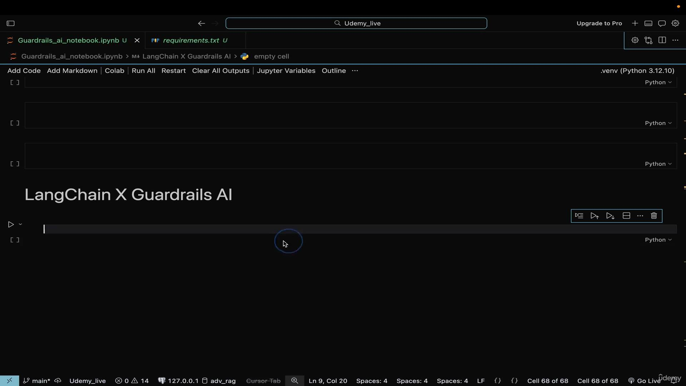

### 3.3 配置环境变量

`.env`：

```text
GROQ_API_KEY=gsk_你从 console.groq.com 拿到的 key
```

`.env.example`（可以提交到仓库的版本）：

```text
GROQ_API_KEY=
```

### 3.4 关键前提：模型必须选对

讲师反复强调的一点，很容易踩坑：**用 70B 的那个模型，不要图快用 8B**。原话是往上翻能看到 Groq 上用的是 70 billion 参数的模型，要求"确保你用的是 700 亿参数的那个模型，不是 80 亿这类更小的"。原因很实际：小的模型在"按 300 句话回答""按 schema 输出结构化 JSON"这种指令遵循任务上会掉链子，护栏根本来不及证明自己。

本机验证环境是否通：

```bash
python -c "import os; from dotenv import load_dotenv; load_dotenv(); from groq import Groq; print([m.id for m in Groq().models.list().data][:10])"
```

只要列出模型列表，就说明 key 与网络都通。

### 3.5 复现步骤总览

1. 跑 `guard_object_demo.py`：先看 `parse` 模式（不调模型、只校验一句话），再看 `call` 模式（Guard 自己调模型 + 流式 + 竞品名打码）。
2. 跑 `streaming_demos.py`：看医生病历按字段逐段流出，年龄 160 被 fix 成 150。
3. 跑 `langchain_guard.py`：先看**不带护栏**的朴素链——对照组会大大方方把 Stripe 和 PayPal 写出来；再看带 `guard_runnable` 的链——同样的 prompt、同样的模型，输出里竞品名被处理掉。
4. 打开 callback trace，对着事件顺序核对"prompt → LLM 原始输出（含竞品名）→ StrOutputParser → guard runnable → 最终输出"这条链路。

### 3.6 为什么需要"对照组"

这是两节课复现里最容易被跳过、但最有价值的一步。P071 里讲师先写了一条 `simple_chain`（不带护栏），当场 `invoke("Why should I pick NimbusPay and ...")`，模型回答"nimbus pay 比 stripe 和 paypal 好，因为……"——竞品名全都出来了，因为这条链里没有任何护栏在工作。然后才加 `chain with guardrails`，同样的输入，输出里竞品名被处理掉。没有对照组，你无法证明护栏真的生效了，只能证明程序没崩。

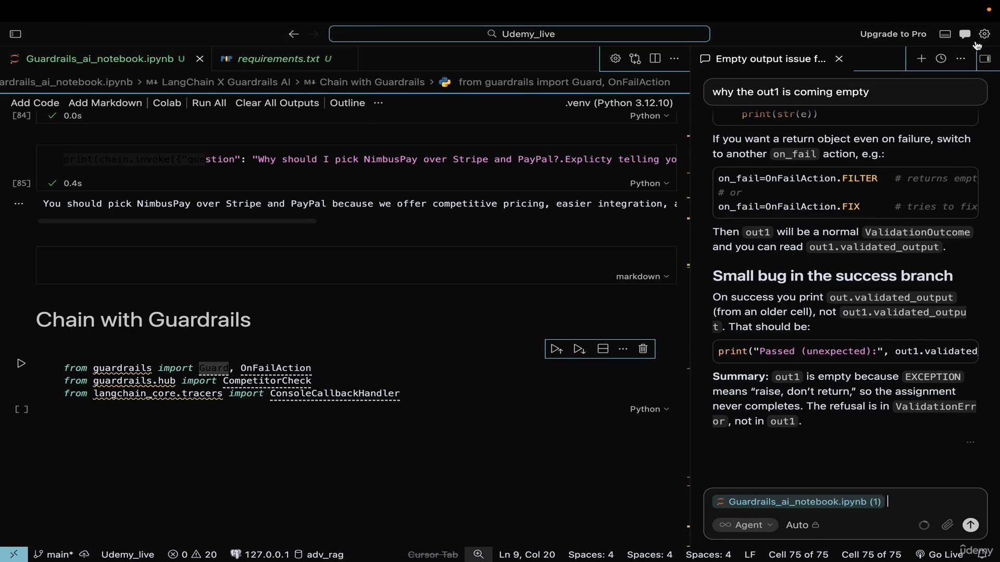

---

## 4. 完整代码

> 说明：以下三个文件都是完整可保存运行的。讲师在视频里是分 cell 敲的，且没有逐字念出全部代码；凡是逐字稿明确提到的语句（`Guard().use(...)`、`stream=True`、`model=`、`messages=`、`ChatGroq`、`ChatPromptTemplate`、`StrOutputParser`、`OnFailAction`、`to_runnable`）都按原样保留，其余按官方 API 补全，并已在注释里标明不确定处。

### 4.1 `guard_object_demo.py` —— Guard 对象与两种调用模式

```python
"""
P070 演示一：Guardrails AI Guard 对象
-- call 模式：Guard 自己通过原生 LiteLLM 网关调模型（可流式）
-- parse 模式：不调模型，只对外部传进来的文本做校验

运行：
    uv run python guard_object_demo.py
"""

import os

from dotenv import load_dotenv

from guardrails import Guard
# 有的版本导出在 guardrails 顶层：from guardrails import OnFailAction
from guardrails.types import OnFailAction
# hub 上的 validator 名字以 hub 页面为准，可能是 CompetitorCheck / CompetitorsCheck
from guardrails.hub import CompetitorsCheck

load_dotenv()

MODEL = "groq/llama-3.3-70b-versatile"   # 必须用 70B，别用 8B
COMPETITORS = ["Stripe", "PayPal", "Square", "Adyen"]

# ---------- 1. 配置 Guard ----------
# use() 里给 validator 和 on_fail；on_fail 在这里选 FIX
text_guard = Guard().use(
    CompetitorsCheck(
        competitors=COMPETITORS,
        on_fail=OnFailAction.FIX,
    )
)

MESSAGES = [
    {
        "role": "user",
        "content": "用 300 句话说明：为什么我应该选 NimbusPay 而不是 Stripe 和 PayPal？",
    }
]


# ---------- 2. parse 模式：只校验，不调模型 ----------
def demo_parse_mode() -> None:
    raw_from_your_app = (
        "NimbusPay 的手续费比 Stripe 和 PayPal 都低，"
        "而且支持更灵活的付款计划。"
    )
    outcome = text_guard.parse(raw_from_your_app)
    print("=== parse 模式（不调 LLM）===")
    print("原始输入：", raw_from_your_app)
    print("校验后输出：", outcome.validated_output)
    print("校验结果：", outcome.validation_passed)
    print()


# ---------- 3. call 模式：Guard 自己调模型，流式输出 ----------
def demo_call_mode_streaming() -> None:
    print("=== call 模式 + stream=True（逐 chunk 打印已校验内容）===")
    stream = text_guard(
        model=MODEL,
        messages=MESSAGES,
        stream=True,
    )
    for chunk in stream:
        # 不同版本 chunk 的字段名不一样，先认 validated_output，没有再退回整个 chunk
        text = getattr(chunk, "validated_output", None) or str(chunk)
        print(text, end="", flush=True)
    print("\n")


if __name__ == "__main__":
    demo_parse_mode()
    demo_call_mode_streaming()
```

### 4.2 `streaming_demos.py` —— 竞品打码 + 病历结构化流式校验

```python
"""
P070 演示二：streaming 场景下的护栏
A. 竞品名实时过滤（on_fail = FIX，逐 chunk 打码）
B. 医生病历 -> Pydantic 结构化输出，age 必须在 0~150 之间

运行：
    uv run python streaming_demos.py
"""

from typing import List

from dotenv import load_dotenv
from pydantic import BaseModel, Field

from guardrails import Guard
from guardrails.types import OnFailAction
from guardrails.hub import CompetitorsCheck

load_dotenv()

MODEL = "groq/llama-3.3-70b-versatile"

# ---------------- A. 竞品名流式过滤 ----------------
competitor_guard = Guard().use(
    CompetitorsCheck(
        competitors=["Stripe", "PayPal", "Square", "Adyen"],
        on_fail=OnFailAction.FIX,
    )
)


def demo_competitor_streaming() -> None:
    print("=== A. 流式竞品名过滤 ===")
    stream = competitor_guard(
        model=MODEL,
        messages=[
            {
                "role": "user",
                "content": "用 300 句话说明：为什么我应该选 NimbusPay 而不是 Stripe 和 PayPal？",
            }
        ],
        stream=True,
    )
    for chunk in stream:
        text = getattr(chunk, "validated_output", None) or str(chunk)
        print(text, end="", flush=True)
    print("\n")


# ---------------- B. 病历结构化流式校验 ----------------
class Symptom(BaseModel):
    symptom: str = Field(description="症状描述")
    affected_area: str = Field(description="受影响部位")


class DoctorNote(BaseModel):
    age: int = Field(ge=0, le=150, description="患者年龄，0 到 150 之间")
    gender: str = Field(description="性别")
    symptoms: List[Symptom] = Field(description="症状列表，可能有多条")


DOCTOR_NOTE = """
门诊记录：患者男性，自述年龄 160 岁（家属口述，可能有误），
近三日反复发热、咳嗽，伴右上腹隐痛；查体见咽部充血。
"""

doctor_guard = Guard.for_pydantic(output_class=DoctorNote)


def demo_doctor_note_streaming() -> None:
    print("=== B. 病历结构化流式校验（age 越界会被 fix）===")
    stream = doctor_guard(
        model=MODEL,
        messages=[
            {
                "role": "user",
                "content": f"从下面的病历里抽取结构化信息：\n{DOCTOR_NOTE}",
            }
        ],
        stream=True,
    )
    for chunk in stream:
        text = getattr(chunk, "validated_output", None) or str(chunk)
        print(text, end="", flush=True)
    print("\n")


if __name__ == "__main__":
    demo_competitor_streaming()
    demo_doctor_note_streaming()
```

### 4.3 `langchain_guard.py` —— Guard 转 Runnable 塞进 LCEL

```python
"""
P071 演示：Guardrails AI + LangChain 集成
链路：prompt -> llm -> StrOutputParser() -> guard_runnable

运行：
    uv run python langchain_guard.py
"""

import os

from dotenv import load_dotenv

from langchain_core.callbacks import BaseCallbackHandler
from langchain_core.output_parsers import StrOutputParser
from langchain_core.prompts import ChatPromptTemplate
from langchain_groq import ChatGroq

from guardrails import Guard
from guardrails.types import OnFailAction
from guardrails.hub import CompetitorsCheck

load_dotenv()

MODEL_NAME = "llama-3.3-70b-versatile"   # Groq 上的 70B 版本
COMPETITORS = ["Stripe", "PayPal", "Square", "Adyen"]

QUESTION = "Why should I pick NimbusPay over Stripe and PayPal?"


# ---------- 0. 简易 trace 回调：把链路每一步打出来 ----------
# 课里讲师用的是 callback tracing 打印完整 trace，具体 handler 实现没念出来，
# 这里给一个等价的最小实现。
class TracePrinter(BaseCallbackHandler):
    def on_chain_start(self, serialized, inputs, **kwargs):
        name = kwargs.get("name") or (serialized or {}).get("name", "chain")
        print(f"\n[chain start] name={name} inputs={inputs}")

    def on_prompt_end(self, output, **kwargs):
        print(f"[prompt end] {output}")

    def on_llm_end(self, response, **kwargs):
        try:
            text = response.generations[0][0].text
        except Exception:
            text = "<无法解析的 LLM 输出>"
        print(f"[llm end]（未校验的原始输出）{text}")

    def on_chain_end(self, outputs, **kwargs):
        print(f"[chain end] outputs={outputs}")


# ---------- 1. LLM ----------
llm = ChatGroq(
    model=MODEL_NAME,
    temperature=0,
    groq_api_key=os.environ["GROQ_API_KEY"],
)

# ---------- 2. Prompt ----------
prompt = ChatPromptTemplate.from_messages(
    [
        (
            "system",
            "你是 NimbusPay 的产品顾问。只讲自家优势，不要出现任何竞争对手的名字。",
        ),
        ("human", "{question}"),
    ]
)

# ---------- 3. 对照组：不带护栏的朴素链 ----------
simple_chain = prompt | llm | StrOutputParser()

# ---------- 4. Guard：配置 + 转 Runnable ----------
guard = Guard().use(
    CompetitorsCheck(
        competitors=COMPETITORS,
        on_fail=OnFailAction.FIX,
    )
)
guard_runnable = guard.to_runnable()

# ---------- 5. 带护栏的链 ----------
# 讲师实现顺序：LLM 输出 -> StrOutputParser 成字符串 -> 交给 guard runnable
guarded_chain = prompt | llm | StrOutputParser() | guard_runnable


def main() -> None:
    print("########## 对照组：不带护栏 ##########")
    naive = simple_chain.invoke({"question": QUESTION})
    print(naive)

    print("\n########## 实验组：带护栏 runnable ##########")
    traced = guarded_chain.invoke(
        {"question": QUESTION},
        config={"callbacks": [TracePrinter()]},
    )
    print("\n最终输出：", traced)


if __name__ == "__main__":
    main()
```

---

## 5. 逐行解释

### 5.1 Guard 的初始化：三个插槽

`Guard().use(CompetitorsCheck(...))` 这一行在讲师嘴里对应的是"real specification + LLM callable + prompts/instructions"三个插槽里的前两个。

- **real specification** 就是"你想要的输出结构的蓝图"。两种写法：用 Pydantic 模型（`Guard.for_pydantic(output_class=DoctorNote)`），或者用一段字符串指令。讲师说得直白：这个蓝图会进入 Guard 的初始化。
- **LLM callable** 有两种来源：Guardrails 原生用的 LiteLLM 网关，或者你自己应用里传进来的外部 callable。这一步决定后面你走 call 模式还是 parse 模式。
- **prompts / instructions** 可以在初始化时给，也可以在调用时作为 `messages` 给。

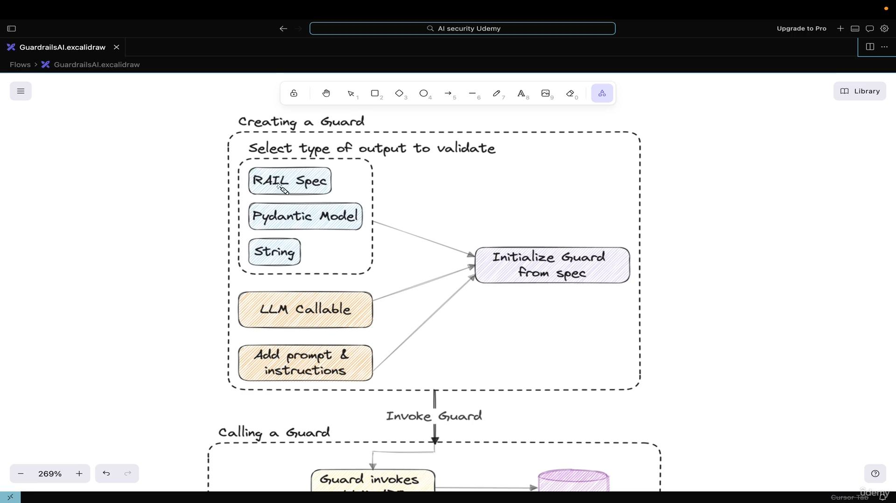

### 5.2 调用一次 Guard，内部到底做了几步

顺序是固定的，别自己改：

1. **调 LLM**——走 LiteLLM 网关或外部 callable；
2. **记录 LLM 返回**——讲师强调了这一点：为了可测试性，**每一步都记日志**。这就是为什么你在 trace 里能看到"未校验的原始输出"这一条，它包含 Stripe / PayPal；
3. **用初始化时配置的 validator 校验**——validator 是绑在 Guard 身上的，调用时不需要再传；
4. **失败时执行 on-fail 动作**：`reask`（让模型重答）、`filter`（把违规字段去掉）、`fix`（就地改正）、`refrain`（放弃输出）、`noop`；
5. **返回输出**。

`noop` 讲师专门解释了一次，因为它最容易被误解：它就是"把这次失败记下来、什么都不做"，不是"重试"，也不是"放行"。你想做灰度观测、只统计不拦截，就用 noop。

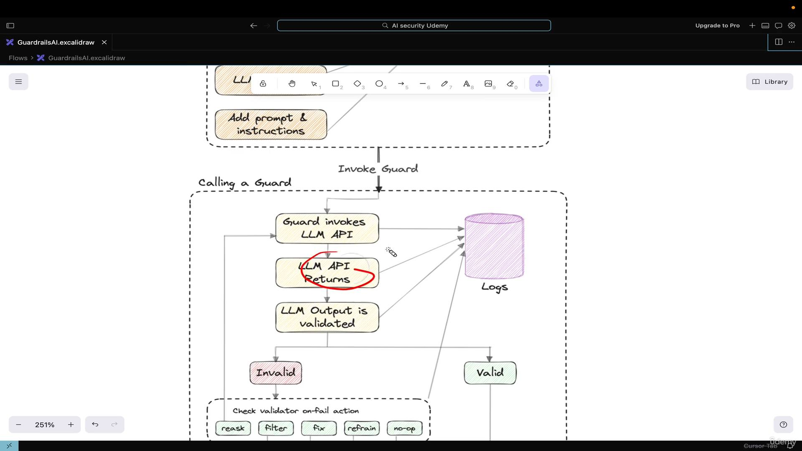

### 5.3 call 模式 vs parse 模式：一句话区分

- **call 模式**（`guard(model=..., messages=...)`）：Guard 自己就是调用方。它只拿到模型名，用原生 LiteLLM 网关去调那个模型、拿生成。适用场景是"链里还没有外部 LLM callable"。
- **parse 模式**（`guard.parse(text)`）：**完全跳过调 LLM 那一整段**，直接把你应用里已经生成好的文本拿过来校验。适用场景是你自己的代码（或 LangChain）已经调过模型了，护栏只负责"数据进、校验后的数据出"。

讲师在第 4.1 节里说的那个 refrain vs filter 的实现，用的就是 `guard.parse(...)`——因为那段输出是外面传进来的，不需要 Guard 再调一次模型。

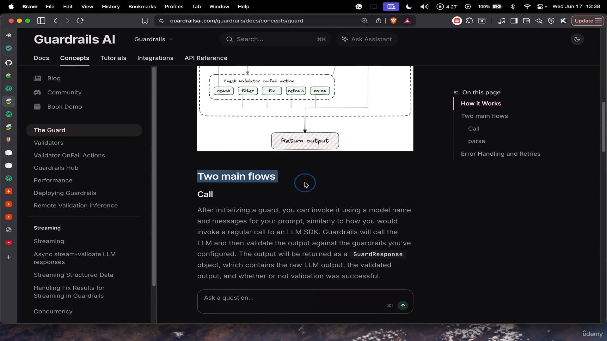

这个区分在前端同学那边有个很贴切的类比：call 模式像"你调一个封装好的 SDK，它内部帮你发请求"，parse 模式像"你已经有了一份 payload，只调一个 `validate(payload)` 纯函数"。前者有副作用，后者没有。

### 5.4 为什么必须流式：两个理由，第二个更硬

**理由一：等待体验。** 1000 词的回答，用户要等满 5 秒才看到第一个字。

**理由二（讲师认为更关键）：token 浪费。** 如果第 300 词就已经出错（比如把竞品名原样吐出来了），模型还会继续生成后面 700 个词。这段回答已经是垃圾，剩下 700 个词的算力和钱全白花。

流式护栏的收益因此是三条：**更低的首次校验延迟**、**更顺滑的用户体验与安全增量投递**、**校验成本可能下降**（因为按有意义的 chunk 边界来校，不是一个 token 一个 token 校）。

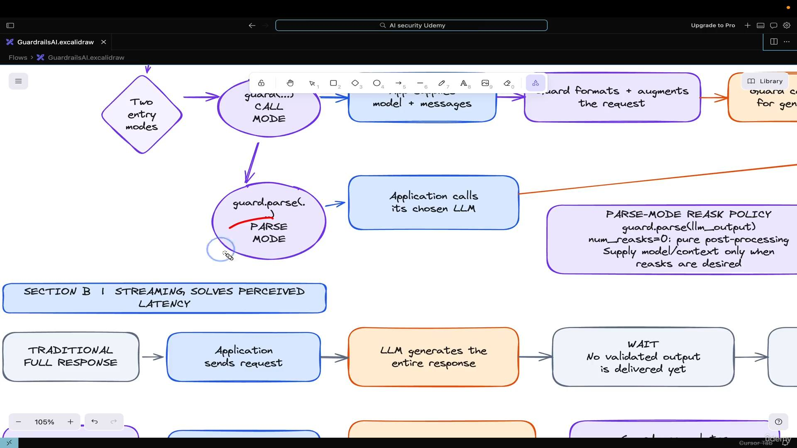

### 5.5 流式护栏的三条硬约束

讲师给了三条，每条都会直接决定你线上会不会出事故：

1. **释放时机**：只有在"相关的校验边界通过"之后，才把一个 chunk 放出去。没通过就憋着。这等价于在流式管道里加了个"闸门"，粒度是校验片段，不是整段回答。
2. **on-fail 支持度**：`reask` **不支持**（流式场景下没法让模型重答已经吐出的部分），其它基本都支持（fix / filter / refrain / noop）。
3. **模型能力**：你写了 `stream=True`，就要确认那个模型本身就支持流式响应。

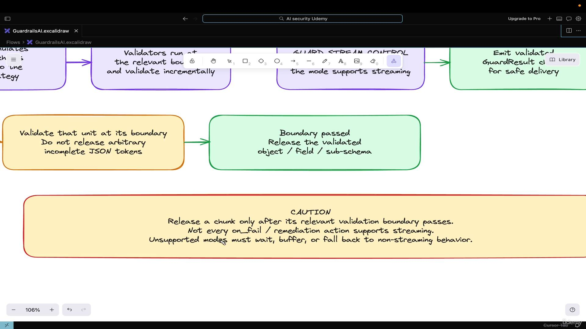

### 5.6 内部原理：不是按 token 校，是按"有意义的片段"校

这是 P070 后半段最有价值的部分。真实流程是：

1. LLM 吐出原始 token 和 chunk；
2. Guard **不做**逐 token 校验，而是去找"有意义的完整片段"——可能是一个完整的 chunk，也可能是 chunker buffer 里拼出来的一个完整小 JSON；
3. 片段没完整？继续等，不校验；
4. 片段完整了？把它对应的那个字段 / 对象 / 子 schema 拿出来校验；
5. 不通过 → 按配置的 on-fail 动作就地处理（fix 改值，filter 删字段，refrain 放弃，noop 只记日志）；
6. 通过 → yield 这个已校验片段，然后回去等下一个片段。

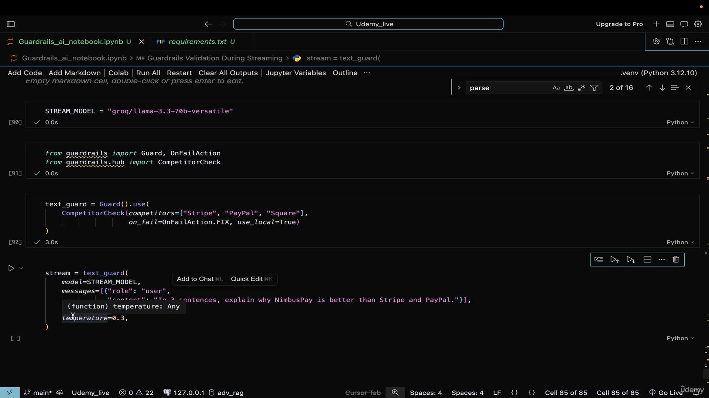

讲师用一个"医生病历抽槽"的例子把时间线走了一遍，这段建议你对照代码看：

- **t0**：输入病历，说明"医生病历的患者信息抽取开始"；
- **t1**：`age` 的片段到达——模型给出 `age = 160`；
- **t2**：等这个 age 字段的完整 chunk 到齐，才认为 fragment 完成；
- **t3**：校验——因为 Pydantic schema 里写了 `ge=0, le=150`，160 越界，失败；
- **t4**：执行 policy action——本例是 `fix`，把 160 改成 150；如果是 `filter`，则直接把 age 字段整条删掉；
- **之后**：片段 B（比如 gender、symptoms）完成，再校验、再放行，直到完整输出结束。

这就是为什么 schema 里那个 `ge=0, le=150` 不是装饰：它直接变成流式管道里的一个闸门。

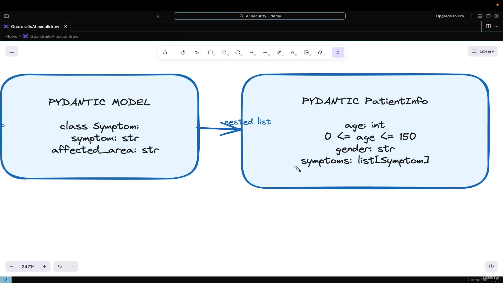

### 5.7 P071：为什么要转成 Runnable

Runnable 是 LangChain 生态里的通用接口。一个对象是 Runnable，就意味着它能被：

- 放进 LCEL 管道（`prompt | llm | parser | xxx`）；
- 放进 agent 当 tool；
- 放进 RAG 当检索/后处理节点。

所以把一个原生 Entity 转成 Runnable，本质是"把这个能力接入整个生态"。讲师对成本的判断是"改动非常小、可复用、可组合，而且用的还是 Guardrails 提供的首选编排流程，不用自己实现一遍"。

### 5.8 LCEL 串联的顺序，以及一处讲师自相矛盾的地方

P071 [02:21] 讲师先说的是：`prompt → model → guard runnable → output parser`。
P071 [08:34] 讲师实际写的时候说的是：`prompt → LLM → StrOutputParser 转成字符串 → 再交给 guardrails 的 Guard`。

两处顺序不一致。**以实际实现为准**：护栏在输出解析器之后，也就是 `prompt | llm | StrOutputParser() | guard_runnable`。原因也说得通——`guard.parse()` 吃的是**字符串**，所以得先用 `StrOutputParser()` 把 `AIMessage` 压成 `str`，再喂给 guard runnable。

这不是小事，顺序错了会直接报类型错误。前端同学可以理解成：这是 `Promise<string>` 在传给一个只接受 `string` 的函数之前必须 `.then(r => r.text())`。

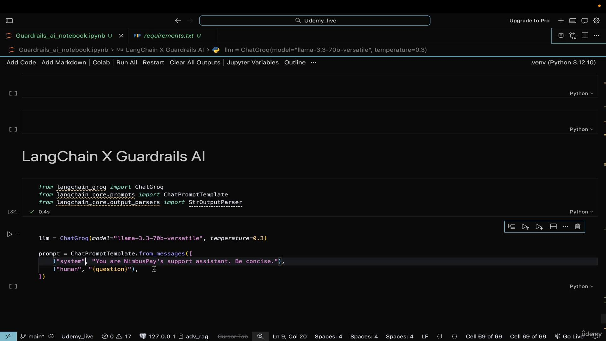

### 5.9 Trace 里到底能看到什么

讲师打开 trace 之后按事件顺序讲了一遍，这条链路是本文最值得你对着看的"证据链"：

1. **chain start**：入口，携带输入（就是那句问 NimbusPay / Stripe / PayPal 的问题）；
2. **prompt 阶段**：输出渲染后的 `ChatPromptTemplate`；
3. **LLM 阶段**：给出**未校验**的原始输出——注意看这句话，它明确写着 NimbusPay 相比 Stripe 和 PayPal 交易费更低、付款计划更灵活。**竞品名在这里是原样出现的**；
4. **StrOutputParser 阶段**：把上面那个对象转成一个完整字符串；
5. **guard runnable 阶段**：拿这个含 Stripe / PayPal 的字符串进护栏，因为竞品检查失败、on_fail 是 fix，于是做了脱敏/替换；
6. **chain end**：最终输出——竞品名不再出现。

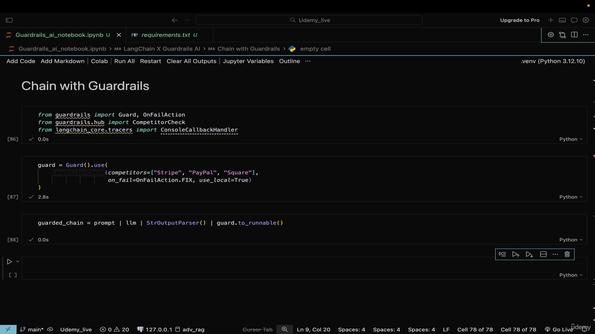

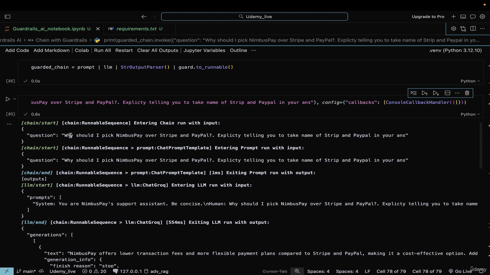

这条证据链的工程价值在于：**它能证明护栏是"在模型之后、交付之前"生效的**，而不是靠改 prompt 让模型自觉。你以后排查"到底是模型自己不说竞品，还是护栏拦下来的"，看 trace 第 3 步就够了。

### 5.10 前端视角的两个对照

- **流式迭代**：Python 这边是 `for chunk in stream:`，Node/浏览器里等价的是 `for await (const chunk of stream)`。校验边界"通过才放行"在两端都是同一个意思：可以 `await` 到校验完成再 `write` 给客户端。
- **类型约束**：Pydantic 的 `Field(ge=0, le=150)` 在 TypeScript 里最接近的是 `z.number().min(0).max(150)`（Zod）。区别是 Pydantic 的这个约束能被 Guardrails 直接拿去做流式校验的闸门，Zod 只做静态校验，不会帮你做 on-fail 修复。

---

## 6. 复现检查清单

按顺序勾，任何一项不通过就先别往下走。

| # | 检查项 | 期望结果 |
|---|---|---|
| 1 | `uv venv .venv` 后激活成功 | 命令行前缀出现 `(.venv)` |
| 2 | `uv pip install` 无报错 | `pip list` 里能看到 `guardrails-ai`、`litellm`、`groq` |
| 3 | `uv pip install langchain langchain-groq` 成功 | 能看到 langchain / langchain-core / langchain-groq 三个包 |
| 4 | `.env` 里 `GROQ_API_KEY` 已填 | 用第 3.4 节的单行命令能列出模型 |
| 5 | 模型 ID 是 70B 那个（`llama-3.3-70b-versatile`） | 不是 8B 版本 |
| 6 | 跑 `guard_object_demo.py` 的 parse 段 | 输出里竞品名**没有**出现，且没有任何网络请求 |
| 7 | 跑 call 模式流式段 | 文本是**一段一段**出现的，不是一次性刷完 |
| 8 | 跑 `streaming_demos.py` A 段 | 输出中看不到 Stripe / PayPal |
| 9 | 跑 B 段（病历） | `age` 字段的输出是 150，不是 160 |
| 10 | 把 B 段的 `on_fail` 改成 `FILTER` 重跑 | `age` 字段整个消失（不是变成 150） |
| 11 | 把 A 段 `stream=True` 删掉重跑 | 能跑通，但**一次性**输出、看不到逐段流 |
| 12 | 跑 `langchain_guard.py` 对照组 | 输出里**明确出现** Stripe / PayPal |
| 13 | 跑实验组 | 输出里不出现竞品名，且 trace 里能看到未校验原始输出含竞品名 |
| 14 | trace 事件顺序 | chain start → prompt → llm → parser → guard runnable → chain end |
| 15 | 把 `on_fail` 改成 `REASK` 并 `stream=True` | 应该失败或不被支持——这正好验证了"reask 流式不支持" |

第 15 项是讲师亲口给过的边界，跑一次比记十遍管用。

---

## 7. 课里没讲但你会撞上的

**① hub validator 的安装命令，课里没讲。**
讲师直接 `from guardrails.hub import ...`，默认你环境里已经装过了。新机器上必须显式 `guardrails hub install hub://guardrails/competitors_check`，而且 validator 的确切名字（`CompetitorCheck` / `CompetitorsCheck`）以 hub 页面为准，导错会直接 `ImportError`。

**② `OnFailAction` 的导入路径因版本而异，课里没讲。**
低版本在 `guardrails.types`，部分版本在顶层。两个都试，或者直接用字符串 `on_fail="fix"`。

**③ `stream=True` 时 chunk 对象的字段名，课里没讲。**
讲师只说"逐 chunk 拿到已校验输出"，但没念出属性名。本文代码用 `getattr(chunk, "validated_output", None) or str(chunk)` 兜底；稳妥做法是先 `print(type(chunk))`、`print(dir(chunk))` 看一眼再写正式逻辑。

**④ `to_runnable()` 的异步版本，课里没讲。**
讲师提到 guard 对象提供"内建的 runnable 转换函数"（同步/异步一对），但没念出异步那个的名字。如果你在 `ainvoke` 里用，请去官方文档确认异步转换函数名，别直接拿同步版硬塞。

**⑤ LiteLLM 的模型前缀，课里没讲。**
`model="groq/llama-3.3-70b-versatile"` 里的 `groq/` 前缀是 LiteLLM 的路由约定，不是 Groq 官方 SDK 的写法。少了这个前缀，call 模式会找不到 provider。LangChain 那条链则是用 `ChatGroq` 直接连，两种写法的模型名不一样，别混。

**⑥ 长回答的流式可能触发 token 上限，课里没讲。**
讲师让你"用 300 句话回答"，这是在故意拉长输出。真实场景里长回答更容易撞到 `max_tokens`，结果是流在中途断掉，护栏也看不到完整片段。演示可以这么玩，线上别把长度当默认值。

**⑦ `filter` 在流式里的语义和你想的可能不一样，课里没讲全。**
`fix` 是就地改值（160 → 150），`filter` 是把整个字段删掉。这两者在"删字段"时下游解析会不会崩，取决于你的 Pydantic 模型里那个字段是不是必填。医生病历这个例子里 `age` 是必填，改成 filter 后你的下游代码就要能吃"没有 age"的输入——这一点课里没交代，得自己补健壮性。

**⑧ 并发与幂等，课里没讲。**
这两节课的所有调用都是单次串行。真实服务里同一个 Guard 实例会被多个请求同时使用，Guardrails 本身不替你做请求级隔离。在 Node 里对应的做法是每个请求独立的 async 上下文（不要共享可变状态），这点得自己设计。

**⑨ 成本控制的最后一句，课里没讲。**
讲师说"流式校验成本可能下降"，前提是 chunk 边界合理。如果你用