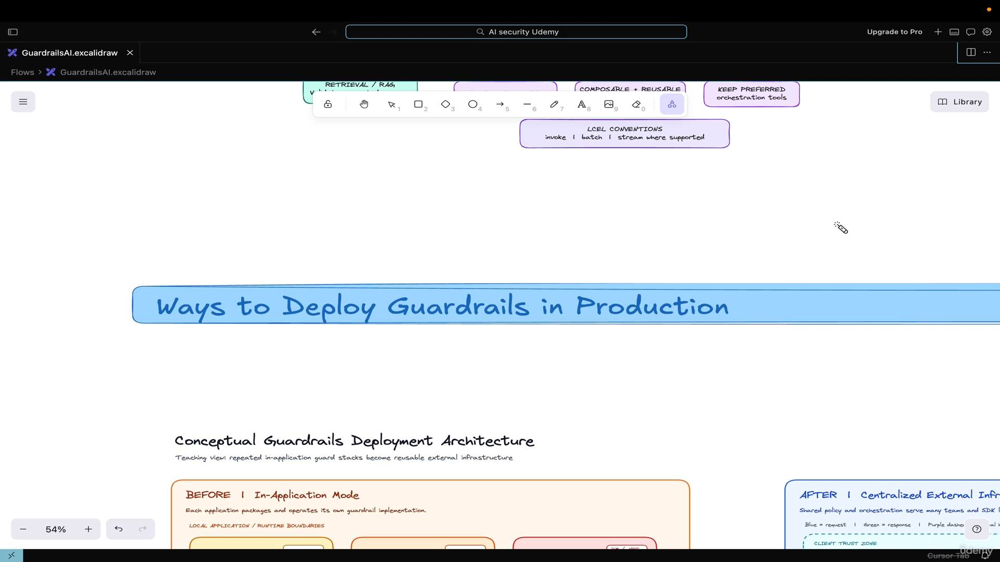
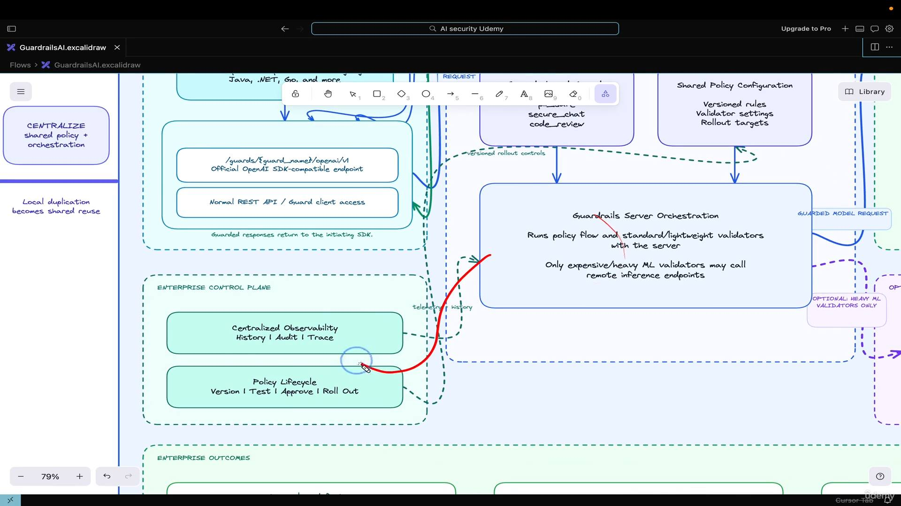
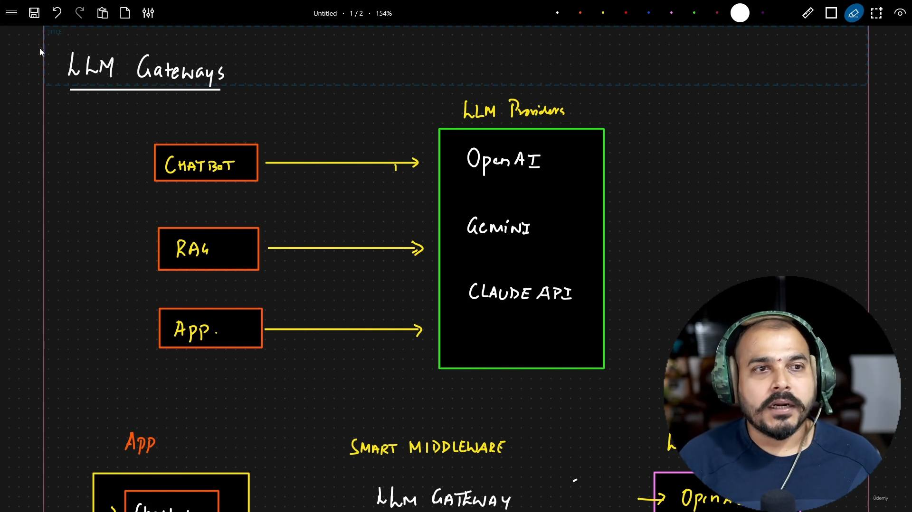
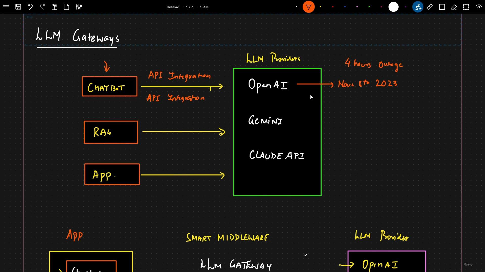
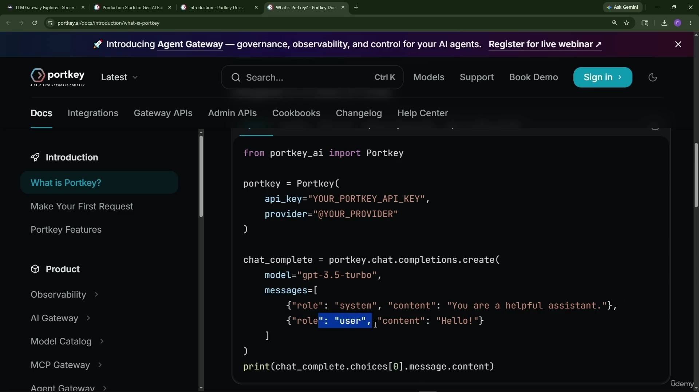
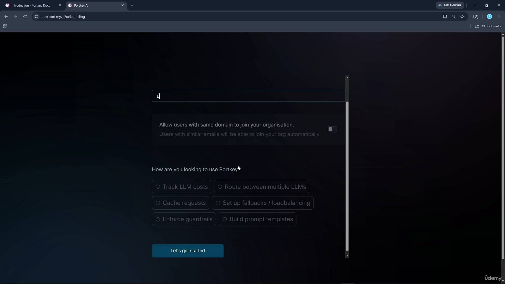
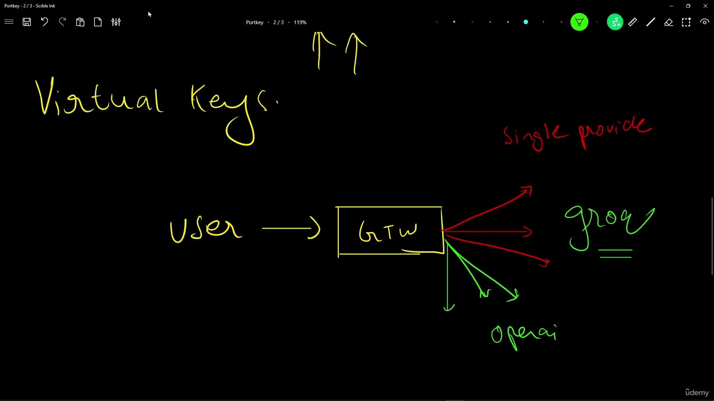

# AI Security Bootcamp Part 2：护栏、网关与可观测复现文档（P72–P74）

本段课程不是单纯讲 Guardrails AI 的 API，而是把三件事连成一条可落地的工程路线：**P72 讲 guardrails 在生产里怎么部署**，**P73 讲 LLM Gateway 为什么必须有**，**P74 用 Portkey + Groq 把网关实验环境搭起来**。下面按“能照着做出来”的方式重组，不按视频顺序流水账。

> 说明：本段【截图 OCR】为空，所以本文不引用任何“屏幕上出现但逐字稿没念”的代码。所有命令、包名、配置项都来自逐字稿；逐字稿没有逐字拼写的地方，我会明确标注“课里没讲/按上下文整理”，不把猜测写成讲师原话。

---

## 1. 这一节做什么

这一节要做出一个**可复现的 LLM Gateway 实验环境**，同时理解 guardrails 在生产架构里的位置。最终你会得到：

1. 一个 `gateways/` 工程目录；
2. 一个用 `uv` 创建的 Python 虚拟环境 `gateway_env`；
3. 一份可安装的 `requirements.txt`；
4. 一个 `.env`，里面放 Portkey API Key 和 Groq API Key；
5. 一个 `gateways.ipynb`，能选到虚拟环境并打印 `ok`；
6. 一个 Portkey 账号，环境名 `udemy`；
7. 两个 Groq 虚拟密钥：`G key` 和 `G key 2`；
8. 一套判断标准：什么时候用“每个应用各自带 guardrails”的起步架构，什么时候迁移到“中心化共享策略 + 编排”的安全平台架构。

P72 的架构讨论是**设计依据**，P73 是**概念模型**，P74 是**动手搭建**。三者不能拆开看：如果你只照着 P74 装包，遇到“为什么要虚拟密钥”“为什么网关要独立部署”“为什么缓存能省钱”时会不知道为什么。

---

## 2. 讲师原话（带「—— pNNN [MM:SS]」）

> "这个视频不是只讲 Guardrails AI 框架，而是从架构层面讨论：当 AI 应用扩展时，guardrails 怎么部署才不会成为扩展的阻力。"
> —— p072 [00:19]

> "起步阶段，Python 应用、JavaScript 或 TypeScript 前端/后端各自跑在自己的实例里，各自带 guardrails 对象、validators、策略配置和依赖。"
> —— p072 [01:23]

> "这个结构很容易起步，不需要架构规划，接起来就能看到结果，也没有网络开销。"
> —— p072 [02:13]

> "但如果有 100 个软件开发者一起做，这个结构就不好用了：资源利用会过载，会出现重复策略和配置，还有运行时耦合和发布不一致的风险。"
> —— p072 [02:47]

> "应用成熟后，要走向中心化的共享策略加编排：中心安全平台信任区由安全团队维护，客户端信任区里的 Python、JavaScript 客户端共享官方 guardrails 对象。"
> —— p072 [04:14]

> "昂贵或重的 validator 可以调用远程推理端点，放在独立的专用计算区里，被每个微服务共享。"
> —— p072 [05:41]

> "LLM 网关是一个智能中间件，位于应用和 LLM 提供方之间。"
> —— p073 [04:05]

> "它提供路由、fallback、缓存、限流、guardrails、成本追踪、evals 等能力。"
> —— p073 [04:26]

> "如果 OpenAI 的 API key 挂了，网关会通过 fallback 去尝试 Google、Anthropic、Groq 等备用提供方。"
> —— p073 [05:51]

> "缓存可以放在本地，也可以放在 Redis 或你正在使用的任何数据库里；对重复查询，它能把成本降低 40% 到 60%。"
> —— p073 [09:29]

> "如果输入里有信用卡号、PAN 卡号这类敏感信息，LLM 网关可以限制这些信息，甚至不让它们到达 LLM 提供方。"
> —— p073 [10:26]

> "Portkey 是生产级应用里做网关的首选框架，因为它在市场上功能最完整。"
> —— p074 [00:00]

> "chat completions 位于应用和模型之间，你在这里配置模型、system 或 user 角色；chat completions 负责设置模型，chat complete 负责触发模型。"
> —— p074 [06:58]

> "虚拟密钥就是：你把 OpenAI API key 交给 Portkey，然后给它起一个虚拟名字，比如 GPT key；以后切换模型时，模型名可以变，虚拟 key 不变。"
> —— p074 [14:27]

---

## 3. 从零复现

### 3.1 先做架构决策：起步阶段 vs 中心化安全平台

P72 给了两张架构图，本质是在回答一个问题：**guardrails 应该跟着每个应用走，还是抽成中心安全平台？**

#### 起步阶段：每个应用各自带 guardrails



起步阶段的结构是：

- 有多个实例，分别跑在本地或独立实例里；
- 一个 Python 应用；
- 一个 JavaScript/TypeScript 应用，可能是前端，也可能是后端；
- 还可能有其他栈；
- 前端里有 guardrails 对象；
- 后端里也有 guardrails 对象；
- 前后端各自有 validators；
- Python 应用有自己的策略配置；
- JavaScript 应用有自己的策略配置；
- 其他运行时应用也有自己的策略和配置；
- Python 侧有 guardrails 相关依赖；
- JavaScript 侧有 Node 相关依赖。

这个结构的好处，讲师说得很明确：

- **很容易起步**；
- **不需要架构规划**；
- 把各部分接起来就能看到结果；
- **没有网络开销**，因为 guardrails 就在本进程/本实例里执行。

但它的坏处也很明确：

- 有扩展瓶颈；
- 如果交给 100 个软件开发者协作，这个结构不好用；
- 资源利用会过载；
- 实现上会过度复杂；
- 会出现重复策略和重复配置；
- 存在**运行时耦合**：一个应用用重 validator，另一个应用也用重 validator，它们可能用不同实例，也可能用同一个实例，后者会互相拖慢速度；
- 存在**发布不一致风险**：不同团队各自改策略，很难保证一致；
- 同一个策略意图，却要建多个 guardrails 对象；
- validator 的包、配置、依赖、生命周期在每个应用里重复出现，形成可删减的重复代码。

讲师的态度不是“起步阶段不能用”，而是：**小规模、内部测试、没有用户时，可以先用这种结构；当应用成熟、问题出现后，必须迁移。**

#### 成熟阶段：中心化共享策略 + 编排



成熟架构的核心是：**中心外部基础设施 + 中心安全平台信任区**。

- 不再是每个微服务、每个 Python/前端各自建 guardrails 对象、各自建 validators；
- 有一个**中心安全平台信任区**；
- 这个平台由安全团队维护；
- 安全团队不需要对每个微服务的业务细节理解到很深，也能统一管理并对外提供能力；
- 有**客户端信任区**：Python 客户端、JavaScript 客户端等；
- 客户端共享“官方 guardrails 对象”；
- 有**外部提供方区**：Azure OpenAI、其他 LLM 提供方；
- 中心 server orchestration 负责把请求送到被 guard 的模型请求链路；
- 有**共享 namespace**：PII、secure charts 等内容被所有微服务共享，不需要每个 JavaScript/Python 客户端重复实现；
- 如果有 validator 使用很重的 ML 算法做推理，可以调用**远程推理端点**；
- 这个远程推理端点放在独立实例、**专用计算区**里；
- 专用计算区可以被每个微服务使用，并且能独立管理、独立扩 GPU。

> 逐字稿里出现的是 “secure charts”，这个词很可能是语音识别误差，课里没有进一步解释。本文保留原词并标注，不把它强行解释成某个具体产品。

成熟架构的好处：

- 一份策略定义可以跨团队复用；
- 出问题时知道去哪里看、找哪个团队；
- 执行是一致的；
- 可以独立扩缩容、独立部署；
- 新增 validator 时，不需要改每个客户端配置；
- 如果新 validator 需要大模型/GPU，可以只扩专用计算区；
- 多语言支持更好：Python、JavaScript 等客户端都能接同一套中心能力；
- 昂贵 validator 有专用计算资源；
- 治理更容易；
- 有中心 observability。

对比起步阶段：起步阶段每个团队有自己的日志，团队之间还要沟通，存在通信开销；中心化架构把 observability 放到中心编排层，观察点更统一。

P72 最后给了一个迁移判断：**一开始可以按本地多实例方式做；应用成熟后，走向中心 gateway repository / gateway microservice。** 讲师口述里出现了 “central gateway repository”“gateway microservice”，中间还自我纠正了一次，核心意思就是：**抽一个中心网关微服务**。

P72 还提到资源区会附带一个白板文件。讲师口述的扩展名是 “Excalibur”，文件读作 `flow.escalator`；按上下文这应该是 Excalidraw 相关文件，但**准确拼写课里没给**。操作步骤是：

1. 打开 VS Code 或任意 IDE；
2. 进入 Extensions；
3. 搜索
搜索框输入 Excalidraw，点 Install；然后新建或打开白板文件（讲师口述为 `flow` 加上某个扩展名，读音接近 “escalator”，准确后缀课里没讲清；装完扩展后以 IDE 实际生成的后缀为准），就能在里面写文字、画流程。课件资源区会附带这个白板文件，装上扩展即可查看。**这一步不是可选项**：P72 的两张架构图就是这个白板文件的产物，你要复现架构讨论，最好用同一种方式把图打开、对照着看。

### 3.2 把 P73 的场景先想清楚：为什么必须有网关



讲师给了一个非常具体的 startup 场景，复现时请先在纸上写下来，因为后面所有配置都从它推导：

- 你开了一家 startup，给客户做了几个产品；
- 产品一：一个 chatbot；
- 产品二：一个 RAG 应用；
- 产品三：另一个 AI 应用；
- chatbot 用的是 OpenAI 的 LLM 提供方；
- RAG 用的是 Google Gemini；
- 第三个应用用的是 Anthropic API，讲师口述为 “Anthropic API 或 Cloud API”（“Cloud”应为 Claude 的语音识别误差）；
- 每个应用都各自写自己的 API 集成代码；
- 有的地方还会用 SDK（讲师口述 “HD case”，应为 SDK 的识别误差）来对接某个提供方；
- 结果是：**每接一个提供方，就多一套集成代码**。

然后讲师抛出了那个真实事故：**2023 年 11 月 8 日，OpenAI API 出现约四小时中断**，原因是 API key 侧出问题，整个 API 不可用。当时 Cursor、Notion AI 这类直接依赖 OpenAI API 的产品，它们的客服机器人全部挂掉，用户投诉大量出现。

这里的推理链是本文档要你复现的重点：

1. 单点依赖 = 单点故障；
2. 故障发生在**提供方**，不是你的代码，所以你改自己的业务代码没用；
3. 如果应用直连提供方，你唯一的选择是等；
4. 如果应用和提供方之间有一层，这层可以在主 key/主提供方失败时切到备用提供方；
5. 这一层就是 LLM Gateway。

讲师原话的意思是：**同样一场中断，如果你的应用还能跑，那就是因为中间有网关。**

### 3.3 网关的定义与八项核心能力（照着核对你的实现）



定义：**LLM Gateway 是位于应用和 LLM 提供方之间的智能中间件（smart middleware）。应用不再直连提供方，请求先到网关，网关决定发给哪个提供方，再把响应回给用户。**

讲师强调：这一切**只靠配置变更完成**，你不需要为每个提供方写一套 API 集成代码。

三个“为什么值得”的理由：

1. 应用不需要知道底层用的是哪个 LLM；
2. 切换 LLM 不需要动应用代码——现在用 Claude，可以只改配置切到 GPT/OpenAI 模型或 Google Gemini；
3. 网关自带一堆智能能力：routing、fallbacks、caching、成本追踪、安全/guardrails、evals 等。

八项核心能力，逐条给出“它到底解决什么”：

| # | 能力 | 讲师给的机制 | 复现时你要能回答的问题 |
|---|---|---|---|
| 1 | 统一 API（unified API） | 一个函数调用，面对上百个提供方；一个函数作为 API 集成到所有应用 | 你的应用里是不是只有一个调用入口？ |
| 2 | 自动 fallback | 主 key/主提供方不可用，自动试备用模型/备用提供方 | 主提供方 4 小时不可用时你的应用会怎样？ |
| 3 | 智能路由（smart routing） | 按不同请求，把请求送到不同提供方 | 简单请求和复杂请求走的是不是同一个贵模型？ |
| 4 | 负载均衡 | 大部分请求压到 OpenAI 时，分流到其他 LLM；本质是“一个网关后面挂多个 API key” | 你是不是只有一个 key 在扛全部流量？ |
| 5 | 缓存 | 网关判断这是被反复问的常见问题就缓存；可本地缓存，也可放 Redis 或你正在用的任何数据库；对重复查询**降本 40%–60%** | 你的用户是不是在反复问同样的问题？ |
| 6 | 可观测性（observability） | 每次调用都记录：prompt、response、token、花了多少美元；可对接 LangSmith 或 Langfuse | 你能查到“哪个用户、哪个请求、花了多少 token”吗？ |
| 7 | 护栏（guardrails） | 输入里出现信用卡号、PAN 卡号等敏感信息时做限制，**不让这些信息到达 LLM 提供方** | 敏感信息是在进模型之前就被拦住了吗？ |
| 8 | 评估（evals） | 可集成不同评估框架 | 你换模型/改 prompt 后，有没有回归评测？ |

第 4 条讲师用了一个很好用的类比：**网关就是那个“LIS”（语音识别误差，实际是 LB / load balancer 的角色），后面挂多个 API key**。这样既能分流，也能顺带控制 rate limit。

第 7 条要和 P72 连起来看：P72 讲的是 guardrails **部署在哪里**（进程内 vs 中心平台），P73 讲的是 guardrails 在网关这条链路上**卡在哪个位置**——卡在“进模型之前”。

### 3.4 判断你现在该不该上网关

把讲师两段话合成一张判定表：

| 你的处境 | 建议 |
|---|---|
| 只有一个应用、一个提供方、内部测试、几乎没有用户 | 可以先不上网关，直连也行，先把产品跑通 |
| 已经有两个以上提供方，代码里出现多套 API 集成 | 上网关，收益立刻体现 |
| 出现过提供方中断、限流 429、key 额度耗尽 | 上网关，并且立刻配 fallback |
| 有大量重复问题（客服、FAQ、文档问答） | 上网关并开缓存，讲师给的预期是重复查询降本 40%–60% |
| 用户输入可能带 PII/卡号 | 上网关并在入口处加 guardrails，别把敏感数据发给提供方 |
| 需要给不同团队/不同租户分配额度 | 上网关 + 虚拟密钥 + 限流/预算（P74 的 Portkey 正好覆盖） |

### 3.5 搭实验环境：从空目录到 `ok`



按顺序做，每一步都有可验证的结果：

**第 1 步：建目录并用 VS Code 打开。** 讲师的做法是在 `Udemy` 文件夹下的 `gateways` 文件夹里操作，然后用 VS Code 打开它。目录结构最终是：

```
Udemy/
└── gateways/
    ├── .env
    ├── .venv 或 gateway_env/     ← 虚拟环境目录，用命令生成
    ├── requirements.txt
    └── gateways.ipynb
```

**第 2 步：创建虚拟环境。** 讲师口述是 “uv venv and gateway env”，对应命令是把虚拟环境命名为 `gateway_env`。这一步会生成隔离的 Python 环境，后面所有包装进去，不污染系统 Python。

**第 3 步：激活虚拟环境。** 讲师只说“我激活了环境”，**激活命令课里没讲**。按平台：

- macOS / Linux：`source gateway_env/bin/activate`
- Windows PowerShell：`gateway_env\Scripts\Activate.ps1`
- Windows CMD：`gateway_env\Scripts\activate.bat`

激活成功的标志是终端提示符前面出现环境名。

**第 4 步：写 `requirements.txt`。** 讲师列的依赖是：Portkey AI、`langchain-groq`（用 Groq 提供方做实验）、`langchain-openai`（把 Portkey 接进 LangChain 时要用，讲师说“到时候我会解释”）、`langchain-core`、`python-dotenv`（读环境变量）。随后他补了一个 `ipykernel`，让 Jupyter notebook 能用这个环境当 kernel。

**第 5 步：装依赖。** 讲师用 `uv` 安装；`ipykernel` 是单独补装的一条命令。实际两条：

```bash
uv pip install -r requirements.txt
uv pip install ipykernel
```

**第 6 步：写 `.env`。** 两个值：Portkey API Key、Groq API Key。**变量名课里没讲**，本文在第 4 节给出一组约定名。

**第 7 步：注册 Portkey 拿 API Key。**



- 打开 Portkey 站点；
- Sign up，讲师用的是 “Sign up with Google”；
- 会问你的环境名，讲师填 `udemy`；
- 会让你勾选用 Portkey 做什么，全选后 Get started；
- 进 dashboard 后就能看到一个 API Key，复制它；
- 粘贴进 `.env`。

讲师同时明确说了取舍：**视频里用 free tier，为了课程对所有人可负担；但生产要用 paid plan，因为很多功能 free tier 没有。** 这是你必须知道的前提，否则后面跟着做会发现某些功能在免费版点不出来。

**第 8 步：准备 Groq API Key。** 讲师说“你已经知道怎么拿 Groq API key 了”，直接粘贴进 `.env`。获取步骤课里没展开。

**第 9 步：建 notebook 并验证内核。**

- 新建 `gateways.ipynb`；
- 选择刚创建的 `gateway_env` 环境作为 kernel（讲师说“让它加载 Python 环境，选中我们的环境”）；
- 写一句打印，运行，**输出 `ok` 就说明环境通了**。

**第 10 步：拿配套 readme 和在线 demo 应用。** 讲师让你把 readme 一直放在手边，并给了一个 Portkey 上的应用链接——这个应用把 notebook 里要做的实验用“活的”方式演示一遍：应用怎么执行、你能看到什么。使用方式是：在应用页面里粘贴你的 Portkey API Key 和 Groq API Key，再填入你创建的虚拟密钥 slug，页面提示 “ready to run demos” 就说明配置对了。

**第 11 步：创建虚拟密钥（这是 P74 最重要的概念）。**



先理解问题：网关后面有很多模型，可能来自同一个提供方，也可能来自不同提供方。同一个 Groq 下有 Llama、Qwen 等开源模型；同一个 OpenAI 下有 4o mini、4 模型、3.5 turbo 等。**每次换模型，如果按传统写法，你要改很多行代码、写 if/else、管理一堆环境变量。**

Portkey 的方案：**你把提供方的 API Key 交给 Portkey，并给它起一个虚拟名字。** 比如 OpenAI 的 key 叫 `GPT key`，Groq 的 key 叫 `G key`。以后：**模型名可以变，虚拟 key 不变。**

实操路径：

1. dashboard 提示 “connect to your large language model”；
2. 选择 new model provider；
3. 选 Groq（列表里还有 Hugging Face、xAI、Amazon Bedrock、Anthropic、Vertex AI、OpenRouter 等，讲师说“我们坚持用免费方案”，所以选 Groq）；
4. 给它起名 `G key`；
5. 填入 Groq API Key；
6. 创建后会得到一个 **slug**——slug 就是你在代码里访问这个模型时要用的虚拟名；
7. 点某个模型（例如 Llama 3.1 70B）的 “check out this code”，会看到示例代码就是用这个 `G key` slug 去访问模型；
8. 换到 DeepSeek 模型时：**model name 变，`G key` 不变**。

**第 12 步：创建第二个虚拟密钥做分流。**

- 再做一次 LLM integration，仍然选 Groq；
- 起名 `G key 2`；
- 讲师说明：系统会自动生成一个变量名，slug 也可以自己改，他为了保持一致把两者都设成一样；
- API Key 用另一个 Google 账号下的新 key；
- 创建时可以**选择允许/禁止哪些模型**，讲师举例：不想用 PlayAI 的 text-to-speech 模型就把它禁用；
- 创建完成后，你就有了两个 slug：`G key`、`G key 2`。

两个 slug 的意义：讲师明说这是为了**分担请求、实现负载均衡**。同一个提供方、两把 key、两个虚拟名，网关层就能把流量分开，也能绕开单 key 的额度/限流天花板。

**第 13 步：在 demo 应用里填两个 slug**，页面显示 ready 后，后面的实验（routing、observability、automatic retries、request fallback）就可以逐个跑。

---

## 4. 完整代码

以下文件可以直接保存使用。**凡讲师没有明确给出具体拼写的地方，我都标注了“课里没讲/本文约定”**，请不要当成讲师原话。

### 4.1 `requirements.txt`

讲师列的 6 个依赖（前 5 个在 requirements 里，`ipykernel` 是后来补的，本文一并放进来，方便一条命令装完）。**版本号课里没讲**；要锁定版本，装完后用 `pip freeze > requirements.lock.txt` 固化。

```txt
# 课里没讲版本号；如需可复现构建，请用 pip freeze 生成 lock 文件
portkey-ai
langchain-groq
langchain-openai
langchain-core
python-dotenv
ipykernel
```

对应“讲师口述名 → PyPI 实际包名”：

| 讲师口述 | `requirements.txt` 里写 | 说明 |
|---|---|---|
| Portkey AI | `portkey-ai` | 包名按 PyPI 实际拼写 |
| Lang chain grok | `langchain-groq` | 讲师读作 “grok”，Groq 是提供方 |
| Lang chain open AI | `langchain-openai` | 把 Portkey 接进 LangChain 时用 |
| Lang chain core | `langchain-core` | LangChain 核心包 |
| python dot env | `python-dotenv` | 读取 `.env` |
| ipy kernel | `ipykernel` | 让 notebook 使用该虚拟环境 |

### 4.2 `.env`

```dotenv
# 变量名课里没讲，以下是本文约定；值请换成你自己的
PORTKEY_API_KEY=pk-xxxxxxxxxxxxxxxxxxxxxxxxxxxxxxxx
GROQ_API_KEY=gsk_xxxxxxxxxxxxxxxxxxxxxxxxxxxxxxxx
```

### 4.3 `.env.example`（提交到仓库的那一份，不要提交 `.env`）

```dotenv
PORTKEY_API_KEY=
GROQ_API_KEY=
```

### 4.4 `.gitignore`

```gitignore
.env
gateway_env/
.venv/
__pycache__/
.ipynb_checkpoints/
```

### 4.5 `gateways.ipynb`（完整可运行的最小版本）

下面这份 JSON 可以直接存成 `gateways.ipynb`，用 `gateway_env` 作为 kernel 打开运行。

- 第 1 个单元是**讲师在 P74 做的那一步：打印 `ok`**；
- 第 2 个单元是**本文补充的环境自检**（课里没讲，用于确认两个 key 读进来了，只打印长度，不打印 key 本身）。

```json
{
 "cells": [
  {
   "cell_type": "code",
   "execution_count": null,
   "metadata": {},
   "outputs": [],
   "source": [
    "print(\"ok\")"
   ]
  },
  {
   "cell_type": "code",
   "execution_count": null,
   "metadata": {},
   "outputs": [],
   "source": [
    "# 课里没讲这段自检代码，本文补充：确认 .env 被读到\n",
    "import os\n",
    "from dotenv import load_dotenv\n",
    "\n",
    "load_dotenv()\n",
    "\n",
    "portkey_key = os.getenv(\"PORTKEY_API_KEY\")\n",
    "groq_key = os.getenv(\"GROQ_API_KEY\")\n",
    "\n",
    "print(\"PORTKEY_API_KEY loaded:\", bool(portkey_key), \"len=\", len(portkey_key or \"\"))\n",
    "print(\"GROQ_API_KEY loaded:\", bool(groq_key), \"len=\", len(groq_key or \"\"))"
   ]
  }
 ],
 "metadata": {
  "kernelspec": {
   "display_name": "gateway_env",
   "language": "python",
   "name": "python3"
  },
  "language_info": {
   "name": "python"
  }
 },
 "nbformat": 4,
 "nbformat_minor": 5
}
```

### 4.6 网关调用示意（**课里没有代码，以下为示意**）

P74 只讲到“环境搭好、虚拟密钥建好、demo 页面 ready”，**具体的 Portkey 调用代码在下一段视频里才做**。下面这段是为了让你在等下一节之前，能先验证 `G key` 这个 slug 真的能通；方法名和参数结构请以 Portkey 官方文档和 `check out this code` 弹窗里的示例为准。

```python
# 课里没有代码，以下为示意；slug 与 model 名请替换成你自己创建的
import os
from dotenv import load_dotenv
from portkey_ai import Portkey

load_dotenv()

client = Portkey(
    api_key=os.getenv("PORTKEY_API_KEY"),
    virtual_key="G key",          # ← 你在 Portkey 控制台创建的 slug
)

resp = client.chat.completions.create(
    model="llama-3.1-70b-versatile",   # ← 换模型只改这一行，slug 不变
    messages=[
        {"role": "system", "content": "You are a concise assistant."},
        {"role": "user", "content": "用一句话说明什么是 LLM gateway。"},
    ],
)

print(resp.choices[0].message.content)
```

切换到第二个 slug 时，只改 `virtual_key="G key 2"`；切换到另一个模型时，只改 `model=`。这正是讲师说的“模型名可以变，虚拟 key 不变”。

---

## 5. 逐行解释

**`portkey-ai`**：网关客户端。装上它，你的应用才有一个统一入口去调不同提供方。没有它，你就回到“每个提供方写一套集成”的起步阶段。

**`langchain-groq`**：本次实验用 Groq 作为后端提供方。选它的现实原因是免费额度可用，讲师明确说“我们坚持用免费方案”。注意 Groq 是提供方，不是模型；模型是它托管的 Llama、Qwen、DeepSeek 等。

**`langchain-openai`**：讲师说要“通过这个方法把 Portkey 接进 LangChain”。注意顺序：**Portkey 是网关层，LangChain 是应用层框架**，两者不是替代关系。你现在不写 LangChain 也能跑通 4.6 的示意，但后面做 agent/chain 时会用到。

**`langchain-core`**：LangChain 的抽象层，`langchain-openai`、`langchain-groq` 都依赖它。单独列出来是为了版本可控。

**`python-dotenv`**：把 `.env` 里的键值读进 `os.environ`。**不写 `load_dotenv()` 的话，`os.getenv()` 全是 `None`**，这是新手最常踩的坑。在 Node 里对应 `require('dotenv').config()` 或 Node 20+ 的 `--env-file=.env`。

**`ipykernel`**：notebook 的“运行时”。装了它，Jupyter 的下拉框里才会出现 `gateway_env`。如果不装，你会看到 notebook 只能选系统 Python，然后 `import portkey_ai` 报 ModuleNotFoundError。

**`uv venv gateway_env`**：创建名为 `gateway_env` 的隔离环境。为什么必须隔离：Portkey、LangChain 的依赖树会互相牵扯版本，装进系统 Python 以后，你其他项目可能被顶坏。Node 里的等价物是 `node_modules` 加 `package.json`，只不过 Python 的隔离粒度是“环境目录 + 解释器”。

**`uv pip install -r requirements.txt`**：按清单安装。`uv` 是讲师用的安装器，速度比 `pip` 快；命令形态与 `pip install -r` 一致。**课里没讲 `uv` 本身的安装方法**，如果你机器上没有 `uv`，用 `pip install uv` 或按官方安装脚本装。

**激活虚拟环境**：激活的作用是把 `python`、`pip`、`uv pip` 指向 `gateway_env` 里的解释器。Node 里的类比是 `nvm use` 切 Node 版本 + `node_modules/.bin` 进 PATH。

**`.env` 两个 key**：`PORTKEY_API_KEY` 用于认证“你是哪个 Portkey 账号”，`GROQ_API_KEY` 用于让 Portkey 代表你去调 Groq（在 P74 的做法里，这把 key 主要是填进 Portkey 控制台创建虚拟密钥时用的）。**两把 key 的职责不同，不要混。**

**为什么不把 `.env` 提交**：key 进了 git 历史就等于泄露，即使后来删掉也能从历史里翻出来。所以 `.env.example` 提交、`.env` 进 `.gitignore`。

**Portkey 环境名 `udemy`**：控制台里用来区分“这套配置属于哪个环境/项目”的命名空间。**它的具体作用范围课里没讲**，按字面理解成一个项目容器即可。

**dashboard 里的 API Key**：这是你和 Portkey 之间的凭证。复制后粘贴进 `.env`。

**虚拟密钥 `G key` / `G key 2`**：这是 P74 的核心。传统写法里，`openai_api_key`、`groq_api_key` 这些变量散落在代码和部署配置里，换提供方要改代码、改环境变量、重新部署。虚拟密钥把这些收敛成**一个字符串 slug**：

- 真 key 存在 Portkey 侧；
- 你的代码只写 slug；
- 换 key/换提供方在控制台做，代码不动；
- 一个 slug 可以限制可用模型（讲师禁用了 PlayAI 的 TTS 模型）；
- 多个 slug 可以分流，达到负载均衡的目的。

Node/前端的类比：这就像你后端有一个 `/api/llm` 代理，前端只认这个路径，真正的上游 key 永远不出现在浏览器里。**这一点对你尤其重要：任何 key 都不要放进前端 bundle。**

**slug 与 model 名的分工**：slug 回答“用谁的账号/哪把 key 去调”，`model=` 回答“调哪个模型”。所以：

- 同一把 key 换模型 → 只改 `model`；
- 换账号/换提供方 → 只改 `virtual_key`（slug）；
- 两个都换 → 两行都改。讲师在 DeepSeek 那个例子里演示的正是第一种。

**“chat completions 负责设置模型，chat complete 负责触发模型”**：讲师这里在区分两件事——`chat.completions.create(...)` 这个**方法/命名空间**是你声明模型、角色、消息的地方；真正发出请求、把模型跑起来的是这次调用本身。更准确的说法是“配置参数 + 执行调用”发生在同一个 API 上；讲师强调的是**接入点只有这一个**，所以你只需要改参数，不需要改接入代码。课里没有更细的 API 拆分说明，看到不同 SDK 的命名差异不必纠结。

**fallback 怎么写**：讲师说配置里可以设 retry、fallback、cache，并且这些“都能从同一个 dashboard 管理”。但**具体配置代码课里没给**。所以本文不编造配置字段；你需要时去 Portkey 控制台对应页面生成配置，或查官方 gateway API 文档。

**缓存为什么能省 40%–60%**：客服/FAQ 场景里大量请求是同一个问题。第一次真调模型，后续命中缓存，token 成本直接归零，只剩存储和查询成本。这也是为什么讲师说缓存可以放本地、Redis 或任何你在用的数据库。**注意缓存键要包含影响输出的因素**（模型、system prompt、温度等），否则会把不该复用的答案复用出去。

**guardrails 卡在入口**：讲师举的是信用卡号、PAN 卡号。逻辑是“不让它到达 LLM 提供方”，所以拦截点必须在**网关的请求侧**，不是响应侧。P72 的架构图解决的是“这套拦截逻辑部署在哪”，P73 解决的是“它挂在哪条链路上”。

---

## 6. 复现检查清单

环境：

- [ ] 我创建了 `gateways/` 目录，并用 VS Code 打开
- [ ] `uv venv gateway_env` 执行成功，目录里出现 `gateway_env/`
- [ ] 终端提示符显示环境已激活
- [ ] `requirements.txt` 有 6 个包：`portkey-ai`、`langchain-groq`、`langchain-openai`、`langchain-core`、`python-dotenv`、`ipykernel`
- [ ] `uv pip install -r requirements.txt` 无报错
- [ ] `uv pip install ipykernel` 无报错
- [ ] 在 `gateway_env` 里 `python -c "import portkey_ai, langchain_groq, dotenv; print('ok')"` 输出 `ok`

凭证：

- [ ] Portkey 账号注册完成（可用 Google 登录）
- [ ] 环境名填了 `udemy`
- [ ] 从 dashboard 复制到了 Portkey API Key
- [ ] 拿到了 Groq API Key
- [ ] `.env` 里两个值都填了，且没有多余空格/引号
- [ ] `.env` 在 `.gitignore` 里
- [ ] notebook 第二个单元打印出 `PORTKEY_API_KEY loaded: True` 和 `GROQ_API_KEY loaded: True`

Notebook：

- [ ] `gateways.ipynb` 已创建
- [ ] kernel 选的是 `gateway_env`（不是系统 Python）
- [ ] 第一个单元 `print("ok")` 输出 `ok`

虚拟密钥：

- [ ] 创建了 Groq 类型的集成，名字 `G key`
- [ ] 创建了第二个 Groq 集成，名字 `G key 2`
- [ ] 两条集成都填了有效的 Groq API Key
- [ ] 知道两个 slug 分别是什么（控制台 LLM integrations 页面可查）
- [ ] 在模型选择里禁用了不需要的模型（如 PlayAI TTS）
- [ ] 在 demo 应用的虚拟密钥输入框里填入两个 slug 后，页面显示 **ready to run demos**

概念自检（能用自己的话说出来才算过）：

- [ ] 能说出起步架构的 4 个优点和 5 个缺点
- [ ] 能说出成熟架构里“中心安全平台信任区 / 客户端信任区 / 外部提供方区 / 专用计算区”各放什么
- [ ] 能解释为什么重 validator 要放专用计算区并暴露远程推理端点
- [ ] 能复述 2023-11-08 OpenAI 中断事件与 fallback 的关系
- [ ] 能列出网关 8 项能力，并各举一个自己项目里的例子
- [ ] 能解释“slug 不变、model 变”为什么能减少代码改动
- [ ] 能说清 guardrails 为什么必须拦在请求侧

---

## 7. 课里没讲但你会撞上的

**1. `uv` 本身怎么装。** 逐字稿直接从 `uv venv` 开始，默认你已经有 `uv`。没有的话：`pip install uv`，或按 Astral 官方安装脚本装。装完 `uv --version` 能出版本号再继续。

**2. Windows 上激活脚本被执行策略拦住。** PowerShell 报 “running scripts is disabled” 时，需要改执行策略，或者改用 CMD 的 `activate.bat`。这不是课程内容，但 Windows 用户大概率遇到。

**3. notebook 选不到 `gateway_env`。** 装完 `ipykernel` 后，有时需要把环境注册成 kernel（`python -m ipykernel install --user --name gateway_env`），或者干脆重启 VS Code 让 kernel 列表刷新。**这一步课里没讲**，但选不到 kernel 是最常见的卡点。

**4. notebook 里读不到 `.env`。** 因为工作目录不是 `gateways/`，`load_dotenv()` 找不到文件。用 `load_dotenv()` 时显式给路径（`load_dotenv(dotenv_path=".env")` 并确认 cwd），或把 notebook 保存到与 `.env` 同级目录。

**5. `portkey-ai` 和 “Portkey AI” 的写法差异。** 讲师口述是产品名，`pip` 要的是包名。照抄产品名装不上，用 `portkey-ai`。同理 `langchain-groq` 不是 `langchain-grok`（Groq 是芯片/推理公司，Grok 是 xAI 的模型，两个不是一回事，讲师口述里这两个词混着出现）。

**6. 模型名会变，slug 不会。** 讲师演示用的 Llama 3.1 70B、DeepSeek 这类模型标识，提供方随时可能改名或下线。**报 “model not found” 时不要怀疑网关，先去 Portkey 的 model catalog 或 Groq 控制台查当前可用模型名，只改 `model=`。** 这也正是“slug 不变”设计的价值。

**7. 免费版功能缺失。** 讲师已明确说：想体验全部功能要上 paid plan，视频为了可负担性用 free tier。所以你跟着做时，**某些 dashboard 页面/功能可能点不出来或显示升级提示**，这不是你配错了。

**8. 429 限流与额度。** 免费 key 的速率和额度都低。出现 429 时，先确认是不是单 key 打满——这正是讲师建 `G key` 和 `G key 2` 两个 slug 的理由：多 key 分流。

**9. key 泄露风险。** 三条铁律：`.env` 不进 git；key 不进前端 bundle；在截图/录屏前遮住 key 和 slug。你从后端视角看，网关就是一个“帮你保管上游 key 的服务端代理”；从前端视角看，**浏览器只应该调你自己的后端**，永远不要直连 Portkey 或提供方。

**10. 白板文件打不开。** P72 说的扩展名在语音里是 “Excalibur/escalator” 之类，正确扩展名课里没给准。做法是：装 Excalidraw 扩展，然后用 IDE 打开课程资源区给的那个文件；如果后缀不匹配，用“打开方式 → 文本编辑器”看文件头判断真实格式，别硬改后缀。

**11. `secure charts` 这个词。** 逐字稿原样出现，课里没有解释。按上下文它属于“共享 namespace 里被各微服务复用的安全相关资产”，但**具体指什么、是不是语音识别误差，课里没讲**，本文不补。

**12. Node/前端开发者的心智映射（讲师没讲，但你需要）。** 网关 = 你后端的一个中间层服务；虚拟密钥 = 服务端保存的上游凭证 + 一个对外别名；fallback = 请求失败后的降级链；缓存 = 带 TTL 的响应缓存；限流/预算 = 按租户的配额；observability = 结构化日志 + trace。**这些概念你在 Express/Nest 里都能找到对应物，不需要重新学一套世界观，只需要把位置挪到“模型调用”这条链路上。**

**13. 本段没做的部分。** P74 结束时只完成了“环境 + 虚拟密钥 + demo 页面 ready”。**routing、observability、automatic retries、request fallback 的具体代码实现，讲师明说在后续视频里做**，本文不提前补。你现在能复现的边界就是：环境跑通、`ok` 打印出来、两个 slug 建好、demo 显示 ready。