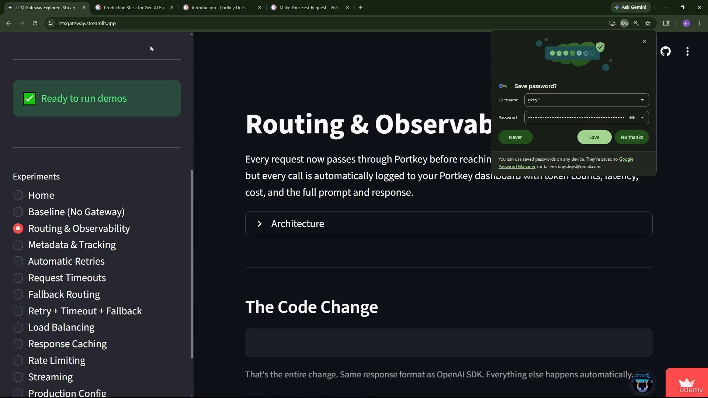
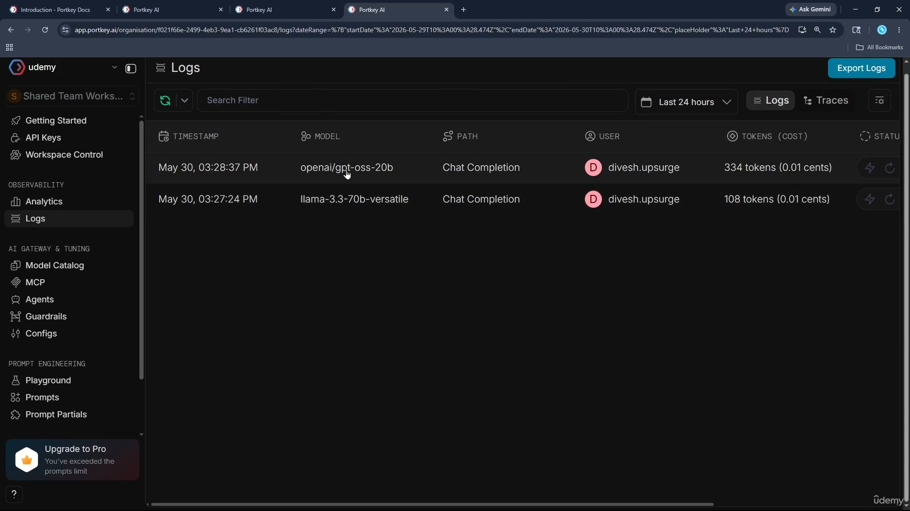
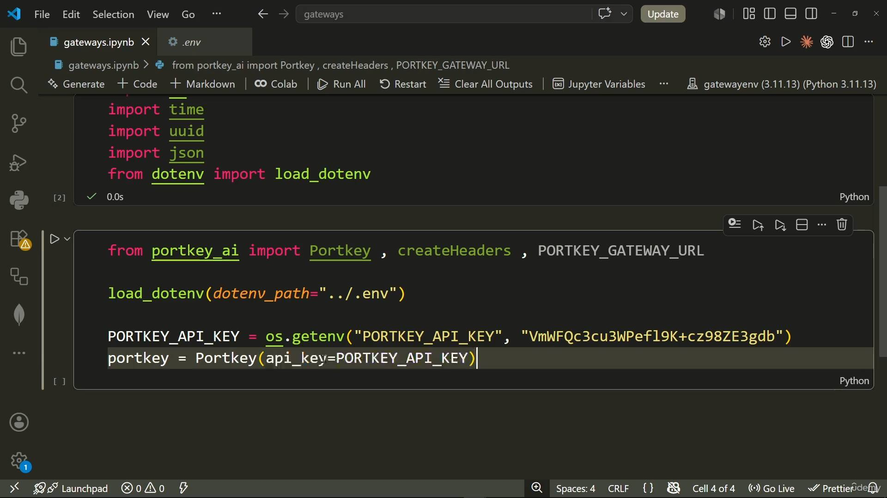
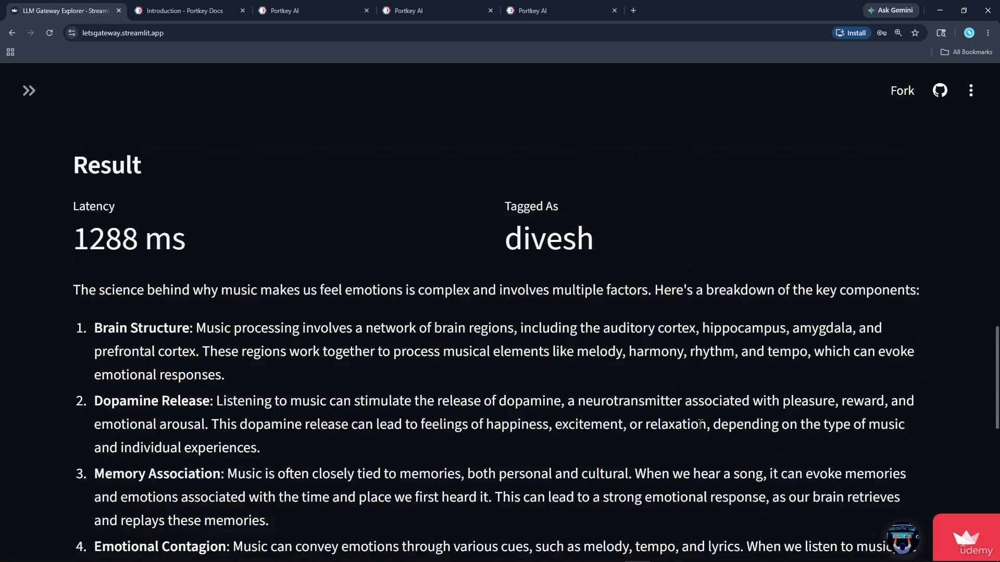
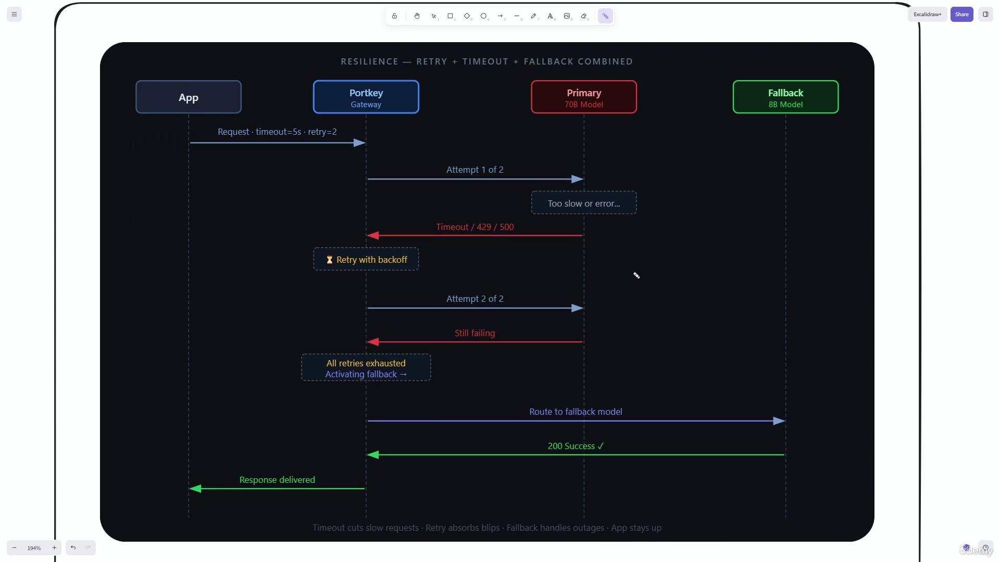
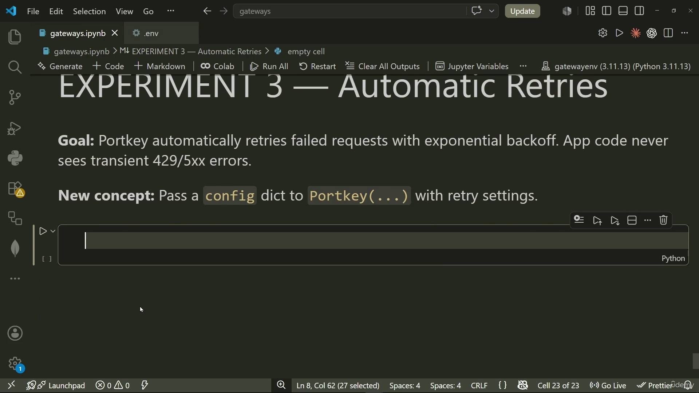

# AI Security Bootcamp Part 2 — 网关、可观测性、重试/超时/回退（P75–P76）复现手册

> 覆盖视频：BV1PSGA6SETb 的 P75、P76
> 前置：P74 已经讲过「虚拟密钥（virtual key）」的概念，本节从「直连模型」的基线实验开始，一路做到「带重试/超时/回退的容错网关」。
> 术语约定：逐字稿里出现的 GROC / grog / grok 都指模型提供方 **Groq**，不是 xAI 的 Grok。Portkey 的 Python SDK 包名是 `portkey-ai`。

---

## 1. 这一节做什么

这两集要完成的事情非常具体：**把一个「裸调大模型」的 Python 应用，改造成「所有请求都过 Portkey 网关」的版本，并把网关的三个核心能力开起来——可观测性（observability）、元数据打标（metadata/tagging）、以及重试 + 超时 + 回退（retry / timeout / fallback）。**

拆成四个实验，全部在一个 VS Code 工程里按顺序做：

| 实验 | 目录/文件 | 做什么 | 验证点 |
|---|---|---|---|
| 实验 0 | `01_baseline.py` | 用 `langchain_groq` 直接打 Groq，不走网关 | 只能看到最终输出，没有用户、成本、延迟归属 |
| 实验 1 | `02_gateway.py` | 把请求改走 Portkey 网关（虚拟密钥 slug 代替真实 API Key） | Portkey 仪表盘出现 request / log / token / cost / latency |
| 实验 2 | `03_metadata.py` | 用 `with_options(metadata=...)` 给每个请求打 user / session_id / feature / environment | 仪表盘能按人、按会话、按功能、按环境筛选与分析 |
| 实验 3 | `04_retry_timeout_fallback.py` | 给网关加 retry、timeout、fallback 三段配置，并把它们合并 | 故意用错虚拟密钥，请求会自动重试并回退到第二个模型 |

实验 3 是本节的「戏眼」：**讲师故意把一个不存在的虚拟密钥（G key 3）配上，让主模型必然失败，然后演示网关如何重试、如何在超时/额度耗尽后落到第二个模型上，并且最终用户完全看不到报错。**



---

## 2. 讲师原话

关于虚拟密钥存在的理由，讲师在开场就讲得很直白：

> "你可能在项目里用不同的提供方，比如 Groq、比如 OpenAI，也可能用 Anthropic，这些不同的模型提供方下面还有不同的模型。现在你要配置和使用所有这些，至少得写 10 行代码，而且维护这些代码会很难。所以 Portkey 说：来我的仪表盘上创建一个虚拟密钥，你创建的时候我就把你的环境变量存起来。"
> —— p075 [00:26]

> "用这个虚拟密钥，你就能访问你已经把 API Key 给我的那个提供方下面的任何模型。"
> —— p075 [00:53]

关于「slug 是什么」，他打了个比方：

> "slug 你可以把它想象成朋友给你取的外号。"
> —— p075 [10:23]

> "先写 groq slug 的名字，然后访问你想用的任何模型。"
> —— p075 [11:21]

关于走网关之后能拿到什么：

> "我们刚才看到的所有东西——完整的 prompt 和响应、tokens、延迟、用的是哪个模型、时间戳、request id，所有这一切都会显示在你的 Portkey 仪表盘上。"
> —— p075 [04:07]

> "第一次请求走的是 Llama 模型，第二次请求走的是 OpenAI 模型，我们能看到所有这些响应和问题，一切都被追踪到了。这就是网关的美，这就是 Portkey 网关的美。"
> —— p075 [06:03]

关于元数据打标：

> "假如有一个用户 Alice，她在 production 环境里，正在测试一个叫 search 的功能。如果我们想把这（环境、功能）也记录下来呢？我们想在自己的 Portkey 仪表盘上追踪它。我们可以把这些信息作为 metadata 传给我们的网关。请求发出去，响应回来，元数据加上响应，全部存到 Portkey 仪表盘上。"
> —— p076 [00:29] ~ [00:56]

> "Portkey 有一个叫 with_options 的方法，用它我们可以给 user、session ID、feature、environment 打标签，我们可以加任何形式的 metadata，这个不是强制的（结构不固定）。"
> —— p076 [06:38]

关于重试与容错：

> "如果第一次不行、第二次也不行，但第三次可以，那么响应就会被送达。我们现在谈的是容错系统。我们不希望我们的系统失败，否则名声就毁了。"
> —— p076 [09:24]

关于超时：

> "用户能遇到的最糟糕的事情就是响应太慢。……在这类系统里我们要求模型两秒内响应，如果模型两秒内没有响应，它会直接切换到另一个模型，把请求转发给另一个模型，因为原来那个处理得太慢了。"
> —— p076 [10:22] ~ [10:52]

关于回退：

> "你试了一个模型，它不行，给了你一个错误，你不会把这个错误发给用户。你会回退到另一个模型，由另一个模型给你一个响应。这个回退方法也叫模型路由（model routing），我们在把请求路由到另一个模型上。"
> —— p076 [11:19] ~ [11:49]

关于「为什么要写配置文件」：

> "我们被这个网关提供了很多功能：可以重试、可以回退、可以路由、还有缓存等等。但每次我们想用这些功能，我们都必须为它写一份配置。我们的网关怎么知道它应该重试？编程的方式就是写一个配置文件。"
> —— p076 [16:08] ~ [16:38]

> "写这个配置文件有两种方式。第一种是直接在仪表盘上写；第二种是在代码里，我们可以新建一个配置文件；在仪表盘上我们可以用配置键（config key）来引用。"
> —— p076 [17:05]

> "这些是 Portkey 的固定关键词（fixed keywords），你可以在文档里查它们。"
> —— p076 [18:30]

---

## 3. 从零复现

### 3.1 准备工作（对应 p075 [01:21] 之前的 UI 演示）

1. **注册 Portkey 账号**，进入控制台。
2. 在 **Virtual Keys** 页面新建两个虚拟密钥，把 Groq 的 API Key 填进去：
   - 第一个：slug 记作 `g-key`（讲师在 UI 上叫它 **G key**）
   - 第二个：slug 记作 `g-key-2`（讲师叫它 **G key 2**）
   讲师原话是「我们用 Groq 做了两个集成，一个叫 G key，一个叫 G key 2，两个都加到了我们的 UI 上」。
3. **注意：虚拟密钥的 slug 一旦确定，后面代码里就用它代替真实 API Key。** 讲师明确说：

   > "后来每一次我打我的模型，我都会通过 Portkey 网关去打。只是想先给你看这个基线实验——那里没有网关。"
   > —— p075 [01:47]

4. 单独准备一个 **Groq 原生 API Key**（`GROQ_API_KEY`），只给实验 0 的基线调用用。讲师说得很清楚：

   > "如果你困惑为什么要在这儿留一个 Groq API Key，只是为了先给你看一个简单的 LLM 调用。后面我们就不需要这个 Groq API Key 了，因为 Portkey 在管理我们的 API Key。"
   > —— p075 [01:47]

### 3.2 目录结构

```
portkey-gateway-lab/
├── .env
├── requirements.txt
├── common.py                      # 环境变量加载 + 两个 helper（p075 [07:02]~[13:40]）
├── 01_baseline.py                 # 实验 0：直连 Groq
├── 02_gateway.py                  # 实验 1：走网关
├── 03_metadata.py                 # 实验 2：metadata 打标
└── 04_retry_timeout_fallback.py   # 实验 3：retry + timeout + fallback
```

讲师是在 VS Code 的 notebook / 单文件里从上往下写的，章节顺序就是上表的顺序。

### 3.3 安装依赖

讲师在 P75 [07:30] 遇到过一次「导入报错 → 忘记装依赖」：

> "我们忘了一件事……让我先跑一下安装 requirements.txt，我之前根本没装。"
> —— p075 [07:30]

`requirements.txt`：

```txt
portkey-ai
python-dotenv
langchain-groq
langchain-core
```

安装：

```bash
cd portkey-gateway-lab
python -m venv .venv
# macOS / Linux
source .venv/bin/activate
# Windows
# .venv\Scripts\activate

pip install -r requirements.txt
```

> 这些依赖是**课里没给出版本号**的（讲师只说了包名和「requirements 装好了」）。第一次装请用当前最新版；如果复现时和讲师表现不一致，固定 `portkey-ai` 到与你 SDK 文档一致的大版本即可。

### 3.4 `.env`

```dotenv
# 实验 0 用它直连 Groq
GROQ_API_KEY=gsk_xxxxxxxxxxxxxxxxxxxx

# 实验 1 之后的全部请求都走这个
PORTKEY_API_KEY=pk_xxxxxxxxxxxxxxxxxxxx
```

> 环境变量名 `GROQ_API_KEY` / `PORTKEY_API_KEY` 是本节代码里写死的；`PORTKEY_GATEWAY_URL` 讲师在导入里提到了，但没有让手动填（SDK 自带默认值）。

### 3.5 重启内核 / 重启 VS Code（讲师踩过的坑）

P75 [08:00] 讲师导入 `Portkey` 时编辑器没有自动补全：

> "你看我这儿看不到这些建议，这种情况怎么办？要么重启 kernel，要么重启 VS Code。我就直接重启 VS Code，然后一切就都好了。"
> —— p075 [08:00]

复现时如果 `from portkey_ai import Portkey` 提示找不到，先按顺序：① 确认 venv 已激活；② VS Code 右下角选对解释器；③ Kernel: Restart。



### 3.6 实验 1：把直连改成走网关

1. 在仪表盘 **Configs** 里把主模型指向 `g-key` 对应的模型，fallback 模型指向 `g-key-2`（讲师在 P75 [04:35] 演示了「从这儿我能改我的模型，这是我的主模型，这是我的 fallback 模型」）。
2. 运行 `02_gateway.py`，问两个问题：「What is AI and Generative AI?」「What is coffee and black coffee?」。
3. 打开仪表盘 → **Logs / Analytics**，核对：
   - request 数量比上一次多了 2
   - 每条 log 里能看到 **question、response、tokens、total cost**
   - 能看到是哪个模型回答的
   
   讲师当场就是这么验的：

   > "我们能看到的请求更多了……这是问题，这是响应，这些是用的 tokens，这些是跑模型的总成本。"
   > —— p075 [19:41]



### 3.7 实验 2：metadata 打标

1. 每次运行先 `session_id = str(uuid.uuid4())` 生成一个新会话 ID。讲师强调过：

   > "当我在上面添加一个新名字，一个新的 session ID 就会自动创建。"
   > —— p076 [05:14]

2. 用「用户 / 功能 / 环境 / 问题」四元组构造场景列表（Alice、Bob、Carolyn、Alice），逐个发请求。
3. 关键写法：**先 `with_options` 把 metadata 挂上，再 `.chat.completions.create`**。讲师特别对比了和上节课的差别：

   > "上一次我们做的是 portkey.chat.completions.create，直接给模型然后执行。但这一次我们先加 metadata——portkey 的 with_options 方法帮我们加 metadata——先打标，再把请求发给具体的模型。"
   > —— p076 [07:04]

4. 去仪表盘刷新，应该看到 **用户数增加、每人请求数、消耗成本排行、按天请求数**。讲师现场看到的是「Devesh 花了最多成本」。



### 3.8 实验 3：retry + timeout + fallback

**第一步，先在仪表盘上做个错误实验**：把虚拟密钥改成不存在的 `g-key-3`，apply，然后提问「What is the most mind-blowing thing about the universe?」。

讲师现场看到的顺序是：

> "它没成功，没成功，在重试、重试……你看它没成功、没成功，然后它回退到了另一个模型，这次成功了。"
> —— p076 [13:44] ~ [14:13]

**第二步，把密钥改回 `g-key`，再问「What is butterfly effect?」** ——这次第一次就成功，因为密钥是对的。讲师借此说明「有错误才触发 retry / fallback」。

**第三步，在代码里写三份配置**（下一节给出完整代码）：

- `retry_config`：`attempts: 3`，命中 `429 / 500 / 502` 时重试
- `timeout_config`：`request_timeout: 2000`（毫秒，即讲师说的「2 秒」）
- `fallback_config`：`strategy.mode = "fallback"`，`targets` 里放两个模型

**第四步，把三份配置合并成一个 config 交给 `Portkey(config=...)`**，然后强制失败验证。讲师在 P76 [24:38] 说明：**「现在我们是每次都单独传一份配置，但这些配置是可以一起工作的」**——他先分别演示，再合并。

**第五步，回到仪表盘看 `requests` 和 `errors` 两个计数同时上涨**：

> "这些请求会增加……我跑第二次，errors 会变成 2。刷新一下，请求增加了，错误也增加了。"
> —— p076 [25:36] ~ [26:05]



---

## 4. 完整代码

### 4.1 `common.py`

```python
"""
公共初始化 + helper 函数
对应 P75 [07:02] ~ [13:40] 讲师写的 setup 与 section / show 两个 helper
"""

import os
import time

from dotenv import load_dotenv
from portkey_ai import Portkey, createHeaders, PORTKEY_GATEWAY_URL  # noqa: F401

# --- 加载环境变量 ---------------------------------------------------------
load_dotenv()

# 讲师原话：如果 .env 里找不到，就用下面这个（演示用，实际别硬编码）
PORTKEY_API_KEY = os.getenv("PORTKEY_API_KEY")
if not PORTKEY_API_KEY:
    raise SystemExit("PORTKEY_API_KEY is missing from .env")

GROQ_API_KEY = os.getenv("GROQ_API_KEY")  # 只有 01_baseline.py 需要

# --- 虚拟密钥 slug -------------------------------------------------------
# 讲师在仪表盘上建的两个虚拟密钥，UI 上显示为 "G key" / "G key 2"
GROQ_SLUG = "@g-key"
GROQ_SLUG_2 = "@g-key-2"

# 讲师原话：先写 groq slug 的名字，然后访问你想用的任何模型
# 主模型：70B；小模型：8B
GROQ_MODEL = f"{GROQ_SLUG}/llama-3.3-70b-versatile"
GROQ_MODEL_SMALL = f"{GROQ_SLUG_2}/llama-3.1-8b-instant"


def check_env() -> None:
    """讲师 P75 [11:48] 打印的那一组「配置 / 环境变量」自检。"""
    print("[config]  PORTKEY_GATEWAY_URL =", PORTKEY_GATEWAY_URL)
    print("[config]  GROQ_SLUG           =", GROQ_SLUG)
    print("[config]  GROQ_MODEL          =", GROQ_MODEL)
    print("[env]     PORTKEY_API_KEY ok  =", bool(PORTKEY_API_KEY))
    print("[env]     GROQ_API_KEY ok     =", bool(GROQ_API_KEY))


def section(title: str) -> None:
    """讲师 P75 [12:17] 的 section helper：把输出分段，纯粹为了好看。"""
    print("\n" + "=" * 72)
    print(title)
    print("=" * 72)


def show(question: str, answer: str, elapsed_ms: float, label: str) -> None:
    """
    讲师 P75 [12:45] 的 show helper：
    question / answer / 耗时 / 标签，四个参数。
    讲师原话：「这又是另一种 pretty print 的方式，没别的。」
    """
    print(f"\n[question] {question}")
    print(f"[answer]   {answer}")
    print(f"[latency]  {elapsed_ms:.0f} ms")
    print(f"[label]    {label}")


if __name__ == "__main__":
    check_env()
    # 讲师 P75 [13:12] 演示 show 的用法
    section("show() demo")
    show("Why is the sky blue?", "nature", 5, "god")
```

### 4.2 `01_baseline.py`（实验 0：直连 Groq，无网关）

```python
"""
实验 0：baseline，直接打 Groq，不走网关。
对应 P75 [14:10] ~ [16:23]
"""

import time

from langchain_core.messages import HumanMessage
from langchain_groq import ChatGroq

from common import GROQ_API_KEY, section, show

# 讲师原话：这里我们不用 Portkey，我想让你看一个简单的调用是怎么工作的
llm = ChatGroq(
    api_key=GROQ_API_KEY,
    model="llama-3.3-70b-versatile",
)

section("1. Baseline: direct Groq call (no gateway)")

questions = [
    "Write a simple joke on LLM gateways",
    "Why does programming exist in this world?",
]

for q in questions:
    started = time.time()
    response = llm.invoke([HumanMessage(content=q)])
    elapsed_ms = (time.time() - started) * 1000

    show(q, response.content, elapsed_ms, "direct-groq")


# 讲师现场收到的第一个答案（大意）：
# "LLM 网关为什么去看心理医生？因为它对自己的情绪有点 gateway（gateway ≈ 关卡）"
# 讲师点评：只有最终输出，没有任何额外的 trace。
```

### 4.3 `02_gateway.py`（实验 1：路由 + 可观测性）

```python
"""
实验 1：走 Portkey 网关。虚拟密钥 slug 代替真实 API Key。
对应 P75 [16:53] ~ [19:41]
"""

import time

from portkey_ai import Portkey

from common import GROQ_MODEL, PORTKEY_API_KEY, check_env, section, show

check_env()

# 讲师原话：用 portkey.chat.completions.create 去触发我们的 LLM
portkey = Portkey(api_key=PORTKEY_API_KEY)

section("2. Experiment 1: gateway routing + observability")

questions = [
    "What is AI and Generative AI?",
    "What is coffee and black coffee?",
]

for q in questions:
    started = time.time()

    response = portkey.chat.completions.create(
        model=GROQ_MODEL,  # 形如 @g-key/llama-3.3-70b-versatile
        messages=[
            {"role": "user", "content": q},
        ],
    )

    elapsed_ms = (time.time() - started) * 1000
    answer = response.choices[0].message.content

    show(q, answer, elapsed_ms, "portkey-gateway")

# 跑完去 Portkey 仪表盘 -> Logs / Analytics
# 应该看到 request 数 +2，以及 prompt、response、tokens、latency、model、request id
```

### 4.4 `03_metadata.py`（实验 2：metadata + 可观测性）

```python
"""
实验 2：给每个请求打 metadata 标签。
对应 P76 [05:14] ~ [08:28]
"""

import time
import uuid

from portkey_ai import Portkey

from common import GROQ_MODEL, PORTKEY_API_KEY, section, show

portkey = Portkey(api_key=PORTKEY_API_KEY)

section("3. Experiment 2: metadata and observability")

# 讲师原话：每次一个新名字进来，就自动创建一个新 session ID
session_id = str(uuid.uuid4())
print("[session_id]", session_id)

# 讲师在应用里演示的四组场景：user / feature / environment / question
scenarios = [
    {
        "user": "alice",
        "feature": "search",
        "environment": "production",
        "question": "How do I make search results more relevant?",
    },
    {
        "user": "bob",
        "feature": "summarization",
        "environment": "staging",
        "question": "Summarize this support ticket in one line.",
    },
    {
        "user": "carolyn",
        "feature": "code-assistant",
        "environment": "development",
        "question": "Why do programmers program?",
    },
    {
        "user": "alice",
        "feature": "search",
        "environment": "production",
        "question": "What makes a good leader? Give me three qualities.",
    },
]

for s in scenarios:
    # 讲师原话：metadata 可以是任意维度，结构不是强制的
    metadata = {
        "user": s["user"],
        "session_id": session_id,
        "feature": s["feature"],
        "environment": s["environment"],
    }

    started = time.time()

    # 先 with_options 打标，再 create —— 顺序不能反
    response = portkey.with_options(metadata=metadata).chat.completions.create(
        model=GROQ_MODEL,
        messages=[
            {"role": "user", "content": s["question"]},
        ],
    )

    elapsed_ms = (time.time() - started) * 1000
    answer = response.choices[0].message.content

    show(s["question"], answer, elapsed_ms, f'{s["user"]}@{s["environment"]}')

# 跑完去仪表盘：
# - 用户数增加
# - 每个用户各自的请求数 / token / cost
# - 可以按 request、按用户筛选，看谁花的成本最多
```

### 4.5 `04_retry_timeout_fallback.py`（实验 3：三段配置 + 合并）

```python
"""
实验 3：retry + timeout + fallback，三份配置分别写，再合并使用。
对应 P76 [18:03] ~ [26:05]
"""

import time

from portkey_ai import Portkey

from common import (
    GROQ_MODEL,
    GROQ_MODEL_SMALL,
    PORTKEY_API_KEY,
    section,
    show,
)

# ---------------------------------------------------------------------------
# 配置 1：retry
# 讲师原话：「在 retry 里我写 attempts，我说你应该重试三次；
#            什么时候重试？on status code，遇到这些状态码时重试，
#            比如 429、500、502。」
# 注意：这些是 Portkey 的固定关键词，确切拼写请以官方文档为准。
# ---------------------------------------------------------------------------
retry_config = {
    "retry": {
        "attempts": 3,
        "on_status_codes": [429, 500, 502],
    }
}

# ---------------------------------------------------------------------------
# 配置 2：timeout
# 讲师原话：「request timeout，我能容忍最多 10 秒或 2 秒，
#            我可以说 2 秒之后我就要看到响应。」
# 单位是毫秒，2000ms = 2s
# ---------------------------------------------------------------------------
timeout_config = {
    "request_timeout": 2000,
}

# ---------------------------------------------------------------------------
# 配置 3：fallback
# 讲师原话：「这里写策略 strategy，mode 就是 fallback，
#            然后写 targets，我们想检查的一组目标，
#            override params 里写 model。」
# ---------------------------------------------------------------------------
fallback_config = {
    "strategy": {
        "mode": "fallback",
        "targets": [
            {"override_params": {"model": GROQ_MODEL}},        # 主模型 70B
            {"override_params": {"model": GROQ_MODEL_SMALL}},  # 回退模型 8B
        ],
    }
}

# ---------------------------------------------------------------------------
# 合并：讲师原话「这些配置是可以一起工作的」
# ---------------------------------------------------------------------------
combined_config = {**retry_config, **timeout_config, **fallback_config}


def build_client(config: dict, api_key: str = PORTKEY_API_KEY) -> Portkey:
    """讲师写法：Portkey(api_key=..., config=...)"""
    return Portkey(api_key=api_key, config=config)


def ask(client: Portkey, question: str, label: str) -> None:
    started = time.time()
    response = client.chat.completions.create(
        model=GROQ_MODEL,
        messages=[{"role": "user", "content": question}],
    )
    elapsed_ms = (time.time() - started) * 1000
    show(question, response.choices[0].message.content, elapsed_ms, label)


if __name__ == "__main__":
    section("4a. retry only")
    ask(build_client(retry_config), "What is AI?", "retry-only")

    section("4b. timeout only")
    ask(build_client(timeout_config), "What is AI?", "timeout-only")

    section("4c. fallback only")
    ask(build_client(fallback_config), "What is AI?", "fallback-only")

    section("4d. retry + timeout + fallback 合并")
    ask(build_client(combined_config), "What is the butterfly effect?", "combined")

    # -----------------------------------------------------------------------
    # 4e. 强制失败：把 slug 换成一个不存在的虚拟密钥（讲师用的是 G key 3）
    #     主模型必然 401/403，网关会先按 retry 配置重试，
    #     重试仍失败后按 fallback 配置落到第二个模型。
    # -----------------------------------------------------------------------
    section("4e. 强制失败 -> retry -> fallback")

    bad_client = Portkey(
        api_key=PORTKEY_API_KEY,
        config=combined_config,
    )

    started = time.time()
    response = bad_client.chat.completions.create(
        model="@g-key-3/llama-3.3-70b-versatile",  # 不存在的虚拟密钥
        messages=[
            {
                "role": "user",
                "content": "What is the most mind-blowing thing about the universe?",
            }
        ],
    )
    elapsed_ms = (time.time() - started) * 1000
    show(
        "What is the most mind-blowing thing about the universe?",
        response.choices[0].message.content,
        elapsed_ms,
        "forced-failure-then-fallback",
    )
```

> **说明 1**：`4e` 里失败的是「虚拟密钥 slug 不存在」，靠 `fallback_config.targets` 里两个模型的 `override_params.model` 完成回退。如果回退的目标也要换 slug，需要在 `override_params` 里同时覆盖 `virtual_key`——**这一点课里没讲**，请以 Portkey 文档为准。
>
> **说明 2**：讲师演示「仪表盘上配置」时，是去 Configs 页点 **Create Config**，配置成 `retry 3 attempts` 然后保存，拿到一个 **config key**，再把这个 key 当 `config=` 传进去。这一步不需要写代码，只要复制 key。课里没给出 config key 的具体字面量，你的 key 会不一样。

### 4.6 仪表盘侧的两处操作（不用写代码）

| 操作 | 位置 | 讲师原话/效果 |
|---|---|---|
| 建虚拟密钥 `g-key` / `g-key-2` | Virtual Keys 页 | 「你创建虚拟密钥时，我会把你的环境变量存起来」p075 [00:26] |
| 改主模型 / fallback 模型 | Configs 页 | 「我可以从这儿改我的模型，这是我的主模型，这是我的 fallback 模型」p075 [04:35] |
| 建 retry 配置并拿 config key | Configs 页 → Create Config | 「它告诉我要配 retry，3 次尝试，我可以全部配好，保存，然后拿到一个 key 复制出来用」p076 [17:33] |



---

## 5. 逐行解释

**`common.py` 的导入区**。`os` 读环境变量，`time` 算延迟，`uuid` 生成 session id。`load_dotenv()` 必须在读 `os.getenv` 之前调用，否则读到的全是 `None`。`from portkey_ai import Portkey, createHeaders, PORTKEY_GATEWAY_URL` 里，后两个在本节**没有被真正用上**——讲师只是说「后面我们要创建用户时会用到 createHeaders」「后面会用到 gateway URL」。之所以现在导入，是因为讲师想让你看清一个企业级网关客户端的完整入口面。

**`PORTKEY_API_KEY` 的兜底逻辑**。讲师说「如果 .env 里找不到，就用这个」，这是教学演示写法。生产环境**不该**在代码里硬编码 key，尤其这是给「AI 安全」课做的项目。复现时建议保留 `raise SystemExit` 版本。

**`GROQ_SLUG` 与 `GROQ_MODEL` 的拼接**。这是整节最反直觉的一行：

```python
GROQ_MODEL = f"{GROQ_SLUG}/llama-3.3-70b-versatile"
```

`model` 字段里放的不是「模型名」，而是「**虚拟密钥 slug + 斜杠 + 模型名**」。讲师原话是「先写 groq slug 的名字，然后访问你想用的任何模型」。也就是说：`@g-key` 这一段告诉网关「用哪一组凭据」，斜杠后面才是「调哪个模型」。**不这样写，网关就没有凭据可用**。在 Node/JS 里等价于你把 `baseURL` 和 `apiKey` 合成一个字符串交给 SDK——是个「凭据即路由」的设计。

**`section()` / `show()`**。纯输出美化，不影响逻辑。但 `show` 的四个参数顺序（question、answer、耗时、标签）后面每个实验都在用，改动会导致输出对不上。

**`01_baseline.py` 里的 `ChatGroq(api_key=..., model=...)`**。这是 LangChain 的 Groq 封装，走的是 Groq 官方 endpoint，**不经过 Portkey**。讲师强调它的意义是「对照组」：你能看到答案和耗时，但看不到「谁问的、花了多少钱、用的是哪个模型、request id 是多少」。这就是没有网关时的信息黑洞。

> "我们只能看到最终的输出，中间什么都没有。所有网关的功能我们一个都看不到，这就是基线调用。"
> —— p075 [02:43]

**`02_gateway.py` 里的 `portkey.chat.completions.create(...)`**。签名刻意和 OpenAI SDK 对齐（`model` + `messages`），所以从前端调用 OpenAI 接口的习惯可以平移过来。区别只在 `model` 里塞了 slug。

**`03_metadata.py` 里的调用顺序**：

```python
portkey.with_options(metadata=metadata).chat.completions.create(...)
```

`with_options` 返回的是**一个新的、带默认参数的客户端**，不是修改原客户端。所以如果你写 `portkey.with_options(...)` 却没把返回值用起来，metadata 会**静默丢失**——这是最容易踩的坑。讲师的原话是「先用 with_options 加 metadata，再 create」，顺序上 metadata 必须在 `create` 之前挂上去。

`metadata` 的四个 key（`user`、`session_id`、`feature`、`environment`）是讲师自定义的。他特别强调：

> "我们可以加任何形式的 metadata，这个不是强制的（不固定结构）。"
> —— p076 [06:38]

Portkey 之所以能给「用户级成本分析」「按功能筛选日志」，就是因为这几个 key 在仪表盘里被当成**可过滤的维度**。

**`retry_config`**。`attempts: 3` 是总尝试次数；`on_status_codes: [429, 500, 502]` 是**触发重试的白名单**——只有这几种错误才重试。为什么是这三个：429 是限流、500 是服务端内部错误、502 是网关/上游错误，全都是「再试一次可能就好」的瞬时错误。而 400/401/403 这类是「你的请求本身错了」，重试一万次也没用，反而会烧钱。这行配置体现的是**「重试只对可恢复错误有意义」**这条工程常识。

**`timeout_config`**。`request_timeout: 2000`，单位毫秒。讲师用「2 秒」作为例子：

> "我们要求模型两秒内响应，如果两秒内没有响应，它会直接切换到另一个模型。"
> —— p076 [10:22]

在 Node 里你对应的做法是 `fetch(url, { signal: AbortSignal.timeout(2000) })`，概念完全一致：**超时不是为了省资源，是为了用户体验的下限。**

**`fallback_config`**。三层结构：

```
strategy.mode = "fallback"          -> 用哪种策略
strategy.targets = [...]            -> 候选目标列表，按顺序尝试
targets[i].override_params.model    -> 每个目标要覆盖哪个参数
```

关键点是 `override_params`：它覆盖的是「请求里原本传的参数」。所以你在 `create(model=...)` 里传的是主模型，fallback 时网关会用 `targets[0].override_params.model` 和 `targets[1].override_params.model` 依次替换。讲师把 70B 放第一个、8B 放第二个——**大模型先试，小模型兜底**。讲师原话：

> "如果第一个模型不工作，就回退到另一个模型；如果主模型不工作，就回退到另一个模型。"
> —— p076 [22:45]

**`combined_config = {**retry_config, **timeout_config, **fallback_config}`**。三份配置的顶层 key 不冲突（`retry` / `request_timeout` / `strategy`），所以可以直接字典合并。讲师反复演示「先分别跑、再合并跑」，是因为**配置是可组合的**这件事不直观：

> "到现在为止，我们每次都是把某一份配置单独传给 portkey……但这些配置是可以一起工作的。"
> —— p076 [24:12]

**`4e` 强制失败段**。把 `model` 换成 `@g-key-3/...`（不存在的虚拟密钥），网关会拿到 401/403。讲师在仪表盘上做的同一个实验，看到的行为是：

> "第一次不行、第二次不行，它一直在重试，然后回退到另一个模型，这次成功了。"
> —— p076 [13:44]

从代码角度，你**看不到任何异常**——`create()` 正常返回，只是 `elapsed_ms` 明显变长（多了一次或多次重试 + 一次 fallback）。这正是「容错系统」的定义：**故障对调用方不可见**。讲师的原话：

> "我们的应用永远不会失败。"
> —— p076 [14:13]

**仪表盘上的 `requests` / `errors` 两个计数**。讲师在强制失败后刷新，看到「请求增加了，错误也增加了」。这里要注意：**errors 增加的是「底层模型调用失败次数」，不是「用户请求失败次数」**——因为最终请求是成功的（回退成功）。这也是理解 retry/fallback 的关键：错误被网关吸收掉了，但**依然被记录**，方便你做告警。

---

## 6. 复现检查清单

**环境**
- [ ] Python 3.10+，venv 已激活
- [ ] `pip install -r requirements.txt` 成功，`python -c "import portkey_ai"` 不报错
- [ ] `.env` 里同时有 `GROQ_API_KEY` 和 `PORTKEY_API_KEY`
- [ ] 仪表盘上有 `g-key`、`g-key-2` 两个虚拟密钥，且各自绑定了可用的 Groq Key

**实验 0（`01_baseline.py`）**
- [ ] 能打印出两个答案 + 耗时
- [ ] 仪表盘**没有**新增 request（因为没走网关）

**实验 1（`02_gateway.py`）**
- [ ] `check_env()` 全部打印 True / 非空
- [ ] 仪表盘 Logs 里出现 2 条新记录
- [ ] 每条记录能看到 prompt、response、tokens、latency、model、request id

**实验 2（`03_metadata.py`）**
- [ ] 运行后打印出一个 uuid
- [ ] 仪表盘 Users 数量增加
- [ ] 点开任意一条 log，能看到 `user` / `session_id` / `feature` / `environment` 四个字段
- [ ] 能按用户筛选，并看到「谁花的成本最多」

**实验 3（`04_retry_timeout_fallback.py`）**
- [ ] 4a/4b/4c/4d 四个 `ask()` 都正常返回
- [ ] 4e 用 `@g-key-3` 时**没有抛异常**，仍然拿到答案
- [ ] 4e 的 `elapsed_ms` 明显大于 4d
- [ ] 仪表盘 `requests` 与 `errors` 同时上涨
- [ ] 在 log 详情里能看到这次请求经过了 retry 和 fallback

**踩坑排查**
- [ ] `Portkey` 导入无补全 → 重启 kernel / VS Code（p075 [08:00]）
- [ ] `metadata` 没生效 → 检查是否用了 `with_options(...)` 的**返回值**
- [ ] 4e 报错而不是回退 → 检查 `fallback_config` 的 `targets` 是否为空、`mode` 是否写成 `"fallback"`
- [ ] 429 不重试 → 检查 `on_status_codes` 里有没有 429

---

## 7. 课里没讲但你会撞上的

1. **`request_timeout` 的单位**。讲师只说了「2 秒」，代码里写 2000。**课里没明说单位是毫秒**，但 Portkey 的 `request_timeout` 是毫秒。写成 `2` 你会得到 2ms 超时，几乎必然触发 fallback，看起来像「模型挂了」。

2. **`on_status_codes` 的确切字段名**。讲师口述的是「on status code」，代码里写的是 `on_status_codes`。**课里没给出官方字段名的字面量**，第一次跑请对照 SDK 文档确认，字段名错了配置会静默失效（不报错、也不重试）。

3. **`fallback_config` 的 `targets` 是「按顺序尝试」还是「随机选一个」**。课里没讲。讲师把 70B 放前面、8B 放后面，从行为看是按顺序，但**这一条请以文档为准**。

4. **回退时要不要换虚拟密钥**。讲师 4e 的实验是「主模型 slug 不存在 → 回退到另一个模型的 slug」。这说明 `override_params` 里可以放 `virtual_key`。但**课里没讲这个字段名**，只讲了 `model`。

5. **metadata 里不要放敏感信息**。`session_id`、`user`、`feature`、`environment` 都是安全维度。但如果你把 `authorization`、原始 prompt、用户手机号放进 metadata，这些会进 Portkey 的日志——**课里没讲这一条**，但对一门叫 AI Security 的课来说，这是必须自己补上的边界。

6. **retry 会放大成本**。3 次尝试 + 2 个 fallback 目标，最坏情况下一次用户请求会打 6 次模型。讲师用 429/500/502 做白名单，就是不想让 4xx 也进重试。**课里没算这笔账**，做预算时别忘了乘上最坏倍数。

7. **Node/JS 侧的等价实现**。如果你想在前端 BFF 层做同样的事，思路是：① 用 `fetch` 打一个统一的 gateway base URL；② 用 `AbortSignal.timeout(2000)` 实现 timeout；③ 用 `for` 循环 + `try/catch` 实现 retry；④ 用「模型数组 + 逐个尝试」实现 fallback。Portkey 把这些都收敛成了一份 JSON 配置，但**概念是一一对应的**。

8. **仪表盘的 config key 会随项目/环境变化**。讲师复制出来的 key 只在他的账号有效。如果你把 config key 硬编码进代码再分享仓库，别人跑不起来——**课里没讲怎么管理这个 key**，建议放 `.env`（比如 `PORTKEY_CONFIG_ID`）。