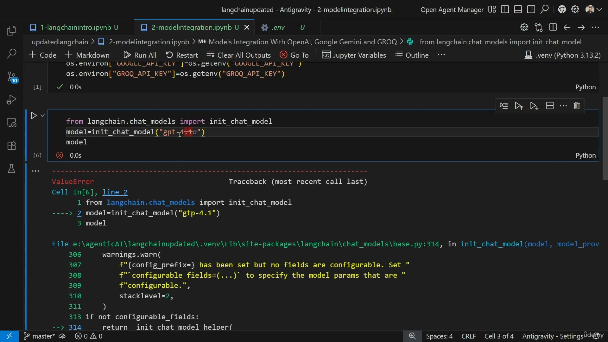
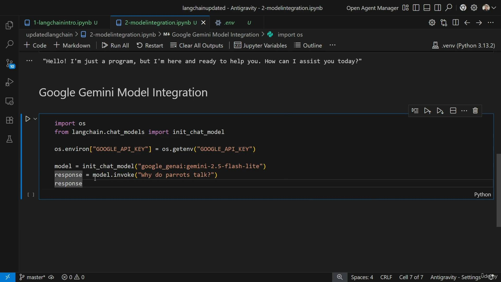
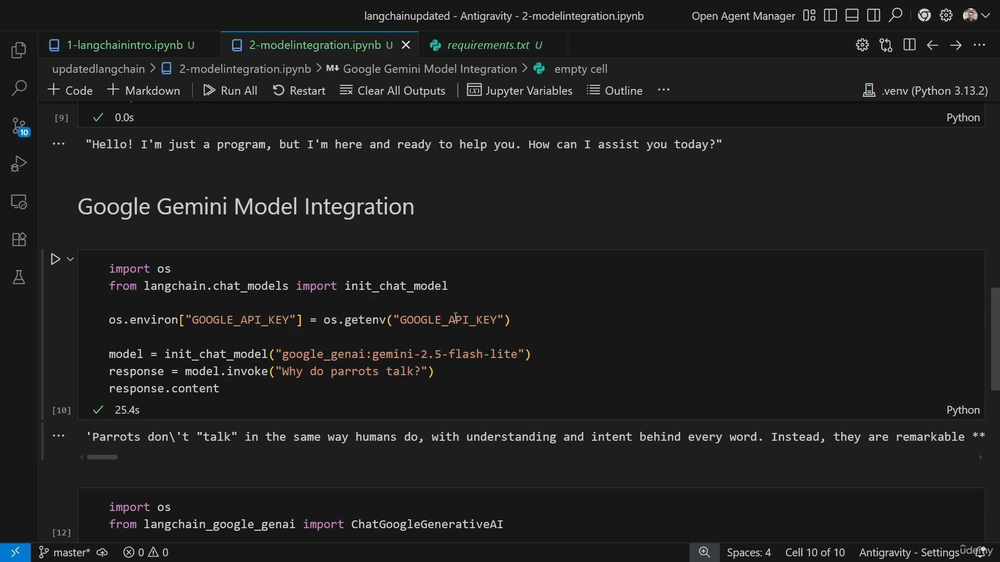
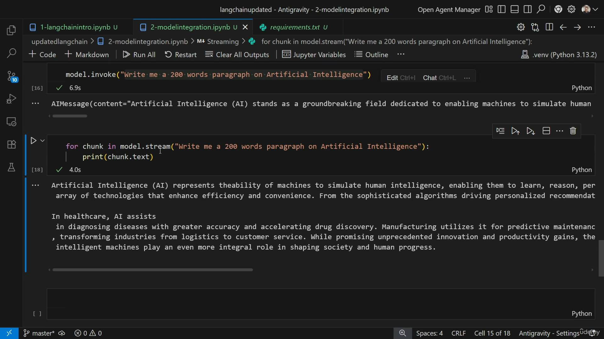
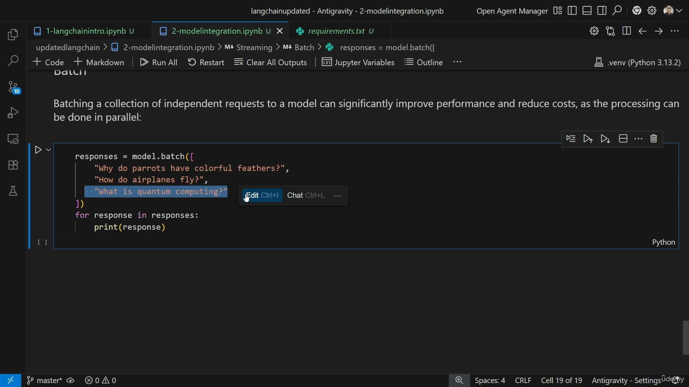
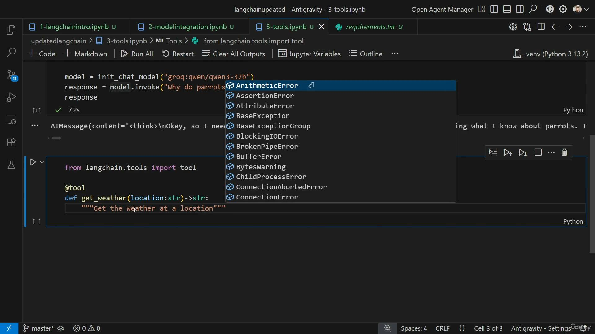
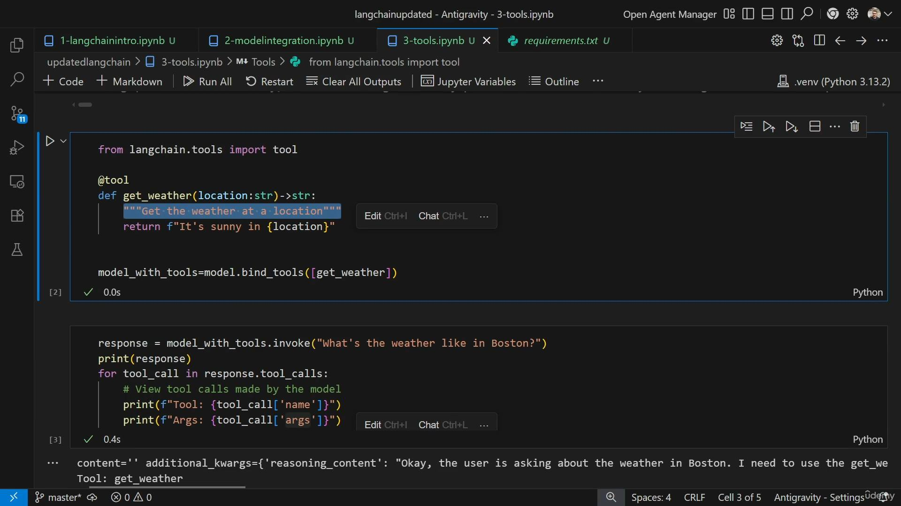
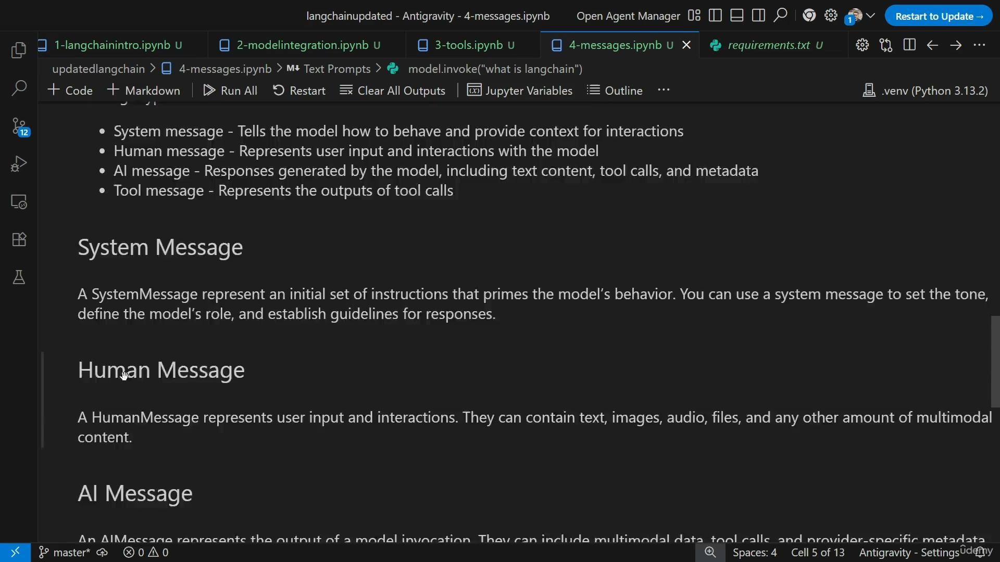
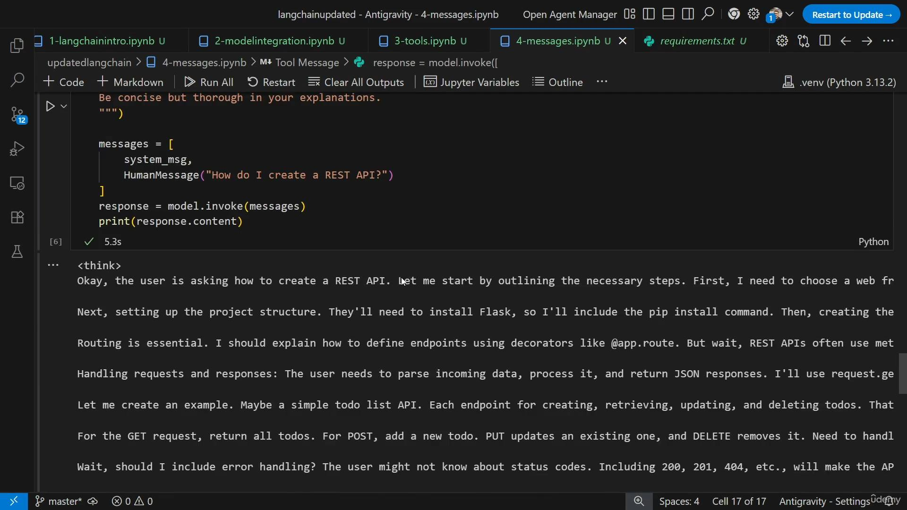

## 1. 这一节做什么

这一节要交付一个可以本地跑起来的最小实验项目 `langchain-model-lab`。它覆盖课程 P008–P011 的四个主题：

1. **模型集成**：用 LangChain 的 `init_chat_model` 和各家专用类，分别接 OpenAI、Google Gemini、Groq 三类模型。
2. **stream 与 batch**：对比 `invoke` 等完整结果、`stream` 逐块输出、`batch` 批量并行，以及 `max_concurrency` 并发上限。
3. **工具创建与工具执行循环**：用 `@tool` 装饰器定义 `get_weather`，用 `bind_tools` 绑定给模型，读取 `tool_calls`，把工具结果追加回消息列表，再让模型生成最终回答。
4. **消息结构**：理解 `SystemMessage`、`HumanMessage`、`AIMessage`、`ToolMessage`，以及 text prompt 与 message prompt 的区别、`name`/`id` 元数据、`usage_metadata` 用量信息。

最终目录结构如下：

```text
langchain-model-lab/
├── .env
├── .env.example
├── requirements.txt
├── p008_model_integration.py
├── p009_stream_batch.py
├── p010_tools.py
└── p011_messages.py
```

需要先说明边界：课程标题里虽然有“护栏/网关/可观测”，但 P008–P011 的逐字稿实际集中在 LangChain 的模型接入、流式/批量、工具、消息这些基础能力上。**本段没有讲护栏、网关、可观测的具体实现**，所以本文不把这些内容编进来。下面所有代码都以逐字稿里出现的函数名、类名、参数和调用顺序为准；逐字稿没念出的依赖版本、精确模型串、工程化错误处理，会明确标注为“复现补齐”。

复现成功的最低标准是：

- `python p008_model_integration.py` 能分别打印出 OpenAI、Google Gemini、Groq 的模型对象或 `AIMessage` 内容；
- `python p009_stream_batch.py` 能看到 `invoke` 等待完整输出、`stream` 逐块输出、`batch` 一次返回多条结果；
- `python p010_tools.py` 能看到 `response.tool_calls`，并能走完“模型请求工具 → 执行工具 → 模型基于工具结果回答”的循环；
- `python p011_messages.py` 能构造不同消息类型，并打印 `response.content`、`response.metadata`、`response.usage_metadata`。

---

## 2. 讲师原话

下面引用均来自逐字稿，英文内容已翻译成中文，技术名保留英文。

> "init_chat_model 是我们专门用来初始化任何聊天模型的库之一。"
> —— p008 [01:50]

> "默认情况下，你可以直接提供模型名。"
> —— p008 [02:20]

> "你可以用 init_chat_model；如果你专门用 OpenAI 模型，可以用 ChatOpenAI；如果你想用 Google Gemini 模型，可以用 ChatGoogleGenerativeAI，或者在 init_chat_model 里直接调用 Gemini 模型。"
> —— p008 [09:07]

> "我们不得不等待响应生成并显示出来。"
> —— p009 [00:28]

> "stream 返回一个迭代器，逐块产出 LLM 的输出。"
> —— p009 [01:27]

> "Batch 是一组发给模型的独立请求，因为可以并行处理，所以能显著提升性能并降低成本。"
> —— p009 [05:14]

> "工具就是 schema 的配对，包括工具名、描述和/或参数定义。"
> —— p010 [03:03]

> "这个 docstring 很重要：当我们把工具绑定给 LLM 时，LLM 能从这个 docstring 识别这个函数到底在做什么。"
> —— p010 [03:30]

> "工具执行循环：先放用户消息，调用带工具的模型，拿到 AI 消息，再遍历 tool_calls，执行 get_weather，把结果追加回消息列表。"
> —— p010 [06:19]

> "消息是 LangChain 中模型上下文的基本单位，表示模型的输入和输出，携带内容和元数据。"
> —— p011 [00:26]

> "System message 是给 LLM 的指令，告诉它应该如何表现。"
> —— p011 [05:12]

> "如果你在 system message 里提供更多信息，我们就能得到更合适的回答。"
> —— p011 [10:01]

这些原话对应四个实现重点：**统一初始化入口、逐块消费流、工具 schema 与执行循环、消息角色与元数据**。下面按项目复现顺序展开。

---

## 3. 从零复现

### 3.1 建目录、虚拟环境和依赖文件

先建项目目录并进入：

```bash
mkdir langchain-model-lab
cd langchain-model-lab
```

创建虚拟环境。课里没有规定 Python 版本；复现建议使用 Python 3.11 或 3.12：

```bash
python3.11 -m venv .venv
source .venv/bin/activate
```

Windows PowerShell 用：

```powershell
.venv\Scripts\Activate.ps1
```

然后创建 `requirements.txt`。**课里没有给依赖版本号**，下面是本文用于复现的基线版本；如果安装时出现版本冲突，优先保证 LangChain 为 1.x，因为逐字稿使用了 `langchain.chat_models.init_chat_model` 和 `langchain.messages` 这类较新的路径：

```text
langchain==1.0.2
langchain-openai==1.0.0
langchain-google-genai==3.0.0
langchain-groq==1.0.0
python-dotenv==1.0.1
```

安装：

```bash
pip install -r requirements.txt
```

安装完成后建议确认：

```bash
python -c "import langchain; print(langchain.__version__)"
```

### 3.2 配置 `.env`

逐字稿里讲师明确说 `.env` 文件里放了三个 API key：OpenAI、Google、Groq。创建 `.env.example`：

```text
OPENAI_API_KEY=sk-你的OpenAIKey
GOOGLE_API_KEY=你的GoogleKey
GROQ_API_KEY=gsk_你的GroqKey
OPENAI_MODEL=gpt-4.1
GOOGLE_MODEL=gemini-2.5-flash
GROQ_MODEL=qwen/qwen3-32b
```

复制一份为 `.env`，把值换成你自己的 key：

```bash
cp .env.example .env
```

注意：`.env` 不要提交到 git。课里没有讲密钥管理策略，但这是实际复现时一定会撞上的问题。

### 3.3 跑 P008：三种模型、两套调用方式

P008 的核心是两套写法：

- 统一入口：`from langchain.chat_models import init_chat_model`；
- 专用类：`ChatOpenAI`、`ChatGoogleGenerativeAI`、`ChatGroq`。

先创建 `p008_model_integration.py`，完整代码见第 4 节。运行：

```bash
python p008_model_integration.py
```

你会依次看到六个 demo。第一个 demo 会先打印模型对象，再打印 `AIMessage`，最后打印 `response.content`。讲师在课里演示时，执行 `init_chat_model` 后屏幕上出现了模型对象信息，包括最大输出 token 等信息：



Google Gemini 的调用串是 `google_genai:gemini-2.5-flash`。讲师在课里用 `gemini 2.5 flash` 演示了 “Why do parrots talk?” 并拿到了回答：



Groq 部分，讲师同样演示了 `init_chat_model` 和 `ChatGroq` 两种写法：



如果这里报 `unable to infer provider for model=...`，优先检查模型名拼写。讲师在课里故意把 `GPT` 拼错后，就出现了“无法推断 provider”的错误；改回 `gpt-4.1` 后恢复。

### 3.4 跑 P009：stream 与 batch

创建 `p009_stream_batch.py`，运行：

```bash
python p009_stream_batch.py
```

`invoke` 的行为是等模型把整段话生成完再显示。`stream` 的行为是拿到一个迭代器，用 `for chunk in model.stream(...)` 逐块消费，并在每个 chunk 上打印 `chunk.text`。讲师在课里用 `end=""` 和 `flush=True` 让输出看起来像真的在“流”：



`batch` 接收一组问题，一次返回多条响应。讲师强调 batch 是“一组独立请求”，可以并行处理，从而提升性能、降低成本。课里演示了三个问题一起返回：



随后讲师又加了 `max_concurrency=5` 这个配置参数，用来说明“同时最多发几个并行调用”。在代码里它作为 `config` 传给 `batch`：

```python
responses = model.batch(questions, config={"max_concurrency": 5})
```

### 3.5 跑 P010：工具定义、绑定、执行循环

创建 `p010_tools.py`，运行：

```bash
python p010_tools.py
```

第一段 demo 定义工具并绑定：

```python
@tool
def get_weather(location: str) -> str:
    """Get weather at a location."""
    return f"It's sunny in {location}"
```

讲师强调 `docstring` 不是装饰，它是给 LLM 看的工具说明；模型会根据它判断这个工具做什么、参数是什么。课里展示的 `@tool` 与 docstring 定义：



然后：

```python
model_with_tools = model.bind_tools([get_weather])
response = model_with_tools.invoke("What's the weather like in Boston?")
```

此时 `response.tool_calls` 里会出现工具调用信息。第二段 demo 是工具执行循环：先拿 AI 消息，再遍历 `ai_message.tool_calls`，对每个 tool call 执行 `get_weather.invoke(tool_call)`，把结果追加进 `messages`，最后再次调用 `model_with_tools.invoke(messages)` 得到最终回答。讲师在课里展示的消息列表里能看到 AI 消息和工具消息：



### 3.6 跑 P011：消息类型与 message prompt

创建 `p011_messages.py`，运行：

```bash
python p011_messages.py
```

这个脚本会依次演示：

- 纯文本 prompt：`model.invoke("What is LangChain?")`；
- 消息列表：`SystemMessage` + `HumanMessage`；
- 更详细的 system message：让模型以“资深 Python Web 框架开发者”的身份回答 REST API 问题；
- 带 `name` 和 `id` 的 `HumanMessage`；
- 手动构造 `AIMessage` 插入对话历史；
- 手动构造 `ToolMessage`，把工具结果作为消息传给模型。

讲师在课里先给出消息类型定义，再逐段写代码：



消息列表调用后会得到 `AIMessage`。讲师还演示了用 `response.metadata` 或 `response.usage_metadata` 查看输入 token、输出 token、总 token：



### 3.7 一键顺序运行

确认 `.env` 配好后，可以按顺序运行：

```bash
python p008_model_integration.py
python p009_stream_batch.py
python p010_tools.py
python p011_messages.py
```

如果只想验证 Groq，因为 P009–P011 默认都用 Groq 模型，可以先只跑：

```bash
python p009_stream_batch.py
```

---

## 4. 完整代码

本段课程没有 OCR 结果；以下代码按逐字稿口述的函数名、参数、调用顺序整理成可直接保存运行的完整文件。逐字稿没有逐字念出的版本号、精确 Groq 模型串、异常处理，属于复现补齐，已在第 7 节标注。

### 4.1 `requirements.txt`

```text
langchain==1.0.2
langchain-openai==1.0.0
langchain-google-genai==3.0.0
langchain-groq==1.0.0
python-dotenv==1
.0.1
```

### 4.2 `.env.example`

```text
OPENAI_API_KEY=sk-你的OpenAIKey
GOOGLE_API_KEY=你的GoogleKey
GROQ_API_KEY=gsk_你的GroqKey
OPENAI_MODEL=gpt-4.1
GOOGLE_MODEL=gemini-2.5-flash
GROQ_MODEL=qwen/qwen3-32b
```

### 4.3 `p008_model_integration.py`

```python
"""
P008：模型集成
三种 provider：OpenAI / Google Gemini / Groq
两套写法：init_chat_model 统一入口 + 各家专用 Chat 类
"""

import os

from dotenv import load_dotenv
from langchain.chat_models import init_chat_model
from langchain_openai import ChatOpenAI
from langchain_google_genai import ChatGoogleGenerativeAI
from langchain_groq import ChatGroq


# ---------- 1. 加载 .env ----------
load_dotenv()

# 讲师在课里是显式把 key 再塞回环境变量一次：
# OPENAI_API_KEY = os.getenv("OPENAI_API_KEY")
os.environ["OPENAI_API_KEY"] = os.getenv("OPENAI_API_KEY", "")
os.environ["GOOGLE_API_KEY"] = os.getenv("GOOGLE_API_KEY", "")
os.environ["GROQ_API_KEY"] = os.getenv("GROQ_API_KEY", "")

OPENAI_MODEL = os.getenv("OPENAI_MODEL", "gpt-4.1")
GOOGLE_MODEL = os.getenv("GOOGLE_MODEL", "gemini-2.5-flash")
GROQ_MODEL = os.getenv("GROQ_MODEL", "qwen/qwen3-32b")


def demo_1_openai_via_init_chat_model():
    """方式一：init_chat_model 接 OpenAI"""
    print("\n=== demo 1: init_chat_model + OpenAI ===")
    model = init_chat_model(OPENAI_MODEL)

    # 讲师课里：打印出来能看到 ChatOpenAI、max output tokens 等信息
    print(model)

    response = model.invoke("Hello hello, how are you?")
    print("---- 完整 AIMessage ----")
    print(response)
    print("---- 只要文本 ----")
    print(response.content)


def demo_2_google_via_init_chat_model():
    """方式二：init_chat_model 接 Google Gemini"""
    print("\n=== demo 2: init_chat_model + Google Gemini ===")
    # 讲师原话：要指定 Google Gemini，就写 google_genai: 加上模型名
    model = init_chat_model(f"google_genai:{GOOGLE_MODEL}")
    print(model)

    response = model.invoke("Why do parrots talk?")
    print(response.content)


def demo_3_openai_via_chat_openai():
    """方式三：直接用 ChatOpenAI 专用类"""
    print("\n=== demo 3: ChatOpenAI ===")
    model = ChatOpenAI(model=OPENAI_MODEL)
    response = model.invoke("Hello, how are you?")
    print(response.content)


def demo_4_google_via_chat_google_generative_ai():
    """方式四：直接用 ChatGoogleGenerativeAI 专用类"""
    print("\n=== demo 4: ChatGoogleGenerativeAI ===")
    model = ChatGoogleGenerativeAI(model=GOOGLE_MODEL)
    response = model.invoke("Why do parrots talk?")
    print(response.content)


def demo_5_groq_via_init_chat_model():
    """方式五：init_chat_model 接 Groq"""
    print("\n=== demo 5: init_chat_model + Groq ===")
    model = init_chat_model(f"groq:{GROQ_MODEL}")
    print(model)

    response = model.invoke("Why do parrots talk?")
    print(response.content)


def demo_6_groq_via_chat_groq():
    """方式六：直接用 ChatGroq 专用类"""
    print("\n=== demo 6: ChatGroq ===")
    model = ChatGroq(model=GROQ_MODEL)
    response = model.invoke("Why do parrots talk?")
    print(response.content)


if __name__ == "__main__":
    demo_1_openai_via_init_chat_model()
    demo_2_google_via_init_chat_model()
    demo_3_openai_via_chat_openai()
    demo_4_google_via_chat_google_generative_ai()
    demo_5_groq_via_init_chat_model()
    demo_6_groq_via_chat_groq()
```

### 4.4 `p009_stream_batch.py`

```python
"""
P009：stream 与 batch
- invoke：等全部生成完才返回
- stream：逐块返回，边生成边显示
- batch：一组独立请求并行处理
- max_concurrency：batch 的并发上限
"""

import os

from dotenv import load_dotenv
from langchain.chat_models import init_chat_model

load_dotenv()
os.environ["GROQ_API_KEY"] = os.getenv("GROQ_API_KEY", "")

GROQ_MODEL = os.getenv("GROQ_MODEL", "qwen/qwen3-32b")

model = init_chat_model(f"groq:{GROQ_MODEL}")


def demo_invoke_blocking():
    """invoke：等整段生成完才一次性显示"""
    print("\n=== invoke：等待完整输出 ===")
    response = model.invoke("Write me a 200 words paragraph on artificial intelligence.")
    print(response.content)


def demo_stream_basic():
    """stream：逐块输出，chunk.text 是最常用的取文本方式"""
    print("\n=== stream：逐块输出 ===")
    for chunk in model.stream("Write me a 200 words paragraph on artificial intelligence."):
        print(chunk.text, end="", flush=True)
    print()


def demo_stream_with_delimiter():
    """stream + 分隔符，方便肉眼看清 token 是一个一个来的"""
    print("\n=== stream：用分隔符标出每个 chunk ===")
    for chunk in model.stream("Why do parrots have colorful feathers?"):
        print(f"[{chunk.text}]", end="", flush=True)
    print()


def demo_batch():
    """batch：三个问题一次性发出去，一次性拿回三条响应"""
    print("\n=== batch：三条独立请求 ===")
    questions = [
        "Why do parrots have colorful feathers?",
        "How do airplanes fly?",
        "What is quantum computing?",
    ]
    responses = model.batch(questions)
    for i, resp in enumerate(responses, start=1):
        print(f"\n---- 第 {i} 条响应 ----")
        print(resp.content)


def demo_batch_with_max_concurrency():
    """batch + max_concurrency：限制同一时刻最多几个并行调用"""
    print("\n=== batch + max_concurrency=5 ===")
    questions = [
        "Why do parrots have colorful feathers?",
        "How do airplanes fly?",
        "What is quantum computing?",
        "What is LangChain?",
        "What is an LLM agent?",
        "How does streaming work?",
    ]
    responses = model.batch(questions, config={"max_concurrency": 5})
    for i, resp in enumerate(responses, start=1):
        print(f"\n---- 第 {i} 条响应 ----")
        print(resp.content)


if __name__ == "__main__":
    demo_invoke_blocking()
    demo_stream_basic()
    demo_stream_with_delimiter()
    demo_batch()
    demo_batch_with_max_concurrency()
```

### 4.5 `p010_tools.py`

```python
"""
P010：工具创建、绑定与工具执行循环
- @tool 装饰器把普通函数变成 LangChain 工具
- docstring 就是给 LLM 看的 schema 说明
- bind_tools 把工具绑定给模型
- tool_calls 是模型发出的“工具调用请求”
- 工具执行循环：AI 消息 -> 执行工具 -> ToolMessage -> 再问模型
"""

import os

from dotenv import load_dotenv
from langchain.chat_models import init_chat_model
from langchain.messages import HumanMessage
from langchain.tools import tool

load_dotenv()
os.environ["GROQ_API_KEY"] = os.getenv("GROQ_API_KEY", "")

GROQ_MODEL = os.getenv("GROQ_MODEL", "qwen/qwen3-32b")

model = init_chat_model(f"groq:{GROQ_MODEL}")


# ---------- 1. 定义工具 ----------
@tool
def get_weather(location: str) -> str:
    """Get weather at a location."""
    # 讲师课里是硬编码返回，真实项目里这里换成 API 请求或数据库查询
    return f"It's sunny in {location}"


def demo_bind_and_inspect():
    """绑定工具，看模型自己决定要不要调用"""
    print("\n=== bind_tools + 观察 tool_calls ===")
    model_with_tools = model.bind_tools([get_weather])

    response = model_with_tools.invoke("What's the weather like in Boston?")

    print("---- 完整 AIMessage ----")
    print(response)
    print("---- content（模型先说话）----")
    print(response.content)
    print("---- tool_calls ----")
    for tool_call in response.tool_calls:
        print(tool_call)


def demo_tool_execution_loop():
    """工具执行循环：这是 agent 能“自己用工具”的最小骨架"""
    print("\n=== tool execution loop ===")

    model_with_tools = model.bind_tools([get_weather])

    # 1) 用户消息进对话历史
    messages = [HumanMessage("What's the weather in Boston?")]

    # 2) 模型第一轮：决定调用哪个工具
    ai_message = model_with_tools.invoke(messages)
    messages.append(ai_message)

    print("---- 第一轮 AI 消息 ----")
    print(ai_message)
    print("---- tool_calls ----")
    for tool_call in ai_message.tool_calls:
        print(tool_call)

    # 3) 遍历 tool_calls，真正执行工具，把结果作为 ToolMessage 追加
    for tool_call in ai_message.tool_calls:
        tool_result = get_weather.invoke(tool_call)
        print("---- 工具执行结果 ----")
        print(tool_result)
        messages.append(tool_result)

    # 4) 模型第二轮：基于工具结果给出自然语言回答
    final_response = model_with_tools.invoke(messages)
    print("---- 最终回答 ----")
    print(final_response.content)

    # 5) 打印完整消息序列，能看到 human / ai / tool 三种角色
    print("---- 完整消息序列 ----")
    for msg in messages:
        print(type(msg).__name__, "=>", msg)


if __name__ == "__main__":
    demo_bind_and_inspect()
    demo_tool_execution_loop()
```

### 4.6 `p011_messages.py`

```python
"""
P011：消息结构
- text prompt：直接传字符串
- message prompt：传消息对象列表
- SystemMessage：给模型的角色/行为指令
- HumanMessage：用户输入，可带 name / id 元数据
- AIMessage：模型输出，也可以手动构造塞进对话历史
- ToolMessage：工具执行结果
- metadata / usage_metadata：token 用量
"""

import os

from dotenv import load_dotenv
from langchain.chat_models import init_chat_model
from langchain.messages import (
    SystemMessage,
    HumanMessage,
    AIMessage,
    ToolMessage,
)

load_dotenv()
os.environ["GROQ_API_KEY"] = os.getenv("GROQ_API_KEY", "")

GROQ_MODEL = os.getenv("GROQ_MODEL", "qwen/qwen3-32b")

model = init_chat_model(f"groq:{GROQ_MODEL}")


def demo_text_prompt():
    """text prompt：单个独立请求，不需要对话历史"""
    print("\n=== text prompt ===")
    response = model.invoke("What is LangChain?")
    print(type(response).__name__)
    print(response.content)


def demo_simple_message_prompt():
    """message prompt：system + human 组成一个列表"""
    print("\n=== message prompt：简单 system message ===")
    messages = [
        SystemMessage("You are a poetry expert."),
        HumanMessage("Write a poem on artificial intelligence."),
    ]
    response = model.invoke(messages)
    print(response.content)


def demo_detailed_system_message():
    """system message 写详细一点，回答质量明显不一样"""
    print("\n=== message prompt：详细 system message ===")
    messages = [
        SystemMessage(
            "You are a senior Python developer with expertise in web frameworks. "
            "Always provide code examples and explain your reasoning. "
            "Be concise, but thorough in your explanation."
        ),
        HumanMessage("How do I create a REST API?"),
    ]
    response = model.invoke(messages)
    print(response.content)


def demo_message_metadata():
    """HumanMessage 可以带 name 和 id：一个标识用户，一个用于追踪"""
    print("\n=== HumanMessage 的 name / id 元数据 ===")
    human = HumanMessage(
        content="Hello!",
        name="Alice",
        id="msg_123",
    )
    print(human)
    response = model.invoke([human])
    print(response.content)


def demo_manual_ai_message():
    """手动构造 AIMessage 塞进对话历史：模拟“多轮对话”"""
    print("\n=== 手动构造 AIMessage ===")
    messages = [
        SystemMessage("You are a helpful assistant."),
        HumanMessage("Can you help me?"),
        AIMessage("I'd be happy to help you with that question."),
        HumanMessage("Great. What is two plus two?"),
    ]
    response = model.invoke(messages)
    print("---- content ----")
    print(response.content)
    print("---- metadata ----")
    print(response.metadata)
    print("---- usage_metadata ----")
    print(response.usage_metadata)


def demo_tool_message():
    """手动构造 ToolMessage：模拟一次已经执行完的工具调用"""
    print("\n=== 手动构造 ToolMessage ===")

    tool_call_id = "call_weather_001"
    weather_result = "It's sunny in San Francisco."

    messages = [
        HumanMessage("What's the weather in San Francisco?"),
        AIMessage(
            content="",
            tool_calls=[
                {
                    "name": "get_weather",
                    "args": {"location": "San Francisco"},
                    "id": tool_call_id,
                }
            ],
        ),
        ToolMessage(
            content=weather_result,
            tool_call_id=tool_call_id,
        ),
    ]

    response = model.invoke(messages)
    print(response.content)


if __name__ == "__main__":
    demo_text_prompt()
    demo_simple_message_prompt()
    demo_detailed_system_message()
    demo_message_metadata()
    demo_manual_ai_message()
    demo_tool_message()
```

---

## 5. 逐行解释

### 5.1 `p008_model_integration.py`

- `load_dotenv()`：读项目根目录的 `.env`，把里面 `KEY=VALUE` 塞进 `os.environ`。讲师说“我在 `.env` 里已经把三个 API key 都加载好了”，这一步就是那个动作。
- `os.environ["OPENAI_API_KEY"] = os.getenv("OPENAI_API_KEY", "")`：讲师在课里写的是 `OPENAI_API_KEY = os.getenv("OPENAI_API_KEY")`，然后说“设置我们的环境变量”。严格说 `load_dotenv()` 已经完成注入，这行是显式再兜一次底，避免大小写或 IDE 环境变量没继承时读不到。写成 `os.environ[...] = ...` 才是真的往进程环境里写；只写 `OPENAI_API_KEY = ...` 只是一个 Python 局部变量，对库没用。这是复现时容易踩的坑。
- `init_chat_model(OPENAI_MODEL)`：不写前缀时，LangChain 靠模型名推断 provider。讲师故意写成 `GPT4.1`（漏了 `gpt` 里的连字符/大小写错），就直接得到 `unable to infer provider for model=...`。所以模型名必须精确。
- `init_chat_model(f"google_genai:{GOOGLE_MODEL}")`：Google 必须带 `google_genai:` 前缀，讲师原话“我们就写 google_genai 冒号，然后写你在 Google Gemini 里用的模型名”。
- `init_chat_model(f"groq:{GROQ_MODEL}")`：同理，Groq 必须带 `groq:` 前缀，后面跟 Groq 上具体的模型 ID。
- `ChatOpenAI(model=OPENAI_MODEL)`：专用类写法。讲师说“用 `init_chat_model` 本质上就是间接在用 `ChatOpenAI`”，所以这两条路最后落到同一个底层实现。
- `ChatGoogleGenerativeAI(model=GOOGLE_MODEL)`：Google 的专用类，导入路径是 `langchain_google_genai`。讲师说“在 `requirements.txt` 里你也装了 `langchain_google_genai`，所以这里也可以用 `ChatGoogleGenerativeAI`”。
- `ChatGroq(model=GROQ_MODEL)`：Groq 的专用类，导入路径 `langchain_groq`。
- `print(response)` 与 `print(response.content)`：`response` 是 `AIMessage` 对象，直接打印能看到角色、内容、可能的 tool_calls、usage 等信息；`.content` 只拿文本。讲师两种都演示了。

### 5.2 `p009_stream_batch.py`

- `model.invoke(...)`：阻塞到模型生成完最后一个 token 才返回。讲师原话是“我们不得不等响应生成并显示出来”，并且现场真的等了很久。
- `model.stream(...)`：返回一个生成器（iterator），每次 `for` 迭代拿到一个 chunk。讲师说“它创建了一个 generator 对象，但我们的目标是把这个 stream 的输出显示出来”。
- `chunk.text`：chunk 上的文本字段。讲师用的就是 `chunk.text`，不是 `chunk.content`。
- `print(chunk.text, end="", flush=True)`：
  - `end=""` 防止每个 chunk 换行，否则流式效果会被打成竖条；
  - `flush=True` 强制立刻刷新缓冲区，否则终端会攒一批才显示，看起来还是“一次性出完”。
- `print(f"[{chunk.text}]", end="", flush=True)`：讲师说“我用两个特殊字符当分隔符，这样你们能直观看到每个 token 是一块一块来的”。这是演示手段，真实产品里当然不会打方括号，前端会直接把增量文本 append 到 DOM。
- `model.batch([...])`：一次传一组独立问题，返回一个响应列表，顺序与输入一致。讲师强调“这是一组独立请求，可以并行处理，所以能提升性能、降低成本”。
- `config={"max_concurrency": 5}`：batch 的配置参数，含义是“同一时刻最多允许 5 个并行调用”。讲师举例：“如果我有 10 个问题，它会 5 个 5 个地发给 LLM，然后生成输出。”
- 前端对照：在 Node 里，`batch` 对应 `Promise.all(tasks)`，`max_concurrency` 对应 `p-limit` / 自写信号量。这一点课里没讲，是给前端转岗读者的类比。

### 5.3 `p010_tools.py`

- `from langchain.tools import tool`：讲师原话“从 `langchain.tools` 里导入 `tool`，这个 `tool` 会作为装饰器使用”。
- `@tool`：加在任何函数上，这个函数就变成 LangChain 工具对象。函数本身还能调用，但多了 `.name`、`.description`、`.args_schema`、`.invoke()`。
- `def get_weather(location: str) -> str:`：参数类型 `str` 会被拿去生成 schema 的类型声明；返回值类型也参与 schema。
- `"""Get weather at a location."""`：这不是普通注释。讲师反复强调“这个 docstring 非常重要，因为当我们把工具绑定给 LLM 时，LLM 会根据这个 docstring 判断这个函数到底在做什么”。写含糊了，模型就选错工具或者不调用。
- `return f"It's sunny in {location}"`：课里为了演示硬编码。讲师说“你也可以在这里发 API 请求、查数据库，真正的功能写在里面”。
- `model.bind_tools([get_weather])`：把工具列表绑定给模型，返回一个新的 model 对象（`model_with_tools`），原 `model` 不受影响。讲师说“另一种方式就是用 `create_agent`，直接给模型名和工具列表，它自动就创建好了；`create_agent` 本质做的也是绑工具这件事”。
- `model_with_tools.invoke("What's the weather like in Boston?")`：此时模型不直接编天气，而是返回一个带 `tool_calls` 的 `AIMessage`。
- `for tool_call in response.tool_calls`：`tool_calls` 是一个列表，每项大致包含 `name`、`args`、`id`。讲师说“tool call 的名字是 weather，需要的参数是 location”。
- `messages = [HumanMessage("...")]` 之后 `messages.append(ai_message)`：把模型第一轮的“我要调工具”这个意图也存进历史，不然后面模型不知道自己请求过什么。
- `get_weather.invoke(tool_call)`：直接把整个 tool_call 字典喂给工具对象，LangChain 会自动取 `args` 里的参数并执行函数，返回值被包装成 `ToolMessage`，并且带上对应的 `tool_call_id`。讲师原话：“我们用的是 `get_weather.invoke(tool_call)`，这样就能拿到工具的结果。”
- `messages.append(tool_result)`：把 `ToolMessage` 追加进历史。讲师说“这个输出也就是上下文，我们也把它 append 到消息里”。
- 第二次 `model_with_tools.invoke(messages)`：模型现在看到了 `HumanMessage` + `AIMessage(tool_calls)` + `ToolMessage(结果)`，于是能生成“波士顿天气晴朗”这种自然语言回答。
- `for msg in messages: print(type(msg).__name__, ...)`：能直观看到 `HumanMessage` / `AIMessage` / `ToolMessage` 三种角色，这就是 P011 的引子。

### 5.4 `p011_messages.py`

- `model.invoke("What is LangChain?")`：直接传字符串。讲师说“这个字符串内部会被当成 human message，但我也把它叫 text prompt”。适用场景是“单个独立请求、不需要保留对话历史、代码复杂度最低”。
- `SystemMessage("You are a poetry expert.")`：给模型的行为指令。讲师定义：“System message 就是给 LLM 的指令，告诉它应该怎么表现，并为交互提供上下文。”
- `HumanMessage("Write a poem on artificial intelligence.")`：用户输入。讲师定义：“Human message 表示用户输入和与模型的交互。”
- `model.invoke(messages)`：传列表而不是字符串。讲师说“这里我可以传一个消息列表，形成对话历史”。
- 详细版 `SystemMessage`：讲师对比了两次。第一次只说“你是一个有帮助的编码助手”，结果很泛；第二次说“你是一位资深 Python 开发者，擅长 Web 框架，总是给出代码示例并解释推理过程，简洁但透彻”，结果立刻变成 Flask + 安装步骤 + 代码示例 + 生产环境关 debug + 输入校验。讲师结论：“你在 system message 里提供的信息越多，得到的回答就越贴合。”
- `HumanMessage(content="Hello!", name="Alice", id="msg_123")`：
  - `name`：标识是哪个用户说的，多用户场景有用；
  - `id`：唯一标识，用于追踪（tracing）。
  讲师原话：“我们提供了两个元数据，一个用来区分不同用户，一个用于唯一标识、方便追踪。”
- `AIMessage("I'd be happy to help you with that question.")`：手动构造的 AI 消息。讲师特意强调“这不是 AI 自己生成的，是我们自己创建并标记成 AI 消息的”。用途是把历史对话“伪造”进上下文，让模型接着聊。
- `response.metadata` / `response.usage_metadata`：讲师说“你能看到输入 token、输出 token、总 token 这些信息”。注意 `metadata` 在不同 provider 下字段不完全一样，`usage_metadata` 是 LangChain 统一过的用量结构。
- `AIMessage(content="", tool_calls=[{"name": ..., "args": {...}, "id": ...}])`：手工造一个“模型请求工具”的消息。`content` 为空是正常的，因为这一轮模型只发工具请求不讲话。
- `ToolMessage(content=weather_result, tool_call_id=tool_call_id)`：手工造工具结果。`tool_call_id` 必须和上面 AI 消息里那个 `id` 对上，否则模型对不上号。讲师说“我在 AI 消息里用了 ID，然后 tool message 用 `content=weather_result` 和 `tool_id`”。
- 讲师最后还提了一句：“如果你看这个 tool message，它本身就是个 tool message，我们把它作为输入给模型，所以 `model.invoke(messages)` 拿回来的就是一条消息。这就是不同类型的消息。”

---

## 6. 复现检查清单

按顺序勾，全绿说明这一节跑通了。

**环境**

- [ ] 进了 `langchain-model-lab` 目录，`python -c "import langchain; print(langchain.__version__)"` 有输出
- [ ] `langchain` 是 1.x（后面 `langchain.messages` 才能导入）
- [ ] `pip list` 里能看到 `langchain-openai`、`langchain-google-genai`、`langchain-groq`、`python-dotenv`
- [ ] `.env` 存在且不被 git 跟踪
- [ ] 三个 key 都非空：`python -c "import os;from dotenv import load_dotenv;load_dotenv();print(bool(os.getenv('OPENAI_API_KEY')),bool(os.getenv('GOOGLE_API_KEY')),bool(os.getenv('GROQ_API_KEY')))"` 输出三个 `True`

**P008**

- [ ] 六个 demo 都能打印出非空 `content`
- [ ] `init_chat_model("gpt-4.1")` 不报 `unable to infer provider`
- [ ] Google 用的是 `google_genai:` 前缀，没漏
- [ ] Groq 用的是 `groq:` 前缀，没漏
- [ ] 知道 `ChatOpenAI` / `ChatGoogleGenerativeAI` / `ChatGroq` 和 `init_chat_model` 是等价的两条路

**P009**

- [ ] `invoke` 明显是“等完才出”，`stream` 是“边出边显示”
- [ ] `stream` 循环里写了 `end=""` 和 `flush=True`，终端能看到碎块输出
- [ ] `chunk.text` 不是 `chunk.content`
- [ ] `batch` 返回的列表长度等于输入问题数，且顺序对应
- [ ] `config={"max_concurrency": 5}` 生效（把问题加到 10 条以上更容易观察）

**P010**

- [ ] `get_weather.name` 是 `get_weather`，`get_weather.description` 就是那句 docstring
- [ ] `bind_tools` 之后 `response.tool_calls` 非空
- [ ] 每个 tool call 里能读到 `name`、`args`、`id`
- [ ] 工具执行循环跑完，`messages` 里至少有 3 条：`HumanMessage` / `AIMessage` / `ToolMessage`
- [ ] 最终 `final_response.content` 里出现了 “sunny” 和 “Boston”

**P011**

- [ ] text prompt 和 message prompt 两种调用都能跑
- [ ] `SystemMessage` + `HumanMessage` 的版本比纯文本版本更“像专家”
- [ ] 详细 system message 版本的回答里出现了 Python / Flask 相关内容
- [ ] `HumanMessage` 带 `name` / `id` 能正常发送
- [ ] 手动构造 `AIMessage` 后模型能接着上一轮聊，而不是重新开始
- [ ] `response.usage_metadata` 能打印出输入/输出 token 数量（字段名以实际输出为准）
- [ ] 手动 `ToolMessage` 的 `tool_call_id` 与 `AIMessage.tool_calls[0]["id"]` 完全一致

**截图对照**

- [ ] 已对照 p008 的模型对象输出、Gemini 回答、Groq 输出三张图
- [ ] 已对照 p009 的 stream 逐块输出与 batch 三条返回
- [ ] 已对照 p010 的 `@tool` + docstring、工具执行循环消息列表
- [ ] 已对照 p011 的消息类型定义页与 `usage_metadata` 页

---

## 7. 课里没讲但你会撞上的

这一节都是逐字稿里没出现、但照着上面代码实际运行一定会遇到的问题。**不是讲师说过的内容，是复现补齐。**

**1. 依赖版本没给，LangChain 1.x 和 0.x 的导入路径不兼容**

课里只说“在 `requirements.txt` 里我们装了 `langchain_openai`、`langchain_google_genai`、`langchain_groq`”，没给版本。而 `from langchain.messages import SystemMessage, HumanMessage, AIMessage` 这种写法属于较新的 LangChain；老版本里是 `from langchain_core.messages import ...`。如果照着装到了 0.1.x，P011 第一个 import 就会 `ModuleNotFoundError`。本文给的 `langchain==1.0.2` 是复现基线，装不上就退到同大版本最新小版本，别跨到 0.x。

**2. Google 的包名/类名有两代**

讲师说的是 `from langchain_google_genai import ChatGoogleGenerativeAI`，这个没问题。但在部分版本里还会看到 `ChatGoogleGenerativeAI` 与 `ChatGoogleGenAI` 并存、`google_genai:` 与 `google_vertexai:` 两种前缀。课里只讲了 `google_genai:` 前缀 + Gemini 模型名，报“找不到 provider”时先核对前缀。

**3. Groq 的模型串在逐字稿里是语音转写的**

逐字稿写的是 “groc quen 332B”、“GROC colon Quen”，这是语音识别结果。真实模型 ID 形如 `qwen/qwen3-32b`，具体以你 Groq 控制台的可用模型列表为准。本文在 `.env` 里用 `GROQ_MODEL` 变量接住，就是为了让你改一处就能跑。这一点课里没讲。

**4. `create_agent` 被提到但没展开**

讲师在 P010 说“另一种方式是用 `create_agent`，给模型名和工具列表，它自动创建”。课里没有给 `create_agent` 的导入路径和完整签名，所以本文没有写它的可运行版本，只保留了 `bind_tools` + 手写执行循环这条最可控的路径。想用 `create_agent` 需自行查当前版本文档，**这属于课里没讲的部分**。

**5. reasoning 字段只在部分模型上有**

讲师在 P010 说“你打印响应能看到 reasoning content，说用户在问波士顿天气，我需要用 `get_weather` 函数”。这是推理型模型才有的字段（常见于 Qwen 这类 reasoning 模型）。换成 `gpt-4.1` 跑同一段代码，`response.content` 可能是空的，`tool_calls` 却非空——这是正常现象，不是代码写错了。本文代码里没有硬读 `reasoning_content`，就是为了避免换模型就崩。

**6. `get_weather.invoke(tool_call)` 传的是整个 dict**

逐字稿里讲师只说了“`get_weather.invoke(tool_call)`”，没解释为什么不是 `get_weather.invoke(tool_call["args"])`。实际是：传整个 tool call 字典，LangChain 才能把 `id` 一起带进返回的 `ToolMessage`，后面模型才能对上号。如果你只传 `args`，`ToolMessage.tool_call_id` 会是空的，下一轮模型往往报错说工具调用没有对应结果。

**7. `ToolMessage` 和 `HumanMessage`/`AIMessage` 的构造签名不一样**

`HumanMessage("...")` 可以直接把内容当第一个位置参数；`ToolMessage` 必须显式写 `tool_call_id=`，否则构造失败。逐字稿里讲师说“我用 `ToolMessage`，`content=weather_result` 和 `tool_id`”，实际参数名是 `tool_call_id`，`tool_id` 是口误/转写偏差。

**8. 速率限制和费用**

`batch` 加 `max_concurrency=5` 不是性能调优的万能钥匙。Groq 免费额度、OpenAI 的 RPM/TPM 都会在并发爬高时返回 429。课里没讲限流、重试、指数退避。实际项目里要么降并发，要么加带退避的重试。

**9. 流式在 Web 前端怎么落地**

课里只在终端里演示 `for chunk in model.stream(...)`。真实产品中这条流要经过 HTTP 传给浏览器，常见做法是 SSE 或 `ReadableStream`，前端用 `fetch` + `response.body.getReader()` 逐块 append。**课里没讲传输层**，但这是前端转 AI 应用工程师真正会撞上的第一堵墙。终端里的 `flush=True` 在浏览器端对应的就是“每拿到一块就渲染一次”，别攒到最后才 `setState`。

**10. `batch` 在 Node 里的对应物**

前端读者可以这样映射：`model.batch(questions)` ≈ `Promise.all(questions.map(q => invoke(q)))`；`config={"max_concurrency": 5}` ≈ 用一个并发上限为 5 的信号量或 `p-limit(5)` 包一层。**课里没有做这个类比**，是给非后端背景读者的补充。

**11. `.env` 读取顺序**

`load_dotenv()` 默认只找当前工作目录下的 `.env`。如果你在项目根目录之外执行 `python langchain-model-lab/p008_model_integration.py`，它会找不到文件，三个 key 全是 `None`，然后报鉴权错误。要么 `cd` 进目录再跑，要么 `load_dotenv(dotenv_path=Path(__file__).parent / ".env")`。

**12. 这节课没有护栏、网关、可观测**

课程标题里有“护栏/网关/可观测”，但 P008–P011 的逐字稿内容全部是 LangChain 的模型接入、stream/batch、tools、messages。**护栏、网关、可观测的具体实现这部分课里没讲**（至少这四集没讲），不要在这份文档里找对应的代码，也不要把其他课程的概念套进来。

**13. 关于“metadata”字段名**

讲师说“可以用 `response.metadata` 或者 `usage_metadata` 看输入 token、输出 token、总 token”。不同 provider 返回的 `metadata` 结构不完全一致，`usage_metadata` 才是 LangChain 归一层。打印出来字段名如果和预期不同，**以你实际输出为准**，不要照抄某个固定字段名去写业务逻辑。

**14. `id` 用不用 UUID**

讲师在 P011 里手写 `id="msg_123"`。真实系统里用 `uuid4()` 或 provider 返回的 call id。手写固定字符串在单次脚本里没问题，并发场景下会撞。

**15. 工具的异常没有处理**

`get_weather` 里如果真去调外部 API，超时/500 会直接把 `get_weather.invoke(tool_call)` 抛出来，整个执行循环中断。讲师课里是硬编码返回，所以看不到这个问题。工程上加 `try/except` 并把错误信息包成 `ToolMessage` 返回给模型，让模型自己决定怎么跟用户解释——**这套错误回传策略课里没讲**。