# AI Security Bootcamp Part 2：TensorZero 网关 + 可观测（P080 复现文档）

> 本文件覆盖 P080 全部内容。读者按第 3 节顺序执行，可从空目录跑出一个「函数 / 变体 / 权重」都配置好的本地 LLM 网关，并亲眼看到「直连 OpenAI」和「走网关」两种调用的差别。
> 逐字稿里的 ASR 把 `Groq` 记成了 `grok / grog`、把 `tensor0.toml` 记成了 `tensor0.tml / tensor0.tuml`、把 `minijinja` 记成了 `miniginja / mininja`，本文统一写成 `Groq` / `tensor0.toml` / `minijinja`，并在容易踩坑处标注「以你屏幕上的实际拼写为准」。

---

## 1. 这一节做什么

这一节要动手做出来的东西是**一个本地的 LLM 网关服务（TensorZero）+ 一个 Web 控制台**，并用两种方式调用同一个大模型，对比出「为什么要加网关」。

做完之后你手上会有：

1. 一个项目目录，里面有 `docker-compose.yml`、`.env`、`config/tensor0.toml`、`config/summarizeSystem.minijinja`。
2. 用 `docker compose up -d` 拉起来的四个服务：网关（Gateway，端口 **3000**）、控制台（UI，端口 **4000**）、Postgres 数据库，以及一个**跑一次就退出**的建表/迁移服务。
3. 配置文件里定义了两个 **function（函数）**：`summarize`（摘要）和 `chat`（闲聊）。每个 function 下面定义两个 **variant（变体）**：`gpt` 和 `groq`。用 **weight（权重）** 控制流量分配——本节把 `gpt` 设成 1、`groq` 设成 0，也就是 100% 走 OpenAI。
4. 两个 Python 脚本：一个**直连 OpenAI**（不经过网关），一个**走 localhost:3000 的网关**。两者的输出几乎一样，但走网关那次会多出 `episode_id`、`inference_id`，并且被自动写进 Postgres，在 UI 的 inferences 面板里能看到原始请求、原始响应、token 数、耗时。
5. 理解两个核心概念：**inference（一次推理 = 一问一答）** 与 **episode（多个 inference 归组成一次会话）**。

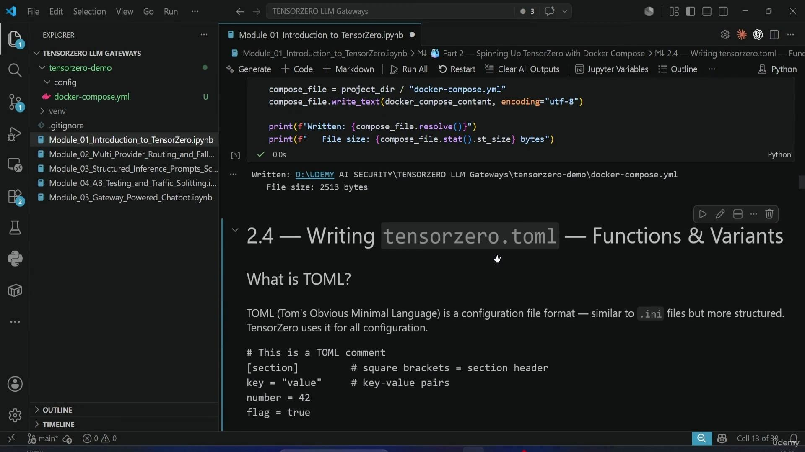

---

## 2. 讲师原话

先解释 TOML 是什么：

> "TOML 就是一种配置文件格式，全称是 Tom's Obvious Minimal Language。你可能见过 `.ini` 格式的文件，比如 C 语言项目里那种。它（TOML）比 `.ini` 更有结构一些。"
> —— p080 [00:00]

> "你基本上就是写键值对，在这个 section 里面写函数名、变体名，然后用键和值的形式给它们赋值。"
> —— p080 [00:27]

一个 `tensor0.toml` 里只有三件事可以做：

> "在 config 目录里你会创建 `tensor0.toml` 文件，在这个文件里你有三件事可以做：第一，定义你所有的模型和所有的 provider（提供商）及其细节；第二，定义所有的函数、函数名和变体名；第三，还有一个可选的网关设置（gateway settings）。我们还没有用到这个网关设置，我们只会定义 provider、定义函数和变体。"
> —— p080 [00:57]

TensorZero 已经内置认识主流模型，所以模型名可以简写：

> "TensorZero 已经知道那些有名的模型了，它已经知道 OpenAI、Groq、Claude、Gemini，所以你不用写全名。比如你写 OpenAI 的，直接写 `openai::gpt-4o-mini` 就行——TensorZero 已经知道这个人在调 OpenAI，并且在这家里面调这个具体模型。Groq 也一样，直接写 `groq::llama-3.1-8b-instant`，它就知道。"
> —— p080 [01:24]

`weight` 字段就是 A/B 测试的流量切分：

> "你在创建 `tensor0.toml` 的时候，列出 OpenAI 的 weight 是 0.8、Groq 的 weight 是 0.2，那你的 TensorZero 就知道：80% 的流量应该发给 OpenAI，20% 的流量应该发给 Groq。这就是我们说的 weight。weight 的意思就是自动把 80% 流量随机发给 OpenAI、20% 流量随机发给 Groq。weight 基本上就是用来做 A/B 测试的。"
> —— p080 [02:22]

函数本身是 prompt，定义在另一个文件里：

> "你可能会问，我在哪儿定义了这个函数？函数其实就是你的 prompt。函数是 prompt。我们确实会定义函数，但函数不能在这个文件里定义，为此我们有另一个文件，叫 minijinja。在那个 minijinja 模板里，我们定义函数——函数就是 prompt。比如你定义 `summarize` 这个 prompt 的时候，你告诉它：把上下文里所有东西拿过来，总结成一段 50 词的短文、50 词的摘要。这就是你的 prompt，也就是你的函数。至于这个函数具体怎么实现，取决于 variant。"
> —— p080 [04:16]

`functions` 和 `variants` 这两个关键字不能改，名字可以改：

> "你照着函数名原样复制——写 `functions.summarize`，然后 `.variants`。这两个关键字必须一模一样。名字你可以按需改，`summarize` 和变体名你都可以改，但 `functions` 和 `variants` 这两个关键词必须一致。"
> —— p080 [04:45]

用 weight 开关变体，而不是删掉变体：

> "现在我们把 weight 设成 1，另一边也做了一样的事……如果 weight 现在设成 1，这里 weight 设成 0，意思就是我们暂时不想用 Groq 模型，只想用 OpenAI 模型。后面的模块我会给你演示改 weight 的场景。现在我只想用 OpenAI。如果你想只用 Groq，就把 Groq 设成 1、把 OpenAI 设成 0，这样就能跑。"
> —— p080 [06:10]

`chat` 函数故意不带 system prompt：

> "现在这是通用聊天函数 general chat。这个函数我们不想加任何 prompt——就是一次普通聊天，你问，OpenAI 模型返回什么你原样给出，不附带任何特定指令。而 `summarize` 会附带特定指令，比如「你是专家级摘要器，你只做摘要」。但 `chat` 函数你就是把问题交给 OpenAI：你回复我你想回复的就行。"
> —— p080 [07:34]

校验项目结构那一步是在看「字节数」：

> "我们来验证项目结构是不是配好了，我跑这个单元格，它会自动检查 `.env` 在不在、config 在不在、`docker-compose.yml` 在不在、`tensor0.toml` 在不在，它还会给我显示字节数。有字节数说明里面有内容。如果我删掉 `.env` 里的内容再跑，它就会显示 0 字节。"
> —— p080 [09:30]

启动前先确认 Docker 引擎在跑：

> "现在开始启动我们的 stack。启动之前先确认 Docker Desktop 在后台运行，底部应该显示引擎在运行（engine running）。"
> —— p080 [10:28]

> "这些是 Docker 命令。你写 `docker compose up -d`，`-d` 的意思是 detached（分离模式）。分离模式的意思是所有东西都在后台运行，不会影响你的前端服务。"
> —— p080 [10:56]

跑完看四个服务，其中一个会 exited：

> "在 Docker Desktop 里你会看到这个 tensor zero demo。打开它，里面有 Postgres、有 Gateway……一共有四个服务。现在你能看到三个服务是绿色的在跑：Gateway 在跑、UI 在跑、Postgres 在跑。那第二个服务为什么没跑？因为它那里来了个消息 `exited`，意思是它只跑一次。它就是用来做 schema 创建、建表的。"
> —— p080 [12:46]

两个端口各是干什么的：

> "点这个 localhost，你把地址写成 `localhost:4000`，把后面那一串删掉，回车，就会打开 TensorZero 的 UI。"
> —— p080 [13:13]

> "现在我们指向 localhost:3000。localhost:3000 上跑的是什么？如果你看 Docker Desktop，在 localhost:3000 上跑的是我们的 TensorZero LLM 网关。"
> —— p080 [19:03]

两个核心概念的原始定义：

> "如果让我非常简短地说：inference 就是你和 LLM 对话，你发一个问题，回来一个回答，这就是一次 inference——一问一答。而当你把多个 inference 归组，比如你和聊天机器人聊天，你会一个问题接一个问题地问，那我们可以把所有 inference 归组为一个 episode。"
> —— p080 [14:40]

> "你把问题发出去，它到 LLM 网关，再到 provider（可能是 OpenAI、Claude 之类），provider 把响应返回，回到你的应用。这整个循环就是一次 inference。而把多个 inference 归组在一起，就叫一个 episode。每次 inference 有自己的 inference ID，把所有 inference 归到一个 episode 里，episode 也有自己的 episode ID。"
> —— p080 [29:03]

为什么要归组：

> "假设 user1 在用你的聊天机器人，user2 也在用。user1 问第一个问题，这是第一次 inference；问第二个问题，第二次 inference；第三个问题、第四个问题……现在你想知道这些 inference 都来自这同一个用户，怎么办？你把它们归到一起，指定为一个 episode，然后说这个 episode 属于这个用户。user2 也一样。"
> —— p080 [30:01]

直连 OpenAI 时 base_url 不用写：

> "你从环境变量里取 API key，也就是 `OPENAI_API_KEY`。至于 base URL 这个参数，它的默认值就是这个（OpenAI 官方地址），所以你不用写它——它会自动指向 OpenAI。"
> —— p080 [17:05]

网关在这里扮演的是桥：

> "现在它（OpenAI 客户端）会把请求发到这个 URL，也就是 localhost:3000，然后我们的 LLM 网关——我们的 TensorZero——本来就知道所有 LLM provider，所以它会自动把请求发给 OpenAI 模型。所以基本上 LLM 网关在这里就是一座桥。"
> —— p080 [20:02]

多出 9 个 prompt token 的原因：

> "为什么 TensorZero 会多出 9 个额外的 token？因为它把 `summarizeSystem.minijinja` 这个模板注入了 prompt。直连 OpenAI 时，你给了 system prompt，但你没有把 system prompt 注入到用户给的内容里；而在 TensorZero 这次调用里，它把模板也拿上，和用户的问题整合在一起。所以 prompt token 会稍微高一点，取决于 prompt。所以多了 9 个 token。"
> —— p080 [31:55]

为什么生产上要用 TensorZero 客户端而不是 OpenAI 客户端：

> "如果你看我们用的，我们用的是 OpenAI 客户端。OpenAI 客户端只针对 OpenAI 的模型。如果你所有活都跟 OpenAI 模型有关，那你可以这么用。但如果你有多个 provider——OpenAI、Claude、Gemini、Groq——你就不能这么干。"
> —— p080 [25:11]

> "如果只有一个 provider，那没问题，这种方式可以考虑。但如果你有多个 provider，有 Claude 你得建 Claude 客户端，有 Gemini 你得建 Google AI 客户端，你得写多个客户端，代码太多、太乱。而用 TensorZero 客户端，你不需要 OpenAI 客户端、Claude 客户端这一堆，所有这些客户端都已经集成在 TensorZero 客户端里面了。"
> —— p080 [26:10]

最后是「控制力」这个结论：

> "有了 TensorZero 你得到的东西叫 control（掌控力）。所有数据、所有信息都在你手里：问了多少问题、做了多少次 inference、token 用量是多少，全都有。直连 OpenAI 你也有 token 用量，但你没法把这些东西全都追踪起来。"
> —— p080 [34:18]

---

## 3. 从零复现

### 3.1 前置条件

- **Docker Desktop 已安装并启动**，底部状态必须是 **engine running**。这一步不做，后面 `docker compose up -d` 一定失败。
- Python 3.10+ 环境（能 `pip install` 即可）。
- 一个 OpenAI API Key，一个 Groq API Key。Groq 的 key 到 Groq 的控制台去拿（讲师原话是「我去我的 Groq 控制台把 API key 复制过来」）。

### 3.2 目录结构（照这个建）

```
tensorzero-demo/
├── docker-compose.yml            # 课程材料提供（内容课里没讲，见 4.1）
├── .env                          # 你自己写，放两个 API key
├── config/
│   ├── tensor0.toml              # 本节核心：函数 + 变体 + 权重
│   └── summarizeSystem.minijinja # 本节核心：system prompt 模板
└── scripts/
    ├── check_stack.py            # 校验文件与字节数（复刻示意）
    ├── direct_openai.py          # 方式一：直连 OpenAI
    └── via_tensorzero.py         # 方式二：走本地网关
```

要点：`tensor0.toml` 里的 `system_template` 写的是**相对 config 目录**的文件名（讲师：`summarizeSystem.minijinja` 和 `tensor0.toml` 在同一个文件夹下，所以 TOML 直接指向它），所以两个文件必须**平级放在 `config/` 里**。

### 3.3 第一步：写 `config/tensor0.toml`

按讲师的顺序：先写 `[functions.summarize]`，`type = "chat"`；再写它的第一个变体（OpenAI）、第二个变体（Groq）；然后写第二个函数 `[functions.chat]` 和它的两个变体。全部内容见 4.2。

三个必须记牢的规则：

1. `functions` 和 `variants` 是**关键字**，不能改名；`summarize`、`chat`、`gpt`、`groq` 是**你自己起的名字**，可以改，但改了就得到处一起改。
2. 模型名用 `provider::model` 简写，不用写全名。
3. `weight` 是浮点数比例，同一函数下所有变体的 weight 加起来应该是 1。本节 `gpt = 1.0`、`groq = 0.0`。

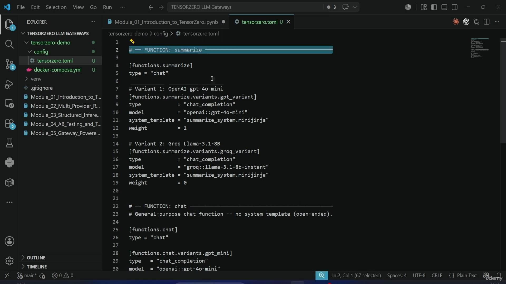

### 3.4 第二步：写 `config/summarizeSystem.minijinja`

这一步就是「定义函数」。讲师屏幕上的 prompt 大意是：给出 2~3 句的摘要、保留关键事实、保持中性语气、你是一个专家级摘要器。完整文本见 4.3。

注意：文件名大小写必须和 TOML 里 `system_template` 的值**逐字符一致**（讲师屏幕上写作 `summarizeSystem.minijinja`，逐字稿 ASR 记成了 `SummarizeSystem.miniginja`、`summarize system.mininja`，以你实际文件为准，两边对齐即可）。

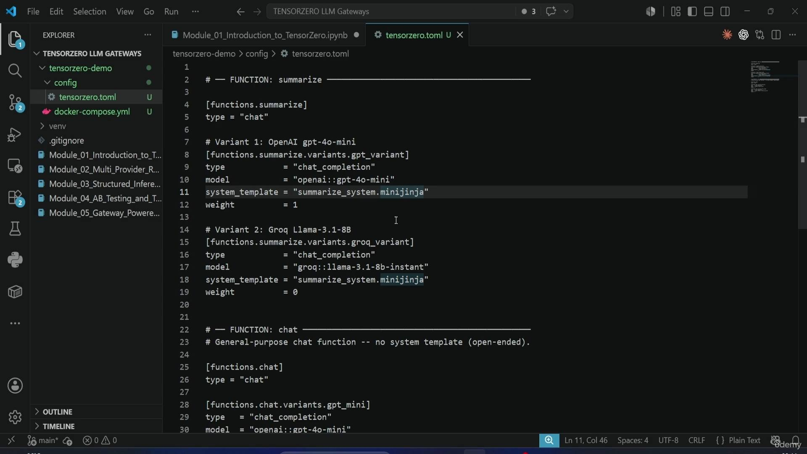

### 3.5 第三步：写 `.env`

在项目根目录（讲师说的「tensorzero 那个目录」）创建 `.env`，放两个 key。内容见 4.4。

讲师演示了「反向验证」：把 `.env` 内容删掉再跑校验脚本，字节数会变成 **0 bytes**；粘回去再跑，显示 **250 bytes**。你也可以用这个办法确认 key 真的写进去了、没有写成空文件。

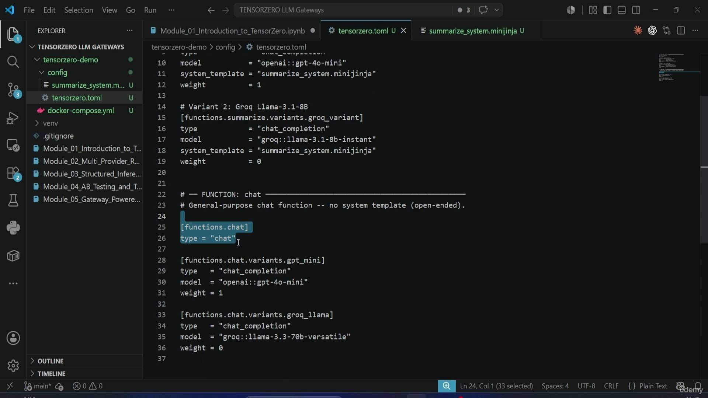

### 3.6 第四步：跑校验脚本，确认四件东西都在

```bash
cd tensorzero-demo
python scripts/check_stack.py
```

期望输出（形如）：

```
docker-compose.yml: 1234 bytes
.env: 250 bytes
config/tensor0.toml: 980 bytes
config/summarizeSystem.minijinja: 180 bytes
```

任何一项显示 `MISSING` 或 `0 bytes`，就回去补。这个脚本本身是「Claude 帮忙写的辅助代码」，讲师明确说不必研究它，重点是 `tensor0.toml` 和网关相关代码。

### 3.7 第五步：`docker compose up -d` 起栈

先确认 Docker Desktop 引擎在跑，然后在项目根目录执行：

```bash
docker compose up -d
```

- `-d` = **detached**，全部服务在后台跑，不占你的终端、不影响前端服务。
- **第一次**运行要拉取镜像（TensorZero 镜像、Postgres 镜像），可能要 **5~6 分钟**，也可能 2~3 分钟，取决于网络和镜像缓存。讲师这次只用了 **18 秒**，因为之前跑过、镜像已经在本地。
- 有报错会直接把错误打出来。

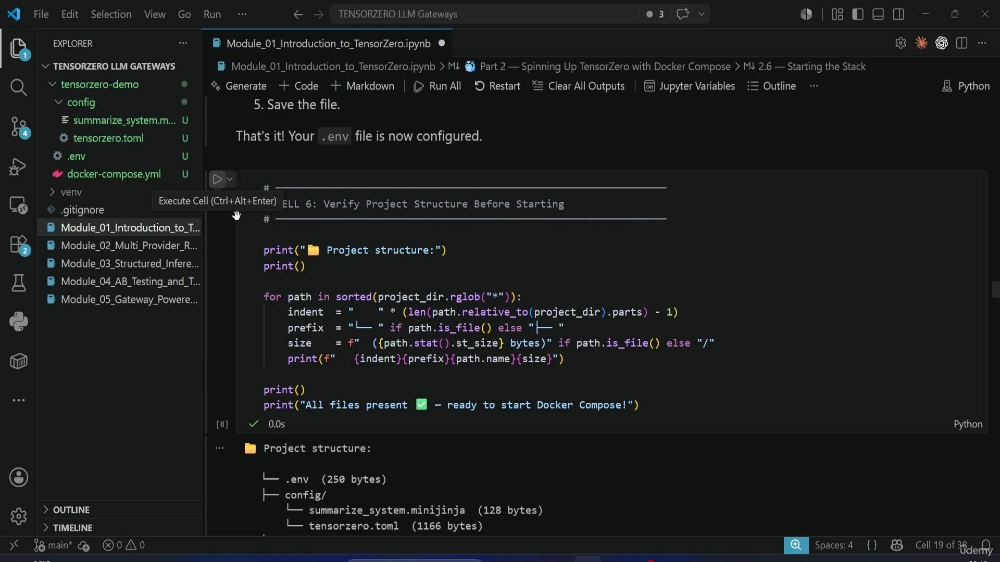

### 3.8 第六步：在 Docker Desktop 里数服务

打开 Docker Desktop，找到这个 stack（讲师屏幕上显示为 `tensor zero demo`），你应该看到四个服务：

| 服务 | 状态 | 说明 |
|---|---|---|
| Gateway | Running（绿色） | LLM 网关，端口 **3000** |
| UI | Running（绿色） | 控制台，端口 **4000** |
| Postgres | Running（绿色） | 存放 inference 记录的数据库 |
| 第四个（迁移/建表服务） | **Exited** | 只跑一次，负责创建 schema 和建表，跑完就退出，**这是正常的** |

「三个绿 + 一个 exited」就是正确状态。看到 exited 不要慌，那是设计如此。

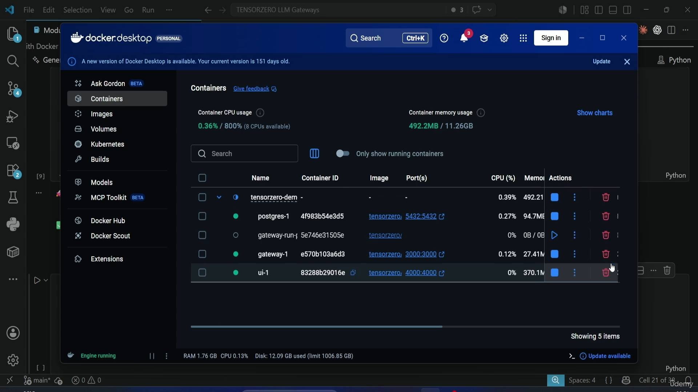

### 3.9 第七步：打开 UI，验证函数与权重

浏览器访问：

```
http://localhost:4000
```

进 **Functions** 页，你应该看到两个函数：

- `summarize` —— 下面两个变体 `gpt`、`groq`，权重 **gpt 1 / groq 0**（讲师口语说「200% gpt、0% groq」，实际就是 100% / 0%）。点开 `gpt` 变体，能看到你在 minijinja 里写的那段 system prompt；`groq` 变体里是**同一段** prompt（因为两个变体都引用了同一个模板）。
- `chat` —— 下面两个变体（Groq Llama 与 GPT mini）。点开能看到**没有模板**，因为我们故意没给它 system prompt。

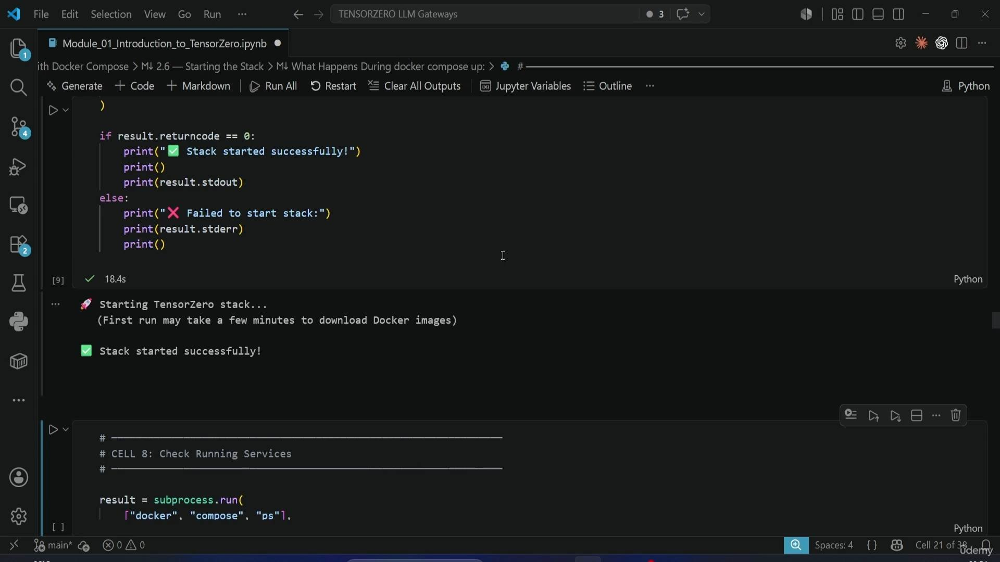

### 3.10 第八步：健康检查

课程里有一个单元格做健康检查，跑完输出类似「Gateway is healthy」，并给出 Gateway 的 API 地址。注意：**这个地址不能直接在浏览器里打开**，它是 API 不是网页；能打开的网页只有 UI（4000）。

### 3.11 第九步：装依赖

讲师口述要装的依赖：**OpenAI SDK、TensorZero Python 库、requests、python-dotenv**（用来加载 `.env` 里的环境变量）。版本号课里没讲。

```bash
pip install openai tensorzero requests python-dotenv
```

### 3.12 第十步：方式一 —— 直连 OpenAI

跑 `scripts/direct_openai.py`（完整代码见 4.6）。要点：只给 `api_key`，**不传 base_url**，因为默认值本身就是 OpenAI 官方地址。

你会看到：

- 一个 **OpenAI 生成的 chat id**（形如 `chatcmpl-...`，讲师说直连时 ID 前面会带 `chatcmpl` 这样的前缀）；
- 用的是哪个模型；
- 创建时间；
- token 用量：**prompt 142 / completion 70 / 合计约 210**；
- 两三行的摘要正文。

跑完之后，**你没有任何地方能查这条记录**——这就是讲师要对比的点。

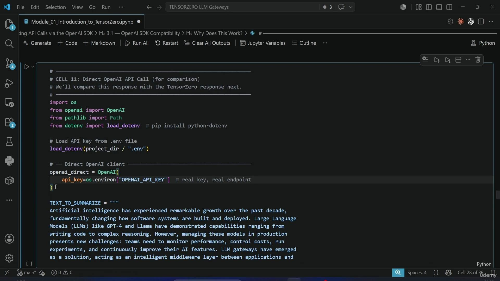

### 3.13 第十一步：方式二 —— 走本地网关

跑 `scripts/via_tensorzero.py`（完整代码见 4.7）。和方式一唯一的本质区别：**指向 `http://localhost:3000`**，并且用**函数名 `summarize`** 代替直接指定模型。

你会看到：

- 一个**不一样的 ID**：不是 OpenAI 那种 `chatcmpl-` 前缀，而是 TensorZero 自己生成的 ID（讲师：这是 TensorZero 给的自定义 ID，作用同样是唯一标识这次对话，工作相同、格式不同）；
- 函数名 `summarize`、**变体名 `gpt`**（说明命中了 gpt 变体）；
- 创建时间；
- **多了 `episode_id` 和 `inference_id`**；
- token 用量：**prompt 151 / completion 91 / 合计约 250**；
- 摘要正文——**和方式一几乎一样，质量没有妥协**。

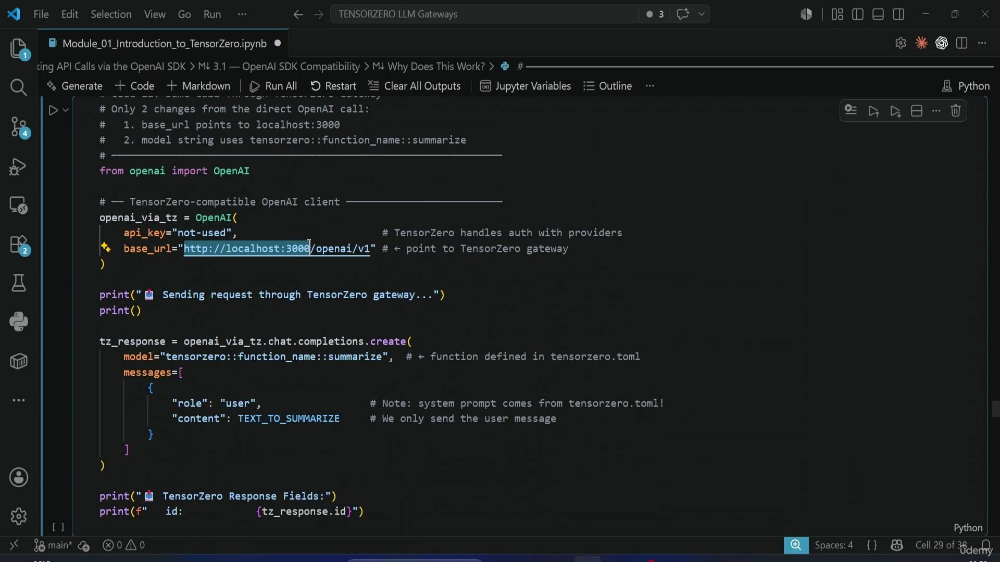

### 3.14 第十二步：回 UI 看 inferences

打开 `http://localhost:4000` 的 **Inferences** 面板，找到刚才那次调用，逐项核对：

- 这次 inference 执行的是哪个 **function**（`summarize`）、哪个 **variant**（`gpt`）；
- **episode id** 和 **inference id**；
- 用户问了什么、模型答了什么；
- 用了什么参数、什么模型（OpenAI `gpt-4o-mini`）；
- **raw request**（原始请求长什么样）、**raw response**（原始响应长什么样）；
- 输入 token 151、输出 token 91、总 token 约 250、处理时间（latency）。

看到这些意味着：**数据被存下来了**。讲师的原话是——「就算 10 年后我回来，这些记录都还在；但直连那次，10 年后你不知道当时问了什么」。这就是 TensorZero 相对直连的核心优势。

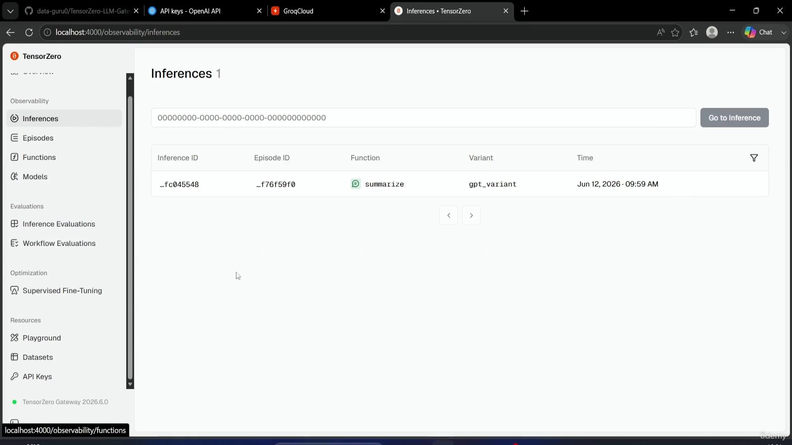

### 3.15 第十三步：结束，`docker compose down`

模块做完后，在项目根目录执行：

```bash
docker compose down
```

它会停掉所有服务。也可以直接在 Docker Desktop 里点停止。**不要**在验证阶段就 down，否则 UI 打不开、inference 记录也没法看。

### 3.16 附：换变体的实验（讲师说后面模块会做，这里给做法）

想切到 Groq，**不需要改 Python 代码**，只改 `config/tensor0.toml` 两个数字：

```toml
[functions.summarize.variants.gpt]
weight = 0.0

[functions.summarize.variants.groq]
weight = 1.0
```

改完重启栈（`docker compose down && docker compose up -d`），再跑 `via_tensorzero.py`，变体名就会变成 `groq`。想 A/B 测试就设 `0.8 / 0.2`，TensorZero 会按比例**随机**分流。

---

## 4. 完整代码

### 4.1 `docker-compose.yml`

**课里没讲这个文件的内容。** 讲师只提到它在项目里存在（校验脚本会检查它），并通过 Docker Desktop 展示了它拉起的四个服务。请从课程材料里取这份文件，放到项目根目录。它必须提供上表那四个服务：Gateway（3000）、UI（4000）、Postgres、一次性迁移服务。

**不要**凭本文自行编写 —— 镜像名、端口映射、`.env` 注入方式课里都没有出现。

### 4.2 `config/tensor0.toml`（完整文件）

```toml
# ============================================================
# config/tensor0.toml
# TensorZero 的配置文件。TOML = Tom's Obvious Minimal Language
# 以 # 开头的是注释。
# 本文件做三件事里的两件：
#   1) 定义 functions（函数 = 你的 prompt 的用途）
#   2) 在函数下面定义 variants（变体 = 具体用哪个 provider 的哪个模型）
# 第三件可选项 gateway settings 本节没有使用。
# ============================================================

# ---------------- 函数 1：summarize（摘要） ----------------
# functions / variants 是关键字，不能改名。
# summarize 是我们自己起的函数名，可以改，但要和 Python 里传的 function_name 一致。
[functions.summarize]
type = "chat"          # 用于 LLM 推理，所以 type = chat

# --- 变体 1：gpt（走 OpenAI） ---
[functions.summarize.variants.gpt]
type = "chat_completion"
# TensorZero 已经认识主流 provider，所以只写 provider::model 简写即可
model = "openai::gpt-4o-mini"
# system prompt 放在 config 目录下的 minijinja 模板里，这里写相对文件名
system_template = "summarizeSystem.minijinja"
weight = 1.0           # 100% 流量走这个变体

# --- 变体 2：groq（走 Groq） ---
[functions.summarize.variants.groq]
type = "chat_completion"
model = "groq::llama-3.1-8b-instant"
system_template = "summarizeSystem.minijinja"   # 同一个模板
weight = 0.0           # 0 = 暂时不用它。想切过来就改成 1.0，并把上面改成 0.0

# ---------------- 函数 2：chat（通用闲聊） ----------------
# 这个函数故意不配 system_template：不附加任何指令，问题原样给模型，回答原样返回。
[functions.chat]
type = "chat"

[functions.chat.variants.gpt]
type = "chat_completion"
model = "openai::gpt-4o-mini"
weight = 1.0

[functions.chat.variants.groq]
type = "chat_completion"
model = "groq::llama-3.1-8b-instant"
weight = 0.0
```

> 说明：段名 `[functions.summarize]`、`[functions.summarize.variants.gpt]`、`type = "chat"` / `"chat_completion"`、`model = "openai::gpt-4o-mini"`、`model = "groq::llama-3.1-8b-instant"`、`system_template`、`weight` 都是讲师在屏幕上逐条讲到的。变体名 `gpt` / `groq` 来自 UI 里看到的「gpt variant / gpt mini、Groq Llama」，逐字稿 ASR 写成 `grok / grog`，请以你屏幕上的拼写为准，改了就两处一起改。

### 4.3 `config/summarizeSystem.minijinja`（完整文件）

```jinja
You are an expert summarizer.

Summarize the given statement in two to three sentences.
Preserve the key facts.
Maintain a neutral tone.
```

> 这是讲师屏幕上那段 prompt 的还原：给出 2~3 句摘要、保留关键事实、保持中性语气、你是专家级摘要器。文件必须和 `tensor0.toml` **同在 `config/` 目录**，TOML 里写的文件名要和磁盘上的**完全一致**。

### 4.4 `.env`（完整文件）

```bash
# 放在项目根目录。讲师演示时这个文件约 250 bytes。
OPENAI_API_KEY=sk-你的-openai-key
GROQ_API_KEY=gsk_你的-groq-key
```

> 课里只演示了往这里粘 OpenAI 和 Groq 两个 key，**没有提到其他变量名**。也没有讲这两个变量是怎么被注入到容器里的（见第 7 节）。

### 4.5 `scripts/check_stack.py`（复刻示意，讲师说是 Claude 生成的辅助代码，课里没逐行念）

```python
"""
检查项目关键文件是否存在、是否有内容（字节数 > 0）。
对应讲师演示的「验证项目结构」单元格。
注意：这是复刻示意代码，讲师明确说不必研究它。
"""
from pathlib import Path

# 项目根目录
ROOT = Path(__file__).resolve().parent.parent

TARGETS = [
    "docker-compose.yml",
    ".env",
    "config/tensor0.toml",
    "config/summarizeSystem.minijinja",
]

for rel in TARGETS:
    p = ROOT / rel
    if not p.exists():
        print(f"{rel}: MISSING")
    else:
        print(f"{rel}: {p.stat().st_size} bytes")
```

### 4.6 `scripts/direct_openai.py`（方式一：直连 OpenAI，完整可运行）

```python
"""
方式一：直接调用 OpenAI，不经过任何 LLM 网关。
讲师强调：这种方式生产上不推荐（只在单一 provider 时勉强可用），
本节仅用于和网关方式做对比。
"""
import os

from dotenv import load_dotenv
from openai import OpenAI

load_dotenv()  # 从 .env 加载 OPENAI_API_KEY

# 只给 api_key。base_url 不传，因为 SDK 默认值就是 OpenAI 官方地址。
# （讲师：这个参数的默认值就是它，所以你不用定义。）
client = OpenAI(api_key=os.environ["OPENAI_API_KEY"])

TEXT = (
    "Artificial intelligence is a field of computer science that builds systems "
    "capable of performing tasks that normally require human intelligence, such as "
    "understanding language, recognizing images, and making decisions. Modern AI is "
    "dominated by machine learning, where models learn patterns from large amounts of "
    "data instead of being explicitly programmed. Recent advances in large language "
    "models have made AI useful for writing, coding, summarization and question "
    "answering, but they also raise concerns about accuracy, bias, cost and safety."
)

resp = client.chat.completions.create(
    model="gpt-4o-mini",
    messages=[
        {
            "role": "system",
            "content": (
                "You are an expert summarizer. "
                "Summarize the given statement in two to three sentences. "
                "Preserve the key facts. Maintain a neutral tone."
            ),
        },
        {"role": "user", "content": TEXT},
    ],
)

# 讲师演示时看的就是这几项：ID、模型、创建时间、token 用量、正文。
# 字段名请以你装到的 openai SDK 版本的实际输出为准。
print("id:", resp.id)
print("model:", resp.model)
print("created:", resp.created)
print("prompt_tokens:", resp.usage.prompt_tokens)      # 讲师这次：142
print("completion_tokens:", resp.usage.completion_tokens)  # 讲师这次：70
print("total_tokens:", resp.usage.total_tokens)        # 讲师这次：约 210
print("---")
print(resp.choices[0].message.content)
```

### 4.7 `scripts/via_tensorzero.py`（方式二：走本地网关，完整可运行）

```python
"""
方式二：走本地 TensorZero 网关（localhost:3000）。
相对方式一，本质区别只有一个：请求指向网关，而不是 OpenAI。
system prompt 不再写在代码里——它已经在 config/summarizeSystem.minijinja 里，
由 tensor0.toml 的 system_template 字段注入。
"""
import os

from dotenv import load_dotenv
from tensorzero import TensorZeroGateway

load_dotenv()

TEXT = (
    "Artificial intelligence is a field of computer science that builds systems "
    "capable of performing tasks that normally require human intelligence, such as "
    "understanding language, recognizing images, and making decisions. Modern AI is "
    "dominated by machine learning, where models learn patterns from large amounts of "
    "data instead of being explicitly programmed. Recent advances in large language "
    "models have made AI useful for writing, coding, summarization and question "
    "answering, but they also raise concerns about accuracy, bias, cost and safety."
)

GATEWAY_URL = "http://localhost:3000"  # 讲师：这里就是 TensorZero LLM 网关

with TensorZeroGateway.build_http(gateway_url=GATEWAY_URL) as client:
    resp = client.inference(
        # 用函数名代替直接指定模型，具体走哪个变体由 tensor0.toml 的 weight 决定
        function_name="summarize",
        input={"messages": [{"role": "user", "content": TEXT}]},
    )

# 讲师演示时看的几项：自己的 ID、function 名、variant 名、创建时间、
# episode id、inference id、token 用量。
# 字段名以你实际返回对象为准；不确定就直接 print(resp) 看全量。
print("inference_id:", resp.inference_id)
print("episode_id:", resp.episode_id)
print("variant_name:", resp.variant_name)
print("---")
print(resp)
```

### 4.8 附：OpenAI 兼容写法（课里没有代码，以下为
示意）

> **课里没有代码，以下为示意。** 讲师在 [24:42] 提到过这个思路：同样用 OpenAI 客户端，只把 `base_url` 从默认值改成 `http://localhost:3000`，请求就先打到网关，再由网关转发给 OpenAI。他也明确说这条路**不是生产做法**（见第 5.11 节）。所以这里只保留「只改一个参数」的形态，具体路径前缀、`model` 字段要怎么写才能对上 `summarize` 函数，**课里没讲**，请以 TensorZero 官方文档和你实际跑通的结果为准。

```python
# 课里没有代码，以下为示意：体现「OpenAI 客户端 + 改 base_url」的思路
from openai import OpenAI

client = OpenAI(
    api_key="dummy",                  # 走到网关后由网关持有真实 provider key
    base_url="http://localhost:3000",  # 唯一改动点：从默认地址指向本地网关
)
# 课里没讲这个 URL 需不需要带 /v1 之类的前缀，也没讲 model 字段在这里
# 要写成模型名还是函数名，请以实际文档为准。
```

---

## 5. 逐行解释

### 5.1 TOML 这门格式本身

`tensor0.toml` 是配置文件，格式叫 TOML（Tom's Obvious Minimal Language）。讲师拿它和 `.ini` 对比：`.ini` 也常见（他说在 C 语言项目里见过），但 TOML「比 `.ini` 更有结构一些」。落到写法上只有三条规则，你必须记牢：

| 元素 | 写法 | 作用 |
|---|---|---|
| 注释 | `# 后面是注释` | 不参与解析，讲师屏幕上的说明文字全是这种 |
| 段（section） | `[functions.summarize]` | 用方括号开一个命名空间，后面所有键值对都归属它 |
| 键值对 | `type = "chat"` | 键 = 值。字符串加引号，数字不加 |

对照 JS：TOML 的 `[a.b.c]` 约等于 JS 里的嵌套对象 `{ a: { b: { c: {} } } }`，`key = "value"` 约等于 `key: "value"`。TOML 不允许你把 `[functions.summarize]` 写两遍来「追加」，重复段会报错——这就是为什么每个变体都必须写成完整路径 `[functions.summarize.variants.gpt]`，而不是先开 `[functions.summarize.variants]` 再开 `[.gpt]`。

### 5.2 `tensor0.toml` 逐个配置项为什么这样定

**`[functions.summarize]`**——讲师的原话是「注释名要写在括号里，你定义的不是注释名，是函数名」。这里 `functions` 是**关键字**（框架认死的），`summarize` 是**你起的名字**。讲师强调：`summarize` 你可以改，但改了之后 Python 里 `function_name="summarize"` 也得跟着改，否则网关找不到这个函数。在 JS 里这就相当于路由名：`app.post('/summarize', ...)` 改了路径，前端 fetch 的地址必须同步改。

**`type = "chat"`**——讲师解释：「它是给 LLM 推理用的，所以我们设 `type = "chat"`」。也就是说函数这一层的 `type` 表达的是「这是不是一次对话式模型调用」，本节只有这一种，所以两个函数都是 `chat`。

**为什么一个函数必须挂两个变体**——讲师反复讲：「一个函数单独是不够的，函数必须配两个变体」。原因在后面的取舍里：函数只是「用途 + prompt」，变体才是「哪家 provider 的哪个模型」。只有把「要做什么」和「用谁做」拆开，你才可能在不改代码的前提下把流量从 OpenAI 切到 Groq——这正是他后面讲的 A/B 测试和路由能力的基础。

**`[functions.summarize.variants.gpt]`**——注意这里是**三段**：`functions` → `summarize` → `variants` → `gpt`。讲师特别点出：「`functions` 和 `variants` 这两个关键字必须一模一样（这两层不能改名），`summarize` 和变体名你可以改」。这就是本节唯一一个「改一个字就全盘崩」的位置。

**`type = "chat_completion"`**——变体这一层的 `type` 比函数层更具体：它对应「chat completion」这种调用形态（也就是一问一答补全）。讲师的说法是「type 就是 chat completion」。

**`model = "openai::gpt-4o-mini"`**——这是本节省事最多的一行。讲师说：「你不用把模型名写全，TensorZero 已经知道 OpenAI、Groq、Claude、Gemini 这些有名的模型」，所以写成 `provider::model` 的双冒号形式即可，网关自己拆开：前半段是 provider，后半段是模型。他还补了一句「如果想用 gpt-5 就直接写 `gpt-5`」。反过来说：**不出名的小众开源模型它不一定认识**，那种情况你得把完整信息写出来，具体怎么写课里没讲。

**`system_template = "summarizeSystem.minijinja"`**——讲师把这一行称为「最重要的地方：system template 在哪」。答案是**不在 TOML 里**，在同目录的 `.minijinja` 模板文件里，TOML 只存**文件名**。因为两个文件同在 `config/` 下，所以这里写相对文件名就够了。这是本节最容易踩的坑：文件名写错一个字母、大小写不一致、或者两个文件不在同一层目录，网关启动或首次调用就会报找不到模板。

**`weight = 1.0` / `weight = 0.0`**——讲师用最直白的方式解释了它：「OpenAI 的 weight 是 0.8、Groq 的 weight 是 0.2，那 TensorZero 就知道 80% 流量发给 OpenAI、20% 发给 Groq，而且是**随机**发。」所以他给 weight 的定义是「用来做 A/B 测试的」。本节把 `gpt` 设 1.0、`groq` 设 0.0，等价于「**把 Groq 这个变体软关掉**，但配置留着」——讲师原话：「如果你想只用 Groq，就把 Groq 设成 1、把 OpenAI 设成 0」。对比一下：删掉变体是硬删除，改 weight 是开关，后者随时可回滚，这就是为什么他要求两个变体都写全。

**`[functions.chat]` 故意没有 `system_template`**——这不是漏写。讲师专门解释：「`chat` 函数我们不想加任何 prompt，就是一次普通聊天，你问，OpenAI 返回什么你原样给出，不附带任何特定指令」；而 `summarize` 是「附带了特定指令：你是专家级摘要器，你只做摘要」。所以 UI 里点开 `chat` 的变体会看到**模板为空**，这是符合预期的。这条差异也解释了为什么同样两个函数，只有 `summarize` 那次调用会多花 token（见 5.9）。

### 5.3 `summarizeSystem.minijinja` 逐句

模板四句话，每一句都对应讲师口述的一个约束：

1. `You are an expert summarizer.` —— 角色设定。讲师原话：「你是专家级摘要器」。
2. `Summarize the given statement in two to three sentences.` —— 长度约束。讲师原话：「把上下文里所有东西拿过来，总结成 50 词的短文、50 词的摘要」，他后面又在 UI 里补充实际写的是「两三句话」。**课里两个数字都出现过（50 词 / 2~3 句）**，以你屏幕上那份文件为准；本文按「两三句」写。
3. `Preserve the key facts.` —— 讲师原话：「保留关键事实」。
4. `Maintain a neutral tone.` —— 讲师原话：「保持中性语气」。

`.minijinja` 是模板引擎的扩展名（minijinja 是 Jinja 模板语法的 Rust 实现）。本节只用了静态文本、没有用任何变量占位符，所以你在文件里写什么，模型就收到什么——这也是为什么讲师能用「多 9 个 token」精确解释 token 差额。至于模板里能不能写 `{{ ... }}` 变量、变量从哪来，**课里没讲**。

### 5.4 `.env` 与「字节数校验」的逻辑

`.env` 里两个变量：`OPENAI_API_KEY` 和 `GROQ_API_KEY`。它们在代码里通过 `os.environ["OPENAI_API_KEY"]` 读取——JS 里对应 `process.env.OPENAI_API_KEY`。`load_dotenv()` 的作用就是把 `.env` 文件的内容灌进进程环境变量，等价于 Node 里的 `require('dotenv').config()`。

讲师演示的校验手法值得学：他先跑一次，看到 `.env: 250 bytes`；然后把 `.env` 的内容**清空保存**，再跑一次，输出变成 `.env: 0 bytes`；粘回去再跑，又回到 250 bytes。这验证的不是「文件存在」，而是「文件里真的有内容」。很多「明明配了 key 却报未授权」的现场，本质上都是文件存在但内容为空、或者 key 被截断。这也是 `check_stack.py` 用 `stat().st_size` 而不是 `exists()` 的原因。

### 5.5 `check_stack.py` 逐行

- `ROOT = Path(__file__).resolve().parent.parent`：从脚本位置往上跳两级拿到项目根目录，这样脚本放在 `scripts/` 里也能正确找到 `docker-compose.yml`。JS 里等价于 `path.resolve(__dirname, '..')`。
- `TARGETS` 列表：对应讲师校验的四样东西——`.env`、`config/` 下的 `tensor0.toml`、`docker-compose.yml`，以及模板文件。讲师原话是「它会自动检查 env 在不在、config 在不在、docker-compose.yml 在不在、tensor0.toml 在不在」。
- `p.stat().st_size`：输出字节数，`0` 就是「有文件没内容」。
- 讲师明确说这段是「Claude 帮忙写的辅助代码，你不必研究它」——所以你不用在这里花时间，重点在 TOML 和网关调用。

### 5.6 `direct_openai.py` 逐行（方式一）

- `client = OpenAI(api_key=os.environ["OPENAI_API_KEY"])`：**只给 api_key，不给 base_url**。讲师原话：「base URL 这个参数默认值就是它（OpenAI 官方地址），所以你不用定义它」——不写就是直连 OpenAI。这一行是「方式一」和「方式二」在直觉上的分水岭。
- `messages` 里第一条是 `role: "system"`：这就是把 system prompt **作为独立的一条消息**发给 OpenAI。注意这一点，等下 5.9 讲 token 差额时要用。
- `model="gpt-4o-mini"`：这里必须写模型全名，因为你没有网关帮你把「函数名」翻译成「模型名」。
- 打印的四项：`id`、`model`、`created`、`usage` 三个 token 字段。讲师这次的实测是 **prompt 142 / completion 70 / 合计约 210**。
- 讲师对这个 ID 的描述：「每次你问问题，OpenAI 都会给这次对话生成一个唯一 ID」，形如 `chatcmpl-...`（他原话是「前面带 chats、MPL 之类的前缀」——ASR 记糊了，你屏幕上看到的就是 `chatcmpl-` 这类前缀）。
- **跑完之后的关键事实**：这条记录**没有任何地方可以查**。这就是他后面所有论证的起点。

### 5.7 `via_tensorzero.py` 逐行（方式二）

- `GATEWAY_URL = "http://localhost:3000"`：讲师原话「现在我们指向 localhost:3000，在 3000 上跑的是我们的 TensorZero LLM 网关」。**端口号是这一节唯一必须记死的运行参数**（另一个是 UI 的 4000）。
- `TensorZeroGateway.build_http(gateway_url=...)`：建一个走 HTTP 的网关客户端。`with ... as client:` 是 Python 的上下文管理语法（进块时建连接、出块时自动关闭），**知道即可**，JS 里对应 `try { ... } finally { await client.close() }`，或者未来的 `using` 声明。
- `function_name="summarize"`：**这里是整个 demo 的核心差异**。你没写模型、没写 system prompt、没写 provider，只写了一个函数名。讲师原话：「我们用的是 `summarize` 这个函数名，然后你只要把要总结的文本传进去」。剩下的翻译工作——函数 → 变体 → provider → 模型 → 拼上 minijinja 模板——全在网关里完成。
- `input={"messages": [{"role": "user", "content": TEXT}]}`：**只有 user，没有 system**。因为 system prompt 已经由 TOML 的 `system_template` 声明、由网关在背后注入。这就是 5.9 的伏笔。
- 打印的字段：`inference_id`、`episode_id`、`variant_name`。讲师在响应里看到的正是「函数名 `summarize`、变体名 `gpt`」——变体名能被打出来，说明 `weight = 1.0` 生效、命中了 gpt。
- 讲师实测 token：**prompt 151 / completion 91 / 合计约 250**。
- **字段名提醒**：上面三个属性名请以你装到的 TensorZero Python 包实际返回为准；不确定就 `print(resp)` 把整个对象打出来看。本文只保证「这三个信息一定拿得到」，不保证属性名逐字符一致。

### 5.8 两次调用的逐项对照

| 对比项 | 直连 OpenAI（方式一） | 走 TensorZero（方式二） |
|---|---|---|
| base_url | 不写（默认官方地址） | `http://localhost:3000` |
| 你指定的东西 | 模型名 `gpt-4o-mini` | **函数名 `summarize`** |
| system prompt 写在哪 | 代码里的 `messages[0]` | `config/summarizeSystem.minijinja`（代码里不出现） |
| 返回的 ID | OpenAI 生成的 ID（`chatcmpl-` 前缀） | TensorZero 自己生成的 ID（无该前缀，**自定义 ID**） |
| 模型信息 | 有（`model` 字段） | 有（UI 里能看到 `gpt-4o-mini`） |
| 变体信息 | 没有 | **有**（`gpt`） |
| `episode_id` | **没有** | **有** |
| `inference_id` | 没有 | **有** |
| A/B 路由 | 没有（企业版可能有，讲师说「我们不展开」） | **有**（靠 weight） |
| 数据库记录 | 没有 | **有**（自动写进 Postgres） |
| prompt token | 142 | 151 |
| completion token | 70 | 91（讲师：completion 会随模型波动，不能拿来论证） |
| 总 token | 约 210 | 约 250 |
| 输出质量 | 两三行摘要 | **几乎一样，「质量上没有妥协」** |

讲师对这个对照的结论是分层说的：论「工作」两者是一样的（都是唯一标识一次对话），区别只在**格式**，所以单看 ID 这一项算是 **tie（平手）**；但一旦看 episode、A/B 路由、数据库记录、控制力，就一边倒了。

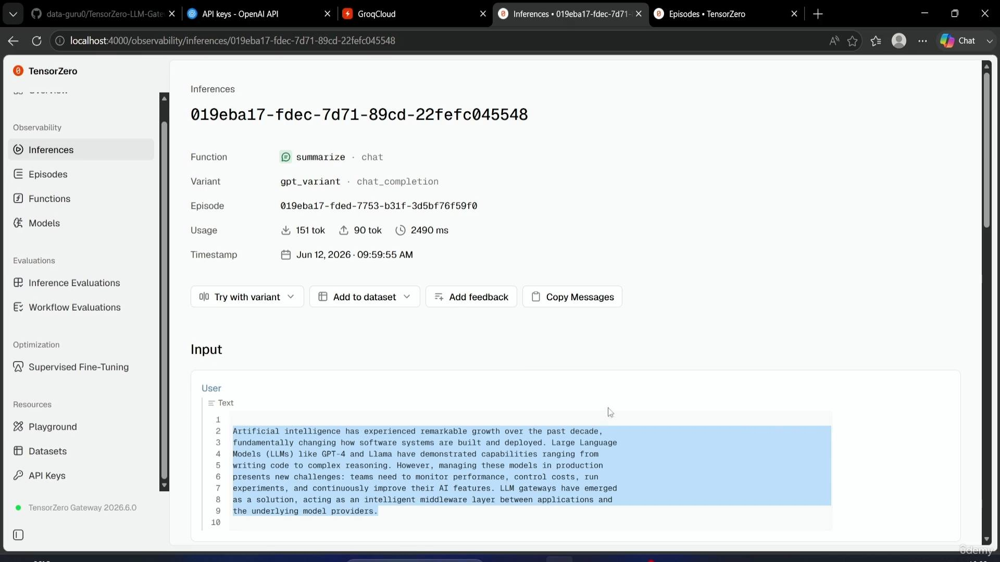

### 5.9 为什么 prompt token 从 142 变成 151

这是本节最值得记住的一个「反直觉点」。讲师自己抛出问题：「prompt 从 142 变成了 151，为什么多了 9 个？completion 有差异我能理解，取决于模型，但 prompt 为什么有差异？」

他的答案是：**因为 TensorZero 把 `summarizeSystem.minijinja` 这个模板注入到了 prompt 里**。

再往下拆一层，是两种「拼装方式」的差别：

- **直连 OpenAI 时**：你给了 system prompt，但它是作为**独立的一条 system 消息**发出去的，和你用户那条内容**各占各的位置**。
- **走 TensorZero 时**：网关把模板拿出来，**和用户的问题整合在一起**构成最终 prompt。

讲师的原话是：「在你的应用里没有 system 消息，但 TensorZero 在背后加了一条（system message）」。所以差额来自这次「背后注入」多出来的模板文本与结构开销。他给的量化结论是 **9 个额外 token**，并且强调「具体高多少取决于 prompt」，同时给出安慰：「summary 的质量保持不变，其他一切都保持不变」。

顺带一条更重要的结论：**每一次 TensorZero inference 都被自动记录到 Postgres 数据库**（讲师原话：「每一次 TensorZero inference 都会自动记录到一个 Postgres SQL 数据库里」）。所以你在 UI 里看到的东西，本质是数据库里的行，不是什么魔法。

### 5.10 inference 与 episode：两个必须分清的概念

这是本节唯一一段纯概念讲解，但它决定了你能不能看懂 UI 的 Inferences 面板。

**inference（一次推理）**——讲师的链路图：用户/应用 → LLM 网关 → provider（OpenAI、Claude 之类）→ 返回 → 回到应用。**这一整个循环就是一次 inference**，也就是「一问一答」。每次 inference 有自己的 `inference_id`。

**episode（一次会话）**——把多个 inference **归组**，就叫一个 episode，有自己的 `episode_id`。

为什么要归组，讲师举了个具体场景：user1 和 user2 都在用你的聊天机器人。user1 问第 1、2、3、4 个问题，这就是 4 次 inference；你想知道「这 4 次都来自同一个人」，于是把它们归到一起、定为一个 episode，并声明这个 episode 属于 user1。user2 同理。他给的使用场景就一句：「一般用在聊天机器人上，因为你想追踪这些问题是同一个人问的，这样后续分析会容易得多」。

给前端同学的类比，方便一次记住：

- `inference` ≈ 你发的一次 `fetch()` 请求 + 它的响应；
- `inference_id` ≈ 一次请求的 `requestId`；
- `episode` / `episode_id` ≈ 一次会话的 `sessionId` / `conversationId`，你在前端用它在 localStorage 里串起一串消息；
- 差别在于：前端是**你自己**在维护 sessionId，而 TensorZero 是**网关自动**帮你落库的。

两种方式的差异也就清楚了：**直连 OpenAI 拿不到 episode**（它只给你一问一答），**走 TensorZero 才有多轮归组的能力**。

### 5.11 为什么生产必须用 TensorZero 客户端，而不是 OpenAI 客户端

讲师在这里花了最长的篇幅，逻辑链是这样的：

1. 我们刚才用的是 **OpenAI 客户端**（`from openai import OpenAI`）。
2. OpenAI 客户端**只针对 OpenAI 模型**。所以「如果你所有活都跟 OpenAI 有关，那这么用没问题」——单 provider 场景下，这条路是可以考虑的。
3. 但一旦你有多 provider：有 Claude，你得建 **Claude 客户端**；有 Gemini，你得建 **Google AI 客户端**；有 Groq，你得装 **Groq SDK**。而每个 SDK 都要 `import`、都要 install、都要处理各自的鉴权和返回结构。
4. 结果就是「代码太多、太乱」。
5. 而 `TensorZero client` 里**这些客户端已经全部集成进去了**：同一个客户端，想调 OpenAI 调 OpenAI，想调 Claude 调 Claude，想调 Gemini 调 Gemini。

所以他给的判断是：**OpenAI 客户端 + 改 base_url 这条路，「课里明确说不算生产做法」**；`TensorZero 客户端才是生产做法（production way）`。

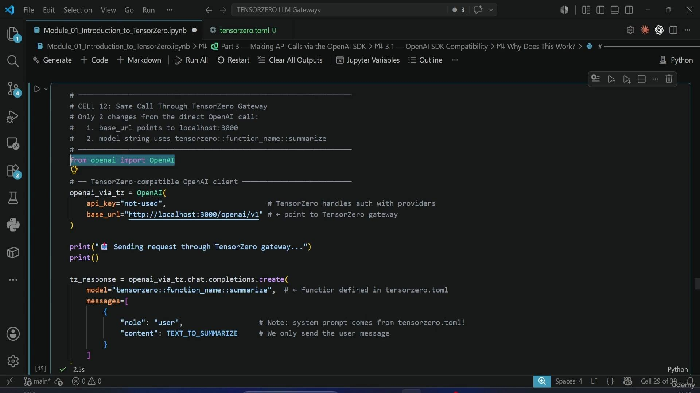

### 5.12 「控制力」——这一节的最终结论

讲师在收尾时把两条路的价值压成了一个词：**control（掌控力）**。他的清单是：所有数据、所有信息都在你手里——问了多少问题、做了多少次 inference、token 用量多少，全都有。他也承认「token 用量直连 OpenAI 也有」，但直连**没法把这些东西整体追踪起来**。

他给的那句最直白的对比是：「就算 10 年后我回来，这些记录都还在；但直连那次，10 年后你不知道当时问了什么、答了什么。」以及「你可以用不同的变体去试，这里有极大的灵活性，直连给不了你这种灵活性」。

---

## 6. 复现检查清单

按顺序打勾。每一项后面是「不对时看哪里」。

**环境与文件**

- [ ] Docker Desktop 已启动，底部显示 **engine running** → 不显示就别往下走
- [ ] 目录里有 `docker-compose.yml`（从课程材料取）→ 缺它 `compose up` 直接报错
- [ ] `.env` 存在且**字节数不为 0**（讲师实测 250 bytes）→ 为 0 说明内容没保存
- [ ] `.env` 里是 `OPENAI_API_KEY` 和 `GROQ_API_KEY` 两个变量 → 变量名拼错会读不到
- [ ] `config/tensor0.toml` 存在且字节数不为 0
- [ ] `config/summarizeSystem.minijinja` 存在，且与 TOML 里的 `system_template` 值**逐字符一致**（含大小写）
- [ ] 两个 config 文件**在同一层目录** → 讲师：TOML 指向同文件夹的模板
- [ ] 跑 `python scripts/check_stack.py`，四项都显示字节数，**没有 MISSING / 0 bytes**

**配置正确性**

- [ ] `tensor0.toml` 里有 `[functions.summarize]` 和 `[functions.chat]` 两个函数段
- [ ] 每个函数下都有 **两个** 变体段
- [ ] `functions` 和 `variants` 这两个词**没有被改名**
- [ ] `summarize` 的 `gpt` 变体 `weight = 1.0`，`groq` 变体 `weight = 0.0`
- [ ] 模型写成 `provider::model` 简写形式（`openai::gpt-4o-mini` / `groq::llama-3.1-8b-instant`）
- [ ] `chat` 函数**故意没有** `system_template`（不要以为是漏了）

**栈与端口**

- [ ] `docker compose up -d` 成功返回，无红色报错
- [ ] Docker Desktop 里看到四个服务：Gateway / UI / Postgres 三个绿 + 一个 **Exited**（建表服务，正常）
- [ ] `http://localhost:4000` 能打开 UI
- [ ] `http://localhost:3000` 是网关 API，**浏览器打开看不到网页是正常的**（讲师专门说过）
- [ ] 健康检查输出 `Gateway is healthy`

**两条调用路径**

- [ ] `pip install openai tensorzero requests python-dotenv` 装完不报错
- [ ] `direct_openai.py` 能打印出 ID / model / token（讲师基线：prompt 142、completion 70）
- [ ] `via_tensorzero.py` 能打印出 `variant_name`，且值是 **`gpt`**（说明 weight 生效）
- [ ] 走网关那次拿到了 `episode_id` 和 `inference_id`
- [ ] 两次的摘要**读起来质量相当**
- [ ] 走网关那次 prompt token 比直连多一点（讲师这次是 151 vs 142）

**可观测性**

- [ ] UI 的 **Functions** 页能看到 `summarize` 和 `chat`，且 `summarize` 下两个变体权重显示为 gpt 100% / groq 0%
- [ ] 点开 `summarize` 的 `gpt` 变体能看到你写的 system prompt
- [ ] 点开 `chat` 的变体看到模板为空（符合预期）
- [ ] UI 的 **Inferences** 页能找到刚才那次调用，能看到 function、variant、episode id、inference id、raw request、raw response、输入/输出 token、处理时间
- [ ] 确认这条记录在**重启栈之后仍然存在**（说明落的是 Postgres 而不是内存；课里没讲持久化配置，见第 7 节）

**收尾**

- [ ] 模块做完后执行 `docker compose down`（或 Docker Desktop 里点停止）
- [ ] 验证阶段**不要**提前 down，否则 UI 和记录都看不到

**常见故障对照**

| 现象 | 最可能的原因 |
|---|---|
| 调用报「找不到函数」 | `function_name` 和 TOML 里的函数名不一致 |
| 报找不到模板 | 文件名/大小写/目录层级和 `system_template` 对不上 |
| 变体名打出 `groq` 而你想用 OpenAI | 两个 `weight` 写反了 |
| 网关起来了但调用 500 | 容器内没拿到 provider key（课里没讲注入方式，见第 7 节） |
| `http://localhost:3000` 打不开 | 它不是网页，是 API；只有 4000 是 UI |
| `compose up` 卡很久 | 首次拉镜像，5~6 分钟正常 |

---

## 7. 课里没讲但你会撞上的

**1）`docker-compose.yml` 正文完全没讲。** 讲师只把它当成「要被校验存在」的文件，并展示它拉起的四个服务，没有逐行讲镜像、端口映射、卷、依赖顺序、`.env` 怎么传进容器。**这份文件必须从课程材料取**。由此还带出一个你必须自己解决的问题：容器里的网关怎么拿到 `OPENAI_API_KEY` / `GROQ_API_KEY`。课里只演示了写在根目录 `.env` 里、由 Python 脚本用 `load_dotenv()` 读取，**没有讲这个 `.env` 是否/如何被 compose 注入到 Gateway 容器**。如果调用报鉴权失败，先去查这一环。

**2）端口 3000 / 4000 是硬编码在课程材料里的。** 讲师只说了「3000 是网关、4000 是 UI」。如果你本机这两个端口被占（3000 是前端项目最常用的端口之一），`compose up` 会报端口冲突。改端口意味着 `via_tensorzero.py` 里的 `GATEWAY_URL` 和浏览器地址都要跟着改——**课里没讲怎么改**。

**3）Postgres 的数据会不会随 `compose down` 消失，课里没讲。** 讲师反复强调「10 年后记录还在」，但那句话的前提是数据库卷被持久化了。有没有配 volume、`down` 之后数据在不在，课程材料里才有答案。想验证就按第 6 节最后一条做一次重启测试。

**4）`weight` 的数学约束课里没明说。** 讲师举的是 0.8 + 0.2、以及 1.0 + 0.0，都刚好凑成 1。同一函数下所有变体的 weight 是否必须严格加和为 1、不写 weight 时默认是多少、三个以上变体怎么分——**课里没讲**。稳妥做法：本节就按 1.0/0.0 和 0.8/0.2 这两种模式用。

**5）`groq` 这个变体即使 `weight = 0` 也可能在启动时被校验。** 课里没说网关会不会在启动阶段就检查每个变体的 provider 凭据是否可用。所以**不要**因为「反正不用 Groq」就不填 `GROQ_API_KEY`——真报错时先把这个 key 补上再排查。

**6）Python 包名与返回对象的属性名，课里没给版本。** 讲师只说了要装「OpenAI SDK、TensorZero Python 库、requests、python-dotenv」。`tensorzero` 这个包名、`TensorZeroGateway.build_http()` 这个方法名、`inference()` 的参数形态、返回对象上 `inference_id` / `episode_id` / `variant_name` 这几个属性，本文按讲师屏幕上的调用形态还原，**请以你装到的版本文档为准**。装完先 `print(resp)` 打全量，比照文档改字段名最快。同理，OpenAI SDK 的 `resp.usage.prompt_tokens` 这类字段名也建议实测确认（本文已在代码注释里标注）。

**7）Java / 后端语言的同学注意：** 本节全部代码是 Python。`with ... as client:`、`os.environ[...]`、`dict` 字面量这几个语法**知道即可**，换成你熟悉的语言时逻辑一一对应：建客户端 → 传函数名 → 传用户消息 → 读返回的 id / variant / token。

**8）前端视角的两个对应关系，课里没讲但能省你很多时间：**
- **weight ≈ feature flag / 灰度百分比**。你在前端做 A/B 分流时是按用户 ID 哈希分桶；TensorZero 是**每次请求随机**按权重选变体（讲师原话「随机」）。所以 weight 0.8/0.2 时，同一个用户的两次请求可能落到不同 provider 上，这会让「按用户对比体验」变得不严谨。要做按用户稳定的分流，课里没给方案。
- **episode ≈ sessionId**。如果你前端已经在维护 conversationId，把它作为 episode 传下去，就能把 UI 里的 inference 按会话串起来。**具体怎么在 SDK 里指定 episode，课里没讲**（他只讲了「后面会实际演示把多个 chat 归到一个 episode」）。

**9）本节只做了「摘要」和「闲聊」两个函数，护栏（guardrail）本身没展开。** 课程标题里有「护栏/网关/可观测」，但 P080 这一段实际落地的是**网关 + 可观测**：路由（函数/变体）、流量控制（weight）、记录（Postgres + UI）。真正的护栏配置属于后面模块，**课里没讲**，别在本节找。

**10）讲师两处口误，不要被带偏：**
- UI 里他说「gpt variant 200%、groq variant 0%」——实际是 **100% / 0%**（weight 是 1.0 / 0.0）。
- 他多次把 OpenAI 说成「OpenEye / OpenEI / IAPG」，把 Groq 说成「grok / grog」，把 `tensor0.toml` 说成「tensor0.tml / tenser0.tuml」——都是 ASR 噪声，**以你屏幕上的实际拼写为准**。

**11）这套东西和「安全」的关系，讲师在这一段只点了一句。** 他的落点是「control：所有数据都在你手里」。真正接上安全主题的部分（护栏、注入防护、成本与滥用控制）在后面的模块，**P080 里没讲**。你在本节能拿到的安全收益是间接的：**请求和响应全量落库、可按函数/变体审计、可随时把某个 provider 的权重降到 0 来止血**——这最后一条在事故响应里非常实用，也是 weight 这个字段最被低估的用法。