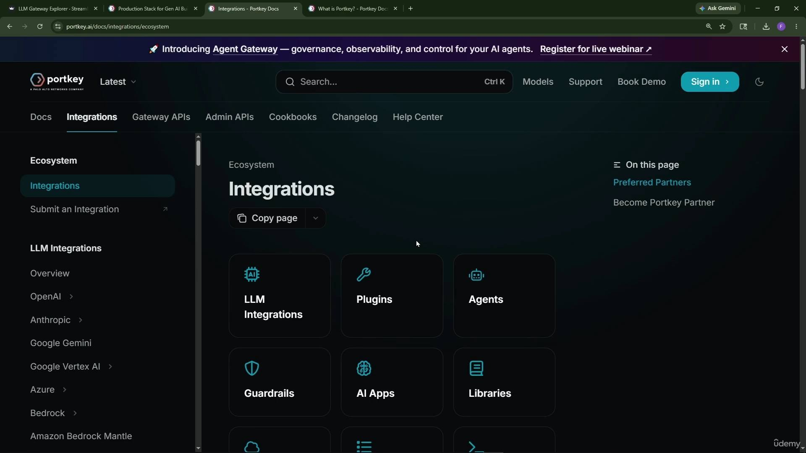
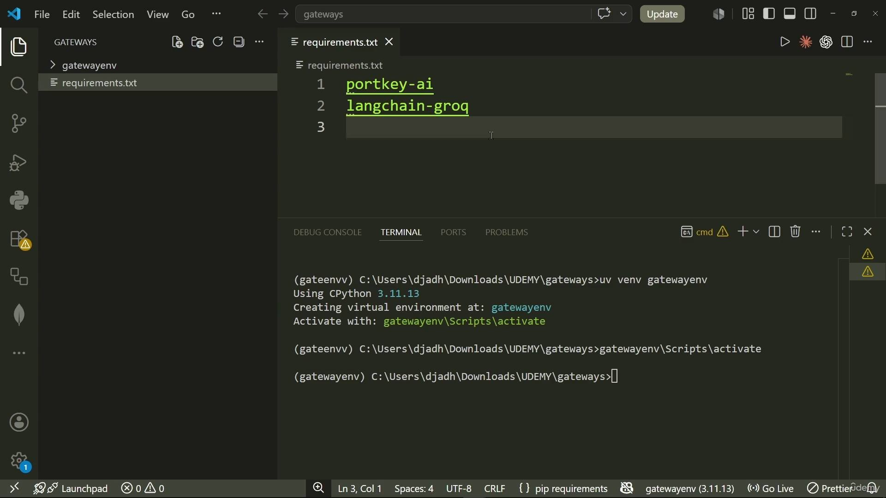
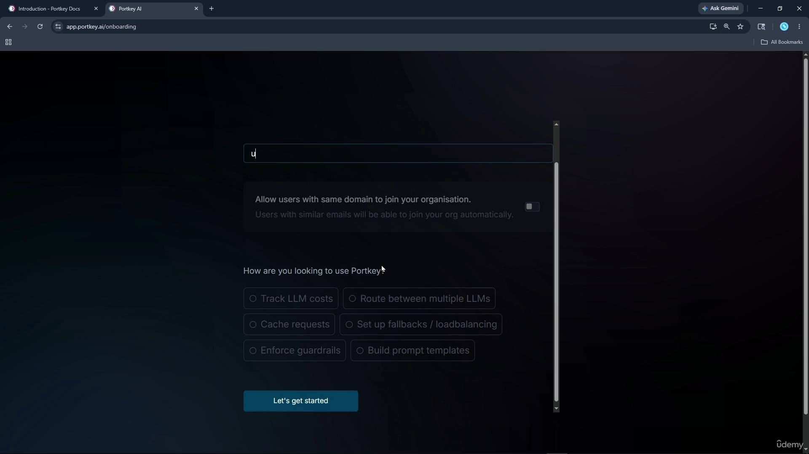
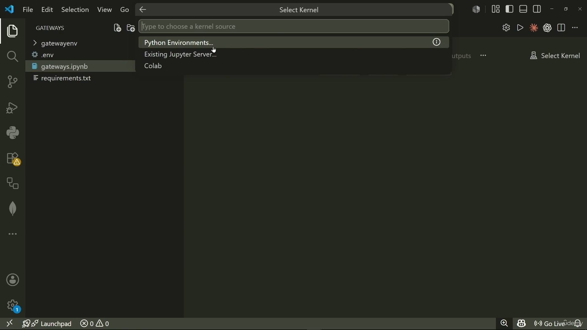
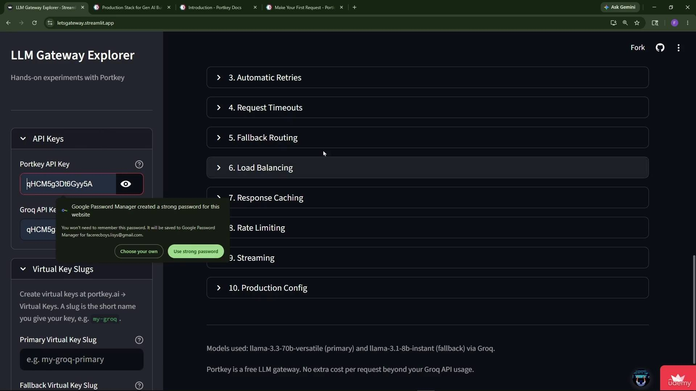
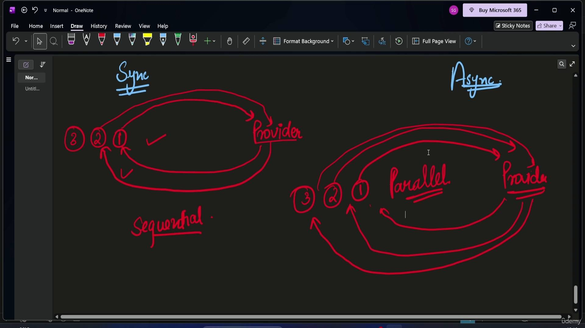
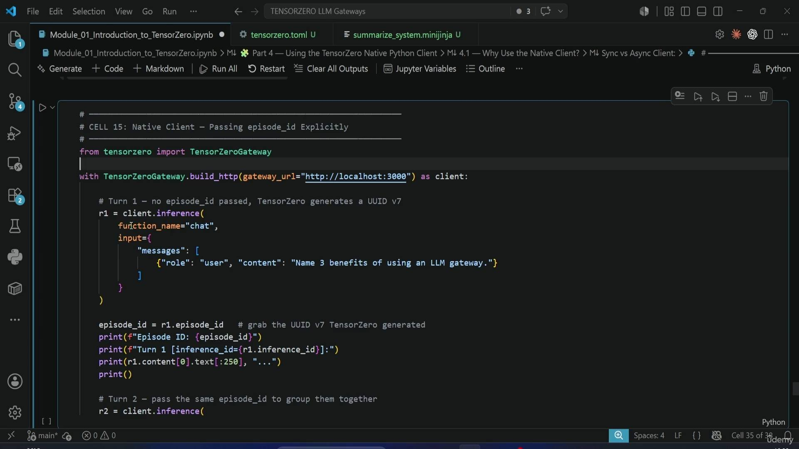
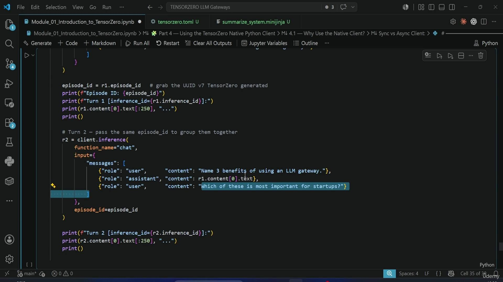
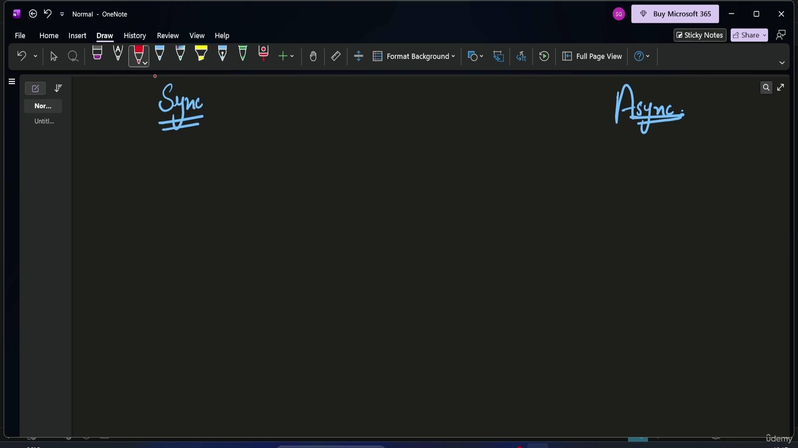
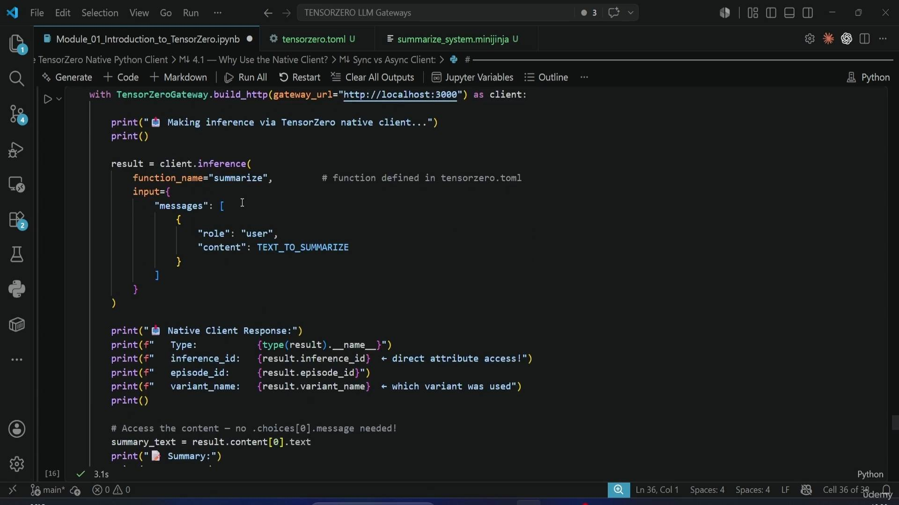

# AI Security Bootcamp part2：Portkey 网关接入与 TensorZero 原生客户端复现（P81–P82）

## 1. 这一节做什么

这一节要完成两条可复现的链路。

第一条链路是 **Portkey 网关接入**：注册 Portkey、拿到 API Key、在控制台里连接 Groq 模型、创建两个虚拟键（virtual key / slug），然后在本地用 `uv` 建虚拟环境、写 `requirements.txt`、写 `.env`、创建 `gateways.ipynb`，最后用 Portkey SDK 或 LangChain 的 `ChatOpenAI` 发一次真实请求。Portkey 在课程里被定位为“生产级应用优先考虑”的网关框架，因为它把可观测性、回退、模型路由、缓存命中、用户日志、限流、护栏、Prompt 版本管理、成本控制、重试和配置管理都放进同一个控制台。

第二条链路是 **TensorZero 原生 Python 客户端**：课程从 OpenAI SDK 切换到 TensorZero 客户端，演示 `build_http`、`client.inference`、同步调用、用 `episode_id` 把两次推断合并到同一个 episode，以及用 `asyncio.gather` 做并行推断。讲师特别强调：测试/原型可以用 embedded gateway，但生产要用 HTTP 模式；同步是串行，异步是并行。



最终建议目录如下：

```text
ai-security-bootcamp/
└── part2-gateways/
    ├── portkey/
    │   ├── .env
    │   ├── .env.example
    │   ├── requirements.txt
    │   ├── gateways.ipynb
    │   ├── portkey_smoke_test.py
    │   └── portkey_langchain_smoke.py
    └── tensorzero/
        ├── .env
        ├── .env.example
        ├── requirements.txt
        ├── tensorzero_sync.py
        ├── tensorzero_episode.py
        └── tensorzero_async.py
```

课里使用的是 Jupyter Notebook 做实验，本地脚本只是同一套代码的可复制版本。你可以先跑脚本确认环境，再把代码贴回 `gateways.ipynb`。

---

## 2. 讲师原话

> "网关是用户和模型之间的一个层，它位于应用和模型之间。"
> —— p081 [06:03]

> "免费版我们会在本视频里使用，因为希望课程对所有学生都负担得起；但当你准备把 Portkey 集成到生产应用时，付费版才是首选，因为很多功能不在免费版里。"
> —— p081 [04:17]

> "Portkey 还给我们提供了虚拟键的方式，这非常令人兴奋。虚拟键的意思是：用户请求先到网关，网关后面可以接同一个供应商的多个模型，也可以接不同供应商的模型。"
> —— p081 [13:03]

> "如果你想用 OpenAI 的 Key，就把 OpenAI API Key 给我；然后你给这个 Key 起一个随机的虚拟名字，比如叫 GPT key。对 Groq 也可以叫 G key，用这个虚拟名字访问对应的 API Key。"
> —— p081 [14:57]

> "这个 slug 就是虚拟键，是你访问模型时使用的虚拟名字。"
> —— p081 [16:23]

> "现在我们要用 TensorZero 原生 Python 客户端。之前用的是 OpenAI 客户端，但 OpenAI 客户端只适用于 OpenAI 模型；如果你要用网关做生产级的东西，就选 TensorZero 客户端。"
> —— p082 [00:00]

> "如果你只是做测试、原型、验证 LLM 网关，那 embedded 也可以；但如果你要上生产，就走 HTTP 方法。"
> —— p082 [01:27]

> "embedded gateway 不需要 Docker，它在 Python 进程内部运行；跑 Python 代码的编译器会用同一块内存来跑 LLM gateway。但它只用于测试，不推荐生产。"
> —— p082 [02:54]

> "同步是串行的：第一个请求完成，第二个才走；异步是并行的：三个请求可以同时走，第二个不用等第一个完成。"
> —— p082 [03:23]

> "每一个推断都会生成两个东西：inference ID 和 episode ID。我们把第一个推断的 episode ID 取出来，在第二次推断时把这个 episode ID 传进去，这样 TensorZero 就知道第二次推断也应该指向第一次推断的 episode。"
> —— p082 [08:38]

> "异步版本里，两个推断会并行启动；我们用 `asyncio.gather` 等它们一起返回。"
> —— p082 [15:14]

> "TensorZero 里的模型优化和前面讲的模型优化不是一回事：一个是微调，一个是智能路由相关的优化，不要混淆。"
> —— p082 [20:58]

---

## 3. 从零复现

### 3.1 准备目录与虚拟环境

先建目录：

```bash
mkdir -p ai-security-bootcamp/part2-gateways/portkey
mkdir -p ai-security-bootcamp/part2-gateways/tensorzero
cd ai-security-bootcamp/part2-gateways/portkey
```

课里在 VS Code 的 `Udemy/gateways` 目录里操作，讲师口述创建虚拟环境为 `uv venv gateway-env`。语音识别把 `gateway-env` 写成了 `gateway env`，实际命令按下面这样执行：

```bash
uv venv gateway-env
source gateway-env/bin/activate
```

Windows PowerShell 用：

```powershell
uv venv gateway-env
.\gateway-env\Scripts\Activate.ps1
```

然后安装依赖。课里逐个说出了 `Portkey AI`、`LangChain Grok`、`LangChain OpenAI`、`LangChain Core`、`python-dotenv`，后面又补了 `ipykernel`。逐字稿里的 `grok/grog` 是语音识别，实际供应商是 **Groq**，所以 Python 包用 `langchain-groq`。



```bash
uv pip install -r requirements.txt
uv pip install ipykernel
```

创建 Jupyter kernel：

```bash
python -m ipykernel install --user --name gateway-env --display-name "Python (gateway-env)"
```

课里随后创建了 `gateways.ipynb`，选择刚建的 Python 环境，并先执行一个 `print("all okay")` 确认 kernel 正常。

### 3.2 注册 Portkey 并创建 API Key

1. 打开 Portkey 官网，注册账号。课里使用 Google 登录。
2. 环境名称填 `udemy`。
3. 进入控制台后复制 Portkey API Key。
4. 把 Key 写入 `.env` 的 `PORTKEY_API_KEY`。
5. 准备 Groq API Key，写入 `.env` 的 `GROQ_API_KEY`。



课里还展示了一个已经做好的 Portkey 应用链接，并说会放进 README，方便直接体验 notebook 里的实验。但逐字稿没有给出可复制的 URL，截图里也没有 OCR 到链接，所以这里写：**课里没给出具体链接，请使用你自己的 Portkey 应用链接，或直接在 notebook 里发请求。**

### 3.3 创建虚拟键：G key 与 G key 2

Portkey 控制台里进入 “Connect to your large language model”，选择 Groq。课里连接了两次 Groq：

- 第一个集成名称叫 `G key`，slug 用 `g-key`。
- 第二个集成名称叫 `G key 2`，slug 用 `g-key-2`。
- 两个都粘贴 Groq API Key。第二个集成课里说使用另一个 Google ID 下的 API Key。
- 课里还演示了禁用不需要的模型，例如禁用 PlayAI 的 text-to-speech 模型。



创建完成后，控制台的 virtual keys / slugs 里填：

```text
g-key
g-key-2
```

如果 slug 和 API Key 都正确，页面会显示 “ready to run demos”。后续 notebook 里通过 `PORTKEY_VIRTUAL_KEY` 选择用哪个 slug。虚拟键的价值是：切换模型时不需要在应用里写大量 `if/else`，也不需要管理很多环境变量；只要换 slug 或换 model 名，Portkey 网关负责把请求转到对应供应商。



### 3.4 运行 Portkey 冒烟测试

在 `portkey/` 下创建 `.env`：

```bash
cp .env.example .env
```

填入：

```dotenv
PORTKEY_API_KEY=你的_Portkey_API_Key
GROQ_API_KEY=你的_Groq_API_Key
PORTKEY_VIRTUAL_KEY=g-key
PORTKEY_MODEL=llama-3.1-70b-versatile
```

运行：

```bash
python portkey_smoke_test.py
```

如果环境正常，会打印模型返回内容。课里在 notebook 里先执行 `print("all okay")`，这个习惯建议保留：先确认 kernel 和虚拟环境没错，再发真实请求。

### 3.5 TensorZero：HTTP 模式而不是 embedded

TensorZero 部分课里已经假设有一个正在运行的 TensorZero gateway。讲师说 HTTP 方式需要一个 server，通常是 Docker 容器；embedded gateway 不需要 Docker，它和 Python 代码在同一个进程、同一块内存里运行，但只适合测试和原型，不适合生产。

所以本地要先满足两个条件：

1. TensorZero gateway 已经在某个 URL 上运行，例如 `http://localhost:3000`。
2. gateway 里已经配置好课程用到的 function：`summarize` 和 `chat`。课里提到 `tensorzero.toml` 里有 `chat` function，并且 `summarize` 用于摘要。具体 gateway 的 Docker 启动命令、镜像名、端口，**课里没讲**，你需要按 TensorZero 官方文档启动，或者使用课程环境里已经启动好的 gateway。



在 `tensorzero/` 下安装依赖：

```bash
cd ../tensorzero
uv venv tensorzero-env
source tensorzero-env/bin/activate
uv pip install -r requirements.txt
```

创建 `.env`：

```dotenv
TENSORZERO_GATEWAY_URL=http://localhost:3000
TENSORZERO_SUMMARIZE_FUNCTION=summarize
TENSORZERO_CHAT_FUNCTION=chat
```

### 3.6 同步推断：summarize

运行：

```bash
python tensorzero_sync.py
```

代码里会：

- 用 `TensorZeroGateway.build_http()` 连接 gateway。
- 调用 `client.inference()`。
- `function_name` 用 `summarize`。
- `input.messages` 里放 `role: user` 和 `content: text_to_summarize`。
- 打印 inference ID、episode ID、variant、输出摘要。

课里说返回里能看到 type、inference ID、episode ID、用了哪个 variant，以及 summary。实际字段名可能随 SDK 版本略有差异，所以脚本里用 `getattr` 兜底，并打印完整响应。

### 3.7 用 episode ID 合并两次推断

运行：

```bash
python tensorzero_episode.py
```

逻辑：

1. 第一次调用 `chat` function，问“使用 LLM gateway 的三个好处是什么”。
2. 从第一次响应里取 `episode_id`。
3. 第二次调用同一个 `chat` function，问“其中哪一个对初创公司最重要”，并把第一次的 `episode_id` 传进去。
4. 打开 TensorZero UI 的 Episodes 页面，能看到同一个 episode 下有两个 inference。



课里还观察到：两个 inference 的 episode ID 相同，例如 `70ff...`；在 episode 页面里能看到第一个是 LLM gateway 问题，第二个是 startup 相关问题。每个 inference 仍然有自己的 inference ID，但它们被归到同一个 episode。

### 3.8 异步并行推断

运行：

```bash
python tensorzero_async.py
```

代码用 `AsyncTensorZeroGateway.build_http()`，然后创建两个 `client.inference()` 协程，用 `asyncio.gather()` 并行等待。课里对比了时间：

- 同步版本：第一个推断完成于 `10:27:31`，第二个完成于 `10:27:36`，大约有 5 秒延迟。
- 异步版本：两个推断的完成时间都是 `10:31:22`，说明它们并行启动。



最后打开 TensorZero UI：

- Inferences：看每次推断的输入、输出、模型、时间、token。
- Episodes：看多个 inference 是否归到同一个 episode。
- Functions：看 `summarize`、`chat` 等函数。
- Models：看模型请求量、token 总量、延迟、time to first token。
- 课里看到 6 次请求经过 GPT mini，总共 1728 tokens；可以切换 hourly、weekly、all time。
- 课里还看到 Postgres 没有正确连接的提示，讲师说“whatever the thing”，这属于环境提示，不是客户端代码错误。

---

## 4. 完整代码

### 4.1 `portkey/requirements.txt`

```text
portkey-ai>=1.5.0
langchain-openai>=0.2.0
langchain-groq>=0.2.0
langchain-core>=0.3.0
python-dotenv>=1.0.0
ipykernel>=6.29.0
```

课里没有给出版本号；上面是写文档时建议的最小可行版本范围，安装时以 `uv pip` 实际解析结果为准。

### 4.2 `portkey/.env.example`

```dotenv
PORTKEY_API_KEY=replace_with_your_portkey_api_key
GROQ_API_KEY=replace_with_your_groq_api_key
PORTKEY_VIRTUAL_KEY=g-key
PORTKEY_MODEL=llama-3.1-70b-versatile
```

### 4.3 `portkey/portkey_smoke_test.py`

```python
import os

from dotenv import load_dotenv
from portkey_ai import Portkey

load_dotenv()

api_key = os.environ["PORTKEY_API_KEY"]
virtual_key = os.environ.get("PORTKEY_VIRTUAL_KEY", "g-key")
model = os.environ.get("PORTKEY_MODEL", "llama-3.1-70b-versatile")

client = Portkey(
    api_key=api_key,
    virtual_key=virtual_key,
)

response = client.chat.completions.create(
    model=model,
    messages=[
        {
            "role": "user",
            "content": "用三句话解释 LLM gateway 对生产应用的价值。",
        }
    ],
)

print(response.choices[0].message.content)
```

### 4.4 `portkey/portkey_langchain_smoke.py`

```python
import os

from dotenv import load_dotenv
from langchain_openai import ChatOpenAI

load_dotenv()

portkey_api_key = os.environ["PORTKEY_API_KEY"]
virtual_key = os.environ.get("PORTKEY_VIRTUAL_KEY", "g-key")
model = os.environ.get("PORTKEY_MODEL", "llama-3.1-70b-versatile")

llm = ChatOpenAI(
    api_key=portkey_api_key,
    base_url="https://api.portkey.ai/v1",
    model=model,
    default_headers={
        "x-portkey-api-key": portkey_api_key,
        "x-portkey-virtual-key": virtual_key,
    },
)

result = llm.invoke("用三句话解释虚拟键如何减少模型切换成本。")
print(result.content)
```

课里说“把 Portkey 集成到 LangChain 要经过 `langchain-openai` 这条路”，这个文件就是那条路的可运行版本。实际 LangChain 版本如果字段名不同，以你安装版本的 `ChatOpenAI` 参数为准。

### 4.5 `portkey/gateways.ipynb`

下面是一个最小可运行 notebook JSON，保存为 `gateways.ipynb` 即可：

```json
{
 "cells": [
  {
   "cell_type": "code",
   "execution_count": null,
   "metadata": {},
   "outputs": [],
   "source": [
    "print(\"all okay\")"
   ]
  },
  {
   "cell_type": "code",
   "execution_count": null,
   "metadata": {},
   "outputs": [],
   "source": [
    "import os\n",
    "from dotenv import load_dotenv\n",
    "from portkey_ai import Portkey\n",
    "\n",
    "load_dotenv()\n",
    "\n",
    "client = Portkey(\n",
    "    api_key=os.environ[\"PORTKEY_API_KEY\"],\n",
    "    virtual_key=os.environ.get(\"PORTKEY_VIRTUAL_KEY\", \"g-key\"),\n",
    ")\n",
    "\n",
    "response = client.chat.completions.create(\n",
    "    model=os.environ.get(\"PORTKEY_MODEL\", \"llama-3.1-70b-versatile\"),\n",
    "    messages=[\n",
    "        {\"role\": \"user\", \"content\": \"用三句话解释 Portkey 网关的作用。\"}\n",
    "    ],\n",
    ")\n",
    "\n",
    "print(response.choices[0].message.content)"
   ]
  }
 ],
 "metadata": {
  "kernelspec": {
   "display_name": "Python (gateway-env)",
   "language": "python",
   "name": "gateway-env"
  },
  "language_info": {
   "name": "python",
   "version": "3.11"
  }
 },
 "nbformat": 4,
 "nbformat_minor": 5
}
```

### 4.6 `tensorzero/requirements.txt`

```text
tensorzero
python-dotenv>=1.0.0
```

TensorZero 的 Python 包版本课里没有写，安装时按官方文档和你的 gateway 版本匹配。

### 4.7 `tensorzero/.env.example`

```dotenv
TENSORZERO_GATEWAY_URL=http://localhost:3000
TENSORZERO_SUMMARIZE_FUNCTION=summarize
TENSORZERO_CHAT_FUNCTION=chat
```

### 4.8 `tensorzero/tensorzero_sync.py`

```python
import os

from dotenv import load_dotenv
from tensorzero import TensorZeroGateway

load_dotenv()

gateway_url = os.environ["TENSORZERO_GATEWAY_URL"]
summarize_function = os.environ.get("TENSORZERO_SUMMARIZE_FUNCTION", "summarize")

text_to_summarize = """
Machine learning is a subset of artificial intelligence.
It allows systems to learn patterns from data instead of being explicitly programmed.
TensorZero is an LLM gateway that can route requests, collect observability data,
and help teams evaluate model behavior.
"""

with TensorZeroGateway.build_http(gateway_url=gateway_url) as client:
    response = client.inference(
        function_name=summarize_function,
        input={
            "messages": [
                {
                    "role": "user",
                    "content": text_to_summarize,
                }
            ]
        },
    )

    print("完整响应（字段名以实际 SDK 输出为准）：")
    print(response)

    print("inference_id:", getattr(response, "inference_id", "<以实际输出为准>"))
    print("episode_id:", getattr(response, "episode_id", "<以实际输出为准>"))
    print("variant_name:", getattr(response, "variant_name", "<以实际输出为准>"))
    print("output:", getattr(response, "output", "<以实际输出为准>"))
```

### 4.9 `tensorzero/tensorzero_episode.py`

```python
import os

from dotenv import load_dotenv
from tensorzero import TensorZeroGateway

load_dotenv()

gateway_url = os.environ["TENSORZERO_GATEWAY_URL"]
chat_function = os.environ.get("TENSORZERO_CHAT_FUNCTION", "chat")

with TensorZeroGateway.build_http(gateway_url=gateway_url) as client:
    first = client.inference(
        function_name=chat_function,
        input={
            "messages": [
                {
                    "role": "user",
                    "content": "列出使用 LLM gateway 的三个好处。",
                }
            ]
        },
    )

    episode_id = first.episode_id

    print("第一次 inference_id:", first.inference_id)
    print("第一次 episode_id:", episode_id)

    second = client.inference(
        function_name=chat_function,
        input={
            "messages": [
                {
                    "role": "user",
                    "content": "这三个好处里，哪一个对初创公司最重要？",
                }
            ]
        },
        episode_id=episode_id,
    )

    print("第二次 inference_id:", second.inference_id)
    print("第二次 episode_id:", second.episode_id)
    print("第二次 output:", getattr(second, "output", "<以实际输出为准>"))
```

### 4.10 `tensorzero/tensorzero_async.py`

```python
import asyncio
import os

from dotenv import load_dotenv
from tensorzero import AsyncTensorZeroGateway

load_dotenv()

gateway_url = os.environ["TENSORZERO_GATEWAY_URL"]
summarize_function = os.environ.get("TENSORZERO_SUMMARIZE_FUNCTION", "summarize")

text_one = """
TensorZero provides an embedded gateway mode for testing and prototyping.
For production, the HTTP gateway mode is recommended because it runs as a server.
"""

text_two = """
Machine learning is a subset of AI. It learns patterns from data.
The summary should be short and should preserve the main idea.
"""


async def main() -> None:
    async with AsyncTensorZeroGateway.build_http(gateway_url=gateway_url) as client:
        task_one = client.inference(
            function_name=summarize_function,
            input={
                "messages": [
                    {
                        "role": "user",
                        "content": text_one,
                    }
                ]
            },
        )

        task_two = client.inference(
            function_name=summarize_function,
            input={
                "messages": [
                    {
                        "role": "user",
                        "content": text_two,
                    }
                ]
            },
        )

        first, second = await asyncio.gather(task_one, task_two)

        print("第一个 summary:", getattr(first, "output", "<以实际输出为准>"))
        print("第二个 summary:", getattr(second, "output", "<以实际输出为准>"))
        print("第一个 episode_id:", getattr(first, "episode_id", "<以实际输出为准>"))
        print("第二个 episode_id:", getattr(second, "episode_id", "<以实际输出为准>"))


if __name__ == "__main__":
    asyncio.run(main())
```

---

## 5. 逐行解释

先看 Portkey 的 `requirements.txt`。`portkey-ai` 是 Portkey 的 Python SDK，提供 `Portkey` 客户端和 `chat.completions.create` 调用入口。`langchain-openai` 不是用来直连 OpenAI 的，而是课程里接入 LangChain 的桥：把 `base_url` 指向 Portkey 的 OpenAI 兼容端点，再通过 header 带上 Portkey API Key 和虚拟键。`langchain-groq` 对应 Groq 供应商；逐字稿里的 `grok/grog` 是语音识别问题，实际是 Groq。`langchain-core` 是 LangChain 的核心依赖。`python-dotenv` 用来读 `.env`。`ipykernel` 让虚拟环境能出现在 Jupyter 的 kernel 列表里。

`.env` 里不要把 Key 写进代码。`PORTKEY_API_KEY` 是 Portkey 控制台给你的 Key；`GROQ_API_KEY` 是 Groq 的 Key；`PORTKEY_VIRTUAL_KEY` 是你在 Portkey 控制台创建的 slug，例如 `g-key` 或 `g-key-2`；`PORTKEY_MODEL` 是具体模型名，课里演示过 Llama 3.1 70B 和 DeepSeek，切换模型时只改这里或改 slug。

Portkey 冒烟测试里，`Portkey(api_key=..., virtual_key=...)` 创建客户端。虚拟键的意义在于：应用不直接持有或选择供应商 Key，而是把请求交给 Portkey，由 Portkey 根据 slug 找到对应供应商。`client.chat.completions.create` 是真正触发模型的方法，讲师口语里说“`chat completions` 是设置模型的地方，`chat complete` 是触发模型的方法”，落到代码就是这一个调用。`messages` 里 `role: user` 表示用户消息，`content` 是
实际传给模型的文本。课里没有在这个调用里显式设置 `temperature`、`max_tokens`、`timeout` 这些参数，**课里没讲**，需要时按 Portkey 文档补即可。

`portkey_langchain_smoke.py` 的重点是三个参数。第一个是 `api_key`，这里放的是 Portkey 的 Key，不是 Groq 的 Key——因为请求先到 Portkey，再由 Portkey 用虚拟键对应的真实 Groq Key 去调供应商。第二个是 `base_url`，指向 Portkey 的 OpenAI 兼容端点，这样 `ChatOpenAI` 才会把请求发到 Portkey 而不是 OpenAI 官方。第三个是 `default_headers`，用来携带 Portkey 的鉴权和虚拟键。讲师在逐字稿里只说了“我们要经过 `langchain-openai` 这条路把 Portkey 接进 LangChain”，**具体 header 名课里没有念出来**，上面代码里的两个 header 是 Portkey OpenAI 兼容接入的通用写法，如果你安装的版本或控制台给出的写法不同，以 Portkey 文档和控制台“View code”片段为准，不要硬套。这也是讲师反复强调“把 README 和 Portkey 页面放在手边”的原因：控制台会直接给你一段可复制的调用代码。

`gateways.ipynb` 是一个最小 notebook。第一格 `print("all okay")` 对应讲师在课里的动作：先确认 kernel 选对了、虚拟环境能 import，再写真实调用。`kernelspec.name` 必须和你 `ipykernel install` 时给的 `--name` 一致，否则 Jupyter 里选不到这个环境。第二个 cell 和冒烟脚本等价，只是把 Key 从 `.env` 读进来，避免把 Key 写进 notebook 被提交到 Git。

TensorZero 的 `requirements.txt` 只有两项。`tensorzero` 是官方 Python 客户端包，`python-dotenv` 读环境变量。注意客户端包和 gateway 服务端是两回事：客户端只是发 HTTP 请求，真正做路由、写观测数据的是你已经跑起来的 gateway。**gateway 的 Docker 镜像名、启动命令、端口映射、`tensorzero.toml` 里 function 的完整定义，课里没讲**，这一节默认你已经有一个可用的 gateway URL。

`tensorzero_sync.py` 逐行看。`TensorZeroGateway.build_http(gateway_url=...)` 是“HTTP 模式”的入口，对应讲师说的“我们要连到一个正在运行的 gateway，必须给它一个 URL”。这里没有用 embedded，因为讲师明确说生产走 HTTP。`with` 语句是上下文管理器，退出时关闭连接，等价于 JS 里的 `try/finally` 里手动 `close()`。

`client.inference(...)` 是发起一次推断。`function_name` 传的是 **TensorZero 里配置的函数名**，不是模型名——这是和 OpenAI SDK 最大的区别。OpenAI SDK 里你写 `model="gpt-4o-mini"`，TensorZero 里你写 `function_name="summarize"`，由 gateway 决定这个 function 用哪个模型、走哪个 variant、要不要按权重分流。讲师说“for summarization, if you see the function name is summarized”，就是让你去 `tensorzero.toml` 里确认函数名，写错了会直接报 function not found。

`input` 是一个字典，里面 `messages` 是消息数组，每条消息有 `role` 和 `content`。`role: "user"` 表示用户输入；`content` 就是 `text_to_summarize`。讲师特别说明“这个 `text_to_summarize` 在上面已经创建过了，我们一直用这同一段文本”，所以脚本里把它提成模块级常量，避免每次改两处。

返回对象里讲师点名看到的字段有：类型（type，值是 chat inference）、inference ID、episode ID、用了哪个 variant、以及摘要输出。**这些字段在 SDK 里是属性还是嵌套在 `output` 里，会随版本变化**，所以脚本用 `getattr` 兜底并打印完整响应——先看清真实结构，再把取值写死。这一步很关键：讲师在 p082 里就卡在“想把响应转成 JSON 却转不出来”，说明他对返回结构的假设和实际不完全一致，你不要重复踩。

讲师还讲了一个观测细节：同样调 `summarize`，前一次输出 90 个 output token，这次只有 78 个，**输出 token 每次都可能不同**；而 input token 取决于你 prompt 有多长，“prompt 写多长，input token 就有多少，`tensorzero.toml` 里那个 mini 模板也会一起进 gateway 算 token”。所以看到 input token 比你以为的多，先去找模板里被拼进去的那部分。

`tensorzero_episode.py` 的核心是两件事：取 episode ID，再把它传回去。第一次 `client.inference(...)` 之后，`episode_id = first.episode_id`；第二次调用时多传一个 `episode_id=episode_id`。讲师的原话是“每个推断都会生成 inference ID 和 episode ID，我们把第一个的 episode ID 拿出来，第二次推断时传进去，这样 TensorZero 就知道这次推断也应该指向第一次的 episode”。

注意这里有两个 ID 同时存在：**inference ID 标识单次调用，episode ID 标识一段会话**。默认情况下每次推断各自成一个 episode；只有你显式传 `episode_id`，两次推断才会被合并进同一个 episode。课里在 UI 的 Episodes 页看到 `70ff...` 这个 episode 下面挂着两条 inference：第一条是“LLM gateway 的三个好处”，第二条是“哪一个对初创公司最重要”。



讲师在课里原本想用 `json.loads` 解析响应再取 episode ID，结果“我不知道为什么它没被转换成 JSON”，反复试了几次后放弃了。所以文档里**不复制那段失败的 JSON 解析**，直接用属性访问 `first.episode_id`。如果你确实需要字典形式，先 `print(response)` 或 `print(type(response))` 看清结构再决定用 `model_dump()` 还是 `dict()`，**具体方法名以你安装的版本为准**。

`tensorzero_async.py` 逐行看。导入的是 `AsyncTensorZeroGateway` 而不是 `TensorZeroGateway`，这是两个不同的类，不能混用。`async with` 是异步上下文管理器。两个 `client.inference(...)` 调用**只是创建协程对象，还没有真正发出请求**——真正的执行发生在 `await asyncio.gather(task_one, task_two)`。这一步就是讲师说的“两个推断并行启动，`await asyncio.gather` 一起等结果”。

这和同步版本的差别，用讲师的时间戳最清楚：同步时第一个推断完成于 `10:27:31`，第二个完成于 `10:27:36`，中间隔了 5 秒；异步时两个推断的完成时间都是 `10:31:22`。也就是说同步是“第一个跑完才发第二个”，异步是“两个几乎同时出发，谁先回来算谁的”。

给前端同学一个对照：`asyncio.gather` 就是 JS 里的 `Promise.all`，`await` 一个接一个写就是串行 `await`。Node 里如果你写 `const a = await f(); const b = await g();` 那是串行；写 `const [a, b] = await Promise.all([f(), g()])` 才是并行——完全同一回事。另外注意，异步并行不等于无限并发，课里只发了两个请求，生产上要自己加并发上限（Node 里对应 `p-limit`，Python 里对应 `asyncio.Semaphore`），**这部分课里没讲**。

讲师最后讲 TensorZero UI 时说得很明确：只看网关相关的话，需要的就是 **Inferences、Episodes、Functions、Models** 四块。Inferences 看每次请求的输入、输出、用了哪个模型、时间、token 数；Episodes 看多次推断有没有被 `episode_id` 串起来；Functions 看有哪些函数（`summarize`、`chat`）；Models 看模型维度的请求量、总 token、延迟、time to first token，并且可以切 hourly、weekly、all time。课里当时看到“6 次请求经过 GPT mini 模型，总共 1728 tokens”。课里还出现 Postgres 未正确连接的提示，讲师说“whatever the thing”，这是环境提示，不影响客户端代码跑通。

还有一个必须区分的点：TensorZero 的 **model optimization** 有两个含义。讲师说前面 feature 里讲的“模型优化”指的是**智能路由**——根据反馈调整请求往哪个 variant 走；而 UI 里 Optimization 页能做的是**微调（fine-tuning）**。他说“不要混淆，一个是微调，一个是路由”。这节课只用到网关部分，微调没展开。

---

## 6. 复现检查清单

按顺序打勾，任何一项不过就停下来修，不要跳。

**环境层**

- [ ] `uv venv gateway-env` 执行成功，`source gateway-env/bin/activate` 后 `which python` 指向 `gateway-env/bin/python`
- [ ] `uv pip install -r requirements.txt` 无报错
- [ ] `python -m ipykernel install --user --name gateway-env` 执行成功
- [ ] Jupyter 里能看到 kernel 显示名 `Python (gateway-env)`
- [ ] `gateways.ipynb` 第一格 `print("all okay")` 输出 `all okay`

**Portkey 控制台层**

- [ ] 账号注册完成，环境名 `udemy`
- [ ] 复制到 Portkey API Key，已写入 `.env` 的 `PORTKEY_API_KEY`
- [ ] Groq API Key 已写入 `.env` 的 `GROQ_API_KEY`
- [ ] 第一个集成：供应商 Groq，slug `g-key`
- [ ] 第二个集成：供应商 Groq，slug `g-key-2`
- [ ] 不需要的模型（如 PlayAI text-to-speech）已在集成里禁用
- [ ] 控制台 virtual keys 区域填入两个 slug 后显示 “ready to run demos”

**Portkey 调用层**

- [ ] `python portkey_smoke_test.py` 打印出模型回复
- [ ] Portkey 控制台的 Logs / Observability 里能看到刚才这次请求
- [ ] 把 `PORTKEY_VIRTUAL_KEY` 从 `g-key` 改成 `g-key-2`，再跑一次，仍然成功（验证虚拟键切换生效）
- [ ] 把 `PORTKEY_MODEL` 换成另一个模型名，再跑一次，模型名变了但 slug 没变（验证“换模型不改代码结构”）
- [ ] `python portkey_langchain_smoke.py` 能跑通；若报鉴权错误，回到 Portkey 控制台复制它给出的代码片段，核对 header 名

**TensorZero 层**

- [ ] 有一个可访问的 gateway URL，`curl $TENSORZERO_GATEWAY_URL/health` 或打开根路径有响应
- [ ] `tensorzero.toml` 里存在 `summarize` 和 `chat` 两个 function，名字和 `.env` 里一致
- [ ] `python tensorzero_sync.py` 能打印出完整响应，且能看到 inference ID、episode ID、variant
- [ ] 打开 Inferences 页，看到刚才这次 `summarize` 记录，token 数与终端输出对得上
- [ ] `python tensorzero_episode.py` 两次调用的 `episode_id` 打印值相同
- [ ] Episodes 页里同一个 episode 下挂着两条 inference
- [ ] `python tensorzero_async.py` 两个 summary 都打印出来
- [ ] Inferences 页里两条 async 记录的时间几乎相同（秒级一致或相差 1 秒内）
- [ ] 对照同步版本那两条记录，能明显看到时间差

**安全层**

- [ ] `.env` 已加入 `.gitignore`
- [ ] 仓库里没有硬编码的 API Key
- [ ] notebook 输出里没有把 Key 打印出来（`print(os.environ)` 这类千万别提交）

`gitignore` 至少要包含：

```gitignore
.env
gateway-env/
tensorzero-env/
.ipynb_checkpoints/
__pycache__/
```


**排错对照表**

| 现象 | 最可能的原因 | 怎么修 |
|---|---|---|
| `KeyError: 'PORTKEY_API_KEY'` | `.env` 不在当前工作目录，或没调用 `load_dotenv()` | 确认在 `portkey/` 目录下运行；确认脚本第一行附近有 `load_dotenv()` |
| 401 / Unauthorized | Key 贴错、Key 前后有空格、把 Groq Key 当成了 Portkey Key | 重新从控制台复制，`.env` 里不要加引号 |
| 虚拟键找不到 | slug 写错，比如控制台是 `g-key` 你写了 `G key` | slug 用连字符，不要空格；`.env` 里的值和控制台完全一致 |
| 模型不存在 | 模型名和该供应商当前可用模型对不上 | 去 Portkey 的 Model Catalog 或供应商文档确认模型名 |
| `ChatOpenAI` 报 base_url 相关错误 | `base_url` 被写成了 `https://api.openai.com/v1` | 改成 Portkey 的 OpenAI 兼容端点 |
| TensorZero 报 function not found | `function_name` 和 `tensorzero.toml` 不一致 | 打开 `tensorzero.toml` 抄一遍函数名 |
| TensorZero 连接被拒 | gateway 没起，或端口不是 `.env` 里那个 | 确认 Docker 容器在跑，`curl` 一下 URL |
| `ImportError: AsyncTensorZeroGateway` | 版本太老 | 升级 `tensorzero` 包 |
| Jupyter 里 import 失败但终端能跑 | kernel 选错 | 重选 `Python (gateway-env)` kernel |
| async 版本没变快 | 只发了两条、单条本来就快，或 gateway 侧串行 | 加更多请求再测；并行收益在请求多时更明显 |

---

## 7. 课里没讲但你会撞上的

**TensorZero gateway 到底怎么起，课里没讲。** 讲师直接假设有一个 URL，说“HTTP 模式需要 server，通常是 Docker 容器”，但镜像名、`docker run` 参数、`tensorzero.toml` 的完整内容都没给。你要么用课程环境里已经跑好的 gateway，要么按 TensorZero 官方文档自己起一个。这一步卡住的话，`tensorzero_*.py` 三个脚本一个都跑不了——先把 `curl` 打通再写代码。

**`tensorzero.toml` 里的 function 和 provider 配置，课里没讲。** 讲师只提到 `chat` 函数存在、`summarize` 用于摘要、模型是 GPT mini、Groq 权重设成了 0。函数怎么定义、variant 怎么配、provider 的 Key 放哪，都得看官方文档。这也是为什么脚本里把函数名做成环境变量——换配置时不用改代码。

**Portkey 免费版的能力边界，课里只给了结论没给清单。** 讲师说“免费版我们这节课用，但很多功能不在免费版里，生产要上付费版”，具体哪些功能锁在付费墙后面，**课里没讲**。你要上生产，先去控制台的订阅页面对一遍，尤其是限流、预算控制、RBAC、Prompt 版本这些生产必需项。

**Portkey 免费额度和 429。** 免费版有请求数和 token 上限，课里没讲具体数字。连着跑几次 notebook 很容易撞到 429。撞到不是代码错，是配额到了，等一会儿或换虚拟键（课里给了两个 slug，正好可以用）。

**一个虚拟键对应一个供应商 Key，轮换要靠多建集成。** 课里建了两个 Groq 集成做演示，但没讲怎么在应用侧做负载均衡——是代码里随机选 slug，还是 Portkey 侧配权重，**课里没讲**。两个 slug 只是前提，真正的分流策略要自己决定。

**模型名会过期。** 课里出现的 `llama-3.1-70b-versatile`、DeepSeek 等模型名，供应商随时可能改名或下线。报 model not found 时先查供应商最新模型列表，不要怀疑代码。

**`x-portkey-*` header 的具体名称，课里没念出来。** 讲师只说“用 `langchain-openai` 这条路接进来”，具体怎么带鉴权是让你看控制台的 “View code”。所以 LangChain 那条路跑不通时，第一动作是回控制台复制代码，不是改代码猜。

**讲师自己踩过的 JSON 解析坑，你大概率也会踩。** p082 里他想 `json.loads` 响应取 episode ID，结果一直转不出来。这说明 TensorZero SDK 返回的是一个对象而不是 JSON 字符串。正确做法是先用 `print(type(response))` 和 `print(response)` 看清结构，再取属性；需要字典时查你所装版本的对象序列化方法。

**OpenAI SDK 的能力缺口，讲师明确点出来了。** 他说用 OpenAI SDK 做 inference 完全没问题，inference ID 和 episode ID **部分可用**（他指着屏幕上的警告符号说“这是警告，表示部分可用”），但 **feedback API 只能用 TensorZero 客户端，OpenAI SDK 做不了**。所以如果你后面要做“用户反馈 → 改进路由”这套闭环，就必须从 OpenAI SDK 切到 TensorZero 原生客户端——这正是这节课切客户端的真正原因，不只是“更正规”。

**embedded gateway 的内存风险。** 讲师说 embedded 是把 gateway 跑在 Python 进程里、共用同一块内存，只适合测试。落到工程上就是：它和你的进程抢内存，进程 OOM 时 gateway 一起挂，而且没有独立的伸缩和重启能力。测试时爽，上线别用。

**async 不等于不限并发。** 课里只发了两个请求，`asyncio.gather` 看起来很美好。真实场景一次发 500 个，供应商会先把你限流。Python 里用 `asyncio.Semaphore(n)` 限并发，Node 里用 `p-limit`，思路一样：先排队，再并发。**课里没讲这层**，但生产必须加。

**同步/异步的选型，讲师给了判断但没给规则。** 他说“同步更容易理解，异步更快、响应更快”，然后说“我们现在用的是同步的”。我的建议：脚本、批处理、后台任务里串行够用就用同步；面向用户的 API 服务里，一个请求要并行打多个模型或多个 function，就用异步。FastAPI 里讲师也提到“一般你用 FastAPI 做后端就会走 async 这条路”。

**观测数据要落库，需要 Postgres 之类的存储。** 课里出现了“Postgres 好像没正确连接”的提示。这说明 TensorZero 的 inferences/episodes 是要写库的，库不通时 UI 里的东西会缺失或报错。**怎么配 Postgres、连不上怎么修，课里没讲**，按官方部署文档来。

**多个 `.env` 文件的优先级。** Portkey 目录一个 `.env`、TensorZero 目录一个 `.env`，`load_dotenv()` 默认从当前工作目录往上找。你在错误的目录下运行脚本，会读到另一个项目的 `.env`，然后出现“Key 明明对却鉴权失败”的灵异现象。养成 `cd` 到项目目录再跑的习惯，或者在脚本里显式指定 `load_dotenv(dotenv_path=...)`。

**Key 泄漏的代价。** 这一节出现的都是真金白银的 Key：Portkey Key 能调你所有已连接的供应商，Groq Key 能直接烧额度。`gateways.ipynb` 如果被提交到公开仓库，notebook 的 cell 输出里可能带着请求 URL 和部分 header。提交前清空所有输出，或者干脆把 notebook 加进 `.gitignore`。



**最后一句提醒。** 这两页课的价值不在于“跑通一次 hello world”，而在于你亲手确认了三件事：虚拟键让模型切换变成改一个字符串；`episode_id` 让多次调用在观测侧变成一段会话；同步和异步在时间戳上的差异是真实存在、可测量的。这三件事在后面的可观测和评估环节都会反复用到，跑通之后别急着往下走，先去 UI 里把每一条记录点开看一遍。