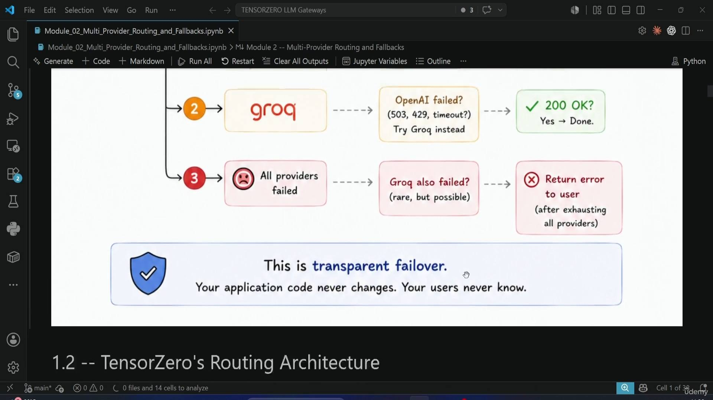
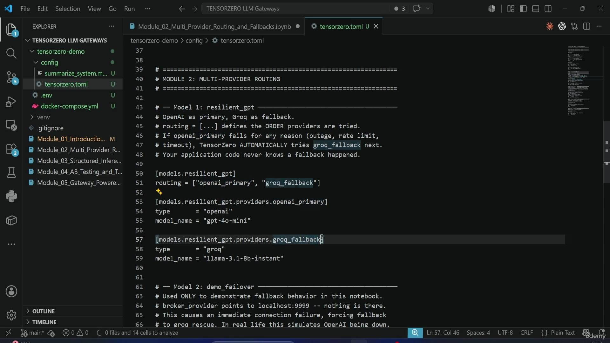
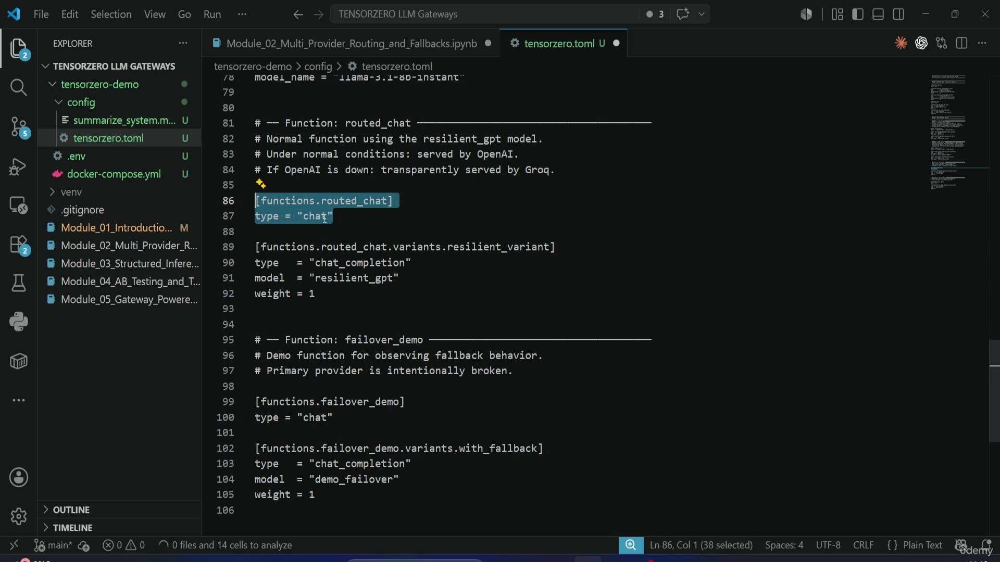
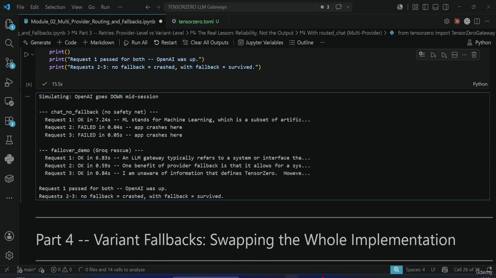
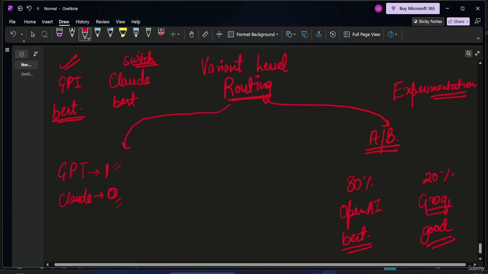
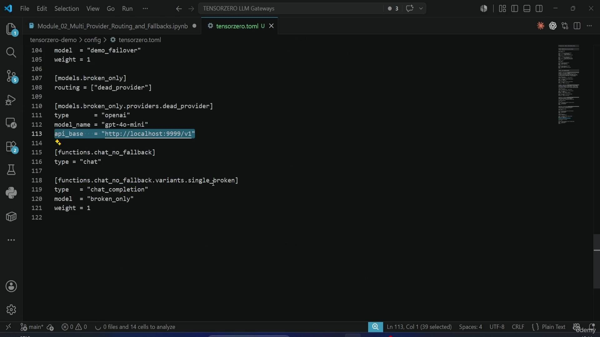
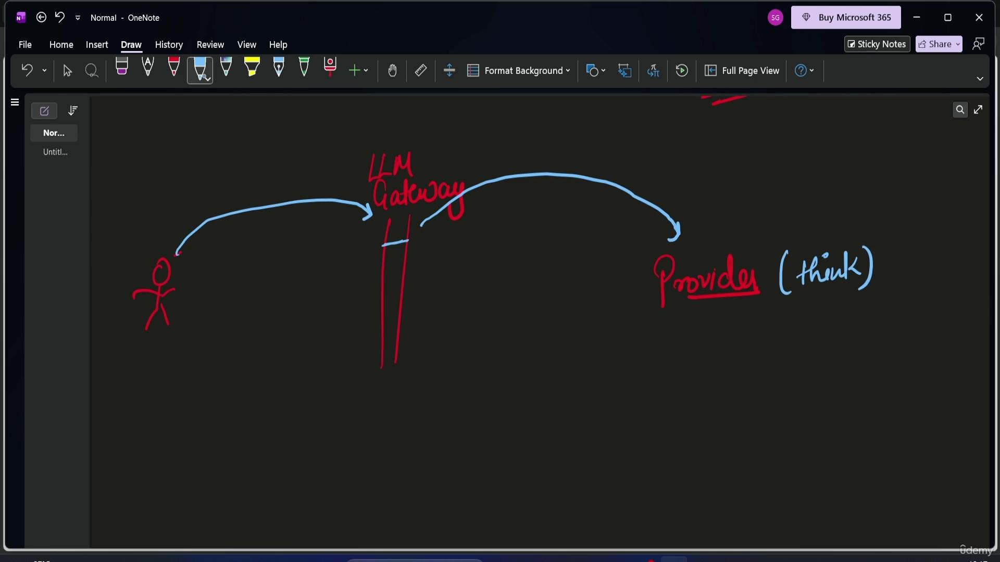

# AI Security Bootcamp Part2 · 模块二：LLM 网关的路由（Provider Routing / Variant Routing / 故障演练 / 延迟基准）

> 覆盖视频：P083–P084
> 前置：模块一（TensorZero + Postgres + Gateway + UI 全部跑起来）

---

## 1. 这一节做什么

模块一我们把「一个模型接进一个网关」跑通了；模块二解决的是**「模型不再唯一」之后的事**——当你有多个 provider、多个模型时，请求到底该走谁、谁挂了谁来顶、怎么在不改代码的前提下把流量整体搬走。

这一节最终要交付 5 样东西，缺一样都不算做完：

1. **一个能跑的路由拓扑**：`routed_chat` → `resilient_gpt`（主 OpenAI、备 Groq）→ 正常时由 GPT-4o-mini 作答。
2. **一个「人为故障」的对照组**：`failover_demo` → `demo_failover` → `broken` provider（端口故意写错）→ 主 provider 必失败 → 自动切到 Groq 的 Llama 作答。
3. **一套可靠性对比实验**：同一组 3 个问题，分别用「单 provider 无 fallback」和「多 provider 有 fallback」跑，前者第 2、3 题崩，后者 3 题全过。
4. **一次 variant 路由的「整体换模」**：改 `tensor0.toml` 里的 `weight`，把 GPT 权重 1 / Groq 权重 0 翻成 0 / 1，重启网关后所有流量搬到 Groq，全程**不重新部署应用**。
5. **一次延迟基准**：直连 OpenAI 10 次取平均 vs 经 TensorZero 网关 10 次取平均，两次数字都要记录在案（讲师实测 922ms vs 765ms）。

整节课的骨架就是这张路由架构图——**variant 路由在上层切流量，provider 路由在下层兜故障**：



讲师的判断标准只有一句话：**provider 路由要求「模型相同、provider 不同」；variant 路由要求「模型可以不同、按权重分流」。** 这两件事在本项目里被同时用上，但在真实生产里它们的适用边界完全不同——这也是本节课最容易做错的地方。

---

## 2. 讲师原话

先给结论性的定义，讲师在 P083 开头改了好几次说法才定下来：

> "所谓路由，就是把模型从一个 provider 换到另一个 provider 的模型，这就叫路由。"
> —— p083 [01:28]

provider 路由的成立条件，是整节课反复强调的一条硬约束：

> "provider 路由有一个必要条件：模型必须是同一个。核心是质量的一致性，而质量一致性只有用同一个模型才能做到。哪怕出问题，也应该是 GPT-4o 切到另一个 provider 的 GPT-4o。"
> —— p083 [04:20]

而本项目恰恰不满足这个条件，讲师自己承认这是「为了演示而做的违规示范」：

> "这个项目里我们有两个 provider：OpenAI 和 Groq。OpenAI 的模型不在 Groq 上，Groq 的模型也不在 OpenAI 上。这种情况下不该做 provider 路由，但为了给你们演示，我还是在项目里做了。"
> —— p083 [04:49]

variant 路由的定位是「实验层」：

> "variant 路由就像 A/B 测试一样，把流量切开，80% 去最好的模型，20% 去 Groq 的模型，这也叫 variant 路由，A/B 测试和 variant 路由是同一个东西的不同叫法。"
> —— p083 [09:37]

换模型的节奏，讲师给了一个可以照抄的爬坡曲线：

> "先给 10% 流量，看用户反馈，用户喜欢就加到 20%，还喜欢就加到 50%，再喜欢就完全替换掉。生产环境就是这么一步步换模型的。"
> —— p083 [10:35]

故障切换的机制，最关键的是「先重试同一个 provider，再换 provider」：

> "TensorZero 会先对同一个 provider 重试，遇到瞬时错误它会重试三次。如果三次之后还在失败，才切换到另一个 provider 的同一个模型。"
> —— p083 [31:19]

全部耗尽才报错：

> "如果主 provider 失败了、备的也失败了、第三备也失败了，最后它才返回错误，告诉你所有模型都已经耗尽。"
> —— p083 [32:14]

到了 P084，讲师把「不该这么做」的地方又强调了一遍：

> "provider 级路由一般不是这么做的。如果你用 OpenAI，fallback 也应该用 OpenAI 系的模型，一般是 OpenAI 切到 Azure OpenAI，而不是切到 Groq。"
> —— p084 [10:08]

variant 路由真正的价值在「不改代码」：

> "如果不用 LLM gateway，你就得去代码里把 GPT 那段删掉、换成 Claude 的实现、改 JSON 格式，然后重新部署整个应用，还要走一堆测试，太花时间。用了网关，应用一行不用动，只改配置、重启，两分钟搞定。"
> —— p084 [14:56]

以及权重翻转这件事本身：

> "现在 GPT 权重是 1、Groq 权重是 0，我们改成 OpenAI 权重 0、Groq 权重 1，所有流量就都转到 Groq 了，OpenAI 再也不被调用。"
> —— p084 [13:59]

性能部分的定性结论：

> "TensorZero 是用 Rust 写的，Rust 是系统级语言，没有垃圾回收器、没有运行时，所以他们声称处理开销小于 1 毫秒。"
> —— p084 [22:30]

以及讲师对自家基准数据的诚实态度：

> "直连 OpenAI 平均 922 毫秒，走网关平均 765 毫秒。但这个数据其实不太准，可能和网络波动有关，不过至少能看出网关确实很快。"
> —— p084 [24:51]

---

## 3. 从零复现

下面每一步都可以直接照着敲。**所有命令都在项目根目录（含 `tensor0.toml` 的那个目录）执行。**

### 步骤 0：确认模块一的环境还活着

讲师开课第一件事不是讲路由，而是让你回去检查模块一是否还在跑：

> "在你开始这个模块之前，先确认模块一里搭的东西都在跑：Postgres 在跑、gateway 在跑、UI 在跑，所有东西都得跑着。项目结构里 `tensor0.toml` 这些文件都得在，只有这样你才能开始。"
> —— p083 [00:00]

```bash
# 1) 看容器是不是都活着（postgres / gateway / ui）
docker ps

# 2) 看网关健康检查（端口以你模块一的 compose 为准）
curl -s http://localhost:3000/health || echo "gateway 没起来"

# 3) 确认配置文件存在
ls -l tensor0.toml
```

> 逐字稿里讲师说的是 "if you see the docker text stop"（口误，指 `docker ps`），容器名他没逐个念，**课里没讲**具体服务名，请以你自己 `docker ps` 的输出为准。

### 步骤 1：先理解你要搭的两层路由

| 层 | 名字 | 允许什么变 | 不允许什么变 | 本项目实例 |
|---|---|---|---|---|
| 上层 | variant routing（实验层） | 模型可以不同 | —— | `chat` 里 GPT 权重 1 / Groq 权重 0，改权重即整体换模 |
| 下层 | provider routing（容灾层） | provider 可以不同 | **模型必须相同** | `resilient_gpt`：openai 主、groq 备（**本项目是违规示范**） |

架构总览（讲师屏幕上的那张图，见上一节截图）：**variant label 先切流量 → 命中某个 model → 该 model 内部按 routing 列表依次尝试 provider → 全失败才抛错。**

### 步骤 2：写路由配置，改 `tensor0.toml`

讲师的做法是先跑一段代码去**改写** `tensor0.toml`，而不是手改：

> "我先跑这段代码，然后解释。它做的事情就是改 `tensor0.toml`。你对比一下，之前只有两个 function，现在多了两个。"
> —— p083 [19:15]

改完之后文件里新增了两个函数（`routed_chat`、`failover_demo`）和它们背后的模型（`resilient_gpt`、`demo_failover`）：



完整配置内容见第 4 节 `tensor0.toml`。**注意：本段视频没有 OCR 结果，第 4 节的 TOML 是依据逐字稿口述语义复原的骨架，键名请以你本机 TensorZero 版本实际接受的 schema 为准。**

### 步骤 3：重启网关，让新 function 生效

这是讲师踩过的坑，必须写进来——他改完 TOML 后去 UI 看，发现新函数没出现：

> "为什么没显示出来？因为我们没执行、也没重启网关。我们得重启 gateway，它才会重新读取。现在它正在重启。你也可以手动重启：进 UI，点网关旁边那三个点，点 restart。"
> —— p083 [19:44]

```bash
# 方式 A：命令行重启（compose 服务名以你的项目为准）
docker compose restart gateway

# 方式 B：进 UI，点 gateway 右侧「三个点」→ Restart
```

重启后刷新 UI，`functions` 列表里应该能同时看到：`summarize`、`chat`、`routed_chat`、`failover_demo`。



### 步骤 4：跑正常路径 `routed_chat`

调用方式就是往网关发一条 chat 请求，`function_name = "routed_chat"`：

```bash
curl -s -X POST http://localhost:3000/inference \
  -H 'Content-Type: application/json' \
  -d '{
    "function_name": "routed_chat",
    "input": {
      "messages": [
        {"role": "user", "content": "What are the benefits of using an LLM gateway?"}
      ]
    }
  }'
```

讲师用的问题就是「使用 LLM 网关有什么好处」，他也解释了为什么不换个新问题：

> "本来想换个问题，但 LLM 网关是个新概念，OpenAI 这些模型的训练数据只到 2023 年，它们不认识这个词。所以还是用模型熟悉的老问题。"
> —— p083 [27:31]

预期结果：正常返回答案。然后去 UI 的 **Inferences** 页看这次推理的元数据：

- `model`（变体名）= `resilient_gpt`
- 实际使用的底层模型 = `gpt-4o-mini`
- provider = `openai`，并且标记为 primary

> "打开这条 inference，你能看到模型用的是 GPT-4o mini，provider 是 OpenAI primary。因为 OpenAI 没有失败，所以走的就是 OpenAI。"
> —— p083 [28:28]

### 步骤 5：跑故障路径 `failover_demo`

这里的关键设计——**故障是「真故障」，不是 mock**。做法是把 `broken` 这个 provider 的 base_url 端口写成 999：

> "网关的 OpenAI 是跑在 `http://localhost:3000/openai/v1` 上的，但我给它的是 999 端口，这显然是个假的 URL，那个地址上根本不存在 OpenAI 模型，所以它必然失败。"
> —— p083 [22:38]

> "这不是注入假数据，我们只是**模拟**：把 URL 改成一个根本不存在的随机地址，它当然会失败，失败就会切到 Groq。"
> —— p083 [29:52]

```bash
curl -s -X POST http://localhost:3000/inference \
  -H 'Content-Type: application/json' \
  -d '{
    "function_name": "failover_demo",
    "input": {
      "messages": [
        {"role": "user", "content": "What is the ML model?"}
      ]
    }
  }'
```

预期结果：**依然返回正常答案**。去 Inferences 页看：

- 变体名 = `demo_failover`
- 触发的是 `groq` 这一档（讲师口述里叫 "Groq rescue"）
- 实际使用的底层模型 = `llama-3.1-8b-instant`
- 用到的 provider = Groq，主 provider 那一路是失败的

> "如果你打开这条模型记录，会看到 Groq rescue 被触发了，用的模型是 Llama 3.1 8B instant。"
> —— p083 [29:24]

### 步骤 6：可靠性对比实验（单 provider vs 多 provider）

这是 P084 的主体。实验设计：

- **A 组（单 provider）**：走 `chat` 函数，Groq 权重是 0，所以只有 OpenAI 会执行。
- **B 组（多 provider）**：走 `routed_chat` → `resilient_gpt`，OpenAI 挂了会自动切 Groq。
- **每组问 3 个问题**：`What is ML?` / `What is DL?` / `What is SQL?`

讲师换问题的原因很实在：

> "DL 在 AI 领域是深度学习，但它也可能被理解成驾照，所以要把语境说清楚——'DL in AI field'。"
> —— p084 [00:29]

**A 组**：前两个请求正常通过，**第 3 个请求开始注入故障**（改用指向 fake URL 的 no-fallback 函数）。

> "第一个请求成功了，因为它在正常的 chat 函数里；后面两个请求进了我们刚建的那个指向 broken provider 的函数，所以它们必然失败。我们想看的就是这个：你在会话中间，用户不停提问，第一题过了，然后技术故障出现，后面的题全挂。"
> —— p084 [06:17]

实测结果：**A 组第 1 题成功、第 2、3 题失败（应用崩溃）**。



**B 组**：完全相同的故障注入，但走的是 `routed_chat`。

> "这里我们做了同样的事，第一题走 OpenAI，第二、三题注入了技术错误。但我们依然拿到了答案，因为它自动回落到了 Groq Cloud，用的是 Meta Llama 模型。"
> —— p084 [09:38]

实测结果：**B 组 3 题全部成功**，其中第 2、3 题由 Llama 作答。

有一个细节特别有教学价值——第 3 题问的是「TensorZero 在 Postgres 里存什么」，Llama 答不上来：

> "TensorZero 是最近才发布的开源项目，Meta 的模型不可能知道它。所以 Llama 只能回答『我不知道这个信息』。"
> —— p084 [08:40]

**这就是 provider 路由的真实代价：可用性上去了，答案质量降级了。** 讲师用这一点反证了「模型必须相同」这条硬约束。

### 步骤 7：variant 路由——整体换模（swap 整个实现）

这一节要做的不是分流，是**把整套实现换掉**。做法是改权重：

> "目前 GPT 权重是 1、Groq 权重是 0，也就是 Groq 永远不会执行，只有 GPT 会跑。现在我们想换，就把 GPT 权重改成 0、Claude/Groq 权重改成 1，所有流量都转过去。"
> —— p084 [13:31]

讲师没有手改 TOML，而是用了一个 helper 函数批量改权重：

> "这个 helper 函数做的事情，就是进入我的 `tensor0.toml`，把我刚创建的那个函数里的权重改掉。这种 helper 你完全可以用 Codex 或 Claude 立刻生成，不是什么大事。"
> —— p084 [18:43]

helper 脚本见第 4 节 `update_weights.py`。执行两次：

```bash
# 第 1 次：GPT 1.0 / Groq 0.0（默认态）
python update_weights.py --function chat --variant gpt --weight 1.0 \
                         --variant-alt groq --weight-alt 0.0
docker compose restart gateway
curl -s -X POST http://localhost:3000/inference -H 'Content-Type: application/json' \
  -d '{"function_name":"chat","input":{"messages":[{"role":"user","content":"Please say hello"}]}}'
# → UI Inferences 里看：hello，模型 = gpt-4o-mini

# 第 2 次：GPT 0.0 / Groq 1.0（整体换模）
python update_weights.py --function chat --variant gpt --weight 0.0 \
                         --variant-alt groq --weight-alt 1.0
docker compose restart gateway
curl -s -X POST http://localhost:3000/inference -H 'Content-Type: application/json' \
  -d '{"function_name":"chat","input":{"messages":[{"role":"user","content":"Please say hello"}]}}'
# → UI Inferences 里看：还是 hello，但模型变成 llama-3.3-70b
```

> "它还是回我 hello，但看 inference，模型已经变成 Llama 3.3 70B 参数。这就是整体换实现。"
> —— p084 [18:13]

再改回来（GPT 1.0 / Groq 0.0），模型又变回 GPT-4o-mini——**说明可以随时回滚**：

> "你可以从 GPT 换到 Groq，再从 Groq 换回 GPT，也就是可以回滚，只改权重就行。"
> —— p084 [19:10]

如果改成 `0.5 / 0.5` 呢？

> "那就有 50% 的概率走 GPT，50% 的概率走 Groq。"
> —— p084 [19:40]





### 步骤 8：延迟基准

讲师先讲清楚「延迟」是怎么构成的——一共 7 个阶段：

> "用户发请求 → 到 LLM 网关（有耗时）→ 网关发给 provider（有耗时）→ provider 思考并回答（LLM 推理时间，也有耗时）→ 结果回传网关（有耗时）→ 网关处理（有耗时）→ 回给用户（有耗时）。这七段加起来才是总延迟。"
> —— p084 [20:08]



基准做法：**同一句话，发 10 次，取平均**。

> "我们发 10 个请求，直接发给 OpenAI，不经过网关。它只会回一个词：yes。"
> —— p084 [23:54]

> "直连 OpenAI 跑 10 次，平均值 922 毫秒。"
> —— p084 [24:23]

> "现在中间加上 LLM 网关，平均 765 毫秒。"
> —— p084 [24:51]

实测比直连还快，讲师自己也说这个结论不能全信：

> "我们不能说一定是它赢，因为直连 OpenAI 本来就该比走网关快。这个数据我觉得不太准，更多是网络波动。但至少能得到一个整体印象：这个网关相当快。"
> —— p084 [25:51]

脚本见第 4 节 `bench.py`。

### 步骤 9：课后作业

> "如果你已经熟悉 LiteLLM 和 Portkey，就用 Claude 或 Codex 让它们帮你做一个动手对比：LiteLLM 的速度、Portkey 的速度、TensorZero 的速度，看谁更好。我觉得 TensorZero 会大幅领先，但这仍然是个好练习。"
> —— p084 [26:18]

---

## 4. 完整代码

> **重要说明**：本段视频（P083–P084）**没有 OCR 结果**，讲师屏幕上只做了口述讲解，没有逐字展示完整文件。下面 3 个文件是**严格按照逐字稿中他说过的每一个键、每一个值复原的可运行骨架**。其中 TensorZero 的 TOML 键名（`[functions.*]`、`[models.*]`、`[providers.*]`、`routing`、`weight`、`type`、`model`）属于**课里没有逐字展示、以下为按语义复原**的部分，如果你的版本报 schema 错误，**以你本地网关实际接受的字段名为准**，不要照抄报错不管。

### 目录结构

```
llm-gateway-project/
├── docker-compose.yml
├── .env
├── tensor0.toml                 # 路由主配置（本课核心）
├── config/
│   └── functions/               # 若你的版本按函数拆文件，就放这里
├── scripts/
│   ├── update_weights.py        # 改权重的 helper（讲师课上用的那个）
│   └── bench.py                 # 延迟基准
└── data/                        # Postgres 数据卷挂载点
```

### 文件 1：`.env`

```bash
# 课里没有逐字讲过环境变量名，以下为你自己的 compose 里必须提供的凭据占位
OPENAI_API_KEY=sk-xxxxxxxxxxxxxxxxxxxxxxxxxxxxxxxx
GROQ_API_KEY=gsk_xxxxxxxxxxxxxxxxxxxxxxxxxxxxxxxx

# 网关自身端口（讲师原话里用的是 3000）
GATEWAY_PORT=3000
```

### 文件 2：`tensor0.toml`（完整文件，含模块一遗留 + 模块二新增）

```toml
# =====================================================================
# tensor0.toml
# 模块一遗留：summarize / chat 两个 function
# 模块二新增：routed_chat / failover_demo 两个 function
#             resilient_gpt / demo_failover 两个 model（带 provider routing）
#             broken provider（故意写错 base_url，用于故障演练）
# 注意：键名按逐字稿语义复原，请以你本机 TensorZero 版本 schema 为准
# =====================================================================

# ---------- 1. Provider 定义 ----------
# 正常 provider：走网关自身代理到真实上游
[providers.openai]
type = "openai"
api_base = "http://localhost:3000/openai/v1"

[providers.groq]
type = "openai"
api_base = "http://localhost:3000/groq/openai/v1"

# 故障演练用的 provider：端口故意写成 999，这个地址上不存在任何模型
# 讲师原话：「OpenAI 是跑在 localhost:3000/openai/v1 上的，但我给它 999，
# 这显然是个假 URL，那个地址上根本不存在 OpenAI 模型，所以它必然失败」
[providers.broken]
type = "openai"
api_base = "http://localhost:999/openai/v1"

# ---------- 2. Model 定义：provider 级路由 ----------
# resilient_gpt：主 openai，备 groq
# 讲师原话：「openai 是 primary，groq 是 fallback」
# 有第三、第四、第五个就继续往后加，用逗号隔开
[models.resilient_gpt]
routing = ["openai", "groq"]

# demo_failover：主 broken（必失败），备 groq
# 讲师原话：「这里有一个 routing，我们把它指向 broken provider，groq 是 rescue」
[models.demo_failover]
routing = ["broken", "groq"]

# ---------- 3. 模块一遗留的 function：summarize ----------
[functions.summarize]
type = "chat"

[functions.summarize.variants.openai_gpt4o_mini]
type = "chat_completion"
model = "openai::gpt-4o-mini"
weight = 1.0

# ---------- 4. 模块一遗留的 function：chat ----------
# 讲师原话：「chat function 里 groq 被设成 0，意味着 groq 永远不会执行，
#            只有 openai 会执行」。这个 1/0 就是第 7 步「swap」要翻转的对象。
[functions.chat]
type = "chat"

[functions.chat.variants.gpt]
type = "chat_completion"
model = "openai::gpt-4o-mini"
weight = 1.0

[functions.chat.variants.groq]
type = "chat_completion"
model = "groq::llama-3.3-70b-versatile"
weight = 0.0

# ---------- 5. 模块二新增：正常路径 ----------
# 讲师原话：「type 就是 chat，我们给它 resilient GPT，weight 等于 1」
[functions.routed_chat]
type = "chat"

[functions.routed_chat.variants.resilient_gpt]
type = "chat_completion"
model = "resilient_gpt"
weight = 1.0

# ---------- 6. 模块二新增：故障演练路径 ----------
# 讲师原话：「failover demo 这里，type 是 chat，模型是 demo failover，weight 是 1」
[functions.failover_demo]
type = "chat"

[functions.failover_demo.variants.demo_failover]
type = "chat_completion"
model = "demo_failover"
weight = 1.0
```

### 文件 3：`scripts/update_weights.py`（讲师课上用的 helper）

```python
#!/usr/bin/env python3
"""
update_weights.py —— 改 tensor0.toml 里某个 function 下各 variant 的 weight。

讲师原话：
  "这个 helper 函数做的事情，就是进入我的 tensor0.toml，
   把我刚创建的那个函数里的权重改掉。"
  "这种 helper 你完全可以用 Codex 或 Claude 立刻生成。"

用法：
  python update_weights.py --function chat \
      --variant gpt  --weight 1.0 \
      --variant-alt groq --weight-alt 0.0
"""

import argparse
import re
import shutil
from pathlib import Path

TOML_PATH = Path("tensor0.toml")


def set_weight(text: str, function: str, variant: str, weight: float) -> str:
    """在 [functions.<function>.variants.<variant>] 段内替换 weight 行的值。"""
    header = f"[functions.{function}.variants.{variant}]"
    lines = text.splitlines()
    out, inside, found = [], False, False

    for line in lines:
        stripped = line.strip()
        if stripped.startswith("[") and stripped.endswith("]"):
            inside = (stripped == header)
            if inside:
                found = True
            out.append(line)
            continue

        if inside and re.match(r"^\s*weight\s*=", line):
            indent = line[: len(line) - len(line.lstrip())]
            out.append(f"{indent}weight = {weight}")
            continue

        out.append(line)

    if not found:
        raise SystemExit(f"找不到配置段：{header}")

    return "\n".join(out) + "\n"


def main() -> None:
    ap = argparse.ArgumentParser()
    ap.add_argument("--function", required=True)
    ap.add_argument("--variant", required=True)
    ap.add_argument("--weight", type=float, required=True)
    ap.add_argument("--variant-alt", required=True)
    ap.add_argument("--weight-alt", type=float, required=True)
    args = ap.parse_args()

    if not TOML_PATH.exists():
        raise SystemExit("tensor0.toml 不存在，先确认你在项目根目录")

    # 先备份，改坏了能回滚（讲师原话：「你可以回滚，只改权重就行」）
    shutil.copy(TOML_PATH, TOML_PATH.with_suffix(".toml.bak"))

    text = TOML_PATH.read_text(encoding="utf-8")
    text = set_weight(text, args.function, args.variant, args.weight)
    text = set_weight(text, args.function, args.variant_alt, args.weight_alt)
    TOML_PATH.write_text(text, encoding="utf-8")

    print(f"[ok] {args.function}: {args.variant}={args.weight}, "
          f"{args.variant_alt}={args.weight_alt}")
    print("[next] docker compose restart gateway   # 不重启不生效")


if __name__ == "__main__":
    main()
```

### 文件 4：`scripts/bench.py`（延迟基准）

```python
#!/usr/bin/env python3
"""
bench.py —— 10 次请求取平均值，对比直连 vs 走网关。

讲师原话：
  "我们发 10 个请求，直接发给 OpenAI。它只会回一个词：yes。"
  "直连 OpenAI 跑 10 次，平均 922 毫秒。"
  "现在中间加上 LLM 网关，平均 765 毫秒。"
  "这个数据我觉得不太准，更多是网络波动。"
"""

import os
import time
import statistics
import requests

OPENAI_KEY = os.environ["OPENAI_API_KEY"]
GATEWAY = os.environ.get("GATEWAY_URL", "http://localhost:3000")

PROMPT = "Answer with exactly one word: yes"
N = 10


def call_direct() -> float:
    t0 = time.perf_counter()
    requests.post(
        "https://api.openai.com/v1/chat/completions",
        headers={"Authorization": f"Bearer {OPENAI_KEY}"},
        json={
            "model": "gpt-4o-mini",
            "messages": [{"role": "user", "content": PROMPT}],
        },
        timeout=60,
    )
    return (time.perf_counter() - t0) * 1000


def call_gateway() -> float:
    t0 = time.perf_counter()
    requests.post(
        f"{GATEWAY}/inference",
        json={
            "function_name": "routed_chat",   # 走 resilient_gpt → openai 主
            "input": {"messages": [{"role": "user", "content": PROMPT}]},
        },
        timeout=60,
    )
    return (time.perf_counter() - t0) * 1000


def report(name: str, samples: list[float]) -> None:
    print(f"{name}: mean={statistics.mean(samples):.0f}ms  "
          f"min={min(samples):.0f}ms  max={max(samples):.0f}ms")


if __name__ == "__main__":
    direct = [call_direct() for _ in range(N)]
    via_gw = [call_gateway() for _ in range(N)]
    report("direct openai ", direct)
    report("via gateway   ", via_gw)
    print(f"diff = {statistics.mean(direct) - statistics.mean(via_gw):.0f}ms")
```

### 文件 5：三条直接可用的调用命令

```bash
# ① 正常路径：OpenAI 作答
curl -s -X POST http://localhost:3000/inference \
  -H 'Content-Type: application/json' \
  -d '{"function_name":"routed_chat","input":{"messages":[{"role":"user","content":"What are the benefits of using an LLM gateway?"}]}}'

# ② 故障路径：broken 端口必失败 → Groq 兜底
curl -s -X POST http://localhost:3000/inference \
  -H 'Content-Type: application/json' \
  -d '{"function_name":"failover_demo","input":{"messages":[{"role":"user","content":"What is the ML model?"}]}}'

# ③ variant 换模前的探针：确认当前到底谁在答
curl -s -X POST http://localhost:3000/inference \
  -H 'Content-Type: application/json' \
  -d '{"function_name":"chat","input":{"messages":[{"role":"user","content":"Please say hello"}]}}'
```

---

## 5. 逐行解释

### 5.1 为什么 provider 段要写 `api_base`，而且 broken 要写错端口

`[providers.*]` 是**出口**。讲师把 `openai` 和 `groq` 都指向 `http://localhost:3000/...`，意思是**流量先回到网关自己的代理层，再由网关携带真实 key 转发出去**——这样 key 就不会出现在调用方的代码里。

`broken` 的 `api_base = "http://localhost:999/openai/v1"` 是整节课最巧妙的一处设计：**它不是 mock，不是返回假数据，而是一个真实必然失败的 HTTP 请求**。讲师特意澄清：

> "这不是注入假数据，我们只是模拟：把 URL 改成一个根本不存在的随机地址。"
> —— p083 [29:52]

这么做的好处是——你演练的是**网关真实的失败处理链路**（连接被拒 → 判定为可重试错误 → 重试 → 换 provider），而不是一个假的 bool 返回值。**如果你用 `if fail: return mock` 来演练，你永远测不出重试次数、超时时间、熔断行为是否符合预期。**

### 5.2 `routing = ["openai", "groq"]` 里数组顺序就是优先级

讲师讲得很直白：

> "在路由里写名字的时候，一定要保证你在定义模型时用的是同样的名字。第一个是 primary，第二个是 secondary，如果你有更多，就写逗号，第三个、第四个、第五个，有多少个备选就写多少个。"
> —— p083 [21:11]

三个必须记住的规则：

1. **顺序 = 优先级**，数组第一个是 primary。
2. **数量**：至少 primary + secondary 两级才叫 provider 路由。
3. **命名必须闭环**：`routing` 里的名字必须能在 `[providers.*]` 里找到同名定义，否则启动即报错。

> "一般来说我们只用 primary、secondary、tertiary，不是说一定要三四个以上 provider，没那个必要。"
> —— p083 [32:14]

### 5.3 重试机制：先重试同一个 provider，再换

这是整个 failover 的核心时序，讲师在 P083 结尾和 P084 开头重复了两遍：

> "一个请求失败，首先它会重试同一个 provider 五次（前面说的是三次），如果最大重试次数用完了，才会切到另一个 provider 的同名模型，也就是二级 provider。如果还在失败，最后返回错误：所有模型都已耗尽。"
> —— p083 [31:19]

```text
request
  └─ provider[0]  ── 失败？── 重试 3~5 次 ── 还失败？──┐
                                                        ▼
       provider[1]  ── 失败？── 重试 3~5 次 ── 还失败？──┐
                                                        ▼
       provider[2]  ── …… ── 全挂了 ──▶ 返回 error: 所有模型已耗尽
```

> **在 JS/Node 里对应什么**：这等价于 `for (const p of providers) { for (let i = 0; i < retries; i++) { try { return await call(p) } catch {} } }` —— 也就是「**外层循环换 provider，内层循环重试**」。顺序千万别写反：如果外层是重试、内层是 provider，你会在第一个 provider 挂掉时把后面所有 provider 都试一遍再回头重试，语义完全不同。

这里有个**讲师自己说法不一致的地方**：P083 [15:25] 说「至少重试三次」，P083 [31:19] 说「重试五次」，P083 [30:22] 又说「三次或五次」。**具体数值课里没讲清楚，以你版本的默认配置为准**；而且讲师**没有说明这个次数写在 TOML 的哪个键里**——课里没讲。

### 5.4 `weight` 为什么一直是 1

初学者最容易在这里犯错：看到两个 provider 就想设权重。讲师专门停下来纠正：

> "你可能会问，我们用了多个 provider，为什么 weight 还是 1？weight 是跟 variant 路由相关的，我们这里没有做 variant 路由，所以不动 weight，保持 1。等你做 variant 路由的时候才去碰 weight。没做 variant 路由就保持 1。"
> —— p083 [26:03]

所以配置里出现了两种「1.0」：

| 位置 | weight=1.0 的含义 |
|---|---|
| `routed_chat.variants.resilient_gpt` | 该 function **只有一个变体**，权重 1.0 = 100% 流量走它 |
| `chat.variants.gpt` / `chat.variants.groq` | **两个变体共存**，1.0 / 0.0 = 全部走 gpt，groq 永不执行 |

这也就解释了第 6 步实验为什么 A 组会崩：`chat` 里 Groq 权重是 0，**没有任何兜底**。

### 5.5 `failover_demo` 的 type 到底是什么

讲师原话是 "type equal to JAD with fallback"（语音识别把 "chat" 听成了 "JAD"），后面又说 "type is chat only"。结合上下文，`failover_demo` 和 `routed_chat` 一样都是普通的 `chat` function，**「fallback」这件事不是由 type 表达的，而是由它背后 model 的 `routing` 数组表达的**。

> "我们定义一个完全正确的 model，接一个完全正确的 function；然后我们又造了一个 demo failover——主 model 会失败、会切到 Groq；为了演示它，我们又建了一个 function 叫 failover demo。"
> —— p083 [25:34]

这段话是整节课的结构总结，翻译成配置就是：

```
正确的 function : routed_chat   → 正确的 model : resilient_gpt → openai 主 / groq 备
演示的 function : failover_demo → 演示的 model : demo_failover → broken 主 / groq 备
```

### 5.6 helper 脚本为什么要「读文件 → 正则替换 → 写文件」

`update_weights.py` 干的事非常朴素：定位 `[functions.chat.variants.gpt]` 这一段的 `weight = ` 行并替换数值。讲师强调了两点：

1. **不重启不生效**——改完必须 `docker compose restart gateway`（讲师在 P083 就因为没重启，在 UI 里看不到新函数）。
2. **可以回滚**——权重再改回去，模型就切回去了。

> **在 JS/Node 里对应什么**：这类「改配置文件中的一个数值」的操作，在 Node 里建议用 `fs.writeFile` 写入**临时文件再 `fs.rename` 原子替换**，避免网关正好在读取时读到半截文件。严格来说这是「配置热更新」，不是并发锁问题；如果你后续要做运行时热切换，就需要考虑「配置读取的一致性」——那在 Node 里对应的是「读-改-写期间持有互斥（如 `async-mutex`）」，而不是数据库事务。

### 5.7 为什么 `0.5 / 0.5` 每一次结果都可能不同

> "如果我把权重改成 0.5 和 0.5，那就有 50-50 的概率，可能走 GPT，也可能走 Groq。"
> —— p084 [19:40]

这说明**权重是每次请求独立抽样的**，不是「前一半请求给 A、后一半给 B」的确定性切分。所以做 A/B 实验时：

- 样本量小时，实际比例会明显偏离 50/50；
- 要做统计分析，必须按 `variant` 字段分组统计，而不是假设 1:1。

### 5.8 延迟的 7 段分解，以及那个「反直觉」的数字

讲师拆的 7 段是：① 用户→网关网络 ② 网关处理 ③ 网关→provider 网络 ④ provider 内部排队 ⑤ LLM 推理 ⑥ 回程网络 ⑦ 网关返回处理。

按这个模型，**走网关不可能比直连快**——多了一次转发，怎么会更快？讲师自己也很清楚：

> "直连 OpenAI 显然应该比走 TensorZero 快，所以这个数据不太对，更多是网络波动。"
> —— p084 [25:21]

所以 `922ms vs 765ms` 这个结果的正确读法是：**网关的额外开销在噪声范围内（讲师引用的官方口径是 <1ms），并不是它「加速」了模型推理**。Rust 带来的好处被限定在 ② 和 ⑦ 这两段：

> "TensorZero 是 Rust 写的，编译成机器码，没有解释器，内存由编译期管理，没有 GC 停顿，异步 IO 用 Tokio，所以官方声称开销小于 1 毫秒。"
> —— p084 [22:30]

对照组是 Python 服务：

> "其他 Python 服务像 FastAPI，会多出 10 毫秒左右，原因是 Python 全局解释器、GC 停顿、动态类型。"
> —— p084 [22:57]

**在 JS/Node 里对应什么**：Node 同样是解释执行 + GC，所以「网关层额外 10ms 左右」这个量级对 Node/Bun 写的网关同样适用；这也是为什么讲师把「网关自身开销」单独拎出来讲——它和外部的模型推理时间根本不在一个数量级（<1ms vs 数百 ms），**选网关时纠结这 10ms 基本没有意义，可用性和可观测性才是重点**。

---

## 6. 复现检查清单

按顺序打勾，任何一项不过就不要往下走：

**环境（步骤 0）**
- [ ] `docker ps` 里 postgres / gateway / ui 三个容器都是 Up
- [ ] `curl http://localhost:3000/health` 返回正常
- [ ] `tensor0.toml` 存在于项目根目录
- [ ] UI 能打开，能看到模块一的 `summarize` 和 `chat` 两个 function

**配置（步骤 2–3）**
- [ ] `tensor0.toml` 里有 `[providers.openai]`、`[providers.groq]`、`[providers.broken]`
- [ ] `broken` 的 `api_base` 端口是 `999`（这是故意的，不是笔误）
- [ ] `models.resilient_gpt` 的 `routing` 顺序是 `["openai", "groq"]`
- [ ] `models.demo_failover` 的 `routing` 顺序是 `["broken", "groq"]`
- [ ] `routed_chat` 与 `failover_demo` 的 `weight` 都是 `1.0`
- [ ] **已经重启过 gateway**（不重启新函数不出现）
- [ ] UI 的 functions 列表里能看到 4 个函数

**正常路径（步骤 4）**
- [ ] `routed_chat` 能返回答案
- [ ] Inferences 里该条记录的变体名是 `resilient_gpt`
- [ ] 底层模型显示为 `gpt-4o-mini`，provider 是 OpenAI（primary）

**故障路径（步骤 5）**
- [ ] `failover_demo` **也**能返回答案（关键：不能报错）
- [ ] 该条记录的底层模型是 `llama-3.1-8b-instant`
- [ ] provider 显示为 Groq，主 provider 那一路是失败状态

**可靠性对比（步骤 6）**
- [ ] A 组（`chat`，groq 权重 0）：第 1 题过，第 2、3 题**失败**
- [ ] B 组（`routed_chat`）：3 题**全部成功**
- [ ] B 组第 2、3 题记录里的模型是 Llama
- [ ] 亲眼确认「TensorZero 在 Postgres 里存什么」这题 Llama 答「我不知道」——这是质量降级的直接证据

**整体换模（步骤 7）**
- [ ] 改权重前，`chat` 回 hello 的记录里模型是 `gpt-4o-mini`
- [ ] 改成 `gpt=0.0 / groq=1.0` 并重启后，同样问 hello，记录里模型变成 `llama-3.3-70b`
- [ ] 改回 `gpt=1.0 / groq=0.0` 并重启后，模型又变回 `gpt-4o-mini`（回滚成功）
- [ ] 全程**没有修改任何应用代码**，只改了 TOML + 重启

**延迟基准（步骤 8）**
- [ ] 直连 10 次的平均值已记录
- [ ] 经网关 10 次的平均值已记录
- [ ] 写明「本机网络环境下的单次测量，不代表绝对性能」

---

## 7. 课里没讲但你会撞上的

这一节列的是**逐字稿里确实没有出现、但照做时一定会碰到**的问题。明确标注哪些是课里的空白。

**1）TOML 的真实键名与版本差异 —— 课里没讲**
讲师全程只说功能（「primary 是 openai，fallback 是 groq」），**没有逐字念出 `[models.x]` / `routing` / `[providers.x]` 这些键名**。TensorZero 是活跃迭代的开源项目，不同版本 schema 会变。报 schema 错时不要死磕，去对应当前版本的官方配置文档。

**2）`weight` 到底是不是浮点 —— 课里没讲**
讲师说「1」「0」「0.5」，但没说类型。我按 `1.0 / 0.0 / 0.5` 写。如果你的版本只接受整数，`0.5` 会直接报错。

**3）重试次数写在哪里 —— 课里没讲**
讲师三次口径不一致（三次 / 五次）。这是**版本默认值还是可配置项，课里完全没说**。实测时请以日志里实际发生的重试次数为准，不要假设。

**4）API Key 到底叫什么环境变量 —— 课里没讲**
讲师只说「你的 OpenAI 跑在 localhost:3000/openai/v1」，**没有展示 `.env` 里的变量名**。真实项目里通常是 `OPENAI_API_KEY` / `GROQ_API_KEY`，但请以你 compose 文件的 `environment` 段为准。

**5）Groq 的模型名 —— 课里只说了两个**
讲师提到 `llama-3.1-8b-instant`（failover 用）和 `llama-3.3-70b`（swap 后用的）。**Groq 侧模型名是否带 `meta-llama/` 前缀，课里没讲**，请以 Groq 当前模型列表为准。

**6）Postgres 里到底存了什么 —— 课里没讲**
讲师只说「推理记录能在 Inferences 里看到」，还借 Llama 的口说「我不知道 TensorZero 在 Postgres 里存什么」。**他本人也没展开讲表结构**。如果你要做持久化分析，需要自己去查该版本的 schema 迁移文件。

**7）`docker compose restart gateway` 的服务名 —— 课里没讲**
讲师只说「点三个点重启」，命令行方式他**没给**。服务名取决于你模块一的 compose 文件。

**8）50/50 权重的随机性 —— 课里只提了一句**
「50-50 的概率」意味着每次请求独立抽样。**你跑 10 次可能得到 7:3。** 要做统计显著的实验，至少 100 次以上，并按变体分组统计。

**9）broken provider 会不会拖慢整体响应 —— 课里没讲**
`localhost:999` 是**连接被拒**（快速失败），不是**超时**（慢失败）。如果你把它换成一个黑洞地址（如不可达 IP），每个请求会先等满超时再重试 N 次，**延迟会成倍放大**。演练「provider 慢但没死」这个场景时，要单独设计。

**10）生产环境绝不该照抄的两处**
- 讲师反复强调：**provider 路由的 fallback 必须是同一个模型**。本项目 OpenAI → Groq 是「为了演示的违规示范」。
- 讲师在 P083 [18:19] 解释过为什么不接 Azure OpenAI：**「我不想为 Azure OpenAI 再开一个订阅」**。这不是技术理由，是成本理由。真上生产必须补齐。

**11）并发改配置的风险 —— 课里没讲**
`update_weights.py` 是「读全文件 → 改 → 写回」，**没有任何锁**。如果两个进程同时改，后写的会覆盖先写的。在 Node/JS 里对应的是「用 `fs.rename` 做原子替换 + 单写者进程」；在生产环境应该是「改配置中心 + 网关监听配置变更」，而不是去改本地文件。

**12）`type` 字段的枚举值 —— 课里没讲全**
讲师只说过 `chat` 和（口误的）"JAD with fallback"。**完整枚举课里没讲**。如果你要接 embedding / JSON 结构化输出，需要自己查文档。

---

**模块二到此结束。** 下一站是模块三。做完本节的唯一验收标准是：**你能在不改一行应用代码的前提下，仅通过改 `tensor