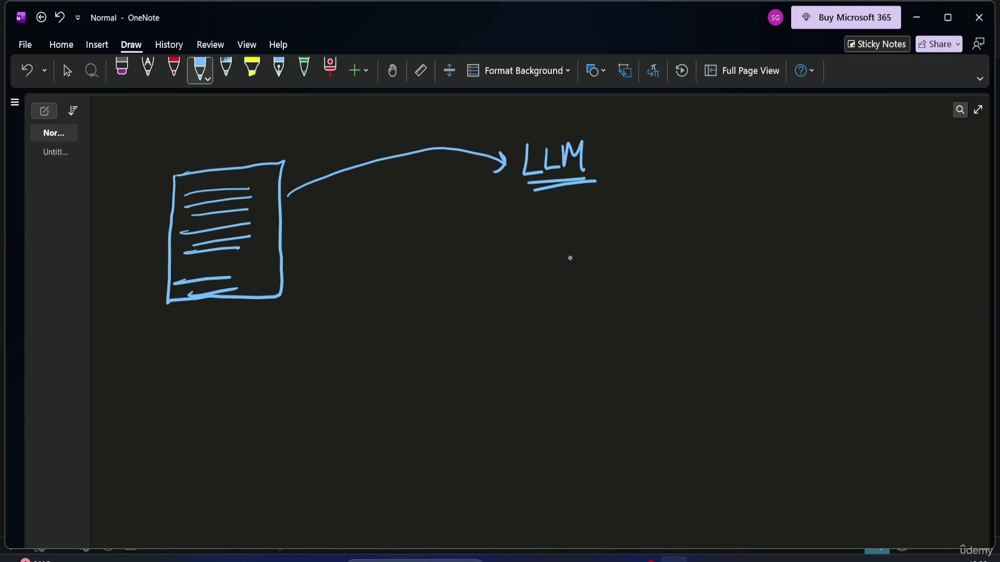
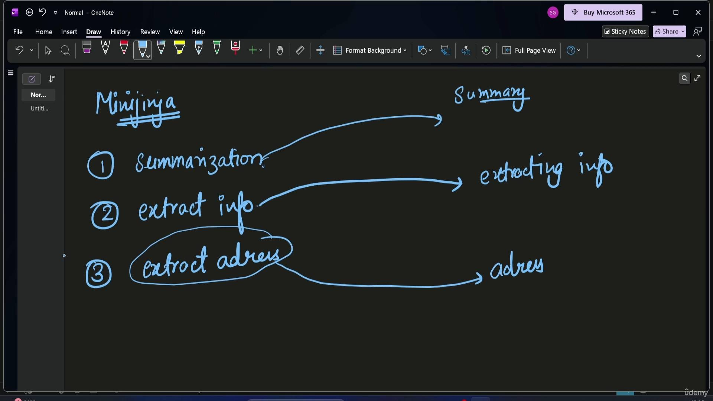
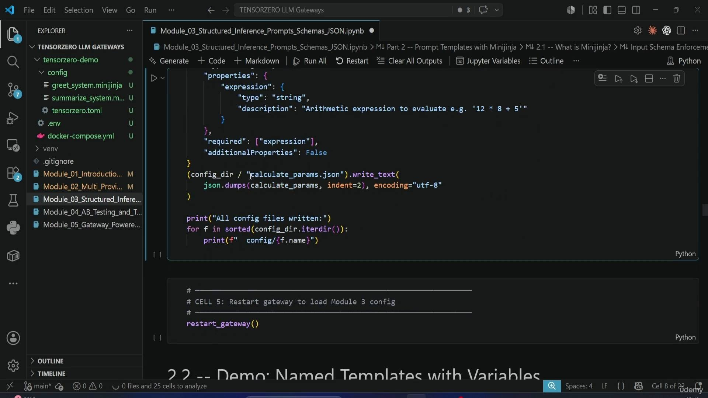
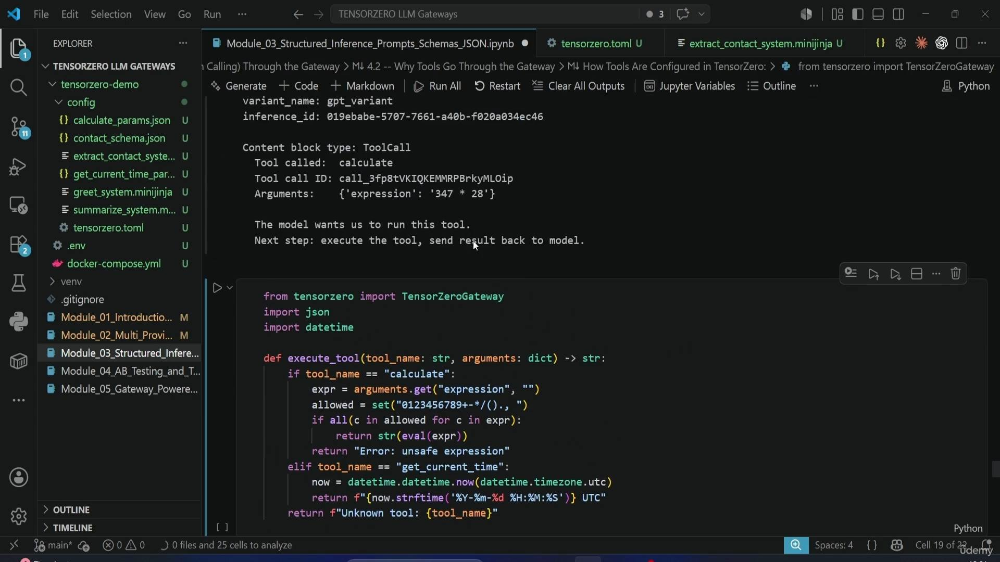
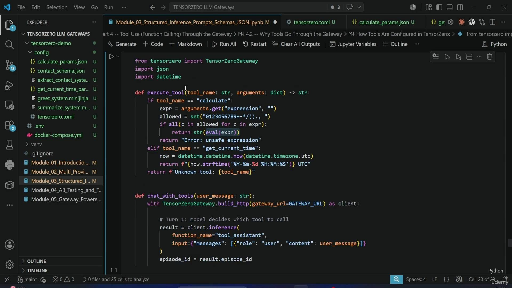
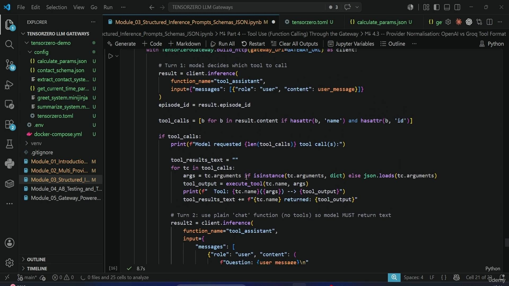
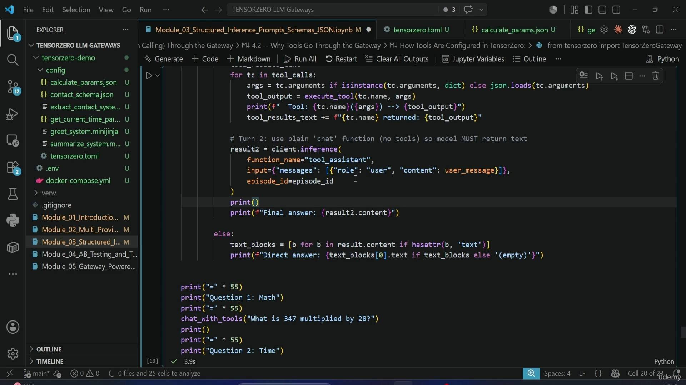
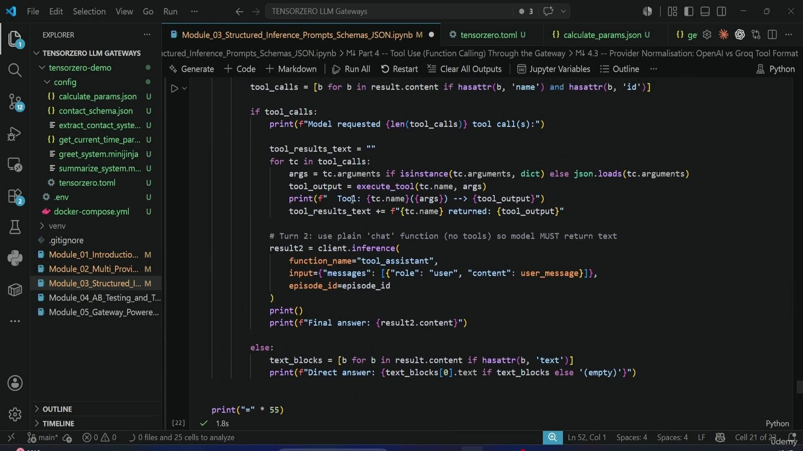
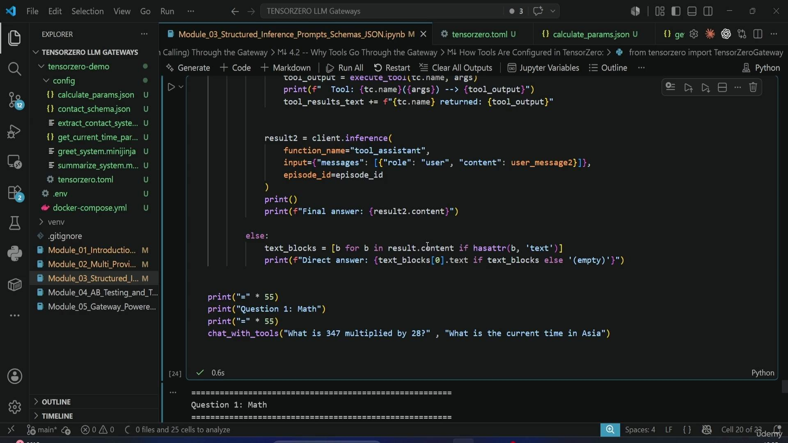

## 1. 这一节做什么

这一节覆盖 **AI Security Bootcamp part2 的 P085–P086**，对应模块三：**结构化推理（structured inference）**。课程要解决的不是“怎么让模型更聪明”，而是三个工程问题：

1. **原始 LLM 输出不稳定**：你要求模型返回 JSON，它有时多包一层括号、有时加一句“这是你要的信息”、有时漏字段、有时少引号。程序直接 `json.loads()` 会崩。
2. **Prompt 改动成本高**：没有网关时，改一句 system prompt 要改代码、重新打包、重新部署整个应用；有 LLM 网关后，只改模板文件、重启网关。
3. **工具调用格式不统一**：OpenAI、Groq、Gemini、Claude 的 tool calling JSON 结构不同，换 provider 就要改代码。TensorZero 把它归一化成统一格式。

这一节最终要跑起来的东西是：

- 一个 TensorZero Gateway；
- 一组 **mini-jinja 模板**：问候、摘要、联系人提取、时间提取、工具助手；
- 一组 **JSON Schema**：联系人输出、时间输出、工具参数；
- 一个 `tensorzero.toml`：定义函数、variant、模板、schema、工具、`json_mode`；
- 一个 Python 脚本：调用问候、结构化输出、工具调用，并显式切换 GPT / Groq variant。

读者是前端转 AI 应用工程师。下面所有“锁/事务/并发”类内容不涉及；但涉及“请求体结构”“JSON 解析”“工具执行”的地方，我会补一句在 JS/Node 里对应什么。



---

## 2. 讲师原话

> "假设你有一段数据，你把它发给 LLM，要求只提取联系人信息，并以 JSON 返回姓名、电话、邮箱。"
> —— p085 [00:27]

> "有时候它会多包一层括号，有时候会加一句‘这是你要的信息’，虽然我们没要求它加。"
> —— p085 [01:52]

> "没有 LLM 网关时，你要改代码、改 prompt 模板、重新配置、重新部署整个应用；有网关时，只要改配置文件、改 mini-jinja 文件、重启网关。"
> —— p085 [04:43]

> "你在 schema 里定义 name、phone、email 必须存在；LLM 不返回 JSON，结构化输出就会拒绝它。"
> —— p085 [07:31]

> "如果 email 不在文本里，就传 email 等于 null，这样你知道是‘没有’，而不是‘不知道为什么没有’。"
> —— p085 [08:28]

> "OpenAI 的工具调用格式不一样，Groq 不一样，Gemini 也不一样；有了 LLM 网关，我们做一个统一的 JSON 格式。"
> —— p085 [11:15]

> "
> "假设我写了一个 Python 函数，里面是加减乘除的代码，我告诉 LLM：凡是数学题就调用这个工具，因为它是规则函数，是纯数学，没有幻觉的机会。"
> —— p085 [10:18]

> "工具调用也是以 JSON 格式做的。它会先做一个 tool call，然后走到你写的那个工具上，拿到输出，再把 8 返回给用户。"
> —— p085 [10:46]

> "mini-jinja 是一种模板语言。你把模板写在文件里，这些文件会在一次调用执行时被注入进 prompt。"
> —— p085 [12:12]

> "结构化输出这个能力，输入和输出两个方向都能用。"
> —— p085 [13:11]

> "我们现在写一个 mini-jinja 模板文件。你是一个问候专家。用户会告诉你一个名字、一个语言、一个风格。"
> —— p085 [13:40]

> "我们把 `tensorzero.toml` 改了。第一个 provider 用 GPT 的 variant，第二个是 Groq 的 variant，模板你要从 `greet_system.minijinja` 里引用。"
> —— p085 [15:09]

> "我告诉它：从提供的文本里提取 name、email、phone number。如果某个字段不存在，就返回 none。"
> —— p085 [16:06]

> "schema 里 name 是字符串、email 是字符串、phone 是字符串，而且这三个字段都是 required。"
> —— p085 [16:36]

> "在 `tensorzero.toml` 的结构化输出部分，我们把 `extract_contact` 的类型设成 `json`，这次不是 chat 类型了。"
> —— p085 [23:14]

> "这里要传 output schema 的路径，我们在 `context_schema.json` 里定义好了，所以你把这个路径传进来。"
> —— p085 [24:13]

> "这是 `json_mode`。如果你把它设成 off，即使你设了 `context_schema.json`，也不会做强制。设成 on，它就会强制 schema 里指定的东西必须存在。"
> —— p085 [24:42]

> "还有个 strict，它会走严格的 schema 校验，但这个只被 OpenAI 使用，它不会和 Groq 这些一起工作。"
> —— p085 [25:11]

> "你能看到这个函数被调用了，parsed output 是这样的，没有多余文本。raw output 也是这样。"
> —— p085 [25:39]

> "为什么需要 JSON 格式？因为 JSON 可以很容易被 JSON 库读取，你可以把它转成 Python 字典，然后取出 name、email、phone 的值。"
> —— p085 [27:30]

> "如果这些信息是用文本发过来的，你就得把整段文本存进数据库。把文本存进数据库并不是那么好。"
> —— p085 [27:59]

> "如果你没有把 JSON mode 打开，模型给的是普通答案，虽然是 JSON，但那只是‘文本里的 JSON’，外面还带着引号。"
> —— p085 [28:26]

> "我们要不要做强制，取决于你把 `json_mode` 设成 on 还是 off。"
> —— p085 [29:26]

> "OpenAI 和 Groq 对工具调用用的 JSON 格式不一样，但有了网关，我们可以修好这件事，TensorZero 会归一化成一个一致的格式。"
> —— p086 [00:00]

> "我已经定义了两个工具，第一个是 `get_current_time`，它帮我拿当前时间，参数是 time zone；第二个工具负责算表达式。"
> —— p086 [00:59]

> "`eval` 是一个 Python 内置函数，你传一个表达式进去，它会自动算出来。"
> —— p086 [04:50]

> "它得是字符串格式，你得加双引号。它算的是表达式，不是整数。"
> —— p086 [05:44]

> "我们造一个 `execute_tool` 函数：只要这次调用是 calculate 这个工具，就执行它。"
> —— p086 [06:13]

> "如果工具名是 `get_current_time`，就用这个表达式去取当前时间。"
> —— p086 [07:39]

> "问题出在我们写的这个 helper 函数只考虑第一条 message，它没考虑后面的 message，所以第一个问题被第二个问题覆盖了。"
> —— p086 [13:45]

> "我得把两个问题合并起来，改成 `user_message_1` 和 `user_message_2`，然后函数也要跟着改。"
> —— p086 [14:15]

> "它报错说没有 `text` 这个属性。原因是我把 chat 换成了 tool assistant，之前 `result.content[0].text` 要改成 `result.content`。"
> —— p086 [10:27]

> "所有推理都会被归到同一个 episode ID 里，你问多少次都自动归进去。"
> —— p086 [06:42]

> "这时候你看模型，是 Groq 的 Llama 3.3 70B。虽然文档里两家格式不同，但网关把它们统一了。"
> —— p086 [17:34]

> "还有一点要记住，我在模块一讲过：prompt 越长，token 用量越大，因为 prompt 是作为输入 token 计费的。所以别写太长，也别写太短太泛。"
> —— p086 [18:29]



---

## 3. 从零复现

### 3.1 环境准备

需要的东西：

- Python 3.10+（`eval` 那段、`pip` 安装、Jupyter/Notebook 都要）
- 一个 TensorZero Gateway 可执行文件（课程用的是 `tensorzero-gateway` 命令启动；版本号课里没讲）
- 至少两个 provider 的 API Key：OpenAI 一个、Groq 一个（因为要演示 GPT variant 和 Groq variant 切换）
- 一个能编辑文本的编辑器，改 `.toml` 和 `.minijinja` 文件

环境变量名（课里念到的 provider 是 GPT 与 Groq，变量名按各自 SDK 惯例命名，具体名字以你安装的 TensorZero 版本为准）：

```bash
export OPENAI_API_KEY="sk-..."
export GROQ_API_KEY="gsk_..."
# 如果网关要求显式指定配置文件位置：
export TENSORZERO_CONFIG_DIR="$(pwd)/config"
```

在 JS/Node 里对应的就是 `process.env.OPENAI_API_KEY`，没有区别。

### 3.2 目录结构

讲师在 P085 里是“先把所有文件建出来，再一个个进去看”，所以目录结构就是他自己念出来的那几个文件名：

```
ai-security-bootcamp/
├── config/
│   ├── tensorzero.toml
│   ├── functions/
│   │   ├── greet/
│   │   │   ├── greet_system.minijinja
│   │   │   └── greet_pirate.minijinja
│   │   ├── summarize/
│   │   │   └── summarize_system.minijinja
│   │   ├── extract_contact/
│   │   │   └── extract_contact_system.minijinja
│   │   └── tool_assistant/
│   │       └── tool_assistant_system.minijinja
│   └── schemas/
│       ├── context_schema.json
│       ├── time_schema.json
│       ├── get_current_time_params.json
│       └── calculate_params.json
├── notebooks/
│   └── module3_structured_inference.ipynb     # 课程用的是 notebook，见 3.8
└── module3.py                                  # notebook 内容的可运行 .py 版本
```

### 3.3 第一步：确认服务在跑

讲师做的第一件事是“检查 setup 是否完成”，也就是确认网关服务已经起来：

```bash
curl -s http://localhost:3000/health && echo " gateway is up"
```

如果这条命令拿不到 200，先不要往下走，后面所有推理都会失败。课里没有明确念出端口号，端口以你启动网关时打印的地址为准。

### 3.4 第二步：写 mini-jinja 模板

先写问候模板。讲师原话是“你是一个问候专家，用户会告诉你名字、语言和风格”，并且强调了 “no extra commentary”（不要多余评论）：

第 1 版 `greet_system.minijinja`：

```jinja
You are a greeting specialist.
The user will give you a name, a language, and a style.
Greet the user in that language, in that style.
No extra commentary.
```

第 2 版 `greet_pirate.minijinja`（用来演示“换 prompt 不换代码”）：

```jinja
You are a pirate greeting specialist.
You must greet the user in pirate language.
Reply only with the greeting. No extra commentary.
```

再写摘要模板（讲师说“summarize 那个你在模块一已经熟悉了”）和联系人提取模板：

`extract_contact_system.minijinja`：

```jinja
You are a contact information extractor.
Extract the name, email, and phone number from the provided text.
If a field is not present, return null for that field.
```

### 3.5 第三步：写 JSON Schema

联系人输出 schema，讲师逐字念了三个字段和 required：

`context_schema.json`：

```json
{
  "type": "object",
  "properties": {
    "name": { "type": "string" },
    "email": { "type": "string" },
    "phone": { "type": "string" }
  },
  "required": ["name", "email", "phone"],
  "additionalProperties": false
}
```

时间输出 schema（讲师说“和上面一样，时间也应该是字符串，time_zone 是 required”）：

`time_schema.json`：

```json
{
  "type": "object",
  "properties": {
    "time_zone": { "type": "string" }
  },
  "required": ["time_zone"],
  "additionalProperties": false
}
```

工具参数 schema。讲师强调“做加法乘法要两个数，所以必须有 expression；没有 expression 就不发给工具”：

`calculate_params.json`：

```json
{
  "type": "object",
  "properties": {
    "expression": { "type": "string" }
  },
  "required": ["expression"],
  "additionalProperties": false
}
```

`get_current_time_params.json`：

```json
{
  "type": "object",
  "properties": {
    "time_zone": { "type": "string" }
  },
  "required": ["time_zone"],
  "additionalProperties": false
}
```



### 3.6 第四步：写 `tensorzero.toml`

这是整节的核心。讲师明确说了几件事：

- `greet_user` 有两个 variant：第一个 GPT（chat 类型），第二个 Groq；
- 模板要“从 `greet_system.minijinja` 引用”；
- `extract_contact` 的类型是 `json` 不是 `chat`；
- 要传 `output_schema` 路径；
- 要开 `json_mode = "on"`，也可以设 `"strict"`（只有 OpenAI 支持）；
- `tool_assistant` 挂两个工具。

完整配置见第 4 节。

### 3.7 第五步：重启网关

讲师在改完 toml 之后的原话是“我们已经做了这些改动，所以显然要再重启一次”：

```bash
# Ctrl+C 停掉当前网关进程，然后重新启动
tensorzero-gateway --config-file config/tensorzero.toml
```

每改一次 `.minijinja`、每次改 toml、每次加 schema，都要重启一次。这是这一节最容易踩的坑：**模板文件不会热加载**。

### 3.8 第六步：跑推理

按课程顺序，一共四组实验：

1. **模板推理**——用 `greet_user`，依次传 `Alice/French/formal`、`Carlos/Spanish/casual`、`Kenji/Japanese/very_polite`，看返回的语言和语气。然后只改 `greet_system` 指向 `greet_pirate.minijinja`，重启，再用同样的 `Alice/English/formal` 请求一次，返回应该从 “Dear Miss Alice, it is a nice pleasure I extend my warmest welcome” 变成 “Welcome aboard, fair Alice”。
2. **结构化输出**——用 `extract_contact` 打三段文本：完整文本（姓名+电话+邮箱）、只有姓名+邮箱没电话、只有邮箱没姓名没电话。第三段要触发 `name: null, phone: null`。
3. **工具调用**——问 “what is 247 multiplied by 28”，看是否返回 `content_block type = tool_call`、`tool_name = calculate`，并且表达式被归一化成 `247*28`；再问 “what is the time currently in Asia India”，看 `get_current_time`，参数落到 `Asia/Kolkata`。
4. **provider 归一化**——同一个请求体，一次不传 `variant_name`（落到默认的 GPT variant），一次显式传 `variant_name="grok"`，对比 inference 页面里的模型名。

课里没有明确念出客户端方法名和方法签名，只念了“我们调用 `greet_user`”“我们调用 `extract_contact`”“我们用 tool assistant 做一次 chat”。所以下节 Python 里带 `# 课里没讲具体方法名` 的地方，请按你安装的 TensorZero Python client 实际 API 调整。

### 3.9 第七步：修两个 bug

讲师在 P086 现场踩了两个坑，必须复现，因为这两个坑是这个模块最有价值的工程细节：

**坑 1：`result.content[0].text` 报 `no attribute 'text'`。**
原因是函数从 chat 类型切到了 tool assistant 类型，返回结构变了。修法：chat 用 `result.content[0].text`，tool assistant 直接用 `result.content`。

**坑 2：两个问题只出现一条 inference。**
原因是 helper 函数只读第一条 `user_message`，第二条把它覆盖了。修法：拆成 `user_message_1`、`user_message_2`，再合并进同一个请求、同一个 `episode_id`。



---

## 4. 完整代码

> 说明：逐字稿只说出了文件名、类型、字段与行为，没有贴出完整源码，OCR 也没有结果。以下文件是按讲师口述重建的**完整可保存文件**；`tensorzero.toml` 的字段名以你所用 TensorZero 版本的官方文档为准（版本号课里没讲）。

### 4.1 `config/tensorzero.toml`

```toml
# ---------- 1. 问候函数：两个 variant，用于演示"换 prompt 不换代码" ----------
[functions.greet_user]
type = "chat"

[functions.greet_user.variants.gpt]
type = "chat_completion"
model = "openai::gpt-4o-mini"
system_template = "functions/greet/greet_system.minijinja"

[functions.greet_user.variants.grok]
type = "chat_completion"
model = "groq::llama-3.3-70b-versatile"
system_template = "functions/greet/greet_system.minijinja"

# 改成下面这一行、重启网关，就切到"海盗语气"，业务代码一行不动
# system_template = "functions/greet/greet_pirate.minijinja"


# ---------- 2. 摘要函数（模块一用过的那个） ----------
[functions.summarize]
type = "chat"

[functions.summarize.variants.gpt]
type = "chat_completion"
model = "openai::gpt-4o-mini"
system_template = "functions/summarize/summarize_system.minijinja"


# ---------- 3. 结构化输出：type = json，不是 chat ----------
[functions.extract_contact]
type = "json"
output_schema = "schemas/context_schema.json"

[functions.extract_contact.variants.gpt]
type = "chat_completion"
model = "openai::gpt-4o-mini"
system_template = "functions/extract_contact/extract_contact_system.minijinja"
json_mode = "on"          # off | on | strict

[functions.extract_contact.variants.grok]
type = "chat_completion"
model = "groq::llama-3.3-70b-versatile"
system_template = "functions/extract_contact/extract_contact_system.minijinja"
json_mode = "on"


# ---------- 4. 时间提取（同样走 json 类型 + schema） ----------
[functions.extract_time]
type = "json"
output_schema = "schemas/time_schema.json"

[functions.extract_time.variants.gpt]
type = "chat_completion"
model = "openai::gpt-4o-mini"
system_template = "functions/tool_assistant/tool_assistant_system.minijinja"
json_mode = "on"


# ---------- 5. 工具调用：一个函数挂两个工具 ----------
[functions.tool_assistant]
type = "chat"

[functions.tool_assistant.variants.gpt]
type = "chat_completion"
model = "openai::gpt-4o-mini"
system_template = "functions/tool_assistant/tool_assistant_system.minijinja"

[functions.tool_assistant.variants.grok]
type = "chat_completion"
model = "groq::llama-3.3-70b-versatile"
system_template = "functions/tool_assistant/tool_assistant_system.minijinja"

# 工具一：取当前时间，参数必须是 time_zone
[[functions.tool_assistant.variants.gpt.tools]]
name = "get_current_time"
description = "Get the current time in the given time zone."
parameters = "schemas/get_current_time_params.json"

# 工具二：算表达式，参数必须有 expression
[[functions.tool_assistant.variants.gpt.tools]]
name = "calculate"
description = "Evaluate an arithmetic expression such as 247*28."
parameters = "schemas/calculate_params.json"

# Groq variant 挂同样的工具，格式完全一样 —— 这就是"统一工具调用格式"
[[functions.tool_assistant.variants.grok.tools]]
name = "get_current_time"
description = "Get the current time in the given time zone."
parameters = "schemas/get_current_time_params.json"

[[functions.tool_assistant.variants.grok.tools]]
name = "calculate"
description = "Evaluate an arithmetic expression such as 247*28."
parameters = "schemas/calculate_params.json"
```

### 4.2 `config/functions/greet/greet_system.minijinja`

```jinja
You are a greeting specialist.
The user will give you a name, a language, and a style.
Greet the user in that language, in that style.
No extra commentary.
```

### 4.3 `config/functions/greet/greet_pirate.minijinja`

```jinja
You are a pirate greeting specialist.
You must greet the user in pirate language.
Reply only with the greeting. No extra commentary.
```

### 4.4 `config/functions/summarize/summarize_system.minijinja`

```jinja
You are an expert summarizer.
Summarize the user's text into a proper essay of roughly 30 to 50 words.
Return only the summary.
```

### 4.5 `config/functions/extract_contact/extract_contact_system.minijinja`

```jinja
You are a contact information extractor.
Extract the name, email, and phone number from the provided text.
If a field is not present, return null for that field.
Return JSON only.
```

### 4.6 `config/functions/tool_assistant/tool_assistant_system.minijinja`

```jinja
You are a helpful assistant with tools.
If the user asks an arithmetic question, call the calculate tool with a plain
expression string such as "247*28".
If the user asks for the current time, call the get_current_time tool with an
IANA time zone such as "Asia/Kolkata".
Do not do arithmetic yourself.
```

### 4.7 `config/schemas/context_schema.json`

```json
{
  "type": "object",
  "properties": {
    "name": { "type": "string" },
    "email": { "type": "string" },
    "phone": { "type": "string" }
  },
  "required": ["name", "email", "phone"],
  "additionalProperties": false
}
```

### 4.8 `config/schemas/time_schema.json`

```json
{
  "type": "object",
  "properties": {
    "time_zone": { "type": "string" }
  },
  "required": ["time_zone"],
  "additionalProperties": false
}
```

### 4.9 `config/schemas/get_current_time_params.json`

```json
{
  "type": "object",
  "properties": {
    "time_zone": { "type": "string" }
  },
  "required": ["time_zone"],
  "additionalProperties": false
}
```

### 4.10 `config/schemas/calculate_params.json`

```json
{
  "type": "object",
  "properties": {
    "expression": { "type": "string" }
  },
  "required": ["expression"],
  "additionalProperties": false
}
```

### 4.11 `module3.py`

```python
"""
AI Security Bootcamp part2 - Module 3: Structured Inference
逐字稿覆盖内容：mini-jinja 模板 / 结构化输出 / 工具调用 / provider 归一化

注意：以下 client 方法名以你安装的 TensorZero Python client 为准，
逐字稿里只念了函数名（greet_user / extract_contact / tool_assistant），
没有念方法签名。
"""

import json
import os
from datetime import datetime
from zoneinfo import ZoneInfo

# ---------------------------------------------------------------- 0. setup
def check_setup() -> bool:
    """讲师第一步：先确认所有服务都跑起来了。"""
    import urllib.request
    try:
        with urllib.request.urlopen("http://localhost:3000/health", timeout=3) as r:
            print("setup complete:", r.status)
            return r.status == 200
    except Exception as e:
        print("setup NOT complete:", e)
        return False


# ------------------------------------------------- 1. mini-jinja 模板推理
def run_greeting(gateway, name: str, language: str, style: str) -> str:
    """调用 greet_user。模板由 tensorzero.toml 指向 greet_system.minijinja。"""
    result = gateway.inference(
        function_name="greet_user",
        input={
            "messages": [
                {
                    "role": "user",
                    "content": f"name={name}, language={language}, style={style}",
                }
            ]
        },
    )
    # chat 类型：content 是列表，取第一个块的 text
    return result.content[0].text


def run_pirate_greeting(gateway, name: str, language: str, style: str) -> str:
    """
    和 run_greeting 完全一样的请求体、一样的函数名。
    唯一差别：tensorzero.toml 的 system_template 指向 greet_pirate.minijinja。
    这就是"输入 schema 强制/换 prompt 不重新部署业务代码"。
    """
    return run_greeting(gateway, name, language, style)


# ---------------------------------------------------- 2. 结构化输出（json）
SAMPLE_WITH_ALL = """
Hi, I am Sara. You can reach me at sara.k@example.com or +1-555-0134.
"""

SAMPLE_NAME_EMAIL_ONLY = """
This is Raj Patel, email raj.patel@example.com.
"""

SAMPLE_EMAIL_ONLY = """
Please contact support for any issues. support@example.com
"""


def extract_contact(gateway, text: str) -> dict:
    """调用 extract_contact：type = json，输出会被 schema 校验。"""
    result = gateway.inference(
        function_name="extract_contact",
        input={"messages": [{"role": "user", "content": text}]},
    )
    print("parsed output:", result.output_parsed)
    print("raw output   :", result.output_raw)
    return result.output_parsed


def demo_structured_output(gateway) -> None:
    for label, text in [
        ("all three fields", SAMPLE_WITH_ALL),
        ("name + email only", SAMPLE_NAME_EMAIL_ONLY),
        ("email only", SAMPLE_EMAIL_ONLY),
    ]:
        print(f"\n=== {label} ===")
        data = extract_contact(gateway, text)
        # JSON 可以转成 dict，然后逐字段取值 —— 这就是结构化输出的意义
        print("name  =", data.get("name"))
        print("email =", data.get("email"))
        print("phone =", data.get("phone"))


# --------------------------------------------------------- 3. 工具调用
def execute_tool(tool_name: str, arguments: dict) -> str:
    """
    讲师口述：如果工具名是 calculate，就用 eval 算表达式；
    如果工具名是 get_current_time，就按参数里的 time_zone 取时间。
    """
    if tool_name == "calculate":
        expression = arguments.get("expression")
        if not expression:
            # 讲师强调：没有 expression 就不执行工具
            return "error: missing expression"
        # eval 需要字符串。eval(10+2) 会报错，eval("10+2") 才能得到 12。
        return str(eval(expression))

    if tool_name == "get_current_time":
        tz = arguments.get("time_zone")
        if not tz:
            return "error: missing time_zone"
        return datetime.now(ZoneInfo(tz)).isoformat()

    return f"error: unknown tool {tool_name}"


def run_tool_assistant(gateway, questions, episode_id=None) -> list:
    """
    修复版 helper：把多个问题全部带进同一请求，并用同一个 episode_id 归组。
    讲师原版 helper 只读第一条 user_message，导致第二个问题覆盖第一个问题。
    """
    messages = [{"role": "user", "content": q} for q in questions]

    result = gateway.inference(
        function_name="tool_assistant",
        input={"messages": messages},
        episode_id=episode_id,      # 同一 episode 的推理会被归在一起
    )

    # tool assistant 直接返回 content，不要再取 [0].text（会报 no attribute 'text'）
    content = result.content

    # 如果模型请求了工具，就执行工具，再带着工具结果跑第二次
    tool_calls = []
    for block in content:
        if getattr(block, "type", None) == "tool_call":
            tool_calls.append(
                {
                    "id": block.id,
                    "name": block.name,
                    "arguments": block.arguments,
                }
            )

    if not tool_calls:
        return content

    tool_results = []
    for call in tool_calls:
        print("tool called:", call["name"], call["arguments"])
        output = execute_tool(call["name"], call["arguments"])
        tool_results.append(
            {
                "type": "tool_result",
                "id": call["id"],
                "name": call["name"],
                "result": output,
            }
        )

    # 第二轮：把工具结果回灌，拿最终答案
    final = gateway.inference(
        function_name="tool_assistant",
        input={"messages": messages},
        tool_results=tool_results,
        episode_id=episode_id,
    )
    return final.content


# --------------------------------------------- 4. provider 归一化对比
def run_same_request_two_variants(gateway, question: str) -> None:
    """
    请求体一模一样，只差一个 variant_name。
    这证明 tool calling 的 JSON 格式在 OpenAI 与 Groq 之间被网关统一了。
    """
    # 不传 variant_name：落到 toml 里第一个 variant，也就是 gpt
    r_default = gateway.inference(
        function_name="tool_assistant",
        input={"messages": [{"role": "user", "content": question}]},
    )
    print("default variant model:", r_default.model_name)

    # 显式传 grok：走 Groq 的 Llama 3.3 70B
    r_grok = gateway.inference(
        function_name="tool_assistant",
        input={"messages": [{"role": "user", "content": question}]},
        variant_name="grok",
    )
    print("grok variant model   :", r_grok.model_name)


# --------------------------------------------------------------- main
if __name__ == "__main__":
    # from tensorzero import TensorZeroGateway   # 课里没讲 import 路径，按你的安装改
    # gateway = TensorZeroGateway.build_http(gateway_url="http://localhost:3000")

    assert check_setup(), "先把网关跑起来再看后面的"

    # 1) 模板推理：三种语言 / 三种风格
    # print(run_greeting(gateway, "Alice", "French", "formal"))
    # print(run_greeting(gateway, "Carlos", "Spanish", "casual"))
    # print(run_greeting(gateway, "Kenji", "Japanese", "very polite"))

    # 2) 结构化输出：第三段会得到 name=null phone=null
    # demo_structured_output(gateway)

    # 3) 工具调用：两个问题，同一 episode
    # print(run_tool_assistant(
    #     gateway,
    #     ["what is 247 multiplied by 28?",
    #      "what is the time currently in Asia India?"],
    #     episode_id="demo-episode-1",
    # ))

    # 4) provider 归一化
    # run_same_request_two_variants(gateway, "what is 5 plus 3?")

    print("uncomment the demo block you want to run")
```

### 4.12 `notebooks/module3_structured_inference.ipynb`（结构说明）

课程现场用的是 notebook，不是 `.py`。讲师自己说“notebook 里你会拿到最新的代码，所以不会有问题”。notebook 的 cell 顺序就是：

```
cell 1: check_setup()
cell 2: 写 greet_system.minijinja / greet_pirate.minijinja（Python 写文件）
cell 3: 写 summarize_system.minijinja
cell 4: 写 context_schema.json / time_schema.json / calculate_params.json / get_current_time_params.json
cell 5: 改 tensorzero.toml
cell 6: 重启 gateway
cell 7: run_greeting 三条 + 改 prompt + 重启 + 再跑一条
cell 8: demo_structured_output
cell 9: run_tool_assistant（eval 修复版）
cell 10: run_same_request_two_variants
```

第 3、4 个 cell 就是讲师说的“我先把所有文件都建出来，然后我们再一个个进去看”。



---

## 5. 逐行解释

### 5.1 `tensorzero.toml`

**`[functions.greet_user]` + `type = "chat"`**
两行一起看。函数声明的是“这个函数返回自由文本”。讲师反复对比的就是 `type = "chat"` 和 `type = "json"` 的区别：chat 拿到的是文本块，json 拿到的是被校验过的对象。在 Node 里，这相当于你声明这个 endpoint 返回 `string` 还是返回 `zod` 校验过的对象。

**`[functions.greet_user.variants.gpt]` 与 `.grok`**
一个函数可以挂多个 variant。讲师说“第一个 provider 我们用 GPT 的 variant，第二个是 Groq 的 variant”。请求时不传 `variant_name`，网关就用文件里的第一个（GPT）；传 `variant_name="grok"` 就走 Groq。这就是 P086 最后“provider 归一化”演示的全部机关——**业务代码不用改，只多一个参数**。

**`model = "openai::gpt-4o-mini"` / `"groq::llama-3.3-70b-versatile"`**
`provider::model` 的写法。讲师在 inference 页面上看到的是 “Groq Llama 3.3 70B”，说明第二个 variant 确实打到了 Groq。具体模型版本号课里只念了“Llama 3.3 70B”，完整 ID 以你和账号可用的为准。

**`system_template = "functions/greet/greet_system.minijinja"`**
这一行是整节的“杠杆点”。讲师原话：“你可以随时在 mini-jinja 模板里改 system prompt，不用做整个代码重新部署。”改这一行或者改被指向的文件内容，重启网关就生效。

**`[functions.extract_contact]` + `type = "json"`**
讲师特意强调：“这次不是 chat 类型了，是 JSON 类型。”`type` 决定返回结构，不是 `json_mode` 决定的。很多人会以为开 `json_mode` 就够了，其实先得把函数声明成 json 类型，然后才谈得上 schema 和强制。

**`output_schema = "schemas/context_schema.json"`**
讲师说“你要把 output schema 的路径传进来”。这个路径相对 `tensorzero.toml` 所在目录。它告诉网关：模型输出的 JSON 要拿这个 schema 去比。

**`json_mode = "on"`**
讲师原话：“如果你设成 off，即使你设了 `context_schema.json`，也不会做强制；设成 on，它就强制 schema 里指定的东西必须存在。”也就是说 schema 只是“期望形状”，`json_mode` 才是“要不要真的卡”。

**`json_mode = "strict"`**
讲师明确说：“strict 会走严格的 schema 校验，但它只被 OpenAI 使用，不会和 Groq 这些一起工作。”所以给 Groq variant 写 `strict` 是无效配置，写 `on`。

**`[[functions.tool_assistant.variants.gpt.tools]]`**
双中括号是 TOML 的数组表，一个函数挂多个工具就写多段。讲师说“两个工具：`get_current_time` 和 `calculate`”。两个 variant 各挂一份，但**内容完全一样**——这正是“统一工具调用格式”的证据。

**`parameters = "schemas/calculate_params.json"`**
讲师说“这里我们也定义了 schema：必须有一个 expression，只有它存在才会执行工具调用”。工具参数同样走 JSON Schema 校验，和输出 schema 是同一个机制。

### 5.2 schema 文件

**`"required": ["name", "email", "phone"]`**
讲师念得很清楚：“这三个字段都是 required，你返回输出时这三个都得在。”注意 required 只要求**键存在**，不要求值非空——所以第三段文本提取出来是 `name: null, phone: null`，键在、值是 null，schema 依然通过。这恰好是讲师想要的行为：“这样你就知道 email 是不存在，而不是不知道为什么没有。”

**`"additionalProperties": false`**
课里没有念出这个字段，是我按“只要 schema 里列出来的东西能进 JSON”这句描述补的。如果你不希望模型返回多余键，就保留；如果版本不支持，删掉不影响主流程。

### 5.3 模板文件

**“No extra commentary.”**
讲师在问候模板里特意加了这句，并在演示里对比：不加时模型会说一堆客套话，加了之后只给一句问候。这也是为什么后面切海盗模板时，返回是干净的一句 “Welcome aboard, fair Alice”。

**模板里没有 `{{ name }}` 这类变量**
讲师提到 mini-jinja 的变量会在运行时注入（“你写 create the username, name, language，这些变量会自动注入进 prompt”），但在演示里实际是**把 name/language/style 作为 user message 传进去**，模板本身只放 system 部分。两种做法都能跑；课程现场用的是后者，所以第 4 节的模板里没有占位符。想用占位符，就把 `name` 等在请求的 `input` 里做模板参数——这部分课里没讲具体参数名。

### 5.4 Python：`execute_tool`

**`return str(eval(expression))`**
讲师现场演示了 `eval` 的坑：`eval(10+2)` 报错（他屏幕上出现的是 “bytes are code object” 一类的错），因为 `10+2` 先被 Python 求值成 `12`，`eval` 收到的是整数不是代码。改成 `eval("10+2")` 才返回 `12`。所以 schema 里 `expression` 的类型必须是 `string`，这跟 `calculate_params.json` 里的 `"type": "string"` 是配套的。

**为什么用 `eval` 而不是让模型算**
讲师的原话逻辑：模型会幻觉，“我不想信任 LLM 去做乘法”，所以把算术交给规则函数，“这是纯数学，没有幻觉的机会”。这就是 tool calling 的立论基础，不是“让模型更强”，是“把不确定的部分挪出模型”。

**`if not expression: return "error: missing expression"`**
对应讲师说的“我们在发给工具之前先检查用户有没有把表达式传进来；没有表达式就不发给工具”。这是**网关侧 schema 校验之外的第二道防线**——schema 保证字段存在，函数自己再保证值可用。

**`datetime.now(ZoneInfo(tz))`**
讲师问 “what is the time currently in Asia India”，工具参数落到 `Asia/Kolkata`。他解释：“说到 Asia，我们一般参照 Asia/Kolkata。”注意这里模型自己把 “Asia India” 归一化成了合法的 IANA 时区名，这是模型的功劳，不是你的代码。

### 5.5 Python：`run_tool_assistant`

**`messages = [{"role": "user", "content": q} for q in questions]`**
这一行就是修 bug 的核心。讲师原版 helper 只取第一条 message，第二个问题把它覆盖了，所以 inference 页面里两个问题显示成同一个。改成把**所有问题都放进 messages 数组**之后，两条推理才都出现在页面上。

**`episode_id=episode_id`**
讲师说：“所有推理都会被归到同一个 episode ID 里，你问多少次都自动归进去。”这是 TensorZero 区别于普通 SDK 的地方之一——它把一次会话的多次调用组织成一个 episode，方便回看。在 Node 里这相当于给一组请求打同一个 trace id。

**`content = result.content`（不是 `result.content[0].text`）**
讲师踩坑原话：“它报错说没有 text 这个属性，原因是我把 chat 换成了 tool assistant。”chat 类型返回的是内容块列表，取 `[0].text`；tool assistant 返回的直接是内容，再取 `[0].text` 就崩。**换函数类型就要重看返回结构**，这是这一节最实用的教训。

**`if getattr(block, "type", None) == "tool_call"`**
讲师在输出里看到的就是 `content_block type = tool_call`、`tools called calculate`。判断块类型是拿到工具调用的入口。

**第二轮请求带 `tool_results`**
讲师描述的流程：“它做一个 tool call，然后走到你做的工具上，分析输出，5+3 得到 8，再把 8 发给用户。”所以是两轮：第一轮模型要工具，第二轮你给结果、模型组织答案。**工具执行永远在你的进程里，不在模型里**——这是安全边界。

### 5.6 Python：`run_same_request_two_variants`

**两段 `gateway.inference` 的 `input` 完全一样**
讲师原话：“你看这个 input 部分，原样在那里：input messages role content user message，这是给 OpenAI 的；这也是给 Groq 的，一模一样。”唯一的差别是第二个多传了 `variant_name="grok"`。这一对比就是整个模块的收尾论点：**同一个请求体，两家 provider 都能吃**。

**`print(r_default.model_name)`**
用来在终端里对照 inference 页面上显示的模型名。讲师在页面上看到的是 “Groq Llama 3.3 70B”，证明 variant 切换生效了。

### 5.7 关于 prompt 长度

讲师在模块三结尾专门回到模块一的话题：“prompt 越长，token 用量越大，因为 prompt 是作为输入 token 计费的。所以别写那么长的 prompt，但也别写那么短、那么泛的 prompt。”这句话放在这里的意思是：**mini-jinja 让改 prompt 变便宜了，不等于可以无限往里堆**。改 prompt 的成本降了，但每次调用的账单没降。



---

## 6. 复现检查清单

按顺序打钩，任何一项不过就别往下走：

**环境**
- [ ] `curl http://localhost:3000/health` 返回 200
- [ ] `OPENAI_API_KEY` 与 `GROQ_API_KEY` 都已 export，且 `echo $OPENAI_API_KEY` 不为空
- [ ] 目录里存在 `config/tensorzero.toml`、`config/functions/`、`config/schemas/`

**模板与配置**
- [ ] 4 个模板文件都在，且 `greet_system.minijinja` 与 `greet_pirate.minijinja` 内容不同
- [ ] 4 个 schema 文件都是合法 JSON（`python -m json.tool config/schemas/context_schema.json` 不报错）
- [ ] `context_schema.json` 的 `required` 里有 `name / email / phone` 三项
- [ ] `extract_contact` 的 `type` 是 `json`，不是 `chat`
- [ ] `extract_contact` 的 variant 里有 `output_schema` 和 `json_mode = "on"`
- [ ] `tool_assistant` 下两个 variant 各挂了 `get_current_time` 与 `calculate` 两个工具

**模板推理**
- [ ] `Alice/French/formal` 返回法语正式问候
- [ ] `Carlos/Spanish/casual` 返回西班牙语随意问候
- [ ] `Kenji/Japanese/very_polite` 返回日语敬语问候
- [ ] 把 `system_template` 改成 `greet_pirate.minijinja`、**重启网关**、再问一次 `Alice/English/formal`，返回变成海盗语气（如 “Welcome aboard, fair Alice”）
- [ ] 改回原模板、再重启一次，恢复原语气

**结构化输出**
- [ ] 第一段文本返回 `name=Sara`、`phone` 有值、`email` 有值
- [ ] 第二段文本返回 `name=Raj Patel`、`email` 有值
- [ ] 第三段文本（只有邮箱）返回 `name=null`、`phone=null`，**不是报错**
- [ ] `parsed output` 和 `raw output` 里都没有多余说明文字
- [ ] 把 `json_mode` 改成 `off` 重启，同样请求，观察输出变成“文本里的 JSON”（外面可能带引号）

**工具调用**
- [ ] 问 “what is 247 multiplied by 28”，返回里有 `content_block type = tool_call`、`tool_name = calculate`
- [ ] 参数里的表达式被归一化成 `247*28`
- [ ] `execute_tool` 返回 `9716`
- [ ] 问 “what is the time currently in Asia India”，工具是 `get_current_time
`——` 参数是 `Asia/Kolkata`（或你所在时区对应的合法 IANA 名称）
- [ ] 两条问题都出现在 inference 页面的**同一个 episode** 下
- [ ] 第一条 inference 里能看到 `calculate` 被调用、表达式是 `247*28`
- [ ] 修好 helper 之后，不再出现“两个问题显示成同一条”的重叠现象

**provider 归一化**
- [ ] 不传 `variant_name` 时，inference 页面显示的是 GPT 系模型
- [ ] 显式传 `variant_name="grok"` 后，inference 页面显示 “Groq Llama 3.3 70B”
- [ ] 两次请求的 `input.messages` 文本**逐字相同**
- [ ] 两次请求返回的内容块类型一致（都是 `tool_call`，只是模型不同）
- [ ] 把 `json_mode = "strict"` 写到 Groq variant 上，确认它要么被忽略要么报错——这验证了讲师说的“strict 只被 OpenAI 使用”

**收尾**
- [ ] 全部实验做完后，`tensorzero.toml` 里的 `system_template` 已改回 `greet_system.minijinja` 并重启（否则下次开会话你会莫名其妙收到海盗问候）
- [ ] notebook 里的 cell 顺序与你在终端里手敲的顺序一致
- [ ] 你能不看文档，自己说清 `type = "chat"` 与 `type = "json"` 的区别、`json_mode` 的 off/on/strict 三档含义、以及为什么工具调用要分两轮



---

## 7. 课里没讲但你会撞上的

这一节全部是**课里没讲**的内容。有些是我按工程经验补的，有些是讲师一笔带过、但你一动手就会卡住的地方。凡是标注“课里没讲”的，都不代表讲师的观点，请自行判断。

### 7.1 字段名与配置语法：以你的版本为准

`tensorzero.toml` 里 `type = "chat"` / `type = "json"`、`output_schema`、`json_mode`、`system_template`、`[[...tools]]`、`parameters` 这些写法，是我按讲师**口述的语义**还原的，课里没有把 toml 全文贴到屏幕上（本段也没有 OCR 结果）。TensorZero 的配置字段在不同版本之间改过名，你装到的版本如果报 “unknown field”，先做两件事：

1. 看报错里给出的合法字段列表；
2. 去官方文档的 configuration reference 对照，别硬猜。

讲师说的是“第一个 provider 用 GPT variant，第二个是 Groq variant”，所以他脑中的写法是 `provider::model` 这种风格；但**具体分隔符是不是 `::`，课里没讲**。如果你写 `openai::gpt-4o-mini` 报模型不存在，换成你实际可用的模型 ID。

### 7.2 端口、健康检查端点、环境变量名，课里都没念

我写的 `http://localhost:3000/health` 是常见默认值，**课里没讲**具体端口和健康检查路径。以你启动网关时终端第一屏打印的地址为准。同理 `OPENAI_API_KEY` / `GROQ_API_KEY` 是各家 SDK 的惯例名，**课里没讲** TensorZero 是否用这两个名字读取 key，也没讲是否需要用 `TENSORZERO_` 前缀。第一次跑不通，八成是这里。

### 7.3 网关不热加载，`Ctrl+C` 是你的日常

讲师在 P085 至少说了三次“重启网关”：写完模板后、改完 `greet_system → greet_pirate` 后、改回来之后。这不是啰嗦，是因为**模板文件和 toml 都不会热加载**。你会撞上的具体现象是：明明把 `greet_pirate.minijinja` 改好了，请求回来还是老样子——因为你忘了重启。

排查顺序永远是：**改文件 → 重启 → 再请求**。如果你在用 Jupyter，注意 `Ctrl+C` 停掉的是终端里的网关进程，不是 notebook 的 kernel；两者是分开的。

### 7.4 `required` + `null` 的隐性冲突

这是本模块最容易翻车的一条，**课里没讲**。

讲师的设计是：`required` 三个字段都必须在，字段没找到就填 `null`。但标准 JSON Schema 里 `"type": "string"` 是不接受 `null` 的——严格校验器会认为 `{"name": null}` 不合法。也就是说：

- 你按讲师的做法写 `"type": "string"` + `required` 三项；
- 然后把 `json_mode` 开到严格档；
- 第三段“只有邮箱”的文本一跑，可能直接被拒。

讲师演示时第三段确实返回了 `name: null, phone: null`，说明他跑的档位允许 null 通过。如果你遇到拒绝，改法是把类型写成联合类型：

```json
{
  "type": "object",
  "properties": {
    "name":  { "type": ["string", "null"] },
    "email": { "type": ["string", "null"] },
    "phone": { "type": ["string", "null"] }
  },
  "required": ["name", "email", "phone"]
}
```

这个写法**课里没讲**，是我按“既要 required 又要允许 null”推出来的。它和你用的网关/模型是否兼容，得自己试。

### 7.5 `eval` 在生产里是红线

讲师用 `eval(expression)` 算 `247*28`，这在教学里没问题，**但他没有讨论安全性**（这是一门安全课，这一点反而值得你记住）。`eval` 会执行任意 Python 代码，而 `expression` 的内容来自**模型输出**，模型输出又受**用户输入**影响。用户问一句 “what is `__import__('os').system('rm -rf /')`”，只要模型原样把它塞进 `expression`，你的进程就执行了。

生产里至少做三件事（**课里没讲**，以下是我的建议）：

```python
import ast
import operator

_ALLOWED_BINOPS = {
    ast.Add: operator.add,
    ast.Sub: operator.sub,
    ast.Mult: operator.mul,
    ast.Div: operator.truediv,
}

def safe_eval(expression: str) -> float:
    """只允许加减乘除和数字字面量，不用 eval。"""
    tree = ast.parse(expression, mode="eval")

    def _walk(node):
        if isinstance(node, ast.Expression):
            return _walk(node.body)
        if isinstance(node, ast.Constant) and isinstance(node.value, (int, float)):
            return node.value
        if isinstance(node, ast.BinOp) and type(node.op) in _ALLOWED_BINOPS:
            return _ALLOWED_BINOPS[type(node.op)](_walk(node.left), _walk(node.right))
        raise ValueError(f"unsupported node: {type(node).__name__}")

    return _walk(tree)
```

然后把 `execute_tool` 里的 `eval(...)` 换成 `safe_eval(...)`。这个替换**不是课上教的**，但你在“AI 安全”这门课里做工具调用，不做这一步说不过去。

前端视角类比：这就相当于你在浏览器里永远不用 `eval(userInput)`，而用 `JSON.parse` + 白名单校验。同一个道理。

### 7.6 工具执行放在哪一侧

**课里没讲**部署形态，但这一点对前端转过来的人特别容易搞混：工具函数（`calculate`、`get_current_time`）跑在**你的服务进程里**，不在模型里、更不在浏览器里。所以：

- 网关和你调工具的那段代码，必须跑在服务端（Node/Python 都行）；
- 别把 `OPENAI_API_KEY` / `GROQ_API_KEY` 塞进前端 bundle——TensorZero 是在服务端帮你统一 provider，不是帮你把 key 藏到前端；
- 如果要在浏览器里调，前端只调你自己的 `/api/chat`，由你的后端去调网关。

在 Node 里这段循环和 Python 版结构一样，只是全都要 `await`：

```js
// 课里没有 JS 代码，以下为示意
async function runToolAssistant(questions, episodeId) {
  const messages = questions.map((q) => ({ role: "user", content: q }));

  const first = await gateway.inference({
    function_name: "tool_assistant",
    input: { messages },
    episode_id: episodeId,
  });

  const toolCalls = first.content.filter((b) => b.type === "tool_call");
  if (toolCalls.length === 0) return first.content;

  const toolResults = toolCalls.map((call) => ({
    type: "tool_result",
    id: call.id,
    name: call.name,
    result: executeTool(call.name, call.arguments), // 同样别用 eval
  }));

  const second = await gateway.inference({
    function_name: "tool_assistant",
    input: { messages },
    tool_results: toolResults,
    episode_id: episodeId,
  });
  return second.content;
}
```

注意 `tool_result` 里到底要哪些字段（`id` / `name` / `result` 是不是这三个名字），**课里没讲**，讲师只念了“把结果回灌”。报错就照着错误信息里的必填字段补。

### 7.7 “Asia India” → “Asia/Kolkata” 不是永远成功

讲师演示时模型自动把 “Asia India” 映射成了 `Asia/Kolkata`，他顺口说“说到 Asia，我们一般参照 Asia/Kolkata”。但**这个映射是模型做的，不是你的代码做的**，换个模型、换句问法就可能给你 `"Asia"`、`"IST"`、`"India"` 这类非法时区名，然后 `ZoneInfo(tz)` 抛 `ZoneInfoNotFoundError`。

所以你需要在 `execute_tool` 里加一层兜底（**课里没讲**）：`try/except` 住时区解析失败，返回一个明确的错误字符串给模型，让它重试或告诉用户。讲师在 P086 结尾说的“如果报错，先自己试着修，修不了到 Q&A 问”，说的就是这类问题。

### 7.8 为什么第二个问题会覆盖第一个：这是“上下文拼接”的通病

讲师诊断得很准：“我们写的 helper 函数只考虑第一条 message，它没考虑后面的 message。”但值得你带走的是**这个 bug 的一般形态**：只要你的 helper 用“固定取 `messages[0]`”的写法，任何多轮/多问题的场景都会退化成最后一轮或第一轮。

在 Node/Express 里这对应的是：`const userMessage = req.body.messages[0].content`。一次请求只取一条，多轮对话就全丢。正确写法是把整个数组透传（像第 4 节那样），或者显式做 history 累加。讲师修完之后说“我得把两个问题合并起来，改成 `user_message_1` 和 `user_message_2`，函数也要跟着改”——他改的是 helper 的签名，不只是加一行。

### 7.9 episode 的语义：它是“归组”，不是“记忆”

**课里没讲** episode 除了归组之外会不会影响模型上下文。从讲师的描述看，他只说了“所有推理都会被归到同一个 episode ID 里，你问多少次都自动归进去”——这是**观测层面的归组**，方便你在 dashboard 里把一次会话的多条 inference 一起看。别默认它等于“模型记得上一轮”，记忆要靠你自己把历史 message 带上。

### 7.10 返回值结构在两种函数类型之间是不同的

这是讲师现场踩的坑，值得单独抄一遍：

| 函数类型 | 取值方式 | 踩坑现象 |
|---|---|---|
| `type = "chat"` | `result.content[0].text` | — |
| `type = "tool_assistant"`（工具函数） | `result.content` | 写成 `[0].text` 会报 `no attribute 'text'` |

**课里没讲**完整的返回类型定义，但讲师说的“我们把 chat 换成 tool assistant 之后，`result.content[0].text` 要改成 `result.content`”已经足够你定位。原则：**换函数类型，先 `print(result)` 看一眼结构，再写取值代码**。

同时注意 `parsed output` 与 `raw output` 是两个不同的东西：`parsed` 是网关按 schema 解析后的对象（可以直接当 dict 用），`raw` 是模型原样吐出来的字符串。讲师在 P085 [25:39] 特意对比了两者，并指出“raw 里只是多了一点空格，空格不影响 JSON 格式”。你排查 schema 校验失败时，**先看 raw，再看 parsed**——raw 里能看出模型到底加了什么多余东西。

### 7.11 `json_mode = "off"` 到底长什么样

讲师花了不少篇幅讲这个（P085 [28:26]–[29:44]），值得你自己跑一遍对照：关掉强制之后，模型确实可能给你一个 JSON，但那个 JSON 是“**被当成文本的 JSON**”，常见形态是外面多一层引号、或者前面加一句 “Here is the information you asked for”。讲师的原话是“外面有引号，引号里面才是 JSON，所以它整体被当成一段文本”。

这就是为什么 `type = "json"` + `output_schema` + `json_mode = "on"` 三个要一起上：**只开前两个不设 on，等于只是“建议”模型给 JSON**。前端类比：`output_schema` 像 TypeScript 的类型声明，编译期不拦你；`json_mode = "on"` 才像运行时 `zod.parse()`，真会抛错。

### 7.12 prompt 长度与 token 账单

讲师在模块三结尾绕回模块一：“prompt 越长，token 用量越大，因为 prompt 是作为输入 token 计费的。所以别写那么长的 prompt，但也别写那么短、那么泛的 prompt。”这条在工程上的落点是：**mini-jinja 把“改 prompt”的成本从一次部署降到了改一个文件，但每次调用的输入 token 一分没少**。所以模板该精简还是得精简，尤其是你挂在 system 里的那些 “No extra commentary” 之类的话——短句有用，长段落就是账单。

### 7.13 notebook 与 `.py` 的差异

讲师明确说“notebook 里你会拿到最新的代码，所以不会有问题”，意思是他在课上边讲边改，`.py` 可能落后于 notebook。你自己复现时建议直接写 `.py`（如第 4 节的 `module3.py`），好处是：

- 重启网关和跑脚本是两个终端，不会混；
- 每次改完配置，跑一次脚本就能验证；
- 不会出现“cell 顺序乱了导致变量是上一次的”这种 notebook 专属事故。

如果你偏要用 notebook，把“重启网关”做成一个单独的 shell cell（`!pkill -f tensorzero-gateway` 之类），并在跑推理前**先跑一遍 setup cell**——讲师 P085 [13:40] 的第一件事就是 “let's check setup complete”，这不是仪式，是防止你在旧进程上白测半小时。

### 7.14 模块三到这里就结束了，模块四会接着用这些

讲师在 P086 结尾给了一个明确的过渡：“模块三我们讲了 prompt 模板、结构化输出、函数调用/工具调用，现在可以进入模块四，讲 AB 测试和反馈循环——那些才是把你的 TensorZero 和其他 LLM 网关区分开的东西。”

所以第 4 节里那套 `tensorzero.toml` 不要删：模块四的 AB 测试就是在**同一个函数下再多挂几个 variant**、然后按比例分流。你现在写的 `greet_user.variants.gpt` 和 `.grok` 已经是最小可用的 A/B 骨架了——只是现在你还在手动传 `variant_name`，模块四会讲怎么让网关自己分。





---

**本节小结（三句话）：**

1. 结构化推理解决的不是“模型笨”，是“模型输出格式不可编程”——用 `type = "json"` + `output_schema` + `json_mode = "on"` 三道闸把它变成可 `JSON.parse` 的对象。
2. 工具调用解决的不是“模型不会算”，是“算错了你没法追责”——把算术、取时间这类确定性逻辑挪进你自己的进程，用 JSON Schema 卡住参数，模型只负责决定**调哪个**。
3. 网关解决的不是“接入麻烦”，是“换 provider 要改代码”——同一个请求体、同一个工具定义格式，`variant_name` 一换就换模型；代价是你得接受“改配置必须重启”这个工作流，以及 `strict` 只对 OpenAI 有效这类实现差异。