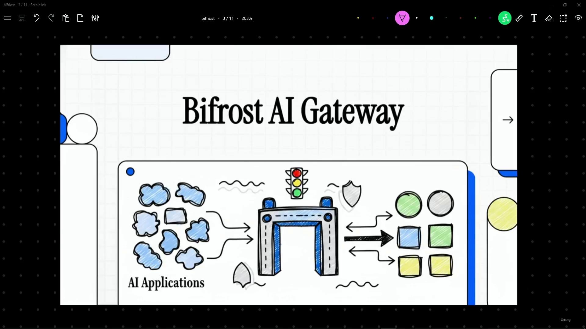
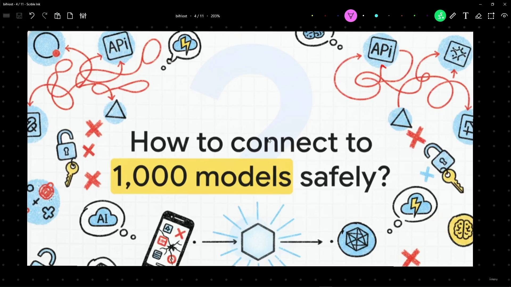
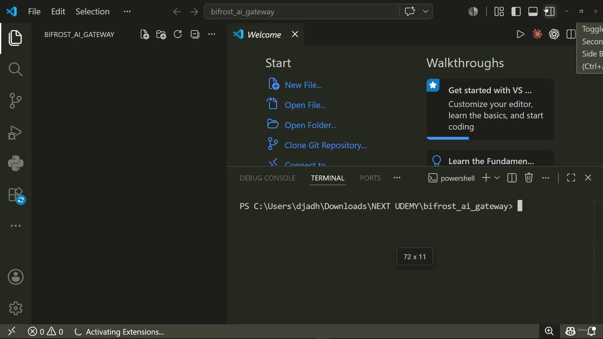
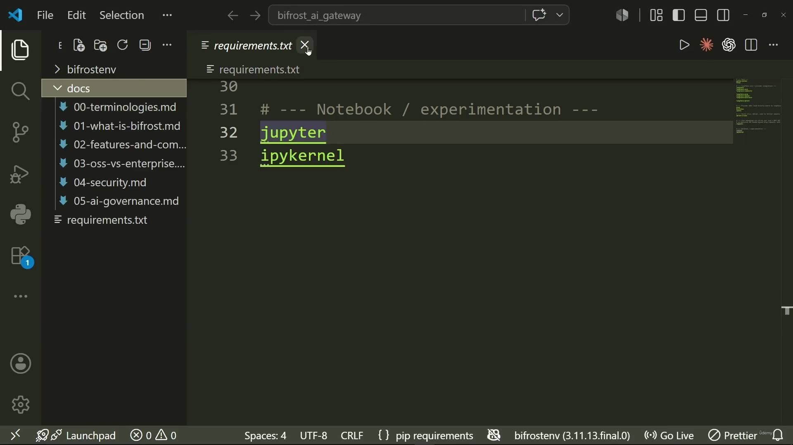
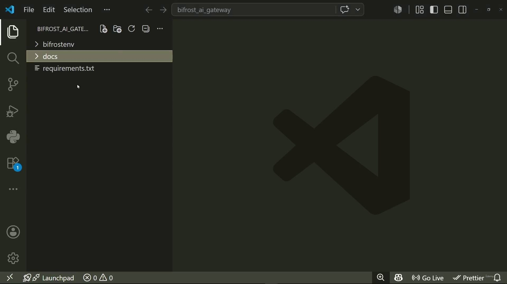
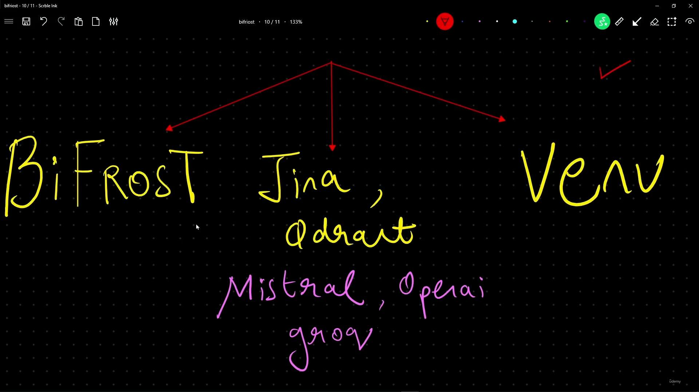
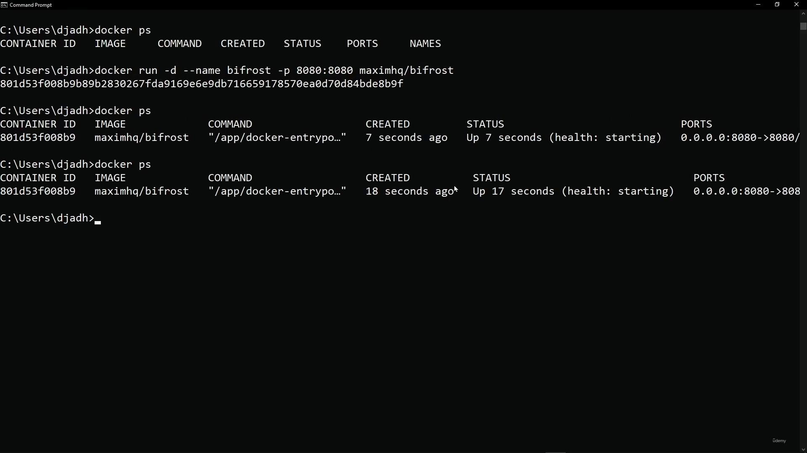
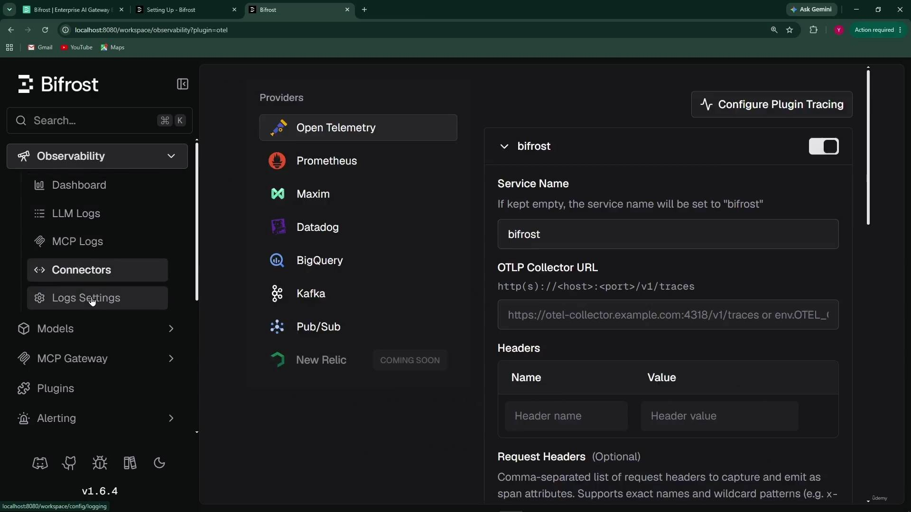
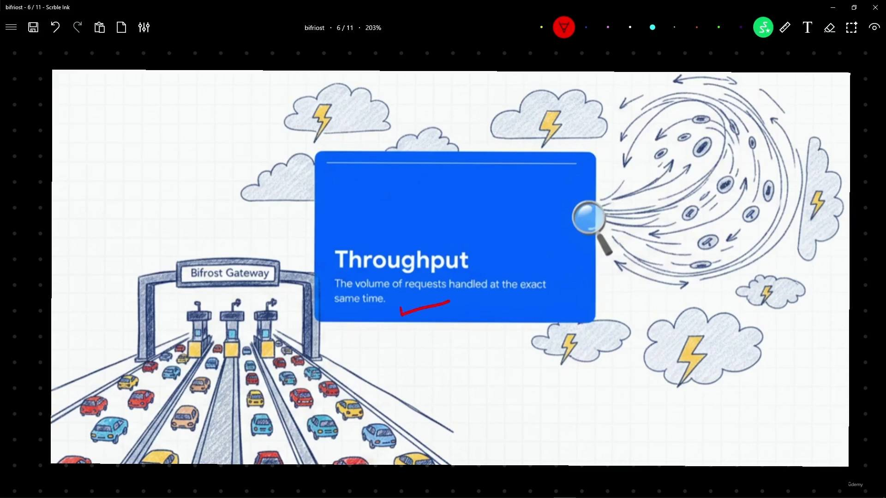

## 1. 这一节做什么

这一节覆盖 P89–P90，目标不是只讲“AI 网关是什么”，而是把后面的实验环境先搭好：你会用 `uv` 建一个 Python 3.11 虚拟环境，写好 `requirements.txt`、`.gitignore`、`.env.example`，拿到 Qdrant、Groq、Mistral、Jina 等服务的密钥，用 Docker 在本地跑起 Bifrost AI Gateway，然后在 Bifrost 的 UI 里配置 Groq、Mistral 两个 provider，生成两个 virtual key，最后把这些值写回 `.env`。

完成后，你的本机应该处于这个状态：

```text
bifrost-lab/
├── .env                  # 真实密钥，不提交
├── .env.example          # 变量模板，可提交
├── .gitignore
├── requirements.txt
└── bifrost_environment/  # uv 创建的虚拟环境，被 gitignore
```

以及一个正在运行的 Docker 容器：

```text
localhost:8080 -> Bifrost Dashboard
```

P89 是概念铺垫：Bifrost 是什么、为什么用 Go 写、latency/throughput/success rate 分别是什么意思、virtual key 为什么比把真实 API key 散落在开发者电脑里安全、AI governance 管什么。P90 是动手搭建：环境、依赖、密钥、Docker、UI 配置。下一节才会进 Jupyter notebook 做实验，所以这一节不要把“还没写 notebook”当成失败。



讲师在官网首页看到的几个关键数字是：20 微秒延迟、每秒 500 个吞吐请求、3.3 GB 峰值内存；页面还写了 1000+ 团队使用、比 LiteLLM 快 50 倍。后面讲师又提到“增加 11 微秒开销”和对比表里的 0.99 毫秒/40 毫秒，这些数字来自不同页面或不同口径，复现时不要把不同口径混成一个严格 benchmark。



Bifrost 的位置是“中间人”：你的 LLM 应用不再直接对接 OpenAI、Anthropic、Groq、Mistral 等一堆 provider，而是对接 Bifrost 暴露的 OpenAI 兼容入口；由 Bifrost 做路由、fallback、密钥管理、日志和治理。讲师强调，这样应用侧不再为每个 provider 写一套错误处理、重试逻辑。

这一节最后要得到的不是“看完了”，而是“可继续做实验”的环境。检查标准在本文第 6 节。

---

## 2. 讲师原话

> "从这期视频开始，我们要在一个新的 AI 网关框架里做集成，它的名字叫 Bifrost AI Gateway。"
> —— p089 [00:00]

> "他们首页写了：20 微秒延迟、每秒 500 个吞吐请求、3.3 GB 峰值内存。"
> —— p089 [00:26]

> "Bifrost 比 LiteLLM 快 50 倍。LiteLLM 也是一个 AI 网关框架，但我们这门课没有用它，因为它不安全。"
> —— p089 [00:55]

讲师展示了 LiteLLM 供应链攻击的案例：2026 年 3 月 24 日，一个名为 PCP 的威胁组织通过其 CACD 依赖中的漏洞入侵了项目的发布流水线（逐字稿听写为 CACD，具体拼写以原案例为准）。讲师让学员课后去读这个案例，理解为什么当时 LiteLLM 不被认为像以前那样安全。课里没有展开修复细节，也没有要求你复现攻击。

> "Go 语言可以并发处理多个线程，这就是 Bifrost 这么快的原因。"
> —— p089 [09:23]

讲师这里做了简化：Python 在他口中是“同一时间执行一个线程”，Go 可以并发处理多个线程。更准确地说，Python 有 GIL，但异步 I/O 也能并发；Go 的 goroutine 在网关这种高并发网络层更轻量。课里没有讲 GIL 细节，你只要知道讲师用这个点解释 Bifrost 为什么用 Go。

> "延迟是单个请求穿过网关再回来的时间；吞吐是同一时间能处理多少请求；成功率是请求成功完成的百分比。"
> —— p089 [13:02]

讲师用“汽车过收费亭”的比喻：请求是汽车，网关是收费亭，LLM provider 去查数据库再返回。收费亭慢，汽车就慢；收费亭同时能放多少车，就是吞吐；车能不能不抛锚到达目的地，就是成功率。Bifrost 声称 100% 成功率；对比表里 LiteLLM 是 88.78%。

> "如果虚拟键泄露了，不是大问题，你可以快速撤销它，甚至可以换掉；真实 API key 仍然安全。"
> —— p089 [17:14]

传统做法是 provider 的真实 key 散落在每个开发者的笔记本、几十个 `.env` 文件里，这是巨大的安全风险。安全做法是把真实 key 放进网关的 secret vault，应用只拿 virtual key。virtual key 泄露就撤销/轮换，不影响组织里其他人继续跑。

> "第一步是创建虚拟环境，我用 uv，Python 3.11，你也可以用更高版本。"
> —— p090 [00:29]

> "用 Docker 的话，先拉镜像，然后运行容器，把 8080 端口映射到 8080，镜像名是 maximhq/bifrost。"
> —— p090 [09:22]

> "provider 配
置好之后，就可以去 AI governance 里创建 virtual key 了。"
> —— p090 [15:52]

> "创建 virtual key 的时候我第一次忘了选 provider，所以要去 update 一下；你创建时记得先选 provider，再点创建。"
> —— p090 [16:21]

这是讲师在录屏里真实踩到的坑：他在新建 `grok virtual key` 时只填了名字和备注，没选 provider，于是这个 key 建出来不能正常路由，只能回去编辑、把 provider 选成 Groq 再保存。第二个 `mistral virtual key` 他就一次选对了。

> "我这里有 OpenAI key、Groq key、Mistral key；如果你没有 OpenAI key，完全可以跳过，不会影响什么。还需要 Qdrant URL 和 Qdrant API key、Jina embeddings，最后是 Bifrost base URL。"
> —— p090 [04:43]

> "还会有一个 virtual key 进来，以及一个 OpenTelemetry exporter，这个我们后面再讲。"
> —— p090 [05:12]

> "Bifrost 可以用两种方式装：npx，30 秒搞定；或者用 Docker。我自己喜欢用 Docker，比较自托管，我也很依赖 Docker。"
> —— p090 [05:41]

> "讲师在文档里演示，npx 只要跑一条 binary 命令就能把 Bifrost 装进系统；这条我没跑，我走 Docker 这条路。"
> —— p090 [06:10]

> "我们用的是 Jina embeddings，它们是通过 Jina 的 REST API 调用的，LangChain 里有对应的 Jina Embeddings 支持。"
> —— p090 [02:16]

> "Qdrant 是我们的向量数据库，我们是走 Qdrant Cloud，不用自托管版本，所以还要装 qdrant-client。"
> —— p090 [01:48]

> "开源版里我们有模型目录，1000+ AI 模型够用了；可以做预算，给团队设花费上限并追踪；可以做 provider fallback，一个模型挂了就切到另一个；有 MCP gateway，可以把多个工具接到 MCP 上再把请求路由过网关；还有 virtual key 管理和统一界面。"
> —— p089 [05:07]

> "企业版才有：治理、自适应负载均衡、集群模式、告警、日志导出、审计日志、Vault 支持（安全的 API key 管理）、VPC 部署、guardrails。要用这些得走企业版，可以申请 14 天免费试用。"
> —— p089 [06:02]

> "Bifrost 是任何 AI SDK 的 drop-in replacement：不管哪个 provider，你只要把 base URL 换成 Bifrost 的 OpenAI 兼容地址就能接上。"
> —— p089 [04:38]

> "请求进来之后，Bifrost 先检查对应的 provider 是否就绪；就绪就执行调用，没就绪就 fallback 到另一个 provider。这就是所有网关的工作方式。"
> —— p089 [15:54]

> "如果你们的应用是 RAG 或 agentic 应用，一些任务用 OpenAI、一些用 Anthropic、一些用 Groq 或 Mistral，那你要管理 20 多个 LLM API，还要处理请求、错误和一堆敏感 key——这是彻头彻尾的噩梦。"
> —— p089 [07:57]

> "很多人会在文档里看到 p50、p90、p99 延迟、吞吐、内存占用、并发这些术语，我在课程仓库里做了术语文档，你都应该过一遍。"
> —— p090 [03:15]

讲师提到的术语清单（出自他贴在仓库里的文档，逐字稿只念了一部分）：LLM inference、token、fine-tuning、agent、MCP、RAG、gateway 相关的 plugin hooks、p50/p90/p99 latency、throughput、memory footprint、concurrency。原文只列了名字，没有逐个定义，本文不替它编定义。

> "Bifrost 是 Maxim AI 做的产品；他们还有 Bifrost Edge，可能是给本地 LLM 用的，还有 enterprise gateway，你要搞清楚这几个的差别，在组织里才知道什么场景选哪个。"
> —— p089 [06:31]

> "这节课的作业是：视频结束后去把这份文档翻一遍。"
> —— p089 [07:00]

---

## 3. 从零复现

### 3.0 前置条件

| 需要的东西 | 说明 | 课里怎么说的 |
|---|---|---|
| Python 3.11 或更高 | 讲师明确用 3.11 | "我在这里用的是 Python 3.11，你可以用相近或更高的版本" |
| `uv` | 用 `uv venv`、`uv pip install` | 讲师全程用 uv |
| Docker Desktop | Mac 或 Windows 都行 | 讲师说 Windows 版他已经装好了 |
| 一个空文件夹 + VS Code | 讲师从空目录开始 | —— |
| 账号：Qdrant Cloud、Mistral、Groq、Jina，OpenAI 可选 | 用来取密钥 | —— |

在 JS/Node 那边对应的是什么？`uv` ≈ `pnpm`/`npm` 的角色（装包 + 隔离环境），`uv venv` ≈ `node_modules` 独立目录，`requirements.txt` ≈ `package.json` 的 `dependencies`，`.env` ≈ `dotenv` 读的那份文件。理解成本很低。

### 3.1 建目录、装虚拟环境

```bash
mkdir bifrost-lab
cd bifrost-lab
code .          # 用 VS Code 打开这个空目录
```

在 VS Code 的终端里（讲师用的是 CMD / PowerShell 风格）：

```bash
uv venv bifrost_environment
```

这一句会在当前目录生成 `bifrost_environment/`。讲师的虚拟环境名就叫 `bifrost_environment`，后面 `.gitignore` 里也是忽略这个名字。

激活（Windows）：

```bash
bifrost_environment\Scripts\activate
```

激活（macOS / Linux）：

```bash
source bifrost_environment/bin/activate
```

激活后清屏，准备写依赖文件。



### 3.2 写 requirements.txt

新建 `requirements.txt`，内容见第 4.1 节。讲师点名的依赖分四组：

1. **核心**：`python-dotenv`、`httpx`（逐字稿听写成 "python.env" 和 "sttps"，指的是这两个包：前者读环境变量，后者发 HTTP 请求）。
2. **LangChain 全家桶**：`langchain`、`langchain-core`、`langchain-community`、`langchain-groq`、`langchain-openai`、`langchain-mistralai`、`langchain-qdrant`。
3. **provider / 向量库客户端**：讲师说要"单独写 LLM providers"，因为他后面要演示从每个 provider 直接发请求；另外还要 `qdrant-client` 才能连 Qdrant Cloud。
4. **notebook**：`jupyter`、`ipykernel`，下一节要用。
5. 另外还有 `requests`，因为 Jina embeddings 是走 Jina 的 REST API、由 LangChain Community 的 Jina Embeddings 调用。

安装：

```bash
uv pip install -r requirements.txt
```



### 3.3 写 .gitignore

新建 `.gitignore`，见第 4.2 节。讲师要忽略的：`__pycache__`、`build`、`dist`、打包产生的包目录、虚拟环境（他这里就是 `bifrost_environment`）、ipynb checkpoints，以及后面陆续会加的东西。注意 `.env` 必须进 `.gitignore`，否则真实 key 会被推上 GitHub——讲师在 P89 花了整整两分钟讲"真实 key 散落各处"的风险，别自己第一天就犯。

### 3.4 写 .env.example 并复制成 .env

新建 `.env.example`（见第 4.3 节），然后：

```bash
cp .env.example .env     # Windows CMD: copy .env.example .env
```

讲师明确说了：你手上最后有的是 `.env`，里面填真实值；`.env.example` 只是模板，他不会把自己的 key 填进去。变量清单来自讲师原话：

- OpenAI key（可跳过）
- Groq key
- Mistral key
- Qdrant URL
- Qdrant API key
- Jina embeddings key
- Bifrost base URL
- Bifrost virtual key（先留空，3.7 之后回填）
- OpenTelemetry exporter（后面视频才用）



### 3.5 取各家密钥

**Qdrant**（向量库）：

1. 用 Google 账号登录 Qdrant Cloud。
2. 按提示填"我是谁 / 我是 AI engineer / build something new"之类的问卷，一路继续。
3. 给 cluster 起名，讲师起的名字是 `bifrost`。
4. 区域随便选，免费账号不用纠结。
5. 创建完成后拿到两样东西：**API key** 和 **cluster endpoint**，分别填到 `QDRANT_API_KEY`、`QDRANT_URL`。

**Mistral**：搜 "mistral api key"，在 Mistral 控制台生成一个 key，填 `MISTRAL_API_KEY`。讲师顺口夸了一句 Mistral 提供了很多开源模型。

**Groq**：同样在 Groq 控制台创建 API key，填 `GROQ_API_KEY`。注意拼写：逐字稿里全篇写作 "grok / grog"，指的是 **Groq**（不是 xAI 的 Grok）。

**OpenAI**：登录 OpenAI 拿 key，填 `OPENAI_API_KEY`。讲师明说："如果你没有，真的没关系，什么都不会变。"

**Jina**：Jina AI 提供 embeddings，免费额度不错。进 API keys 页面取 key（讲师说也可以从 embeddings / account 页面进），填 `JINA_API_KEY`。

### 3.6 用 Docker 起 Bifrost

先确认 Docker 在：

```bash
docker --version
docker ps
```

`docker ps` 只是确认守护进程活着，正常情况下没有正在跑的容器。然后拉镜像：

```bash
docker pull maximhq/bifrost
```

讲师说他自己已经拉过了，所以录屏里没真正执行这条，但你第一次必须跑。

跑容器：

```bash
docker run -d --name bifrost -p 8080:8080 maximhq/bifrost
```

命令会返回一个容器 ID。再 `docker ps`，应该看到一行：镜像 `maximhq/bifrost`、端口 `8080->8080`、创建于几秒前、健康状态 `starting`（讲师连续查了两次都还是 `starting`，这是正常的启动过程）。想看日志用 `docker logs bifrost`——讲师说"我们可以看日志，但没必要"。

浏览器打开：

```text
http://localhost:8080
```

就进了 Bifrost Dashboard。停掉容器：

```bash
docker stop bifrost
```

下次再起用 `docker start bifrost`；要删掉重建就用 `docker rm bifrost` 再 `docker run`。后两条课里没讲，属于 Docker 常识。



另一条路是讲师展示但没执行的 npx 方式：文档里写着 30 秒 setup，跑一条 npx binary 命令即可。逐字稿没有念出完整的 npx 命令字符串，所以本文不替你猜参数——要么去文档抄，要么就按上面走 Docker。



### 3.7 在 UI 里配 provider 和 virtual key

打开 `localhost:8080` 之后，左/侧边能看到这些入口：Dashboard、LLM logs、MCP logs、connectors、log settings、Models。Models 页里有 **model catalog**，以及 "Add provider" 按钮，可选 Azure、Mistral、Ollama 等等；还有 budget limits、complexity router。Governance 区里有 virtual keys、users、audit logs；但 audit logs、evals 这些带 "Book a demo" 的都是企业版功能。

按下面顺序操作：

1. **Models → Add provider → Groq**。Key 名称填 `grok test`（讲师原样这么写的），把 Groq 的 API key 粘进去，保存。
2. **Add provider → Mistral**，Key 名称填 `mistral test`，粘 Mistral API key，保存。
3. Ollama 讲师明确说留到以后的项目视频再加。
4. **AI Governance → Virtual Keys → 新建**。名字 `grok virtual key`，描述写 `testing`，**provider 选 Groq**，创建。
5. 再建一个：名字 `mistral virtual key`，**provider 选 Mistral**，创建。
6. 分别复制两个 virtual key 的值，回填到 `.env` 的 `BIFROST_GROQ_VIRTUAL_KEY`、`BIFROST_MISTRAL_VIRTUAL_KEY`。



第 4 步就是讲师踩坑的地方：创建时漏选 provider，建出来的 key 不能路由，必须回去编辑补上。你一次做对就行。

到这里 P90 结束。讲师收尾说："这一节我们成功搭好了三件事：Bifrost、Jina、Qdrant、Mistral 这些，还有虚拟环境。下一节我们进 Jupyter notebook 开始做各种实验。"

---

## 4. 完整代码

本段视频**没有 OCR 结果**（截图清单里没有可读的代码/配置文本），所以第 4 节的每个文件都是按逐字稿口述重建的。凡是讲师没有念出的具体名字（比如环境变量的确切拼写、依赖的版本号），我都在下方标注为"课里没讲"，你可以按自己的命名习惯改，只要前后一致。

### 4.1 `requirements.txt`

```text
# ---- 核心 ----
python-dotenv
httpx

# ---- LangChain ----
langchain
langchain-core
langchain-community
langchain-groq
langchain-openai
langchain-mistralai
langchain-qdrant

# ---- provider / 向量库客户端 ----
qdrant-client

# ---- Jina embeddings 走 REST ----
requests

# ---- notebook ----
jupyter
ipykernel
```

说明：版本号**课里没讲**，讲师只说"装 requirements"。上面故意不 pin 版本，装的是你执行当天的稳定版。要严格可复现，装完执行 `uv pip freeze > requirements.lock.txt` 自己锁一份——这一步课里没讲，是工程惯例。

### 4.2 `.gitignore`

```text
# Python
__pycache__/
*.py[cod]

# 打包产物
build/
dist/
*.egg-info/

# 虚拟环境（讲师用的名字）
bifrost_environment/
.venv/

# Notebook
.ipynb_checkpoints/

# 密钥：绝对不要提交
.env

# 系统文件
.DS_Store
```

### 4.3 `.env.example`

```text
# ============ LLM providers（真实 key）============
# OpenAI 可选，没有就留空
OPENAI_API_KEY=
GROQ_API_KEY=
MISTRAL_API_KEY=

# ============ 向量库 Qdrant Cloud ============
QDRANT_URL=
QDRANT_API_KEY=

# ============ Embeddings（Jina）============
JINA_API_KEY=

# ============ Bifrost ============
# 本地 Docker 起的网关地址
BIFROST_BASE_URL=http://localhost:8080
# 在 Bifrost UI 的 AI Governance -> Virtual Keys 里生成
BIFROST_GROQ_VIRTUAL_KEY=
BIFROST_MISTRAL_VIRTUAL_KEY=

# ============ 可观测（后续视频才用）============
OTEL_EXPORTER_OTLP_ENDPOINT=
```

变量名说明：`.env` 里具体叫什么**课里没讲**（讲师只说了"要有 OpenAI key、Groq key、Mistral key、Qdrant URL、Qdrant API key、Jina、Bifrost base URL、virtual key、OpenTelemetry exporter"这些**项目**）。上面这套命名是我给的可运行方案，你改成 `OPEN_AI_KEY` 之类也行，只要代码里读的是同一个名字。

### 4.4 Docker 命令全集

```bash
# 0) 确认 Docker 可用
docker --version
docker ps

# 1) 拉镜像（第一次必须跑）
docker pull maximhq/bifrost

# 2) 启动容器：后台、命名 bifrost、8080 映射 8080
docker run -d --name bifrost -p 8080:8080 maximhq/bifrost

# 3) 确认在跑，health 一栏可能还是 starting
docker ps

# 4) 打开 Dashboard
#    浏览器访问 http://localhost:8080

# 5) 停掉（讲师演示过）
docker stop bifrost
```

### 4.5 环境自检脚本（课里没有代码，以下为示意）

```python
# check_env.py —— 课里没有这段；用来确认 3.x 全部做完
import os
import httpx
from dotenv import load_dotenv

load_dotenv()

REQUIRED = [
    "GROQ_API_KEY",
    "MISTRAL_API_KEY",
    "QDRANT_URL",
    "QDRANT_API_KEY",
    "JINA_API_KEY",
    "BIFROST_BASE_URL",
    "BIFROST_GROQ_VIRTUAL_KEY",
    "BIFROST_MISTRAL_VIRTUAL_KEY",
]

missing = [k for k in REQUIRED if not os.getenv(k)]
print("缺失变量:", missing or "无")

base = os.getenv("BIFROST_BASE_URL", "http://localhost:8080")
try:
    r = httpx.get(base, timeout=5)
    print("Bifrost 可达:", r.status_code)
except Exception as e:
    print("Bifrost 不可达:", e)
```

---

## 5. 逐行解释

**`uv venv bifrost_environment`**
创建名为 `bifrost_environment` 的隔离环境。为什么必须隔离：Bifrost 这一节要装 LangChain + 三四个 provider SDK + qdrant-client，版本冲突概率不低；装在全局 Python 里，以后另一个项目要旧版 `langchain-core` 就炸了。这条对应 Node 里的"每个项目一个 `node_modules`"。

**`bifrost_environment\Scripts\activate` / `source .../activate`**
Windows 和 Unix 的激活脚本路径不同。不激活就 `uv pip install`，包会装到别处去，后面 Jupyter kernel 找不到。这是新手最常"明明装了却 import 失败"的原因。

**`python-dotenv`**
让 Python 能读 `.env`。注意：**装了不等于自动加载**，代码里必须写 `load_dotenv()`，`os.getenv()` 才拿得到值。这一条课里没讲，但你一定会撞上。

**`httpx`**
发 HTTP 请求。讲师对它的定位是"handling requests"。后面要直接打 provider 的 REST 端点、以及打 Bifrost 的 OpenAI 兼容端点，都用得上。`requests` 也能干这事，讲师两个都装了——`requests` 主要是给 Jina embeddings 那条路用的。

**`langchain` / `langchain-core` / `langchain-community`**
三个层次：`core` 是抽象基类（Runnable、Message 等），`community` 是各家第三方集成的大杂烩（Jina Embeddings 就在这儿），`langchain` 是编排层。讲师把它们分开列，是因为 `langchain-*` 系列各自的依赖树不同，一起装能避免你后面遇到 "找不到某个 integration" 时不知道缺哪个。

**`langchain-groq` / `langchain-openai` / `langchain-mistralai`**
每个 provider 一个包。对应关系很直白：要调 Groq 就装 `langchain-groq`，要调 OpenAI 就装 `langchain-openai`。这三个正是本节要接的三个 LLM provider（OpenAI 可选）。

**`langchain-qdrant` + `qdrant-client`**
前者是 LangChain 的 Qdrant 集成（VectorStore 接口），后者是官方 SDK（连集群、建 collection）。为什么两个都要：讲师用的是 **Qdrant Cloud**，不是自托管，HTTP/gRPC 连接、鉴权都靠 `qdrant-client`；`langchain-qdrant` 只负责把它包成 LangChain 的向量库接口。

**`jupyter` / `ipykernel`**
next video 要用 notebook 做实验。`ipykernel` 是把你的 `bifrost_environment` 注册成 Jupyter 可选的 kernel 的前提；只有 `jupyter` 而没有 kernel，notebook 里 `import langchain` 还是会失败。注册命令（课里没讲）：

```bash
python -m ipykernel install --user --name bifrost_environment --display-name "Python (bifrost)"
```

**`.gitignore` 里的 `bifrost_environment/`**
必须跟 `uv venv` 用的名字一模一样，否则虚拟环境（几百 MB）会被提交。`.env` 同理——这是 P89 那个"真实 key 散落在几十个 env 文件里"故事的直接对策。

**`BIFROST_BASE_URL=http://localhost:8080`**
网关地址。`8080` 不是随便挑的，是你在 `docker run -p 8080:8080` 里映射出来的宿主端口。讲师表述："8080 是你的端口，我们把所有流量转到 8080"。

**`BIFROST_GROQ_VIRTUAL_KEY` / `BIFROST_MISTRAL_VIRTUAL_KEY`**
应用侧**只**拿这两个，不拿 `GROQ_API_KEY` / `MISTRAL_API_KEY`。这就是 P89 讲的虚拟键模型：真实 key 住在网关里，泄露了虚拟键就撤销重建，组织里其他人不受影响。注意 `.env` 里同时存了真实 key——这一节是为了让你演示"直连各 provider"和"走网关"两条路，所以两种都在。生产上真实 key 不该出现在应用侧的 `.env` 里，这一点讲师没明说，但正是他"safe way"那一页的结论。

**`docker pull maximhq/bifrost`**
从镜像仓库拉官方镜像。讲师的口述是 "docker pull maxim hq"，实际写法是 `maximhq/bifrost`（Maxim AI 是 Bifrost 背后的公司）。

**`docker run -d --name bifrost -p 8080:8080 maximhq/bifrost`**
拆开看：
- `-d`：detached，后台跑，所以命令立刻返回一个容器 ID 而不是占住终端。
- `--name bifrost`：给容器命名 `bifrost`，后面 `docker ps`、`docker stop bifrost` 都靠它。
- `-p 8080:8080`：`宿主端口:容器端口`。左边是你在浏览器敲的 `localhost:8080`，右边是容器内部监听。两个 8080 一致是讲师的写法；如果本机 8080 被占（比如本地的 Spring Boot、某些前端 dev server），改成 `-p 8081:8080`，浏览器就访问 8081。
- 最后的 `maximhq/bifrost`：镜像名。

**`docker ps` 里 health 显示 `starting`**
讲师连续查了两次都是 `starting`，然后直接去浏览器打开了 `localhost:8080` 并成功。结论：`starting` ≠ 失败，别急着重建容器，等几秒刷新。

**在 UI 里配 provider vs 建 virtual key**
两件不同的事，顺序不能反：
1. **provider**（Models → Add provider）存的是**真实 key**：`grok test` / `mistral test`。这是网关的"上游凭据"。
2. **virtual key**（Governance → Virtual Keys）是发给应用用的**下游凭据**，必须绑定一个 provider，否则不知道路由到哪。讲师第一次漏选 provider 就是这个原因。

**为什么不现在配 Ollama**
讲师原话是留到"以后的项目视频，等我们用 Bifrost 的时候再加"。OSS 版的 model catalog 里 1000+ 模型，但这一节只需要 Groq + Mistral 跑通风控链路。

**为什么课程标题叫"护栏/网关/可观测"而这两节几乎只讲网关**
这两节里，guardrails 只作为**特性**出现（AWS Bedrock Guardrails、Pangea Guardrails、Custom Guardrails，企业版才有），可观测只有 UI 里的 LLM logs / MCP logs / log settings / audit logs 和那个 `OTEL_EXPORTER_OTLP_ENDPOINT` 占位。真正的护栏规则和 OTel 埋点，课里在这两节**没讲**，后续视频才做。



三个指标的准确读法：

- **latency（延迟）**：单个请求穿网关再回来的耗时。讲师给的数量级：1 微秒 = 百万分之一秒（原话"one microsecond is one millionth of a second"）。他说 Bifrost 增加 11 微秒开销，首页写 20 微秒；对比表里 Bifrost 0.99 毫秒、LiteLLM 40 毫秒——**单位在毫秒和微秒之间切换过，别把 0.99 毫秒当成 0.99 微秒**。0.99 ms ≈ 990 µs，仍比 40 ms 快约 40 倍，和"50x faster"是同一量级。
- **throughput（吞吐）**：同一时间能处理多少请求。首页写 500 req/s，对比表写 424（Bifrost）vs 44.84（LiteLLM）。两个数字来源不同，不要相加也不要互推。
- **success rate（成功率）**：成功返回的请求占比。Bifrost 声称 100%，对比表里 LiteLLM 88.78%。讲师的话是"应用爆红（比如上了 Instagram）时，你需要高吞吐的网关"，以及"高成功率意味着网关在重负载下没把你的请求丢掉"。

**p50 / p90 / p99**
讲师只把它们列为"你应该知道的术语"，没给定义。常规含义是延迟分位数：p99 = 99% 的请求快于这个值。课里没细讲，实验阶段可能会在 dashboard 上看到。

---

## 6. 复现检查清单

按顺序打勾，任何一项不过就别进下一节。

**环境**
- [ ] `python --version` 显示 3.11 或更高
- [ ] 当前目录下有 `bifrost_environment/`，且终端提示符前面有环境名（说明已激活）
- [ ] `pip list` 里能看到 `langchain`、`langchain-groq`、`langchain-mistralai`、`langchain-qdrant`、`qdrant-client`、`python-dotenv`、`httpx`、`jupyter`、`ipykernel`

**文件**
- [ ] `requirements.txt` 存在，且 `uv pip install -r requirements.txt` 无报错
- [ ] `.gitignore` 存在，包含 `bifrost_environment/` 和 `.env`
- [ ] `.env.example` 存在，变量清单覆盖：OpenAI（可空）、Groq、Mistral、Qdrant URL、Qdrant API key、Jina、Bifrost base URL、两个 virtual key、OTel exporter
- [ ] `.env` 存在，且 `git status` 看不到它（说明被忽略）

**密钥**
- [ ] Qdrant Cloud 上有名为 `bifrost` 的 cluster，API key 与 endpoint 已填
- [ ] Mistral key 已填
- [ ] Groq key 已填
- [ ] Jina key 已填
- [ ] OpenAI key：有就填，没有留空（不影响后续）
- [ ] Qdrant 的 endpoint 是完整 URL（含 `https://`），不是裸主机名

**Bifrost 容器**
- [ ] `docker --version` 有输出
- [ ] `docker ps` 能看到容器 `bifrost`，状态 `Up`，端口列含 `8080->8080`
- [ ] 浏览器打开 `http://localhost:8080` 能看到 Dashboard
- [ ] 页面里能看到 Models、LLM logs、MCP logs、connectors、log settings 这些入口
- [ ] audit logs / evals 显示需要 "Book a demo"（说明你确实在 OSS 版）

**Provider 与 virtual key**
- [ ] Models → Add provider 里已添加 Groq，key 名 `grok test`，保存成功
- [ ] 已添加 Mistral，key 名 `mistral test`
- [ ] Governance → Virtual Keys 里有 `grok virtual key`，**provider 一栏是 Groq**
- [ ] 有 `mistral virtual key`，**provider 一栏是 Mistral**
- [ ] 两个 virtual key 的值已回填到 `.env`
- [ ] 故意改错一个 virtual key 里的一个字符，请求应失败；改回来恢复——说明它真的在被校验（这一步课里没做，是我建议的自测）

**概念自检（能不看笔记说出来）**
- [ ] latency / throughput / success rate 三个词各自定义
- [ ] 为什么 virtual key 泄露比真实 key 泄露危害小
- [ ] Bifrost 在架构里的位置：应用 ↔ 网关 ↔ provider
- [ ] OSS 版有哪 6 个能力、企业版多出哪 8 个能力

---

## 7. 课里没讲但你会撞上的

**1. `.env` 不会自动加载**
`load_dotenv()` 忘写，`os.getenv("GROQ_API_KEY")` 返回 `None`，然后报一个看起来毫不相关的 401。排查顺序永远是：文件在不在 → 变量名拼写 → 有没有 `load_dotenv()`。

**2. Groq 拼成 Grok**
逐字稿里 "grok / grog" 出现十几次，指的是 **Groq**（groq.com）；Grok 是 xAI 的模型。你在 `langchain-groq` 里 import 的是 `ChatGroq`。讲师给 provider 起名 `grok test` 只是随手写的，你自己起名别跟着错。

**3. Qdrant / Quadrant、Jina / Gina、LiteLLM / Light LLM**
全是语音识别产物。正确拼写：**Qdrant**、**Jina**、**LiteLLM**。搜文档时用错拼写会找不到。

**4. 8080 端口被占**
`docker run` 报 `port is already allocated`。换映射：`docker run -d --name bifrost -p 8081:8080 maximhq/bifrost`，然后 `BIFROST_BASE_URL=http://localhost:8081`。别去改容器内部端口。

**5. Docker Desktop 没启动**
`docker ps` 报 `Cannot connect to the Docker daemon`。讲师的做法是先打开 Docker Desktop 再查一次——他录屏时也"卡了一下"，就是等 Docker 起来。

**6. health 一直 `starting`**
等 10–30 秒。若始终不 healthy，看 `docker logs bifrost`。课里没讲排障细节。

**7. 容器重启后数据还在吗**
本节的配置（provider、virtual key）存在容器内部。`docker stop` / `docker start` 保留；`docker rm` 后重建会**丢失**，得重新配。讲师没提持久化，也没挂 volume——所以别随手 `docker rm`。要持久化需要挂卷，具体挂哪个路径**课里没讲**。

**8. Virtual key 漏选 provider**
就是你会在 UI 里重复讲师那个错误：建出来的 key 看起来正常，但打请求时报找不到上游。回去编辑，把 provider 选上。

**9. Qdrant 免费集群会休眠**
长时间不访问后第一次连接会慢几秒甚至超时。课里没讲，但它不是你的代码坏了。

**10. Jina / Mistral / Groq 的免费额度**
都有速率与额度限制，而且各家计费页随时变。讲师只说 Jina "generous free tier"、OpenAI "没有也没关系"，具体额度课里没给数字，别照抄任何数字。

**11. `uv venv` 建的环境名 ≠ `--name bifrost` 的容器名**
两个 `bifrost` 长得很像：`bifrost_environment/` 是 Python 环境，`bifrost` 是 Docker 容器。`.gitignore` 只忽略前者，容器本来就不在 git 里。

**12. Jupyter kernel 没注册**
装了 `ipykernel` 但 notebook 的 kernel 列表里没有你的环境，`import langchain` 报 ModuleNotFoundError。用第 5 节那条 `ipykernel install` 命令注册。

**13. "Drop-in replacement" 别理解成"改个 URL 就全对"**
讲师说用 OpenAI 兼容的 base URL 就能迁移。实践中，不同 provider 的模型名、参数支持（比如某些模型不接受 `temperature`）、返回字段细节都有差异，网关能统一入口，但不会把 provider 之间的语义差抹平。课里没讲这些边界。

**14. 这一节没有 guardrails 和 OTel 的实操**
标题里的"护栏/可观测"在本段只以特性列表和 UI 入口的形式出现。别在这里找护栏规则配置或 span 埋点代码——课里没讲，下一段才有。

**15. 企业版功能点了会怎样**
audit logs、evals、governance 的深水区都标着 "Book a demo"。点进去是预约表单，不是功能页。想试企业版得申请 14 天试用，讲师提过一次。