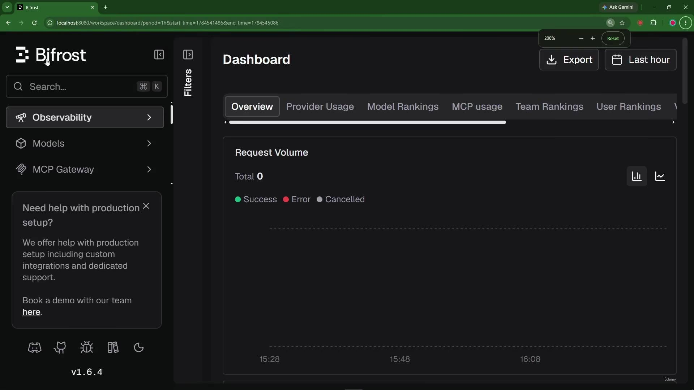
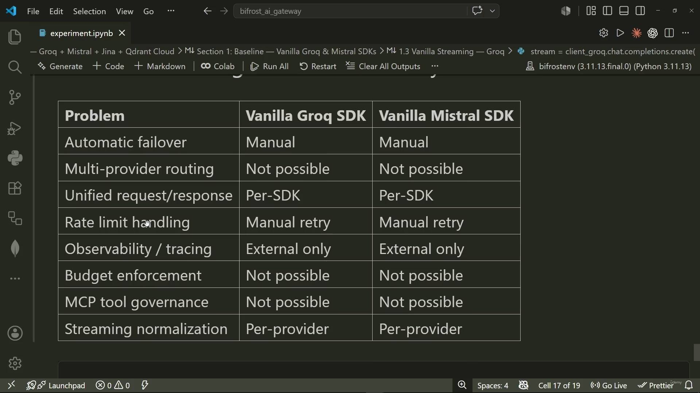
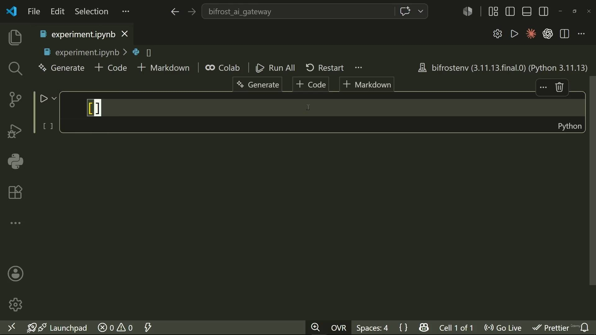
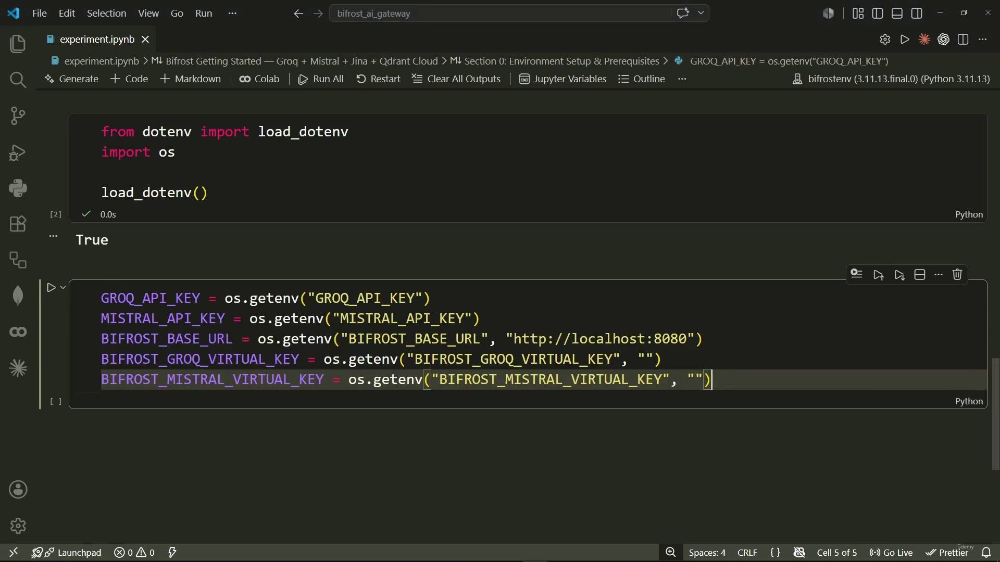
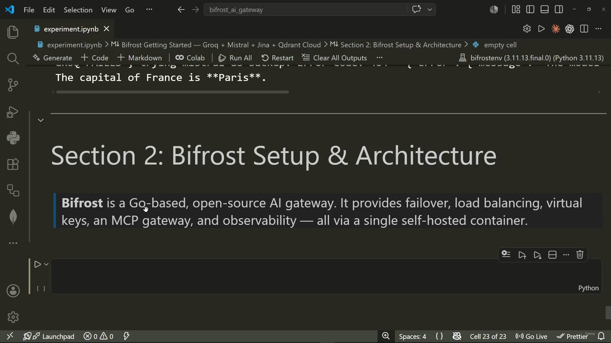
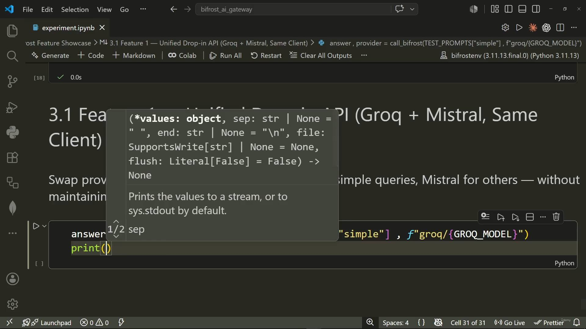
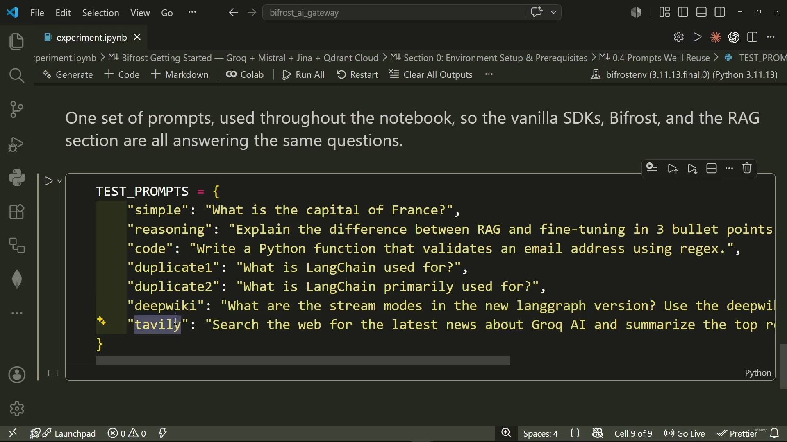

## 1. 这一节做什么

P091–P092 是一条完整的对照实验：**先不用网关，再用网关**。

P091 里，讲师先用 Groq 和 Mistral 的原生 SDK 直连模型，亲手写计时、流式输出和 `try/except` 降级，让你体验“没有网关”时每个 provider 一套 key、一套 client、一套 fallback 逻辑的痛苦。P092 里，他把同一个调用换成 Bifrost：用 OpenAI 兼容 SDK 指向本地 `http://localhost:8080/v1`，写一个 `call_bifrost()` helper，之后只改 `model` 字符串就能在 Groq 和 Mistral 之间切换，并在 Bifrost dashboard 里看到 query、token 用量、provider 和 trace。

照着这份文档做完，你会得到一个可运行的 `experiment.py`（也可以按 `# %%` 逐段粘进 `experiment.ipynb`），包含：

- `.env` 环境变量加载与默认值处理
- Bifrost 健康检查 `/health`
- 7 条可复用测试 prompt
- 直连 Groq 的基线调用、延迟统计
- 直连 Mistral 的基线调用
- Groq 原生流式输出
- 手写 naive manual fallback
- Bifrost 的 OpenAI 兼容 client
- `call_bifrost()` helper：prompt、system、model、fallback model、provider 提取
- 用 helper 分别调用 Groq 和 Mistral，并在 dashboard 验证 trace

前置条件：Docker 里已经有 Bifrost 容器，容器映射到本机 `8080`；你有 Groq 和 Mistral 的 API key；Bifrost dashboard 里已经添加了这两个 provider、创建了 virtual key、在 model catalog 里登记了要用的模型。课里默认这些在上一节已经做完，这一节直接开始实验。



讲师在 P091 开头先确认了运行状态：Bifrost 是 self-hosted，跑在自己的机器上，不在公网；dashboard 地址是 `localhost:8080`。他还展示了 traces 页面，可以按 success rate、error rate 过滤，侧边栏里能看到 governance、virtual keys、MCP gateway 这些入口。这些入口就是后面 P092 要用的地方。



这一节的核心不是“学一个 SDK”，而是让你先感受到**没有网关时，所有治理能力都要自己补**：自动 failover、多 provider 路由、统一请求格式、限流、tracing、预算控制、MCP 工具治理、流式归一化。P092 再用 Bifrost 把这些能力收走。

---

## 2. 讲师原话

> "没有网关时最大的问题是，所有 fallback 逻辑和别的逻辑都得你自己写。"
> —— p091 [02:46]

> "我们面对不同的 LLM provider，Groq、Mistral、OpenAI、Claude、Anthropic、Gemini，这些都是不同的 LLM provider。如果 Groq 不工作，Mistral 要能工作；如果 Mistral 不工作，Gemini 要能工作。这些逻辑都得我们自己写。"
> —— p091 [03:15]

> "每个 provider 都会给你自己的 API key，你得分别管理所有 API key 和 client。以前没有网关的时候人们就是这么干的。"
> —— p091 [04:12]

> "这是每个 API 都应该有的隐藏路由，健康检查路由。每个正经的企业级 API 都会有。"
> —— p091 [08:01]

> "为什么初始化这些 LLM client 这么相似？因为大家维护了一个标准，兼容 OpenAI，因为 OpenAI 开创了这一切。所以我们总说 OpenAI compatible clients。"
> —— p091 [17:14]

> "最糟糕的是没有自动 failover。即使 Groq 和 Mistral 各自能用，如果这个 API key 不工作，我们有没有备份？没有。"
> —— p091 [20:33]

> "多 provider 路由、统一请求 SDK，这些都没有。我们没有一条公共路径来发请求。"
> —— p091 [21:01]

> "限流、可观测性/tracing、预算控制，这些都做不到。MCP 工具治理更不可能，流式归一化也要看 provider。"
> —— p091 [21:57]

> "prompt 版本管理，网关也提供。这是对你 AI 应用的总治理。"
> —— p091 [25:48]

> "Bifrost 是一个 Go 写的开源 AI 网关。Go 能加速网络层，所有跑在特定基础设施或框架上的流程都会更快。"
> —— p092 [00:00]

> "它提供 failover、负载均衡、virtual keys、MCP gateway 和可观测性。"
> —— p092 [00:27]

> "标准做法是 OpenAI 兼容，因为今天和未来出现的框架都会兼容 OpenAI。"
> —— p092 [01:55]

> "我们有 virtual keys，Bifrost 替我们管 API key，我们不用操心。"
> —— p092 [02:23]

> "headers 是我们随请求传的元数据或额外信息。"
> —— p092 [05:13]

> "在 Bifrost 上能看到一次 query，token 用量、输入 token、输出 token，还有第一条 trace。"
> —— p092 [10:55]

---

## 3. 从零复现

### 3.1 目录结构

```text
ai-security-bootcamp/
└── part2-gateway/
    ├── .env
    ├── .gitignore
    ├── requirements.txt
    └── experiment.py        # 也可以复制进 experiment.ipynb
```

`.gitignore` 至少要有：

```gitignore
.env
.venv/
__pycache__/
.ipynb_checkpoints/
```

### 3.2 确认 Bifrost 容器在跑

先看容器：

```bash
docker ps
```

如果 Bifrost 容器存在但没启动：

```bash
docker start bifrost
```

> 容器名以你 `docker ps -a` 里看到的为准。课里只说“Docker start Bifrost 会启动你的 Bifrost 容器”，没有逐字给出容器名。

确认端口和健康检查：

```bash
curl http://localhost:8080/health
```

浏览器打开 `http://localhost:8080`，确认 dashboard 能进。课里说的 dashboard 路由包括 workplace route、dashboard route、LLM logs；health 是一个隐藏路由，不在侧边栏里。

### 3.3 在 Bifrost 里配好 provider、virtual key、model catalog

在 dashboard 里完成三件事：

1. **Providers**：添加 Groq 和 Mistral，填入各自的 API key。
2. **Virtual keys**：创建供代码调用的 virtual key。课里在 `.env` 里放了 `BIFROST_GROQ_VIRTUAL_KEY` 和 `BIFROST_MISTRAL_VIRTUAL_KEY` 两个变量，说明他至少按 provider 准备了 key。
3. **Model catalog**：在模型目录里登记要用的模型。课里说“在同一个 provider 下可以添加更多模型”，他加了一些“不是真实模型”的条目做测试。你这里要加真实模型：Groq 的 120B 和 20B，Mistral 的 large-latest 和 small-latest。

MCP 相关先不用配。P092 只说了入口：MCP gateway 下面有 MCP catalog，后面才会往里加 MCP server。

### 3.4 创建 Python 环境

```bash
mkdir -p ai-security-bootcamp/part2-gateway
cd ai-security-bootcamp/part2-gateway
python -m venv .venv
source .venv/bin/activate        # Windows: .venv\Scripts\activate
pip install -r requirements.txt
```

`requirements.txt` 内容见第 4 节。课里只说了“安装 requirements.txt”，没有逐字给版本；下面给的是一组能配合当前 SDK 的参考版本，装不上就退回最新版。

### 3.5 写 `.env`

```dotenv
GROQ_API_KEY=gsk_你的GroqKey
MISTRAL_API_KEY=你的MistralKey
BIFROST_URL=http://localhost:8080
BIFROST_GROQ_VIRTUAL_KEY=sk-bf-你的GroqVirtualKey
BIFROST_MISTRAL_VIRTUAL_KEY=sk-bf-你的MistralVirtualKey
```

逐字稿里语音识别把 Groq 写成了“GROC/GROK”，实际产品是 **Groq**。变量名按 `GROQ_API_KEY` 写。

### 3.6 创建 notebook / 脚本

在 VS Code 里新建 `experiment.ipynb`，选择刚才的 `.venv` 作为 kernel；或者直接新建 `experiment.py`，用 `# %%` 分隔 cell，在 VS Code 的交互窗口里逐段运行。课里用的是 `experiment.ipynb`，并且专门确认了虚拟环境选对、`print("all OK")` 能跑。



### 3.7 按顺序运行代码

运行顺序就是第 4 节的 Cell 0 到 Cell 13：

1. **Cell 0**：加载 `.env`，读取五个变量，打印 Bifrost URL。
2. **Cell 1**：`httpx.get(f"{BIFROST_URL}/health", timeout=3)`，状态码 200 就打印
状态码 200 就打印 `Bifrost online`；请求异常则打印 `Bifrost offline`，并提示先用 `docker start bifrost` 把容器拉起来。
3. **Cell 2**：定义 7 条可复用测试 prompt：`simple`、`reasoning`、`code`、`duplicate_one`、`duplicate_two`、`deepwiki`、`tavily`。
4. **Cell 3**：写死 4 个模型常量：Groq 主模型 / 备用模型、Mistral 主模型 / 备用模型，并打印出来确认。
5. **Cell 4**：直连 Groq，跑 `simple` prompt，用 `time.perf_counter()` 前后夹住，算出毫秒延迟。
6. **Cell 5**：直连 Mistral，跑 `reasoning` prompt，打印答案、延迟、token 数。
7. **Cell 6**：Groq 原生 streaming，`stream=True`，`for chunk in stream` 里取 `chunk.choices[0].delta.content`，有内容就 `print(delta, end="", flush=True)`。
8. **Cell 7**：naive manual fallback，`try` 里打 Groq，`except` 里打印 `Groq failed, trying Mistral as backup` 和原始错误，然后打 Mistral。跑完你再手工把 `GROQ_MODEL` 改成一个不存在的值，观察降级。
9. **Cell 8**：构造 Bifrost 的 OpenAI 兼容 client，`base_url = f"{BIFROST_URL}/v1"`，`api_key` 用 virtual key。
10. **Cell 9**：写 `call_bifrost()` helper，返回 `(answer, provider)`。
11. **Cell 10**：用 helper 调 Groq，打印答案和 provider。
12. **Cell 11**：只把 `model=GROQ_MODEL` 改成 `model=MISTRAL_MODEL`，再跑一次，看 dashboard 多出第二条 trace。
13. **Cell 12**：换一条带指令的 prompt（"how to learn AI gateways. Shortcut: respond in ten words"），验证 helper 能透传任意消息。

每跑完一个 Cell，回浏览器 `http://localhost:8080` 刷一下：P092 里第一次调用后出现 1 条 query、input/output token 数、第一条 trace；第二次调用后刷新变成 2 条，LLM logs 里能看到 provider 分别是 Groq 和 Mistral AI。



---

## 4. 完整代码

### 4.1 `requirements.txt`

```text
openai>=1.40.0
groq>=0.9.0
mistralai>=1.0.0
httpx>=0.27.0
python-dotenv>=1.0.0
```

课里只说了"安装你的 requirements.txt"，没有逐字报版本号；上面是一组能跑的参考下限。`mistralai` 1.0 之前是 `from mistralai.client import Mistral` + `client.chat()`，1.0 之后是 `from mistralai import Mistral` + `client.chat.complete()`，下面代码按 1.0+ 写，并在注释里标了旧写法。

### 4.2 `experiment.py`（可整体保存运行，也可按 `# %%` 贴进 `experiment.ipynb`）

```python
# %%
# ============================================================
# Cell 0 — 加载环境变量
# ============================================================
import os
from dotenv import load_dotenv

load_dotenv()

GROQ_API_KEY = os.getenv("GROQ_API_KEY")
MISTRAL_API_KEY = os.getenv("MISTRAL_API_KEY")

# Bifrost 默认跑在 localhost:8080；有人会改端口，所以给默认值
BIFROST_URL = os.getenv("BIFROST_URL", "http://localhost:8080")

# virtual key：如果环境变量里没有，默认空字符串
BIFROST_GROQ_VIRTUAL_KEY = os.getenv("BIFROST_GROQ_VIRTUAL_KEY", "")
BIFROST_MISTRAL_VIRTUAL_KEY = os.getenv("BIFROST_MISTRAL_VIRTUAL_KEY", "")

print("All environment variables loaded successfully")
print(f"Keys loaded -> GROQ: {bool(GROQ_API_KEY)} | MISTRAL: {bool(MISTRAL_API_KEY)}")
print(f"Bifrost is running on {BIFROST_URL}")


# %%
# ============================================================
# Cell 1 — 检查 Bifrost 健康状态 /health
# ============================================================
import httpx

try:
    health = httpx.get(f"{BIFROST_URL}/health", timeout=3)
    bifrost_ok = health.status_code == 200
except Exception:
    # 连不上、超时、端口不通，都按 offline 处理
    bifrost_ok = False

if bifrost_ok:
    print("Bifrost online")
else:
    print("Bifrost offline — 请先执行: docker start bifrost")


# %%
# ============================================================
# Cell 2 — 可复用的测试 prompt
# ============================================================
TEST_PROMPTS = {
    "simple": "What is the capital of France?",
    "reasoning": "Explain the difference between RAG and fine-tuning.",
    "code": "Write a Python function that reverses a string.",
    "duplicate_one": "What is LangChain used for?",
    "duplicate_two": "What is LangChain primarily used for?",
    # 课里给 deepwiki 只报了名字，没有念出具体措辞；这里放一条占位问题
    "deepwiki": "Summarize the architecture of this GitHub repository.",
    # Tavily 那条，课里明确念的是 LangGraph 的 stream modes
    "tavily": "What are the stream modes in LangGraph?",
}


# %%
# ============================================================
# Cell 3 — 模型清单
# 课里：Groq 原计划用 Llama 3.3 70B versatile，但录制时已宣布退役，
# 所以改用 GPT-OSS 120B（主）和 20B（备）；Mistral 用 large-latest / small-latest
# 具体 model id 以你 Bifrost model catalog 里登记的字符串为准
# ============================================================
GROQ_MODEL = "openai/gpt-oss-120b"
GROQ_MODEL_FALLBACK = "openai/gpt-oss-20b"

MISTRAL_MODEL = "mistral-large-latest"
MISTRAL_MODEL_FALLBACK = "mistral-small-latest"

print("Groq model:          ", GROQ_MODEL)
print("Groq fallback model: ", GROQ_MODEL_FALLBACK)
print("Mistral model:       ", MISTRAL_MODEL)
print("Mistral fallback:    ", MISTRAL_MODEL_FALLBACK)


# %%
# ============================================================
# Cell 4 — Session 1：直连 Groq（没有网关的基线）
# ============================================================
import time
from groq import Groq

groq_client = Groq(api_key=GROQ_API_KEY)

start = time.perf_counter()

groq_response = groq_client.chat.completions.create(
    model=GROQ_MODEL,
    messages=[
        {"role": "user", "content": TEST_PROMPTS["simple"]}
    ],
)

latency_ms = (time.perf_counter() - start) * 1000

print(groq_response.choices[0].message.content)
print(f"Latency: {latency_ms:.0f} ms")
print(f"Tokens: {groq_response.usage.prompt_tokens} in / "
      f"{groq_response.usage.completion_tokens} out")


# %%
# ============================================================
# Cell 5 — Session 1：直连 Mistral（和 Groq 是同一套写法）
# mistralai 1.0+ 用 client.chat.complete；0.x 用 client.chat
# ============================================================
from mistralai import Mistral

mistral_client = Mistral(api_key=MISTRAL_API_KEY)

start = time.perf_counter()

mistral_response = mistral_client.chat.complete(
    model=MISTRAL_MODEL,
    messages=[
        {"role": "user", "content": TEST_PROMPTS["reasoning"]}
    ],
)

latency_ms = (time.perf_counter() - start) * 1000

print(mistral_response.choices[0].message.content)
print(f"Latency: {latency_ms:.0f} ms")
print(f"Tokens: {mistral_response.usage.prompt_tokens} in / "
      f"{mistral_response.usage.completion_tokens} out")


# %%
# ============================================================
# Cell 6 — 原生流式（vanilla streaming）
# 课里强调：这就是 ChatGPT 那种一行一行吐字的体验
# ============================================================
stream = groq_client.chat.completions.create(
    model=GROQ_MODEL,
    messages=[
        {"role": "user", "content": TEST_PROMPTS["code"]}
    ],
    stream=True,
)

for chunk in stream:
    delta = chunk.choices[0].delta.content
    if delta:
        print(delta, end="", flush=True)


# %%
# ============================================================
# Cell 7 — naive manual fallback（手写降级）
# 课里明确说这是"naive/笨办法"，只为演示没有网关时你被迫写什么
# ============================================================
try:
    response = groq_client.chat.completions.create(
        model=GROQ_MODEL,          # 故意改成 None 或错误 id 可触发降级
        messages=[
            {"role": "user", "content": TEST_PROMPTS["simple"]}
        ],
    )
    answer = response.choices[0].message.content
    print(answer)
    print("Answered by: Groq")
except Exception as groq_error:
    print("Groq failed, trying Mistral as backup")
    print(groq_error)

    response = mistral_client.chat.complete(
        model=MISTRAL_MODEL,
        messages=[
            {"role": "user", "content": TEST_PROMPTS["simple"]}
        ],
    )
    answer = response.choices[0].message.content
    print(answer)
    print("Answered by: Mistral (fallback)")


# %%
# ============================================================
# Cell 8 — Bifrost client：OpenAI 兼容 SDK 指向本地网关
# api_key 传 virtual key，不再直接用 provider 的 key
# ============================================================
from openai import OpenAI

bifrost = OpenAI(
    api_key=BIFROST_GROQ_VIRTUAL_KEY,
    base_url=f"{BIFROST_URL}/v1",
)

print("Bifrost is ready — 已包含 Groq 和 Mistral 两个模型")


# %%
# ============================================================
# Cell 9 — call_bifrost() helper
# 返回 (answer, provider)；provider 从 Bifrost 返回体 extra_fields 里取
# ============================================================
import json

# 课里口述为 "bifrost fallback models" 头；实际头名请以你 Bifrost 版本文档为准
BIFROST_FALLBACK_HEADER = "x-bifrost-fallback-models"


def call_bifrost(prompt, model, system=None, fallback_model=None):
    """
    prompt:         用户问题
    model:          Bifrost model catalog 里登记的模型字符串
    system:         系统指令（可选）
    fallback_model: 备用模型字符串，None 表示不设
    """
    headers = {}
    if fallback_model:
        headers[BIFROST_FALLBACK_HEADER] = fallback_model

    messages = []
    if system:
        messages.append({"role": "system", "content": system})
    messages.append({"role": "user", "content": prompt})

    raw = bifrost.chat.completions.with_raw_response.create(
        model=model,
        messages=messages,
        extra_headers=headers if headers else None,
    )

    response = raw.parse()

    provider = (
        json.loads(raw.text)
        .get("extra_fields", {})
        .get("provider", "unknown")
    )

    return response.choices[0].message.content, provider


# %%
# ============================================================
# Cell 10 — 用 helper 打 Groq
# ============================================================
answer, provider = call_bifrost(
    prompt=TEST_PROMPTS["simple"],
    model=GROQ_MODEL,
    fallback_model=GROQ_MODEL_FALLBACK,
)

print(f"Model: {GROQ_MODEL} | Provider: {provider}")
print(answer)


# %%
# ============================================================
# Cell 11 — 只改一个 model 字符串，就换到 Mistral
# ============================================================
answer, provider = call_bifrost(
    prompt=TEST_PROMPTS["simple"],
    model=MISTRAL_MODEL,
    fallback_model=MISTRAL_MODEL_FALLBACK,
)

print(f"Model: {MISTRAL_MODEL} | Provider: {provider}")
print(answer)


# %%
# ============================================================
# Cell 12 — 透传任意指令型 prompt
# ============================================================
answer, provider = call_bifrost(
    prompt="How to learn AI gateways? Shortcut: respond in ten words.",
    model=MISTRAL_MODEL,
    fallback_model=MISTRAL_MODEL_FALLBACK,
    system="You are a concise technical assistant.",
)

print(f"Model: {MISTRAL_MODEL} | Provider: {provider}")
print(answer)
```

### 4.3 跑完后的验证

三个地方都要看到东西：

1. **终端**：Cell 4 打印 `The capital of France is Paris` 和毫秒延迟；Cell 10、11 打印 `Provider: ...`。
2. **`http://localhost:8080` 的 traces**：Cell 10 之后是 1 条 query，Cell 11 之后刷新变 2 条，两条都是 success。
3. **LLM logs**：能看到 `OpenAI` 这一行下挂着 GPT-OSS 模型（Groq 那次），以及 `Mistral AI`（Mistral 那次）；课里那次 trace 的 token 是 78 input / 43 output，你的数字会不同。



---

## 5. 逐行解释

### 5.1 Cell 0：为什么 `BIFROST_URL` 必须进代码

`load_dotenv()` 把 `.env` 里的键值塞进进程环境。之后 `os.getenv` 逐个取出来。在 JS/Node 里这一步就是 `require('dotenv').config()` 加 `process.env.XXX`，概念完全一样。

`BIFROST_URL = os.getenv("BIFROST_URL", "http://localhost:8080")` 的第二个参数是默认值。讲师的原话是："如果这个变量在环境变量里找不到，这就是默认值，因为有时候人们会把它跑在不同的端口上。" 这句话很重要——它是**可移植性**的开关。你把项目发给别人，对方把容器映射到 `9090`，只需改 `.env`，一行代码都不用动。

`BIFROST_GROQ_VIRTUAL_KEY = os.getenv(..., "")` 同理，默认是空字符串。课里说的是"如果这里什么都没有，默认就是空"。空 key 不会让脚本在导入阶段崩掉，只会在真正发请求时返回 401，报错位置更接近问题本身，这是有意的。

为什么 `BIFROST_URL` 要出现在业务代码里？讲师自问自答："`localhost:8080` 是什么？是 Bifrost 在跑的地方。我们代码里要打 Bifrost client。如果你在云上，你打的就是 Portkey client，我们之前配过 Portkey client。" 也就是说：**你打的不再是模型厂商，而是你自己那台网关**。这是整节课的转折点。之前 Groq client 打 `api.groq.com`，Mistral client 打 `api.mistral.ai`；从 Cell 8 开始，所有请求只有一个出口——`localhost:8080`。

### 5.2 Cell 1：为什么专门写一个健康检查

`httpx.get(f"{BIFROST_URL}/health", timeout=3)`。讲师在浏览器里先手动验证了一遍：切到 dashboard 时 URL 是 workplace route，切到 LLM logs 时 route 在变，但 `/health` 是一个侧边栏里看不到的**隐藏路由**。他的判断是："每个 API 都应该有这个隐藏的 health 路由，每个正经的企业级 API 都有。"

`timeout=3` 是"等 3 秒，不回就当挂了"。不加 timeout 的 HTTP 请求在网络半通时会一直挂着，notebook 的 cell 会永远转圈，这是本地开发最常见的坑之一。

`bifrost_ok = health.status_code == 200`。讲师说"如果这个 health 是 OK 的，我就造一个变量叫 bifrost_ok，等于 status 200；不行的话就抛异常，表示 Bifrost 不 OK"。我这里用 `except` 兜住异常然后置 `False`，效果等价，但不会把整个 notebook 打断——你更希望看到一句 "Bifrost offline" 而不是一大坨 traceback。

`docker start bifrost` 只出现在提示语里。讲师说"这段代码其实不需要，除非有人不知道这回事"，所以他保留这段作为给新手的兜底说明。容器名以你 `docker ps -a` 的实际输出为准，课里没有逐字报容器名。

顺带说一个真实干扰项：讲师在录制时遇到 **VS Code 没有自动补全**，解决方式是"关掉、重启系统/编辑器"，重启后补全恢复。这不是代码问题，遇到别怀疑自己写错。

### 5.3 Cell 2：7 条 prompt 的分工

讲师的原话是"我们不会每次都花时间写 prompt，我准备了一个 prompt 列表，任务是简单的——我只想检查我的 API 是不是在工作"。这 7 条不是随便凑的，每条对应一类测试目标：

- `simple`（法国首都）：最便宜的连通性探针，答案唯一，肉眼可判对错。
- `reasoning`（RAG 与 fine-tuning 的区别）：要求模型输出多要点，用来观察"结构化长回答"的 token 消耗。讲师现场看到的就是"三点、三点"，即三个 bullet points。
- `code`（写一段 Python）：流式演示用，因为代码是逐行吐出来的，你能明显看到"一行一行"的流式效果。
- `duplicate_one` / `duplicate_two`（"LangChain 用来做什么" vs "LangChain 主要用来做什么"）：两条几乎同义、但措辞不同的 prompt，用来做**相似度/缓存/路由**类实验。讲师说"我们就会看到差别"。
- `deepwiki` / `tavily`：讲师解释了为什么两条都要留——"deepwiki 用来翻你的 GitHub 仓库，Tavily 用来搜网页，为什么两个都要？我后面会给你演示 deepwiki 和 tavily 的 MCP service，到那时候我会告诉你。" 所以这两条在这一节只是占位，真正用途在后面的 MCP 部分。

课里没有逐字念出 `deepwiki` 那条 prompt 的完整措辞，代码里我放了占位问题并标注了。Tavily 那条讲师明确念的是 "What are the stream modes in LangGraph?"。

### 5.4 Cell 3：模型为什么换了

讲师说："Groq 要退役 Llama 3.3 70B versatile，录这个视频的时候它就要被退役了。那我们有替代模型吗？当然，Groq 没死。" 他在 Groq 的 playground 里搜到了替代品，最终选了两个：**120B 参数**的主模型和 **20B 参数**的备用模型。Mistral 那边"就跟我们有大小模型一样，用 large-latest 和 small-latest"。

这里有个必须理解的设计意图：**主备两个模型是成对出现的**。`GROQ_MODEL` + `GROQ_MODEL_FALLBACK`，`MISTRAL_MODEL` + `MISTRAL_MODEL_FALLBACK`。这四个常量在 Cell 3 只是打印，但到 Cell 10、11 会作为 `model` 和 `fallback_model` 同时传进 `call_bifrost()`。

模型 id 的字符串（`openai/gpt-oss-120b` 这种）在各家命名规则不同。**课里没有逐字报出完整的 model id 字符串**，只报了"120 billion parameter model"和"20 billion parameter model"。所以你必须打开 Bifrost 的 model catalog，把你实际登记的名字原样抄进 Cell 3，否则请求会因为"模型不存在"被拒。这一点在后面讲师演示故意失败时会亲口印证——他把模型名设成一个不存在的值，返回的错误里就有 "the model nothing does not exist"。

### 5.5 Cell 4：直连 Baseline 的两个细节

`Groq(api_key=GROQ_API_KEY)`——注意这里用的是**厂商自己的 key**，不是 virtual key。这是"没有网关"的定义：你拿着每家发的 key，直连每家的域名。

`start = time.perf_counter()` 与 `latency_ms = (time.perf_counter() - start) * 1000`。讲师说"我需要 time，这样我能追踪模型响应花了多少时间"，用的是 `time.perf_counter()` 而不是 `time.time()`——前者是单调高精度计数器，不受系统时间调整影响。

为什么讲师要专门测延迟？因为在后面用网关时，你会关心**多了一跳网关之后延迟涨了多少**。这是网关选型最现实的问题：功能白送，但每次调用多一次网络往返。课里没给量化结论，只说"这条花了 430 毫秒"。你的数字会因网络和模型不同，别对标。

`messages=[{"role": "user", "content": ...}]` 这个结构，讲师专门强调："我希望你知道，这是打 LLM API 的标准方式。" 这个 `role` / `content` 的结构就是 OpenAI 定义的 chat 格式，全文所有 SDK 都是它的变体。

### 5.6 Cell 5：为什么 Mistral 的代码几乎是复制粘贴

讲师直接把 Groq 那段复制过来，只把 `groq` 换成 `mistral`，然后说："注意，初始化这些 LLM client 是多么相似。为什么？因为大家维护了一个标准来开发这些 client，并且兼容 OpenAI，因为 OpenAI 开创了这一切。所以我们总说 OpenAI compatible clients。"

这就是这一节最值钱的一句话。**正是因为厂商都对齐了同一个形状，网关才有机会把 N 个 provider 收敛成 1 个接口**。如果每家都像 SOAP 时代那样自定义协议，网关就无从下手。

Mistral 的调用是 `mistral_client.chat.complete(...)`（1.0 之前是 `mistral_client.chat(...)`），比 Groq 的 `chat.completions.create` 少一层。这个细微差别正是"没有统一层"的代价——你写的代码里永远留着 provider 的指纹。

讲师在这里说了一句容易被误解的话："我们在自己算 token。" 他的意思不是用 tokenizer 手动分词，而是**token 用量由 SDK 返回的 `usage` 字段提供，你在自己这边记录**。到了 Bifrost，这件事变成网关侧统计，你在 dashboard 上直接看 input/output 数字。

### 5.7 Cell 6：流式的本质

`stream=True` 一行就把普通请求变成流式。讲师说："如果 `stream=True`，我们就会看到模型一步一步地回复。"

`for chunk in stream:` 每次拿到一个 chunk。`delta = chunk.choices[0].delta.content`——讲师专门解释了这个词："`delta` 是什么？`delta` 就是大语言模型给出的流式内容。" 非流式返回的是 `message.content`（完整一段），流式返回的是 `delta.content`（增量一片）。`if delta:` 用来跳过首尾那些 `content` 为 `None` 的 chunk。

`print(delta, end="", flush=True)`。`end=""` 不换行，`flush=True` 立刻刷到屏幕。讲师说："`flush` 参数设为 true，意思是把结果马上冲出去。" 如果不 flush，Python 会攒在缓冲区里，你就看不到"一行一行"的效果，而是最后一次性刷出来——那就不叫流式了。

在 Node 里对应的是 `for await (const chunk of stream)`，`flush` 的概念对应 `process.stdout.write()`，同样是即时输出。

讲师强调这是 **vanilla streaming**（原生流式）："流式很简单，我们在 Portkey 那节也见过，不是什么大事。" 但后面在列痛点时他说了一句关键的："streaming normalization 要看 provider"——意思是不同厂商的 chunk 结构不一样，你的前端要写多套解析。

### 5.8 Cell 7：为什么这段代码叫 "naive"

讲师的命名是刻意的："我把这个叫 naive manual fallback，我特意给它起名叫 naive，因为作为程序员来说这不是成熟的做法。之所以展示它，是因为以前没有这些基础设施，人们只能自己手写。"

结构是标准的 `try / except`：

```python
try:
    # 打 Groq
except Exception as groq_error:
    print("Groq failed, trying Mistral as backup")
    print(groq_error)
    # 打 Mistral
```

讲师一步步口述："首先接受异常，把异常命名为 `groq_error`。一旦 Groq 报错，我们就打印 `Groq failed`。因为打印不会终止执行，所以它可以接着去试 Mistral 作为备份。然后我们把 `groq_error` 也打出来，因为我们要告诉开发者到底发生了什么。"

在 JS 里这段就是 `try { ... } catch (groqError) { ... }`，一模一样的心智模型。

然后他把 `GROQ_MODEL` 改成一个不存在的值重跑，现场输出是："Groq failed, trying Mistral as backup"，接着是原始错误（"missing API key"、"the model nothing does not exist"），最后是 Mistral 给的 `The capital of France is Paris`。

然后是这段演示最重要的结论，讲师连说了三遍：

> "我们能写出这类逻辑吗？能。但全部手写非常难。这就是为什么需要网关——网关替你管这些，你只需要配置。"

还有一句更狠的观察："现在哪个模型回答的？**我们不知道。**" 你手写的 try/except 只能告诉你"走到了 except 分支"，却没有一个统一的字段告诉你"这次实际是 Mistral 服务的"。到 P092 的 `call_bifrost()`，这件事变成返回值里的 `provider`。

### 5.9 Cell 8：OpenAI 兼容 client 指向网关

```python
bifrost = OpenAI(
    api_key=BIFROST_GROQ_VIRTUAL_KEY,
    base_url=f"{BIFROST_URL}/v1",
)
```

- **`from openai import OpenAI`**：讲师强调"别担心，我们不在这里用 OpenAI 的 API key，我们只是用标准的 OpenAI 库，因为今天和未来出现的框架都会兼容 OpenAI"。你装的是 OpenAI 的 SDK，打的是自己的网关，一分钱不花给 OpenAI。
- **`api_key` 传 virtual key**：讲师说"key 我们不需要（厂商的），因为我们有 virtual keys，这是最棒的部分——Bifrost 替我们管 API key，我们不用操心"。你在 dashboard 里给 Groq 建一个 virtual key、给 Mistral 建一个，provider 的真实 key 只存在 Bifrost 里，代码和 notebook 里不出现。这是安全上实打实的收益：notebook 一旦被分享，泄露的是可以随时吊销的 virtual key，而不是能烧你额度的厂商 key。
- **`base_url=f"{BIFROST_URL}/v1"`**：`/v1` 不能少。Bifrost 对外暴露的是 OpenAI 兼容的 `/v1/chat/completions` 路径，SDK 会自动在这个 base 后面拼 `/chat/completions`。少了 `/v1` 就是 404。
- **为什么 `.env` 里有两个 virtual key？** 因为课里给 Groq 和 Mistral 各建了一个。你也可以只用一个全局 virtual key，那是 Bifrost 的配置问题，课里没展开。

`"pick a provider with the model string"`——讲师这句话是本节的交易核心：**provider 选择被降维成了 `model` 参数的一个字符串**。你在 model catalog 里登记 `openai/gpt-oss-120b` 属于 Groq、`mistral-large-latest` 属于 Mistral，传哪个就走哪家。

### 5.10 Cell 9：`call_bifrost()` 逐行

讲师给这个 helper 的定位是："下面每个功能都会调用 Bifrost，所以我们为什么不写一个简单的方法，每次复用？我们要发 prompt、拿回答案，同时知道是哪个 provider 在用。"

**签名四个参数**。讲师口述："它从用户这里拿一堆输入：`prompt`（用户要传的提示词）、`system`（内部系统指令）、`model`（用哪个模型）、`fallback_model`（万一模型挂了有没有备份，默认 `None`）。" `fallback_model` 默认 `None` 的意思是"加不加备份由你决定"。

**headers 条件拼装**。讲师的定义是："headers 是我们随请求传的元数据、额外信息。" 逻辑是："如果有 fallback model，就把它放进 headers；如果没有，就传 `None`，也就是默认值。也就是说，每次调用 Bifrost 时加不加备份模型由我们自己决定。**加备份模型是好习惯。**"

注意这是**参数化的降级**：不是像 Cell 7 那样写一个 `except` 分支，而是把备用模型名告诉网关，让网关在内部完成切换。你的代码里连 `try` 都不需要。

**`with_raw_response.create`**。讲师说："我们拿到 raw 响应。我们不想修改或美化响应。" 这是 OpenAI SDK 的原始响应模式，好处是你能拿到未解析的 HTTP body（`raw.text`），就这样才能读到 Bifrost 塞进响应体的额外字段。

**`raw.parse()`** 把它解析成标准 chat completion 对象，于是 `response.choices[0].message.content` 照常可用。

**provider 提取**。讲师口述的顺序是：`json.loads(raw.text)` 加载返回的原始文本，`.get("extra_fields")` 拿额外字段，"有了 extra_fields 我们还拿到一个空字典，它会被额外元数据填满"，再 `.get("provider")`，"如果没有 provider 就打印 `unknown`"。

所以 `json.loads(...).get("extra_fields", {}).get("provider", "unknown")` 这两层 `.get` 都带默认值，任何一层缺失都不会抛 `KeyError`。`unknown` 这个兜底很重要：**你的监控代码不能因为网关少了一个字段就崩**。

**返回元组**。`return answer, provider`，调用方写 `answer, provider = call_bifrost(...)`。讲师说："为什么这么写？因为 `call_bifrost` 会给出两样东西：答案是什么、谁给的。"

### 5.11 Cell 10、11：从 20 行到 1 个字符串

Cell 10 打印 `Model: ... | Provider: ...`。讲师跑完第一次后立刻切到浏览器："在 Bifrost 上我们能看见一条 query，这些 token 被用掉了，这些是输入 token，这些是输出 token。我们看到了执行的第一条 trace。还能看 LLM logs——OpenAI、GPT-OSS，这就是用的 Groq 模型，78 输入、43 输出，这就是正经的 trace。没有工具调用、没有路由、没有插件。"

78/43 这两个数字**只属于他那一次请求**，你的会不一样，不要在文档或截图里把它们当固定值。

Cell 11 是本节最直观的一幕：**只改一个字符串**。

```python
model=MISTRAL_MODEL,           # 原来是 GROQ_MODEL
fallback_model=MISTRAL_MODEL_FALLBACK,
```

讲师的原话是："我们刚才用 Groq，让我展示一下用 Mistral 有多简单。把这里替换成 Mistral，把模型写成 Mistral 的模型。看这有多简单。我运行一下，会看到另一条 trace。如果没看到就刷新一下。"

结果：两条 trace 都成功，LLM logs 里 Mistral AI 给出同样的答案（Paris）。

对比一下成本。Cell 7 的 naive fallback 是 20 行 `try/except`，还需要两个 client、两把厂商 key；Cell 10/11 是同一行调用，只换字符串，key 只有一把 virtual key，降级由 header 里的 `fallback_model` 声明。这就是讲师说的"你只需要配置"。

顺带一个前端类比：`call_bifrost` 本质就是你项目里那个 `request.ts` 封装——统一的 baseURL、统一的 header、统一的错误处理、统一返回结构。你在前端早就这么干了，网关只是把它搬到了模型调用这一层。

### 5.12 Cell 12：多消息与指令跟随

`prompt="How to learn AI gateways? Shortcut: respond in ten words."`，`system="You are a concise technical assistant."`。

讲师说："如果你困惑于怎么传别的消息，看，我们可以直接传。我可以直接写 'how to learn AI gateways. Shortcut: respond in ten words'。" 他跑完不读终端，直接刷新 dashboard 看结果，得到类似 "Practice daily, use cheat sheets, explore docs, repeat shortcuts often" 的十词级回答。

这个 Cell 验证三件事：helper 能传 system（它被拼在 messages 最前面）、任意自由文本 prompt
，以及 messages 拼装顺序是否正确。讲师在这里展示的是“把 system 和 user 两条消息一起交给模型”的效果——模型遵守了“十词内回答”的约束，说明指令透传链路是通的。

### 5.13 跑完之后去看的三个地方

讲师在 P092 里没有停在终端输出，而是每次都切回浏览器。这个检查顺序值得抄下来：

1. **Traces / 总览**：第一次调用后 1 条 query，第二次后 2 条，都是 success。讲师说：“如果我们没看到，就刷新一下。”——本地开发经常是页面缓存了旧数据，不是请求没到。
2. **Token 用量**：页面上分输入 token 和输出 token 两栏。这就是 Cell 5 里你在代码里手记的那两个数的网关版本。
3. **LLM logs**：能看到 `OpenAI`（Groq 那次）和 `Mistral AI` 两行，每行标着模型名、输入/输出 token、工具调用情况、是否走了路由、是否启用了插件。讲师特意说“没有工具调用、没有路由、没有插件”，因为这一节还没配 MCP 和治理策略，trace 里这些字段是空的——**空不是错，是还没配**。



到这里，P091 里那七条痛点（自动 failover、多 provider 路由、统一请求 SDK、限流、可观测性、预算、MCP 治理、流式归一化）中，你已经用 Bifrost 直接解决了前三条中的两条半：统一请求（Cell 8）、多 provider（Cell 11 换字符串）、fallback（Cell 9 的 header）。剩下的限流、预算、prompt 版本管理、MCP 治理是后面几节的内容，课里在这一节只点了名字。

---

## 6. 复现检查清单

按顺序打勾。每一步都给了“期望结果”和“不对时先查什么”，不需要靠猜。

### 6.1 环境层

- [ ] `docker ps` 里能看到 Bifrost 容器，状态是 `Up`。没看到就 `docker ps -a`，再 `docker start <容器名>`。
- [ ] `curl http://localhost:8080/health` 返回 200。返回 404 说明端口通了但不是 Bifrost（可能被别的服务占了 8080）；连接被拒说明容器没起或端口没映射。
- [ ] 浏览器 `http://localhost:8080` 打得开 dashboard。打不开但 curl 通，是前端资源问题，重启容器。
- [ ] dashboard 的 **Providers** 里 Groq 和 Mistral 都在，状态正常。
- [ ] **Virtual keys** 里至少有一个可用的 key，值已经抄进 `.env`。
- [ ] **Model catalog** 里登记的模型名，和你 Cell 3 里写的四个常量**逐字符一致**（大小写、斜杠、`latest` 后缀都算）。
- [ ] `.venv` 已激活：终端提示符前面有 `(.venv)`。
- [ ] `pip install -r requirements.txt` 无报错。
- [ ] `.env` 在 `part2-gateway/` 目录下，且和脚本同级；`.gitignore` 里有 `.env`。

### 6.2 Cell 0–3

- [ ] 打印出 `All environment variables loaded successfully`。
- [ ] `GROQ: True | MISTRAL: True`。出现 `False` 就是 `.env` 里变量名拼错，或者 `.env` 不在工作目录。
- [ ] 打印出的 `Bifrost is running on http://localhost:8080` 是你实际的端口。
- [ ] Cell 1 打印 `Bifrost online`。打印 `Bifrost offline` 就回到 6.1 第二条。
- [ ] `TEST_PROMPTS` 有 7 个 key：`simple`、`reasoning`、`code`、`duplicate_one`、`duplicate_two`、`deepwiki`、`tavily`。
- [ ] 四个模型常量打印出来，和你 model catalog 里的名字一致。



### 6.3 基线（无网关）Cell 4–7

- [ ] Cell 4 打印出 `The capital of France is Paris`（或等价答案），以及一行毫秒延迟。
- [ ] Cell 4 的 token 行不是 `0 in / 0 out`。
- [ ] Cell 5 打印出 RAG 与 fine-tuning 的对比，最好是分点形式。
- [ ] Cell 6 是**逐字吐出**的效果，不是最后一次性整段出现。如果整段出现：确认 `flush=True` 写了、确认不是在 IDE 的“运行整个文件”模式下看输出。
- [ ] Cell 7 正常路径下打印 `Answered by: Groq`。
- [ ] 手工把 Cell 7 里的 `model=GROQ_MODEL` 临时改成一个不存在的名字再跑，应该看到三行：`Groq failed, trying Mistral as backup`、原始错误对象、Mistral 给的答案。看完记得改回来。

### 6.4 网关层 Cell 8–12

- [ ] Cell 8 打印 `Bifrost is ready — 已包含 Groq 和 Mistral 两个模型`，没有抛异常。构造 client 不校验 key，所以这里不报错不代表 key 对。
- [ ] Cell 10 打印的 `Provider:` **不是** `unknown`。是 `unknown` 就说明 provider 提取路径没命中，去 dashboard 看这条 trace 是否成功：trace 成功但 provider 是 unknown，说明响应结构和你解析的字段名不一致。
- [ ] Cell 10 在 dashboard 上多出 1 条 query，状态 success。
- [ ] 刷新后 traces 从 1 条变 2 条（做完 Cell 11 之后）。
- [ ] LLM logs 里能分别看到 Groq 那条和 Mistral AI 那条。
- [ ] Cell 11 只改了 `model` 和 `fallback_model` 两个参数，答案和 Cell 10 基本一致（都是 Paris）。
- [ ] Cell 12 的回答确实控制在十词左右。

### 6.5 失败现象对照表

| 现象 | 最可能原因 | 处理 |
|---|---|---|
| `AuthenticationError` / 401 | `api_key` 传了厂商 key，或 virtual key 复制少字符 | 用 `BIFROST_*_VIRTUAL_KEY`，重新从 dashboard 复制 |
| 404 on `/chat/completions` | `base_url` 少了 `/v1` | 补上 `f"{BIFROST_URL}/v1"` |
| `model_not_found` | Cell 3 的字符串和 model catalog 不一致 | 打开 catalog 原样抄 |
| `Provider: unknown` 但 trace success | `extra_fields.provider` 字段名或层级不同 | 先 `print(raw.text)` 看真实结构，再改解析路径 |
| fallback 没生效 | header 名写错，或备用模型未登记 | 先用**故意写错的 model 名**触发一次，看 trace 里有没有第二条 |
| `json.decoder.JSONDecodeError` | 响应不是 JSON（比如网关返回 HTML 错误页） | 先 `print(raw.text[:500])` |
| `Bifrost offline` 但浏览器能开 | 脚本里的 `BIFROST_URL` 和你手敲的不一致（`127.0.0.1` vs `localhost`，或端口） | 统一用同一种写法 |
| 模型答了但延迟比直连高 | 正常现象，多了一跳本地网关 | 记录差值与是否可接受，课里未给基准 |

---

## 7. 课里没讲但你会撞上的

这一节全部是“课里没讲”的部分，写的是你照着做时几乎一定会遇到的坑。标了“课里没讲”的地方，不要当成讲师的观点。

### 7.1 SDK 版本与导入路径

课里用 `from groq import Groq` 和 `from mistral.client import mistral`（语音识别成 `mistral.client`，实际是 `mistralai`）。**`mistralai` 在 1.0 前后是不兼容的两套 API**：

```python
# mistralai >= 1.0
from mistralai import Mistral
client = Mistral(api_key=MISTRAL_API_KEY)
client.chat.complete(model=..., messages=[...])
```

```python
# mistralai 0.x（老教程里常见）
from mistralai.client import MistralClient
client = MistralClient(api_key=MISTRAL_API_KEY)
client.chat(model=..., messages=[...])
```

如果你照着某个老片段写，会撞 `ImportError: cannot import name 'MistralClient'` 或者 `AttributeError: 'Mistral' object has no attribute 'chat'`。课里没讲这个版本分水岭，只讲了“大家写法都差不多”这件事——差不多，但不是完全相同。

### 7.2 Bifrost 的 fallback header 名

课里讲师口述是“bifrost fallback models”，代码里我只看到他在 headers 字典里放了这个语义的字段，**逐字稿和 OCR 都没有给出确切 header 名**，所以我代码里写成常量 `BIFROST_FALLBACK_HEADER = "x-bifrost-fallback-models"` 并标注了“以你 Bifrost 版本文档为准”。你实际要做的：

1. 先不设 header，确认基础调用通。
2. 打开 Bifrost 仓库 README 或 dashboard 文档，找你那个版本对应的 fallback 头名。
3. 改常量，别改函数体。
4. 验证方式：故意把 `model` 写成一个不存在的名字，看网关是不是自动切到 `fallback_model`，并在 trace 里看到第二次尝试。

如果你把 header 名写错，Bifrost 大概率会**忽略**这个头、正常返回主模型答案，你会误以为“fallback 配好了”——直到主 provider 真挂那天才发现没生效。这是最容易静默失败的一处。

### 7.3 `extra_fields` 的层级

`json.loads(raw.text)["extra_fields"]["provider"]` 这个路径是从讲师现场演示里推出来的，但**不同 Bifrost 版本、不同 provider、是否走 fallback，响应体结构可能不一样**。第一次接的时候先打一次原样：

```python
print(raw.text[:1000])
```

看清楚 `provider` 到底在第几层、字段名是不是就叫 `provider`。如果它出现在响应头（比如 `x-bifrost-provider`）而不是 body 里，就要换成读 `raw.headers`。课里没讲这种情况。

### 7.4 一个 virtual key 还是多个

课里 `.env` 里放了 `BIFROST_GROQ_VIRTUAL_KEY` 和 `BIFROST_MISTRAL_VIRTUAL_KEY` 两个变量，暗示他按 provider 分别建了 key。但 `bifrost