# AI Security Bootcamp part2：Bifrost 网关、治理、MCP 与 RAG 接入复现（P93–P95）

本文覆盖 **P93、P94、P95** 三节课，目标是把你从“已经有一个能跑的 Bifrost”带到下面这条完整链路：

1. 用 Bifrost 做 **自动 fallback**：主模型失败时自动切到 Mistral。
2. 用 Bifrost 做 **加权负载均衡**：两个 Groq key 各 0.5 权重，10 次请求大致 5/5 分流。
3. 用 Bifrost 做 **流式输出**：只换 model，不改调用逻辑。
4. 用 Bifrost 的 **logs** 看请求被路由到哪个 provider、耗时和 token 统计。
5. 用 **virtual key + budget governance** 替代把原始 provider key 发给团队。
6. 在 Bifrost 的 **MCP Catalog** 注册 DeepWiki 和 Tavily，并通过 Bifrost 调用 MCP 工具。
7. 用 **Jina embeddings + Qdrant Cloud + LangChain** 做 RAG 数据摄入，并明确下一节会在这套向量库上接 Bifrost 生成。

> 重要边界：Bifrost 的安装、首次启动、控制台登录在前序课完成，**P93–P95 课里没讲**。本文默认你已经有一个可访问的 Bifrost 控制台和 API 地址。课程里也没有给出 Bifrost 的精确版本号、模型 ID、MCP REST 路径；这些在本文里用环境变量和“以你的 Bifrost 版本为准”标出来，避免把猜测写成事实。

---

## 1. 这一节做什么

这三节课不是讲“什么是网关”的概念课，而是把 Bifrost 当成一个 **OpenAI 兼容的 AI Gateway** 来用。你最终会得到一个可以照着跑的实验目录：

```text
bifrost-rag-lab/
├── .env.example
├── requirements.txt
├── 01_fallback.py
├── 02_load_balancing.py
├── 03_streaming.py
├── 04_logs.py
├── 05_virtual_key.py
├── 06_mcp_register_and_call.py
└── 07_rag_ingest.py
```

每个文件解决一个独立问题，互不依赖。你可以按顺序跑，也可以只跑其中某一个。

### 1.1 P93 的产出

P93 做三件事：自动 failover、streaming、load balancing。讲师的原话是：

> "这个视频接下来会做三件事：第一是自动 failover，也就是自动 fallback；第二是通过 Bifrost 做 streaming；第三是 load balancing。"
> —— p093 [01:26]

P93 里还有一个很容易被忽略但很重要的能力：**可观测日志**。讲师在最后演示了不自己加日志，直接请求 Bifrost 的 logs 接口，看请求被路由到哪个 provider、总请求数、总 token 等信息。


### 1.2 P94 的产出

P94 做两件事：**virtual keys / budget governance** 和 **MCP gateway**。

Virtual key 的核心价值是：你不必把 Groq、Mistral 的原始 API key 发给团队成员或某个应用，而是发一个受 Bifrost 控制的 virtual key，并在 Bifrost 里设置预算、请求数上限、过期时间等。

MCP 的核心价值是：把外部工具（DeepWiki、Tavily）通过标准协议注册到 Bifrost，然后让 LLM 通过 Bifrost 调用这些工具，而不是每个开发者手写一套工具调用逻辑。

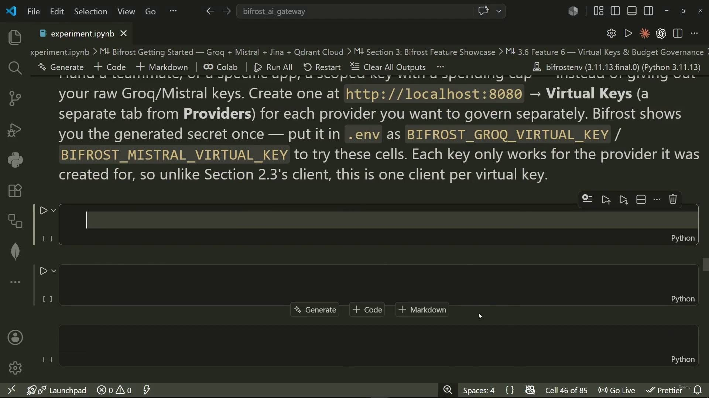

### 1.3 P95 的产出

P95 开始做 RAG 的数据摄入。注意：**这一节没有做完整聊天机器人**，只做到“把 7 条文档写进 Qdrant”。讲师明确说下一节才会在这个向量库上建 chatbot。

> "数据摄入部分我们用 Jina embeddings 来嵌入查询，用 Qdrant vector store 来存储 embeddings；数据检索部分我们用 Bifrost 来跑检索系统。"
> —— p095 [01:18]

P95 的技术栈是：

- **Jina embeddings**：调用 Jina API 的 `/v1/embeddings`。
- **Qdrant Cloud**：托管向量数据库，也可以用 Docker 自托管。
- **LangChain**：用 `QdrantVectorStore` 把 Qdrant 接进 LangChain。
- **自定义 Jina embedding class**：因为 LangChain 内置的 Jina wrapper 只支持旧模型。

> "因为 LangChain 内置的 Jina wrapper 只支持旧模型，所以我们要写一个小的自定义 embedding class。"
> —— p095 [02:45]

---

## 2. 讲师原话

下面这些引用是理解这三节设计意图的关键。引用已翻译成中文，技术产品名保留英文。

> "Bifrost 内部配置了很多大语言模型，有 Groq 模型，也有 Mistral 模型；具体在 Groq 里我们可以配置 2、3、4 个，想配多少个都可以。"
> —— p093 [02:20]

> "自动 failover 的意思是：即使你的主 provider 挂了或者在限流，也继续把请求服务下去。"
> —— p093 [05:08]

> "如果你想看 Bifrost 到底把请求路由给了哪个 provider、花了多久，而且不想自己加日志，能不能做到？可以。"
> —— p093 [12:16]

> "虚拟 key 的意思是，你不需要自己管理所有 provider 的 API key；你把它们交给 Bifrost，Bifrost 来管。"
> —— p094 [00:00]

> "MCP 的全称是 Model Context Protocol，意思是模型从外部工具接收上下文；protocol 表示必须有一种标准做法。"
> —— p094 [03:16]

> "MCP 的缺点是：以前我们需要一个工具就写一个工具逻辑；现在我们拿到的是一个工具箱，AI agent 会困惑到底该用这个还是那个。这属于 context engineering。"
> —— p094 [04:09]

> "我们接下来要做一个非常简单的 RAG；目标不是教你 RAG，而是教你怎样把 Bifrost 集成进 RAG 系统。"
> —— p095 [00:26]

> "查询会被嵌入，也就是向量化，然后这个向量会和所有其他向量比较。"
> —— p095 [12:38]

> "长度是 204，因为每个 embedding 都有一个长度。"
> —— p095 [14:07]

> "如果我们已经有同名 collection，就删掉它；然后创建新的 collection，向量大小用 Jina 的维度，距离用 cosine similarity。"
> —— p095 [16:29]

---

## 3. 从零复现

### 3.1 前置条件

你需要先准备：

1. 一个已经启动的 Bifrost，假设 API base URL 是 `http://localhost:8080/v1`。  
   如果你的端口不同，改 `.env` 里的 `BIFROST_BASE_URL`。
2. Bifrost 控制台可访问。
3. Groq API key、Mistral API key。
4. Qdrant Cloud 的 cluster URL 和 API key；或者本地 Docker 跑 Qdrant。
5. Jina API key。Jina 有免费额度，讲师提到免费额度是 100 万 token。
6. Tavily API key，用于 MCP 的 Tavily server。
7. Python 3.11 左右的环境。

Bifrost 本身的安装命令、Docker 启动命令、控制台账号创建，**课里没讲**。本文不编造。

### 3.2 创建项目与环境

```bash
mkdir bifrost-rag-lab
cd bifrost-rag-lab
python -m venv .venv
source .venv/bin/activate
pip install -r requirements.txt
cp .env.example .env
```

然后把 `.env` 里的值填成你自己的。`requirements.txt` 和 `.env.example` 的完整内容在第 4 节。

### 3.3 在 Bifrost 控制台配置两个 Groq key 与权重

打开 Bifrost 控制台，进入 **Model Catalog / Model Providers**。讲师的操作是：

1. 在 Groq 下新增一个 key，名字可以随便叫，例如 `new key`。
2. 把从 Groq 拿到的 API key 粘贴进去，保存。
3. 现在你会有两个 Groq 模型条目，例如 `groq-test` 和 `new-key`。
4. 编辑两个条目的 **weight**，都写成 `0.5`。

这就是加权负载均衡：

> "如果有一百个请求，发 50% 给模型一，发 50% 给模型二。我们做的就是权重 0.5、0.5。"
> —— p093 [04:43]

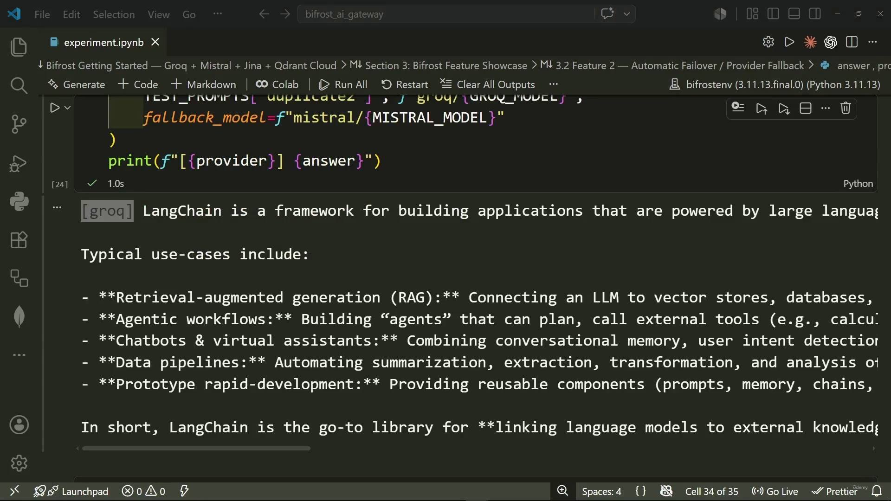

### 3.4 跑 fallback

```bash
python 01_fallback.py
```

预期：

- 第一次用真实 Groq model，输出 `provider: groq` 或类似值。
- 第二次故意传 `fake-model`，Bifrost 自动切到 Mistral，输出 `provider: mistral` 或类似值。

讲师的原话是：

> "我们传一个不存在的 fake model，fallback 是 Mistral；所以 Groq 不工作时，Mistral 会给你输出。这就是自动 fallback。"
> —— p093 [07:28]

注意：`provider` 字段的确切名字和值以你的 Bifrost 实际返回为准。本文代码里用 `data.get("provider", "unknown")`，如果实际字段不同，改这一行。

### 3.5 跑负载均衡

```bash
python 02_load_balancing.py
```

脚本会向 Bifrost 发 10 次 `hello`，每次打印命中的 key/provider，最后用 `Counter` 汇总。讲师演示时还去 Bifrost 控制台看 requests 增加，并看到两个 key 各承担一部分请求。

> "10 个请求发给 Bifrost，然后你去 Bifrost 看，requests 增加了，new key 被使用了，groq-test key 也被使用了，所以权重被正确分配。"
> —— p093 [09:51]

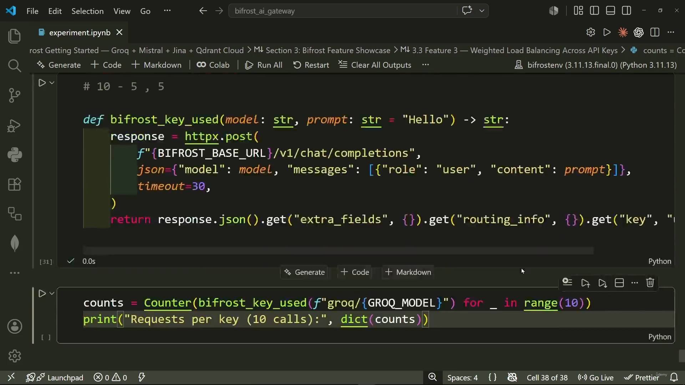

### 3.6 跑 streaming

```bash
python 03_streaming.py
```

脚本先用 Groq model 流式输出，再用 Mistral model 流式输出。讲师强调：

> "streaming 很简单，同一个 streaming 函数；如果 provider 是 Groq，就换 model，同样的代码可以流式跑另一个后端。"
> —— p093 [10:49]

也就是说，**不要改流式循环，只改 model 字符串**。

### 3.7 看 logs

```bash
python 04_logs.py
```

脚本请求：

```text
GET {BIFROST_BASE_URL}/logs?limit=5
timeout=5
```

如果返回 200，打印 JSON；否则打印 status code。讲师演示时看到了 content summary、total requests、total tokens、user facing 等信息。

> "如果我们想看 Bifrost 到底路由到哪个 provider
> "如果我们想看 Bifrost 到底把请求路由到哪个 provider、花了多久，而且不想自己加日志，能不能做到？可以。"
> —— p093 [12:16]

讲师演示时把返回结果打印出来，看到了 content summary、total requests、total tokens、user facing 等字段。这些字段名以你当前 Bifrost 版本实际返回为准，代码里不做任何字段裁剪，原样 `json.dumps` 打印，避免“猜字段名”。

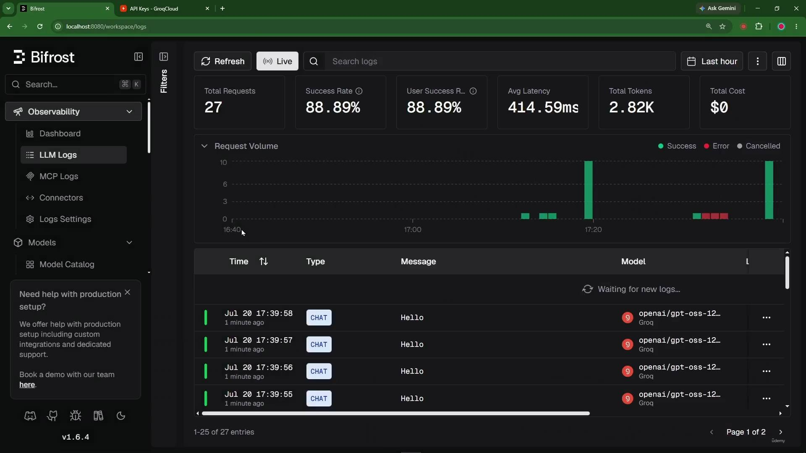

### 3.8 统一环境变量与 URL 约定（很重要，先对齐再往下）

前面的 3.1 里提到“base URL 假设是 `http://localhost:8080/v1`”，但 logs、MCP 这些接口和 chat completions 的路径前缀并不一样。为了避免后面每个脚本各写一套前缀，本文统一约定：

- `.env` 里的 `BIFROST_BASE_URL` **不带 `/v1`**，例如 `http://localhost:8080`。
- 所有 chat completions 请求写成 `f"{BIFROST_BASE_URL}/v1/chat/completions"`。
- OpenAI SDK 的 `base_url` 传 `f"{BIFROST_BASE_URL}/v1"`。
- logs 请求写成 `f"{BIFROST_BASE_URL}/v1/logs"`。
- MCP 客户端列表路径放进 `BIFROST_MCP_CLIENTS_PATH`，默认 `/v1/mcp/clients`。

如果你手上已有的 Bifrost 是把 `/v1` 包含在 base URL 里的，那就把代码里所有 `/v1/` 前缀删掉。**这是一处必然会踩的坑**，因为讲师在 p093 里念的是“bifrost base URL logs limit 5”，并没有把版本前缀念出来。

### 3.9 配置 virtual key 与预算

进入 Bifrost 控制台 → **Governance / Virtual Keys**。讲师的操作顺序是：

1. 先确认 Model Catalog 里已经有 Groq 和 Mistral 的模型条目。
2. 在 Governance 里创建两个 virtual key：一个给 Groq 用（讲师命名为 `bifrost-grog-virtual-key`），一个给 Mistral 用（`bifrost-mistral-virtual-key`）。
3. 创建完之后回到列表，点进去编辑预算：
   - `maximum tokens` 填 1000（讲师原话是“我们加一千个 token”）。
   - `requests` 也填 1000。
   - `reset period` 按你的需要设置。
   - `expire` 讲师演示里是 `never`。
4. 保存。

> "我们检查并编辑它，它应该永不过期，provider 是 Groq；budget configuration 里 maximum token，所以我们要加最大 token 数。我们加一千 token，这里也加一千请求，然后更新。"
> —— p094 [09:20]

这一步的意义在于：你把这个 virtual key 发给同事或某个应用，对方就不需要知道 Groq 的原始 key；一旦超出预算或请求数，Bifrost 会在网关层直接拒绝，不会继续烧钱。

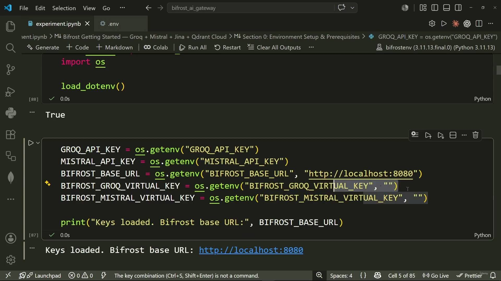

### 3.10 跑 virtual key 脚本

```bash
python 05_virtual_key.py
```

讲师跑的时候遇到过一次失败，原因是环境变量里的 virtual key 已经被他在控制台重新生成、旧值失效。他的处理方式是：

> "调用失败了，所以我们这样做：定义一个变量 `bifrost_virtual_key`，直接把 virtual key 粘贴进来，而不是用环境变量。因为我不想在这些场景里重启，虽然重启也行，但我觉得这样就可以了。"
> —— p094 [08:22]

所以 `05_virtual_key.py` 写成了“环境变量优先，但允许你在文件里硬编码覆盖”的形式。你如果也遇到 401 / 403，先回控制台复制最新的 virtual key。

运行成功后的输出是模型回答，例如“法国的首都是巴黎”，讲师的原话是：

> "现在运行它，法国首都就是巴黎，对吧？同样地，我也可以跑 Mistral 那个，只要把 Groq 模型换成 Mistral 模型。"
> —— p094 [09:50]

### 3.11 注册 MCP：DeepWiki 与 Tavily

先解释这两个东西是什么。讲师在 p094 里逐个介绍：

**Tavily** 是一个 web search API，提供四个能力：

> "Tavily 是 web search API，提供 Tavily search 做实时网页搜索、Tavily extract 抓取指定 URL 并提取纯文本或 markdown、Tavily map 把网站结构映射出来、Tavily crawl 系统地遍历整个网站。所以它给了我们四个不同功能，可以直接插到 LLM 上。"
> —— p094 [11:36]

**DeepWiki** 是一个 Wikipedia MCP server：

> "DeepWiki 通常以 deepwiki-mcp 或 deep-wiki 这样的名字放在开发者仓库里。这是 Wikipedia server，把你的 AI assistant 直接连到 Wikimedia 基础设施上，让 LLM 不用离开聊天界面就能搜索结构化的百科知识。它提供 Wikipedia search、get article、list collections。"
> —— p094 [12:06]

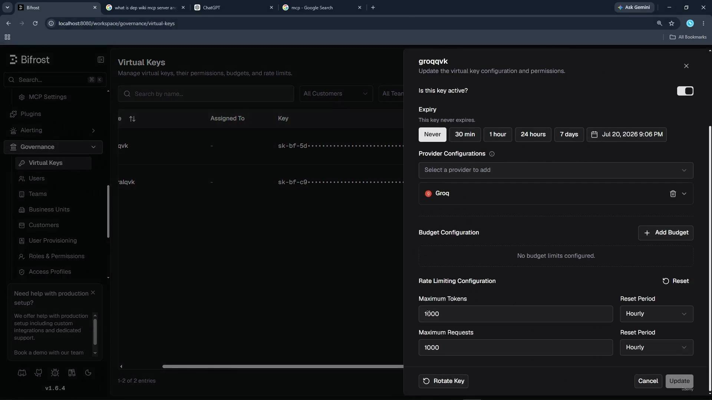

操作步骤（Bifrost 控制台 → **MCP Catalog** → **Add MCP Server**）：

1. 添加 DeepWiki：
   - 类型选 **HTTP Streamable**。
   - Connection URL 填你从 DeepWiki MCP 文档页拿到的地址，放进 `.env` 的 `DEEPWIKI_MCP_URL`。
   - 创建后点 **Edit**，把 auto execute 打开，允许 `ask question`、`read wiki contents` 等工具。
2. 添加 Tavily：
   - Connection URL 需要把 Tavily 的 API key 拼进去。讲师的原话是：

> "对于 connection URL，你需要去 Tavily 拿 API key。到 Tavily 之后取你的 API key，让它打开，可以用 Google 继续……你新建一个给 Bifrost 用的 API key，创建，拿到 key，复制它，你需要它。然后把 connection URL 复制过来，把里面的 your tavily api key 换成你自己的，粘贴到 connection URL 里，就这么简单，创建。"
> —— p094 [13:58]

   - 注意：讲师**没有在视频里念出完整的 connection URL 字符串**，所以本文不会编造它。你去 Tavily 的 MCP 集成页复制即可。
3. 两个 server 都创建完之后，进去 **Edit**，把可用工具全部允许（讲师说的“工具箱”就是这个意思），并把 auto execute 打开。

> "我们已经有三个工具、五个工具在自动执行了。"
> —— p094 [15:24]

讲师还提到可以给 MCP 也加 virtual key 做治理和成本追踪：

> "我们也可以给这个加 virtual key，这样我们就能在那部分做治理，你还可以做成本追踪，这些都没问题，然后保存修改。"
> —— p094 [15:24]

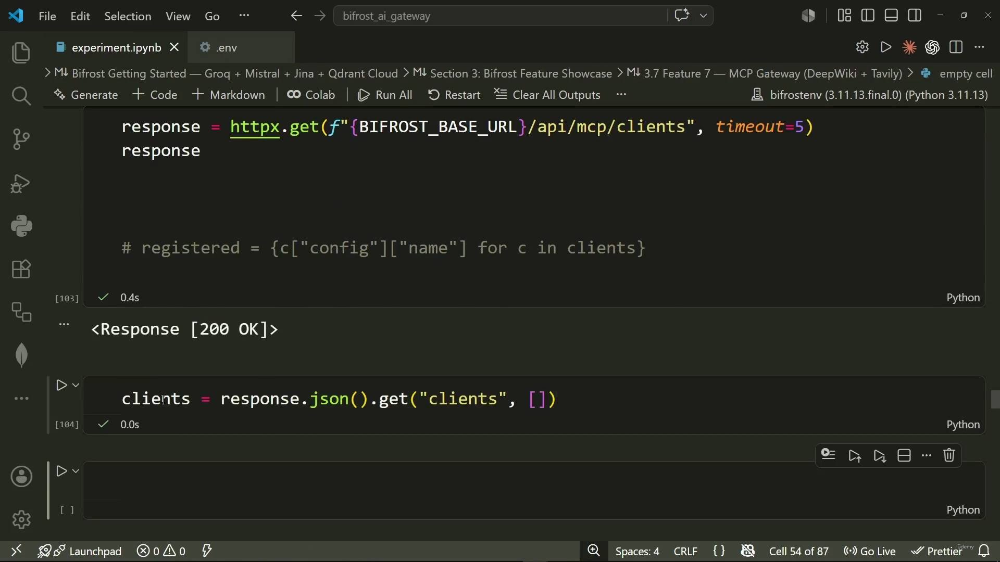

### 3.12 跑 MCP 调用脚本

```bash
python 06_mcp_register_and_call.py
```

脚本分三段：

1. `GET {BIFROST_BASE_URL}{BIFROST_MCP_CLIENTS_PATH}`，timeout 5 秒，拿到所有 MCP client 的 JSON。
2. 遍历 clients，打印每个 client 的 `name` 和 `registered`。
3. 对已注册的 DeepWiki 和 Tavily 分别发一次 `POST /v1/chat/completions`，请求体里带 `mcp_enabled: true`、`code_mode: true`、`servers: [...]`，timeout 60 秒。

讲师讲这三段的原话是：

> "第一件我们需要的是一个 response，从所有 MCP client 拿 response，设 `response = https.get(...)`，timeout 5 秒。第二我们设一个 client，client 会以 JSON 格式给我们 response。第三我们设置它们是否注册，所以我们想要它们的 config 和 name。`response.json()` 会去 ping 那些 client，从那些 client 拿信息，这个 JSON 信息存进 `clients`，然后 `clients` 会被迭代用于注册。"
> —— p094 [15:50]

> "现在我们定义一个 tool call，`call_with_tools`，它接收一个 prompt 和一个 MCP server 列表，返回一个字典。我们发 POST 请求，因为我们在打 MCP client，地址是 `bifrost_base_url /v1/chat/completions`，JSON 里 model 是 Mistral，messages 是 prompt，Bifrost 会用 `mcp_enabled` 为 true，`code_mode` 也为 true，因为它可能在内部写代码，servers 就是 servers，timeout 我们给 60 秒。"
> —— p094 [17:45]

运行完之后，讲师特意去 dashboard 看 MCP 使用情况：

> "在 dashboard 上能看到 MCP usage，一个 tool 正在被使用，目前还没有错误率；刷新一下，两个都被用了，Tavily search 被用了，因为 Tavily 的 prompt 给的是「latest news about GROQ AI」，DeepWiki 也正常工作了。"
> —— p094 [19:12]

### 3.13 RAG 数据摄入

先建 Qdrant。讲师说可以自托管：

> "你也可以把 Qdrant 跑在自己机器上，搜一下 how to self host qdrant via docker，你会拿到 docker image。`docker pull qdrant/qdrant`，就像我们之前拉 Maxim AI Bifrost 的镜像一样，Qdrant 会完全跑在你自己的机器上。"
> —— p095 [05:04]

如果你用 Qdrant Cloud，则在控制台拿到 **Cluster URL** 和 **API key**。讲师在 Qdrant 控制台演示时说：

> "这是我们的 cluster ID，这是我们要打到 endpoint；如果你访问 cluster，这里什么都没有，没有 collection。我们看到有 put collections 的方式，后面再放 collection。"
> —— p095 [06:31]

然后：

```bash
python 07_rag_ingest.py
```

脚本执行顺序与讲师一致：

1. 检查环境变量 `JINA_API_KEY`、`QDRANT_URL`、`QDRANT_API_KEY` 是否都存在。
2. 实例化自定义 `JinaEmbeddings`。
3. 用 `embed_query("hello world")` 探一次维度，打印 `jina dimension`。
4. `QdrantClient(url=..., api_key=...)`。
5. `client.get_collections()` 打印已有 collection。
6. 若同名 collection 存在，先 `delete_collection`。
7. `create_collection`，`VectorParams(size=jina_dim, distance=Distance.COSINE)`。
8. `QdrantVectorStore(client=..., collection_name=..., embedding=...)`。
9. `vector_store.add_texts(DOCS)`，打印 indexed 数量。

关于第 3 步的维度，讲师说：

> "我把 Hello world 传进去然后打印，会发生什么？我的 query 会被嵌入。我展示 embeddings 的长度，长度是 204，因为每个 embedding 都有一个长度。"
> —— p095 [14:07]

这里逐字稿写的是“204”，但常见 Jina embedding 模型的维度是 768、1024、2048 这一类，**很可能是语音识别把 2048 识别成了 204**。所以本文代码里不硬编码维度，而是先探一次真实长度再建 collection。这也是最稳的做法：你在控制台看起来的模型和实际返回必须一致，硬编码迟早对不上。

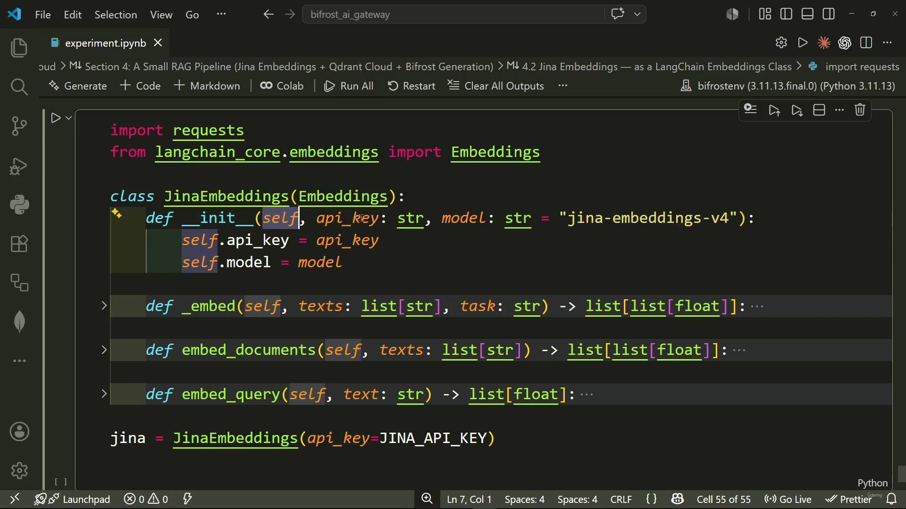

数据摄入的 7 条文档，是讲师自己写的关于 Bifrost、Groq、Jina 的描述性文本，用作文档而不是真实业务数据：

> "Bifrost 是一个基于 Go 的开源 AI 网关，由 Maxim AI 构建……Bifrost 支持 Groq、Mistral AI；Qdrant Cloud 是托管向量数据库；Jina 提供 API embeddings。这是什么？这只是一些随机化的数据，我们可以在它上面做一个 chatbot。"
> —— p095 [16:02]

运行完去 Qdrant 控制台刷新，能看到 7 条文档。讲师的原话：

> "它会显示我们向 bifrost rag demo 索引了 7 个文档。如果我刷新这个，看，我们能看到 7 个文档。"
> —— p095 [20:20]

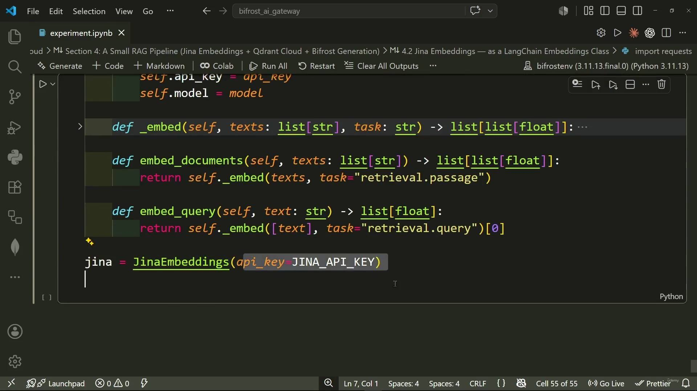

**P95 到此为止。** 检索和生成（把 Bifrost 接进 RAG 的 retrieval 链路）是下一节的内容，课里没讲，本文不补。

---

## 4. 完整代码

下面 9 个文件按第 3 节的目录结构保存即可。**没有省略号，没有伪代码**，全部是完整文件。

### 4.1 `.env.example`

```dotenv
# ============ Bifrost ============
# 注意：这里不带 /v1，代码里自己拼 /v1/xxx
BIFROST_BASE_URL=http://localhost:8080
BIFROST_API_KEY=replace-with-bifrost-api-key-if-any

# Model Catalog 里配置的模型名，形如 provider/model
GROQ_MODEL=groq/groq-test
GROQ_MODEL_2=groq/groq-new-key
MISTRAL_MODEL=mistral/mistral-small-latest

# Governance 里创建的 virtual key（不是 provider 原始 key）
BIFROST_GROQ_VIRTUAL_KEY=bifrost-grog-virtual-key
BIFROST_MISTRAL_VIRTUAL_KEY=bifrost-mistral-virtual-key

# MCP 客户端列表路径，以你的 Bifrost 版本实际路由为准
BIFROST_MCP_CLIENTS_PATH=/v1/mcp/clients

# ============ Providers（只在 Bifrost 控制台里填，脚本不直接用） ============
GROQ_API_KEY=replace-me
MISTRAL_API_KEY=replace-me

# ============ MCP ============
# DeepWiki 的 HTTP Streamable connection URL
DEEPWIKI_MCP_URL=replace-me
# Tavily 的 connection URL，里面要替换成你自己的 Tavily API key
TAVILY_MCP_URL=replace-me

# ============ Jina Embeddings ============
JINA_API_KEY=replace-me
JINA_MODEL=jina-embeddings-v3

# ============ Qdrant ============
QDRANT_URL=https://xxxxxxxx-xxxx-xxxx-xxxx-xxxxxxxxxxxx.eu-central.aws.cloud.qdrant.io:6333
QDRANT_API_KEY=replace-me
QDRANT_COLLECTION=bifrost_rag_demo
```

### 4.2 `requirements.txt`

```text
requests==2.32.3
openai==1.51.2
python-dotenv==1.0.1
qdrant-client==1.12.1
langchain-core==0.3.15
langchain-qdrant==0.2.0
```

版本号是写作时的参考。课程里没有给出任何版本号，装不到时用 `pip install requests openai python-dotenv qdrant-client langchain-core langchain-qdrant` 让 pip 自己解依赖即可。

### 4.3 `01_fallback.py`

```python
import os
import requests
from dotenv import load_dotenv

load_dotenv()

BIFROST_BASE_URL = os.environ["BIFROST_BASE_URL"].rstrip("/")
BIFROST_API_KEY = os.environ.get("BIFROST_API_KEY", "")
GROQ_MODEL = os.environ["GROQ_MODEL"]
MISTRAL_MODEL = os.environ["MISTRAL_MODEL"]

# 讲师在控制台看到/配置的字段名是 fallback；
# 如果你的 Bifrost 版本用的是 fallback_models 或干脆在控制台配 fallback 链，
# 只改这一个常量即可，其它逻辑不用动。
FALLBACK_FIELD = "fallback"


def call_bifrost(prompt: str, model: str, fallback_model: str | None = None):
    payload = {
        "model": model,
        "messages": [{"role": "user", "content": prompt}],
    }
    if fallback_model:
        payload[FALLBACK_FIELD] = fallback_model

    headers = {"Content-Type": "application/json"}
    if BIFROST_API_KEY:
        headers["Authorization"] = f"Bearer {BIFROST_API_KEY}"

    resp = requests.post(
        f"{BIFROST_BASE_URL}/v1/chat/completions",
        headers=headers,
        json=payload,
        timeout=60,
    )
    resp.raise_for_status()
    data = resp.json()

    answer = data["choices"][0]["message"]["content"]

    provider = data.get("provider")
    if provider is None:
        extra = data.get("extra_fields") or {}
        provider = extra.get("provider", "unknown")

    return answer, provider


if __name__ == "__main__":
    print("=== 场景 1：主模型正常 ===")
    answer, provider = call_bifrost(
        prompt="用一句话解释什么是 AI 网关。",
        model=GROQ_MODEL,
        fallback_model=MISTRAL_MODEL,
    )
    print("answer:", answer)
    print("provider:", provider)

    print()
    print("=== 场景 2：主模型不存在，触发 fallback ===")
    answer, provider = call_bifrost(
        prompt="用一句话解释什么是 AI 网关。",
        model="fake-model",
        fallback_model=MISTRAL_MODEL,
    )
    print("answer:", answer)
    print("provider:", provider)
```

### 4.4 `02_load_balancing.py`

```python
import os
from collections import Counter
import requests
from dotenv import load_dotenv

load_dotenv()

BIFROST_BASE_URL = os.environ["BIFROST_BASE_URL"].rstrip("/")
BIFROST_API_KEY = os.environ.get("BIFROST_API_KEY", "")
GROQ_MODEL = os.environ["GROQ_MODEL"]

ROUNDS = 10


def _headers() -> dict:
    headers = {"Content-Type": "application/json"}
    if BIFROST_API_KEY:
        headers["Authorization"] = f"Bearer {BIFROST_API_KEY}"
    return headers


def bifrost_key_used(model: str, prompt: str) -> str:
    """发一次请求，返回这次遇到的 routing key。

    字段路径以你实际的响应为准：
    讲师的说法是「return JSON extra fields and get routing information, key unknown」，
    所以先看顶层 key，再看 extra_fields.routing.key，最后兜底 unknown。
    """
    resp = requests.post(
        f"{BIFROST_BASE_URL}/v1/chat/completions",
        headers=_headers(),
        json={
            "model": model,
            "messages": [{"role": "user", "content": prompt}],
        },
        timeout=60,
    )
    resp.raise_for_status()
    data = resp.json()

    key = data.get("key")
    if key is None:
        extra = data.get("extra_fields") or {}
        routing = extra.get("routing") or {}
        key = routing.get("key", "unknown")

    return key


if __name__ == "__main__":
    hits = Counter()

    for i in range(ROUNDS):
        used = bifrost_key_used(GROQ_MODEL, "hello")
        print(f"request {i + 1:02d} hit key: {used}")
        hits[used] += 1

    print()
    print("=== 汇总 ===")
    for key, count in hits.items():
        print(f"{key}: {count}/{ROUNDS}")
```

### 4.5 `03_streaming.py`

```python
import json
import os
import requests
from dotenv import load_dotenv

load_dotenv()

BIFROST_BASE_URL = os.environ["BIFROST_BASE_URL"].rstrip("/")
BIFROST_API_KEY = os.environ.get("BIFROST_API_KEY", "")
GROQ_MODEL = os.environ["GROQ_MODEL"]
MISTRAL_MODEL = os.environ["MISTRAL_MODEL"]


def _headers() -> dict:
    headers = {"Content-Type": "application/json"}
    if BIFROST_API_KEY:
        headers["Authorization"] = f"Bearer {BIFROST_API_KEY}"
    return headers


def stream_bifrost(prompt: str, model: str):
    """只改 model，流式逻辑完全不变。"""
    with requests.post(
        f"{BIFROST_BASE_URL}/v1/chat/completions",
        headers=_headers(),
        json={
            "model": model,
            "messages": [{"role": "user", "content": prompt}],
            "stream": True,
        },
        stream=True,
        timeout=120,
    ) as resp:
        resp.raise_for_status()
        for raw_line in resp.iter_lines():
            if not raw_line:
                continue

            line = raw_line
            if line.startswith(b"data: "):
                line = line[len(b"data: "):]
            if line.strip() == b"[DONE]":
                break

            chunk = json.loads(line)

            # 讲师的做法：取 choices，再取第一个 choice
            choices = chunk.get("choices") or []
            if not choices:
                continue
            delta = choices[0].get("delta") or {}
            content = delta.get("content")
            if content:
                yield content


if __name__ == "__main__":
    prompt = "用三句话解释什么是自动 fallback。"

    print("=== stream via Groq model ===")
    for piece in stream_bifrost(prompt, GROQ_MODEL):
        print(piece, end="", flush=True)
    print()

    print()
    print("=== stream via Mistral model ===")
    for piece in stream_bifrost(prompt, MISTRAL_MODEL):
        print(piece, end="", flush=True)
    print()
```

### 4.6 `04_logs.py`

```python
import json
import os
import requests
from dotenv import load_dotenv

load_dotenv()

BIFROST_BASE_URL = os.environ["BIFROST_BASE_URL"].rstrip("/")
BIFROST_API_KEY = os.environ.get("BIFROST_API_KEY", "")

headers = {}
if BIFROST_API_KEY:
    headers["Authorization"] = f"Bearer {BIFROST_API_KEY}"

resp = requests.get(
    f"{BIFROST_BASE_URL}/v1/logs",
    params={"limit": 5},
    headers=headers,
    timeout=5,
)

if resp.status_code == 200:
    logs = resp.json()
    print(json.dumps(logs, indent=2, ensure_ascii=False))
else:
    print("status code:", resp.status_code)
    print(resp.text[:500])
```

### 4.7 `05_virtual_key.py`

```python
import os
from openai import OpenAI
from dotenv import load_dotenv

load_dotenv()

BIFROST_BASE_URL = os.environ["BIFROST_BASE_URL"].rstrip("/")
GROQ_MODEL = os.environ["GROQ_MODEL"]
MISTRAL_MODEL = os.environ["MISTRAL_MODEL"]

# 讲师的做法：环境变量失效时直接在文件里硬编码粘贴最新 virtual key。
# 你如果也踩到 401/403，把这里填成控制台里最新的值。
HARDCODED_GROQ_VIRTUAL_KEY = ""
HARDCODED_MISTRAL_VIRTUAL_KEY = ""

BIFROST_GROQ_VIRTUAL_KEY = (
    HARDCODED_GROQ_VIRTUAL_KEY
    or os.environ.get("BIFROST_GROQ_VIRTUAL_KEY", "")
)
BIFROST_MISTRAL_VIRTUAL_KEY = (
    HARDCODED_MISTRAL_VIRTUAL_KEY
    or os.environ.get("BIFROST_MISTRAL_VIRTUAL_KEY", "")
)


def call_with_virtual_key(virtual_key: str, model: str, prompt: str) -> None:
    if not virtual_key:
        print("no virtual key for this provider")
        return

    # 关键点：这里 api_key 传的是 virtual key，不是 provider 原始 key
    client = OpenAI(
        api_key=virtual_key,
        base_url=f"{BIFROST_BASE_URL}/v1",
    )

    response = client.chat.completions.create(
        model=model,
        messages=[{"role": "user", "content": prompt}],
    )
    print(response.choices[0].message.content)


if __name__ == "__main__":
    print("=== 用 Groq virtual key 调用 Groq 模型 ===")
    call_with_virtual_key(
        virtual_key=BIFROST_GROQ_VIRTUAL_KEY,
        model=GROQ_MODEL,
        prompt="法国的首都是哪里？",
    )

    print()
    print("=== 用 Mistral virtual key 调用 Mistral 模型 ===")
    call_with_virtual_key(
        virtual_key=BIFROST_MISTRAL_VIRTUAL_KEY,
        model=MISTRAL_MODEL,
        prompt="法国的首都是哪里？",
    )
```

### 4.8 `06_mcp_register_and_call.py`

```python
import json
import os
import requests
from dotenv import load_dotenv

load_dotenv()

BIFROST_BASE_URL = os.environ["BIFROST_BASE_URL"].rstrip("/")
BIFROST_API_KEY = os.environ.get("BIFROST_API_KEY", "")
BIFROST_MCP_CLIENTS_PATH = os.environ.get(
    "BIFROST_MCP_CLIENTS_PATH",
"/v1/mcp/clients",
)
DEEPWIKI_MCP_URL = os.environ.get("DEEPWIKI_MCP_URL", "")
TAVILY_MCP_URL = os.environ.get("TAVILY_MCP_URL", "")
MISTRAL_MODEL = os.environ["MISTRAL_MODEL"]


def _headers() -> dict:
    headers = {"Content-Type": "application/json"}
    if BIFROST_API_KEY:
        headers["Authorization"] = f"Bearer {BIFROST_API_KEY}"
    return headers


def get_raw_clients():
    """第一步：从 Bifrost 拿所有 MCP client 的 JSON。"""
    resp = requests.get(
        f"{BIFROST_BASE_URL}{BIFROST_MCP_CLIENTS_PATH}",
        headers=_headers(),
        timeout=5,
    )
    resp.raise_for_status()
    return resp.json()


def normalize_clients(raw) -> list[dict]:
    """兼容两种返回形态：顶层就是数组，或者被包在 clients / data 字段里。

    讲师演示时直接 response.json() 就拿到了可以迭代的 client 信息，
    但他没有念出外层字段名，所以这里做兼容，避免把猜测写死。
    """
    if isinstance(raw, list):
        return raw
    if isinstance(raw, dict):
        for field in ("clients", "data", "items"):
            value = raw.get(field)
            if isinstance(value, list):
                return value
    return []


def pick_registered(clients: list[dict], name_part: str) -> str | None:
    """在已注册的 client 里按名字模糊匹配，返回真实注册名。"""
    needle = name_part.lower().replace(" ", "").replace("-", "").replace("_", "")
    for client in clients:
        raw_name = client.get("name") or ""
        haystack = raw_name.lower().replace(" ", "").replace("-", "").replace("_", "")
        if needle in haystack and client.get("registered") is True:
            return raw_name
    return None


def call_with_tools(prompt: str, servers: list[str]) -> dict:
    """第三步：带 MCP 工具的 chat completions 请求。

    讲师原话：model 用 Mistral，mcp_enabled 为 true，code_mode 为 true，
    servers 就是传入的列表，timeout 给 60 秒。
    """
    payload = {
        "model": MISTRAL_MODEL,
        "messages": [{"role": "user", "content": prompt}],
        "mcp_enabled": True,
        "code_mode": True,
        "servers": servers,
    }

    resp = requests.post(
        f"{BIFROST_BASE_URL}/v1/chat/completions",
        headers=_headers(),
        json=payload,
        timeout=60,
    )
    resp.raise_for_status()
    return resp.json()


def print_tool_result(label: str, data: dict) -> None:
    message = (data.get("choices") or [{}])[0].get("message") or {}
    content = message.get("content")
    tool_calls = message.get("tool_calls")

    print(f"--- {label} ---")
    print("content:", content)
    print("tool_calls:", json.dumps(tool_calls, indent=2, ensure_ascii=False))
    print()


if __name__ == "__main__":
    raw = get_raw_clients()
    print("=== 原始 clients 响应 ===")
    print(json.dumps(raw, indent=2, ensure_ascii=False)[:2000])
    print()

    client_list = normalize_clients(raw)

    print("=== 注册状态 ===")
    for client in client_list:
        print(f"name={client.get('name')!r} registered={client.get('registered')}")
    print()

    deepwiki_name = pick_registered(client_list, "deepwiki") or pick_registered(
        client_list, "wiki"
    )
    tavily_name = pick_registered(client_list, "tavily")

    if deepwiki_name:
        data = call_with_tools(
            prompt="What is Bifrost? Use the wiki search tool and answer briefly.",
            servers=[deepwiki_name],
        )
        print_tool_result(f"deepwiki ({deepwiki_name})", data)
    else:
        print("deepwiki 没有处于 registered 状态，跳过调用")

    if tavily_name:
        data = call_with_tools(
            prompt="latest news about GROQ AI",
            servers=[tavily_name],
        )
        print_tool_result(f"tavily ({tavily_name})", data)
    else:
        print("tavily 没有处于 registered 状态，跳过调用")
```

### 4.9 `07_rag_ingest.py`

```python
import os
import requests
from dotenv import load_dotenv

from langchain_core.embeddings import Embeddings
from langchain_qdrant import QdrantVectorStore
from qdrant_client import QdrantClient
from qdrant_client.models import Distance, VectorParams

load_dotenv()

JINA_API_KEY = os.environ.get("JINA_API_KEY")
JINA_MODEL = os.environ.get("JINA_MODEL", "jina-embeddings-v3")
QDRANT_URL = os.environ.get("QDRANT_URL")
QDRANT_API_KEY = os.environ.get("QDRANT_API_KEY")
COLLECTION = os.environ.get("QDRANT_COLLECTION", "bifrost_rag_demo")

JINA_EMBEDDINGS_URL = "https://api.jina.ai/v1/embeddings"


# ---------------------------------------------------------------
# 1) 自定义 Jina embedding class
#    原因：LangChain 内置的 Jina wrapper 只支持旧模型。
# ---------------------------------------------------------------
class JinaEmbeddings(Embeddings):
    def __init__(self, api_key: str, model: str):
        self.api_key = api_key
        self.model = model
        self.url = JINA_EMBEDDINGS_URL

    def _embed(self, texts: list[str], task: str) -> list[list[float]]:
        headers = {
            "Content-Type": "application/json",
            "Authorization": f"Bearer {self.api_key}",
        }
        payload = {
            "model": self.model,
            "input": texts,
            "task": task,
        }

        response = requests.post(
            self.url,
            headers=headers,
            json=payload,
            timeout=30,
        )
        # 讲师原话：raise_for_status，如果有 HTTP 错误（404 等）就抛出来
        response.raise_for_status()

        data = response.json()
        return [item["embedding"] for item in data["data"]]

    def embed_documents(self, texts: list[str]) -> list[list[float]]:
        return self._embed(texts, task="retrieval.passage")

    def embed_query(self, text: str) -> list[float]:
        return self._embed([text], task="retrieval.query")[0]


# ---------------------------------------------------------------
# 2) 讲师在 notebook 里写的 7 条文档
# ---------------------------------------------------------------
DOCS = [
    "Bifrost is a Go-based open-source AI gateway built by Maxim AI.",
    "Bifrost supports Groq and Mistral AI as model providers.",
    "Bifrost provides automatic failover so requests keep being served when a provider is down.",
    "Bifrost provides weighted load balancing across multiple API keys of the same provider.",
    "Qdrant Cloud is a managed vector database used to store embeddings.",
    "Jina provides API embeddings that turn text into vectors.",
    "LangChain can connect to a Qdrant collection through QdrantVectorStore.",
]


def check_env() -> None:
    missing = [
        name
        for name, value in (
            ("JINA_API_KEY", JINA_API_KEY),
            ("QDRANT_URL", QDRANT_URL),
            ("QDRANT_API_KEY", QDRANT_API_KEY),
        )
        if not value
    ]
    if missing:
        raise SystemExit(f"缺少环境变量: {', '.join(missing)}")

    print("环境变量已就绪：JINA_API_KEY / QDRANT_URL / QDRANT_API_KEY 都存在")
    print(f"collection 名称: {COLLECTION}")
    print()


if __name__ == "__main__":
    check_env()

    # 3) 初始化自定义 embedding class
    embeddings = JinaEmbeddings(api_key=JINA_API_KEY, model=JINA_MODEL)
    print("Jina class 初始化成功")

    # 4) 探一次真实维度，绝不硬编码
    probe = embeddings.embed_query("hello world")
    jina_dim = len(probe)
    print(f"jina dimension: {jina_dim}")
    print()

    # 5) 连 Qdrant
    client = QdrantClient(url=QDRANT_URL, api_key=QDRANT_API_KEY)

    existing = client.get_collections().collections
    existing_names = [c.name for c in existing]
    print("existing collections:", existing_names)

    # 6) 同名 collection 先删掉，重新建
    if COLLECTION in existing_names:
        client.delete_collection(collection_name=COLLECTION)
        print(f"已删除同名 collection: {COLLECTION}")

    client.create_collection(
        collection_name=COLLECTION,
        vectors_config=VectorParams(size=jina_dim, distance=Distance.COSINE),
    )
    print(f"collection created: {COLLECTION}")

    # 7) 用 LangChain 的 QdrantVectorStore 包一层，建立兼容
    vector_store = QdrantVectorStore(
        client=client,
        collection_name=COLLECTION,
        embedding=embeddings,
    )

    # 8) 摄入数据
    ids = vector_store.add_texts(DOCS)
    print(f"indexed {len(ids)} documents into {COLLECTION}")
```

### 4.10 运行顺序总表

```bash
python 01_fallback.py
python 02_load_balancing.py
python 03_streaming.py
python 04_logs.py
python 05_virtual_key.py
python 06_mcp_register_and_call.py
python 07_rag_ingest.py
```

前 6 个只依赖 Bifrost，第 7 个只依赖 Jina + Qdrant，两者互不阻塞。

---

## 5. 逐行解释

### 5.1 `01_fallback.py`：为什么 fallback 字段单独抽成常量

`FALLBACK_FIELD = "fallback"` 这一行是全文最“心虚”的一行，必须说清楚。讲师在 p093 里连续说了三遍参数：

> "要调 Bifrost，记得我们有哪些参数：prompt、model 和 fallback model。"
> —— p093 [05:33]

也就是说，讲师当时用的 SDK 方法签名里有 `prompt`、`model`、`fallback_model` 三个参数。但他演示的是 **Bifrost 的客户端封装**，不是裸 HTTP。我在本文里统一用裸 HTTP（`requests.post` 到 `/v1/chat/completions`），因为这样才能让你在没有那层封装的情况下照样跑通。裸 HTTP 下 fallback 的字段名到底是 `fallback`、`fallback_model` 还是 `fallback_models`，**课里没讲**，讲师也没有把请求体念出来。

所以代码的处理方式是：

- 把字段名抽成一个常量 `FALLBACK_FIELD`；
- 万一你的 Bifrost 版本不认这个字段，你只改一行；
- 另外一条更稳的路是：**在 Bifrost 控制台的 Model Catalog 里直接把 fallback 链配好**，请求体里根本不传 fallback，这样字段名问题直接消失。这也是为什么第 3.3 节的步骤是“先在控制台配好”。

`provider` 的取值同理：

```python
provider = data.get("provider")
if provider is None:
    extra = data.get("extra_fields") or {}
    provider = extra.get("provider", "unknown")
```

讲师在 p093 演示时说的是“我拿到了响应，provider 是 Groq，我们能看到”。他屏幕上看到的值是真实的，但逐字稿没有把 JSON 路径念出来。代码里先看顶层 `provider`，再看 `extra_fields.provider`，最后兜底 `unknown`。**如果你跑出来两次都是 `unknown`，不代表 fallback 没生效**，去 Bifrost 控制台的 logs 里看实际路由到的 provider，那是最权威的。

场景 2 里我把 `model` 写成 `"fake-model"`，这是照讲师的原话：

> "我传一个不是真的模型，或者直接传 fake model，然后 fallback 是 Mistral；也就是说如果 Groq 不工作，这个就应该能工作。"
> —— p093 [07:28]

注意 `resp.raise_for_status()` 的位置。如果 Bifrost 在“主模型不存在”时直接返回 4xx，而不是自动 fallback，这一行就会抛异常，你看到的是 traceback 而不是 Mistral 的回答。这时候不是代码错，是**你的 fallback 没在网关层生效**。讲师演示成功，说明他那边是网关内部消化了这次失败。这个区别很关键：fallback 是网关的能力，不是你 Python 脚本的能力。

> 前端对照：在 Node/浏览器里，这段逻辑对应的是“先 `fetch` 主地址，catch 到 5xx 或超时再 `fetch` 备份地址”。但 Bifrost 的做法是把这段重试搬到了服务端，你的前端/应用层只发一次请求。这就是网关的价值——重试策略只写一份，所有客户端共享。

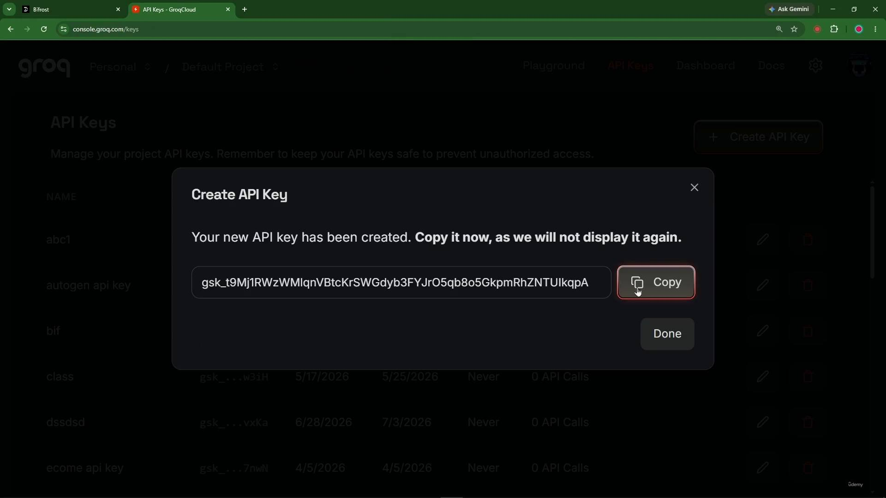

### 5.2 `02_load_balancing.py`：为什么用 Counter，以及为什么不能期待严格 5/5

`from collections import Counter` 是讲师明确说的：

> "从 collections 导入 counter，因为现在我想演示：如果我发 10 个请求，5 个发给 Groq，另外 5 个发给新建的那个 Groq 模型，也就是新的 API key。"
> —— p093 [08:26]

`bifrost_key_used()` 每次只发一个请求、只返回这一次命中的 key，这样你才能看到**逐次**的分流结果，而不是只看一个总数。这是讲师演示的精髓：他要让你看到 requests 数字在控制台里涨，同时两个 key 都被打到。

`ROUNDS = 10` 对应讲师说的“我要把这个 hello 传 10 次给 Bifrost”。样本只有 10 个，加权随机的结果**很可能不是精确的 5/5**，可能是 6/4、7/3。这不是 bug。讲师演示时说的是“权重被正确分配”“50% 和 50%”，他看到的是大致均衡。你如果跑出 6/4，不要去改代码，把 `ROUNDS` 改成 100 再看，比例会收敛。

key 的提取路径也是兼容式写法：

```python
key = data.get("key")
if key is None:
    extra = data.get("extra_fields") or {}
    routing = extra.get("routing") or {}
    key = routing.get("key", "unknown")
```

讲师的原话是“它会返回 JSON extra fields，然后拿到 routing information，key unknown”。这句话信息量很大：说明**路由信息在一个叫 extra fields 的结构里**，而且他演示时可能就看到 `key` 是 `unknown`。所以我给了三层：顶层 `key`、`extra_fields.routing.key`、兜底 `unknown`。如果你三次都拿到 `unknown`，分流其实仍然发生了，只是你没读到字段——去控制台的 Model Providers 页面看两个 key 的请求计数，那是最直观的证据。

> 前端对照：加权负载均衡在 Node 里对应“按权重随机选一个上游地址”，本质是 `Math.random() < 0.5 ? a : b`。区别是 Bifrost 把权重存在服务端配置里，你改权重不用发版。

### 5.3 `03_streaming.py`：只改 model，不改循环

讲师的这句话是这一节的全部要点：

> "streaming 真的很简单，同一个 streaming 函数；如果 provider 是 Groq，就换 model，同样的代码可以为另一个后端流式输出。所以我们不用改模型……不用改逻辑，只需要改模型。"
> —— p093 [10:49]

代码结构上，`stream_bifrost(prompt, model)` 把 model 作为参数，所以换后端就是换实参。`stream=True` 传在请求体里，同时 `requests.post(..., stream=True)` 是**客户端侧**的流式读取开关——这两个 `stream` 不是一回事，别混。请求体里的 `stream: true` 告诉 Bifrost“我要 SSE 流”；`requests` 的 `stream=True` 告诉 Python“先别把响应体整个读进内存”。少任何一个都拿不到逐字输出。

逐行解析 SSE：

```python
for raw_line in resp.iter_lines():
    if not raw_line:
        continue
    line = raw_line
    if line.startswith(b"data: "):
        line = line[len(b"data: "):]
    if line.strip() == b"[DONE]":
        break
    chunk = json.loads(line)
```

- `iter_lines()` 逐行吐 bytes；
- 空行跳过（SSE 用空行分隔事件）；
- `data: ` 前缀是 SSE 的格式，要去掉；
- `[DONE]` 是 OpenAI 兼容流的结束标记，遇到就 `break`；
- 剩下的就是一坨 JSON，`json.loads` 解析。

然后取内容：

```python
choices = chunk.get("choices") or []
if not choices:
    continue
delta = choices[0].get("delta") or {}
content = delta.get("content")
```

讲师的原话是“for chunk 会返回所有 choices，就像我们之前写的那样”。**流式响应用 `delta`，非流式用 `message`**，这是最容易写错的一处。如果你在流式里读 `choices[0]["message"]`，会直接 `KeyError`。

`print(piece, end="", flush=True)` 里的 `flush=True` 不能省，否则 Python 会缓冲，你看到的还是一次性吐完，误以为流式没生效。

> 前端对照：浏览器里读这种流用 `fetch` + `response.body.getReader()` + `TextDecoder`，或者用 `EventSource`。解析逻辑和上面一模一样：按行切、去 `data: `、遇 `[DONE]` 停、`JSON.parse`、取 `delta.content`。课里只讲了 Python 侧，浏览器侧课里没讲。

### 5.4 `04_logs.py`：为什么原样打印、不裁剪字段

```python
resp = requests.get(
    f"{BIFROST_BASE_URL}/v1/logs",
    params={"limit": 5},
    headers=headers,
    timeout=5,
)

if resp.status_code == 200:
    logs = resp.json()
    print(json.dumps(logs, indent=2, ensure_ascii=False))
else:
    print("status code:", resp.status_code)
    print(resp.text[:500])
```

讲师的原话是“我会在 `https.get` 上拿到响应，`bifrostbase URL logs limit 5`，所以我只想看 5 条，timeout 是 5 秒”。三个要素——路径、`limit=5`、`timeout=5`——全部照搬。

`limit` 用 `params` 传而不是拼在 URL 里，是 `requests` 的标准做法，效果一样但更安全（会自动转义）。

`if status_code == 200 ... else ...` 这个分支也是讲师明确说的：

> "logs 就是 `response.json()`，如果 `response.status_code` 等于 200；否则 status 就是 `response.status_code`，意思是我们的响应有不同的 code。"
> —— p093 [12:40]

**为什么用 `json.dumps(indent=2)` 而不是挑字段打印？** 因为讲师演示时是新建了一个 `output` 文件、把整个响应体打印出来看的，他看到的是 content summary、total requests、total tokens、user facing 这些字段。逐字稿里这些名字是讲师**嘴上念的**，不是你屏幕上能复核的结构。如果我按这些名字写 `logs["total_tokens"]`，而你的版本字段叫 `totalTokens`，代码就崩了。原样打印，你第一眼就能看到真实结构，再决定怎么取。

`resp.text[:500]` 是为了非 200 时也能看到一点错误信息，又不至于刷屏。

如果 404，大概率是路径前缀问题：`/v1/logs` 还是 `/logs`，取决于你的 Bifrost 版本。这就是第 3.8 节花了那么多字统一 URL 约定的原因。

### 5.5 `05_virtual_key.py`：virtual key 到底替换了什么

这是全篇最容易误解的一处。看起来只是把 `api_key` 换了个值，但它改变的是**信任边界**。

普通调用的链路是：

```text
你的脚本 --(Groq 原始 key)--> Bifrost --(Groq 原始 key)--> Groq
```

virtual key 的链路是：

```text
你的脚本 --(virtual key)--> Bifrost --(Groq 原始 key，只有 Bifrost 知道)--> Groq
```

讲师的原话：

> "virtual key 的意思是，你不需要管理所有 provider 的 API key；你把它们交给 Bifrost，Bifrost 来管。"
> —— p094 [00:00]

> "我们可以给团队用：嘿，用这个 API key，你甚至不需要知道 API key，我给你一个 virtual key 去访问它；我们还可以在上面设限流。"
> —— p094 [04:38]

代码里对应的是：

```python
client = OpenAI(
    api_key=virtual_key,
    base_url=f"{BIFROST_BASE_URL}/v1",
)
```

`OpenAI` SDK 完全不知道你传的是 virtual key，它只是把它塞进 `Authorization: Bearer ...` 头里。Bifrost 收到之后，认出这是自己签发的 virtual key，映射到某个 provider 的原始 key，再转发。**所以你的应用代码一行都不用改**，只换 `api_key` 的值。这也是讲师强调“so simple and so relatable”的原因。

`if not virtual_key: print("no virtual key for this provider")` 对应讲师说的“如果没有 virtual key，就打印这个 provider 没有 virtual key”。

`HARDCODED_*` 两个常量是为了复现讲师踩的那个坑：

> "调用失败了，所以我们这样做：定义一个变量 `bifrost_virtual_key`，直接把 virtual key 粘贴进来，而不是用环境变量。因为我不想在这些场景里重启。"
> —— p094 [08:22]

注意他失败的原因是**他在控制台重新生成了 key，环境变量里还是旧值**。你如果遇到 401，第一反应应该是“回控制台复制最新的”，而不是怀疑代码。

预算这块，代码里不体现，因为它是在控制台配的：`maximum tokens=1000`、`requests=1000`、`expire=never`、`reset period` 按需。讲师的原话是“我们加一千 token，这里也加一千请求，然后更新”。配完之后，一旦超出，Bifrost 会在网关层拒绝，你的脚本会收到 4xx——学员的原话是“检查 virtual key 是否有效或者超预算”。

> 前端对照：这相当于把第三方服务的 secret 从 `.env` 挪到自己的 BFF（backend for frontend）后面。浏览器里永远只拿得到短期 token，拿不到长期 secret。virtual key 就是那个“短期、可限额、可吊销”的凭证。

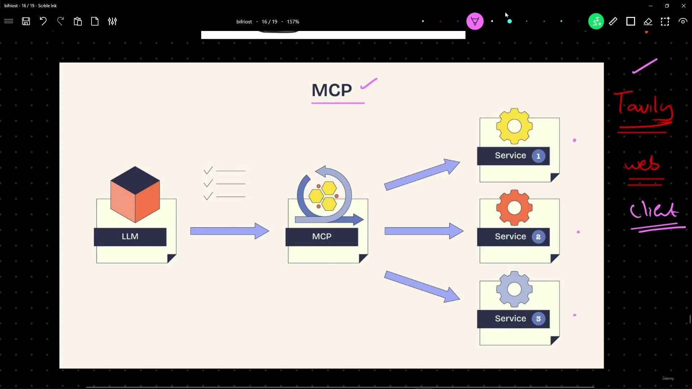

### 5.6 `06_mcp_register_and_call.py`：三段式结构对应讲师的三步

讲师把 MCP 的接入拆成了三步，代码结构严格按这三步来：

> "第一件我们需要的是一个 response，从所有 MCP client 拿 response……第二我们设一个 client，client 会以 JSON 格式给我们 response……第三我们设置它们是否注册，我们想要它们的 config 和 name。"
> —— p094 [15:50]

**第一步 `get_raw_clients()`**：`GET {BIFROST_BASE_URL}{BIFROST_MCP_CLIENTS_PATH}`，`timeout=5`。讲师说的“timeout 是五秒”就是这个。

**第二步 `normalize_clients(raw)`**：讲师说“这个 JSON 信息会存进 clients，然后 clients 会被迭代用于注册”。他直接迭代了 `response.json()`，说明他那边顶层就是可迭代的。但我加了一层兼容——顶层是 list 就直接用，是 dict 就找 `clients` / `data` / `items`。**这是防御性写法，不是讲师讲过的内容**，课里没讲外层结构叫什么。

**第三步 `pick_registered()`**：讲师说的是“我提取每一个，然后打印谁注册了，DeepWiki 和 Tavily 两个都注册了，我从这里拿到了 registered 变量”。所以判断条件是 `client.get("registered") is True`。名字匹配做了去空格、去连字符、去下划线的模糊处理，因为控制台里显示的名字可能是 `deep-wiki`、`DeepWiki`、`deepwiki-mcp` 等，而讲师嘴上是“deep wiki”。

`call_with_tools()` 的请求体是这一节的硬核部分：

```python
payload = {
    "model": MISTRAL_MODEL,
    "messages": [{"role": "user", "content": prompt}],
    "mcp_enabled": True,
    "code_mode": True,
    "servers": servers,
}
```

逐项对应讲师原话：

> "地址是 `bifrost_base_url /v1/chat/completions`，JSON 里 model 是 Mistral，messages 是 prompt，Bifrost 会用 `mcp_enabled` 为 true，`code_mode` 也为 true，因为它可能在内部写代码，servers 就是 servers，timeout 我们给 60 秒。"
> —— p094 [17:45]

`code_mode: true` 这个字段名字很怪，但讲师明确念了，并且解释了原因——“它可能内部写代码”。**这个字段的含义课里没有展开**，只能照抄。如果哪天你的 Bifrost 版本不认它，返回 400，把这一行注释掉试。

`timeout=60` 比普通请求长得多，因为 MCP 调用是“模型 → 工具 → 模型”两跳，还要等工具返回。60 秒是讲师给的值。

`print_tool_result()` 里同时打印 `content` 和 `tool_calls`，对应讲师说的“打印 messages、tool calls”。`content` 是模型最终回答，`tool_calls` 是它调了哪些工具、传了什么参数——后者才是验证 MCP 真的被调用的证据。

讲师演示的两个 prompt 值得抄下来：

- DeepWiki：走 wikipedia 的 `search` / `get article`，问 Bifrost 是什么。
- Tavily：`"latest news about GROQ AI"`，走实时网页搜索。

> "Tavily 的 prompt 是「latest news about GROQ AI」，所以 Tavily search 被用了；DeepWiki 也正常工作了。"
> —— p094 [19:12]

最后讲师留了作业：

> "找一找你最喜欢的 MCP，有一个 MCP 列表网站……awesome mcp servers。找到一个之后，做一个简单的 RAG、简单的 agent，接收一个 prompt，接上这个 MCP 工具，通过 Bifrost 传消息。"
> —— p094 [20:09]

这个作业本文不代做，但代码结构已经给全了：把 `call_with_tools()` 的 `servers` 换成你新注册的 server 名即可。

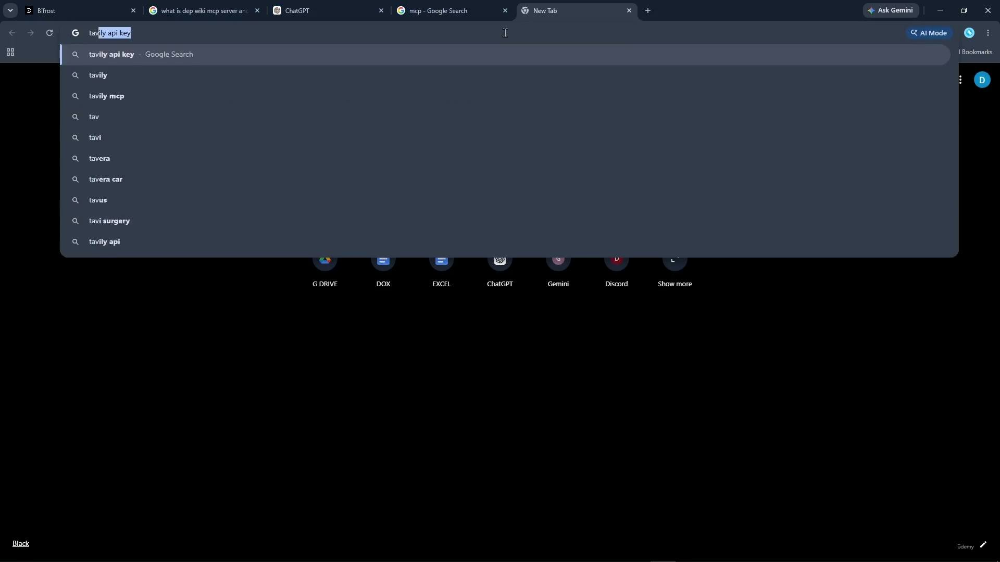

### 5.7 `07_rag_ingest.py`：为什么非要自己写 embedding class

这是 P95 最实质的工程量。讲师说得很直白：

> "我们要写这个自定义 class，因为 LangChain 确实给了我们用 Jina embeddings 的方式，但那个现在已废弃（deprecated）。"
> —— p095 [07:53]

> "因为 LangChain 内置的 Jina wrapper 只支持旧模型。"
> —— p095 [02:45]

所以 `JinaEmbeddings` 继承 `langchain_core.embeddings.Embeddings`，实现两个抽象方法：

```python
def embed_documents(self, texts: list[str]) -> list[list[float]]:
    return self._embed(texts, task="retrieval.passage")

def embed_query(self, text: str) -> list[float]:
    return self._embed([text], task="retrieval.query")[0]
```

讲师解释了为什么要分成两个方法：

> "这是 LangChain 构建 retriever class 的标准做法。如果你用过 Chroma，或者用过任何 embedding，我们会做 embed documents，也就是有一堆文档；然后还要写 embed query，意思是用户 query 来了，我们嵌入这个 query，再和所有已嵌入的文档算相似度。"
> —— p095 [11:40]

**这两个方法不能合并**，因为 Jina 的 API 对“文档”和“查询”用不同的 `task` 参数：`retrieval.passage` 和 `retrieval.query`。向量空间是同一个，但编码方式略有差别，混用会掉召回。这是讲师明确在代码里区分的（`task` 作为参数传给 `_embed`），不是我自己加的。

`_embed()` 里的请求构造，讲师逐项解释过：

> "我们传了 headers，headers 是额外信息，我们传了 authorization 和 bearer，这就是 api key；为什么需要 api key？为了告诉 Jina 这个 API：嘿，我是一个授权用户。然后 json，我们以 JSON 格式传请求，这是标准做法；model 是我用的模型，input 是我收到的文档列表，task 是它该做的任务。我们等 30 秒，看这个 embedding 是否工作。然后 `response.raise_for_status()`，意思是如果有错误，比如 HTTP 错误、404，它会抛出来。"
> —— p095 [10:43]

对应代码：`Authorization: Bearer {api_key}`、`json=payload`、`"model"`、`"input"`、`"task"`、`timeout=30`、`raise_for_status()`。一个不多一个不少。

`data["data"]` 里取 `item["embedding"]`，是 Jina 返回结构。**讲师没有念出这个字段路径**，他是看着 Jina 官方文档的 Python 示例写的（“我看到他们也是用 request，我从这里拿到了确切的代码”）。如果你换模型后结构变了，以 Jina 文档为准。

维度探测这一段，必须解释清楚我为什么不照抄“204”：

> "我把 Hello world 传进去然后打印，会发生什么？我的 query 会被嵌入。我展示 embeddings 的长度，长度是 204，因为每个 embedding 都有一个长度。"
> —— p095 [14:07]

`204` 这个数字在常见 Jina 模型里并不典型（768、1024、2048 更常见），**极可能是语音识别把 2048 听成了 204**。如果我硬编码 `size=204` 去建 Qdrant collection，而你用的模型返回 1024 维，`add_texts` 会直接报维度不匹配。所以代码里是：

```python
probe = embeddings.embed_query("hello world")
jina_dim = len(probe)
```

先探一次，拿到真实长度，再 `VectorParams(size=jina_dim, ...)`。讲师本人的做法也是先 `embed_query("hello world")` 再打印长度，我只是把结果直接喂给 `create_collection`，避免两处不一致。

Qdrant 这一段，讲师逐句讲过：

> "如果 quadrant collection 存在，就删掉这个 collection……这是 collection exist 方法，用来检查有没有 collection……在我们的场景里，如果之前有同名 store，就删掉它，我们不需要它。"
> —— p095 [16:29]

```python
existing = client.get_collections().collections
existing_names = [c.name for c in existing]
if COLLECTION in existing_names:
    client.delete_collection(collection_name=COLLECTION)
```

注意 `.collections` 这一层：`get_collections()` 返回的是一个对象，里面才是 list。写成 `client.get_collections()` 直接迭代会挂。

> "现在我们创建 collection，collection 名就是 collection；vectors config 里的 vector parameters 接收两个东西：embedding 的大小，也就是 Jina 的维度，还有 distance，我们用 cosine similarity。"
> —— p095 [16:59]

```python
client.create_collection(
    collection_name=COLLECTION,
    vectors_config=VectorParams(size=jina_dim, distance=Distance.COSINE),
)
```

讲师顺手展开过 `Distance` 的选项：

> "里面有 cosine、Euclidean、dot product、Manhattan distance，这些是找两个向量相似度的不同度量方法。"
> —— p095 [17:28]

`Distance.COSINE` 就是对应 cosine similarity。

最后包一层 LangChain：

```python
vector_store = QdrantVectorStore(
    client=client,
    collection_name=COLLECTION,
    embedding=embeddings,
)
ids = vector_store.add_texts(DOCS)
```

讲师的原话是“vector store 接收一堆东西：第一我们要打到 Qdrant vector store，这个对象就是我们的 Qdrant client；第二 collection name；第三 embeddings，我们用 Jina embedding”。还有一句很可爱的坦白：

> "我不是凭空写的，我前面已经推导过这些了。"
> —— p095 [18:23]

`add_texts` 而不是 `add_documents`，是因为我们手里是纯字符串列表，不是 LangChain 的 `Document` 对象：

> "如果它是 LangChain documents，我们会 ingest documents。"
> —— p095 [19:51]

运行成功的标志：

> "它会显示我们向 bifrost rag demo 索引了 7 个文档。如果我刷新这个，看，我们能看到 7 个文档。"
> —— p095 [20:20]

> 前端对照：向量库对前端来说就是“没有 SQL 的数据库”。你不用会写 join，但要理解三件事：每条文档一个向量、向量的长度由模型决定、查询时把 query 也变成同长度向量再算距离。`embed_documents` 对应“批量导入时调一次 API 传很多条”，`embed_query` 对应“用户每次搜索时调一次 API 传一条”。

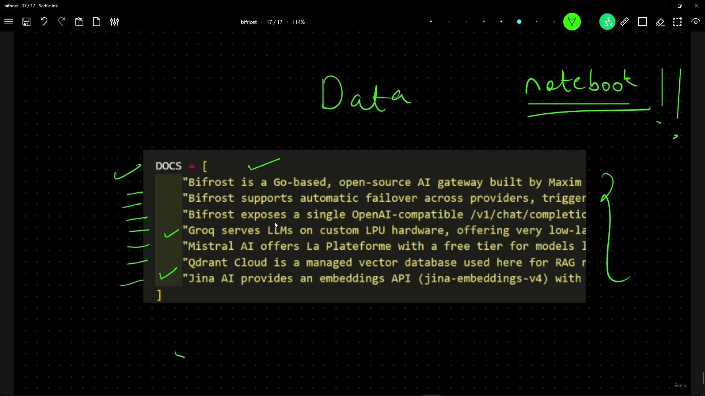

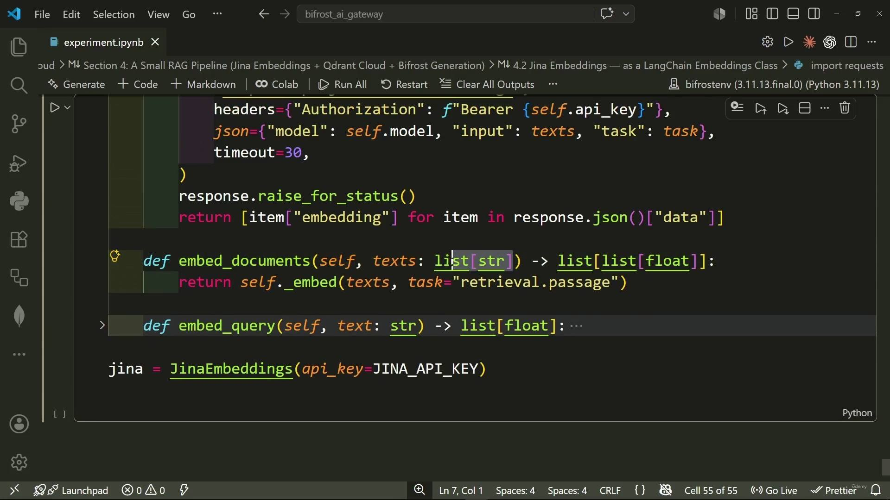

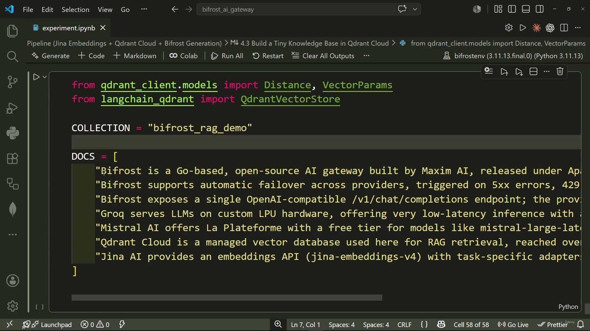

---

## 6. 复现检查清单

按顺序打勾。任何一项不过，先解决它，不要往下走。

### 6.1 环境与依赖

- [ ] `python --version` 是 3.10 以上（代码里用了 `str | None` 语法；3.10 以下会 `TypeError`）。
- [ ] `pip install -r requirements.txt` 成功，`python -c "import requests, openai, qdrant_client, langchain_qdrant"` 无报错。
- [ ] `.env` 从 `.env.example` 复制过来，且**没有被提交进 git**。
- [ ] `BIFROST_BASE_URL` **不带** `/v1`（本文约定，见 3.8）。

### 6.2 Bifrost 侧

- [ ] 控制台能打开，Model Catalog 里能看到 Groq 和 Mistral 的模型条目。
- [ ] 两个 Groq 条目都存在，weight 都是 `0.5`。
- [ ] `GROQ_MODEL` / `GROQ_MODEL_2` / `MISTRAL_MODEL` 三个值和控制台里显示的模型名**逐字符一致**（大小写、连字符都算）。
- [ ] `01_fallback.py` 场景 2 能拿到 Mistral 的回答，而不是 4xx 报错。
- [ ] `02_load_balancing.py` 跑 10 次，两个 key 都至少出现一次；跑 100 次时比例接近 5:5。
- [ ] `03_streaming.py` 两段输出都是**逐字**出现，不是最后一次性打印。
- [ ] `04_logs.py` 返回 200 且能看到 JSON；如果 404，改路径前缀。
- [ ] 控制台的 logs / dashboard 里能看到刚才那批请求。

### 6.3 Virtual key

- [ ] Governance 里创建了 `bifrost-grog-virtual-key` 和 `bifrost-mistral-virtual-key` 两个 virtual key。
- [ ] 各自配了 `maximum tokens = 1000`、`requests = 1000`。
- [ ] `expire` 设为 `never`（或你明确需要的日期）。
- [ ] `05_virtual_key.py` 两个场景都能打印出模型回答。
- [ ] 故意把 `.env` 里的 virtual key 改错一个字符，应当得到 401/403；改回来恢复正常。
- [ ] 理解：脚本里**没有任何** Groq / Mistral 原始 key。

### 6.4 MCP

- [ ] MCP Catalog 里 DeepWiki 类型是 **HTTP Streamable**，connection URL 填的是 `DEEPWIKI_MCP_URL`。
- [ ] Tavily 的 connection URL 里已经替换成你自己的 Tavily API key。
- [ ] 两个 server 都**打开了 auto execute**，工具都允许。
- [ ] `06_mcp_register_and_call.py` 第一段打印出来的 JSON 里，两个 server 的 `registered` 都是 `true`。
- [ ] DeepWiki 那次调用返回了内容，且 `tool_calls` 不为空。
- [ ] Tavily 那次 prompt 是 `latest news about GROQ AI`，返回的是新闻类内容。
- [ ] 控制台 MCP usage 里能看到“两个工具被使用”，错误率为 0。

### 6.5 RAG 摄入

- [ ] Qdrant 控制台能打开，`QDRANT_URL` 带端口 `:6333`（Cloud 默认）。
- [ ] `07_rag_ingest.py` 启动时打印“环境变量已就绪”。
- [ ] 打印出的 `jina dimension` 是一个真实数字（不是 0，不是报错），**记下这个数字**。
- [ ] 脚本能列出已有 collections；第一次跑时 collection 列表里没有 `bifrost_rag_demo`。
- [ ] 第二次跑时，脚本会先删除同名 collection 再重建，不报错。
- [ ] 最后打印 `indexed 7 documents into bifrost_rag_demo`。
- [ ] 回 Qdrant 控制台刷新，collection 里能看到 **7 条** point。
- [ ] 生成的向量维度与控制台里 collection 配置的 size 一致。

### 6.6 明确不做的事

- [ ] 本文**没有**实现 RAG 的检索和生成。P95 到此为止，chatbot 是下一节。
- [ ] 本文**没有**实现前端界面。三节课全程是脚本 + 控制台。
- [ ] 本文**没有**给出 Bifrost 的安装步骤。前序课的内容，课里没讲。

---

## 7. 课里没讲但你会撞上的

这一节全部是“课里没讲”的补充，目的是让你少卡两天。凡是我标注了“以实际为准”的，都不要当成讲师的原话。

### 7.1 Bifrost 的 REST 路径与字段名，课里没讲全

讲师演示时用的是封装好的 client（`bifrost client`、`https.post` 这类），请求体字段名大部分没念。你可能撞上的具体点：

- **fallback 字段名**：`fallback` / `fallback_model` / `fallback_models` 都可能，本文抽成 `FALLBACK_FIELD` 常量。最稳的是在控制台配 fallback 链。
- **logs 路径**：`/v1/logs` 还是 `/logs`，以实际为准。本文默认 `/v1/logs`。
- **MCP client 列表路径**：`BIFROST_MCP_CLIENTS_PATH` 默认 `/v1/mcp/clients`，纯属默认值，**课里没念过这个路径**。404 就换。
- **`mcp_enabled` / `code_mode`**：这两个字段名讲师明确念了，但**含义课里没展开**。`code_mode` 那句“因为它可能在内部写代码”，只能理解到字面。
- **provider 字段**：顶层还是 `extra_fields` 里，以实际响应为准。

处理原则只有一条：**先原样打印 JSON，再决定取哪个字段**。`04_logs.py` 和 `06` 的第一段都是这么写的。

### 7.2 virtual key 的 401 与“重新生成即失效”

讲师自己在 p094 [08:22] 踩过：控制台重新生成 key 之后，`.env` 里的旧值立刻失效。你在本地会遇到完全一样的现象。

- 症状：`openai.AuthenticationError` 或 401。
- 处理：回 Governance 复制当前 virtual key，覆盖 `.env`；或者临时填进 `HARDCODED_*` 常量。
- 注意：如果你的应用是长期跑的服务，改 `.env` 之后要重启进程，`load_dotenv()` 只在启动时读一次。

另外，预算超了也会返回错误，但**不是 401，