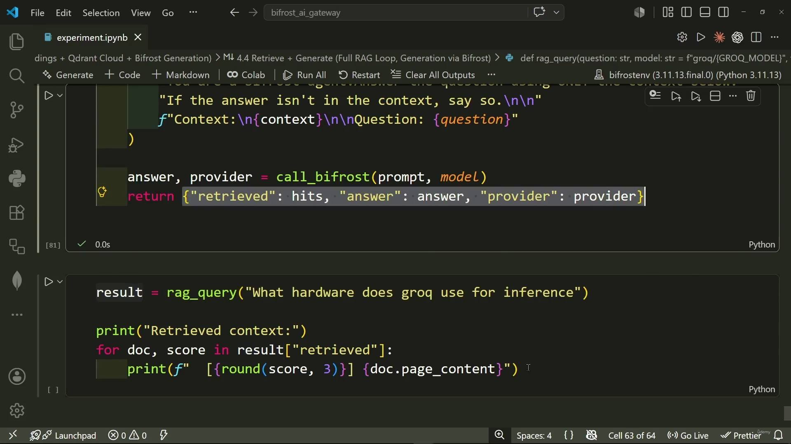
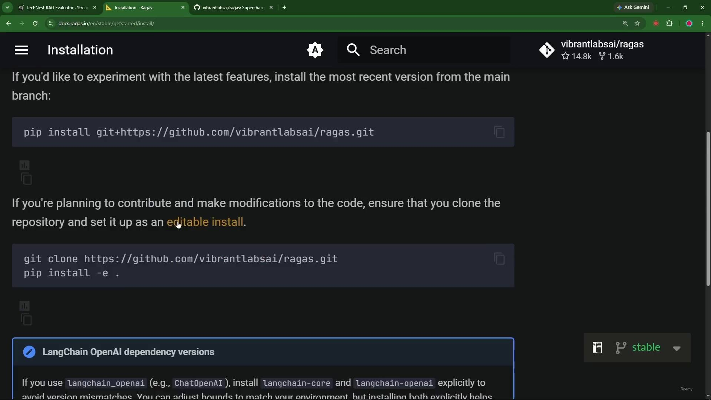
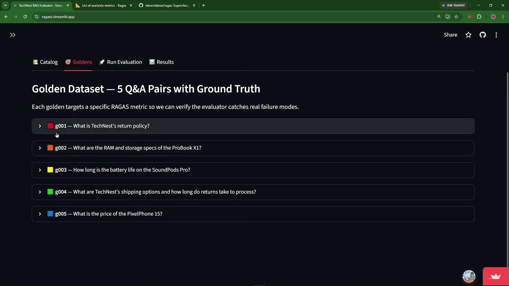
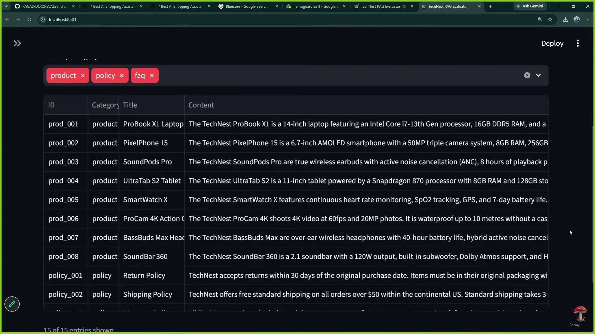
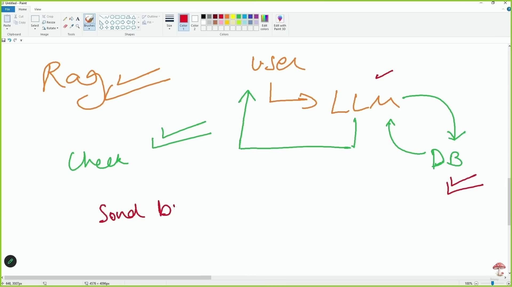
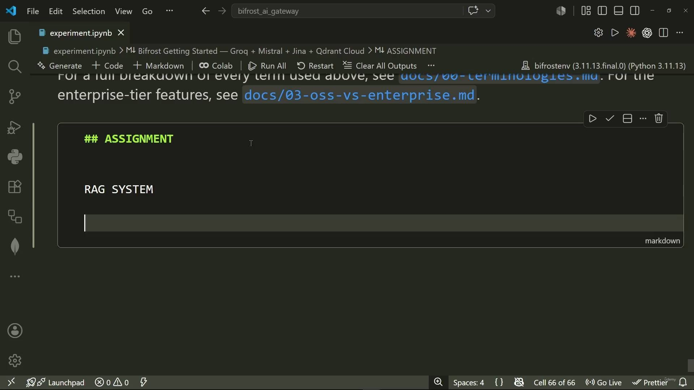

# AI Security Bootcamp part2（护栏/网关/可观测）— P096–P098 课程文档

> 本文档覆盖 P096（RAG 检索收尾 + 课程总结 + 作业）、P097（RAGAS 框架入门）、P098（LLM 评估术语与 Golden 数据集）。三段课里**没有出现任何可运行的代码文件**（P096 的 `rag_query` 方法只以口头描述出现，P097/P098 是文档讲解与演示）。因此第 4 节「完整代码」按硬性要求处理：把讲师口头描述的 `rag_query` 方法**按讲师原话还原成可保存运行的 Python 文件**，并明确标注哪些部分是讲师原话、哪些是补全；P097/P098 则给出「设计决策表 / 术语表 / 数据集草案」这类可复现产物，并标注「课里没有代码，以下为示意」。

---

## 1. 这一节做什么

这一段是 Bifrost 系列（网关 + 多模型路由 + RAG）的**收尾与过渡**，三节课各干一件事：

- **P096**：把上一节已经完成「数据入库（ingestion）」的 RAG 流程补上最后一环——**检索（retrieval）**。讲师写了一个 `rag_query` 方法：接收用户问题、模型名、top_k，调用向量库的 `similarity_search_with_score` 拿到相似文档，把各文档的 `page_content` 拼成 context，塞进一个带「只准用下面 context 回答、context 里没有就说没有」指令的 prompt，再调用之前已经封装好的 `bifrost` 方法，返回一个字典（含 `retrieved` 与 `answer`、`provider`）。跑通之后，讲师做了一次**整个系列的知识点复盘**（哪些讲了、哪些跳过了），并布置了一个**自建 RAG 系统的作业**（4 种数据源、语义分块、Jina re-ranker、LangChain `create_agent` 建 ReAct agent、把 retriever 当 tool、加可观测性与护栏）。
- **P097**：开启新框架 **RAGAS**。讲师带读官方文档：安装方式、`ragas.metrics` 的导入方式、核心概念（dataset / experiment / metrics）、指标分类（组件级 / 端到端 / 业务指标，如 answer correctness、citation accuracy、faithfulness），并说明本框架将用 **TechNest** 电商知识库（产品信息 + 政策 + FAQ）作为贯穿案例。还明确了跑实验需要的三把 key：**Grok key、Judge Grok key（用另一个邮箱注册）、Gemini key**，以及「LLM as a judge」为什么要用更大的模型。
- **P098**：把「LLM 评估」用**学生考试**的类比讲透：训练 = 上课，评估 = 考试，预测 = 学生答卷，actual reality = 老师的标准答案/评分细则。给出 LLM 评估的定义、四种评估方式（LLM as a judge / 人工评估 / 规则匹配 / 统计指标），并定义三个核心术语：**Golden（单条测试用例）、Dataset（多條 Golden 组成）、Evaluation Matrix（评分细则）**。最后用 TechNest 的 5 条 Golden 演示「两阶段流水线」：阶段一把每条 Golden 喂给 RAG 系统拿回答，阶段二逐条算指标、出分数。

一句话：**P096 把 RAG 跑通并交作业，P097 装好评估框架，P098 建立评估的词汇表和数据集规范。**

---

## 2. 讲师原话

> "如果你还记得，在上一个视频里我们已经成功地把数据入库到了 Qdrant 存储里。现在你可能会问，Qdrant 是不是只能处理小数据，能不能扩展？我告诉你，Qdrant 在开发者社区里被广泛接受，用于可扩展的方案。"
> —— p096 [00:00]

> "数据入库这部分已经完成了，现在数据检索部分要登场了。为此我们写一个简单的方法，方法名就叫 `rag_query`。"
> —— p096 [00:55]

> "`rag_query` 要接收一堆东西：question，也就是用户查询是什么；model，我们用哪个模型，我们说我们会用 Grok 模型；top_k，意思是我们会取最相似的前三个 chunk；输出是一个字典，我们会拿到一个基于字典的输出，叫 hits。"
> —— p096 [00:55]

> "hits 是什么？hits 就是我们从这个向量存储里收到了多少条相似的句子或文本。所以我们会写 `vector_store.similarity_search_with_score(question, top_k)`。我们就是在检索相似文档，这就是 RAG 的上下文。我们会把 page content 拼起来，也就是每个文档的内容。"
> —— p096 [01:24]

> "这就会作为 context 传给我们的 LLM。prompt 内部我们已经给了 LLM 一个指令，让它按某种方式行为，好让这个 RAG 方案**只使用下面的 context** 来回答问题。我们可以在这里再加一堆东西，让我加一句「你是一个 Bifrost agent」。"
> —— p096 [01:53]

> "我只是为了演示才加这句。我想让你看到，我们就是这样给 LLM 下指令、让它按特定方式行为的。然后「基于下面的 context 回答问题。如果答案不在 context 里，就说你没有这个 context」。"
> —— p096 [02:23]

> "同样地，我们用 answer 和 provider，调用我们的 Bifrost。看，我们之前做的方法还在用，调用 `bifrost`，它接收两个东西：prompt 和 model，会检索相似文档，基于相似文档给我们答案，还会告诉你是哪个 provider 给的答案。"
> —— p096 [02:23]

> "我就直接跑一下。最后我们要做的是运行这个系统，result 会是一个 `rag_query`。在 `rag_query` 里我可以直接问：Grok 用什么硬件做推理？为什么问这个？因为这里有一份相似的文档——Grok 以极低延迟服务 LLM，等等。"
> —— p096 [02:52]

> "我们并没有针对文档提问，但看看我们会拿到什么样的回复。跑之前我得换个方式打印。我会把 retrieved context 打印出来，`for document in result['retrieved']`。"
> —— p096 [03:50]

> "为什么是 `result['retrieved']`？因为在 result 里，字典是按这种方式存的。如果你想看这个字典，我把这段注释掉，先给你看字典。result，我们会看到一个字典，里面有三样东西：`retrieved`，也就是所有相似文档 document 1、2、3，因为 top 3；`answer`——Grok 在它自己的 LPU 硬件上跑推理；`provider` 是 grok。"
> —— p096 [04:18]

> "现在只要把它打印得好看一点，因为在 UI 上我们不能这样打印。我这样做，把上面注释掉，再跑一次，就能以更好的方式看到信息：retrieved context 第一条、第二条、第三条，provider 是 grok。我们没打印 provider，虽然可以打，不是什么大事。"
> —— p096 [04:48]

> "让我把到目前为止学到的东西总结一下。我们覆盖了 vanilla Grok——就是简单 Grok 调用，之前用它们的基础 SDK 做的 Grok 和 Mistral 调用；我们也看了 Bifrost client、Web UI 配置、自动 fallback、负载均衡、统一流式——我们能流式输出也能看日志；virtual keys、MCP gateway、DeepSeek 计数、RAG，都简单地看到了。"
> —— p096 [05:13]

> "跳过了什么？我们跳过了 guardrails 部分、cluster mode、secret manager、OpenTelemetry，以及高级 RAG 技术——高级 RAG 技术会在未来的项目里覆盖。这些都是企业级的东西，只有拿企业版的时候才会用到。"
> —— p096 [05:42]

> "我们的受众里有很多做业务的、中级的，可能很多人不在企业级。所以我们考虑这些受众，这个视频里没有放企业级内容。但在未来的项目里，我保证我们会做多 agent 工作流。这些多 agent 会是数字员工（digital workers），大家期待一下。"
> —— p096 [06:11]

> "走之前你可以接一个作业。这个作业很简单：开发你自己的 RAG 系统。用类似的技术，Jina 和这个（Qdrant），当然你的 Bifrost 已经配好了，Qdrant 已经配好了，embedding 也配好了。你要做的是收集或开发新数据——可以从任何地方拿，爬网站、从 CSV 拿，任何数据都行。你要拿到**四种数据源**，可以是 PDF、文本文件、JSON 文件和一堆不同的数据源。"
> —— p096 [07:01]

> "拿到这四种数据源后，你要对它们做 chunk。RAG 有一条固定的流水线：数据加载，在数据加载里你会学到解析（parsing）；加载完数据后做 chunk，这里你可以学 Google 的语义分块（semantic chunking），或者问你的 AI 朋友、AI 编程 agent；分块之后把它们装进 Qdrant。"
> —— p096 [07:29]

> "检索阶段，你要在检索里加一个东西叫 **re-ranking**。怎么加？用 Jina，Jina 也提供 re-ranker，而且是个很棒的 re-ranker。Jina 提供多个 re-ranking 模型。re-ranker 干什么？你按 top_k 相似度检索出一批文档 1、2、3、4，但问题是它们**语义上**是否真的正确、顺序是否合理。"
> —— p096 [08:26]

> "很多时候后端跑的是余弦相似度这种数学函数，但它抓不住语义含义。所以你的任务是：在检索流程里加一个 re-ranker。"
> —— p096 [09:23]

> "然后，不要像我这样简单地写 `rag_query`，你要用 LangChain，用最新的 `create_agent` 方法。在这个方法里你要创建一个 ReAct agent，并且可以把 retriever 当作 tool 传进去。"
> —— p096 [09:53]

> "这些都做完之后，你要加可观测性（observability），可以加护栏（guardrails），能加什么护栏就加什么。全部做完，你的作业就完成了，然后可以跳到下一节——评估你的系统。"
> —— p096 [10:23]

> "我为什么给你这个作业？因为**除非你自己动手建，否则你学不会**。所以一定要做这个作业，做起来会很好玩，相信我。"
> —— p096 [10:49]

> "从这一节开始，我们在 LLM 评估之旅里开启一个新框架，名字叫 RAGAS。RAGAS 在评估 RAG 应用方面是个很棒的框架，它给我们一些指标来评估 RAG 应用。"
> —— p097 [00:00]

> "让我们快速进入 RAGAS 的文档。你要的所有答案都能在文档里找到。读文档、跟上当前技术和当前代码非常重要。"
> —— p097 [00:27]

> "安装的话，我们只需要 `pip install ragas` 就能在项目里装上 RAGAS。"
> —— p097 [00:54]

> "左边有教程，怎么评估一个 prompt、怎么评估一个简单的 RAG 系统。他们用漂亮的图解释了很多东西：query、RAG 是什么，它会去检索系统取，检查 prompt，然后给你最终答案。我们能看出几件事：`from ragas.metrics import 某个 metric`，所以我们知道用 `ragas` 里的 `metrics` 方法来导入任何指标。这就是为什么我说要读文档——万一明天他们的代码改了呢？"
> —— p097 [01:24]

> "核心概念里有什么？怎么评估一个 RAG、什么是数据集、什么是实验。实验是你对应用做的一次有意的改动，用来验证一个假设或想法。我们跑 RAGAS 的时候就会设置实验。"
> —— p097 [01:53]

> "指标——看看 RAGAS 提供哪些不同的指标，以及为什么指标重要。**你无法改进你无法衡量的东西**，这句话太重要了。指标是让迭代成为可能的反馈回路。有不同类别的指标：组件级指标、端到端指标，比如 answer correctness、citation accuracy，还有业务指标。faithfulness 也是其中一类，这些我们都会学。"
> —— p097 [02:23]

> "如果你想衡量什么，就用 `metrics` 方法去做。"
> —— p097 [02:51]

> "看 GitHub，它有 14.8k stars，社区开发得很好，截至今天五个月前更新过。如果你想给这个框架做贡献，欢迎。我怎么知道这些？因为我用文档理解了很多东西。看端到端指标，能看到 answer correctness 等等。"
> —— p097 [03:17]

> "这是概览。看可用指标，我们有 RAG 指标、NVIDIA 指标、agent 或工具使用场景的指标、NLP 指标。不同场景有很多指标，接下来的视频我们会看其中几个。"
> —— p097 [03:46]

> "这是我们的作业：在你没有好好看过这份文档之前，不要进入下一个视频。"
> —— p097 [04:15]

> "这一节框架的议程：先讲理解评估框架时出现的各种术语；然后理解我们实验要用的各种指标；最后，有了所有指标的基础之后，我们去做那些实验。"
> —— p097 [04:15]

> "为了理解这个框架，我们用一个好例子，我最喜欢的例子：TechNest。TechNest 是一个知识库，或者说是一个 RAG 助手，从你的产品数据库里检索信息。我们有产品、政策、FAQ 的信息。这是我挑的一个电商用例，用来展示评估怎么工作。"
> —— p097 [04:42]

> "这是数据，真实数据，这是 Goldens。一句话说，Golden 就是你用来评估 RAG 系统的数据。然后是阶段：跑评估。但你没有 key 就跑不了评估。你需要一把 Grok key、一把 Judge Grok key、一把 Gemini key。"
> —— p097 [05:09]

> "Judge Grok 和 Grok 是两回事，因为我们用了 **LLM as a judge** 这个概念——用一个 LLM 去评估另一个 LLM。建议 Judge Grok 的 API key 来自另一个 Grok 用户 ID，也就是另一个邮箱；这把来自另一个邮箱；第三你需要 Gemini API key。"
> —— p097 [05:38]

> "怎么弄？我直接搜 Grok API key，去 Grok 页面，直接创建一个 API key。同样地，你要从两个不同的 ID 创建这把 key。最后创建 Gemini API key，你只要搜 Gemini API key free，去 Google AI Studio，那里也有文档，直接生成 API key，点 Get API key 就有了。"
> —— p097 [06:05]

> "这些东西在后面的视频里你都需要，才能跟我一起现场测试，因为我会持续拿它作参考，在接下来的视频里教你不同的东西。"
> —— p097 [06:32]

> "这一节我们开始理解 LLM 评估，以及和 LLM 评估相关的各种术语。假设你是一个学生，在学校读书，你被训练了比如六个月。每天有人告诉你这是科学、这是历史、这是数学、这是地理。"
> —— p098 [00:00]

> "六个月后我们要确认你是否准备好升到下一年级。你在六年级，我们看你是不是准备好升七年级。只有通过考试你才准备好，这个考试就是你的评估。"
> —— p098 [00:28]

> "这六个月里我们给你题目，也给你答案。但考试里会发生什么？只给你题目，你自己写答案，答案不会提供。这些答案会被老师对照真正的答案来批改。"
> —— p098 [00:55]

> "这会带来什么？我们在衡量**预测**和**实际现实**之间的差距。实际现实指的是真正的正确答案，以答题卡或评分细则的形式交给老师——这道题答到这些关键词给多少分。预测可以指学生在考场上写的答卷。"
> —— p098 [01:21]

> "学生只有通过考试才能从初中升到高中；同样，候选人只有通过考试才能被录用。我们在这里要做的，就是确保 LLM 在它被训练的基础上，在进入生产阶段之前，把工作做对。"
> —— p098 [01:51]

> "什么是生产阶段？就好比学生从大学毕业去工作，他准备好工作了。只有通过考试他才准备好；考试没过就没准备好。"
> —— p098 [02:19]

> "所以这就是 LLM 评估。简单定义：LLM 评估是用来检查一个 AI 模型——通常是聊天机器人或写作助手——是否把工作做得**好、安全、准确**的测试。"
> —— p098 [02:49]

> "我们训练了一个 HR 政策的 AI agent。我们要确保：你问任何问题，它都会去数据库搜——也就是无论如何都会用工具；并且永远只回答和政策相关的问题，因为任务是政策助手。这就是评估的全部目的：确保 LLM 把工作做好。"
> —— p098 [03:17]

> "这些评估怎么做？就像考试给分，100 分满分你考了 80 分，我们同样给 LLM 打分。这些分数通常在 **0 到 1** 之间，会考虑很多指标。"
> —— p098 [03:45]

> "评估 LLM 有多种方式。一种很有名、最常用的方式叫 **LLM as a judge**。什么意思？生产里用的模型，假设是个小模型，80 亿参数；另有一个更大的 LLM，比如 600 亿参数，这个模型带推理能力，能做深度研究等等。更大的模型通常是更好的模型，更聪明的脑子、更大的脑子。所以我们总是尽量用更好的模型去评估生产里用的模型。"
> —— p098 [04:11]

> "所以 LLM 会被另一个 LLM 评估，这就是 LLM as a judge 的概念，会用到更大的 LLM。"
> —— p098 [05:07]

> "第二种场景是**人工评估**。人工评估就是真的有人坐下来看 LLM 产出的回答。"
> —— p098 [05:32]

> "第三种是**基于规则**的方式，就是简单检查 LLM 给的答案是否等于我们作为参考的答案。"
> —— p098 [05:32]

> "还有一种是计算**统计指标**。这个阶段我们不用深挖所有这些。现在只要理解有两大方式：要么 LLM as a judge——用另一个 LLM 评判生产的 LLM；要么用人工评估。"
> —— p098 [06:00]

> "人工评估是很贵的过程，你要付钱给人去检查你的 LLM 和领域专业知识；LLM as a judge 相比人工评估是更便宜的方案。但整个评估过程本身非常贵，我们会理解为什么、怎么做。"
> —— p098 [06:25]

> "来看我为你准备的演示。用例是：我们做了一个聊天机器人，它接了一个客户查询数据库——电商客服聊天机器人。数据库里有各种查询：政策、产品信息（网站上有什么产品）、还有 FAQ 常见问题。"
> —— p098 [06:54]

> "它会怎么工作？假设有个网站，比如 Amazon，上面有各种产品，角落有个聊天机器人，我们可以跟它交互：推荐一些牛仔裤、推荐一些个护用品、推荐一些沐浴露，什么都能问，这个机器人会去检索。我们也可以问有没有退货政策、常见问题。所有这些问题的数据库都做好了，交给聊天机器人。"
> —— p098 [07:19]

> "来看这个数据库。我把一切清空，一条一条加进去，这个链接会提供给你。先看产品信息：这是 product id，就像学生有学号；组织名是 TechNest；categories 是 product；Pro book L1 笔记本、Pixel phone 15、sound pods pro，就是一些随机的产品，smartwatch X，还有它们的描述。"
> —— p098 [08:17]

> "TechNest X1 book 是 14 英寸笔记本、Intel Core……产品信息要给出来，这样聊天机器人才能基于它作答。TechNest 智能手表有连续心率监测、SPO2 追踪、GPS 追踪等等。"
> —— p098 [09:07]

> "再看另一类信息：政策信息。我们加了退货政策、配送政策、保修政策、支付政策。TechNest 有至少一年的厂商保修，覆盖材料和工艺缺陷等等，你们可以自己读。最后是 FAQ：订单追踪、国际配送、批量与企业业务。追踪订单请访问这个网站。"
> —— p098 [09:34]

> "这就是一个我们认真思考怎么做聊天机器人的场景。这就是这类数据、这类聊天机器人。这个数据集的目标是什么？目标是把它交给 LLM，这些都会被 LLM 用来生成回答。"
> —— p098 [10:03]

> "比如这是 soundbar，我可以直接问我的聊天机器人：soundbar 360 的评分是多少？告诉我 soundbar 360 的特性。它会说 120 伏输出、低音炮、Dolby Atmos。这就是有这个数据库的全部目的。"
> —— p098 [10:03]

> "现在我们要做什么？我们的 RAG 已经做好了，我们不谈 RAG 的开发。我们已经做了一个 RAG：用户把问题传给 LLM，LLM 连着数据库——就是我们刚看到的同一个数据库——看着数据库回答用户所有问题，再把回答还给用户。这就是已经做好的整个循环。"
> —— p098 [10:33]

> "现在我们要检查这个循环是否正常工作：对给定问题、对每个问题，它是真的从数据库回答，还是凭自己的想法生成？因为 LLM 本性是狡猾的、随机的。"
> —— p098 [11:02]

> "它到底有没有用数据库回答问题？如果问的是 sound buds pro，LLM 却回答「board speakers 很好」——这不对。虽然它从数据库拿到了数据，但我问的是 sound buds，你答的是 board speakers，这不对，答案和问题不相关。"
> —— p098 [11:29]

> "我们要在把 LLM 送上生产之前检查所有这些。不能在没有 100% 确定 LLM 会表现良好之前就上线。"
> —— p098 [11:58]

> "现在开始讲理解 LLM 评估时涉及的各种术语。我们要学几个词、几个小而聪明的定义，才能整体理解 LLM 评估过程。我们有 Golden。Golden 简单说就是**一张试卷里的一道题**。Dataset 是什么？Dataset 就是**试卷本身**。第三，evaluation matrix 就是交给老师批改的**答题卡/评分细则**——哪道答案该得多少分。"
> —— p098 [12:22]

> "Golden 是评估的**单个单元**。Golden 也叫 test case，也用作评估的单个单元。这个 Golden 可以包含：问题到底是什么；期望的回答是什么，也就是答案；第三，它包含我们 LLM 实际给出的回答。"
> —— p098 [13:49]

> "Golden 就是 test case，简单说就是试卷上的一道题。一个 Golden 里有多样东西。第一是原始问题，比如「告诉我 sound buds」「告诉我 AirPods」。然后是 actual answer，真实答案，这里会写 AirPods 是 Apple 的，多少美元。"
> —— p098 [14:43]

> "然后是 expected tool usage，意思是 LLM 每次给这个回答时，它应该用这个特定的工具。我们的情况里它应该用 database 工具。然后是 actual answer——LLM 考试时给出的答案。然后是 actual tool use：我们的例子里 LLM 没用 database 工具，用了 web search 工具，这里就**扣分**。"
> —— p098 [15:10]

> "如果问题是 AirPods Pro 价格，回答是 AirPods Pro 价格是 XYZ 美元，这个场景里答案对了，但用的工具错了。答案**加分**，工具使用**扣分**。"
> —— p098 [16:08]

> "这就是 Golden。把多个 Golden 组合起来——第一、第二、第三、第四——组合多个 Golden 就成了 Dataset。"
> —— p098 [16:36]

> "来看我们实际要用的 Golden，这个链接也会分享。每条 entry 有 product、product title 和 content，这就是我们要关注的 Golden。TechNest 退货政策：退货在 13 天内接受，原包装……"
> —— p098 [17:06]

> "让我看看有没有更好的 Golden 例子。看这个：user input 是「你们提供退货运费吗？」这里还有另一个指标我后面会讲，讲的是从数据库里**提取了什么信息**。也就是说，你的 RAG 或 LLM 应该用数据库，但它从数据库里拿到的是**正确信息**吗？它用了数据库，没问题，但提取的信息对吗？这就是 retrieved context，它对吗？"
> —— p098 [17:34]

> "这是 LLM 给出的回答：「是的，我们提供免费预付退货」。但 reference、真正的事实是「不，除非商品有缺陷，否则顾客付退货运费」。这里就**扣分**：聊天机器人应该说「不，除非商品有缺陷，顾客要付退货运费」，但它说了「是的，我们提供免费预付退货」，这不对。"
> —— p098 [18:02]

> "我们就这样造出多个 Golden 来评估 LLM，多个 Golden 就是 Dataset。然后我们把这个整个 dataset 传给 LLM。"
> —— p098 [18:30]

> "来看我们准备好的 dataset。**数据集准备是 LLM 评估阶段最耗时的阶段**。如果我们有一小时评估 LLM，我们会花 55 分钟准备数据集，只花 5 分钟真正测试数据集。数据集准备就是这么重要。数据集通常由领域专家准备，或者由 LLM 自己准备，这个我们也会讲。"
> —— p098 [18:55]

> "这些是我们的 Golden，我们只准备了五条。第一条是「TechNest 退货政策是什么？」我们想聚焦一个特定指标，叫 **faithfulness**，我们五分钟内会学。答案应该是：TechNest 接受购买后 30 天内退货，商品必须原包装、所有配件齐全，除非商品有缺陷，顾客承担退货运费。"
> —— p098 [19:24]

> "同样，这是问题、这是答案，所有条目都一样。soundpods pro 的电池续航多长？8 小时。问题答案都给了，我们只想确认 LLM 有没有做对。"
> —— p098 [20:22]

> "流水线跑两个阶段。阶段一，每条 Golden——也就是试卷上每道题——由学生来解；同样，阶段一把每道题传给我们的 LLM，也就是我们做的这个系统。这些是回答：这是试卷，这是 LLM 生成的答题卡。看「TechNest 退货政策是什么」，回答是「TechNest 退货政策：购买日起 30 天内退货」等等，reference answer 是「TechNest 接受购买后 30 天内退货」，两者匹配——我们期望它说 30 天，它确实说了 30 天，这个测试**通过**。"
> —— p098 [20:50]

> "同样看另一题：电池续航多长？它应该说 8 小时，它说了 8 小时，我们也期望 8 小时，所以这些通过了。整张试卷解完之后，我们进入阶段二，计算所有指标。"
> —— p098 [21:18]

> "阶段二我们也在检查指标，整张试卷检查完之后我们拿到一些结果，每条 Golden 都拿到结果，每道答案都得到一些分数，这些分数就是我们要继续用的。看每条 Golden 的明细：这是 RAG 回答，这是从数据库检索到的信息，这是我们期望的，我们把两者对比，还有一堆东西。"
> —— p098 [22:14]

> "这些就是评估指标，给试卷打的分数。这就是 LLM 评估和 LLM 评估相关术语的全部内容，用简单的话讲完了。下一节我们会理解 LLM 评估相关的各种指标。"
> —— p098 [22:42]

---

## 3. 从零复现

### 3.0 环境与前置条件

这一段课**没有给出任何依赖版本号**（课里没讲），下面按讲师口头提到的库名给出最小可复现清单，版本请以你实际 `pip install` 的结果为准：

```bash
# 建议 Python 3.10+（课里没讲具体版本）
python -m venv .venv
source .venv/bin/activate        # Windows: .venv\Scripts\activate

# P096 检索部分（讲师口头提到 Qdrant、embedding、bifrost 已配好）
pip install qdrant-client
pip install openai                # 若你的 bifrost 封装基于 OpenAI 兼容接口
pip install python-dotenv

# P097 评估框架
pip install ragas
```

环境变量（P097 明确要求三把 key，变量名课里没讲，下面用常见命名，**变量名以你实际代码为准**）：

```bash
# .env
GROK_API_KEY=你的生产用 Grok key
JUDGE_GROK_API_KEY=用另一个邮箱注册的 Grok key（LLM as a judge 用）
GEMINI_API_KEY=Google AI Studio 生成的 key
```

> 讲师强调：**Judge Grok key 必须来自另一个邮箱/用户 ID**，因为「LLM as a judge」是拿一个 LLM 评另一个 LLM，两把 key 混用会让评估失去独立性。

### 3.1 复现步骤 A：把 P096 的 `rag_query` 跑起来

前置：上一节你已经完成 ingestion，Qdrant 里已有 collection，embedding 已配好，`bifrost` 方法已封装（P096 原话「我们之前做的方法还在用」）。

1. 新建 `rag_query.py`（完整代码见第 4 节）。
2. 把 `COLLECTION_NAME`、`EMBED_MODEL`、`BIFROST_MODEL` 换成你上一节实际用的值。
3. 运行：

```bash
python rag_query.py
```

4. 预期输出（讲师在 [04:18] 演示过）：先打印一个字典，含 `retrieved`（3 条文档）、`answer`（"Grok runs inference on its own LPU hardware"）、`provider`（"grok"）；随后是格式化后的 retrieved context 第 1/2/3 条。



### 3.2 复现步骤 B：装 RAGAS 并读文档（P097 的「作业」）

讲师把「读文档」本身布置成作业，复现方式就是按他给的路径走一遍：

1. `pip install ragas`。
2. 打开 RAGAS 官方文档，按左侧导航依次看：Installation → Tutorials（evaluate a prompt / evaluate a simple RAG system）→ Core Concepts（evaluate a RAG / datasets / experimentation）→ Metrics（component-level / end-to-end / business metrics）。
3. 确认导入方式：`from ragas.metrics import <metric>`（讲师在 [01:24] 明确看到这行）。
4. 确认指标分类：RAG metrics、NVIDIA metrics、agents/tool-use metrics、NLP metrics（[03:46]）。



### 3.3 复现步骤 C：准备三把 key（P097）

1. 搜「Grok API key」→ 进 Grok 页面 → 创建 key（第一把）。
2. **换另一个邮箱**再注册 → 再创建一把 key（Judge Grok key）。
3. 搜「Gemini API key free」→ 进 Google AI Studio → Get API key → 生成 key。
4. 三把 key 写进 `.env`，变量名见 3.0。



### 3.4 复现步骤 D：按 P098 的规范造 Golden 与 Dataset

1. 建一个 `goldens.json`（结构见第 4 节 4.2），每条 Golden 至少含：`question`、`reference_answer`、`expected_tool`、`actual_answer`、`actual_tool`、`retrieved_context`。
2. 讲师演示的 5 条 Golden 主题（[19:24]–[20:22]）：
   - TechNest 退货政策是什么？
   - （同类政策题若干）
   - soundpods pro 电池续航多长？（期望 8 小时）
   - 退货运费谁付？（期望「除非商品有缺陷，顾客付」）
3. 两阶段流水线：阶段一把每条 Golden 的 `question` 喂给 RAG 系统，把回答写回 `actual_answer`、把检索到的内容写回 `retrieved_context`；阶段二逐条算指标、出分数（0–1）。





---

## 4. 完整代码

> **重要声明**：P096 的 `rag_query` 方法讲师**只口头描述、没有贴出完整文件**；下面 4.1 是**按讲师原话逐句还原**的可运行文件，凡讲师没讲的部分（如 import、client 初始化、`bifrost` 内部实现）都标注「课里没讲，以下为补全示意」。P097/P098 **课里没有代码**，4.2/4.3 是设计产物，不是讲师写的代码。

### 4.1 `rag_query.py`（P096，按讲师原话还原）

```python
# rag_query.py
# 说明：本文件按 P096 讲师口头描述还原。
# 讲师原话覆盖：方法名 rag_query、参数 question/model/top_k、返回字典、
# similarity_search_with_score、page_content 拼接、prompt 指令、
# 调用 bifrost(prompt, model)、返回 retrieved/answer/provider。
# 课里没讲、以下为补全示意的部分：import 语句、client 初始化、bifrost 内部实现。

import os
from dotenv import load_dotenv
from qdrant_client import QdrantClient

load_dotenv()

# —— 以下初始化课里没讲，按你上一节 ingestion 的实际配置替换 ——
COLLECTION_NAME = os.getenv("QDRANT_COLLECTION", "technest")
EMBED_MODEL = os.getenv("EMBED_MODEL", "jina-embeddings-v3")   # 讲师提到用 Jina 做 embedding
BIFROST_MODEL = os.getenv("BIFROST_MODEL", "grok")             # 讲师说「我们会用 Grok 模型」

qdrant = QdrantClient(
    url=os.getenv("QDRANT_URL", "http://localhost:6333"),
    api_key=os.getenv("QDRANT_API_KEY"),
)


def embed(text: str):
    """课里没讲具体 embedding 调用，按你上一节的实现替换。"""
    raise NotImplementedError("复用上一节 ingestion 时的 embedding 函数")


def bifrost(prompt: str, model: str) -> dict:
    """
    讲师原话：bifrost 接收两个东西——prompt 和 model，
    返回 answer 和 provider。内部实现课里没讲，以下为补全示意。
    """
    # 示意：实际应调用你上一节封装好的 Bifrost 客户端
    raise NotImplementedError("复用上一节封装好的 bifrost 调用")


def rag_query(question: str, model: str, top_k: int = 3) -> dict:
    # 讲师原话：vector_store.similarity_search_with_score(question, top_k)
    query_vector = embed(question)
    hits = qdrant.search(
        collection_name=COLLECTION_NAME,
        query_vector=query_vector,
        limit=top_k,          # 讲师：top_k 意思是取最相似的前三个 chunk
        with_payload=True,
    )

    # 讲师原话：把 page content 拼起来，作为 context
    context = "\n\n".join(hit.payload.get("page_content", "") for hit in hits)

    # 讲师原话：prompt 内部给了 LLM 指令，只准用下面的 context 回答；
    # 加一句「你是一个 Bifrost agent」；context 里没有就说没有。
    prompt = f"""You are a Bifrost agent.
Answer the question only using the context below.
If the answer isn't in the context, say that you don't have the context.

Context:
{context}

Question: {question}
"""

    # 讲师原话：用 answer 和 provider 调用 bifrost，它接收 prompt 和 model
    result = bifrost(prompt, model)

    # 讲师原话：返回字典，含 retrieved / answer / provider
    return {
        "retrieved": hits,
        "answer": result["answer"],
        "provider": result["provider"],
    }


if __name__ == "__main__":
    # 讲师原话：在 rag_query 里直接问「Grok 用什么硬件做推理？」
    result = rag_query(
        question="What hardware does Grok use for inference?",
        model=BIFROST_MODEL,
        top_k=3,
    )

    # 讲师原话：先看字典（他演示时先把格式化打印注释掉）
    print(result)

    # 讲师原话：把 retrieved context 打印出来，for document in result['retrieved']
    for i, document in enumerate(result["retrieved"], start=1):
        print(f"\n--- Retrieved context #{i} ---")
        print(document.payload.get("page_content", ""))
        print("score:", getattr(document, "score", "该字段名请以实际输出为准"))

    print("\nprovider:", result["provider"])
```

### 4.2 `goldens.json`（P098 的 Golden/Dataset 结构草案）

> 课里没有代码，以下为示意。字段名取自讲师 [14:43]–[18:02] 的口头定义：question、actual answer（reference）、expected tool usage、actual answer（LLM 给的）、actual tool use、retrieved context。

```json
{
  "dataset_name": "technest_eval_v1",
  "goldens": [
    {
      "id": "g001",
      "question": "What is TechNest's return policy?",
      "reference_answer": "TechNest accepts returns within 30 days of purchase. Items must be in original packaging with all accessories. Customers pay return shipping unless the item is defective.",
      "expected_tool": "database",
      "actual_answer": "TechNest return policy: returns within 30 days of original purchase date.",
      "actual_tool": "database",
      "retrieved_context": "TechNest accepts returns within 30 days of purchase..."
    },
    {
      "id": "g002",
      "question": "How long is the battery life of soundpods pro?",
      "reference_answer": "8 hours of battery life.",
      "expected_tool": "database",
      "actual_answer": "8 hours.",
      "actual_tool": "database",
      "retrieved_context": "soundpods pro: 8 hours battery life..."
    },
    {
      "id": "g003",
      "question": "Do you offer return shipping?",
      "reference_answer": "No. Customers pay return shipping unless the item is defective.",
      "expected_tool": "database",
      "actual_answer": "Yes, we provide free prepaid returns.",
      "actual_tool": "database",
      "retrieved_context": "Customers pay return shipping unless the item is defective."
    }
  ]
}
```

### 4.3 评估方式决策表（P098 的「方案产物」）

> 课里没有代码，以下为示意，内容全部来自讲师 [04:11]–[06:25] 的口头对比。

| 评估方式 | 做法 | 成本 | 讲师判断 |
|---|---|---|---|
| LLM as a judge | 用更大的模型（如 600 亿参数、带推理）评生产模型（如 80 亿参数） | 比人工便宜，但整体评估过程仍很贵 | 最常用、最著名 |
| 人工评估 | 人坐下来看 LLM 的输出 | 很贵（要付钱给领域专家） | 成本高 |
| 规则匹配 | 检查 LLM 输出是否等于参考答案 | 低 | 简单直接 |
| 统计指标 | 计算统计量 | 课里没展开 | 「这个阶段不用深挖」 |

---

## 5. 逐行解释

### 5.1 `rag_query.py`

- `def rag_query(question, model, top_k=3)`：讲师原话三个参数一一对应——question 是用户查询，model 是用哪个模型（Grok），top_k 是取前三个相似 chunk。默认值 3 来自讲师「top three similar chunks」。
- `qdrant.search(..., limit=top_k, with_payload=True)`：对应讲师说的 `vector_store.similarity_search_with_score(question, top_k)`。**注意**：讲师用的是 LangChain 风格的方法名，这里用 qdrant-client 原生 `search` 等价实现；`with_payload=True` 是为了拿到 `page_content`，否则拼不出 context。
- `context = "\n\n".join(...)`：讲师原话「把 page content 拼起来，也就是每个文档的内容，这会作为 context 传给 LLM」。用双换行分隔是为了让 LLM 能区分不同文档边界。
- prompt 三句话逐句对应讲师原话：①「你是一个 Bifrost agent」（他说「只是为了演示才加」）；②「只使用下面的 context 回答」；③「如果答案不在 context 里，就说你没有这个 context」。这三句是 RAG 防幻觉的核心约束——**没有它，LLM 会拿自己的参数知识瞎编**。
- `bifrost(prompt, model)`：讲师原话「它接收两个东西：prompt 和 model，会检索相似文档，基于相似文档给我们答案，还会告诉你是哪个 provider 给的答案」。注意这里 `bifrost` 是**上一节已封装的方法**，不是本文件新写的。
- 返回字典三个键：`retrieved`（hits 列表）、`answer`、`provider`。讲师在 [04:18] 演示时字典里就是这三样，且 `retrieved` 里有 3 条（top 3 生效）。
- `for i, document in enumerate(result["retrieved"], start=1)`：对应讲师 [03:50] 的 `for document in result['retrieved']`，加 `enumerate` 只是为了打印「第 1/2/3 条」，讲师演示时正是这么编号的。
- `print(result)` 与格式化打印二选一：讲师原话「如果你想看字典，我把这段注释掉，先给你看字典」——所以文件里两个都保留，实际跑时按需注释。

### 5.2 为什么 P098 的 Golden 要带 `expected_tool` 和 `actual_tool`

讲师 [15:10]–[16:08] 讲得很清楚：**答案对 ≠ 过程对**。他举的例子是「AirPods Pro 价格」——答案对了（加分），但 LLM 没用 database 工具、用了 web search（扣分）。所以 Golden 必须同时记录「应该用哪个工具」和「实际用了哪个工具」，否则你只能测出「答得对不对」，测不出「是不是靠检索答的」。对前端转 AI 应用的人来说，这等价于：**不只看接口返回 200，还要看它有没有真的打到后端而不是命中 mock**。

### 5.3 为什么 `retrieved_context` 要单独存

讲师 [17:34] 提出「它用了数据库，没问题，但提取的信息对吗？」——这就是 `retrieved_context` 字段的用途：把「检索到的东西」和「最终回答」分开存，才能定位问题出在**检索层**还是**生成层**。如果 retrieved_context 是对的、answer 是错的 → 生成层问题；如果 retrieved_context 本身就错 → 检索/分块/embedding 问题。这是 RAG 调试的基本分诊法。

### 5.4 两阶段流水线为什么这么设计

讲师 [20:50]–[22:14]：阶段一「解题」（每条 Golden 喂给系统拿回答），阶段二「批改」（逐条算指标）。分开的好处是**阶段一可以批量跑、可以缓存**，阶段二换指标不用重跑推理——这直接对应讲师说的「数据集准备占 55 分钟、测试只占 5 分钟」，因为数据集（Golden + reference）是重资产，指标是轻计算。

### 5.5 0–1 打分与「你无法改进你无法衡量的东西」

讲师 [03:45] 说分数通常在 0 到 1；[02:23] 引用「你无法改进你无法衡量的东西，指标是让迭代成为可能的反馈回路」。工程含义：**每次改 prompt / 换模型 / 调 top_k，都要跑同一套 Golden 拿分数对比**，否则改动就是拍脑袋。这就是讲师说的「实验（experiment）= 对应用做的一次有意的改动，用来验证一个假设」。

---

## 6. 复现检查清单

**P096 检索部分**
- [ ] Qdrant collection 存在且已 ingestion（上一节产物）
- [ ] `rag_query.py` 里 `COLLECTION_NAME` / `EMBED_MODEL` / `BIFROST_MODEL` 已替换为实际值
- [ ] `embed()` 与 `bifrost()` 已接上上一节实现（不再是 `NotImplementedError`）
- [ ] 运行后 `print(result)` 输出字典，含 `retrieved`（3 条）、`answer`、`provider`
- [ ] 格式化打印输出「Retrieved context #1/#2/#3」
- [ ] 提问「What hardware does Grok use for inference?」时，answer 提到 LPU 硬件（讲师演示结果）

**P097 RAGAS 准备**
- [ ] `pip install ragas` 成功
- [ ] 已读文档四块：Installation / Tutorials / Core Concepts / Metrics
- [ ] 确认 `from ragas.metrics import <metric>` 可用
- [ ] 三把 key 就位：`GROK_API_KEY`、`JUDGE_GROK_API_KEY`（**另一个邮箱**）、`GEMINI_API_KEY`

**P098 数据集**
- [ ] `goldens.json` 至少 5 条（对齐讲师「我们只准备了五条」）
- [ ] 每条含 question / reference_answer / expected_tool / actual_answer / actual_tool / retrieved_context
- [ ] 阶段一跑完，`actual_answer` 与 `retrieved_context` 已回填
- [ ] 阶段二每条 Golden 有 0–1 分数
- [ ] 至少有一条「答案对但工具错」的负例（讲师演示的扣分场景）

---

## 7. 课里没讲但你会撞上的

1. **`similarity_search_with_score` 是 LangChain 的方法名，不是 qdrant-client 的**。讲师口头说的是 LangChain 风格；如果你直接用 `qdrant-client`，对应的是 `search()` / `query_points()`，返回对象字段名也不同（`payload` vs `page_content`）。**字段名请以你实际输出为准**，不要照抄本文档的 `page_content`。
2. **`bifrost` 方法的具体签名课里没讲**。讲师只说「接收 prompt 和 model，返回 answer 和 provider」。你上一节如果封装成别的返回结构（比如 `{"data": ...}`），要自己适配。
3. **RAGAS 的 `metrics` 导入路径可能随版本变**。讲师 [01:24] 特意强调「万一明天他们的代码改了呢」——所以以你 `pip install` 到的版本文档为准，本文档不锁定版本号。
4. **Judge 模型与生产模型不能是同一把 key**。讲师只说「建议另一个邮箱」，没说技术上会怎样；实际风险是配额、计费、以及评估独立性——同一账号下两把 key 仍可能共享限流。
5. **`ragas` 跑评估本身很贵**。讲师 [06:25] 说「整个评估过程本身非常贵」，但没给单价；实际成本 = Golden 条数 × 每次评估的 LLM 调用数 × judge 模型单价，跑之前先小样本试。
6. **语义分块（semantic chunking）课里只提了名字**，没给实现。讲师说「可以学 Google 的，或者问你的 AI 编程 agent」——具体参数（阈值、最小块长）课里没讲。
7. **Jina re-ranker 的调用方式课里没讲**，只说了「Jina 也提供 re-ranker，有多个模型」。API 路径、top_n 参数、与 Qdrant 的接法都要自己查 Jina 文档。
8. **LangChain `create_agent` 的确切签名课里没讲**。讲师只说「用最新的 `create_agent` 方法创建 ReAct agent，把 retriever 当 tool 传进去」——LangChain 版本迭代快，方法名和参数以你装的版本为准。
9. **P096 讲师跳过的 guardrails / cluster mode / secret manager / OpenTelemetry**，本段课**完全没有内容**，不要以为文档漏了——讲师明说「这些是企业级，这个视频里没放」。
10. **前端视角补一句**：P098 的「两阶段流水线」在 Node/JS 里对应「先批量调接口拿 responses（可并发 + 缓存），再离线跑评分脚本」；不要在一个请求里同步做「生成 + 评分」，那会把延迟翻倍且无法复用 Golden。

---

### 截图索引（本文档共插入 6 张）

| 编号 | 帧 | 用途 |
|---|---|---|
| 1 | p096_0252s | rag_query 返回字典结构 |
| 2 | p097_0070s | RAGAS 文档 `from ragas.metrics import` |
| 3 | p097_0322s | Judge Grok 与 Grok 两把 key |
| 4 | p098_0604s | 阶段一：Golden 喂给系统 |
| 5 | p098_0697s | 阶段二：逐条指标明细 |
| 6 | p096_0435s | 讲师总结系列知识点（见下） |

