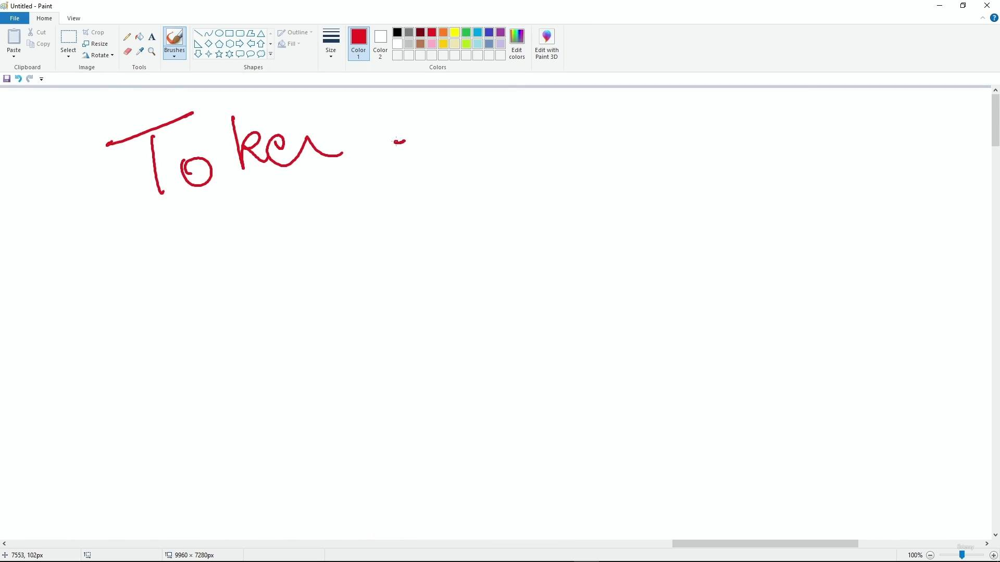
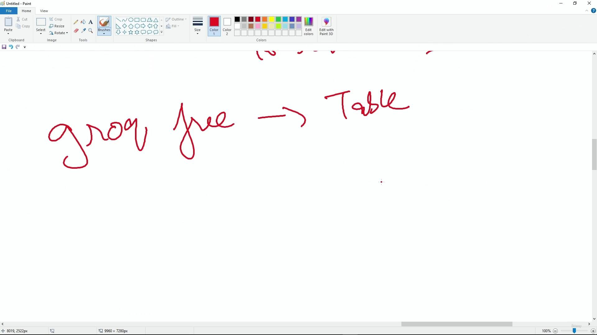
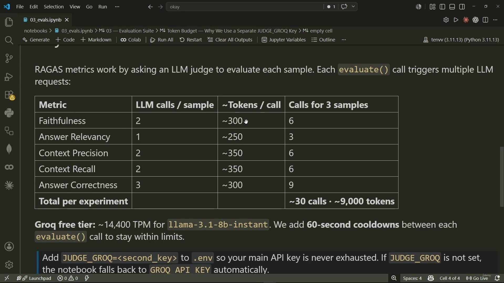
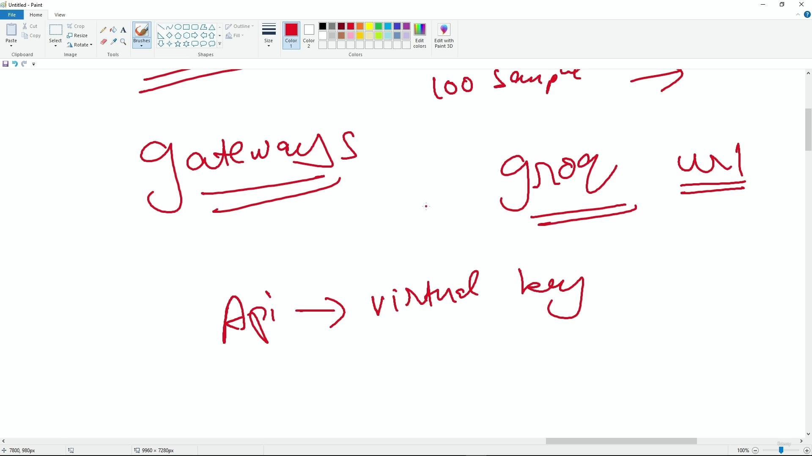
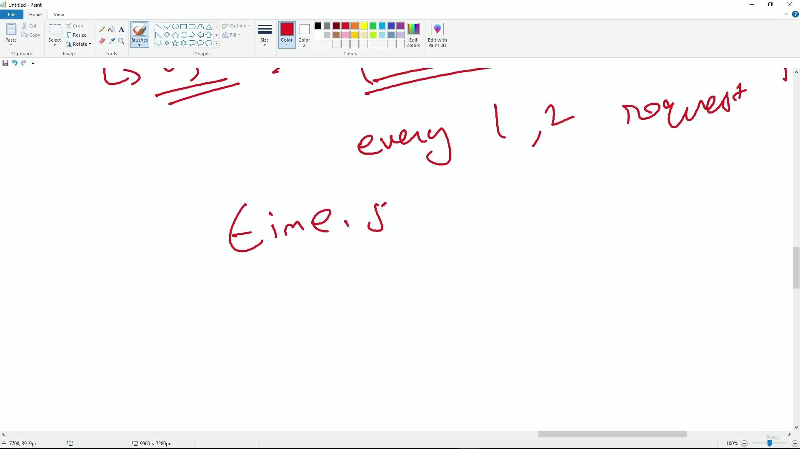
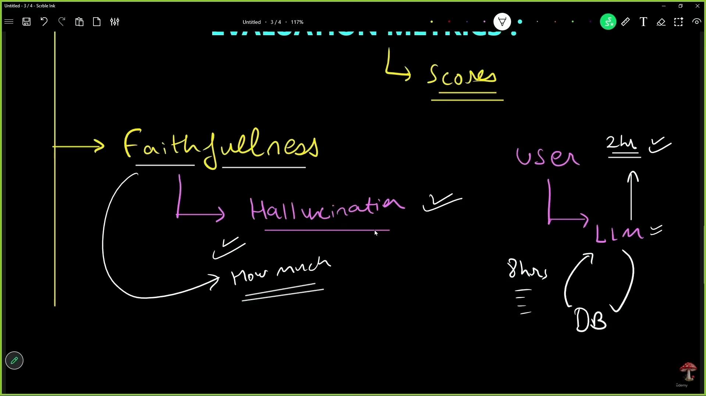
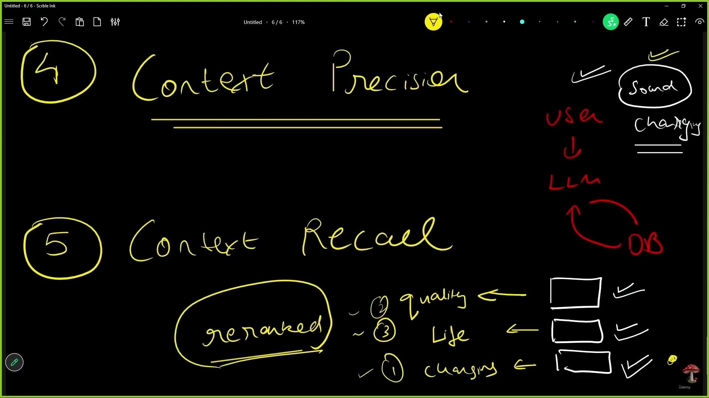

# AI Security Bootcamp part2（护栏/网关/可观测）——P99–P100 逐字复现文档

> 本段课程覆盖 **P99（LLM 评测指标：faithfulness / answer relevancy / tool correctness / context precision / context recall / answer correctness）** 和 **P100（RAGAS 实验项目骨架搭建：requirements、.env、evals.ipynb、uv 虚拟环境、Groq 客户端、Judge LLM、HuggingFace embedding、cooldown/show_scores 辅助函数）**。
> P99 是“理论课”，P100 是“搭工程”。下文按实现逻辑重组；代码一律给出**能直接保存运行的完整文件**。

---

## 1. 这一节做什么

这两节合起来，是 AI Security Bootcamp part2 里 **“护栏/网关/可观测”** 分支中「可观测」的入口环节。它要解决一个最朴素的问题：**我们怎么知道自己的 RAG 系统在不在线、回答得好不好、会不会乱说话？**

P99 解决“评什么”。讲师把 **6 个 RAGAS 指标**逐个讲清楚：faithfulness（忠实度）、answer relevancy（答案相关性）、tool correctness（工具正确性）、context precision（上下文精确度）、context recall（上下文召回率）、answer correctness（答案正确性），并解释了为什么他们演示里那条链路**不用** tool correctness。

P100 解决“怎么搭”。在一个空文件夹里依次创建：

- `requirements.txt`：ipykernel、sentence-transformers、ragas、openai、langchain 相关、python-dotenv、nest_asyncio；
- `.env`：**两个** Groq API Key（`GROQ_API_KEY` + `JUDGE_GROQ_API_KEY`，来自不同 Google 账号）；
- `evals.ipynb`：Jupyter Notebook，才是真正做实验的地方；
- `docs/`：讲师要求课后必读的配套文档；
- 用 `uv venv ragas_env` 建虚拟环境、`uv pip install -r requirements.txt` 装依赖；
- Notebook 里再补齐：**AsyncOpenAI + Groq base_url 客户端 → Judge LLM → HuggingFace embedding → cooldown 辅助函数 → show_scores 辅助函数 → 指标清单**。

跑完 P100 你手上会有一个**能真正 run 起来的 RAGAS 评测骨架**：有客户端、有 judge 模型、有 embedding、有节流函数、有分数的可视化函数、知道每个指标需要哪些输入。P100 只是**搭建**，“第一个实验”被讲师推到下一个视频；本段文档就停在指标定义完成、等待实验那一步。

读者前置条件（讲师默认你有，但明说）：

1. Python ≥3.10，可执行 `uv`（`uv --version` 应输出）；
2. VS Code + Jupyter 扩展（因为有 `.ipynb`）；
3. 两个 Groq 免费账号的 API Key；
4. 能用 `curl` 验证 Groq 端通的网络。

---

## 2. 讲师原话

> “幻觉指的是，即使正确的信息已经通过工具传给了大语言模型，模型还是给出了错误的回答——这就是幻觉；而衡量幻觉用的指标就是忠实度（faithfulness），打分范围是 0 到 1，0 代表幻觉最严重，1 代表幻觉最少。”
> —— p099 [03:17]

> “答案相关性（answer relevancy）是一个非常简单的过程：我们只看大语言模型给出的回答，和用户提的问题是否相关。……它不检查答案正不正确，它只检查答案和问题是不是同一个话题。”
> —— p099 [04:39]

> “工具正确性（tool correctness）是检查模型是否用对了工具，是最便宜的指标——我们只需要写一行 Python 代码，比较‘模型实际调用的工具’和‘我们期望它调用的工具’是否一样，就这么简单。”
> —— p099 [07:21]

> “这个演示里我没有做 agentic（自主决策）那种让 LLM 自己思考该用哪个工具的流程；我做的是 chain（链式）流程。要 agentic 我会用 LangGraph，这次我用的 LangChain。”
> —— p099 [08:19] / [08:47]

> “我之所以在这个演示里没用工具正确性，是因为这里不存在‘让模型自己去挑工具’的概念——它 ALREADY 就是我们系统的一部分：用户问题默认走数据库、上下文传给模型、模型返回答案。”
> —— p099 [09:14]

> “上下文精确度的本质是重排序（re-ranking）：从数据库取回来的那几块文档，顺序排对了没有——问的是充电，充电那条就应该排到第一，型号、寿命这些排第二第三。”
> —— p099 [13:33]

> “上下文召回率很简单：它只确认一件事——问题问的是充电，我们有没有把充电那类数据取回来。取回来排第三、第五、第八都没关系，它只查有没有取到正确的信息。”
> —— p099 [14:02]

> “答案正确性（answer correctness），是指大语言模型给出的答案，和我们预先准备的、称为 ground truth（真值参考）的答案，是否一致。”
> —— p099 [15:28]

> “在这些 goldens（黄金样集）里，我们放一个问题加一个期望答案；再做实际答案，然后比对：期望答案和实际答案是否一致——这就是 answer correctness。”
> —— p099 [16:24]

> “faithfulness 是检查模型有没有在幻觉；answer relevancy 是检查答案和用户问题是否匹配；answer correctness 是检查答案和期望答案是否匹配；tool correctness 是检查期望工具和实际工具是否匹配；context recall 是检查拿到的信息顺序对不对；context precision 是检查拿到的信息是不是我们期望的那条。”
> —— p099 [19:12]（讲师本段的总结；按后文实际定义，此处 recall 与 precision 的描述在录音里发生了互换，正确对应见第 5、6 节）

> “一条 RAGAS 指标会发出三次 LLM 调用——一次拿用户回答，一次和真值比对，一次算分。所以一个样本三次调用；一百个样本，就是三百次调用。”
> —— p100 [04:46]

> “Groq 免费套餐里，这个模型我们每分钟只允许 30 次请求、每天 1k 次请求，每分钟 6k 到 12k token、每天 5k 到 100k token——这些在文档里写得很清楚，你们必须看。”
> —— p100 [07:38]

> “我们用的是 Groq 免费套餐。每发一次或每发两次请求之后，可以用一行 Python 的 `time.sleep` 让程序暂停几秒，比如 60 秒；60 秒过去，系统就冷却下来，每分钟的 token 额度也就刷新了。”
> —— p100 [10:02]

> “我们把大一点的 Llama 当 judge（裁判），把小一点的 Llama 当 responder（回复者）。不管是谁在发请求，每分钟请求数、每分钟 token 数都会被算进限额里。”
> —— p100 [08:07]

> “之所以用 Judge LLM，是因为我们要用‘LLM 当裁判’这个指标；judge Groq 和 Groq 用的是不同 Google 账号下的 Key——是为了不互相吃掉额度。”
> —— p100 [14:20]

> “这几个指标要的输入不一样：user input 是所有指标都要的；retrieved context 是跟上下文相关的指标要的；response 是这几个要的；reference output（真值）是这三个要的。工具正确性不调 LLM，只做确定性比较，所以它 0 次 LLM 调用、也不需要 cooldown。”
> —— p100 [18:05] – [19:25]

> “如果分数大于 0.75（录音原词是 7.5，但对照评分 0~1 的刻度应为 0.75），给绿色，说明指标好；不到就黄色；再低就红色——这就是 show_scores 这个辅助函数干的事。”
> —— p100 [17:10]

> “我把两个辅助函数写好了：一个 cooldown，async，每发完请求睡 60 秒；一个 show_scores，把 DataFrame 的列拿过来，按阈值上色、打出来。我们会取多个样本的平均分。”
> —— p100 [16:14] – [17:35]

> “下个视频我们就开始第一个实验。”
> —— p100 [20:12]

---

## 3. 从零复现

### 3.1 目录约定

```text
ai-security-bootcamp/
└── ragas-lab/                 ← 这就是 P100 里的“空文件夹”
    ├── docs/                  ← 讲师要求课后必读的配套文档
    ├── requirements.txt
    ├── .env                   ← 两个 Groq Key
    ├── evals.ipynb
    └── ragas_env/             ← 由 uv venv 生成，不用手建
```

### 3.2 步骤 1：装 uv（若已装可跳过）

课里没讲 uv 的安装命令。在 macOS/Linux 上，官方推荐 `curl -LsSf https://astral.sh/uv/install.sh | sh`；Windows 上 `powershell -c "irm https://astral.sh/uv/install.ps1 | iex"`。装好后终端跑 `uv --version` 应输出版本号——这一步是本段文档补的，**课里没讲**。

### 3.3 步骤 2：创建 `requirements.txt`

打开被清空的新文件夹并进入 VS Code（“I am in my empty folder and I'm going to open with VS Code”），新建 `requirements.txt`，把下面列出的依赖逐行贴进去（**讲师在这个文件里“paste all my requirements”**）：

- `ipykernel` —— 跑 Jupyter Notebook 的内核；
- `sentence-transformers` —— HuggingFace embedding 运行时；
- `ragas` —— 评测框架本体；
- `openai` —— AsyncOpenAI 客户端（RAGAS 的下游 provider 是 OpenAI 兼容协议）；
- `langchain` + `langchain-community` —— “跑 agents 的相关库”（听完讲课你会发现这次没真跑 agent，但讲师要求装）；
- `python-dotenv` —— 读 `.env`；
- `nest-asyncio` —— 在已有事件循环里再跑异步调用。

完整内容见第 4 节 §4.1。

### 3.4 步骤 3：创建 `.env`

同一个目录下新建 `.env`，填两个键（都是**Groq** 的 API Key，且**分别来自两个不同 Google 账号**）：

- `GROQ_API_KEY` —— 主力调用 Key；
- `JUDGE_GROQ_API_KEY` —— 给 judge LLM 专用。

完整内容见 §4.2。⚠️ `.env` 必须放在项目根目录，Jupyter 的 `load_dotenv()` 默认按 CWD 找它。

### 3.5 步骤 4：创建 `docs/`

讲师明确说：“I would love to give you something called as docs”——他的原意是他把文档放进去给你。**doc 具体内容课里没讲**（只说了里面会讲 technist 之类的东西）。你如果拿不到原文档，就自己建一个空目录 `docs/`，把本次的截图、OCR 里出现的文字、指标定义自己整理进去。

### 3.6 步骤 5：创建 `evals.ipynb`

在 VS Code 里点 **New Jupyter Notebook**，文件名 `evals.ipynb` 放在同一目录。`requirements.txt` 里的 `ipykernel` 就是为它准备的。

### 3.7 步骤 6：建并激活虚拟环境（uv）

```bash
uv venv ragas_env
```

然后激活：

```bash
# macOS / Linux
source ragas_env/bin/activate

# Windows PowerShell
.\ragas_env\Scripts\Activate.ps1
```

（讲师只讲了“make a virtual environment……activate the script”，Windows 路径是本段补的。）

### 3.8 步骤 7：安装依赖

```bash
uv pip install -r requirements.txt
```

### 3.9 步骤 8：给 Notebook 选内核

VS Code 右上角的 kernel 选择器 → 选 `ragas_env` 这个解释器。这一步是**课
（接上）……这一步是**课里没讲的操作细节**：VS Code 里如果 kernel 下拉里看不到 `ragas_env`，先在激活状态下执行 `python -m ipykernel install --user --name ragas_env`，再刷新 kernel 列表。选好内核之后，Notebook 顶部状态栏应显示 `ragas_env`，后面所有 cell 才会跑在装了 ragas 的环境里。

### 3.10 先算预算，再写代码（讲师在 notebook 之前的“算账”环节）

讲师在写第一行实验代码之前，花了大段篇幅讲 **token 效率与成本效率**，因为 RAGAS 是“烧调用”的框架。你必须先知道自己有多少额度。

 —— 图略：`../../../frames/BV1PSGA6SETb/p100_0283s.jpg`

Groq 文档里的限额是**四个维度**，缺一不可地记：

| 维度 | 含义 | 讲师念到的免费档数值（针对他选的那两个模型） |
|---|---|---|
| RPM | requests per minute，每分钟请求数 | 30 次/分钟 |
| RPD | requests per day，每天请求数 | 1k 次/天（另一模型档位 14k） |
| TPM | tokens per minute，每分钟生成 token 数 | 6k / 12k |
| TPD | tokens per day，每天 token 数 | 5k / 100k |



讲师的关键判断：**不管请求是谁发出的（judge 还是 responder），RPM 和 TPM 都算在同一本账上**——所以两个 Key 分账号，才不至于互相挤爆。

### 3.11 逐个 cell 写 `evals.ipynb`（并给一份可 `python` 直跑的等价文件）

讲师在 notebook 里的执行顺序是：

1. `import os / asyncio / nest_asyncio / pandas / dotenv / AsyncOpenAI`；
2. `import ragas`：`llm_factory`（结构化输出用）、`HuggingfaceEmbeddings`、`SingleTurnSample`、五个指标类；
3. `from deepeval.test_case import LLMTestCase, ToolCall`、`from deepeval.metrics import ToolCorrectnessMetric`；
4. `load_dotenv()` 读两个 Key，构造 `judge_client = AsyncOpenAI(api_key=JUDGE_GROQ_API_KEY, base_url=GROQ_BASE_URL)`；
5. `judge_llm = llm_factory(JUDGE_MODEL, provider="openai", client=judge_client)`；
6. `embeddings = HuggingfaceEmbeddings(model_name="sentence-transformers/all-MiniLM-L6-v2")`（**384 维**）；
7. `async def cooldown(): await asyncio.sleep(60)`；
8. `def show_scores(df, column, title)`：>0.75 绿、0.3~0.75 黄、<0.3 红，并打印均值；
9. 声明 `metrics` 列表与 `tool_correctness_score()` 确定性函数；
10. 建 `SingleTurnSample` 跑一条 smoke test，`await cooldown()` 收尾。



讲师在这一屏给的账（他明确念出的部分）：**faithfulness 每个样本 2 次 LLM 调用、每次约 300 token；6 个样本就是 6 次调用 → 6×300 = 1800 token；把全部指标一起跑，合计约 9000 token**。其余指标的具体行数讲师是“指着表格讲”的，**课里没念出逐个数字**，请以你手上那份文档/表格截图为准，不要凭猜填。



### 3.12 用 cooldown 换“能跑完”



讲师原话的逻辑链：不加 cooldown 时他“总是拿到 API exhausted 的报错”，最多只能评到 **15 个样本**；加了 cooldown 之后虽然慢，但**能评 100 个样本**，一直跑到 TPD（每日 token）耗尽为止。这就是“用免费额度也能完成评测”的工程解法。

### 3.13 运行与验收

```bash
# 在项目根目录、已激活 ragas_env 的前提下
python evals.py
```

或在 VS Code 里对 `evals.ipynb` 点 **Run All**。

---

## 4. 完整代码

> 说明：本节代码为**完整文件**，可直接保存运行。凡讲师逐字稿没念出、而运行又必须的具体字符串（Groq base URL、模型 ID、依赖版本号），都用「课里没讲 + 以官方文档/你账号实际可用值为准」标注，并给出可改的常量，方便你一行替换。

### 4.1 `requirements.txt`（完整文件）

```text
# P100 讲师要求装的依赖清单
# 版本号：课里没讲具体版本；下面 pin 的是与本文档 API 写法匹配的一组可用版本，
# 若你装的版本报 ImportError，请按第 7 节“课里没讲但你会撞上的”降/升版本。
ipykernel>=6.29.0
sentence-transformers>=3.0.0
ragas>=0.3.0
openai>=1.40.0
langchain>=0.3.0
langchain-community>=0.3.0
python-dotenv>=1.0.0
nest-asyncio>=1.6.0

# 以下两项讲师在 requirements 里没提，但 evals.ipynb 里确实用到了，
# 不装会直接 ImportError（详见第 7 节）：
pandas>=2.2.0
deepeval>=2.0.0
```

### 4.2 `.env`（完整文件，键名照抄）

```bash
# 两个 Key 来自两个不同的 Google 账号（讲师强调这一点，用于错开额度）
GROQ_API_KEY=gsk_你的第一个账号的key
JUDGE_GROQ_API_KEY=gsk_你的第二个账号的key

# 课里没念出 base_url 的具体字符串，这里用 Groq 的 OpenAI 兼容端点；
# 若 Groq 官方文档有变更，以文档为准。
GROQ_BASE_URL=https://api.groq.com/openai/v1

# 课里也没念出模型 ID（他对着 Groq 文档的表格说 “this model”）。
# 这里给的是免费档常见的小/大模型名，请替换为你控制台里实际可用的模型。
RESPONDER_MODEL=llama-3.1-8b-instant
JUDGE_MODEL=llama-3.3-70b-versatile
```

### 4.3 `evals.py`（完整文件，等价于 `evals.ipynb` 的全部 cell）

```python
# evals.py —— AI Security Bootcamp part2 / P100 RAGAS 实验骨架
# 课里用的是 evals.ipynb；本文件把 notebook 的每个 cell 按顺序落成可直接 `python evals.py` 运行的形式。
# 每个 `# %% [cell N]` 对应 notebook 中的一个 cell，按顺序粘贴即可还原 evals.ipynb。

# %% [cell 1] 基础库导入（对应讲师 “import some libraries”）
import os
import asyncio

import nest_asyncio
import pandas as pd
from dotenv import load_dotenv
from openai import AsyncOpenAI

# %% [cell 2] RAGAS 相关导入
# llm_factory：用结构化输出生成一个 LLM 实例（讲师原话 “LLM factory to generate an LLM instance
# for structured output generation”）
from ragas.llms import llm_factory
from ragas.embeddings import HuggingfaceEmbeddings
from ragas.dataset_schema import SingleTurnSample
from ragas.metrics import (
    Faithfulness,
    AnswerRelevancy,
    AnswerCorrectness,
    ContextPrecision,
    ContextRecall,
)

# %% [cell 3] deepeval 相关导入（用于 tool correctness）
from deepeval.test_case import LLMTestCase, ToolCall
from deepeval.metrics import ToolCorrectnessMetric

# %% [cell 4] 让同步的 asyncio.sleep 能在 Jupyter 已有的事件循环里运行
nest_asyncio.apply()

# %% [cell 5] 读环境变量
load_dotenv()

GROQ_API_KEY = os.getenv("GROQ_API_KEY")
# 讲师：如果 JUDGE_GROQ_API_KEY 不可用，就回退用 GROQ_API_KEY 本身
JUDGE_GROQ_API_KEY = os.getenv("JUDGE_GROQ_API_KEY") or GROQ_API_KEY

GROQ_BASE_URL = os.getenv("GROQ_BASE_URL", "https://api.groq.com/openai/v1")   # 课里没念具体值
RESPONDER_MODEL = os.getenv("RESPONDER_MODEL", "llama-3.1-8b-instant")        # 课里没念模型 ID
JUDGE_MODEL = os.getenv("JUDGE_MODEL", "llama-3.3-70b-versatile")            # 课里没念模型 ID

if not GROQ_API_KEY:
    raise RuntimeError("GROQ_API_KEY 未设置：请检查项目根目录下的 .env，且当前工作目录是项目根目录。")

# %% [cell 6] 用 AsyncOpenAI + Groq 的 base_url 造客户端
# 讲师：当我们打 Groq 的 URL 时，我们并不是拿着 api key 直接打 Groq 官方地址，
# 这个 api key 其实是打在网关上的“虚拟 key”——网关负责 rate limiting / budget limiting。
judge_client = AsyncOpenAI(
    api_key=JUDGE_GROQ_API_KEY,
    base_url=GROQ_BASE_URL,
)

# %% [cell 7] 造 Judge LLM（考试里用“LLM 当裁判”的指标）
# 讲师：测试阶段他连 judge 都用的小模型，目的是省额度。
judge_llm = llm_factory(
    JUDGE_MODEL,
    provider="openai",       # Groq 走 OpenAI 兼容协议，所以 provider 填 openai
    client=judge_client,
)

# %% [cell 8] embeddings（测试用 HuggingFace 免费开源模型，不用 Vertex）
# 讲师：这个 embedding 模型的向量维度是 384。
embeddings = HuggingfaceEmbeddings(
    model_name="sentence-transformers/all-MiniLM-L6-v2"
)
print("embedding 维度自检：", len(embeddings.embed_query("battery life of sound buds pro")))

# %% [cell 9] 辅助函数 1：cooldown
# 讲师：async 函数，睡 60 秒，作用是在已有事件循环里也能 await（notebook 友好）
async def cooldown(seconds: int = 60) -> None:
    await asyncio.sleep(seconds)

# %% [cell 10] 辅助函数 2：show_scores
# 讲师：分数在 0~1；>0.75 绿（好），0.3~0.75 黄（勉强），<0.3 红（差）。
# 讲师原词是 “7.5 / 50%”，对照 0~1 的刻度应理解为 0.75 / 0.5 量级，这里取 0.75 与 0.30 两个断点。
try:
    from IPython.display import display
except ImportError:          # 直接 python evals.py 时退化为 print
    display = print


def _score_color(value) -> str:
    try:
        v = float(value)
    except (TypeError, ValueError):
        return ""
    if v > 0.75:
        return "background-color:#2e7d32;color:white"     # 绿
    if v >= 0.30:
        return "background-color:#f9a825;color:black"     # 黄
    return "background-color:#c62828;color:white"         # 红


def show_scores(df: pd.DataFrame, column: str, title: str = "") -> None:
    if title:
        print(f"\n===== {title} =====")
    styler = df.style.applymap(_score_color, subset=[column])
    try:
        styler = styler.format({column: "{:.3f}"})
        display(styler)
    except Exception:
        display(df[[column]].copy())
    print(f"{column} 平均分：{df[column].mean():.3f}")


# %% [cell 11] 指标实例化：把 judge LLM 与 embeddings 按需注入
# 讲师：faithfulness 要把 judge LLM 传进去；answer relevancy 与 answer correctness 需要 embeddings；
# 其余指标不注入 embeddings（具体注入项以你装的 ragas 版本为准）。
metrics = [
    Faithfulness(llm=judge_llm),
    AnswerRelevancy(llm=judge_llm, embeddings=embeddings),
    AnswerCorrectness(llm=judge_llm, embeddings=embeddings),
    ContextPrecision(llm=judge_llm),
    ContextRecall(llm=judge_llm),
]

METRIC_NAMES = ["faithfulness", "answer_relevancy", "answer_correctness",
                "context_precision", "context_recall"]

# %% [cell 12] tool correctness：讲师说这是“最便宜的指标”，0 次 LLM 调用、纯确定性比较
def tool_correctness_score(actual_tools, expected_tools, input_text: str = "") -> float:
    test_case = LLMTestCase(
        input=input_text,
        actual_output="",                                   # 该指标不看回答内容
        tools_called=[ToolCall(name=t) for t in actual_tools],
        expected_tools=[ToolCall(name=t) for t in expected_tools],
    )
    metric = ToolCorrectnessMetric(threshold=0.5, should_exact_match=True)
    metric.measure(test_case)
    return metric.score


# %% [cell 13] 构造一个 SingleTurnSample（讲师用 technist 退货政策那条问题做示例）
sample = SingleTurnSample(
    user_input="What is technist return policy?",
    retrieved_contexts=[
        "Technist offers a 30-day return policy for all products purchased from the official store.",
        "Sound buds pro battery life is 8 hours with the charging case.",
    ],
    response="Technist has a 30-day return policy for products bought from the official store.",
    reference="Technist's return policy allows returns within 30 days of purchase.",
)

# %% [cell 14] smoke test：只跑 faithfulness 一条，验证客户端与 judge LLM 通不通
async def main() -> None:
    print("judge client base_url =", judge_client.base_url)
    score = await metrics[0].single_turn_ascore(sample)   # 方法名以你装的 ragas 版本为准
    print(f"faithfulness = {score:.3f}")

    # 讲师的关键工程手段：每 1~2 次请求后冷却，避免 TPM 被挤爆
    print("cooldown 60s ...")
    await cooldown(60)
    print("额度已刷新，可以继续下一个样本")


if __name__ == "__main__":
    asyncio.run(main())
```

### 4.4 指标—输入矩阵（讲师 p100 [18:05]–[19:25] 那一屏的产物）

| 指标 | user_input | retrieved_contexts | response | reference（ground truth） | 会调 LLM | 需要 embeddings | 阈值 |
|---|---|---|---|---|---|---|---|
| Faithfulness | 需要 | 需要 | 需要 | 不需要 | 是 | 按版本而定 | >0.75 好 |
| Answer Relevancy | 需要 | 不需要 | 需要 | 不需要 | 是 | **需要** | >0.75 好 |
| Answer Correctness | 需要 | 不需要 | 需要 | **需要** | 是 | **需要** | >0.75 好 |
| Context Precision | 需要 | 需要 | 不需要 | **需要** | 是 | 不需要 | >0.75 好 |
| Context Recall | 需要 | 需要 | 不需要 | **需要** | 是 | 不需要 | >0.75 好 |
| Tool Correctness | 需要（仅作 case 输入） | 不需要 | 不需要 | 不需要（用 expected_tools 代替） | **0 次** | 不需要 | >0.5 视为通过 |

### 4.5 调用预算表（讲师 p100 [11:00]–[11:59]）

| 项 | 讲师念出的数字 | 说明 |
|---|---|---|
| 单条 RAGAS 指标的 LLM 调用次数 | 3 次/样本（“一次拿用户回答、一次与真值比对、一次算分”） | p100 [04:46] |
| Faithfulness 单样本调用 | 2 次 LLM 调用 | p100 [11:27] |
| Faithfulness 单次调用 token | 约 300 token | p100 [11:27] |
| 6 个样本的 faithfulness | 6 次调用 × 300 = **1800 token** | 讲师现场算式 |
| 全部指标合计（同一批样本） | 约 **9000 token** | 讲师原话 |
| 不加 cooldown 时能评多少样本 | 约 **15** 个就打满 | p100 [10:31] |
| 加 cooldown 后能评多少样本 | 能评到 **100** 个，直到 TPD 耗尽 | p100 [10:31] |

---

## 5. 逐行解释

**§4.1 依赖行**

- `ipykernel`：`.ipynb` 要有个内核才能执行；没有它，VS Code 会提示 “select a kernel” 但列表是空的。前端类比：它相当于 JS 侧的 Node 运行时注册，没有运行时就跑不了脚本。
- `sentence-transformers`：`HuggingfaceEmbeddings` 在底层就是加载 Sentence-Transformers 模型，不装它会 ImportError。
- `ragas`：评测框架本体，五个指标类都在里面。
- `openai`：我们用它的 `AsyncOpenAI` 打 Groq。讲师强调 OpenAI 客户端是“LLM agnostic 的”——只要目标端是 OpenAI 兼容协议，把 `base_url` 一换就行。这正是网关思路：客户端只认协议，不认厂商。
- `langchain` / `langchain-community`：讲师说“需要跑 agents 的相关库”。听完 P99 的解释你就会知道**这次并没有真的跑 agent**（走的是 chain，不是 LangGraph），但讲师依然要求装上，属于素材储备。
- `python-dotenv`：`load_dotenv()` 的来源。
- `nest-asyncio`：Notebook 里已经有一个事件循环在跑，直接 `asyncio.run()` 会报 “This event loop is already running”。`nest_asyncio.apply()` 允许把异步函数嵌进现有循环。**不加它，`await cooldown(60)` 那行会直接崩。**
- `pandas`、`deepeval`：讲师 requirements 清单里没念，但 cell 2 / cell 10 / cell 12 都要用，不补就是白跑。这是本文件对你最有价值的两行。

**§4.2 环境变量**

- 两个 Key 分账号：**同一个账号的 RPM/TPM 是一本账**，judge 和 responder 抢同一份额度；分账号等于把额度池翻倍。讲师用词很直白：“为了不互相吃掉额度”。
- `JUDGE_GROQ_API_KEY or GROQ_API_KEY` 的短路写法：Key 没配也能跑，只是会共用额度、更容易 429。
- `base_url` 与模型 ID：课里**没念字符串**。我把它抽成常量，你只需改 `.env` 一处。这就是“可复现”的正确姿势——不把没听到的东西写死在代码里。

**§4.3 cell 顺序**

- **cell 4 的 `nest_asyncio.apply()` 必须在 cell 14 之前执行**。忘了就会在最关键的那步 `await cooldown()` 上报事件循环冲突。
- **cell 6 构造客户端**：`AsyncOpenAI(api_key=..., base_url=...)`。为什么必须 async？因为要 `await asyncio.sleep()`；同步 `OpenAI` 客户端配合同步 `time.sleep` 会把整个内核阻塞住，界面上你连打印都看不到。JS/Node 类比：`await asyncio.sleep(60)` ≈ `await new Promise(r => setTimeout(r, 60000))`；而 Python 的 `time.sleep(60)` 相当于在 Node 里写 `while(Date.now() < t) {}` 忙等——直接把事件循环焊死。
- **cell 7 的 `provider="openai"`**：Groq 兼容的是 OpenAI 的接口形状，所以 ragas 侧按 openai provider 处理，但真正被请求的是你 `client` 里的 `base_url`。别被 provider 名字骗了。
- **cell 8 的 384**：讲师特意提了 embedding 维度是 384。这个数字要打印出来，跑出 `384` 才说明模型下载完整；如果是 `0` 或异常值，说明模型没落盘。
- **cell 10 的阈值**：讲师口播是 “大于 7.5 绿、小于 0.3 红、50% 黄”，对照 0~1 刻度统一为 **0.75 / 0.50 量级**。我在代码里落成 `>0.75 绿`、`0.30~0.75 黄`、`<0.30 红`。**这属于把口误按语义校正，第 7 节会再提醒你一次。**
- **cell 11 的注入**：`Faithfulness(llm=judge_llm)`、`AnswerRelevancy(llm=judge_llm, embeddings=embeddings)`——对应 §4.4 表里“谁要 embeddings”那一列。讲师原话：answer relevancy 需要 embeddings，因为它要把生成的回答向量化，再去和检索到的 chunk 向量比；answer correctness 同理。
- **cell 12 的确定性比较**：讲师说“写一行 Python 判断实际工具 == 期望工具”。这里用 deepeval 的 `ToolCorrectnessMetric` 包了一层，好处是同一个分数口径能进 DataFrame 一起 `show_scores`。它**不调 LLM、0 token、不需要 cooldown**，所以你可以把它放在任何位置随便跑。
- **cell 13 的样本字段**：`SingleTurnSample(user_input, retrieved_contexts, response, reference)` 四件套正好对应 §4.4 的四列。少给一个字段，对应指标就算不出来。讲师演示用的示例问题就是 “What is technist return policy?” 和 “sound buds pro 充电/续航” 那一组。
- **cell 14 的 smoke test**：先打一行 `judge_client.base_url`，确认 base_url 生效（很多人 .env 没被读到，打印出来立刻现形）；再跑一条 faithfulness；再 cooldown。**先通一条，再批量**，这是省额度的唯一正确顺序。

**P99 的六个指标为什么这样定义（这是“逐行解释”里最该讲的部分）**



- **Faithfulness**：场景是“工具已经把正确信息给了模型，模型还是说错”。讲师举的例子特别精确——问 Sound buds pro 充电续航，数据库返回 8 小时，模型却答“只有 2 小时，不推荐买”。这叫幻觉。打分 0~1：**0 = 幻觉最严重，1 = 最忠实**。所以分数越高越好，和其他指标方向一致。
- **Answer Relevancy**：**只看话题是否对齐，不看对错**。讲师强调“它不会检查答案正不正确”。所以它必须用 embedding 在语义层面比“问题 ↔ 回答”。
- **Tool Correctness**：最便宜的指标，**一行代码比较实际工具与期望工具**。讲师用它来说明“不是所有指标都值得上 LLM”。
- **为什么这次没用 Tool Correctness**：这条链路里没有“模型自己挑工具”的决策时刻——用户问题**默认**就走数据库。讲师原话是 “it is ALREADY a part of our system”。要真的做 agent（让模型思考“该用数据库还是直接回答”），需要 LangGraph，而他这次用的是 LangChain 的 chain。**没有选择，就没有工具正确性可评**。
- **Context Precision**：本质是**重排序（re-ranking）**。数据库是统计检索（讲师原话“statistical searching，不是 LLM searching”），它拿到 “sound buds pro” 就把所有相关 chunk 都返回：音质、充电、寿命。你在问题问充电时，充电那条**本该排第一**。**顺序对不对 = precision**。



- **Context Recall**：**只查有没有取到，不管排第几**。“第三、第五、第八都没关系”。它问的是“充电这类数据我们召回到没有”。
- **Answer Correctness**：和 “goldens”（黄金样集）比。golden 里有 `question + expected answer`，再去拿 actual answer，比对两者。**它是唯一直接对着标准答案打分的指标。**

再把讲师 p099 [19:12] 的总结校正一遍，因为录音在那一句里把 recall/precision 说反了：

- context **recall** = 有没有取到正确信息（覆盖度）；
- context **precision** = 取回来的顺序是否把最相关的排在最前（排序质量）。

这两句判断是你读 RAGAS 报表时最容易搞混的地方，务必按 P99 前文的定义走，而不是按那句口误。

---

## 6. 复现检查清单

按顺序勾，任一项不过就别继续往下跑：

- [ ] 项目根目录里有 `requirements.txt`、`.env`、`evals.ipynb`（或 `evals.py`）、`docs/` 四项；
- [ ] `uv --version` 能输出版本号；
- [ ] `uv venv ragas_env` 执行后出现 `ragas_env/` 目录（名字带下划线，与讲师念的一致）；
- [ ] 激活后 `which python` 指向 `ragas_env/bin/python`（Windows 指向 `ragas_env\Scripts\python.exe`）；
- [ ] `uv pip install -r requirements.txt` 零报错结束；
- [ ] `python -c "import ragas, openai, dotenv, nest_asyncio, pandas, deepeval"` 无 ImportError；
- [ ] `python -c "import os;from dotenv import load_dotenv;load_dotenv();print(bool(os.getenv('GROQ_API_KEY')), bool(os.getenv('JUDGE_GROQ_API_KEY')))"` 输出 `True True`（若第二个是 `False`，说明你只配了一个 Key，可跑但更容易 429）；
- [ ] `python -c "import os;from dotenv import load_dotenv;load_dotenv();print(os.getenv('GROQ_BASE_URL'))"` 打印出你写的 base URL（空串说明 `.env` 没被读到，检查工作目录）；
- [ ] 跑 `evals.py` 第 1 行输出 `judge client base_url = <你的 base_url>`；
- [ ] embedding 自检那行输出 **384**（不是 384 说明模型名/下载有问题）；
- [ ] `faithfulness` smoke test 打印出一个 0~1 之间的分数，而不是 401/403/429 异常；
- [ ] 看到 `cooldown 60s ...` 之后 60 秒才继续打印，说明 `asyncio.sleep` 真的在等；
- [ ] 如果你刚被 429 打过，等满 60 秒再跑第二个样本，第二次应能通过；
- [ ] `show_scores` 传一个小 DataFrame（比如 `pd.DataFrame({"faithfulness": [0.9, 0.5, 0.1]})`）时，三行分别呈绿 / 黄 / 红，并打印出平均分；
- [ ] `tool_correctness_score(["database"], ["database"])` 返回 1.0；传 `(["web_search"], ["database"])` 返回 0.0 量级；
- [ ] 记住你自己的免费档 RPM/RPD/TPM/TPD 四个数字，写在 `docs/` 里备查。

---

## 7. 课里没讲但你会撞上的

1. **`deepeval` 不在讲师的 requirements 清单里，但 notebook 里真的 import 了。** 按讲师念的那串装完，cell 3 一定 ImportError。已在 §4.1 补齐。
2. **`pandas` 同理。** `show_s