# AI Security Bootcamp part3（BV1PSGA6SEaa）P11–P13 · Claude Code 的 Subagent / Agent View / Agent Teams 实战

> **先说清楚一件事**：这门课的总标题写的是「护栏 / 网关 / 可观测」，但 P011–P013 这三段的逐字稿实际内容，从头到尾都是 **Claude Code 自身的 agent 能力**——subagent（子代理）、agent view（代理视图）、agent teams（代理团队）。没有出现任何 guardrail / gateway / OpenTelemetry 相关的代码、配置或命令。本文件严格按逐字稿真实内容写，不替讲师补他没讲的东西。

---

## 一、这一节做什么

这三段课是一条完整的、能跑通的链路，产出三样东西：

1. **一个你自己写的 subagent**。名字叫 `code improvement advisor`（代码改进顾问）。它住在你项目的 `.claude/agents/` 目录里，是一个 Markdown 文件，有 name、description、tools、model、memory 四个配置项，加上一段很长的 system prompt。它的工作方式是：你给它一句「review the code of the entire project and provide me suggestions」，它就自己去读你项目里所有文件，然后按 high / medium / low 严重程度分级，把问题、现有代码、改进版一起还给你。
2. **一个可以一块屏幕管多任务的入口**。命令是 `claude agents`。开了它之后，你不用再开第二个、第三个终端窗口去开第二个、第三个 Claude Code 实例；所有任务都在这一个界面里排队、跑、等你审批，用 `/bg` 在任务详情和后台列表之间来回切。
3. **一个开了实验开关的协作模式**。命令层面是先改 `.claude/settings.json`，把 `CLAUDE_CODE_EXPERIMENTAL_AGENT_TEAMS` 设成 `1`，重启 Claude Code，然后你就可以让 lead agent 自己拉一个两三人小队，共享一份任务清单、彼此发消息、干完活互相 review。

前置条件（P011 开头讲师明确提到，这些是**上一节已经做完的事**，本节不再重复搭建）：Claude Code 已安装、已登录；仓库里有 `.claude.md`；有一个 `plan.md` 记录整体计划；有一个讲 vectorless RAG 的 `.ipynb` Jupyter notebook。你如果没有这套东西，随便找一个你自己的项目仓库也行，只要里面有能被 agent 读的文件。

这三段课**没有 PPT 讲义，没有 OCR 代码**，讲师全程是「开着终端直接演示 + 有问题当场问 Claude」。所以本文的「完整代码」一节，会严格区分两类内容：**逐字稿里讲师亲口念出来的**，和**为了让读者能复现、我按讲师描述还原出来的示意版本**。后者我会逐条标注。

---

## 二、讲师原话

> "Claude Code 的文档写得非常非常好。如果你连文档都看不懂，那不如直接去用 Claude Code。"
> —— p011 [00:57]

> "在 Claude Code 里，一个 agent 是一个独立的 Claude 实例，我可以通过 agent 工具把它启动起来，去处理一个聚焦的任务。它有自己的上下文窗口，干完活之后返回一条汇总消息给我。这跟 LangChain 的 create agent 不是一回事。"
> —— p011 [01:56]

> "内置的 agent 类型有：explore、plan、general-purpose、claude-code-guide、status line setup。这些都是内置的。"
> —— p011 [02:23]

> "每一个 subagent 都跑在自己的上下文窗口里，有自己独立的内存，你可以压缩它、总结它，随便你怎么处理——它就是一个独立的、单独的 Claude 实例在工作，最后返回一条汇总消息给我。把它们想成同事：我把活派给它们，它们看不到我们的对话，只能看到我递给它的那段 prompt。"
> —— p011 [05:58]

> "上下文保护：在几百个文件里做一次搜索，会吐出巨大的输出。subagent 把这些全都读完，然后只返回一个两百字的摘要，我的主上下文就保持干净了。"
> —— p011 [06:25]

> "并行：我可以在一条消息里同时跑三个 agent。专业化：每个 agent 有自己聚焦的工具集。什么时候**不该**用它：你已经知道文件路径，直接读就行；你知道确切的符号，直接抓就行；一行的检索任务，启动一个 agent 是纯粹的开销。"
> —— p011 [06:53]

> "它先问我：创建新 agent 时用哪个位置？是项目级还是个人级？在个人级创建，这个 agent 会应用到你的**每一个**项目。如果选第一个、项目级，它就会在你这里创建一个 `.claude` 文件夹，然后在里面建一个叫 `agents` 的文件夹。"
> —— p011 [09:14]

> "现在它问我：要给这个 agent 哪些工具？可以选全部工具、只读工具、编辑工具、执行工具、MCP 工具、其他工具。我这个 agent 是代码改进 agent，所以我不会选全部工具，我只选只读工具。理由就是：它应该只能访问我的整个项目文件夹，能读代码、然后给我建议。"
> —— p011 [11:26]

> "这是我对 Claude Code 的一个感受：很多 token 会被烧掉。"
> —— p011 [16:05]

> "Agent View 做的事，是从**一块屏幕**里派发和管理多个 Claude Code 会话。Agent View 会显示每个会话在干什么、哪一个需要你输入、哪些已经完成了。"
> —— p012 [02:39]

> "`/bg` 就是 background 的意思。在 background 里面，你有 needs input、有 working、有 completed。"
> —— p012 [05:31]

> "在 subagent 里，它们之间**没有**通信；在这里，subagent 之间**有**通信。上下文方面，subagent 有自己独立的上下文窗口，结果返回给调用它的那一方；这里也是独立的上下文窗口，但这个上下文窗口在所有队友之间是**共享**的。"
> —— p013 [04:32]

> "在 agent teams 里，token 成本会更高。原因很简单：每一个队友都在和其他队友通信——这是除了它本来正在做的工作**之外**的开销。"
> —— p013 [05:23]

> "agent team 是 Claude Code 的一个实验特性。你需要设置一个环境变量，写在 `.claude` 文件夹里的 `settings.json` 中：`CLAUDE_CODE_EXPERIMENTAL_AGENT_TEAMS` 等于 `1`。我之所以已经把它设好了，就是因为我想用 agent teams。"
> —— p013 [07:11]

> "Agent teams 把它升级成了一个持久协作的模型：你有一个 lead agent，加上若干个**具名的**队友。它们在多个轮次里一直活着，而不是跑一次就消失；它们可以在任务进行到一半的时候互相发消息，围绕一份共享的任务清单来协调。"
> —— p013 [08:09]

> "第一个环节你创建团队，第二个环节你规划工作，第三个环节你把它们启动起来，然后是任务更新、发消息、这一切都在这里发生。"
> —— p013 [13:35]

---

## 三、从零复现

### 阶段 0：确认前置环境

打开一个终端（Windows 上 CMD 或 PowerShell 都行，讲师两种都用过）。你要能跑：

```bash
node -v
```

```bash
claude --version
```

两条都有输出，才继续往下。然后 `cd` 到你准备做实验的项目仓库根目录。**后面所有的 `.claude/` 目录，都建在这个根目录下。**

讲师的仓库在 P011 开头是这样的（这是他的现状，不是你要新建的东西）：

```
bootcamp-repo/
├── .claude.md                 # 上一节做的，项目级指令文件
├── plan.md                    # 上一节做的，整体计划
├── vectorless-rag.ipynb       # 上一节做的 Jupyter notebook
└── ...
```

你做实验时，只要保证仓库里**有几个真实存在的源文件**就够了，agent 需要有东西可以扫。

### 阶段 A：搞清楚内置 agent 有哪些，以及 plan mode 就是个 agent

先进 Claude Code：

```bash
claude
```

进去之后，按 **Shift + Tab**。讲师在这里做了两次：先按了 Ctrl 键、按错了，然后改口说是 **Ctrl + Shift + Tab**，接着干脆把当前实例关掉重新开一个。你不用纠结按键组合，具体是 Shift+Tab 还是 Ctrl+Shift+Tab 取决于你的版本和终端，**目标只有一个：让终端底部那一行出现「plan mode on」**。讲师原话说「这里 edit on 是一个 agent，这个 plan mode on 也是一个 agent」。

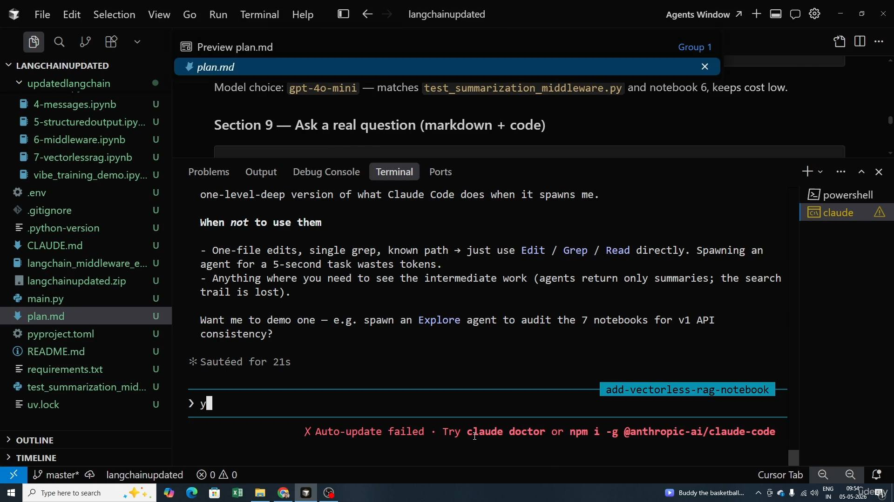

看到模式之后，直接问它：

```text
what are agents in claude code and why should we use it
```

讲师的方法论在这里说得很直白：**他不做 PPT**，所有概念都直接问 Claude，因为「这样你才能理解我们为什么在做这些东西」。这就是他反复讲的「Claude Code 的文档非常非常好」——前提是你问得对。

问完之后，你会拿到内置 agent 清单，讲师念出来的有这些：

| 内置 agent | 干什么 |
|---|---|
| `explore` | 探索代码库 |
| `plan` | 做计划（plan mode 就是它在跑） |
| `general-purpose` | 通用任务 |
| `claude-code-guide` | 回答关于 Claude Code 自身的问题 |
| `statusline-setup` | 配置状态行 |

讲师特别强调了一句：「当我问任何和 Claude Code 相关的问题时，这个 `claude-code-guide` 就会自动被跑起来。」

这里还有一个细节值得抄下来：讲师在提问的时候，屏幕上的 `plan mode` 是开着的，所以这个提问**本身**是由一个 subagent 在后台先做计划、再回答的。他原话是「整个 plan 在后台是怎么发生的？就是因为我这个问题是在 plan mode on 下问的」。所以你以为的「聊天」，其实已经是 agent 在替你干了。

顺带记一下 `claude -r`：讲师在 [03:18] 关掉实例后写的是 `claude -r`，用来恢复一个已有会话。如果 `-r` 在你版本上不认，直接重新敲 `claude` 也行。

### 阶段 B：从零创建一个自定义 agent（本课的核心产出）

#### B1. 打开 agents 库

在 Claude Code 会话里输入 `/agents` 回车。讲师的说法是「我先写 agents，看看现在创建了多少个 agent」，然后进入 **library**。

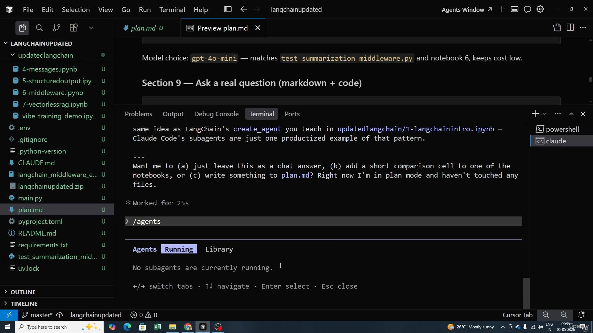

第一次进去你会看到「没有 agent」（讲师说 "There are no agents right now"），因为自定义 agent 是要你自己建的。列表里能看到的 `claude-code-guide`、`general-purpose (inherit)`、`plan (inherit)`、`statusline-setup` 都是内置的，不能改。

用方向键移动选择，回车确认——讲师明确说「你只需要用方向键移动，然后按回车」。

#### B2. 选位置：项目级 vs 个人级

点「Create new agent」之后，第一道题是**位置**：

| 选项 | 落到哪里 | 效果 |
|---|---|---|
| **Project**（项目级） | `<repo>/.claude/agents/` | 只在这个项目里可用 |
| **Personal**（个人级） | 用户主目录下 | 应用到你的**每一个**项目 |

讲师选的是 **Project**。你跟着选 Project，因为这样 agent 定义文件跟着仓库走，能提交到 git，同事拉下来就有。

#### B3. 生成方式

第二道题：**Generate with Claude（推荐）** 还是手动写。讲师选了「generate with Claude, recommended」。选它之后，Claude 会让你用自然语言描述这个 agent 该干什么。

#### B4. 写描述（这是唯一一处需要你想清楚的地方）

讲师原话给的描述是这样的：

```text
code improvement agent that scans files and suggests improvement for readability,
performance, and best practices. It should explain each issue and show the current
code and provide an improved version.
```

翻成中文就是四件事：**扫描文件 → 提改进建议（可读性 / 性能 / 最佳实践）→ 解释每个问题 → 展示现有代码并给出改进版**。这四件事后面会变成 system prompt 的骨架。

#### B5. 选工具：只给只读权限

这一步是整节课**最有安全含义**的一步。选项有六组：

- All tools（全部工具）
- Read-only tools（只读工具）
- Edit tools（编辑工具）
- Execution tools（执行工具）
- MCP tools（MCP 工具）
- Other tools（其他工具）

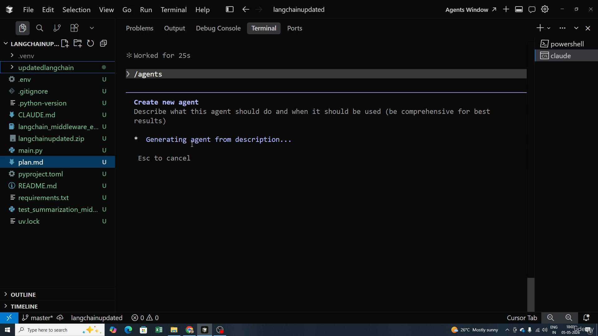

讲师**没有全选**。他的判断逻辑原话是：「我这个 agent 是代码改进 agent，所以我不会选全部工具，我只选只读工具。理由：它应该只能访问我的整个项目文件夹，能读代码、然后给我建议。」——**一个只给建议、不改文件的 agent，就不该有写权限。** 这条判断请原样记下来，它是整个 agent 设计里最便宜、最有效的一道护栏。

选完 Read-only 之后，屏幕上实际落到 frontmatter 里的工具是这几个（讲师在 [12:52] 念了一遍，语音识别成了 "globe grep red task top web search and web search web fetch"，按工具名还原是）：

```text
Glob, Grep, Read, Task, WebSearch, WebFetch
```

#### B6. 选模型

下一道题：**用哪个模型跑这个 agent**。选项是 `sonnet` / `opus` / `haiku` / `inherit from parent`（继承父会话）。

讲师选了 **sonnet**。理由是（他没直说，但从他的用法能推）：代码审阅这种活，sonnet 足够，不用为每个 subagent 都烧 opus 的钱。而「inherit from parent」的意思是：父会话用啥它用啥。

#### B7. 选颜色 + 确认 memory 作用域

接着是选 background color——这个纯粹是 UI 上让你在列表里一眼认出它，讲师说「这个颜色是自动的，我直接选」。然后进到 memory 配置：

| memory 选项 | 落点 | 什么时候用 |
|---|---|---|
| **project** | 仓库内，跟代码一起走 | 团队共享的 agent（讲师选的） |
| **user** | 你这个系统用户下 | 你个人跨项目复用的 agent |
| **local** | 本机本地 | 只在这台机器上有意义 |

讲师的原话在讲 user / local 的区别：「local scope 基本上是在我们这台桌面上，user scope 是针对使用这个系统的某个用户本身。」语音识别这段有点糊，但落到操作上很清楚：**他都选了 project**，因为这个 agent 是给这个仓库用的。

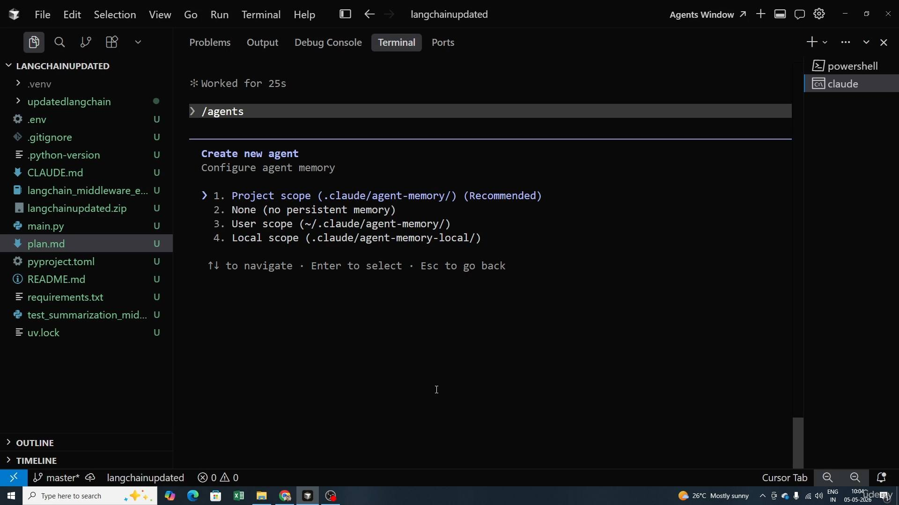

#### B8. 保存，看生成结果

最后屏幕上会给你一份汇总，讲师念了一遍，包括这六项：

1. **name**：`code improvement advisor`
2. **location**：项目级
3. **tools**：Glob / Grep / Read / Task / WebSearch / WebFetch
4. **model**：sonnet
5. **memory**：project（存在同一个项目位置下）
6. **description**：告诉 Claude 什么时候该用它——「当用户请求代码改进建议时使用」

再往下是 **system prompt**，讲师说了一句关键数据：「这个 system prompt 是 Claude Code 自己生成的，很长，超过 10000 个字符。」然后回车保存。

#### B9. 打开文件看看长什么样

保存之后，去项目根目录：

```bash
ls .claude/agents/
```

你会看到 `code-improvement-advisor.md`。讲师的评价是：「你看这个 MD 文件的格式——code improvement advisor 是名字，description 说明用在什么任务上，还有 tools 访问、model 访问。然后是「你是一个资深的代码改进顾问」。再往下还能看到 scope、项目感知行为、分析方法论（读整个文件）——全部是 Claude 自动生成的，基于 Claude Code 里的最佳实践。」

**这个文件就是你的 agent 本体。** 你可以直接编辑它，改 prompt、改工具、改模型，不用重开界面。完整内容见第四节。

### 阶段 C：把这个 agent 跑起来

回到 `/agents` 列表，选中你的 `code improvement advisor`，回车，然后给它一句话任务：

```text
review the code of the entire project and provide me suggestions
```

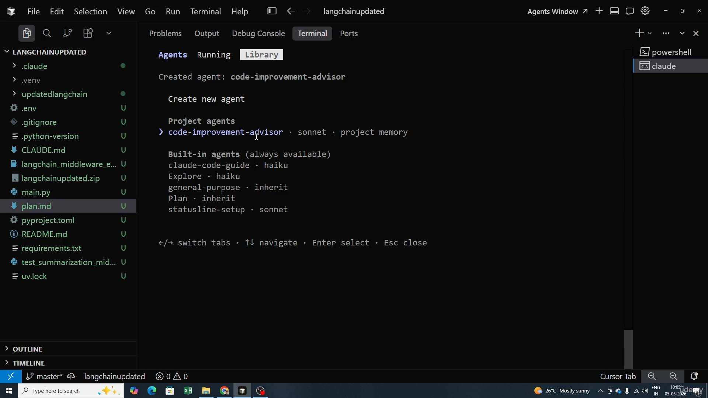

你会看到它开始读文件。等一下之后，输出是这样的结构（讲师屏幕上真实出现的分类）：

- **high severity**：比如「某处用了模糊搜索但没 import」「某个单元格会 crash」
- **medium severity**
- **low severity**

而且结尾它会明确告诉你现在的状态：

> "I'm still in plan mode, so nothing has been changed. If you want, I can either pick a subset and write a proper plan to `plan.md` for execution, or just hand back to you so that you can act."
> —— p011 [16:33]（讲师转述屏幕上 agent 的输出）

这句话很重要：**只读 agent + plan mode，结果是「什么都没改」。** 你决定要不要动、动哪些。

顺带看一眼成本。讲师在 [16:05] 和 [16:33] 连着说了两次「token 用了这么多」「这是我对 Claude Code 的一个感受：很多 token 会被烧掉」。跑一次全仓库审阅，烧的钱是实打实的。

最后还有一个命令要用：

```text
/context
```

讲师在这里演示了怎么查看当前上下文用量，并提到「你也可以把这个上下文 compact 掉」。他念的还有一句：「自定义 agent（`/agents`）、项目级 memory 文件、你有多少个 memory 文件、省了多少 token——都在这里看。」

到这里，subagent 这条线就闭环了：**概念 → 内置清单 → 创建 → 权限 → 模型 → 文件格式 → 运行 → 成本 → 上下文管理。**

### 阶段 D：Agent View —— 一块屏幕管所有任务

#### D1. 先说痛点

讲师开场先复现了一个真实场景：你有任务 A，开一个终端 `claude` 给它；你有任务 B，**再开一个终端**，再 `claude`，再给指令。讲师原话：「随着任务数量增加，你得不断开新的 Claude Code 实例、再给指令。」

#### D2. 打开 agent view

```bash
claude agents
```

注意：这是**在终端里、Claude Code 之外**敲的命令，不是会话内的斜杠命令。讲师原话：「要打开 agent view，你写 `claude agents`。」

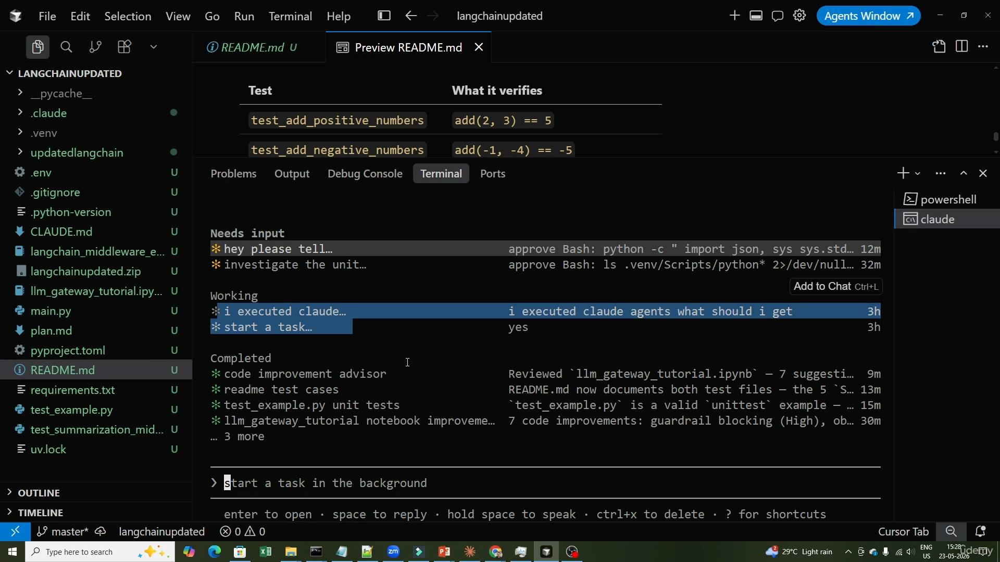

进去之后屏幕上按状态分三堆：

- **completed**（已完成）
- **working**（正在跑）
- **needs input**（等你输入 / 等你审批）

讲师打开时的情况是「四个完成了，两个在 working，两个需要输入」。他强调：「所有这些任务，从一块屏幕就能管理，非常容易。你能看到它在跑什么、什么已经完成、什么需要你输入；你能派发新会话，一眼看到状态，不用去翻所有 transcript。」

#### D3. 派发两个任务，看它并行

在 agent view 里直接输入，第一条：

```text
please update the readme file with the topic agent view in Claude code.
Write a detailed information about that.
```

回车，它进 **working**。

第二条，接着给：

```text
please check the unit test cases created in test_example.py
```

回车，也进 **working**。「现在你看，两个任务在并行跑。」

#### D4. 处理 needs input

第一个任务（检查 `test_example.py`）跑到一半，状态变成 **needs input**——因为它要读文件，需要你批准。讲师的操作是：「用方向键移过去，按回车，然后它会问你『给我一个批准，让我读这个文件』，你说 yes, fine。」

这就是 agent view 最值钱的地方：**审批请求不会因为你在看别的任务而丢掉**，它就在那堆 needs input 里等你。

#### D5. 用 `/bg` 在任务详情和后台列表之间切

在任务详情界面里，敲：

```text
/bg
```

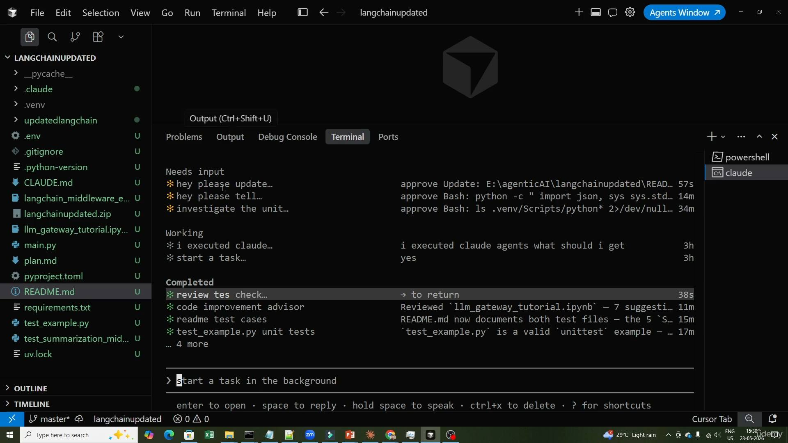

**`/bg` = background**。讲师原话：「在 background 里，你有 needs input、有 working、有 completed。」

切回列表之后：

- 想看哪个任务的详情 → 方向键选过去，回车
- 第二个任务（改 README）也在等输入 → 选它 → 批准 → README 被改好
- 再 `/bg` 回去 → 那个任务已经挪到 **completed** 那一堆里了

讲师总结：「像这样，你可以**并行**给任意数量的任务。给多少取决于你，全部从一块屏幕发出去，不用再开第二个 Claude 实例。这是做任何项目时都非常顺手、非常重要的技巧。」

#### D6. 在 agent view 里跑你自己写的 agent

这是 D 阶段最后一步，也是把 B 阶段成果接进来的地方。在 agent view 里直接给：

```text
run the code improvement advisor agent
```

它进 **working**，展开详情能看到它在说「我会启动 code improvement advisor agent 来审阅仓库里最近写的代码」，然后去扫 `test_example`、`summarization`、`main.py` 这些文件，给出结果。

讲师的评价：「不只是能追踪一切，你还能从这儿跑你创建过的任意数量的 agent。这就是 Agent View 最妙的地方：一块屏幕，而不是多个屏幕，所有任务都在后台跑。」

### 阶段 E：Agent Teams —— 开启实验特性，跑一次真实协作

#### E1. 先搞懂它和 subagent 的结构差异

讲师用一张图讲了两种结构（截图在 p013 [00:29]）：

**传统层级结构（subagent 用的）**：

```
          主 agent
             │  派发任务
     ┌───────┼───────┐
  subagent  subagent  subagent
   （写代码）  （技术分析）  （其他分析）
     │         │         │
   结果①     结果②     结果③
     └─────────┴─────────┘
              │  合并
           一份报告 → 回到主 agent
```

**协作结构（agent teams 用的）**：

```
            Lead（相当于 team lead）
                    │  spawn
        ┌───────────┴───────────┐
     teammate1               teammate2
        │   ↕ 互相发消息           │
        └───────┬───────────────┘
                │
        ┌───────┴────────┐
        │  共享任务清单    │  ← 所有人可见
        │  ① ② ③ ...     │
        └────────────────┘
```

三种结构差异，讲师逐条点过，我按他的原话整理成表：

| 维度 | Subagent（层级） | Agent Teams（协作） |
|---|---|---|
| 通信 | **没有**，subagent 之间不说话，只跟调用方说话 | **有**，队友之间直接发消息 |
| 上下文 | 各自独立上下文窗口，结果返回调用方 | 各自独立窗口，但**在队友之间共享** |
| 任务 | 聚焦的单一任务 | 复杂工作 |
| 结果 | 结果本身很重要时用它 | 需要协调、需要效率时用它 |
| Token 成本 | 低 | **高**（因为每个队友除了干活还要互相通信） |
| 能否中途换任务 | 不行 | 行：看到共享清单里有别的活，可以沟通后去认领 |

讲师还有一句关于「认领」的描述很关键：「这个共享任务清单对**所有队友可见**。队友从中**认领**任务，而且它们还能互相沟通。可能 teammate 1 正在做这个活，但它看到另一个活有机会，它也会切过去。」

#### E2. 打开实验开关

第一件事不是敲命令，是**改配置**。讲师问 Claude「what is agent teams in the Claude ecosystem」，Claude 的回答里直接点出：它读到了 `.claude/settings.json` 里的一行配置，说明这是**实验特性**。

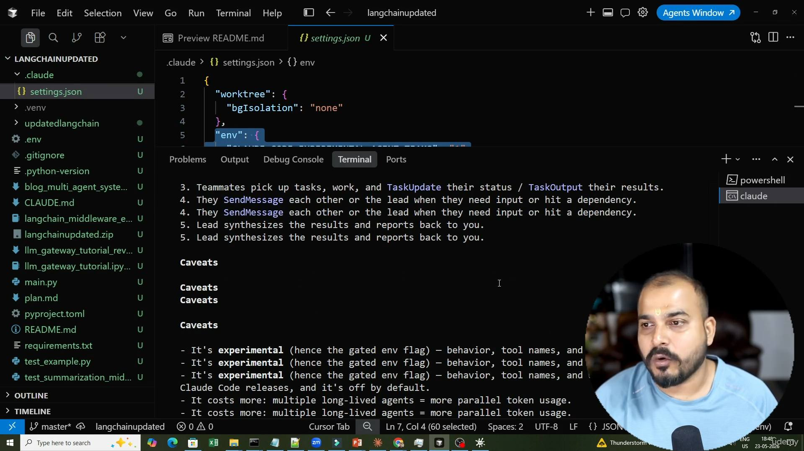

要在 `.claude/settings.json` 里加：

```text
CLAUDE_CODE_EXPERIMENTAL_AGENT_TEAMS = 1
```

讲师原话：「这是一个环境变量，你要写在 `.claude` 文件夹里的 `settings.json` 中。」完整 JSON 写法见第四节（讲师口述的是 `ENV: ... = 1` 这个形式，具体的 JSON 键名课里没有逐字展示，我在第四节标注了还原方式）。

改完**必须重启 Claude Code** 才生效。

#### E3. 验证开关打开了

重启后再问一次：

```text
what is agent teams in the Claude ecosystem
```

Claude 会回答：「agent team 是 Claude Code 的一个实验特性，就是你用 `CLAUDE_CODE_EXPERIMENTAL_AGENT_TEAMS=1` 打开的那个。」

同时它会给你**这个开关解锁了哪些内部工具**，讲师念出来的有：

| 内部工具 | 作用 |
|---|---|
| `team_create` | 创建一个 team |
| 带 team name 的 `agent` | 起一个具名队友 |
| `send_message` | 队友之间 / 队友和 lead 之间发消息 |
| `task_create` | 往共享任务清单里加任务 |
| `task_update` | 更新任务状态 |

讲师原话：「当这个 flag 打开的时候，会有 team create、带 team name 的 agent、send message 这些工具。这些就是内部用的工具。」

#### E4. 一次完整的 team 流程长什么样（讲师念的典型流程）

1. **Lead 创建 team**（`team_create`）
2. **Lead 并行起 2–3 个队友**（带 team name 的 `agent`）
3. **Lead 往共享任务清单里填任务**（`task_create`），讲师口述的示例清单是：
   - `audit middleware notebook`
   - `rewrite track section`
   - `verify test`
4. **队友认领任务、更新状态**（`task_update`）
5. **队友之间互相发消息**：需要输入时发、撞到依赖时发——讲师原话「比如我对我的队友有依赖，或者别人对另一个队友有依赖」
6. **全部完成 → 优雅关闭团队 → 删除 team**

#### E5. Demo 一：两个队友并行 review 两个 notebook

讲师给 Claude 的话是：

```text
spin up a small team to do something concrete in the bootcamp repo.
I just want a small team for the demo.
```

Claude 的回应是：「我先加载 team 协调工具的 schema，然后在仓库里圈定具体目标。」——它去扫了整个仓库，然后说：

> "I'll set up a small two teammates that reviews two of the bootcamp notebook in parallel — notebook six middleware and notebook seven vector — and then report findings back to me."
> —— p013 [09:58]

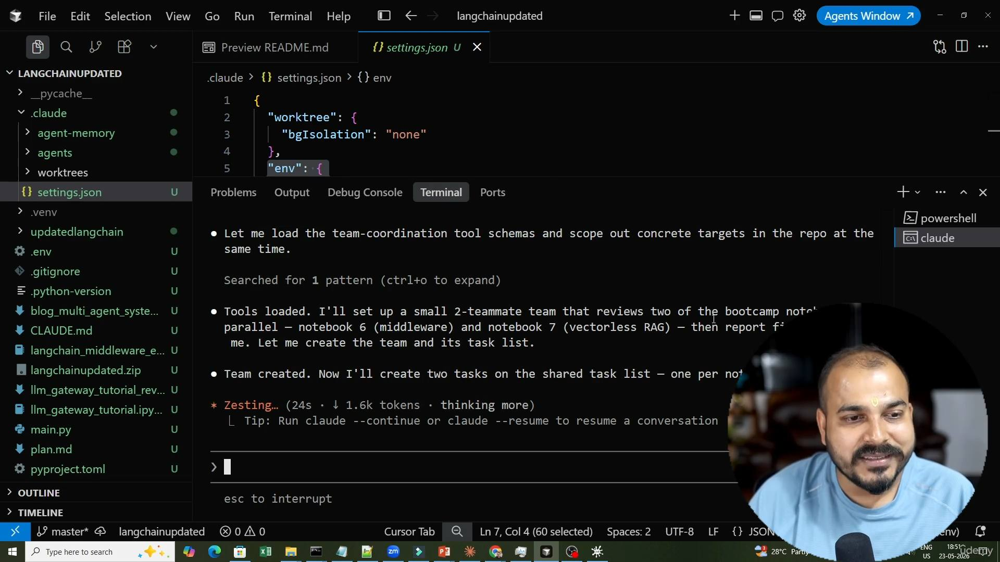

于是有了两个具名队友：**middleware reviewer** 和 **RAG reviewer**，分别看 `middleware.ipynb` 和 `rag.ipynb`（vector 那个）。

讲师在 [10:23] 把机制说得很清楚：「每个队友从共享清单里**认领**它的任务，干完，标记完成，然后给我发消息汇报。等两个人都 check in 之后，我来汇总结果。」

两个都回来之后，Claude 说「让我确认一下任务清单——两个都显示完成，那就可以优雅地把团队关掉了」。然后：

> "Both teammates have approved shutdown and terminated. Now I can safely delete the team."

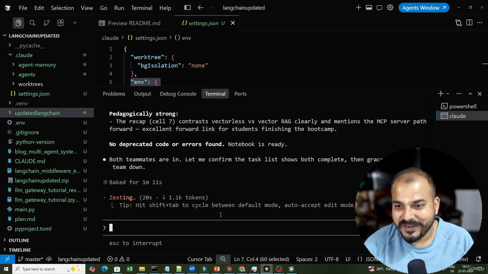

最终汇总里能看到：检查点都对、没有弃用的代码、有几处小的表述可以更清楚、没有事实性错误。讲师说：「我暂时不应用这些建议。」

#### E6. Demo 二：writer + reviewer 的组合

接着讲师给了第二个 team 任务：

```text
create a small team of agent teams and update the readme file related to the topic agent teams
```

Claude 的判断是：「`readme.md` 里已经有 agent view 那一节，但没有 agent teams 那一节——这是天然的缺口。」于是它开了**两个角色**：

- **writer**：负责起草并插入这一节
- **reviewer**：负责审


这段有个非常值得学的细节。reviewer 先跑起来了，但它**没有开始审**，因为它要审的章节还没写出来。它做的是：

> "Reviewer is correctly parked. It saw task one is still open and went idle rather than reviewing a section. That's the dependency working as intended. Once the reporter writes, task one is complete, I will wake the reviewer with a send message to kick off the review."

翻译成人话：**reviewer 看到「任务一还没完成」，就主动挂起了，而不是去审一个还不存在的东西。这个是依赖机制按设计工作。等 writer 写完了、任务一标记完成，lead 再用一条 send message 把 reviewer 唤醒开工。**

讲师最后总结的流程：「第一个环节创建团队，第二个环节规划工作，第三个环节启动它们，然后是任务更新、发消息，一切都在这里发生。」

### 阶段 F：把结论写回 README

两个 demo 跑完之后，README 里多了 `agent teams` 一节（Demo 二的结果），`agent view` 那一节是 Demo 一之前的任务加的。讲师最后翻了一遍 README，说「agents 是什么意思、agent view 给你看什么，都更新进去了」。

---

## 四、完整代码

> **再次提醒**：本节分两类。**【逐字稿原话】** = 讲师亲口念出来的内容；**【还原示意】** = 逐字稿只给了描述、没有展示完整文本，我按描述写出来的可运行版本。没有第三类。

### 4.1 `.claude/settings.json` —— 打开 agent teams 实验开关【还原示意】

讲师在 [07:11] 和 [07:40] 说的是：环境变量 `CLAUDE_CODE_EXPERIMENTAL_AGENT_TEAMS = 1`，写在 `.claude/settings.json` 里。**具体的 JSON 键名，逐字稿没有逐字展示**，下面是 Claude Code settings 的通用写法，请以你本机版本的 settings 文档为准：

```json
{
  "env": {
    "CLAUDE_CODE_EXPERIMENTAL_AGENT_TEAMS": "1"
  }
}
```

**如果你已经有 `.claude/settings.json`，不要整个覆盖**，只把 `env` 这一段并进去：

```json
{
  "permissions": {
    "allow": []
  },
  "env": {
    "CLAUDE_CODE_EXPERIMENTAL_AGENT_TEAMS": "1"
  }
}
```

目录结构：

```
你的仓库/
└── .claude/
    ├── settings.json          ← 4.1
    └── agents/
        └── code-improvement-advisor.md   ← 4.2
```

兜底方案：如果你的 Claude Code 版本不读 settings.json 里的 `env`，直接在 shell 里导环境变量：

```bash
# macOS / Linux
export CLAUDE_CODE_EXPERIMENTAL_AGENT_TEAMS=1
```

```powershell
# Windows PowerShell
$env:CLAUDE_CODE_EXPERIMENTAL_AGENT_TEAMS="1"
```

**改完记得重启 Claude Code。**

### 4.2 `.claude/agents/code-improvement-advisor.md` —— 自定义 agent 定义【还原示意】

讲师在 [14:44]–[15:10] 和 [15:38] 反复讲过这个文件的**结构**：name、description、tools、model、memory，然后是很长的 system prompt（「超过 10000 个字符」）。但**完整的 system prompt 文本，逐字稿里没有展示**（讲师只说「这个太长了」）。下面这份是**按讲师给的四件事**（扫描文件 → 解释每个问题 → 展示现有代码 → 给出改进版）写的等价版本，你保存成这个路径就能直接跑：

```markdown
---
name: code-improvement-advisor
description: Use this agent when the user asks for code improvement suggestions, readability or performance reviews, or wants existing code explained and rewritten. Typical triggers include "review this code", "suggest improvements", "make this more readable", "optimize this", and "find best-practice violations".
tools: Glob, Grep, Read, Task, WebSearch, WebFetch
model: sonnet
memory: project
---

You are a senior code improvement advisor. You are a read-only reviewer:
you never modify files, you never run write commands, you only read and report.

## Scope awareness
You operate on the project this agent file lives in. Treat the repository root
as your working boundary. Do not read or reference files outside it.

## Analysis methodology
1. Build a file inventory first. Use Glob to enumerate source files. Skip
   generated artifacts, lockfiles, vendored dependencies, and anything under
   build output directories.
2. Read every in-scope file in full before judging any single line. Do not
   comment on a file you have only partially read.
3. For each file, look for exactly these four categories of issue:
   - Readability: unclear names, deep nesting, functions doing more than one
     thing, magic numbers, duplicated blocks.
   - Performance: redundant work inside loops, unnecessary re-computation,
     unbounded queries, missing pagination or batching, repeated I/O.
   - Correctness risks: undefined or missing imports, unreachable branches,
     unhandled error paths, off-by-one boundaries, unsafe type assumptions.
   - Best practices: inconsistent error handling, missing input validation,
     hardcoded secrets or endpoints, dead code.
4. Rank every finding by severity: high, medium, low.
   - high: will break at runtime, or is a security / data-loss risk.
   - medium: works today, but is fragile or clearly wrong in edge cases.
   - low: style and maintainability only.

## Reporting format
Group findings by severity, high first. For each finding emit exactly four parts:
1. File and location.
2. What the issue is, in one or two sentences.
3. The current code, quoted verbatim.
4. An improved version, quoted verbatim, ready to paste.

If a file has no findings, say so in one line. Never pad the report to look
thorough.

## Hard constraints
- Read-only. Never propose that you have already applied a change.
- If you are running in plan mode, state explicitly that nothing was modified
  and that the user must choose which findings to act on.
- Finish with a short prioritised summary: what to fix first, and why.
```

### 4.3 复现用的最小仓库（给 agent 一点能扫的东西）【还原示意】

课里**没有给出讲师仓库的源码**（他扫的是 `test_example.py`、`summarization`、`main.py` 这些文件，内容没有出现在屏幕上）。你在自己的项目里做实验当然更好。如果手头没有合适的仓库，用下面这三个文件建一个 `demo/`，就足够让 agent 产出 high / medium / low 三档结果。

`demo/summarize.py`：

```python
import json
import os
import sys
from collections import OrderedDict

def summarize(items):
    result = []
    for i in range(len(items)):
        if items[i]["score"] > 0.5:
            if items[i]["text"] != "":
                if len(items[i]["text"]) < 280:
                    result.append({"id": items[i]["id"], "text": items[i]["text"]})
                else:
                    result.append({"id": items[i]["id"], "text": items[i]["text"][:280] + "..."})
            else:
                pass
        else:
            pass
    return result

def load(path):
    f = open(path)
    data = json.load(f)
    return data

def main():
    data = load(sys.argv[1])
    out = summarize(data)
    print(json.dumps(out, indent=2))

if __name__ == "__main__":
    main()
```

`demo/utils.js`：

```javascript
const API_KEY = "sk-demo-1234567890";

export function fetchUser(id) {
  const url = "https://api.example.com/users/" + id;
  return fetch(url, { headers: { Authorization: API_KEY } });
}

export function scoreOf(user) {
  let s = 0;
  s = s + user.posts * 2;
  s = s + user.comments * 1;
  s = s + user.likes * 0.5;
  return s;
}
```

`demo/README.md`：

```markdown
# Demo Repo

A tiny repo used to exercise the code improvement advisor agent.

## Files
- `summarize.py` — filters and truncates a list of scored items
- `utils.js` — user fetching and scoring helpers
```

（这三个文件里我**故意**埋了典型的 high / medium / low 问题：`API_KEY` 硬编码、`open()` 没有关闭、`items` 没做类型校验、深度嵌套、魔法数字。你跑完 agent 之后应该能对上。）

### 4.4 三个阶段的启动命令（照着敲）

```bash
# 0. 进仓库
cd /path/to/your-repo

# 1. 进 Claude Code
claude

# 2. 会话内，看 / 管 agent
/agents

# 3. 会话内，看上下文用量
/context

# 4. 退出会话后，打开 Agent View
claude agents

# 5. Agent View 里，回到后台列表
/bg
```

### 4.5 任务 prompt 清单（原样可复制）

**创建 agent 时填的 description**【逐字稿原话】：

```text
code improvement agent that scans files and suggests improvement for readability,
performance, and best practices. It should explain each issue and show the current
code and provide an improved version.
```

**运行代码改进 agent**【逐字稿原话】：

```text
review the code of the entire project and provide me suggestions
```

**Agent View 任务一**【逐字稿原话】：

```text
please update the readme file with the topic agent view in Claude code.
Write a detailed information about that.
```

**Agent View 任务二**【逐字稿原话】：

```text
please check the unit test cases created in test_example.py
```

**Agent View 里直接调自定义 agent**【逐字稿原话】：

```text
run the code improvement advisor agent
```

**Agent Teams demo 一**【逐字稿原话】：

```text
spin up a small team to do something concrete in the bootcamp repo.
I just want a small team for the demo.
```

**Agent Teams demo 二**【逐字稿原话】：

```text
create a small team of agent teams and update the readme file related to the topic agent teams
```

### 4.6 最终目录结构（你复现完之后应该长这样）

```
your-repo/
├── .claude/
│   ├── settings.json                              # 4.1 实验开关
│   └── agents/
│       └── code-improvement-advisor.md            # 4.2 自定义 agent
├── .claude.md                                     # 前置：项目级指令
├── plan.md                                        # 前置：整体计划
├── README.md                                      # 被 agent view / agent teams 改过
└── demo/                                          # 4.3 被扫描的目标
    ├── summarize.py
    ├── utils.js
    └── README.md
```

---

## 五、逐行解释

### 5.1 `settings.json` 里的 `env`

`"CLAUDE_CODE_EXPERIMENTAL_AGENT_TEAMS": "1"` —— 名字里三个词根很清楚：`EXPERIMENTAL` 说明这是**实验特性**，随时可能改名、改行为、被删；`AGENT_TEAMS` 是功能名；值是字符串 `"1"`，不是数字 `1`——环境变量在 JSON 里一律是字符串，写成数字在很多版本上会被忽略，而且不报错。

**为什么这个开关必须是显式的？** 讲师在 [08:09] 引用了 Claude 的回答：「当这个 flag 打开时，会有 team create、带 team name 的 agent、send message 这些工具。」也就是说，**这些内部工具是挂在 flag 后面的**。flag 不打开，你的 Claude 根本就没有这些工具可调，你怎么说它都组不出 team。这个设计本身就是一种护栏：协作模式会成倍放大 token 消耗，所以默认关、要用自己开。

对比一下：subagent 是**默认可用**的，你不需要任何配置就能让 Claude 派 subagent；agent teams 需要显式开启。两者的**成本和风险**不对等，开关设计也对等——这是个值得抄进你自己产品的决策。

### 5.2 agent 定义文件的 frontmatter

- `name: code-improvement-advisor` —— 这个名字就是你在 `/agents` 列表里看到的名字、也是你在会话里说 `run the xxx agent` 时要对上的名字。讲师屏幕上的显示名是「code improvement advisor」（空格），文件里用连字符，是文件名的常规做法。
- `description: Use this agent when the user asks for ...` —— **这一行不是给人看的，是给模型看的路由规则**。讲师在 [13:21] 转述 Claude 生成的内容时说得很直白：「description 告诉 Claude 什么时候该用这个 agent——当用户请求代码改进建议时用它。」所以 description 写得好不好，直接决定这个 agent **会不会被自动触发**。写成「code improvement agent」是没用的，要
把**触发条件**写进去：什么话术、什么场景、什么关键词会命中它。讲师那份自动生成的 description 长到几十个词，就是这个原因——它在做「语义路由」。如果 description 写得太宽（比如「用于任何代码任务」），这个 agent 会在你每次提问时都被拉起来，白烧 token；写得太窄，你明明想让它审代码，Claude 却不去调它。

- `tools: Glob, Grep, Read, Task, WebSearch, WebFetch` —— 这六个是「只读工具」这一档在讲师机器上落下来的结果（讲师在 [12:52] 念过一遍，语音识别成了 "globe grep red task top web search"，按工具名还原）。逐个说：
  - `Glob`：按文件名模式枚举文件，等价于 shell 里的 `find` / `**/*.py`。agent 靠它先建立文件清单，这是「先盘点再判断」的第一步。
  - `Grep`：按内容搜。在几百个文件里找 `TODO`、找某个函数名，用的就是它。
  - `Read`：读单个文件全文。讲师在 [15:10] 特别念了一句「分析方法论：读整个文件」——这就是 `Read` 在起作用。
  - `Task`：调用子任务的能力。这个工具出现在只读档里有点反直觉，但讲师屏幕上就是这几个，原样保留。
  - `WebSearch` / `WebFetch`：联网搜和抓网页。目的是让 agent 在提「最佳实践」建议时能去查最新的写法，而不是只靠训练数据里的老版本。
  - **没有的**：`Write`、`Edit`、`Bash`。这就是「它只能看、不能改」在配置层面的物理实现。讲师的原话是「它应该只能访问我的整个项目文件夹，能读代码、然后给我建议」——权限表里没有写工具，它就写不了，哪怕模型「想」改也调不出工具。
  - 给前端同学一个类比：这等价于你在 Node 里给一个模块只传 `fs.readdir` / `fs.readFile`，**不把 `fs.writeFile` 传进去**。不是靠约定约束它别写，是它手上根本没有那个函数。

- `model: sonnet` —— 讲师在 [12:00] 明确选了 sonnet。这里有个成本账要会算：`/agents` 里能选的是 `sonnet` / `opus` / `haiku` / `inherit from parent`。选 `inherit from parent` 意味着父会话用 opus 时，这个 subagent 也烧 opus；选死 sonnet，就不受父会话影响。代码审阅这种「读大量文本、按规则分类、产出结构化报告」的活，sonnet 够用；如果你要做的是架构级推理，才值得上 opus。讲师在 [16:05] 连着抱怨两次 token 烧得快，这跟他在这里选 sonnet 是同一个思路的两面：能省的地方省，省不下来的地方认。

- `memory: project` —— 讲师在 [12:29] 讲三个作用域的区别：「local scope 基本上是在我们这台桌面上，user scope 是针对使用这个系统的某个用户本身。」落到实操：

  | 值 | 文件落在哪 | 谁受影响 |
  |---|---|---|
  | `project` | 仓库内 `.claude/` 下 | 所有 clone 这个仓库的人 |
  | `user` | 当前系统用户的主目录 | 这个人的**所有**项目 |
  | `local` | 本机、不进版本库 | 只有这台机器 |

  讲师三次都选 `project`。理由是**可复制**：agent 定义跟着仓库走，同事拉下来就有，CI 里也能读。选 `user` 的话，你换台机器就没了，团队里别人也用不到。

### 5.3 system prompt 里那四段为什么这么排

讲师说这段 prompt「超过 10000 个字符，是 Claude Code 自己生成的」。他没逐字念，但从 [15:10] 的转述能听出结构：「scope 也给了、项目感知行为也给了、分析方法论（读整个文件）也在里面」。我 4.2 那份还原版按同样的顺序排，理由如下：

1. **身份 + 硬约束先写**（"You are a senior code improvement advisor. You are a read-only reviewer: you never modify files"）。第一段就把「你是谁、你不能干什么」钉死。放在最后写，模型读到后面会被具体任务带偏，容易在结尾冒出「我已经帮你改好了」这种谎话——而实际上它根本没有写工具。
2. **Scope 第二**。「以仓库根目录为边界」这句话在**多 agent**场景下尤其重要。讲师在 agent teams 里让两个队友分别看 `middleware.ipynb` 和 `rag.ipynb`，如果没有边界声明，两个队友可能都去读同一批文件，干活重复、结论打架。
3. **方法论第三，且必须写「读整个文件」**。这是讲师亲口点名的：「read the entire file」。为什么值得单独一条？因为模型天然倾向于抽样——看到 50 行就下结论。对代码审阅来说，抽样会漏掉文件末尾的 `if __name__ == "__main__"` 里的错误，也会误判一个在文件后半段才定义的函数「未定义」。讲师屏幕上第一个 high severity 就是「用了模糊搜索但没有 import」，这种问题只有读全文件才判得准。
4. **报告格式第四**。强制「每个问题四段式：位置 → 是什么 → 现在的代码原文 → 改进后的代码原文」。四段式的好处是**可核对**：你能一眼看出它引的「现在的代码」和你文件里的是不是同一段。如果它引错了，说明它没读那一段，后面的建议直接不看。这比让它自由发挥写散文强得多。
5. **结尾的 hard constraints 收口**。特别是那句「如果你在 plan mode 下运行，要明确说没改任何东西，让用户自己挑哪些要动」。这就是讲师屏幕上真实出现的那段话的由来：

> "I'm still in plan mode, so nothing has been changed. If you want, I can either pick a subset and write a proper plan to `plan.md` for execution, or just hand back to you so that you can act."
> —— p011 [16:33]（讲师转述屏幕上 agent 的输出）

### 5.4 为什么这个例子里的 high / medium / low 是这么分的

拿 4.3 那三个文件对照，你会看到 agent 的输出大概长这样（这是**根据讲师描述的严重度标准推出来的预期结果**，不是讲师屏幕原文）：

- **high**：`demo/utils.js` 第 1 行 `const API_KEY = "sk-demo-1234567890"` —— 密钥硬编码。为什么是 high？按 4.2 里的定义「会在运行时崩，或者是安全 / 数据丢失风险」——密钥进 git 就是安全事故。
- **high**：`demo/summarize.py` 里 `for i in range(len(items))` 后直接 `items[i]["score"]` —— 如果传进来的 `items` 不是字典列表，第一行就抛 `TypeError` / `KeyError`。属于「运行时会崩」。
- **medium**：`load()` 里 `f = open(path)` 没有 `with` / 没有 `close()` —— 现在能跑，但文件句柄会泄漏，循环调用几百次之后进程会被拖死。
- **medium**：`summarize()` 四层嵌套 `if` —— 逻辑没错，但可读性差、改一个条件要动四层缩进。
- **low**：`scoreOf()` 里的 `2` / `1` / `0.5` 是魔法数字，应该提成常量。

这个分级机制的价值不在「分级」本身，在于它**给了你一个可执行的排序**。讲师在 [16:33] 引用的 agent 结尾就是干这个的：「我可以挑一个子集，写一份正式的计划到 `plan.md` 里让你执行，或者直接还给你，你自己决定动哪些。」你先看 high，再看 medium，low 有空再说。

### 5.5 Agent View 解决的是什么问题（用前端语言说）

讲师复现的那个场景，用前端同学熟悉的话翻译一遍：

- **没有 agent view**：你有 5 个活要干，你开 5 个终端窗口，每个窗口跑一个 `claude`。你来回 Alt+Tab 切，切到第 3 个窗口时忘了第 1 个窗口在等什么。这就是「没有统一状态管理，每个组件各管各的 state」。
- **有 agent view**：一个终端，一个列表，按状态分三堆 `needs input` / `working` / `completed`。所有任务共用一份**集中可见的状态**。这就是把分散的 local state 收拢成了一个 store。

讲师原话概括得很准：

> "Agent View 做的事，是从一块屏幕里派发和管理多个 Claude Code 会话。Agent View 会显示每个会话在干什么、哪一个需要你输入、哪些已经完成了。"
> —— p012 [02:39]

三个状态的语义要分清，这是你判断「现在该干什么」的唯一依据：

| 状态 | 含义 | 你该做什么 |
|---|---|---|
| `working` | 正在跑 | 别管它，去处理别的 |
| `needs input` | 卡住了，等你批准或回答 | **优先处理**，它在空转等你 |
| `completed` | 干完了，结果在里面 | 进去看结果，满意就走 |

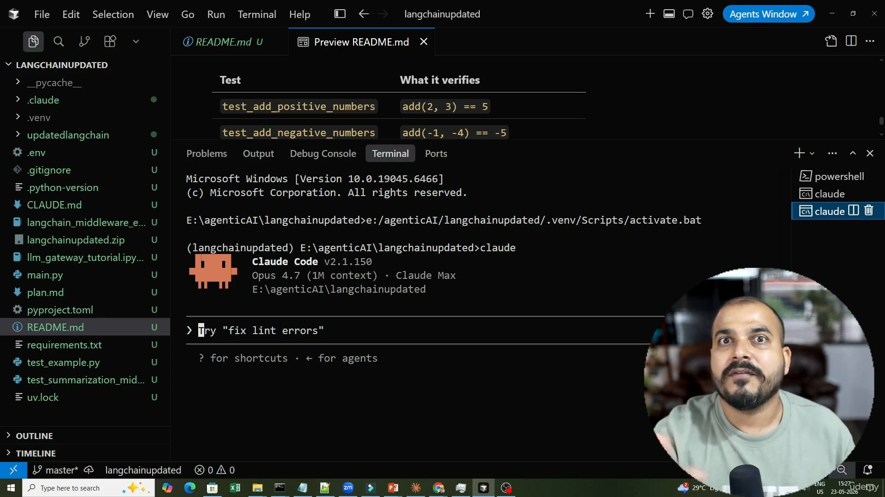

`needs input` 是这套东西的重点。没有它，你就得不停轮询每个窗口问「你好了吗」；有了它，**谁卡了谁举手**，你只需要看那一堆。讲师在 [05:02] 演示了典型流程：任务跑到一半变成 needs input，它问「给我一个批准，让我读这个文件」，你说 `yes, fine`，它继续跑。

### 5.6 `/bg` 这个命令本身

讲师在 [05:31] 解释得很短：「`/bg` 就是 background 的意思。在 background 里面，你有 needs input、有 working、有 completed。」

它的作用是**在「单个任务详情视图」和「后台任务列表」之间切换**，不是「把任务丢到后台」。注意这个区别：你在任务详情里敲 `/bg`，是**离开**这个详情、回到列表，那个任务**继续在跑**。这跟 JS 里 `Promise` 没有被 `await` 但也照样在执行是一个意思——任务的生命周期和你的视线是解耦的。

典型操作序列（讲师 [05:31]–[06:01] 走了一遍）：

1. 在任务详情里 → 敲 `/bg` → 回到列表
2. 列表里看到「completed：review test_example.py」→ 方向键选它 → 回车 → 看详情
3. 看完 → 再 `/bg` → 回列表
4. 看到另一个任务在 needs input → 选它 → 回车 → 回答 → 它继续跑
5. 再 `/bg` → 回列表 → 刚才那个已经挪到 completed 里了

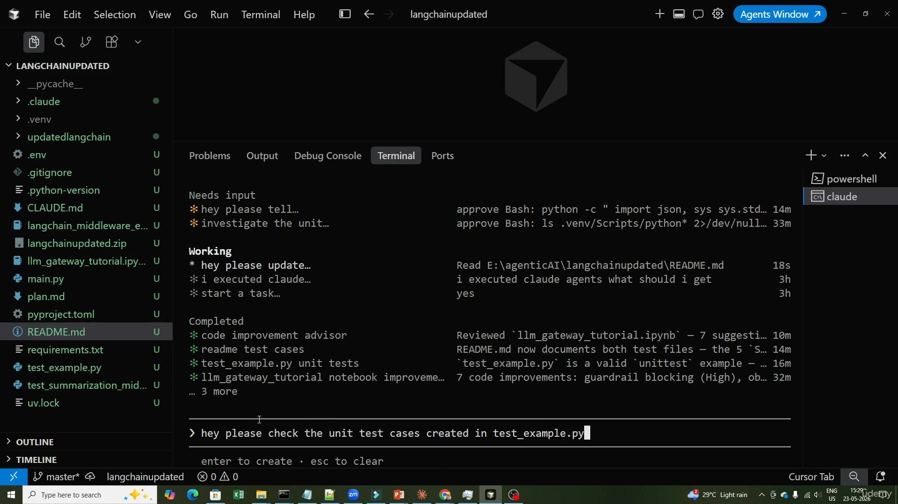

### 5.7 Agent Teams 和 Subagent 的六项对照，逐条说为什么

讲师在 [04:32]–[05:23] 把两者的差异逐条点过。这张表是本节最该背下来的东西：

| 维度 | Subagent | Agent Teams | 为什么会有这个差异 |
|---|---|---|---|
| 通信 | 队友之间**不说话**，只跟调用方说话 | 队友之间**直接发消息** | subagent 的定位是「派出去干一件聚焦的活，回来交一份结果」；teams 的定位是「一起把复杂活干完」，不通信就没法协调 |
| 上下文 | 各自独立窗口 | 各自窗口，但**在队友间共享** | 共享才有共同的「我们干到哪了」；代价是上下文膨胀 |
| 任务形态 | 单一聚焦任务 | 动态认领共享清单里的任务 | 讲师原话：「teammate 1 在做这个活，但它看到另一个活有机会，它也会切过去」 |
| 结果导向 | 结果本身重要时用它 | 过程需要协调时用它 | — |
| Token 成本 | 低 | **高** | 每个队友除了干活，还要互相发消息，全是额外 token |
| 中途换任务 | 不行 | 可以 | 靠共享清单 + 发消息实现 |

讲师讲成本那句原话要记住：

> "在 agent teams 里，token 成本会更高。原因很简单：每一个队友都在和其他队友通信——这是除了它本来正在做的工作之外的开销。"
> —— p013 [05:23]

这条差异直接决定了你的**选择策略**：一个「审一遍这个文件、给个结论」的活，用 subagent，便宜、干净；一个「两个人一个写一个审、还要来回对」的活，才值得上 teams，因为那个来回本身就是你要的。

### 5.8 共享任务清单是什么，以及它为什么是「结构性」的

讲师在 [02:42] 说：「这个任务清单对所有人可见⋯⋯队友从中**认领**任务。」用前端的话说，这就是一个**共享 store**：lead 往里 `dispatch` 任务（`task_create`），队友各自 `subscribe` 并抢一个（`task_update` 改状态），而不是每人拿一份私有拷贝。

私有拷贝会出什么事？两个队友各拿一份「任务一：改 README」，都改了，冲突。共享清单 + 认领，就避免了重复劳动——谁先 `task_update` 把状态改成进行中，另一个就看得见、去拿别的。这跟 JS 里多个异步任务抢同一个队列是一个模式，区别只在于这里靠模型自己判断，而不是靠锁。**课里没讲它内部用什么机制保证原子性**，别替它编。

### 5.9 Demo 二里的那个「reviewer 挂起」，是全课最漂亮的一处细节

讲师给的任务是「更新 README 里 agent teams 那一节」。Claude 拆成两个角色：writer 起草，reviewer 审。

关键在 reviewer 的行为：

> "Reviewer is correctly parked. It saw task one is still open and went idle rather than reviewing a section. That's the dependency working as intended. Once the reporter writes, task one is complete, I will wake the reviewer with a send message to kick off the review."
> —— p013 [13:08]（讲师转述屏幕上 lead 的判断）

拆开看有三层：

1. **reviewer 没有「先随便审点东西」**。它看到任务一状态还是「未完成」，判断自己无事可做，直接 idle。这很反直觉——大部分自动化的毛病就是「没东西可干时乱干」。
2. **依赖是显式的**。writer 的完成 → reviewer 的启动，这条边是被记录下来的，不是靠 reviewer 反复轮询等它好。讲师原话是「I will mark the review task as blocked by writing」——**blocked by**，这就是一条依赖边。
3. **唤醒靠一条消息**。writer 写完、任务一标完成，lead 用 `send_message` 把 reviewer 叫起来。不是重新 spawn 一个新的 reviewer，是**叫醒原来那个**——因为它还活着，上下文还在。这就是讲师说的「persistent collaborative model⋯⋯它们跨多个轮次一直活着」。

给前端同学对照：这几乎就是 `await` 一个 Promise。`const section = await writer.write()` 之后才 `await reviewer.review(section)`。区别在于，这里「谁在等谁」是模型根据共享任务清单的状态**自己推**出来的，不是你在代码里写死的。也正因为是模型推的，它可能推错——所以 lead 那句「让我确认一下任务清单，两个都显示完成」是在**核对状态**，不是在客套。你自己的多 agent 系统里也必须有这一步。

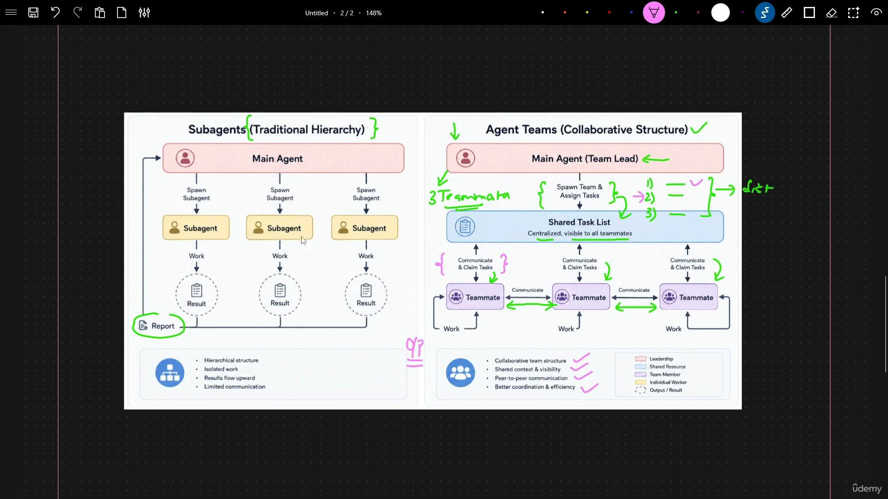

### 5.10 两个 demo 的关闭流程

两个 demo 最后都走到同一句话：

> "Both teammates have approved shutdown and terminated. Now I can safely delete the team."

注意顺序：**先等队友批准关闭、终止，再删 team**。不是直接删。因为队友可能还在写文件，你直接删的话，写了一半的文件就留在那了。讲师在 demo 一里做的最后一步是把任务清单核对一遍，确认两个都是 complete，才关。

这个流程对应到你自己做的东西：**任何共享资源的销毁，都要先确认所有持有者已经释放**。Node 里关数据库连接池也是这个道理，`pool.end()` 之前要先确认没有在途查询。

---

## 六、复现检查清单

按顺序打勾。每一项都写了「怎么验」和「不对怎么办」。

### 阶段 0：环境

- [ ] `node -v` 有输出。没有 → 装 Node。
- [ ] `claude --version` 有输出。没有 → 回上一节装 Claude Code。
- [ ] 已登录（能正常发消息拿回复）。验法：`claude` 进去问一句「hi」，能回就行。
- [ ] 当前目录是你打算做实验的仓库根目录，里面有**至少 3 个源文件**可被扫描。验法：`ls` 看一眼。

### 阶段 A：内置 agent 与 plan mode

- [ ] 会话内按 Shift+Tab（你版本上可能是 Ctrl+Shift+Tab），终端底部出现 **plan mode on**。见不到 → 你的版本可能没有这个模式，跳过这一项，不影响后面主流程。
- [ ] 问「what are agents in claude code and why should we use it」，回答里出现 `explore` / `plan` / `general-purpose` / `claude-code-guide` / `statusline-setup` 这几个名字。**这是你确认自己理解了内置清单的验法。**

### 阶段 B：创建自定义 agent

- [ ] `/agents` 能打开 library，看得到内置 agent 列表和「Create new agent」入口。
- [ ] 选 **Project** 作用域（不是 Personal）。
- [ ] 选 **Generate with Claude（recommended）**。
- [ ] description 填的是讲师那句英文（4.5 第一条），四件事齐全：扫描 / 建议（可读性+性能+最佳实践）/ 解释每个问题 / 展示现有并给改进版。
- [ ] 工具选 **Read-only tools**，**没有**选 All tools。这是整节课最重要的一条安全动作。
- [ ] 模型选 **sonnet**。
- [ ] memory 选 **project**。
- [ ] 保存后，`ls .claude/agents/` 能看到 `code-improvement-advisor.md`。
- [ ] 打开这个文件，确认 frontmatter 里 `tools:` 那一行**不含** `Write` / `Edit` / `Bash`。**含了就手动删掉**，这是你这个 agent 的护栏，不能靠它自觉。
- [ ] frontmatter 里 `description:` 不是一句空话，而是写清了「什么时候该用」。对照讲师那句「description 告诉 Claude 什么时候该用这个 agent」。

### 阶段 C：运行自定义 agent

- [ ] 在 `/agents` 里选中它，回车。
- [ ] 给任务 `review the code of the entire project and provide me suggestions`。
- [ ] 输出按 **high / medium / low** 分了档。没分档 → 你的 system prompt 里「Reporting format」那段没写或没生效，回 4.2 对照。
- [ ] 每个问题都带**现有代码原文 + 改进版**。只给建议不给代码 → 同上，回 4.2 补。
- [ ] 结尾明确说了「在 plan mode 下，什么都没改」，或者至少没说「已经帮你改好了」。**如果它声称改了文件，立刻去检查文件有没有被改**——这是只读权限没配对的信号。

### 阶段 D：Agent View

- [ ] 退出会话，在终端敲 `claude agents`，能进 agent view。命令不认 → 你的版本可能还没这个功能，记录版本号，跳到阶段 E。
- [ ] 界面上能看到 `needs input` / `working` / `completed` 三类分组。
- [ ] 派第一个任务（更新 README，4.5 第三条），它进 `working`。
- [ ] **紧接着**派第二个任务（检查 `test_example.py`），也进 `working`。**两个同时在跑** = 并行验证通过。
- [ ] 有任务进 `needs input`，能选中、能批准、批准后继续跑。这验证了审批流没丢。
- [ ] 敲 `/bg` 能回到列表，再选一个任务回车能进详情。
- [ ] 一个任务跑完后，列表里它出现在 `completed` 下面。
- [ ] 在 agent view 里能直接 `run the code improvement advisor agent`，并且它真的跑起来了。

### 阶段 E：Agent Teams

- [ ] `.claude/settings.json` 里加了 `env` 段，值是字符串 `"1"`（见 4.1）。
- [ ] **重启了 Claude Code**。没重启 → 开关不生效，这是最常见的失败原因。
- [ ] 重启后问「what is agent teams in the Claude ecosystem」，回答里**主动提到**你刚设的那个环境变量 / 那个 flag。提都没提 → 开关没读到，检查 JSON 是否符合语法（用 `python -m json.tool .claude/settings.json` 验一下格式）。
- [ ] 回答里出现了 `team_create` / `send_message` / `task_create` / `task_update` 这些工具名。出现了 = 工具已解锁。
- [ ] 让它 `spin up a small team...`，能看到**两个具名队友**（讲师那次叫 middleware reviewer 和 RAG reviewer）。
- [ ] 看到过至少一次「队友之间发消息」的痕迹，或 lead 说「等两个都 check in 我再汇总」。
- [ ] 看到关闭流程：**先确认任务全部 complete → 队友批准关闭 → 再删 team**。
- [ ] Demo 二重跑一次，重点看 **reviewer 是否挂起等待**，而不是提前审一个不存在的章节。
- [ ] 最后翻 `README.md`，确认 `agent teams` 那一节真的写进去了。

### 全流程验收

- [ ] 我能不看本文，从空仓库走到「agent view 里同时跑两个任务 + agents team 里两个队友协作改 README」。
- [ ] 我知道为什么工具只给只读。
- [ ] 我知道 agent teams 为什么比 subagent 贵，贵在哪。
- [ ] 我知道 `.claude/` 下每个文件是干什么的：`settings.json`（开关）、`agents/*.md`（agent 定义）、`.claude.md`（项目指令，上一节的）。

---

## 七、课里没讲但你会撞上的

这一节全部是**逐字稿里没有的内容**。我把它分成「一定会撞上的」和「可能撞上的」两类，每条都标了怎么判、怎么绕。

### 7.1 命令和界面的版本漂移（几乎一定会撞上）

- **`/agents` 打不开，或者菜单长得不一样**。讲师用的是当时那版，UI 会变。**课里没讲兜底路径**。最稳的办法是自己手写文件：在 `.claude/agents/` 下手建 `code-improvement-advisor.md`，内容照 4.2，frontmatter 写对就等价于用 UI 建好的东西。这条路不依赖任何 UI。
- **`claude agents` 命令不存在**。同样，**课里没讲**这个功能的最低版本要求。你可以在会话里问一句「your version 支持 agent view 吗」，或者查你本地 `claude --help` 里有没有 `agents` 子命令。
- **Shift+Tab 切不出 plan mode**，或者按键是别的组合。讲师自己在 [03:01] 就先按错成了 Ctrl，然后改口。说明这个键位本身不牢靠。**按不出来就跳过**——plan mode 只是让你看到「计划也是 agent 在做」，不影响你建 agent、跑任务。
- **`claude -r`** 讲师在 [03:18] 提过用它恢复会话。`-r` 在你的版本上可能不认、可能需要参数（比如后面跟会话 id）。不认就直接重开 `claude`。

### 7.2 `settings.json` 的写法（我上面标了「还原示意」的那一条）

- 讲师口述的形式是 `ENV: CLAUDE_CODE_EXPERIMENTAL_AGENT_TEAMS = 1`，这是他在**念**，不是 JSON 原文。**课里没有逐字展示这个文件**。所以 4.1 那两种写法都是按 Claude Code settings 的通用约定还原的，**不保证和你版本完全一致**。
- 撞上的症状：改完重启，问 agent teams 的事，Claude 完全不提那个 flag。
- 排查顺序：① 用 `python -m json.tool .claude/settings.json` 验 JSON 语法；② 确认 `env` 是顶层键、不是嵌在 `permissions` 里；③ 确认值是字符串 `"1"` 不是数字 `1`；④ 确认你改的是**仓库根目录**下的 `.claude/settings.json`，不是主目录下的；⑤ 最后用 4.1 里的 `export` / `$env:` 兜底，绕过 settings.json。
- 另外：settings 里可能还有别人/别的工具写进去的其他键。**合并，不要覆盖。**

### 7.3 权限与安全（这门课最该自己补的一块）

讲师只讲了「我只选只读工具」，**没讲**下面这些：

- **只读不等于无副作用**。`WebFetch` 会往外发请求，`WebSearch` 会把你的关键词发给搜索服务。如果你的代码里有内网地址、有业务关键词，让 agent 去「搜最佳实践」时它可能把这些词带出去。真要严格，把 `WebSearch` / `WebFetch` 也去掉，只留 `Glob` / `Grep` / `Read`。
- **`.env` 会被读到**。agent 的边界是「仓库根目录」，如果你的 `.env`、`.env.local`、`secrets.json` 在仓库里，`Read` 是完全读得到的，而且读到的内容会进上下文、可能被写进报告。**讲课里没提这件事**。你必须自己做两件事之一：把这些文件加进 `.gitignore`（它们本来就该在），以及在 agent 的 system prompt 里显式写「不要读 `.env`、`*.key`、`credentials*` 这类文件」。光靠 `.gitignore` 不够——`.gitignore` 管的是 git，不管 agent 的 `Read`。
- **报告会被写进日志 / 上下文**。它引用的「现有代码原文」里如果含密钥，那个密钥就出现在你的终端回滚缓冲里、出现在 Claude 的上下文里。所以 4.3 那个 demo 里我故意用了 `sk-demo-1234567890` 这种明显是假的字符串。
- **agent teams 的共享上下文放大泄露面**。subagent 的结果只回给调用方；teams 里队友之间**共享上下文窗口**，一个队友读到的敏感片段，理论上其他队友都能看到。讲师讲了「共享」，**没讲这意味着什么风险**。你自己要清楚：队友越多，共享面越大。

### 7.4 成本

- 讲师在 [16:05]、[16:33]、[05:23] 三次提到 token。**课里没给任何具体数字**（没有单价、没有每次运行的 token 数）。别信任何人给你的「跑一次多少钱」的估算，你自己用 `/context` 看。
- 会让你烧得特别快的三件事：① 全仓库审阅（讲师第一次跑的就是这个）；② agent teams（每个队友互相发消息，全是额外 token）；③ `model` 选 `inherit from parent` 而父会话是 opus。
- 省钱的具体做法：审阅范围收窄（别 `review the entire project`，改成 `review the files in demo/`）；`model` 写死 `sonnet`；subagent 能解决就别上 teams。

### 7.5 Agent Teams 的坑（逐字稿完全没覆盖）

- **队友死循环**。两个队友互相等对方的输出，谁都不动。讲师那个 demo 里 reviewer 是「正确地挂起」，但那是理想情况。**一旦你看到两个队友都 idle 且任务都没完成，就是死锁**。处理方式：直接给 lead 发一条消息说明情况，或者关掉重来。**课里没讲怎么处理**。
- **队友改同一个文件**。writer 写 README 那一节，如果同时有第二个 writer 也在写 README 的别处，两个都写就可能互相覆盖。讲师这个 demo 只有一个 writer，所以没暴露这个问题。**你的项目里如果多个队友可能碰同一个文件，先给每个队友划清文件边界**（在任务描述里写死「只准动 X 文件」）。
- **实验特性会变**。名字里就带 `EXPERIMENTAL`。工具名（`team_create` / `send_message`）、开关名、行为，都可能在你升级版本后变。**不要把生产流程建在它上面**。
- **关不干净**。讲师演示的是「两个队友都批准关闭 → 删 team」。如果有一个队友卡住了不批准，删不掉。**课里没讲卡住怎么办**。保守做法：别硬删，先让它把任务标成失败/放弃，再关。

### 7.6 和「本来该讲的内容」的落差

这三段的标题在 bootcamp 里属于 part3「护栏 / 网关 / 可观测」，但 P011–P013 的实际内容是 Claude Code 的 agent 能力。**这三段里没有出现**：任何 guardrail 框架、任何 LLM 网关（gateway）配置、任何 OpenTelemetry / trace / metrics / logs 的代码或命令。**这些内容在别的 P 里，不在 11–13**。

所以如果你是按「学护栏」来的，这三段给你的**实际护栏**只有一条，但它很硬：**创建 agent 时把工具权限砍到只读**。讲师自己给的理由是「它应该只能读代码、然后给我建议」——这句话翻译成工程语言就是**最小权限原则（principle of least privilege）**，只不过在这个场景里，权限是配在 agent 定义文件的 frontmatter 里，而不是配在 IAM 里。这条能通用到你自己写的任何 LLM 应用：**给模型的工具集，就是它的攻击面。**

### 7.7 前端 / Node 对照速查

把这三段里几个容易糊的概念，对到 JS 世界：

| 课里的概念 | JS / Node 里对应什么 | 差异 |
|---|---|---|
| subagent | 一个独立的 `worker_threads` / 子进程，跑完返回一个结果 | 它是模型驱动的，返回的是自然语言摘要，不是结构化数据 |
| subagent 的独立上下文 | 子进程的独立堆内存 | 会随对话变长而膨胀，需要 `compact` |
| Agent View 的三状态 | 一个 store 里 `{idle, loading, error}` | `needs input` 是它特有的，本质是「等人审批」 |
| `/bg` 切到后台 | 没有 `await` 的 Promise 继续执行 | 你不用 `await`，它的生命周期照样在推进 |
| 共享任务清单 | 一个共享的 `queue`，多个 worker 抢 | 靠模型判断，不靠锁；**没有原子性保证** |
| reviewer 挂起等 writer | `await` 一个未 resolve 的 Promise | 依赖关系是模型推出来的，不是代码写死的 |
| 只读工具集 | 只把 `fs.readFile` 传进模块，不传 `fs.writeFile` | 理念一样：能力即权限 |
| `compact` 上下文 | 压缩一个越来越大的数组 | 会把历史摘要化，可能丢细节 |

最后一条要展开一句，因为讲师只提了一句「你也可以 compact 这个上下文」，**没讲代价**：压缩会把早期对话摘要掉。如果早期对话里有你交代过的关键约束（比如「不要动 src/legacy/」），压缩之后就丢了，agent 可能转头去动它。**重要约束写进文件（`.claude.md` / agent 的 system prompt），不要只写在对话里。** 这是这三段课给的最实用的一条隐含经验——讲师自己就是这么干的：`.claude.md`、`plan.md`、`.claude/agents/*.md`，全是落在磁盘上的约束，不是聊出来的。