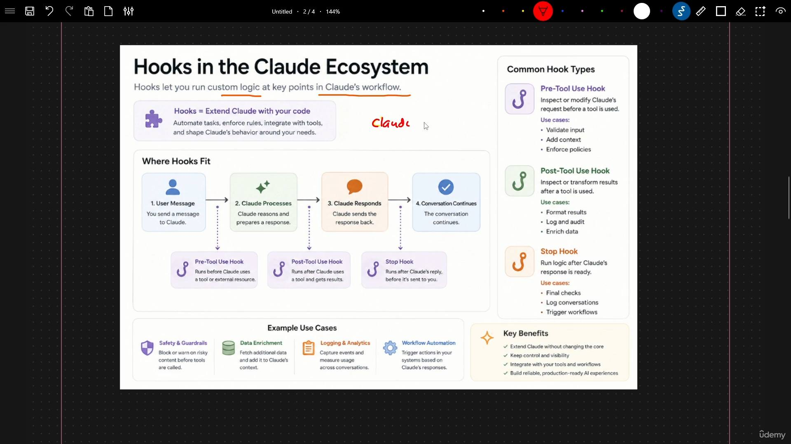
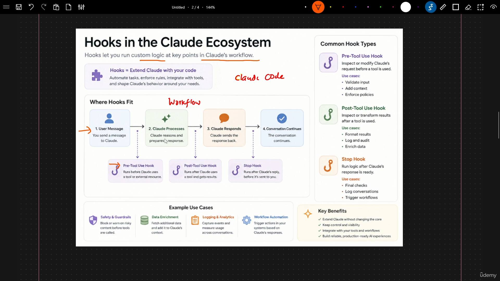
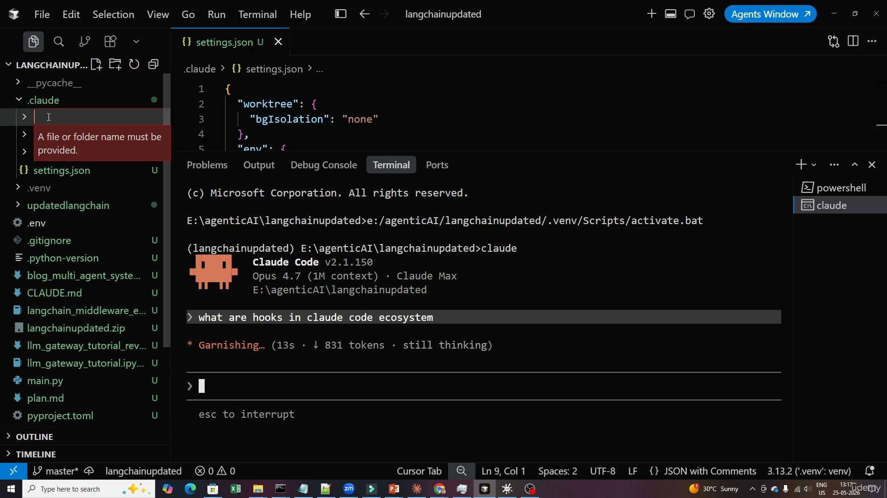
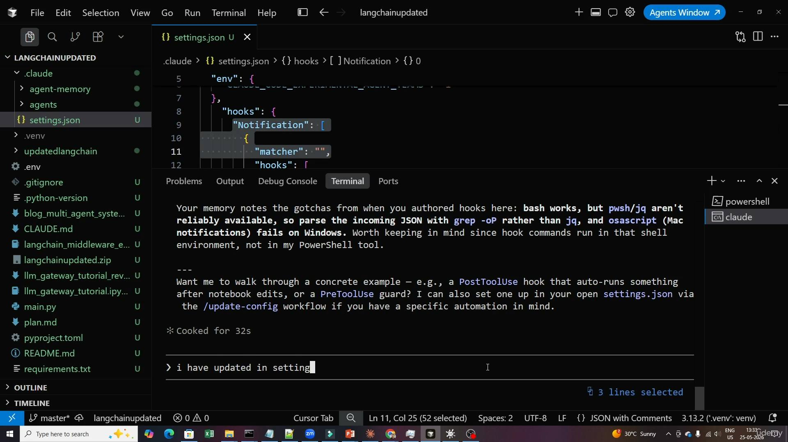
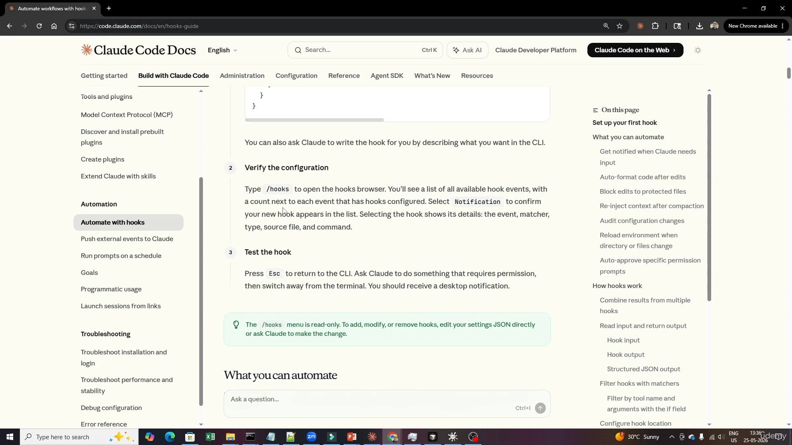
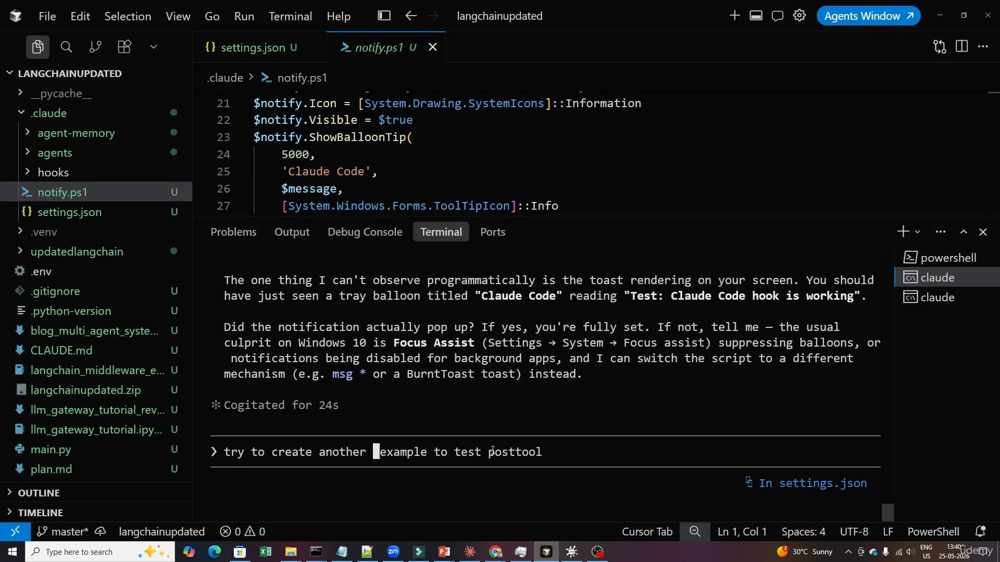
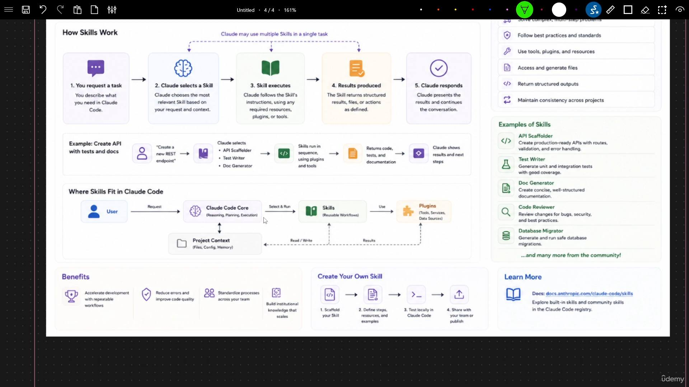
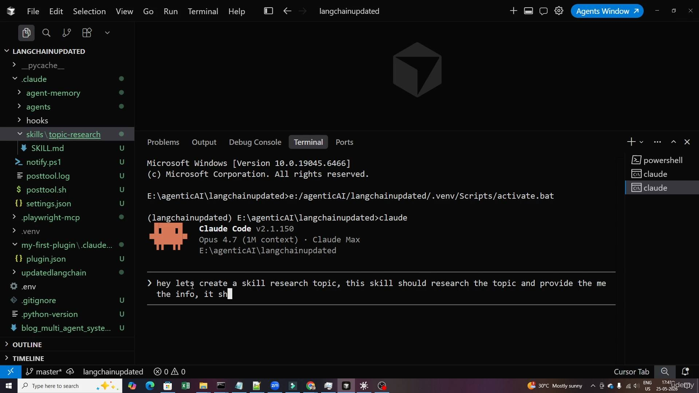
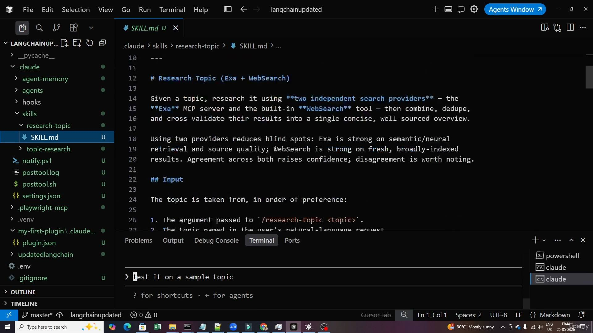
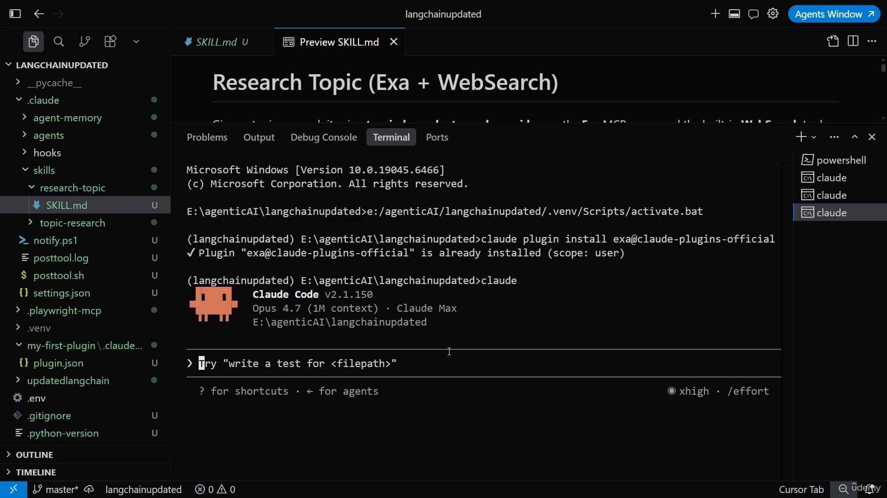

# AI Security Bootcamp part3：Claude Code 的 Hooks 与 Skills/Plugins 实战复现

> 课程：AI Security Bootcamp part3（护栏/网关/可观测）（BV1PSGA6SEaa）
> 覆盖：P014（Hooks）、P015（Skills 与 Plugins）
> 读者定位：前端转 AI 应用工程师。本文档按「能照着把东西做出来」的标准写，所有命令、配置、脚本都给出完整文件，可直接保存运行。

---

## 1. 这一节做什么

这两节（P014、P015）讲的是 Claude Code 生态里两个「把重复劳动固化下来」的机制：

- **P014 Hooks（钩子）**：在 Claude Code 工作流的固定生命周期节点上，自动执行你定义的 shell 命令。讲师的核心比喻是——「与其指望自己记得做某件事，不如让 harness 保证它一定执行」。典型场景：Claude 需要你输入时弹通知、每次工具调用后写审计日志、编辑文件后自动跑格式化、阻止 `.env` 被提交。
- **P015 Skills（技能）与 Plugins（插件）**：Skill 是「可复用的指令+资源+示例集合」，教 Claude Code 怎么完成某类特定任务；Plugin 是「通过标准接口给 Claude Code 提供工具/资源/能力的打包集成」（如 Exa 搜索、Context7 文档、Playwright）。两者可以嵌套：**Skill 内部调用 Plugin**，形成一个可复用的工作流。

学完这两节，你手上会有：

1. 一个 `settings.json` 里配置好的 notification hook（跨平台，Windows 用 PowerShell 脚本）；
2. 一个 post-tool-use hook，把每次工具调用写进日志文件；
3. 一个 `research-topic` skill，内部调用 Exa + Web Search 插件做主题调研；
4. 一个 `open-source-documentation` skill，内部调用 Context7 插件拉取最新库文档。

---

## 2. 讲师原话

> "Hooks 让你在 Claude 工作流的关键节点运行自定义逻辑。"
> —— p014 [00:28]

> "在你给 Claude Code 任何指令时，它遵循某个工作流来执行任务：用户发消息，Claude 处理、推理、准备响应，然后 Claude 回复，对话继续。Hooks 之所以厉害，是因为你可以在这个工作流推进的过程中插入自定义逻辑，相当于在流程里加新的检查和关卡。"
> —— p014 [00:28]–[01:27]

> "在 Claude 处理之前——因为 Claude 会用 LLM 模型，也会用一些工具——我们可以加一个 hook，这种叫 pre-tool hook。类似地，Claude 请求 LLM 并与工具通信之后，如果你想针对某些场景、某些条件加 hook，那叫 post-tool hook。"
> —— p014 [01:27]–[02:20]

> "区别很简单：pre-tool 是在任何工具被调用之前加 hook，它在 Claude 使用工具或外部资源之前运行；post-tool 是在工具被使用、拿到结果之后运行自定义逻辑。你也可以在整个响应返回给用户之后停止 hook。"
> —— p014 [02:20]–[02:49]

> "在 pre-tool use hook 里，你可以检查或修改 Claude 在工具使用前的请求：校验输入、添加上下文、强制执行策略。在 post-tool hook 里，你可以检查或转换工具使用后的结果：格式化结果、记录日志、审计、丰富数据。还有 stop hook，在每次 Claude 响应就绪后运行：做最终检查、记录对话、触发工作流。"
> —— p014 [03:15]–[03:43]

> "一些用例：安全与护栏、数据丰富、日志分析、工作流自动化。使用 hook 的关键好处：在不改核心的前提下扩展 Claude、保持控制与可见性、与你的工具和工作流集成、构建可靠的生产级 AI 体验。"
> —— p014 [03:43]–[04:13]

> "Hooks 是用户定义的 shell 命令，Claude Code 在其生命周期的固定点上自动运行。它们是 harness 给你确定性控制的方式——而不是指望『我记得要做某事』，比如『编辑后总是格式化』，harness 保证你的命令被执行。"
> —— p014 [04:41]–[05:11]

> "你的 settings.json 目前还没有定义任何 hook。一个 hook 就是 settings.json 里的一条条目，它把 shell 命令绑定到一个生命周期事件；当事件触发时，Claude Code 运行你的命令，并把事件数据以 JSON 通过 stdin（标准输入）传给它。"
> —— p014 [05:38]–[06:06]

> "可以挂 hook 的事件很多：工具使用前、工具使用后、用户提交 prompt 时（可以在这里注入上下文）、post-tool 时加反馈、stop 时（主 agent 回复完成时你可以强制继续）、sub agent stop、pre compact、session start、notification 等等。"
> —— p014 [06:34]–[07:03]

> "官方文档里有一个『设置你的第一个 hook』的例子：当 Claude 需要输入时收到通知。Linux 和 Windows 用的命令不一样，示例里是 `osascript -e 'display notification "Claude Code needs your attention" with title "Claude Code"'`。"
> —— p014 [07:27]–[07:57]

> "我把它粘到 settings.json 里，matcher 为空，命令负责显示通知。然后我问 Claude『我在 settings.json 里加了 notification hook，配置正确吗』，它会读这个文件并给出建议。"
> —— p014 [08:26]–[09:24]

> "你也可以直接搜 `/hooks`，能看到 pre tool usage、post tool usage、post tool user failure、post tool batch、pre permission denied、notification、user prompt submit、user prompt expansion、session start、stop 这些可以挂 hook 的位置。"
> —— p014 [09:51]

> "它说 JSON 解析和结构是对的，hooks 下的 notification 数组存在，但这个功能不会在你的机器上触发——命令是 osascript，只在 macOS 上可用，你用的是 Windows 10 Pro for Workstation，所以只会报错。"
> —— p014 [09:51]–[10:21]

> "于是我说『为我的 Windows 机器配置它』。它不再用 osascript，而是改用别的脚本。配置完成后，这个命令会自动变化。最好的一点是：每当 Claude Code 向你询问什么时，这个通知也会被触发。我还说发通知时也确保记录到某个地方，这样我们能理解它。"
> —— p014 [10:21]–[11:14]

> "它开始执行，说『为我的 Windows 配置』，于是做了改动。`notify.ps1` 被创建出来——现在不用 osascript，改用 PowerShell。它还顺带创建了一个 hooks 文件夹。"
> —— p014 [11:44]–[12:13]

> "现在是 PowerShell 命令，我刚听到一声『叮』的声音。让我展示从 stdin 来的实际通知消息。"
> —— p014 [12:13]–[13:09]

> "这是 settings.json 里发生的变化。我更新 notify.ps1，按回车，现在应该会有声音——一种 toast 那样的『叮』声。Hooks 最重要的一点是：你甚至可以借助 Claude 本身来帮你做这类 hook。比如你有一个 .env 文件，不想让它被提交，你可以把这些空检查都做进去。"
> —— p014 [13:09]–[13:38]

> "hook 命令已经指向脚本，不需要改动。我说『运行并测试这个 hook』。"
> —— p014 [13:38]–[14:08]

> "bash 调用 PowerShell 的 notify.ps1，JSON payload 通过 stdin 传进去，脚本解析它并取出消息部分。我能观察到的是你屏幕上 toast 的渲染——你应该看到托盘气泡，标题是 Claude Code，内容是『测试 Claude hook 正在工作』。通知真的弹出来了吗？是的。"
> —— p014 [14:36]–[15:05]

> "现在再做一个例子测试 post-tool。我说：加一个简单的 post-tool-use hook，把每次工具使用记录到文件里，方便我们看日志。因为你的 hook shell 是 bash，我用一个小 bash 脚本。先重新读当前 settings 以精确修改。"
> —— p014 [15:59]–[16:56]

> "`posttool.sh` 文件被创建出来，settings.json 也更新了。现在 settings.json 里有一个 post-tool usage 条目，命令指向 post-tool.sh，这段代码在 Claude 实际执行任何工具时运行。"
> —— p014 [16:56]–[17:25]

> "每当你运行 PowerShell——这些都是工具：edit 是工具、bash 是工具、write 是工具、PowerShell 命令执行时也是工具——它都会把每一样东西记录下来。"
> —— p014 [17:52]–[18:14]

> "总结：我加了 Claude post-tool，从 stdin 读 JSON，用 grep 提取工具名，追加到文件。新的 post-tool 条目带 matcher 触发。你去看 settings.json 会看到 `.*`，也就是任何任务都会把信息记录下来。"
> —— p014 [18:14]–[18:44]

> "也可以把 matcher 收窄到 edit 或 write。"
> —— p014 [18:44]

> "我让它读 test_example.py 并告诉我它是干什么的。它自动在 144 行读取，你能看到 read、bash、write、PowerShell 这些信息，也就是执行了哪些工具。"
> —— p014 [18:44]–[19:40]

> "我说『运行它』，于是又会产生新的日志。任何命令执行都会在这里体现，这就是 post-tool usage 的 PowerShell 相关 hook。你可以加任意多步骤。"
> —— p014 [19:40]–[20:09]

> "我建议去看文档，你会看到多种格式化方式。你可以阻止对受保护文件的编辑——比如你不想让 .env 文件在 git commit 时被带上，就可以加这个。你可以在项目里创建这个文件夹、写这样的脚本、加到 settings.json 里自动生效，或者直接让 Claude Code 帮你做。"
> —— p014 [20:09]–[20:38]

> "Skill 是可复用的指令、资源和示例的集合，教 Claude Code 如何完成某一类特定任务。"
> —— p015 [00:00]–[00:29]

> "你请求一个任务，描述你需要什么，Claude 选择一个 skill 来做，skill 执行那些指令，然后产出结果。Claude 根据你的请求和上下文选择最相关的 skill。你可以创建任意多个 skill。Claude 会使用所需的资源、插件或工具来遵循 skill 的指令。"
> —— p015 [00:57]–[01:21]

> "Skill 在 Claude Code 里的位置：用户给请求，Claude Code 核心开始推理、规划、执行；为了执行，它可能选择一个 skill——一个可复用的工作流——内部可能用插件或工具，结合项目上下文去执行。"
> —— p015 [01:49]–[02:16]

> "插件是通过标准接口给 Claude Code 提供工具、资源或能力的打包集成。比如做外部网页搜索有 ExaSearch 这样的公司；你想让 Claude Code 理解 PR，可能需要 GitHub 第三方集成——这些都可以以插件形式集成进来。"
> —— p015 [02:44]–[03:12]

> "比如我说『搜索这个话题并给我简要信息』，Claude 会决定该用哪个插件。如果我集成了 Exa 或 web search 插件——Claude 本身也自带很多插件——它会选择确切的插件，用所需输入调用它，拿到结果返回给用户。"
> —— p015 [03:39]–[04:06]

> "比如我有 GitHub 插件，我可以问『给我看 Anthropic Claude Code 仓库最新的 issue』，Claude 就会和 GitHub 插件通信拿到 issue 并回复。"
> —— p015 [04:28]

> "我之所以在这一节同时讲 skills 和 plugins，原因很简单：我做一个 skill，这个 skill 做某件特定任务；当我给 skill 输入时，这个 skill 可以去调用这些插件。插件在 skill 内部与 Claude Code 集成，然后拿到输出。所以 skill 就像一个工作流。"
> —— p015 [04:28]–[05:28]

> "举个例子：创建一个 skill 做某主题的研究，研究时用我们集成的 Exa 插件。这个工作流带着这个工具执行，从插件拿到输出和上下文，工作流借助这些上下文执行，最后得到输出。"
> —— p015 [05:28]–[05:57]

> "在 .cloud 文件夹里，我创建了一个 topic research skills，里面有 skill.md。但作为示例我想从头展示。"
> —— p015 [06:25]

> "我说：创建一个 skill，名字叫 research topic，这个 skill 应该研究主题并给我信息，内部同时使用 Exa 和 web search 插件并给出结果，创建 skill.md 文件，因为这是项目里需要的文件，这样你也能引用它。这个 skill 只针对我正在开发的项目。"
> —— p015 [06:55]–[08:23]

> "我的问题是：我怎么知道这个插件在不在？我已经装过这些插件了。安装插件：先写 `claude plugins`，能看到所有内置插件列表，你也可以加自己的插件。里面有 playwright 等，搜 exa 就能看到 exa 插件，它需要先安装。"
> —— p015 [08:23]–[09:19]

> "Exa 是什么？Exa AI，网页搜索、深度搜索和内容抽取。首先我们需要 Exa 的 API。去 exa.ai 登录，进 APIs 可以创建 API。最初它会提供 10 美元免费额度。"
> —— p015 [09:19]–[09:45]

> "它自动在 .cloud 文件夹里创建 skills 文件夹，里面建 research topic 文件夹，再里面是 skill.md，就是给 research topic 这个 skill 用的。"
> —— p015 [09:45]–[10:14]

> "这里能看到 skills，research topic skills 在，这是我刚创建的。看内容：research topic，给定一个主题做研究，输入是研究主题；它用了 Exa，输出格式是答案、主题、要点、来源等。开发时想搜任何主题，不用去浏览器，因为它内部做网页搜索。"
> —— p015 [10:14]–[10:44]

> "要调用这个 skill，写 `/research-topic`，这是 skill 名。但还得给主题名。我写『什么是 LLM gateways』作为主题。这个 research topic skill 会自动触发，内部插件也被调用——我们用的那个确切插件也在被调用。"
> —— p015 [11:12]–[11:41]

> "你可能会想，Krish，我们还没装 exa 插件。我已经装过了，我也会展示安装步骤。我点 yes，它应该按我们在空文件里看到的格式给我结果。"
> —— p015 [11:41]–[12:10]

> "它说 Exa 搜索工具还不能调用，MCP 已安装但需要一次性认证登录；工具按 skill 的 fallback 暴露，我改用 web search 继续。这里有点问题，我没去认证 Exa 搜索。但你可以给它。现在看输出，它在做 web search——web search 不需要 API key。"
> —— p015 [12:10]–[12:39]

> "要修 Exa，只需复制这个并提供 secret key，自动就能工作。但我的问题还在：Krish，你还没展示怎么安装插件。安装插件：复制『Install in Claude Code』，打开新命令行，粘进去，exa 就自动装好了。写 `claude`，粘进去，exa 插件就装好了。"
> —— p015 [12:39]–[13:07]

> "想看其他插件详情，写 `/plugins`。这里有非常多插件。Claude Code 有整个 marketplace，去 discover / installed 能看到我装的所有插件。我装了 exa 插件、playwright 插件、claude.ai 插件等等。"
> —— p015 [13:07]–[13:35]

> "去 marketplace 搜 Claude plugins official，能看到可用插件。Context7 插件非常好，用来拿最新文档，相当于一个 MCP server 集成，提供最新文档。"
> —— p015 [13:35]–[14:02]

> "我装 Context7。然后问：基于最新的 LangChain 文档，解释如何用 LangChain 创建 deep agents。它会用 Context7 去研究最新文档。我加上『使用 Context7 插件』的指令。"
> —— p015 [14:02]–[15:00]

> "它说：你想用 Context7 插件查文档，我来加载这些工具。想象我们集成了这个插件，并且可以在 skill 内部使用它。你创建的 skill 可以挂任何插件——web search、exa search 都行。"
> —— p015 [15:00]–[15:29]

> "它让我重载插件。每次加插件后，最好重载所有插件，以拿到最新版本。现在我有四个插件。然后我用『基于最新 LangChain 文档，用 Context7 插件解释如何创建 deep agents』。Context7 工具是活的，解析 LangChain 库并查询，Python deep agents 的信息就来了。"
> —— p015 [15:29]–[15:58]

> "你在这里能做所有事，不用去浏览器。项目开发时想查语法，可以直接查。插件被调用，讲什么是 deep agent、为什么是四大支柱、规划、工具。即使我自己做材料，也一定用 Context7 插件，因为能直接拿到最新内容。"
> —— p015 [16:24]–[16:52]

> "同时我再创建另一个 skill：开源文档。当我们搜索某个开源库时，它应提供最新可用信息，并用 Context7 作为插件。在项目里创建 skill.md。"
> —— p015 [16:52]–[17:51]

> "它工作得很好，我能拿到信息，确认插件工作正常。它会让我在特定文件夹创建 skill，于是又建一个文件夹。这个 skill 内部用 Context7 插件。"
> —— p015 [18:19]–[18:48]

> "要执行，写 `/open-source-documentation`，然后说『开发 LangChain agents 的最新代码』。skill.md 也创建好了。它问 Context7 工具在这个会话里能否调用，然后加载它。"
> —— p015 [19:18]–[20:14]

> "给它机会，Context7 就被用上了。你只要写 `/open-source-documentation`、LangChain 和库名，它就能给你所有信息，甚至给出最新结果和数据。"
> —— p015 [20:14]–[20:40]

> "这一节我们理解了 skills 和 plugins 两个重要主题，理解了如何在 skill 内部使用插件。Skill 就像一个你反复执行的通用工作流。"
> —— p015 [20:40]–[21:11]

---

## 3. 从零复现

### 3.1 前置条件

- 已安装 Claude Code CLI（`claude` 命令可用）。安装方式课里没讲，请按官方文档装。
- 操作系统：讲师用的是 **Windows 10 Pro for Workstation**，所以 notification hook 走 PowerShell。macOS 用 `osascript`，Linux 用 `notify-send`（课里只演示了 macOS 示例和 Windows 改写，Linux 命令课里没讲）。
- 一个可用的项目目录（下文用 `my-project/` 表示）。
- 若要跑 Exa 插件：需要 Exa API key（exa.ai 注册，讲师说初始有 10 美元免费额度）。
- 若要跑 Context7 插件：无需额外 key（课里没提 key）。

### 3.2 目录结构（最终形态）

```
my-project/
├── .claude/
│   ├── settings.json              # hooks 配置写在这里
│   ├── hooks/
│   │   ├── notify.ps1             # Windows 通知脚本（Claude 自动生成）
│   │   └── posttool.sh            # post-tool 日志脚本（Claude 自动生成）
│   └── skills/
│       ├── research-topic/
│       │   └── skill.md
│       └── open-source-documentation/
│           └── skill.md
├── post-tool.log                  # posttool.sh 写入的日志（运行时生成）
└── test_example.py                # 讲师用来测试读取的文件
```

> 注意：讲师口述里把目录说成「.cloud」，但 Claude Code 的实际约定目录是 `.claude`。截图/OCR 里没有给出目录名的原文，课里也没讲 OCR。**以你本地 `claude` 实际生成的目录名为准**；如果 Claude 自动创建的是 `.claude`，就按 `.claude` 走。

### 3.3 步骤一：确认当前没有 hook

1. 在项目目录打开终端，运行 `claude` 进入交互会话。
2. 问它：`Claude Code 生态里 hooks 是什么？`（讲师原话是 "what are hooks in cloud code ecosystem"）。
3. 它会告诉你：你的 `settings.json` 还没有定义任何 hook；一个 hook 就是 `settings.json` 里的一条条目，把 shell 命令绑定到生命周期事件，事件触发时通过 stdin 把 JSON 事件数据传给命令。

这一步的目的是让你亲眼看到「没有 hook 时」的状态，后面加完再对比。

### 3.4 步骤二：加第一个 notification hook（先照抄 macOS 示例，再让 Claude 改成 Windows）

讲师的做法是：先把官方文档里 macOS 的示例粘进 `settings.json`，然后让 Claude 检查并改写成本机可用的 PowerShell 版本。这个「先错后改」的过程本身就是教学点——它演示了 hook 的 matcher/command 结构，也演示了 Claude 能自己改自己的配置。

1. 打开 `.claude/settings.json`（没有就新建，内容为 `{}`）。
2. 把下面这段粘进去（这是官方文档的 macOS 示例，**在 Windows 上会报错**，讲师故意先这么干）：

```json
{
  "hooks": {
    "notification": [
      {
        "matcher": "",
        "hooks": [
          {
            "type": "command",
            "command": "osascript -e 'display notification \"Claude Code needs your attention\" with title \"Claude Code\"'"
          }
        ]
      }
    ]
  }
}
```

3. 回到 `claude` 会话，问：`我在 settings.json 里加了 notification hook，配置正确吗？`
4. Claude 会读文件并回答：JSON 解析和结构正确，`hooks.notification` 数组存在；但 `osascript` 只在 macOS 可用，你在 Windows 上会报错。
5. 接着说：`为我的 Windows 机器配置它，并且在发通知时也记录到某个地方。`
6. Claude 会自动：
   - 创建 `.claude/hooks/notify.ps1`；
   - 把 `settings.json` 里的 command 改成调用 PowerShell 脚本；
   - 顺带创建 `hooks/` 文件夹。

改完后 `settings.json` 大致长这样（**具体字段以 Claude 实际写入为准**，下面是按讲师描述重建的结构）：

```json
{
  "hooks": {
    "notification": [
      {
        "matcher": "",
        "hooks": [
          {
            "type": "command",
            "command": "powershell -ExecutionPolicy Bypass -File .claude/hooks/notify.ps1"
          }
        ]
      }
    ]
  }
}
```

> 讲师在 [16:27] 提到「execution policy bypass」，说明 command 里带了 `-ExecutionPolicy Bypass`。其余参数（是否 `-NoProfile` 等）课里没讲，以你本地生成结果为准。

7. 让 Claude「运行并测试这个 hook」。它会用 bash 调 PowerShell 跑 `notify.ps1`，把 JSON payload 通过 stdin 传进去，脚本解析后弹出托盘气泡，标题 `Claude Code`，内容类似「测试 Claude hook 正在工作」。讲师听到了一声「叮」的 toast 音。

### 3.5 步骤三：加 post-tool-use hook，把每次工具调用写进日志

1. 在 `claude` 会话里说：`加一个简单的 post-tool-use hook，把每次工具使用记录到文件里，方便看日志。因为你的 hook shell 是 bash，用一个小 bash 脚本。先重新读当前 settings 以精确修改。`
2. Claude 会创建 `.claude/hooks/posttool.sh`，并在 `settings.json` 里加一条 `postToolUse` 条目，matcher 为 `.*`（匹配所有工具）。
3. 讲师强调：edit、bash、write、PowerShell 命令执行，**这些都是工具**，所以都会被记录。
4. 测试：让 Claude `读 test_example.py 并告诉我它是干什么的`。日志文件里会新增一条 read 记录；再说 `运行它`，又会新增 bash/PowerShell 记录。
5. 讲师还提到可以把 matcher 从 `.*` 收窄到 `edit` 或 `write`，只记录文件编辑类工具。

### 3.6 步骤四：查看所有可挂 hook 的位置

在 `claude` 会话里输入 `/hooks`，会列出：pre tool usage、post tool usage、post tool user failure、post tool batch、pre permission denied、notification、user prompt submit、user prompt expansion、session start、stop。讲师用这个命令确认 notification hook 已经出现在列表里。

### 3.7 步骤五：安装插件（Exa、Context7）

1. 在终端运行 `claude plugins`，列出所有内置插件（能看到 playwright 等）。搜 `exa` 能找到 Exa 插件。
2. 去 exa.ai 注册登录，进 APIs 创建 API key（讲师说初始 10 美元免费额度）。
3. 在插件页面点「Install in Claude Code」，复制给出的安装命令，打开新终端粘进去执行，Exa 插件即安装。
4. 运行 `/plugins`，在 discover / installed 里确认已装插件（讲师装了 exa、playwright、claude.ai、Context7 等）。
5. 去 marketplace 搜 `Claude plugins official`，找到 Context7 并安装。Context7 相当于一个 MCP server 集成，提供最新库文档。
6. **每次加完插件，重载所有插件**，拿到最新版本（讲师原话）。

### 3.8 步骤六：创建 research-topic skill

1. 在 `claude` 会话里说：`创建一个 skill，名字叫 research-topic。这个 skill 应该研究主题并给我信息，内部同时使用 Exa 和 web search 插件并给出结果。创建 skill.md 文件，放在项目里。`
2. Claude 会在 `.claude/skills/research-topic/` 下创建 `skill.md`。
3. 调用：输入 `/research-topic 什么是 LLM gateways`。
4. 如果 Exa 没认证，Claude 会提示「Exa 搜索工具还不能调用，MCP 已安装但需要一次性认证登录；按 skill 的 fallback 改用 web search 继续」。web search 不需要 API key，所以仍能出结果。
5. 要修 Exa：把 API key 作为 secret 提供给它（课里没讲具体环境变量名，以 Exa 插件文档为准）。

### 3.9 步骤七：创建 open-source-documentation skill（内部用 Context7）

1. 说：`再创建一个 skill，叫 open-source-documentation。当我们搜索某个开源库时，它应提供最新可用信息，并用 Context7 作为插件。在项目里创建 skill.md。`
2. Claude 会新建 `.claude/skills/open-source-documentation/skill.md`。
3. 调用：`/open-source-documentation 开发 LangChain agents 的最新代码`。
4. Claude 会先确认 Context7 工具在本会话能否调用，然后加载它，返回最新文档内容。

### 3.10 步骤八：验证

- `settings.json` 里同时有 `notification` 和 `postToolUse` 两条 hook；
- 触发一次需要输入的交互，应看到托盘通知；
- 让 Claude 读/写/跑命令，`post-tool.log` 行数增加；
- `/research-topic` 和 `/open-source-documentation` 都能出结果。

---

## 4. 完整代码

> 说明：本段**没有 OCR 结果**，所以下面的脚本是按逐字稿描述重建的「可运行版本」，不是讲师屏幕原文。凡是逐字稿没给的细节（如日志格式、PowerShell 具体写法），都标注「课里没讲，以下为按描述重建」。你可以直接保存运行，也可以让 Claude 按 3.4/3.5 的对话自动生成——后者更贴近讲师实际做法。

### 4.1 `.claude/settings.json`（最终形态）

```json
{
  "hooks": {
    "notification": [
      {
        "matcher": "",
        "hooks": [
          {
            "type": "command",
            "command": "powershell -ExecutionPolicy Bypass -File .claude/hooks/notify.ps1"
          }
        ]
      }
    ],
    "postToolUse": [
      {
        "matcher": ".*",
        "hooks": [
          {
            "type": "command",
            "command": "bash .claude/hooks/posttool.sh"
          }
        ]
      }
    ]
  }
}
```

要点：
- `notification` 的 `matcher` 为空字符串（讲师 [08:26] 明确说「matcher 会是空的」）。
- `postToolUse` 的 `matcher` 是 `.*`（讲师 [18:14] 明确说「你去看 settings.json 会看到 `.*`」）。
- 每条 hook 里 `type` 为 `command`，`command` 是实际执行的 shell 命令。
- 事件数据通过 **stdin** 以 JSON 传给命令（讲师 [06:06] 明确）。

### 4.2 `.claude/hooks/notify.ps1`（Windows 通知脚本）

```powershell
# notify.ps1
# 从 stdin 读取 Claude Code 传来的 JSON 事件数据，
# 弹出 Windows 托盘通知，并把消息追加到日志。
# 课里没讲具体实现，以下为按讲师描述（"从 stdin 读 JSON、取消息、弹通知、记录"）重建。

$ErrorActionPreference = "Stop"

# 1. 从 stdin 读全部内容
$raw = [Console]::In.ReadToEnd()

# 2. 解析 JSON
try {
    $payload = $raw | ConvertFrom-Json
} catch {
    $payload = $null
}

# 3. 取出消息文本（字段名以实际 payload 为准；课里没讲字段名）
$message = "Claude Code needs your attention"
if ($payload -and $payload.message) {
    $message = [string]$payload.message
}

# 4. 追加到日志
$logPath = Join-Path $PSScriptRoot "notify.log"
$line = "{0} | {1}" -f (Get-Date -Format "yyyy-MM-dd HH:mm:ss"), $message
Add-Content -Path $logPath -Value $line

# 5. 弹托盘气泡（标题 Claude Code）
Add-Type -AssemblyName System.Windows.Forms
$notify = New-Object System.Windows.Forms.NotifyIcon
$notify.Icon = [System.Drawing.SystemIcons]::Information
$notify.BalloonTipTitle = "Claude Code"
$notify.BalloonTipText = $message
$notify.Visible = $true
$notify.ShowBalloonTip(5000)
Start-Sleep -Seconds 5
$notify.Dispose()
```

> 讲师在 [15:05] 描述的现象是「托盘气泡，标题 Claude Code，内容『测试 Claude hook 正在工作』」，并听到 toast 音。上面脚本用 `NotifyIcon.ShowBalloonTip` 实现，能产生同样的气泡和系统提示音。字段名 `message` 是猜测，**请以你本地实际 payload 为准**；不确定就先 `Write-Output $raw` 打印出来看。

### 4.3 `.claude/hooks/posttool.sh`（post-tool 日志脚本）

```bash
#!/usr/bin/env bash
# posttool.sh
# 从 stdin 读 Claude Code 传来的 JSON，提取工具名，追加到 post-tool.log。
# 讲师原话：从 stdin 读 JSON，用 grep 提取工具名，追加到文件。

set -euo pipefail

LOG_FILE="post-tool.log"
PAYLOAD="$(cat)"

# 提取工具名（讲师用 grep；字段名以实际 payload 为准，课里没讲）
TOOL_NAME="$(printf '%s' "$PAYLOAD" | grep -o '"tool_name"[^,]*' | head -n1 || true)"

# 时间戳 + 工具名 + 原始 payload 一行
{
  printf '%s | %s | %s\n' \
    "$(date '+%Y-%m-%d %H:%M:%S')" \
    "${TOOL_NAME:-unknown}" \
    "$(printf '%s' "$PAYLOAD" | tr '\n' ' ')"
} >> "$LOG_FILE"
```

> 讲师 [18:14] 说「用 grep 提取工具名，追加到文件」，所以这里用 `grep -o`。字段名 `tool_name` 是常见约定，**课里没讲具体字段名，请以实际 payload 为准**。如果 grep 匹配不到，`|| true` 保证脚本不因 `set -e` 退出。

### 4.4 `.claude/skills/research-topic/skill.md`

```markdown
---
name: research-topic
description: 给定一个主题，做网络调研并输出结构化结果；内部使用 Exa 和 web search 插件。
---

# Research Topic

## 输入
- `topic`：要研究的主题（必填）

## 步骤
1. 优先调用 Exa 插件做深度搜索与内容抽取。
2. 若 Exa 不可用（未认证/无 key），回退到 web search 插件。
3. 汇总结果，按下面格式输出。

## 输出格式
- **Answer**：一段简要结论
- **Topics**：涉及的关键子主题
- **Key Points**：要点列表
- **Sources**：来源链接
```

> 讲师 [10:44] 描述的输出结构是「answer、topics、key points、sources」，上面按此重建。frontmatter 的 `name`/`description` 字段是 Claude Code skill 的常见约定，**课里没讲具体 frontmatter 格式**，以你本地生成结果为准。

### 4.5 `.claude/skills/open-source-documentation/skill.md`

```markdown
---
name: open-source-documentation
description: 查询某个开源库的最新文档与用法；内部使用 Context7 插件。
---

# Open Source Documentation

## 输入
- `library`：开源库名（如 LangChain）
- `question`：要查的问题（如「如何创建 deep agents」）

## 步骤
1. 确认 Context7 工具在本会话可调用；不可调用则先加载。
2. 用 Context7 解析库名并查询最新文档。
3. 返回最新用法与代码示例。

## 输出格式
- **Library**：库名
- **Latest Docs**：最新文档要点
- **Code Example**：可直接使用的代码片段
- **Sources**：文档链接
```

### 4.6 `test_example.py`（讲师用来测试读取的文件）

```python
# test_example.py
# 课里没讲这个文件的内容，讲师只让 Claude「读它并说明它是干什么的」。
# 以下为占位示例，你可以换成任意 Python 文件。

def add(a, b):
    return a + b


if __name__ == "__main__":
    print(add(2, 3))
```

---

## 5. 逐行解释

### 5.1 `settings.json` 的结构

- `hooks` 是顶层键，下面按**事件名**分组（`notification`、`postToolUse` 等）。讲师 [06:06] 说「一个 hook 就是 settings.json 里的一条条目，把 shell 命令绑定到生命周期事件」。
- 每个事件是一个数组，数组元素是「matcher + hooks」对象：
  - `matcher`：决定哪些情况触发。`notification` 用空字符串（不筛选）；`postToolUse` 用 `.*`（正则，匹配所有工具）。讲师 [18:44] 说可以收窄到 `edit` 或 `write`。
  - `hooks`：数组，每项 `type: "command"` + `command` 字符串。为什么是数组？因为同一事件可以挂多个命令，课里没讲上限。
- 事件触发时，Claude Code 把事件数据以 **JSON 通过 stdin** 传给命令（[06:06]）。这就是为什么两个脚本第一件事都是 `cat` / `ReadToEnd()` 读 stdin。

### 5.2 `notify.ps1` 逐段

- `[Console]::In.ReadToEnd()`：PowerShell 里读 stdin 全部内容的标准写法。对应 Node 里就是 `process.stdin` 读流——前端同学可以类比 `fs.readFileSync(0)`。
- `ConvertFrom-Json`：把 JSON 字符串转对象，相当于 `JSON.parse`。
- `$payload.message`：取消息字段。**字段名课里没讲**，所以加了 `if` 兜底；不确定就先打印 `$raw`。
- `Add-Content`：追加写日志，相当于 Node 的 `fs.appendFileSync`。
- `NotifyIcon.ShowBalloonTip`：Windows 托盘气泡 API，会带系统提示音（讲师听到的「叮」）。`Start-Sleep 5` 是为了让气泡停留 5 秒再 `Dispose`，否则进程退出气泡可能立刻消失。
- 为什么用 PowerShell 而不是 osascript：讲师 [10:21] 明确说 osascript 是 macOS only，Windows 上会报错。这就是「先粘官方 macOS 示例、再让 Claude 改写」的教学价值——**hook 命令是平台相关的**。

### 5.3 `posttool.sh` 逐段

- `set -euo pipefail`：bash 严格模式。`-e` 出错退出，`-u` 未定义变量报错，`pipefail` 管道任一环失败即失败。前端同学可以理解为「让脚本 fail fast，别静默吞错」。
- `PAYLOAD="$(cat)"`：读 stdin。对应 Node 的 `fs.readFileSync(0, 'utf8')`。
- `grep -o '"tool_name"[^,]*'`：从 JSON 里抠出工具名字段。`-o` 只输出匹配部分。`|| true` 是因为 `set -e` 下 grep 没匹配会返回非零导致脚本退出，加兜底。
- `tr '\n' ' '`：把 payload 里的换行压成空格，保证日志一行一条。
- `>> "$LOG_FILE"`：追加写。为什么用相对路径 `post-tool.log`？因为 hook 命令的工作目录通常是项目根目录；如果不在，改成绝对路径。课里没讲工作目录，**以实际为准**。
- 讲师 [17:52] 强调「edit、bash、write、PowerShell 都是工具」，所以 `.*` matcher 下这些都会进日志。这就是「审计」用例的落地。

### 5.4 Skill 的 frontmatter 与正文

- `name`：调用时用的 slash 命令名（`/research-topic`）。讲师 [11:12] 说「写 `/research-topic`，这是 skill 名」。
- `description`：Claude 据此判断「哪个 skill 最相关」（[01:21]「Claude 根据你的请求和上下文选择最相关的 skill」）。
- 正文是给 Claude 的指令：输入、步骤、输出格式。讲师 [10:44] 展示的输出结构就是正文里的「输出格式」段。
- Skill 内部调插件：正文里写「优先调用 Exa，回退 web search」——这就是 [05:28] 说的「skill 像一个工作流，内部可以调插件」。

### 5.5 为什么 Skill 和 Plugin 要一起讲

讲师 [04:28] 的原话逻辑：Skill 是工作流，Plugin 是能力。工作流需要能力才能干活。所以「Skill 内部调用 Plugin」是最自然的组合：你写一次 skill.md，以后每次 `/research-topic` 都自动走「Exa 搜索 → 汇总 → 结构化输出」，不用每次重新交代。

### 5.6 平台差异与 fallback

- notification：macOS `osascript` / Windows PowerShell / Linux 课里没讲。
- Exa 未认证时，Claude 按 skill 里的 fallback 走 web search（[12:10]）。这说明 skill.md 里写 fallback 是有实际作用的，不是装饰。
- Context7 每次新会话可能要重新加载（[19:47]「Context7 未加载，我们加载它」），所以 skill 第一步写「确认可调用，否则先加载」。

---

## 6. 复现检查清单

- [ ] `claude` 命令可用，能进入交互会话。
- [ ] `.claude/settings.json` 存在，且 `hooks` 下有 `notification` 和 `postToolUse` 两个键。
- [ ] `notification` 的 `matcher` 为空字符串，`command` 指向 `notify.ps1`（Windows）或 `osascript`（macOS）。
- [ ] `postToolUse` 的 `matcher` 为 `.*`，`command` 指向 `posttool.sh`。
- [ ] `.claude/hooks/notify.ps1` 存在，手动 `powershell -ExecutionPolicy Bypass -File .claude/hooks/notify.ps1` 能弹气泡（stdin 可先 `echo '{"message":"test"}' | ...` 测）。
- [ ] `.claude/hooks/posttool.sh` 存在且有执行权限（`chmod +x`）。
- [ ] 在 `claude` 里输入 `/hooks`，能看到 notification 和 post tool usage 已注册。
- [ ] 让 Claude 读一个文件，`post-tool.log` 新增一行，含时间戳和工具名。
- [ ] `claude plugins` 能列出插件；`/plugins` 的 installed 里能看到 Exa 和 Context7。
- [ ] Exa API key 已配置（否则走 web search fallback，仍能出结果）。
- [ ] `.claude/skills/research-topic/skill.md` 存在，`/research-topic 什么是 LLM gateways` 能出结构化结果。
- [ ] `.claude/skills/open-source-documentation/skill.md` 存在，`/open-source-documentation 开发 LangChain agents 的最新代码` 能出最新文档。
- [ ] 加完插件后重载过插件（讲师强调）。
- [ ] 日志文件路径与 hook 工作目录一致（不一致就改绝对路径）。

---

## 7. 课里没讲但你会撞上的

1. **`.claude` 还是 `.cloud`**：讲师口述说「.cloud」，但 Claude Code 实际约定是 `.claude`。以你本地 `claude` 生成的目录为准；如果它生成 `.claude`，全文按 `.claude` 走。
2. **hook 的工作目录**：课里没讲 hook 命令在哪个目录执行。`posttool.sh` 用相对路径 `post-tool.log`，如果日志没出现在项目根，改成绝对路径或 `cd` 到项目根。
3. **stdin JSON 的字段名**：课里只说「JSON payload」「取消息部分」「用 grep 提取工具名」，**没给字段名**。`notify.ps1` 里的 `message`、`posttool.sh` 里的 `tool_name` 都是按常见约定猜的。第一次跑先打印原始 payload（`Write-Output $raw` / `echo "$PAYLOAD"`）确认。
4. **PowerShell 执行策略**：讲师 [16:27] 提到 `ExecutionPolicy Bypass`。如果你的机器策略更严，可能还要 `-NoProfile` 或改注册表；课里没讲。
5. **Linux 的 notification 命令**：课里只演示 macOS 和 Windows，Linux 用 `notify-send` 是常见做法但**课里没讲**，别当成讲师说的。
6. **Exa API key 怎么传给插件**：课里只说「复制这个并提供 secret key」，**没讲环境变量名或配置文件位置**。以 Exa 插件文档为准。
7. **Context7 是否需要 key**：课里没提，按「不需要」处理；如果提示要认证，按插件提示走。
8. **skill.md 的 frontmatter 格式**：课里展示了「name/description/输入/输出」的内容，但**没讲 YAML frontmatter 的确切字段**。以 Claude 自动生成的为准，别手写猜。
9. **matcher 的正则语义**：`.*` 匹配所有工具，`edit`/`write` 是收窄。课里没讲是否支持复杂正则、是否大小写敏感。
10. **hook 超时/失败行为**：课里没讲命令超时多久、失败会不会阻塞 Claude。生产环境要自己加超时和错误处理。
11. **多 hook 顺序**：同一事件挂多个命令时谁先跑，课里没讲。
12. **`/hooks` 与 `settings.json` 的一致性**：改了 `settings.json` 后是否需要重启会话才生效，课里没讲；讲师是让 Claude 改完直接测的，说明大概率热加载，但以实际为准。
13. **安全边界**：讲师提到「阻止对受保护文件的编辑，比如不让 .env 被提交」，但**没给具体 hook 配置**。这属于 pre-tool hook 的 guard 用例，需要你自己写 matcher + 脚本；课里只给了方向。
14. **Node/前端类比**：hook 的 stdin JSON ≈ Node 的 `process.stdin`；`settings.json` 的 hooks 数组 ≈ 一个事件总线配置；skill.md ≈ 一个带 frontmatter 的「提示词模板文件」。这些类比课里没讲，是给前端读者的翻译。

---

### 附：本文引用的截图



















