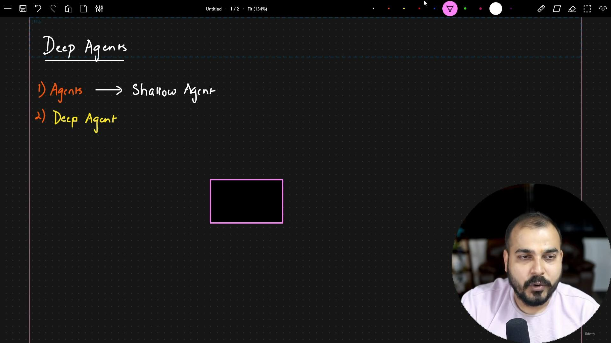
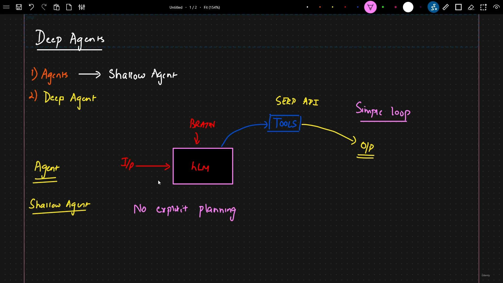
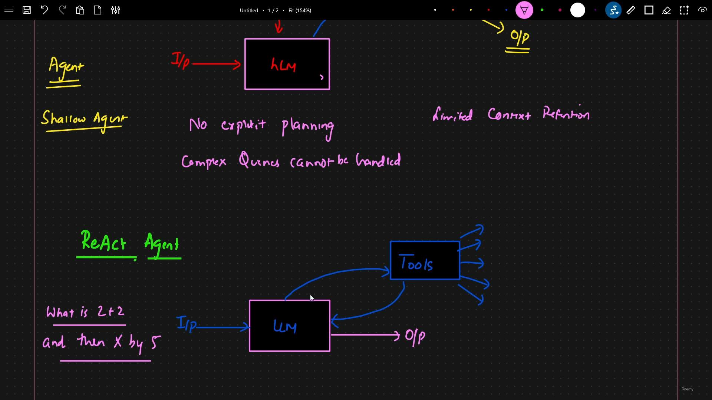
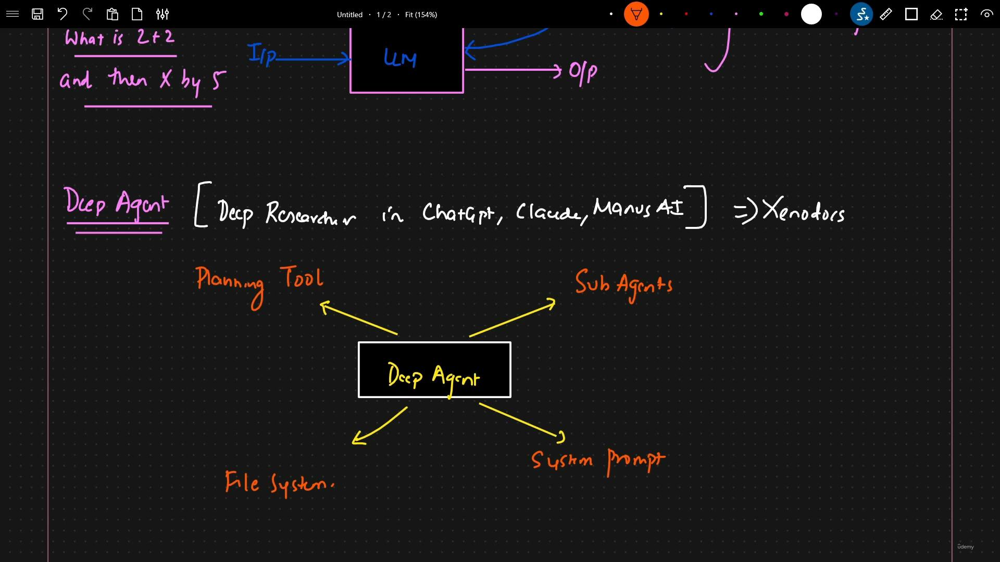
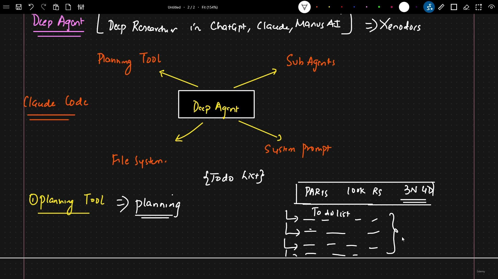
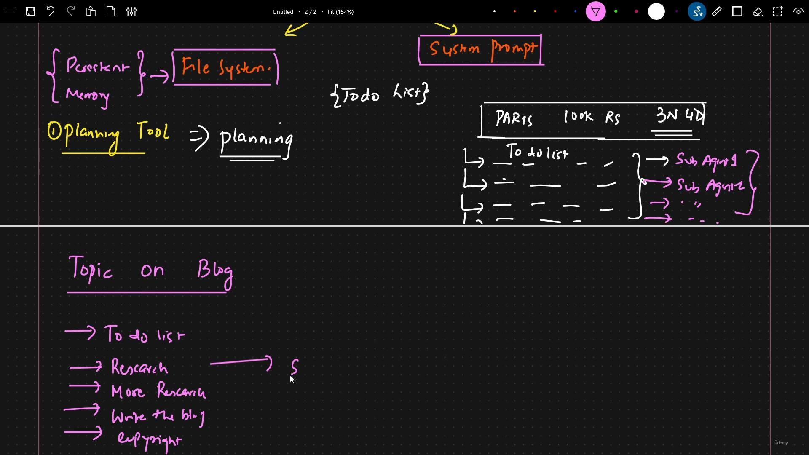
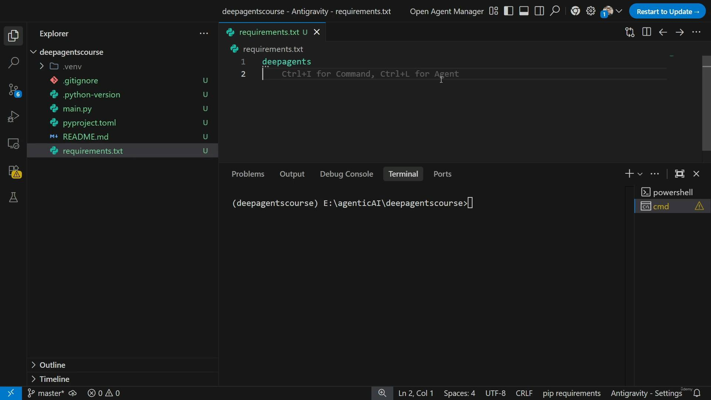
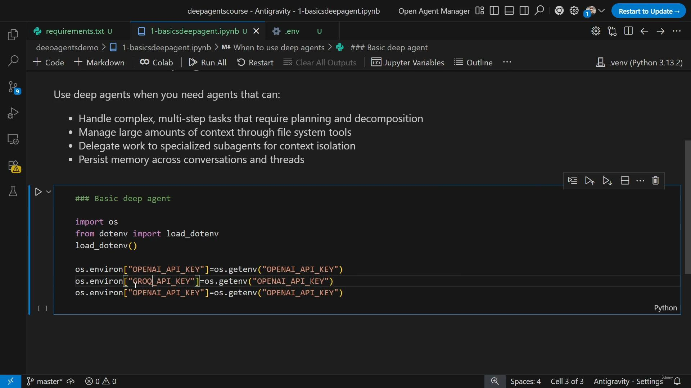
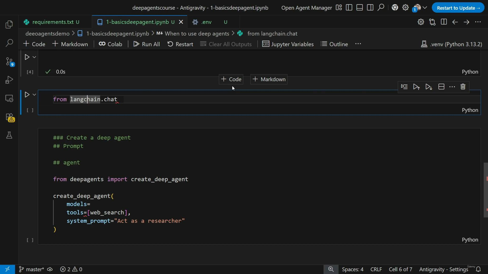
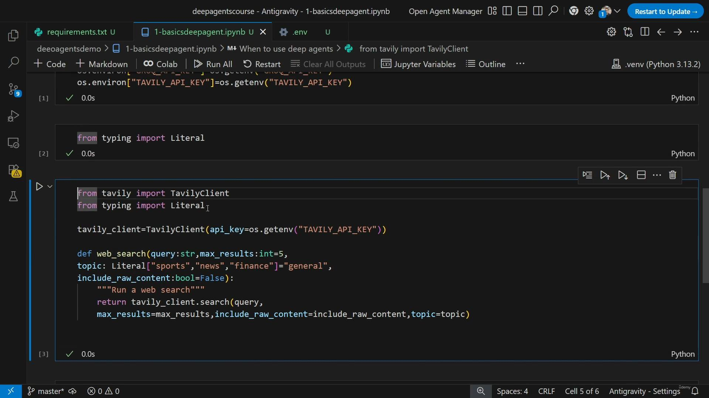

# AI Security Bootcamp part3 课程文档（p016：Deep Agents 入门实现）

> **阅读提示**：本节 p016 的逐字稿实际内容为 **Deep Agents（深度智能体）的概念与最小实现**，与课程标题里的“护栏 / 网关 / 可观测”没有直接对应关系。本文严格按逐字稿复现，不把逐字稿没讲的安全组件安到讲师头上。如果你是按标题来找护栏/网关内容的，这一节可以当作“Agent 架构基础”来看。

---

## 1. 这一节做什么

这一节要从一个空文件夹开始，做出一个**能跑起来的 Deep Agent 最小项目**。它不是一个只讲概念的架构课：讲师会先对比“普通 Agent / ReAct Agent / Deep Agent”三种结构，然后打开 IDE，用 `uv` 初始化项目、创建虚拟环境、写 `requirements.txt`、配置 `.env`、安装 `deepagents`、`langchain`、`langchain-openai`、`groq`、`ipykernel`、`tavily-python`、`python-dotenv`，最后在 Jupyter Notebook 里写出一个带 Tavily 联网搜索工具的 Deep Agent，并用 `agent.invoke()` 实际跑一次“What is deep agent?”的查询。

最终产物是一个目录，结构如下：

```text
deep_agent_course/
├── VENV/                          # uv venv VENV 创建的虚拟环境
├── requirements.txt               # 本节全部依赖
├── .env                           # 四个 API Key
├── .env.example                   # Key 的模板（建议提交到 git 时用这个）
├── pyproject.toml                 # uv init 生成
├── uv.lock                        # uv 安装后生成
└── deep_agents_demo/
    └── basic_deep_agent.ipynb     # 讲师实际写的 notebook
```

如果你不想用 notebook，第 4 节也给了一个可以直接 `python basic_deep_agent.py` 运行的完整脚本，代码内容和 notebook 里一致。

这一节的目标不是把 Deep Agent 做到生产级，而是让你亲眼看到：

1. Deep Agent 和普通 Agent 在**结构上**差在哪里；
2. `create_deep_agent()` 这个 API 长什么样、需要哪几个参数；
3. 一个真实的工具（Tavily 联网搜索）怎么接进去；
4. 跑完之后 `result["messages"]` 和 `result["files"]` 里分别有什么。

---

## 2. 讲师原话

> "今天这节课我要讲一个非常重要的主题，叫做 deep agents。如果你看 ChatGPT、Claude Code、Manus AI 这些公司，它们都有自己的 deep research agent，而这些 deep research agent 本质上就是 deep agents。"
> —— p016 [00:00]

> "这个输入给到 LLM，LLM 基本上就像大脑。它会决定是直接生成输出，还是需要和某种工具通信。"
> —— p016 [01:19]

> "复杂查询无法被处理，它需要被分解成子查询。而且在这种简单循环里，上下文保留非常有限。"
> —— p016 [04:11]

> "在 deep agent 里，有四个重要属性：第一是 planning tool，第二是 sub agents，第三是 system prompt，第四是 file system。"
> —— p016 [09:40]

> "file system 基本上是一个持久记忆，所有子 agent 都可以访问它。子 agent 可以把任务结果保存在这个持久记忆里，形式可以是文件、共享记忆等等，所有子 agent 可以互相通信。"
> —— p016 [14:22]

> "deep agents 是一个独立库，用来构建能处理复杂多步任务的 agent。它构建在 LangGraph 之上，灵感来自 Claude Code、Manus、OpenAI 的 deep research。"
> —— p016 [19:04]

> "当你需要 agent 处理复杂多步任务，需要规划、分解、通过文件系统工具管理大量上下文、把工作委派给专门子 agent 做上下文隔离、跨会话和线程持久记忆时，就用 deep agents。"
> —— p016 [21:51]

> "这些参数都是 Tavily client 要求的，所以我们在这里硬编码了所有必要选项。而且这些参数应该保持同样的顺序，有时候顺序变了，你可能就拿不到正确输出。"
> —— p016 [30:16]

> "create_deep_agent 需要一些参数。第一是 tools，第二是 system prompt，第三是 model。"
> —— p016 [33:08]

> "它报错说关键字参数 models，你是不是想写 model？好，我改成 model。"
> —— p016 [35:31]

> "在 deep agent 里，自动挂上了一些 middleware hooks：有 tool call 相关的 hook、summarization hook，模型之后还有 to-do list。to-do list 会自动创建，用来跟踪任务执行。"
> —— p016 [37:28]

> "deep agent 是一个端到端的深度研究 agent。你可以看到它也创建了文件。"
> —— p016 [40:22]

> "在第二部分，我们会尝试定制 deep agent，会用到 model、system prompt、tools，还会涉及 backend、sub agents 和 interrupts。"
> —— p016 [43:10]

---

## 3. 从零复现

### 3.1 先理解三种 Agent 的差别（不然代码会写得很盲目）

讲师在写代码前花了大约 17 分钟做结构对比。这一段不是废话，它直接决定了后面 `create_deep_agent()` 为什么有 `system_prompt`、`tools`、`model` 这三个参数，以及为什么跑完会出现 `files`。

**第一种：最普通的 Agent（讲师叫它 shallow agent）**

结构是：输入 → LLM（当大脑）→ 决定直接输出，或调用某个工具 → 工具返回 → 输出。讲师举的例子是查“班加罗尔或巴黎当前温度”，LLM 没有实时数据，所以接一个 SERP API、Tavily API 或天气 API。这个流程只走一圈，没有回到 LLM 再做第二轮决策，也没有显式规划。



讲师指出的问题有两个：一是**没有显式规划**，复杂查询不会先被拆成子查询；二是**上下文保留有限**，一轮输出完，上下文就断了。所以这种结构不适合“帮我找今天 AI 新闻，并分析它和经济学、物理学最新发展的关系”这类需要分解的查询。



**第二种：ReAct Agent**

LLM 同时连接很多工具，比如 Wikipedia、搜索 API、Tavily。输入查询后，LLM 带着 system prompt 决定先调哪个工具；工具输出作为上下文回传给 LLM；LLM 再决定要不要继续调工具。这个“act → observation → 再 act”的循环可以发生任意多次，直到复杂查询被解决。



但讲师仍然把它归为 shallow agent，原因是：它本质上还是“LLM + 工具”的循环，没有 planning、没有结构化计划、没有深度推理、没有状态管理、没有持久记忆。它比第一种强，但没有质变。

**第三种：Deep Agent**

Deep Agent 有四个核心组件，讲师在屏幕上逐条列出来：

1. **planning tool**：查询进来先做计划，不直接打工具；
2. **sub agents**：计划需要被拆给多个子 agent 执行；
3. **system prompt**：规定 agent 的语气、行为、编码风格等；
4. **file system**：所有子 agent 都能访问的持久记忆，用来存中间结果、共享上下文。



讲师用“巴黎度假”举例：预算 10 万卢比、4 天。查询进来后，planning 先产出一个 to-do list——第一天飞巴黎、住某酒店、价格多少；第二天早餐在哪、去埃菲尔铁塔；第三天去另一个景点；第四天回印度、航班和每天成本。这个 to-do list 会明确“订什么、不订什么”。然后 sub agent 1 执行第一条，sub agent 2 执行第二条，以此类推。每个子 agent 都需要 system prompt 来规定行为，执行结果写进 file system，其他子 agent 可以读。



第二个例子是“博客写作”：to-do list 是“研究博客 → 从论文/外部材料做更多研究 → 写博客 → 版权检查”。研究子 agent 需要互联网访问；更多研究子 agent 需要访问 archive/论文；写作子 agent 有写作专长；版权检查子 agent 从互联网查重。这些任务可以并行。



讲师还专门展示了 Claude Code 的 system prompt 片段，说明 Deep Agent 的 system prompt 可以非常具体。译文如下：

> "你是 Claude Code，Anthropic 官方的代码 CLI。你是一个交互式 CLI 工具，帮助用户完成软件工程任务。使用下面的指令和可用工具来协助用户。只协助防御性安全任务，拒绝创建、修改、改进可能被恶意使用的代码。"
> —— p016 [11:05]

这段在逐字稿里是讲师念屏幕上的英文，本文按中文引用。它说明 system prompt 不只是“你是一个助手”，而是可以写角色、边界、安全约束。

### 3.2 准备环境

你需要：

- 一个装了 **Python** 的机器（讲师没有在逐字稿里念 Python 版本号，课里没讲具体版本；建议 3.10 以上，因为 `deepagents` 和 LangGraph 生态通常要求较新的 Python）；
- **uv** 包管理器（讲师全程用 uv，没有用 pip）；
- 一个 IDE。讲师用的是 **Google Antigravity**，但他明确说“你可以用任何符合你需求的 IDE”；
- 四个 API Key：OpenAI、Groq、Google、Tavily。其中 Tavily 是本节真正会用到的联网搜索 key；Groq 是默认模型来源；OpenAI 和 Google 是备选模型来源，讲师先把 key 配好，方便后面切模型。

### 3.3 初始化项目

在终端里进入一个空文件夹，讲师把它命名为 `deep_agent_course`。然后执行：

```bash
uv init
```

讲师的原话是“write UV in it”，执行后项目工作区就被初始化了。`uv init` 会生成 `pyproject.toml` 等文件。

接着创建虚拟环境：

```bash
uv venv VENV
```

讲师把虚拟环境名写成 `VENV`。执行后终端会提示虚拟环境已创建。

然后激活虚拟环境。**讲师只说“激活”，没有念出具体命令**，所以这里按操作系统补全：

```bash
# Windows PowerShell / CMD
VENV\Scripts\activate

# macOS / Linux
source VENV/bin/activate
```

激活后，终端提示符前面通常会出现 `(VENV)`。

### 3.4 写 requirements.txt

在项目根目录创建 `requirements.txt`，逐行写入讲师口述的库：

```text
deepagents
langchain
langchain-openai
groq
ipykernel
tavily-python
python-dotenv
```

讲师特别解释了 `ipykernel` 的用途：它只是用来把 kernel 附加到 Jupyter Notebook。`tavily-python` 是联网搜索工具；`python-dotenv` 用来加载 `.env`。讲师没有指定版本号，**课里没讲版本号**，所以上面不锁版本。如果你希望可复现性更强，可以在安装后把 `uv.lock` 提交到仓库。

安装：

```bash
uv add -r requirements.txt
```

讲师执行后看到 langgraph 也被自动安装了，因为 `deepagents` 依赖 LangGraph。他在视频里说“默认安装 deep agents 时，langgraph 也会被安装”。这是正常的依赖传递。



### 3.5 配置 .env

在项目根目录创建 `.env`，写入四个 key。讲师口述的四个 key 是：OpenAI key、Groq API key、Google API key、Tavily API key。按各家 SDK 的常见约定，变量名写成：

```bash
OPENAI_API_KEY=sk-xxxxxxxxxxxxxxxx
GROQ_API_KEY=gsk_xxxxxxxxxxxxxxxx
GOOGLE_API_KEY=xxxxxxxxxxxxxxxx
TAVILY_API_KEY=tvly-xxxxxxxxxxxxxxxx
```

> 说明：逐字稿没有逐字拼出变量名，只念了“OpenAI key / Groq API key / Google API key / Tavily API key”。上面用的是各家 SDK 的标准环境变量名。如果你的 SDK 版本要求别的名字，以报错为准。

Tavily key 的获取方式，讲师在视频里演示了：浏览器搜索 Tavily，进入官网，用 Google 登录，登录后就能看到 key，复制即可。Tavily 提供实时互联网搜索。



### 3.6 创建 notebook 并选择 kernel

在项目里新建文件夹 `deep_agents_demo`，在里面新建 `basic_deep_agent.ipynb`。打开 notebook 后，第一件事是**选择 kernel**，要选到刚才创建的 `VENV`。讲师在视频里明确做了这一步。

他还建议在 notebook 开头写一段定义/笔记，方便以后回看：

```markdown
# Deep Agents Overview

Build agents that can plan, use sub agents, leverage file systems for complex tasks.

## When to use deep agents

Use deep agents when you need agents that can:
- handle complex multi-step tasks that require planning
- decomposition
- manage large amounts of context through file system tools
- delegate work to specialized sub-agents for context isolation
- persist memory across conversation and thread
```

这段就是讲师在 notebook 里敲进去的“when to use”要点，对应 [21:51] 那段口述。

### 3.7 写代码并运行

代码分几个 cell 写。完整的合并版本见第 4 节。运行顺序是：

1. 先跑 import 和 `load_dotenv()`；
2. 再跑 Tavily client 初始化；
3. 再跑 `web_search` 定义；
4. 再跑模型初始化和 `create_deep_agent()`；
5. 最后跑 `agent.invoke()` 和结果展示。

讲师第一次写 `create_deep_agent` 时把参数写成了 `models=`，运行报错：

```text
unexpected keyword argument 'models'. Did you mean 'model'?
```

他改成 `model=` 后通过。这个报错本身就是重要信息：`create_deep_agent` 的参数名是单数 `model`，不是 `models`。

同样，他在对比普通 agent 时先写了 `tool=`，报错提示 `Did you mean 'tools'?`，改成 `tools=` 后通过。也就是说 `create_agent` 的参数名是复数 `tools`。



运行查询：

```python
result = agent.invoke({
    "messages": [
        {"role": "user", "content": "What is deep agent?"}
    ]
})
```

讲师原本想问“What is lang graph?”，后来改成“What is deep agent?”。这个问题会触发 Deep Agent 内部的流程：模型先生成 to-do list，把问题拆成子任务；需要联网时调用 `web_search`；工具结果回传后做 summarization；最后输出。

查看最终回答：

```python
result["messages"][-1].content
```

查看文件系统状态：

```python
result["files"]
```

讲师在视频里看到 `files` 里包含 large tool results、content、query、follow-up questions、results URL、title、修改位置和时间等信息。他的解释是：Deep Agent 会把大上下文写进文件系统，可能是 txt，也可能是其他格式，用来保留上下文；文件信息里能看到“在什么位置、什么时间被修改”。



### 3.8 和普通 Agent 对比（可选，但建议做）

讲师在同一 notebook 里又写了一个普通 agent：

```python
from langchain.agents import create_agent

simple_agent = create_agent(
    model=model,
    tools=[web_search],
)
print(simple_agent)
```

他把两个 agent 并排看，结论是：普通 agent 和 deep agent 在“有 model、有 tools”这一点上看起来一样，但 deep agent 内部自动挂了 middleware hooks：tool call 相关 hook、summarization hook、模型之后的 to-do list。普通 agent 则是 nodes、graphs、edges 在通信；你也可以自己给普通 agent 加 middleware，但默认没有这些。

在 JS/Node 里，middleware 可以类比成 Express 的 `app.use()` 或 Axios 的 interceptor：请求/响应经过它时会被拦截、改写、记录。Deep Agent 的 middleware 就是在模型调用和工具调用之间插入的“钩子”。

---

## 4. 完整代码

### 4.1 requirements.txt

```text
deepagents
langchain
langchain-openai
groq
ipykernel
tavily-python
python-dotenv
```

### 4.2 .env.example

```bash
# 复制为 .env 后填入真实值
OPENAI_API_KEY=
GROQ_API_KEY=
GOOGLE_API_KEY=
TAVILY_API_KEY=
```

### 4.3 basic_deep_agent.py（可直接保存运行）

> 说明：讲师实际是在 `basic_deep_agent.ipynb` 里分 cell 写的。下面把 cell 合并成一个完整 Python 文件，逻辑与顺序不变。模型 ID 那行逐字稿只念了“grok when 32 billion”，没有拼出完整字符串，所以这里用环境变量 `GROQ_MODEL` 兜底，并给一个 Groq 常用模型作为默认值；你应换成自己 Groq 账号里可用的模型。

```python
# basic_deep_agent.py
import os

from dotenv import load_dotenv

# 1. 加载 .env
load_dotenv()

# 2. 讲师口述的四个 key 已由 load_dotenv 载入
#    OPENAI_API_KEY / GROQ_API_KEY / GOOGLE_API_KEY / TAVILY_API_KEY
#    下面这行只是显式检查 Tavily key 是否存在，不存在就尽早报错
if not os.getenv("TAVILY_API_KEY"):
    raise RuntimeError("缺少 TAVILY_API_KEY，请先在 .env 里配置")

# 3. Tavily 客户端
from tavily import TavilyClient

tavily_client = TavilyClient(api_key=os.getenv("TAVILY_API_KEY"))

# 4. 类型标注
from typing import Literal

# 5. 联网搜索工具
def web_search(
    query: str,
    max_results: int = 5,
    topic: Literal["sports news", "news", "finance", "general"] = "general",
    include_raw_content: bool = False,
):
    """
    Tavily 实时联网搜索工具。
    参数顺序按讲师演示：query -> max_results -> include_raw_content -> topic。
    """
    return tavily_client.search(
        query=query,
        max_results=max_results,
        include_raw_content=include_raw_content,
        topic=topic,
    )

# 6. 创建 Deep Agent
from deepagents import create_deep_agent
from langchain.chat_models import init_chat_model

# 讲师口述的模型名逐字稿记为 "grok when 32 billion"，
# 无法确定完整模型 ID；这里用环境变量兜底，默认给一个 Groq 常用模型。
MODEL_ID = os.getenv("GROQ_MODEL", "groq:llama-3.3-70b-versatile")
model = init_chat_model(MODEL_ID)

agent = create_deep_agent(
    tools=[web_search],
    system_prompt="Act as a researcher.",
    model=model,
)

# 7. 运行
if __name__ == "__main__":
    result = agent.invoke({
        "messages": [
            {"role": "user", "content": "What is deep agent?"}
        ]
    })

    print("===== 最终回答 =====")
    print(result["messages"][-1].content)

    print("\n===== files =====")
    print(result.get("files"))
```

### 4.4 普通 Agent 对比代码（可选）

```python
# simple_agent_compare.py
import os
from dotenv import load_dotenv
load_dotenv()

from tavily import TavilyClient
from typing import Literal
from langchain.chat_models import init_chat_model
from langchain.agents import create_agent

tavily_client = TavilyClient(api_key=os.getenv("TAVILY_API_KEY"))

def web_search(
    query: str,
    max_results: int = 5,
    topic: Literal["sports news", "news", "finance", "general"] = "general",
    include_raw_content: bool = False,
):
    return tavily_client.search(
        query=query,
        max_results=max_results,
        include_raw_content=include_raw_content,
        topic=topic,
    )

MODEL_ID = os.getenv("GROQ_MODEL", "groq:llama-3.3-70b-versatile")
model = init_chat_model(MODEL_ID)

simple_agent = create_agent(
    model=model,
    tools=[web_search],
)

print(simple_agent)
```

### 4.5 notebook cell 划分（如果你照讲师用 .ipynb）

```python
# Cell 1
import os
from dotenv import load_dotenv
load_dotenv()

# Cell 2
from tavily import TavilyClient
tavily_client = TavilyClient(api_key=os.getenv("TAVILY_API_KEY"))

# Cell 3
from typing import Literal

def web_search(
    query: str,
    max_results: int = 5,
    topic: Literal["sports news", "news", "finance", "general"] = "general",
    include_raw_content: bool = False,
):
    return tavily_client.search(
        query=query,
        max_results=max_results,
        include_raw_content=include_raw_content,
        topic=topic,
    )

# Cell 4
from deepagents import create_deep_agent
from langchain.chat_models import init_chat_model

MODEL_ID = os.getenv("GROQ_MODEL", "groq:llama-3.3-70b-versatile")
model = init_chat_model(MODEL_ID)

agent = create_deep_agent(
    tools=[web_search],
    system_prompt="Act as a researcher.",
    model=model,
)
print(agent)

# Cell 5
result = agent.invoke({
    "messages": [
        {"role": "user", "content": "What is deep agent?"}
    ]
})

# Cell 6
result["messages"][-1].content

# Cell 7
result["files"]
```

---

## 5. 逐行解释

**`load_dotenv()`**：把 `.env` 里的键值读进 `os.environ`。在 Node 里对应 `require('dotenv').config()`。讲师在 notebook 里还额外写了一些 `os.environ[...]` 的赋值，逐字稿没有念全具体键名；实际上 `load_dotenv()` 已经能把四个 key 载入，后面的 `os.getenv()` 直接读即可。

**`TavilyClient(api_key=os.getenv("TAVILY_API_KEY"))`**：创建 Tavily 客户端。讲师说“Tavily 提供实时互联网搜索，登录后就能拿到 key，复制过来用”。这个 client 后面只被 `web_search` 使用。

**`query: str`**：搜索关键词，必填。

**`max_results: int = 5`**：返回结果条数。讲师说“我想最多五条结果”。

**`topic: Literal["sports news", "news", "finance", "general"] = "general"`**：新闻分类。讲师原话是“我想要体育新闻、新闻、金融，这些我们特别使用的分类”，并说默认可以给 `sports news` 或 `general`。这里保留了他口述的四个值。需要注意：Tavily 实际支持的 `topic` 枚举可能只有 `general`、`news`、`finance`，`sports news` 是否合法要以 Tavily 文档为准；如果 SDK 报非法枚举，把它删掉或改成 `general`。**课里没讲这个枚举的完整合法值列表**。

**`include_raw_content: bool = False`**：是否返回原始正文。讲师明确说“这是布尔值，默认 false”。

**为什么参数要按这个顺序**：讲师在 [30:16] 强调“这些参数是 Tavily client 要求的，顺序应该保持一致，顺序变了可能拿不到正确输出”。严格说，Python 用关键字参数传参时顺序不影响结果，但讲师是按 Tavily 文档的参数顺序照抄的；为了避免 SDK 版本差异和签名变化，照抄这个顺序最稳。

**`return tavily_client.search(...)`**：把 Tavily 的返回直接交给 agent。讲师在 [30:44] 说“这就是我的 web search 功能，它返回的就是通过 Tavily client 在互联网上做的查询”。

**`from deepagents import create_deep_agent`**：这是本节的核心 API。讲师说 `deepagents` 是“一个独立库，用来构建能处理复杂多步任务的 agent，构建在 LangGraph 之上，灵感来自 Claude Code、Manus、OpenAI deep research”。

**`from langchain.chat_models import init_chat_model`**：初始化聊天模型。讲师说“你可以用任何 chat model，OpenAI、Google Gemini、Chat Groq 都行”。他实际选了 Groq。

**`model = init_chat_model(MODEL_ID)`**：模型对象。讲师口述的模型名逐字稿写作“grok when 32 billion”，没有拼出完整字符串；本文用 `GROQ_MODEL` 环境变量兜底，并给 `groq:llama-3.3-70b-versatile` 作为默认值。**准确模型 ID 请以你的 Groq 控制台为准**，如果报“model not found”，换一个你账号可用的 Groq 模型即可。

**`create_deep_agent(tools=[web_search], system_prompt="Act as a researcher.", model=model)`**：三个参数分别对应讲师说的“第一是 tools，第二是 system prompt，第三是 model”。

- `tools` 是列表，放你定义的函数工具；本节只有 `web_search`。讲师说“你可以开发任意数量的工具接进来”。
- `system_prompt` 是角色设定。讲师写的是“Act as a researcher.”，并说“它可以是一个简单 prompt，也可以是一个复杂 prompt”。
- `model` 是模型对象。注意参数名是单数 `model`；讲师第一次写 `models=` 时报错 `Did you mean 'model'?`，改成 `model` 才通过。

**`agent.invoke({"messages": [{"role": "user", "content": "What is deep agent?"}]})`**：LangChain/LangGraph 的标准调用方式。`messages` 是消息列表，每条有 `role` 和 `content`。讲师原本想问“What is lang graph?”，后来改成“What is deep agent?”。

**`result["messages"][-1].content`**：取最后一条消息的文本，也就是最终回答。讲师说“这是真正的输出”。

**`result["files"]`**：查看 Deep Agent 的文件系统状态。讲师在 [40:22] 说“它创建了文件”，并在 [41:16] 说 files 里能看到 large tool results、content、query、follow-up questions、results URL、title、修改位置和时间。**注意：这些字段名是逐字稿口述的，不是逐字稿里出现的完整 JSON 键名；实际键名请以你运行后的输出为准。**

**Middleware hooks 是什么**：讲师在 [37:28] 说 Deep Agent 自动挂了 middleware hooks——tool call 相关 hook、summarization hook、模型之后的 to-do list。to-do list 自动创建，用来跟踪任务执行；对话持续时自动做 summarization。普通 agent 默认没有这些，它是 nodes、graphs、edges 在通信；你也可以手动给普通 agent 加 middleware，但要自己写。前端同学可以把 middleware 理解成 Express 的 `app.use()`、Axios interceptor 或 Koa 的洋葱模型：在模型调用和工具调用之间插入一层，做记录、改写、摘要、任务跟踪。

**File system 为什么重要**：讲师说它是“持久记忆，所有子 agent 可访问；子 agent 可以把任务结果保存在里面，形式可以是文件、共享记忆；所有子 agent 可以互相通信”。在 JS/Node 里，这类似一个所有 worker 都能读写的共享存储（比如 Redis 或对象存储），而不是每个 agent 各自的内存变量。

**Sub agents 为什么重要**：讲师用巴黎度假和博客写作两个例子说明：to-do list 拆出来后，每个子任务交给一个专门子 agent，子 agent 有自己的工具权限（比如研究子 agent 能上网、论文子 agent 能访问 archive、写作子 agent 有写作专长），并且可以并行。在 JS/Node 里，类似 `Promise.all()` 并发跑多个专门 worker，每个 worker 只拿自己需要的上下文，避免把所有上下文塞进一个模型。

**Planning tool 为什么重要**：讲师说查询进来先做计划，“通常 Claude Code 里的 planning 就是一个 to-do list”。它解决的是普通 agent “没有显式规划、复杂查询不会分解”的问题。

---

## 6. 复现检查清单

按顺序打勾：

- [ ] 终端里能执行 `uv --version`，说明 uv 已安装。
- [ ] 在空目录执行过 `uv init`，能看到 `pyproject.toml`。
- [ ] 执行过 `uv venv VENV`，目录里出现 `VENV/`。
- [ ] 激活虚拟环境成功，终端提示符带 `(VENV)`。
- [ ] `requirements.txt` 包含 `deepagents`、`langchain`、`langchain-openai`、`groq`、`ipykernel`、`tavily-python`、`python-dotenv`。
- [ ] 执行过 `uv add -r requirements.txt`，没有报依赖冲突；安装日志里能看到 `langgraph` 被带入。
- [ ] `.env` 里四个 key 都有值，且 `TAVILY_API_KEY` 不是空字符串。
- [ ] Tavily 账号已登录并复制了 key；如果 key 失效，`web_search` 会报 401/403。
- [ ] Jupyter notebook 的 kernel 选的是 `VENV`，不是系统 Python。
- [ ] `from deepagents import create_deep_agent` 不报 `ModuleNotFoundError`。
- [ ] `create_deep_agent` 的参数写的是 `model=`，不是 `models=`。
- [ ] `create_agent` 的参数写的是 `tools=`，不是 `tool=`。
- [ ] `agent.invoke()` 的输入是 `{"messages": [{"role": "user", "content": "..."}]}`。
- [ ] 运行后 `result["messages"][-1].content` 有非空文本。
- [ ] `result["files"]` 能打印出内容；如果键不存在，用 `result.get("files")` 并打印 `result.keys()` 看实际结构。
- [ ] 如果 Groq 报模型不存在，换一个你账号里可用的 Groq 模型 ID，或改用 OpenAI/Google 模型。

---

## 7. 课里没讲但你会撞上的

1. **Python 版本**：讲师没有念版本号。`deepagents` 和 LangGraph 生态通常要求较新的 Python；如果你用很老的 3.8，可能装不上。建议 3.10+，具体以 `uv add` 的报错为准。

2. **uv 怎么安装**：课里没讲。你需要先按 uv 官方文档安装 uv，否则 `uv init` 直接 command not found。

3. **虚拟环境激活命令**：讲师只说“激活”，没有念命令。Windows 用 `VENV\Scripts\activate`，macOS/Linux 用 `source VENV/bin/activate`；如果你用 fish、PowerShell 或 Conda，命令可能不同。

4. **Groq 模型 ID**：逐字稿只念了“grok when 32 billion”，没有完整字符串。本文默认给 `groq:llama-3.3-70b-versatile`，这是兜底值，不代表讲师当时用的就是它。你应在 Groq 控制台确认可用模型，或设置 `GROQ_MODEL` 环境变量覆盖。

5. **`init_chat_model` 的导入路径**：不同 LangChain 版本可能在 `langchain.chat_models` 或别的位置。课里用的是 `from langchain.chat_models import init_chat_model`；如果你装到的版本报找不到，查一下当前版本的文档。

6. **`create_agent` 的可用性**：`from langchain.agents import create_agent` 在不同 LangChain 版本里名字可能不同（有的版本叫 `create_react_agent` 或在别的模块）。课里演示的是 `create_agent`；如果你报 `ImportError`，以你安装的 LangChain 版本为准。

7. **`topic` 枚举值**：讲师写了 `sports news`、`news`、`finance`、`general`。Tavily 实际合法枚举可能不含 `sports news`；如果 SDK 报非法值，删掉它或改成 `general`。

8. **Tavily 免费额度和速率限制**：课里没讲。免费账号有调用次数限制，跑多次 Deep Agent 可能很快用完；报 429 时不是代码错，是额度/速率问题。

9. **`result["files"]` 的字段名**：讲师口述了 large tool results、content、query、follow-up questions、results URL、title 等，但逐字稿没有给出完整 JSON 结构。你运行时先 `print(result.keys())`，再决定取哪个键；不要硬编码课里没确认的字段名。

10. **文件系统落盘位置**：讲师说 Deep Agent 可能把大上下文写成 txt 或其他文件，但课里没讲具体落盘目录。你可以在 `result["files"]` 里看“修改位置”信息，或查 `deepagents` 文档确认默认后端。

11. **Streaming**：讲师在 [40:22] 提到“我也会用 streaming 展示同样的事情”，但这一节没有展开写 streaming 代码。课里只跑了 `invoke()`；streaming 的实际写法课里没讲。

12. **Part 2 的内容**：讲师在 [43:10] 预告了 customization、model/system prompt/tools、backend、sub agents、interrupts，但这些属于下一节，本节没有实现。不要把 Part 2 的 API 提前写进这一节的代码里。

13. **网络与代理**：Tavily 和 Groq 都是外网服务；如果你在公司网络或需要代理，`web_search` 和模型调用可能超时。课里没讲代理配置，遇到连接错误先检查网络。

14. **API Key 计费**：课里没讲计费。OpenAI、Google、Groq、Tavily 都可能产生费用；跑之前确认你的账号额度和计费方式。