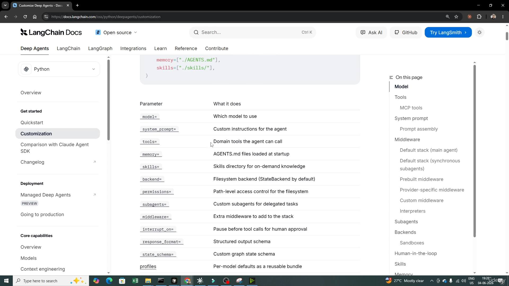
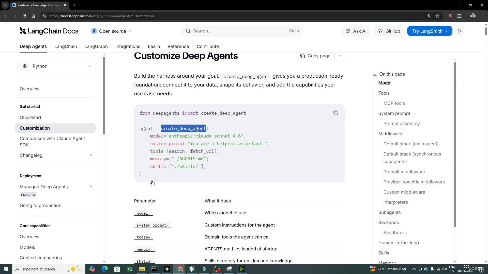
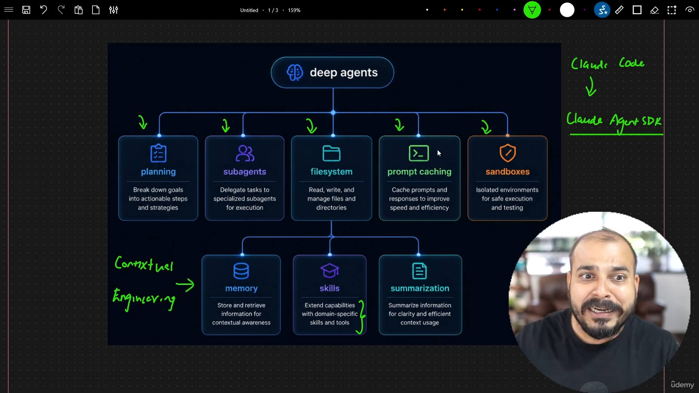
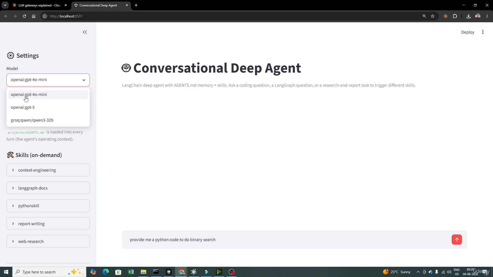
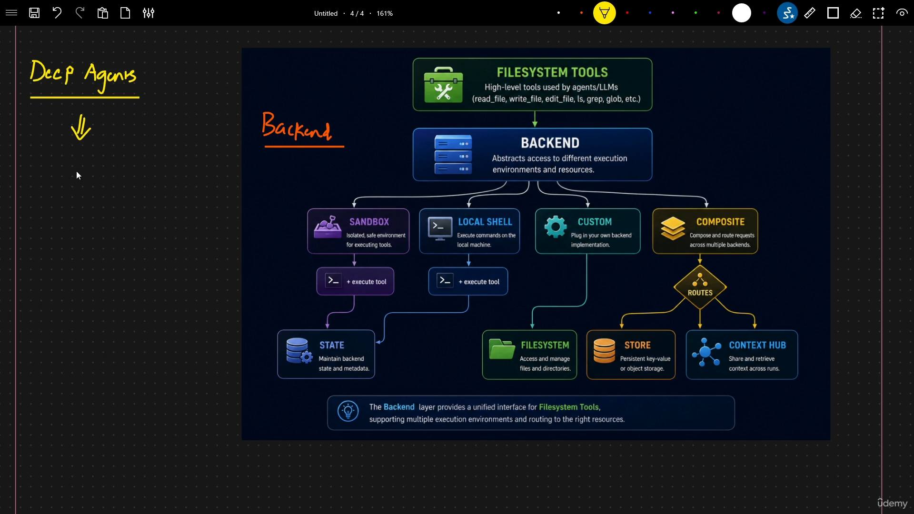
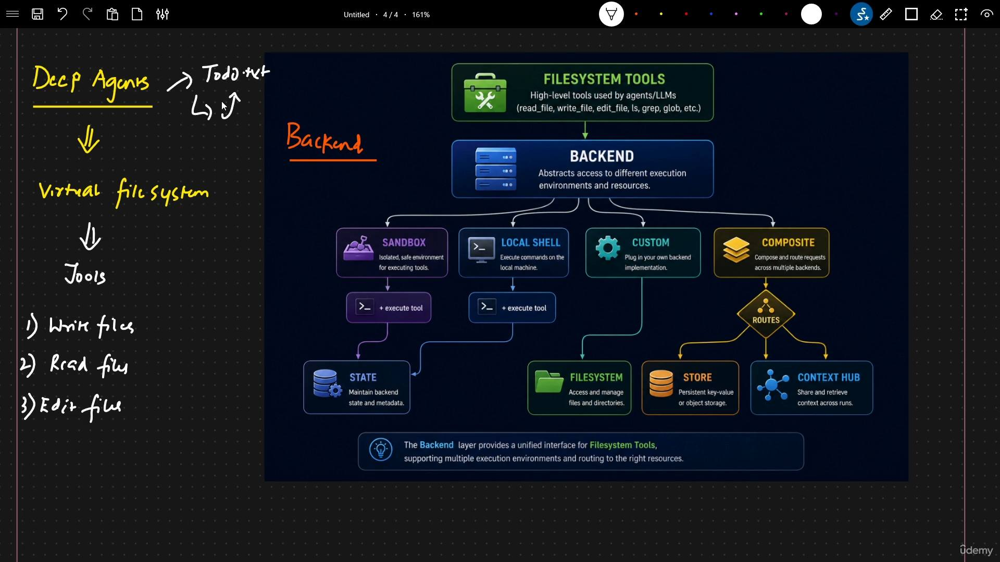
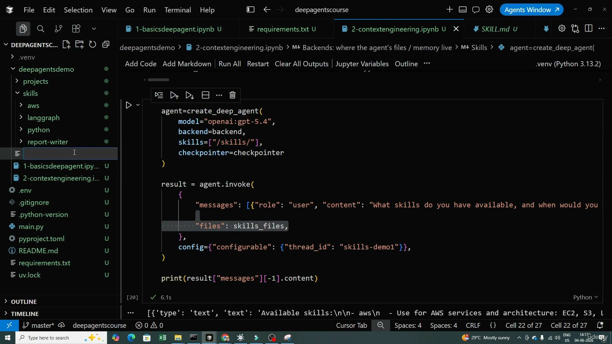
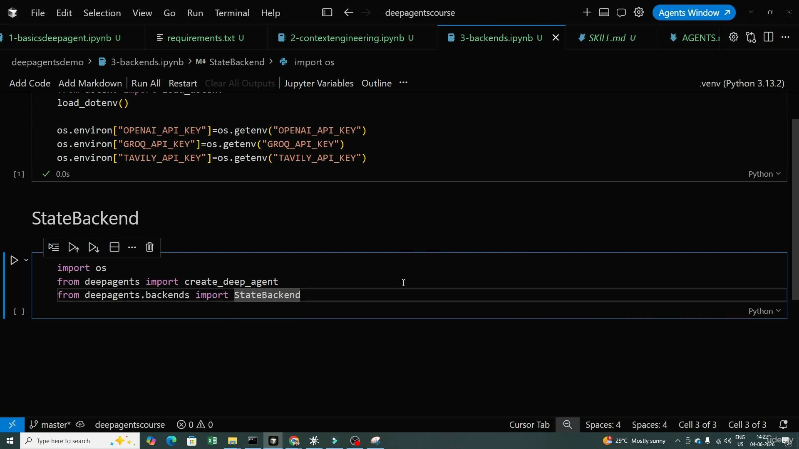
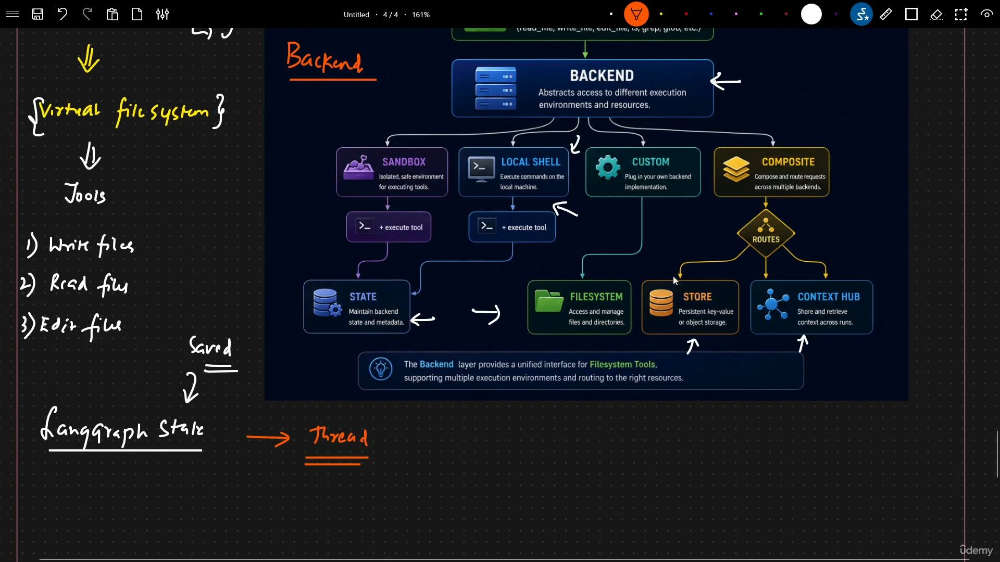

# Deep Agents 实战（P17–P19）：定制参数全景、与 Claude Agent SDK 的差异、Backend 三种落盘方式

> 本段覆盖 **P17–P19**。需要先说明一件事：这三节的逐字稿实际讲的是 **LangChain Deep Agents 的定制参数与 Backend（虚拟文件系统的数据到底放在哪）**，并不是标题里写的“护栏/网关/可观测”。这三节里唯一出现 “LLM gateway” 的地方，是讲师在 p018 的 demo 中把它当成提问素材（“What is LLM gateways?”），并没有展开讲网关本身。护栏、网关、可观测的实现，**课里没讲**，本文不编。
>
> 读完这一篇，你手上应该有一个能跑起来的 `3_backends.ipynb`，能亲眼看到：同一句“帮我建一个 `notes/todo.txt`”，在三种 backend 下文件分别落在 **LangGraph state（内存）／硬盘目录／InMemoryStore（内存）**，以及“换一个 thread 还能不能读到”。

---

## 1. 这一节做什么

这一节要交付的东西很具体：**一个 Jupyter notebook，文件名就叫 `3_backends.ipynb`（讲师在 p019 [04:34] 明确说“我就写 three backends 点 ipynb”），里面依次跑通三种 backend 实验。**

在学习目标上，这三节分成三层，逐层往下：

**第一层（p017）：把 `create_deep_agent` 的参数清单摊开。** 讲师没有逐个讲参数怎么用，他只是先把“这个函数能配什么”一次性列给你看，让你知道后面整个系列要讲的东西都挂在这份清单上。清单是：`model`、`system_prompt`、`tools`、`memory`、`skills`、`backend`、`permissions`、`sub_agents`、`middleware`、`interrupt`。本段只深入其中 **`backend`** 一个。

**第二层（p018）：搞清楚“为什么我们要自己造 deep agent”。** 讲师的论点是：Claude Code / OpenAI Codex 这类产品，内部跑的就是一个 deep agent（他称之为 Claude Agent SDK / Claude Code SDK），它具备 planning、派生 sub agents、读写目录文件、prompt caching、沙箱执行、memory、skills、summarization 这一整套能力。既然闭源产品是这样，那我们用开源的 LangGraph / LangChain 也能拼出同构的东西。这一层是**认知层**，不产出代码。

**第三层（p019）：backend 的三种实现，全部动手跑。** 这是本段唯一的产出层：
- **StateBackend**：文件住在 LangGraph state 里，也就是内存里；agent 会话一关，文件就没了；同一个 thread 内可见。
- **FilesystemBackend**：文件真的写到硬盘上，root 目录 = notebook 所在目录，你在编辑器侧栏里能直接看见 `notes/todo.txt`。
- **StoreBackend + InMemoryStore**：文件存在一个 key-value store 里，**不落盘**，但**跨 thread 可见**——thread 1 写的文件，thread 2 能读出来。

最终目录结构长这样：

```
deep-agents-lab/
├── .env                    # OPENAI_API_KEY / GROQ_API_KEY / TAVILY_API_KEY
├── requirements.txt
├── 3_backends.ipynb        # 主实验文件，课里就叫这个名字
└── notes/                  # 只有 FilesystemBackend 实验会真的生成它
    └── todo.txt
```

需要提前说明的版本问题：**课里没有讲任何依赖的版本号**，讲师全程只说了库名（`deepagents`、`langgraph`、`langchain`）。所以本文的 `requirements.txt` 不锁版本，而是在第 7 节告诉你上线前怎么自己锁。

---

## 2. 讲师原话

下面按“参数清单 → 产品对比 → backend 定义 → 三种实现”的顺序，把讲师的关键判断逐条摘出来（逐字稿是英文，以下为重译）。

**关于 `create_deep_agent` 的参数清单：**

> "用 `create_deep_agent` 这个函数来创建 deep agent 时，你会看到这里有非常多不同的参数。有 `model`，就是你能指定用哪个模型；有 `system_prompt`；有 `tools`，你能用不同种类的工具；然后有 `memory`、`skills`、`backend`、`permissions`、`sub_agents`、`middleware`、`interrupt`，还有一大堆别的选项。"
> —— p017 [00:29]

> "借助这些选项，你就能造出一个非常好的 deep agent，可以给它加额外的上下文工程，可以加额外的 skills。后面我们会一个一个把这些参数详细讲一遍。"
> —— p017 [00:59]

**关于 Claude Code 内部是什么：**

> "如果你看 Claude 或者 OpenAI Codex，或者你看 Claude Code，它们内部其实都用了一个叫 Claude Code SDK 或者 Claude Agent SDK 的东西。Claude Code 内部用的就是 Claude Agent SDK，而这个 SDK 本身就是一个特定的 deep agent，它在做这些任务。这就是我为什么要做这个系列——你需要理解，你怎么用 LangGraph、LangChain 这些开源库，也造出自己的 deep agent。"
> —— p018 [01:14]

> "当我们谈这些 deep agent 的时候，它内部会有这些功能：planning（规划）；有创建 sub agents 的能力；能读取、写入、管理目录里的文件；prompt caching；它还能在 sandbox 里跑——sandbox 就是一个隔离环境，比如 Claude Code，它所有东西都是在它内部的 sandbox 里验证运行的；然后还有 memory，可以在 deep agent 里存和取信息，用来做上下文感知；还有 skills，skills 就是带着领域知识和工具的扩展能力；还有 summarization。这些是每个 deep agent 都能轻松做到的硬核能力。"
> —— p018 [01:43]

**关于 Deep Agents 与 Claude Agent SDK 的差异：**

> "我从三个角度看差异：第一，主要目标，两边都是帮你构建长时间运行的多智能体工作流；第二，基础，Deep Agents 的基础是 LangGraph 和 LangChain，Claude Agent SDK 的基础是整套 Claude Code 基础设施；第三，模型支持，如果你用 LangChain，它支持 OpenAI、Anthropic、Gemini、Grok、本地模型，而 Claude Agent SDK 是专门面向 Claude 模型的。当然你也可以用 Ollama 去跑 Claude Code，但如果你真想让 Claude Agent SDK 跑得好，还是应该用 Claude 模型本身。"
> —— p018 [03:35]

> "核心优势，这边是多智能体编排和规划；那边是工具使用、运行时开发、开发者生产力、sub agents——这边你也可以建层级化的 sub agents，但那边是通过 Claude runtime 来做的。上下文管理，这边你要专门用不同类型的 memory 去把上下文管好，那边是 context isolation，由整个 Claude Code runtime 来管。"
> —— p018 [04:31]

> "skills，这边是内置的 skill 系统；那边也支持 Claude 生态的 skill，你也可以自己写 skill。hooks 和 events，两边都有；MCP 支持，两边也都有。核心设计原则——human in the loop、可观测性、最佳使用场景、厂商锁定，几乎两边都有。但 Claude Agent SDK 有它自己的 runtime，而 Deep Agents 是开源的，所以我们要看怎么把它实现出来。"
> —— p018 [05:29]

**关于 deep agent 的架构：**

> "任何一个任务的 deep agent 架构大概长这样：用户发来一个任务，supervisor（CEO）agent——它本身也是一个 agent——把它分配给各个 sub agents，最后可能用到各种工具、memory、向量库、API、数据库。Claude Agent SDK 的架构也是类似的样子。"
> —— p018 [05:55]

**关于 `agent.md` 这个 memory 文件：**

> "还有一个东西叫 memory，就是一个 `agent.md` 文件。这个 `agent.md` 每一轮都会被加载进 agent 的运行里。也就是说，每当你问一个问题，`agent.md` 里有什么信息，它都会跟着 prompt 一起被加载进去。"
> —— p018 [08:20]

> "然后你还有不同的 skills，skills 就是不同的能力，agent 可以用它们来回答。比如其中一个叫 python skill，里面写着'为任何编码请求写出干净、正确、可运行的 Python 代码，当用户让你写、实现、修的时候就用它'。当我问'给我一段二分查找的 Python 代码'时，第一件发生的事是它开始规划，然后它会把 `agent.md` 里的信息加载进上下文，接着去调这个 skill。"
> —— p018 [09:15]

**关于 backend 是什么：**

> "当我们说 backend，backend 到底是什么？很简单，它就是那个负责回答一个问题的组件。假设我对 deep agent 说：去建一个叫 `todo.txt` 的文件，在里面写点内容。这时候最大的问题就是——这个 deep agent 到底把文件写到哪里？是写进 RAM？写进硬盘？还是写到某个共享存储里？这些 virtual file system 有写文件、读文件、编辑文件、删除文件、搜索文件的所有命令，但问题还是那个：这个文件到底建在哪？这时候 backend 就登场了。backend 就是回答'agent 把文件写在哪、这个文件后来怎么样、它到底有没有被存到某个地方'的组件。"
> —— p019 [01:23]

> "所以你可以看到，这个 virtual file system 在那儿，backend 就像是对不同执行环境和资源的抽象访问。它可以把文件存到文件系统、存到 store、存到 context hub、存到 state；它也可以创建一个独立的 sandbox 环境去执行东西；它还能用本地 shell，甚至在本机上跑各种命令。这就是 deep agent 的本质——你看 Claude Code，它内部也是用某种本地 shell 去跑 shell 命令、在特定虚拟环境里装库、做各种事情。"
> —— p019 [03:11]

**关于 state backend：**

> "state backend 的虚拟文件系统住在 LangGraph state 里。也就是说，你创建 deep agent 时，它内部本来就是一个 LangGraph 的 agent 工作流；你用 state backend 存的所有文件，都只存在这个 LangGraph state 里。记住，这个 LangGraph state 里存的信息，在同一个 thread 下是全程可用的——你用同一个 thread 跟 deep agent 反复对话，你就能把那些信息取出来。"
> —— p019 [05:33]

> "当 agent 执行完、这个 agent 的工作结束、会话关闭的时候，整个文件会被自动删除。"
> —— p019 [07:22]

> "你可以看到它建了 `notes/todo.txt`，内容就是要求的那段。你可能会想：Krish，它是不是建在这了？你看，这里根本没有 `notes` 这个文件夹。它是直接建在 LangGraph state 里的，而 LangGraph state 存在 RAM 里。"
> —— p019 [10:13]

**关于 file system backend：**

> "file system backend 很简单：只要我让 deep agent 建文件或者做任何事，它就会直接存到根目录，也就是硬盘上。"
> —— p019 [12:31]

> "创建的时候，我先 import：`from deepagents.backends import FilesystemBackend`，然后设我的 root 目录——root 目录就是我这个 Jupyter notebook 所在的同一个目录。然后创建 agent，`model` 用 GPT 5.0，`backend` 用 `FilesystemBackend`，root 目录传进去，`virtual_mode` 传 true。"
> —— p019 [12:57]

> "现在这个文件你觉得会建在哪？我们打开 Ctrl+B 看一下——看，`notes` 建出来了，这就是我的 todo 文本。这个是真的存到硬盘上的。所以我们可以直接从硬盘读它。"
> —— p019 [13:56]

**关于 store backend：**

> "store backend 的基本原理很简单：它会创建一个持久化的键值存储或者对象存储。它是由一个 LangGraph store 支撑的 deep agent backend，因为它用的是 LangGraph 这些库，所以实际上是由 LangGraph store 来提供支撑，它会创建键值字典，把所有信息存在那儿。"
> —— p019 [15:20]

> "我们创建了一个叫 `demo_user` 的 namespace，这是我的 store，一个 in-memory store。用这个 store 建 agent，就得到一个带 store backend 的 agent，再给它一个静态 namespace。最棒的地方是：你可以用一个 thread 写，用另一个 thread 读。因为不同 thread 都能读到，都能拿到上下文。假设现在有两个会话在跑，一个会话写的文件，另一个 thread 也能直接从 in-memory store 里读到。"
> —— p019 [16:13]

> "有一件事你必须知道：用 store backend + in-memory store 的时候，文件根本不会落盘。它活在 RAM 里，活在 in-memory store 这个对象里，作为一个以 namespace 为键的条目。这是每个人都要知道的最重要的一点。"
> —— p019 [17:36]

> "每个 deep agent 都带着虚拟文件系统的工具，读写文件——但那些都只是抽象。**是 backend 决定数据物理上住在哪儿。** 默认是 state backend，然后有 file system backend、store backend。"
> —— p019 [18:05]

---

## 3. 从零复现

### 3.1 前置条件

- Python 3.11+（**课里没讲版本**，这是社区通行下限，装不上就往上加）
- 能联网，能拿到 OpenAI API key
- 一个 Jupyter 环境（讲师全程在 Jupyter notebook 里做）

### 3.2 第一步：建目录和虚拟环境

```bash
mkdir deep-agents-lab && cd deep-agents-lab
python3 -m venv .venv
source .venv/bin/activate        # Windows: .venv\Scripts\activate
python -m pip install -U pip
```

### 3.3 第二步：装依赖

把下面的 `requirements.txt` 存到项目根目录，然后 `pip install -r requirements.txt`：

```txt
deepagents
langgraph
langchain
python-dotenv
jupyterlab
```

**课里没讲版本号**。讲师全程只口述了库名。如果你要复现到“和课里一模一样”，请自己在安装后 `pip freeze > requirements.lock.txt` 把实际版本锁下来。

### 3.4 第三步：配 `.env`

讲师在 p019 [05:03] 说得很直白：“第一件事，你必须在任何时候把你需要的 key 都 import 进来，没有这些你什么都做不了。”他点名了三个 key：OpenAI、Groq，以及 “Table API key”（**这大概率是 Tavily 的语音识别错误，课里没有拼对；如果你不做 p018 demo 里的 web 搜索，这个 key 用不上，可以留空**）。

```bash
# .env
OPENAI_API_KEY=sk-xxxxxxxxxxxxxxxxxxxx
GROQ_API_KEY=gsk_xxxxxxxxxxxxxxxxxxxx
TAVILY_API_KEY=tvly-xxxxxxxxxxxxxxxxxxxx
```

> 注意：`.env` 一定加进 `.gitignore`。notebook 里千万别把 key 硬编码，否则你 cell 的输出（outputs）会把 key 一起提交上去。

### 3.5 第四步：新建 `3_backends.ipynb`

在项目根目录下执行 `jupyter lab`，新建一个 notebook，**文件名必须是 `3_backends.ipynb`**——因为 `FilesystemBackend` 的 root 目录用的是“notebook 所在目录”，文件名不影响路径，但讲师就是用的这个名，保持一致方便你对日志。

然后把第 4 节的代码按 cell 顺序粘进去，一个个 cell 执行。

### 3.6 第五步：实验一 —— StateBackend（默认）

跑 cell 1、cell 2、cell 3。你要观察三件事：

1. agent 回复“已经建好了”；
2. `result["files"]` 里能查到 `notes/todo.txt` 这个 key；
3. **侧边栏里没有 `notes/` 文件夹**——这正是讲师在 p019 [10:13] 强调的那个现象。文件不在磁盘上。

### 3.7 第六步：实验二 —— FilesystemBackend

跑 cell 4、cell 5、cell 6、cell 7。观察：

1. 跑完后侧边栏**真的出现了 `notes/todo.txt`**（讲师说“打开 Ctrl+B 看一下”——VS Code 里 Ctrl+B 是切侧边栏）；
2. `Path(root)/"notes"/"todo.txt"` 的 `.exists()` 返回 True；
3. 新建一个 `fresh_agent` 也能读到，因为它读的是硬盘，跟内存无关。

### 3.8 第七步：实验三 —— StoreBackend + InMemoryStore

跑 cell 8、cell 9。观察：

1. thread `"1"` 写文件成功；
2. 换 thread `"2"`，仍然能读出来——这就是讲师说的“一个会话写、另一个 thread 也能读”；
3. 磁盘上**没有**任何新文件。

### 3.9 第八步：做对比表

跑完三个实验，把讲师在 p019 [18:32]–[19:01] 给的对比结论自己填一遍，写进 notebook 的 markdown cell：

| backend | 数据住在哪 | 同一 thread 可见 | 跨 thread 可见 | agent 关闭后 | 重启后 |
|---|---|---|---|---|---|
| `StateBackend`（默认） | LangGraph state（RAM） | 是 | 否 | 文件被删除 | 没了 |
| `FilesystemBackend` | 本地磁盘 root 目录 | 是 | 是 | 还在 | 还在（文件真在硬盘上） |
| `StoreBackend` + `InMemoryStore` | InMemoryStore 对象（RAM），以 namespace 为键 | 是 | **是** | 在 store 对象还活着时还在 | 没了（课里原话：除非你做了持久化，否则不可用） |

---

## 4. 完整代码

> **重要声明**：下面所有代码都是按 p019 逐字稿**口述**整理的。讲师是边讲边敲，口述里出现了 `from deep agents import create deep agents`（复数）这类口语化读法，实际库的导出名是单数。**下面给出的是我认为能跑通的形式；如果你装的 `deepagents` 版本 API 不同，用 `import deepagents; print(dir(deepagents))` 和 `help(StoreBackend)` 对一下签名。** 课里没有 OCR 到任何代码，因此没有“原样照抄”的基准，只有讲师口述的参数名。

### 4.1 `.env`

```bash
# .env —— 放在 deep-agents-lab/ 根目录
OPENAI_API_KEY=sk-xxxxxxxxxxxxxxxxxxxx
GROQ_API_KEY=gsk_xxxxxxxxxxxxxxxxxxxx
TAVILY_API_KEY=tvly-xxxxxxxxxxxxxxxxxxxx
```

### 4.2 `requirements.txt`

```txt
deepagents
langgraph
langchain
python-dotenv
jupyterlab
```

### 4.3 `3_backends.ipynb` —— Cell 1：环境与 key

```python
# Cell 1：把所有 key 先加载进来
# 讲师原话：任何时候你都需要先把重要库和 key import 进来，没有这些什么都做不了
import os

from dotenv import load_dotenv

load_dotenv()  # 从同目录的 .env 读

OPENAI_API_KEY = os.environ["OPENAI_API_KEY"]
GROQ_API_KEY = os.getenv("GROQ_API_KEY", "")      # 本实验用不到，p018 demo 才用
TAVILY_API_KEY = os.getenv("TAVILY_API_KEY", "")  # 同理

# 课里口述的模型是 "GPT 5.0"
MODEL = "gpt-5.0"

print("OPENAI_API_KEY loaded:", bool(OPENAI_API_KEY))
print("MODEL:", MODEL)
```

### 4.4 Cell 2：StateBackend —— 不显式传参（默认就是它）

```python
# Cell 2：不传 backend，默认就是 StateBackend
from deepagents import create_deep_agent

agent = create_deep_agent(model=MODEL)

result = agent.invoke(
    {
        "messages": [
            {
                "role": "user",
                "content": (
                    "Create a file at notes/todo.txt with exactly this content: "
                    "record video, edit video, upload video. "
                    "Then tell me you have done it."
                ),
            }
        ]
    }
)

print(result["messages"][-1].content)
print("result keys:", list(result.keys()))
```

### 4.5 Cell 3：StateBackend —— 显式传参（等价写法）

```python
# Cell 3：显式传 backend=StateBackend()
# 讲师原话：这两段代码是一样的，你不传参数，默认就按 state backend 处理
from deepagents import create_deep_agent
from deepagents.backends import StateBackend

agent = create_deep_agent(
    model=MODEL,
    backend=StateBackend(),
)

result = agent.invoke(
    {
        "messages": [
            {
                "role": "user",
                "content": (
                    "Create a file at notes/todo.txt with exactly this content: "
                    "record video, edit video, upload video. "
                    "Then tell me you have done it."
                ),
            }
        ]
    }
)

# 讲师原话：写好的文件会出现在 result 的 files 里
files = result.get("files", {})
print("files keys:", list(files.keys()))
print(files)
```

### 4.6 Cell 4：StateBackend —— 同一个 thread 再读回来

```python
# Cell 4：同一个 thread 里，把刚写的文件读回来
# 讲师原话：如果你用同一个 thread 执行，你应该能把那些文件读出来
result2 = agent.invoke(
    {
        "messages": [{"role": "user", "content": "Read /notes/todo.txt back to me."}],
        # 讲师口述：这里把 files 详情也带上
        "files": files,
    },
    config={"configurable": {"thread_id": "demo-thread-1"}},
)

print(result2["messages"][-1].content)
```

### 4.7 Cell 5：FilesystemBackend —— 建 agent，root 用 notebook 目录

```python
# Cell 5：FileSystemBackend
# 讲师原话：root 目录就是我这个 Jupyter notebook 所在的同一个目录
from pathlib import Path

from deepagents import create_deep_agent
from deepagents.backends import FilesystemBackend

ROOT_DIR = str(Path.cwd())
print("ROOT_DIR =", ROOT_DIR)

agent_fs = create_deep_agent(
    model=MODEL,
    backend=FilesystemBackend(
        root_dir=ROOT_DIR,
        virtual_mode=True,   # 讲师口述：virtual mode 传 true
    ),
)

print("agent created with filesystem backend")
```

### 4.8 Cell 6：FilesystemBackend —— 写文件

```python
# Cell 6：让 agent 在硬盘上建 notes/todo.txt
result_fs = agent_fs.invoke(
    {
        "messages": [
            {
                "role": "user",
                "content": (
                    "Create a file at notes/todo.txt with exactly this content: "
                    "record video, edit video, upload video."
                ),
            }
        ]
    }
)

print(result_fs["messages"][-1].content)
```

### 4.9 Cell 7：FilesystemBackend —— 用 pathlib 直接验硬盘

```python
# Cell 7：绕开 agent，直接从硬盘验证
# 讲师原话：from pathlib import Path，读那个路径，看它存不存在，内容也在
from pathlib import Path

p = Path(ROOT_DIR) / "notes" / "todo.txt"
print("exists:", p.exists())
if p.exists():
    print("--- content ---")
    print(p.read_text())
```

### 4.10 Cell 8：FilesystemBackend —— 换一个全新 agent 再读

```python
# Cell 8：新建一个 fresh agent，同样配置，再读一次
# 讲师原话：我再建一个 fresh agent，让它把 notes/todo.txt 读回来
fresh_agent = create_deep_agent(
    model=MODEL,
    backend=FilesystemBackend(root_dir=ROOT_DIR, virtual_mode=True),
)

fresh_result = fresh_agent.invoke(
    {"messages": [{"role": "user", "content": "Read /notes/todo.txt back to me."}]}
)

print(fresh_result["messages"][-1].content)
```

### 4.11 Cell 9：StoreBackend + InMemoryStore —— thread 1 写

```python
# Cell 9：StoreBackend + InMemoryStore
# 讲师口述：建一个 demo_user 这个 namespace，store 用 in-memory store，是静态 namespace
from deepagents import create_deep_agent
from deepagents.backends import StoreBackend
from langgraph.store.memory import InMemoryStore

store = InMemoryStore()

agent_store = create_deep_agent(
    model=MODEL,
    backend=StoreBackend(
        store=store,
        namespace="demo_user",   # 讲师口述：demo_user
    ),
)

print("agent created with store backend")

r1 = agent_store.invoke(
    {
        "messages": [
            {
                "role": "user",
                "content": (
                    "Create a file at /notes/todo.txt with exactly this content: "
                    "record video, edit video, upload video."
                ),
            }
        ]
    },
    config={"configurable": {"thread_id": "1"}},
)

print(r1["messages"][-1].content)
```

### 4.12 Cell 10：StoreBackend —— thread 2 读（跨 thread 验证）

```python
# Cell 10：换一个 thread 读同一个文件
# 讲师口述：config 里写 thread 等于 2，应该能把值都拿到
r2 = agent_store.invoke(
    {
        "messages": [{"role": "user", "content": "Read /notes/todo.txt back to me."}],
    },
    config={"configurable": {"thread_id": "2"}},
)

print(r2["messages"][-1].content)
```

### 4.13 Cell 11：三种 backend 的对比（markdown cell 内容）

```markdown
| backend | 数据住在哪 | 跨 thread | agent 关闭后 | 重启后 |
|---|---|---|---|---|
| StateBackend（默认） | LangGraph state / RAM | 否 | 删除 | 无 |
| FilesystemBackend | 本地磁盘 root 目录 | 是 | 保留 | 保留 |
| StoreBackend + InMemoryStore | InMemoryStore / RAM，按 namespace 存 | 是 | 保留 | 除非持久化，否则无 |

（以上结论来自 p019 [18:32]–[19:01] 讲师口述）
```

---

## 5. 逐行解释

### Cell 1 —— 为什么 key 必须最先加载

`load_dotenv()` 要在任何 `create_deep_agent` 之前执行。因为 deep agent 在构造时就会去读 provider 的凭证；如果环境变量还没进 `os.environ`，你会在 `create_deep_agent` 那一行直接吃到认证错误，而不是在 `invoke` 那一步——排查起来会很绕。讲师在 p019 [05:03] 反复强调“第一件事是把需要的库和 key 都 import 进来，否则什么都做不了”，说的就是这个顺序问题。

`GROQ_API_KEY` 和 `TAVILY_API_KEY` 在**本段三个 backend 实验里一个都用不上**。它们只在 p018 的 demo 里出现——讲师说那个 demo 里“我还给了它一个叫 web search / web research 的工具”。所以这两个 key 你用 `.get(..., "")` 读，缺了也不崩。**课里没讲 Groq 和 Tavily 具体怎么接进工具列表**，只说有这么个工具。

`MODEL = "gpt-5.0"` —— 讲师口述是“GPT 5.0”。**课里没讲确切的模型字符串**。如果你账号里没有这个名字，改成你实际可用的模型标识；有些 SDK 版本要求带 provider 前缀（例如 `openai:...`），这个也请以 `create_deep_agent` 的报错提示为准。

### Cell 2 —— 为什么不传 backend 就是 StateBackend

这是讲师在 p019 [07:52]–[08:21] 亲口下的判断：

> "我在这里没有指定 backend，但如果我真的想指定，会多一个参数叫 `backend=StateBackend`。这个 `backend` 一旦指定，就表示这个 LangGraph agent 工作流里、这个 deep agent 生成的所有文件，都会存进 LangGraph state。这两段代码是一样的，也就是说，你什么参数都不给，它默认就按 state backend 处理。"

所以 Cell 2 和 Cell 3 是**同一个东西的两种写法**。你不传，库内部替你填了 `StateBackend()`。

`print("result keys:", list(result.keys()))` 这行是我加的保险。讲师说文件会出现在 `result` 的 `files` 下面（p019 [10:38] 原话：“看 `result`，里面有个东西叫 `files`”），但他没有把 `result` 的完整 schema 念出来。**`result` 里到底有哪些 key，以你实际打印出来的为准。** 如果 `files` 不叫 `files`，按打印结果改。

### Cell 4 —— `thread_id` 是什么，以及前端视角的对应

`config={"configurable": {"thread_id": "demo-thread-1"}}` 里的 `thread_id`，在 LangGraph 里就是会话 ID。**在 JS/Node 里你可以直接类比**：就是 Express 里挂在 session 上的那个 `sessionId`，或者是你在前端 localStorage 里存的那个 `conversationId`。同一个 thread 内的 state 是连续的，换 thread 就是另起炉灶。

这解释了为什么讲师要说“在同一 thread 下再读一次”——他不是在验证文件系统，他是在验证 **state 的作用域**。因为 StateBackend 的数据就住在 state 里，state 的作用域就是 thread 的作用域。所以：

- 同一个 `thread_id` → 读得到；
- 换一个 `thread_id` → 读不到。

这也直接推出 Cell 9/10 的实验设计：要证明 StoreBackend 比 StateBackend 强，就得**换 thread 去读**。

讲师在 Cell 4 里还做了另一件事：把上一轮的 `files` 一起传进 `invoke`。他原话是“这里我把 files 的详情给它，`files = result.get("files")`，这是在同一个 thread 里发生的”。这个传法的确切语义（是恢复 state 快照，还是给 agent 一个提示）**课里没讲**，你按你装的版本的实际行为理解。

### Cell 5 —— `root_dir` 和 `virtual_mode`

`ROOT_DIR = str(Path.cwd())` —— 讲师说“我的 root 目录就是我这个 Jupyter notebook 所在的同一个目录”。在 Jupyter 里 `Path.cwd()` 就是 notebook 所在目录（除非你启动 jupyter 时换了 working dir）。**这就是为什么 3_backends.ipynb 要放在项目根目录**：放子目录里，`notes/` 会跟着建到子目录去。

`virtual_mode=True` —— 讲师只说了“virtual mode 传 true”，**具体含义课里没讲**。从行为上看，它是让 agent 眼里的“虚拟文件系统路径”（比如 `/notes/todo.txt`）映射到 `root_dir` 底下的相对路径，而不是真的去打操作系统的根目录 `/notes`。但这是我从行为反推的，不是讲师说的；你如果在意，去查 `FilesystemBackend` 的 docstring。

注意 agent 收到的指令里路径写的是 `notes/todo.txt`（Cell 6），而 Cell 7 在硬盘上找的是 `ROOT_DIR/notes/todo.txt`。两者能对上，就说明映射生效了。

### Cell 7 —— 为什么要绕开 agent 验证

这一行是本实验最有说服力的一步。前面两个 cell 里，agent 说“我建好了”并不构成证据——StateBackend 那次它也这么说，但磁盘上什么都没有。只有 `pathlib` 直接去读硬盘，才能证明 `FilesystemBackend` 真的落了盘。讲师在 p019 [14:23] 就是这么做的：“我写这段代码，`from pathlib import Path`，读那个路径 `root/todo.txt`，看这个路径存不存在。看，内容也在。”

**在 JS/Node 里这对应什么**：就是 `fs.existsSync(path)` + `fs.readFileSync(path, 'utf8')`。同一个意思。

### Cell 8 —— fresh agent 为什么还能读到

这个实验是在排除一种误判：你会不会觉得“能读到是因为 agent 还记得”？不是。`fresh_agent` 是全新构造的对象，没有任何历史 state，它读到的内容只可能来自磁盘。讲师原话（p019 [14:51]）：“我再建一个 fresh agent，`create_deep_agent` 加文件系统 backend，让它把 `notes/todo.txt` 读回来。”——他就是在做这个排除。

### Cell 9 / 10 —— `namespace` 与跨 thread

`InMemoryStore()` 是一个进程内的 key-value 存储对象。`StoreBackend(store=store, namespace="demo_user")` 把 agent 的文件操作重定向到这个 store，并且**统一挂在 `demo_user` 这个命名空间下**。

**在 JS/Node 里对应什么**：`InMemoryStore` 就是一个模块级的 `new Map()`；`namespace` 就是 key 的前缀（`demo_user:notes/todo.txt`）。而 `StoreBackend` 就是把 agent 的 `writeFile/readFile` 翻译成 `map.set(key, value)` / `map.get(key)`。

关键点在于：**这个 store 对象不属于任何一个 thread**。thread 只是 agent 运行时的会话作用域，store 是 agent 外部的一个对象。所以 thread 1 写进去的东西，thread 2 完全能读到。这就是讲师说的“两个会话同时跑，一个写的文件另一个 thread 也能直接读到”（p019 [16:39]）。

但代价也在同一段话里（p019 [17:36]，这是他在这三节里语气最重的一句判断）：

> "用 store backend + in-memory store 的时候，文件根本不会落盘。它活在 RAM 里，活在 in-memory store 这个对象里，作为一个以 namespace 为键的条目。"

所以：进程一退出，`store` 对象没了，文件全没。讲师在最后的对比里又补了一句“除非我们对那个存储做了持久化，否则它不可用”（p019 [19:01]）。**怎么做持久化，课里没讲。**

### 关于讲师的总结句

p019 [18:05] 那句总结是这三节的总纲，值得单独拎出来：

> "每个 deep agent 都带着虚拟文件系统的工具，读写文件——但那些都只是抽象。**是 backend 决定数据物理上住在哪儿。**"

换成前端能秒懂的说法：`virtual file system` 是一层**接口**（`read/write/edit/delete/search`），`backend` 是这层接口的**实现**。这跟你在 Node 里定义一个 `StorageAdapter` 接口、然后分别用 `MemoryAdapter` / `FsAdapter` / `RedisAdapter` 去实现，是同一个设计模式。

---

## 6. 复现检查清单

跑完请逐条打勾，任何一条没对上就回去查对应 cell：

- [ ] `python -c "import deepagents, langgraph, langchain; print('ok')"` 不报错
- [ ] `.env` 里 `OPENAI_API_KEY` 有值，且 `.env` 已在 `.gitignore` 里
- [ ] `3_backends.ipynb` 位于项目**根目录**（不是子目录）
- [ ] Cell 2 执行后，`result.keys()` 的输出里能看到承载文件的那个 key（讲师口述是 `files`；若不同，按你的实际输出为准）
- [ ] Cell 2 执行后，**项目目录里没有 `notes/` 文件夹** ← 这是 StateBackend 的关键证据
- [ ] Cell 4 用同一个 `thread_id` 能读回 `todo.txt` 内容
- [ ] Cell 6 执行后，侧边栏（VS Code 是 Ctrl+B）里**出现 `notes/todo.txt`**
- [ ] Cell 7 打印 `exists: True`，并打印出 `record video, edit video, upload video`
- [ ] Cell 8 的 `fresh_agent` 能读回同样内容（证明数据在磁盘而非内存）
- [ ] Cell 9 用 `thread_id="1"` 写成功
- [ ] Cell 10 用 `thread_id="2"` 仍能读出内容 ← 这是 StoreBackend 的关键证据
- [ ] Cell 9/10 执行后，磁盘上**没有新增任何文件** ← 证明 store 不落盘
- [ ] 你自己填完了那张三列对比表，且和讲师 p019 [18:32]–[19:01] 的结论一致

---

## 7. 课里没讲但你会撞上的

**1）依赖版本完全没锁。** 讲师全程只说库名。`deepagents` 这个库迭代很快，`create_deep_agent` 的参数名、`backends` 模块的导出名（`StateBackend` / `FilesystemBackend` / `StoreBackend`）都可能变。你装完第一件事：`pip freeze > requirements.lock.txt`，然后 `python -c "from deepagents.backends import StateBackend, FilesystemBackend, StoreBackend"` 验证三个名字都在。

**2）模型字符串对不上。** 讲师口述“GPT 5.0”，但 SDK 实际要求的可能是 `openai:gpt-5` 之类。报错信息里通常会告诉你可用列表。

**3）“Table API key” 到底是谁。** 逐字稿里这个音只能听出 “Table”，结合 p018 demo 里的 web 搜索 / web research 工具，大概率是 Tavily。**课里没有确认过拼写，也没有演示怎么把它接进 tools 列表。** 如果你要用，得自己查 Tavily 的接入方式。

**4）`virtual_mode` 的确切语义没讲。** 讲师只说“传 true”。它对路径解析、越界访问（`../../etc/passwd` 这种）到底有没有做限制，**课里没讲**。如果你要把它放到生产环境，这是必须自己补的安全点——尤其你本来就是做 AI 应用安全的。

**5）`backend` 参数还有哪些取值，只提了名字没讲实现。** 讲师在 p019 [18:05] 明确点名了另外几个：**composite backend**（组合多个 backend）、**context hub backend**（跨运行共享和检索上下文）、**sandbox backend**、**local backend / local shell**。他还说了一句“还有别的 backend，我现在不想教你那些”，以及“后面我会讲怎么建 sandbox”。这些都**在本段之外**，别在 P17–P19 里找。

**6）`permissions`、`interrupt`、`middleware` 三个参数只有名字。** p017 列出来了，但本段三节**一个都没展开**。这三个恰恰和“护栏”“human in the loop”最相关，如果你想做安全方向，得往后翻。

**7）StoreBackend 的持久化方案没讲。** 讲师只说“除非做了持久化，否则重启就没了”。换成 `PostgresStore` 还是 `RedisStore`、`namespace` 怎么规划、多用户怎么隔离，**课里没讲**。

**8）并发和冲突没讲。** 两个 thread 同时写同一个 `namespace` 下的同一个文件会怎样？**课里没讲**。在 JS/Node 里这就是典型的 read-modify-write 竞态，你如果直接用 `Map` 实现，最后写入的那个会赢，前面那个静默丢失。

**9）成本与超时。** 每次 `invoke` 都是一次真实的 LLM 往返。Cell 2/3/4/6/8/9/10 一共七次调用。跑之前想清楚，别在循环里跑。

**10）notebook 的输出会泄露 key。** 如果某个 cell 打印了 `os.environ` 或整个 `result`，outputs 里就会带上敏感信息。`jupyter nbconvert --clear-output` 或提交前手动 clear，是必须做的一步。

**11）Claude Agent SDK 那一半，只有对比没有实操。** p018 的对比表（主要目标、基础、模型支持、核心优势、上下文管理、skills、hooks/events、MCP、设计原则、最佳使用场景、厂商锁定）是**认知框架**，讲师没有写一行 Claude Agent SDK 的代码。想学那边得另找资料。

---

### 附：本段出现的截图索引



















![p019 15:00 StoreBackend 与 InMemoryStore、demo_user namespace 的创建代码](images/p019_090