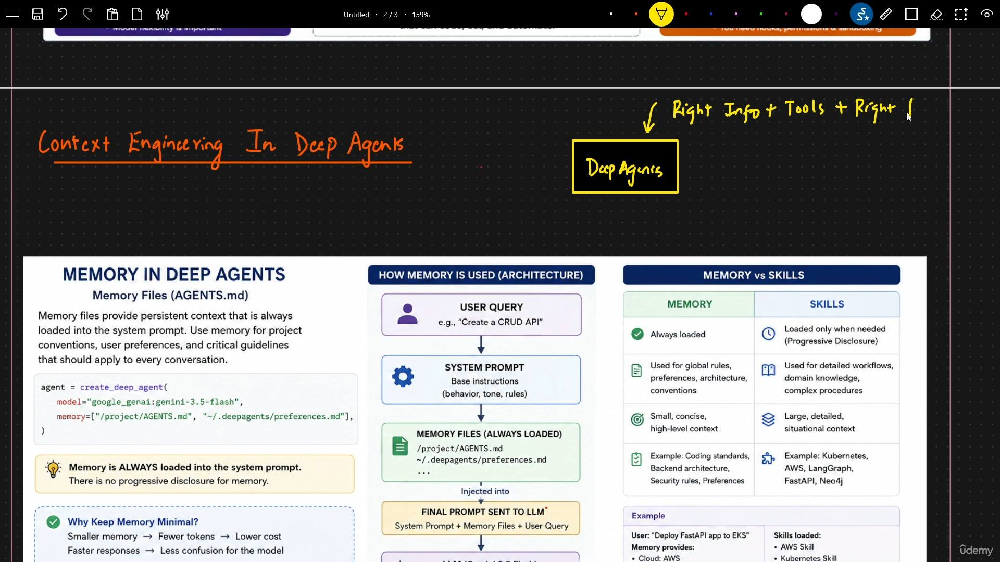
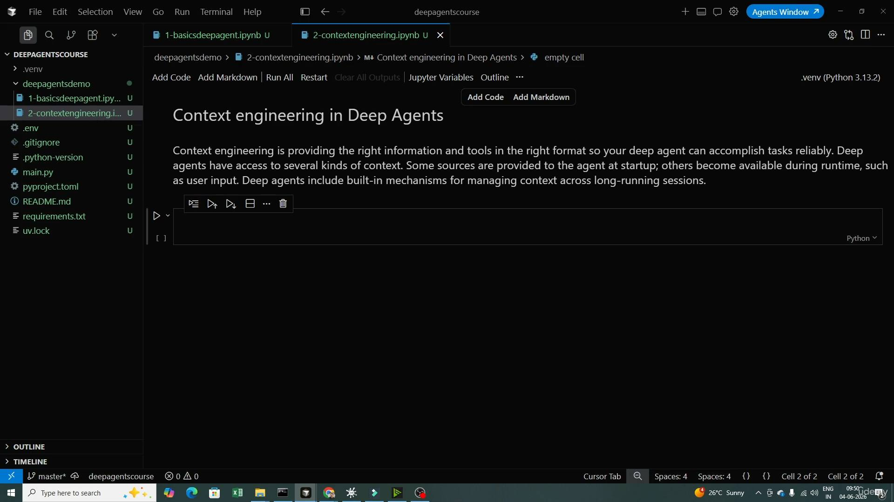
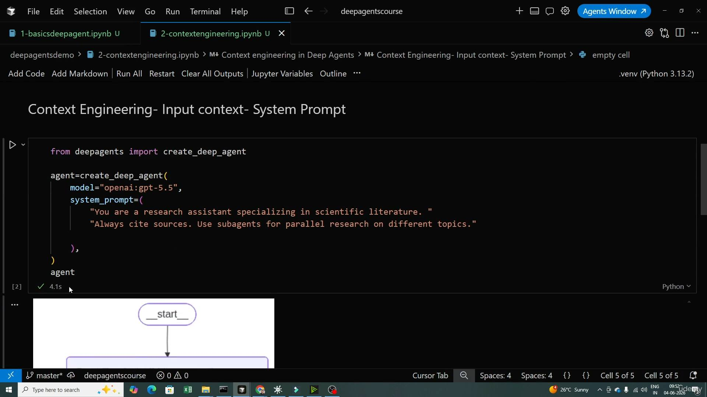
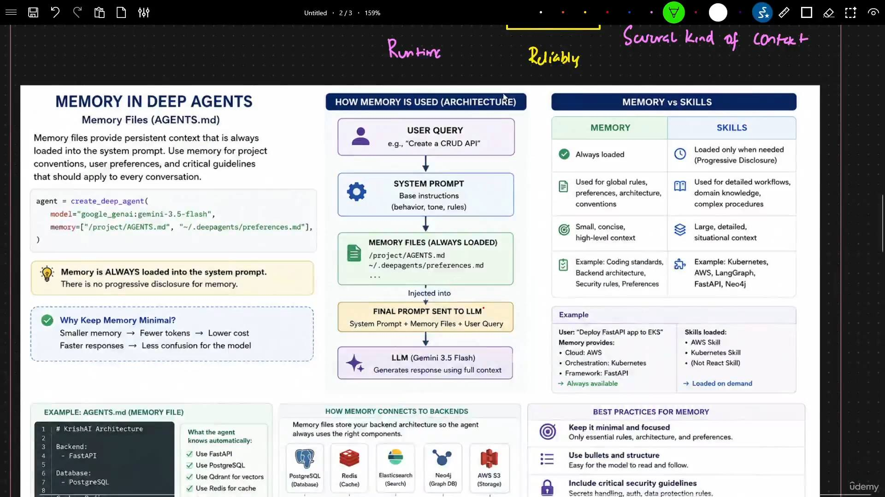
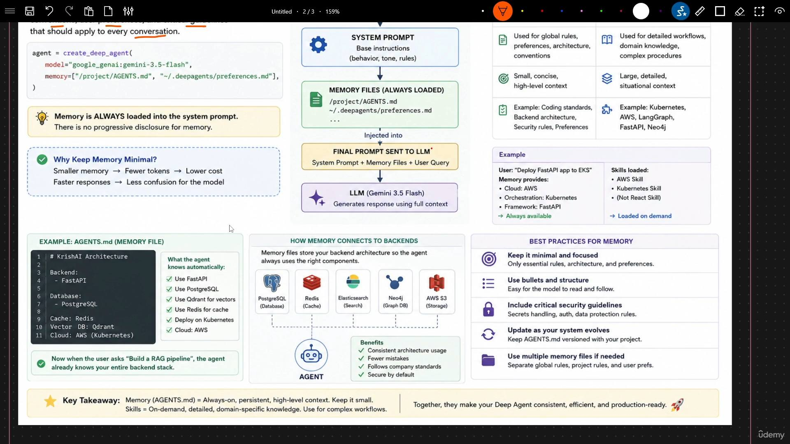
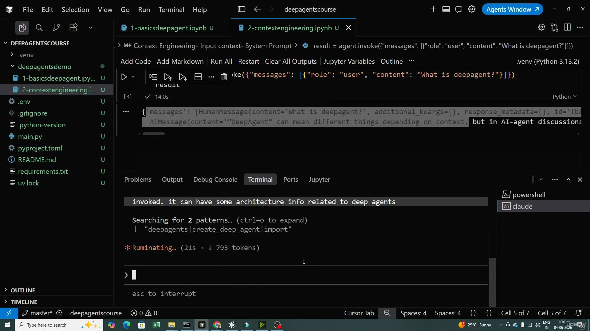
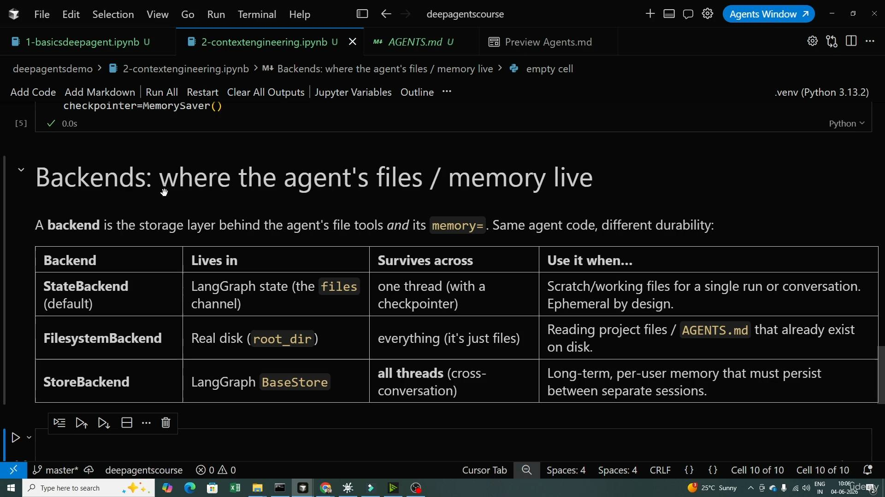
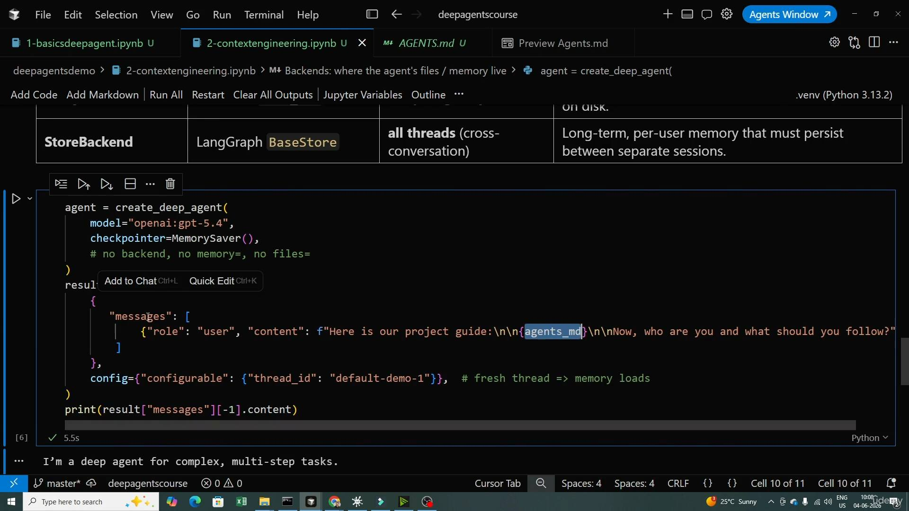
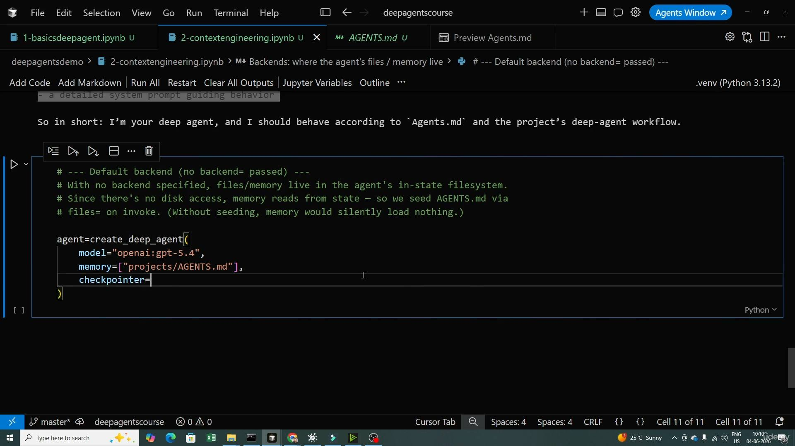

# AI Security Bootcamp Part 3 — 上下文工程（Context Engineering）实操文档

> 课程：BV1PSGA6SEaa ｜ 覆盖 P020（单集，约 34 分钟）
> 读者画像：前端转 AI 应用工程师，会 JS/Node，Python 只要求能读能改。
> 本文档目标：照着做，你能从零把「用 system prompt / agent.md 记忆 / 三种 backend」给 deep agent 注入上下文的四个实验全部跑通。

---

## 1. 这一节做什么

这一节只讲一件事：**上下文工程（context engineering）**——怎么把「正确的信息 + 正确的工具 + 正确的格式」喂给一个 deep agent，让它在长会话里稳定干活。

讲师把 deep agent 能拿到的上下文分成四类，本节只深入第一类 **input context（输入上下文）**，并把它拆成两条实现路径：

1. **system prompt**：写死在 `create_deep_agent(...)` 调用里的静态指令，每次运行都会加载。
2. **memory（记忆）**：把一段外部文本（典型是 `agent.md` 文件）作为持久上下文注入。讲师强调 memory 是「always loaded into the system prompt」，没有渐进披露（progressive disclosure），所以必须保持精简。

而 memory 要落地，就必须回答「记忆存在哪」——于是引出 **backend（后端存储层）** 的三种形态：

| backend | 存在哪 | 生命周期 | 讲师原话要点 |
|---|---|---|---|
| state backend | LangGraph 的 state 里，配合 checkpointer | 会话/线程结束即消失 | 默认就是它，`checkpointer=MemorySaver()` |
| store backend | 一个 base store（可类比向量库/内存 store） | 跨会话持久 | 用 namespace + key 手动 seed 文件内容 |
| file system backend | 真实硬盘上的 root 目录 | 文件在就在 | 直接读磁盘上的 `agent.md`，无需 seed |

本节最后留了个钩子：下一节讲第二类 input context —— **skills**（本节没展开，课里没讲细节）。



---

## 2. 讲师原话

> "上下文工程是一种技术：你提供正确的信息、正确的工具，而且格式也要正确，这样你的 deep agent 才能可靠地完成任何任务。"
> —— p020 [00:57]

> "有些上下文可能需要在 agent 一开始启动时就提供；有些上下文我们可以在运行时提供，比如用户输入的时候。deep agent 内置了跨长会话管理上下文的机制。"
> —— p020 [01:50]

> "输入上下文通常指的是什么进入 agent 的 prompt——在启动时。启动时 basically 就是 agent 开始运行时，什么进入 agent 的 prompt。它有多种设置方式，一个例子是 system prompt，你可以提供 system prompt，可以提供 memory，可以提供 skills。"
> —— p020 [02:49]

> "如果谈作用域，它基本上是静态的，并且在每次运行时都会应用。"
> —— p020 [03:18]

> "我们有四类上下文：输入上下文、运行时上下文、上下文压缩、上下文隔离。"
> —— p020 [03:47]

> "memory 文件提供持久上下文，它总是被加载进 system prompt。所以我们在 agent.md 里写的东西，会一直和 system prompt 一起被加载。用 memory 来放项目约定、用户偏好，以及应该适用于每一次对话的关键准则。"
> —— p020 [11:15]

> "memory 总是被加载进 system prompt，memory 没有渐进披露。"
> —— p020 [12:14]

> "为什么要把 memory 保持最小？只把必要信息放进 agent.md，因为我们不想把所有东西都加载进 memory，那很可能让 deep agent 模型更困惑。所以你要确保 memory 小，token 成本才低。如果你有巨大的 memory、往 agent.md 里塞太多信息，agent 也可能被搞糊涂。"
> —— p020 [12:14]

> "与其把一长串字符串硬编码进 system prompt，我们可以把 agent 的运行上下文放在一个单独的 agent.md 文件里。"
> —— p020 [18:09]

> "上下文工程里，那个持久的『你是谁、你如何行为』的上下文，活在一个可编辑的文件里，而不是埋在代码里。"
> —— p020 [18:36]

> "backend 就是 agent 文件工具和它 memory 背后的存储层。memory 等于同一份 agent 代码、不同的持久性。"
> —— p020 [21:25]

> "有三种 backend 可用：state backend、file system backend、store backend。"
> —— p020 [21:54]

> "state backend 活在 LangGraph 的 state 里，一个线程配一个 checkpointer。默认情况下，`checkpointer=MemorySaver` 用的就是 state backend。也就是说信息存在那个 LangGraph 会话、LangGraph state 里。agent 关闭时，所有信息自动消失。"
> —— p020 [24:09]

> "file system backend 把上下文存在 root 目录，也就是硬盘上，全都是文件。你可以直接从硬盘读已经存在的项目文件。"
> —— p020 [24:38]

> "store backend 是把内容存在某种 base store 或向量 store 里，你可以访问它们。这些是长期用户记忆，会在不同会话之间持久。"
> —— p020 [24:38]

> "file system backend 直接从磁盘读 files/memory。为什么？agent 的文件和 memory 映射到 root 目录下磁盘上的真实文件，什么都不用 seed。如果 agent.md 在文件里存在，memory 就直接加载它。"
> —— p020 [32:05]

> "如果往 memory 里加载任何东西，我们总得把它存在某处，对吧？memory 意味着谁的 memory、什么 memory、哪个 memory。一个 memory 直接来自 state backend，一个来自 store backend，一个来自 file system backend——这些现在都由 deep agents 支持。"
> —— p020 [33:28]

---

## 3. 从零复现

### 3.1 环境与目录

课程沿用的是前面几集已经建好的项目（讲师说「打开我们一直在做的那个项目」）。你需要准备：

```
deep-agents-demo/
├── .env                     # 放 API key，不要提交
├── requirements.txt         # 依赖清单
├── context_engineering.ipynb  # 本节新建的 notebook
└── projects/                # 本节新建，用来放 agent.md
    └── agent.md
```

`.env` 里至少要有讲师提到的三个 key（名字按讲师念的写，具体变量名以你项目里已有为准）：

```
OPENAI_API_KEY=sk-...
GROQ_API_KEY=gsk_...
TAVILY_API_KEY=tvly-...
```

> 说明：讲师在 [05:34] 说「加载我们需要的库，比如 OpenAI API key、Groq API key、Tavily API key，这些已经在 env 文件里了」。他没有在屏幕上逐字念出变量名，所以上面三个变量名是按常见约定写的——**如果你前面几集的 `.env` 已经用了别的名字，以你项目里的为准**。

### 3.2 安装依赖

讲师在 notebook 里执行的第一条命令是：

```bash
uv add -r requirements.txt
```

输出显示依赖「已经是最新的」，所以他没有再改 `requirements.txt`。`requirements.txt` 的具体内容**课里没讲**（是前面几集建的）。本节代码实际用到的包是：

```
deepagents
langgraph
openai
python-dotenv
```

如果你是从零开始，可以直接：

```bash
uv add deepagents langgraph openai python-dotenv
```

（用 pip 的话把 `uv add` 换成 `pip install` 即可。）

### 3.3 新建 notebook 并选 kernel

讲师新建文件 `context_engineering.ipynb`，然后「选择 kernel」。这一步在 Jupyter / VS Code 里点选你装了依赖的那个 Python 环境即可。

### 3.4 实验一：用 system prompt 提供 input context

1. 先写一个 markdown cell，给「上下文工程」下个定义，方便以后回看（讲师说「这样你参考这份材料时至少能拿到一个定义」）。
2. 代码 cell 里 `from deep_agents import create_deep_agent`（讲师口述为 "from deep agents, import create deep agent"）。
3. 调 `create_deep_agent(...)`，指定模型（讲师先用 OpenAI 的 GPT-5.5，后面换成了 5.4，见下方注意）、写一段 system prompt。
4. 用 `agent.invoke({"messages": [{"role": "user", "content": "..."}]})` 调用，观察默认加载的 system prompt 生效。

> ⚠️ 模型名注意：讲师口述的模型名是 "GPT 5.5" 和 "GPT 5.4"，这两个名字在公开 API 里是否存在**请以你账号实际可用的模型为准**。跑不通就换成你环境里可用的 OpenAI 模型名，代码结构不变。

### 3.5 实验二：用 Claude Code 生成 `projects/agent.md`

讲师不想手写 agent.md，于是打开终端用 Claude Code 代劳：

```bash
claude
```

然后在 Claude Code 里下指令（大意）：在 deep agents demo 里创建一个 `projects` 文件夹，里面创建 `agent.md` 文件，写入 deep agent 的架构信息，让它在 agent 被调用时能作为上下文加载。Claude Code 给出架构概览后点 yes，`projects/agent.md` 就生成了。

这一步的产物就是 `projects/agent.md`。它的**具体内容课里只给了片段**（见第 4 节），你可以照抄片段，也可以让 Claude Code 按你的项目重写。

### 3.6 实验三：把 agent.md 读进来，用 state backend 加载

1. 用 `pathlib.Path` 读 `projects/agent.md` 的文本（`read_text(encoding="utf-8")`）。
2. `from langgraph.checkpoint.memory import MemorySaver`，`checkpointer = MemorySaver()`。
3. 再 `create_deep_agent(...)`，这次把 `checkpointer=checkpointer` 传进去——这就是 state backend。
4. 调用时把 agent.md 内容拼进 user message（讲师演示的第一种「直接塞进 prompt」的写法），问「who are you / 你该遵循什么」，验证 agent 读到了。
5. 再演示第二种写法：`create_deep_agent(..., memory=<agent.md 路径>, checkpointer=MemorySaver())`，调用时用 `files=` 参数把文件路径 seed 进去，问「what is in your memory?」。

### 3.7 实验四：store backend

1. `from deep_agents import create_deep_agent, StoreBackend`（讲师口述 "importing store backend"）。
2. 建一个 in-memory store，用 namespace + key 把 agent.md 内容 seed 进去（key 叫 `memories`）。
3. `create_deep_agent(..., backend=StoreBackend(store=store, namespace=lambda rt: ...))`。
4. 调用，问「what's in your memory」，验证能从 store 读出来。

### 3.8 实验五：file system backend

1. `from deep_agents.backend.file_system import FileSystemBackend`（讲师口述 "from deep agents dot backend dot file system import files, file system backend root directory"）。
2. `FileSystemBackend(root_dir="projects")`，`checkpointer=MemorySaver()`。
3. 调用问「what is in your memory / who are you」，再问一个业务问题「What is LLM gateway?」，验证 agent 先从磁盘加载 agent.md 再回答。

### 3.9 三种 backend 的选择口诀

- 只想当前会话记住 → state backend（默认，`MemorySaver`）。
- 想跨会话记住、且记忆是「数据」→ store backend。
- 记忆本来就是磁盘上的项目文件 → file system backend，零 seed。

---

## 4. 完整代码

> 说明：本节没有 OCR 结果，讲师屏幕上的代码是靠逐字稿口述还原的。下面每个 cell 都是**可独立保存运行的完整文件/单元**。凡是逐字稿只念了片段、没念全的地方，我用注释标了「课里没讲全，按口述补全」。模型名、backend 的精确构造参数请以你安装的 `deepagents` 版本为准（见第 7 节）。

### 4.1 `requirements.txt`（课里没讲内容，按本节实际 import 补全）

```text
deepagents
langgraph
openai
python-dotenv
```

### 4.2 `.env`（变量名以你项目已有为准）

```dotenv
OPENAI_API_KEY=sk-your-key
GROQ_API_KEY=gsk-your-key
TAVILY_API_KEY=tvly-your-key
```

### 4.3 `context_engineering.ipynb` — Cell 1（markdown 定义）

```markdown
# Context Engineering

Context engineering = 给 deep agent 提供 **正确的信息 + 正确的工具 + 正确的格式**，
让它在长会话中可靠完成任务。

四类上下文：
1. Input context（本节重点）：system prompt / memory / skills，静态，每次运行都加载
2. Runtime context：运行时（如用户输入）注入
3. Context compression：上下文压缩
4. Context isolation：上下文隔离
```

### 4.4 Cell 2 — 加载环境变量

```python
import os
from dotenv import load_dotenv

load_dotenv()

# 讲师提到需要这三个 key，已在 .env 中
OPENAI_API_KEY = os.getenv("OPENAI_API_KEY")
GROQ_API_KEY = os.getenv("GROQ_API_KEY")
TAVILY_API_KEY = os.getenv("TAVILY_API_KEY")
```

### 4.5 Cell 3 — 实验一：system prompt 作为 input context

```python
from deep_agents import create_deep_agent

agent = create_deep_agent(
    model="openai:gpt-5.5",   # 模型名以你账号可用为准
    system_prompt=(
        "You are a research assistant specializing in scientific literature. "
        "Always cite resources. "
        "Use sub-agents for parallel research on different topics."
    ),
)

result = agent.invoke(
    {
        "messages": [
            {"role": "user", "content": "What are deep agents?"}
        ]
    }
)

print(result)
```

### 4.6 Cell 4 — 读取 `projects/agent.md`

```python
from pathlib import Path

agent_md_path = Path("projects/agent.md")
agent_md = agent_md_path.read_text(encoding="utf-8")

print(agent_md)
```

### 4.7 Cell 5 — 实验三（写法 A）：把 agent.md 直接拼进 user message + state backend

```python
from deep_agents import create_deep_agent
from langgraph.checkpoint.memory import MemorySaver

checkpointer = MemorySaver()

agent = create_deep_agent(
    model="openai:gpt-5.5",
    checkpointer=checkpointer,   # 默认即 state backend
)

result = agent.invoke(
    {
        "messages": [
            {
                "role": "user",
                "content": (
                    "Here is a project guide (agent.md):\n\n"
                    f"{agent_md}\n\n"
                    "Who are you and what should you follow?"
                ),
            }
        ]
    }
)

print(result)
```

### 4.8 Cell 6 — 实验三（写法 B）：`memory=` 参数 + `files=` seed

```python
from deep_agents import create_deep_agent
from langgraph.checkpoint.memory import MemorySaver

agent = create_deep_agent(
    model="openai:gpt-5.4",      # 讲师此处换成 5.4
    memory="projects/agent.md",  # 直接指定 memory 文件
    checkpointer=MemorySaver(),  # 默认 state backend
)

result = agent.invoke(
    {
        "messages": [
            {"role": "user", "content": "What is in your memory?"}
        ],
        "files": ["projects/agent.md"],   # 把文件 seed 进去
    }
)

print(result)
```

> 讲师在 [27:27] 提到这里会用到 `create_file_data` 之类的函数来构造文件数据，并需要额外 import。**该函数的确切名字与签名课里没讲全**，上面用 `files=["projects/agent.md"]` 的路径写法表达同一意图；如果你的 `deepagents` 版本要求传文件对象，请按报错提示改用对应构造函数。

### 4.9 Cell 7 — 实验四：store backend

```python
from deep_agents import create_deep_agent, StoreBackend
from langgraph.checkpoint.memory import MemorySaver

# 1) 建一个 in-memory store（讲师：就像一个向量 store / in-memory store）
store = {}   # 课里没讲全具体 store 类型，这里用 dict 占位，按你版本换成对应 Store 实现

# 2) 把 agent.md 内容 seed 进 store，key = "memories"
store["memories"] = agent_md

# 3) 用 StoreBackend 作为 backend
agent = create_deep_agent(
    model="openai:gpt-5.5",
    backend=StoreBackend(
        store=store,
        namespace=lambda rt: "memories",   # 讲师：namespace 用 lambda 访问 key
    ),
    checkpointer=MemorySaver(),
)

result = agent.invoke(
    {
        "messages": [
            {"role": "user", "content": "What is in your memory? Who are you?"}
        ]
    }
)

print(result)
```

> 注意：`StoreBackend` 的构造参数（`store` / `namespace` 的确切类型）**课里只口述了语义，没给完整签名**。上面按讲师口述的「store + namespace lambda + key=memories」还原；跑不通时以你安装版本的 API 为准。

### 4.10 Cell 8 — 实验五：file system backend

```python
from deep_agents import create_deep_agent
from deep_agents.backend.file_system import FileSystemBackend
from langgraph.checkpoint.memory import MemorySaver

agent = create_deep_agent(
    model="openai:gpt-5.5",
    backend=FileSystemBackend(root_dir="projects"),  # 直接读磁盘
    checkpointer=MemorySaver(),
)

# 问题一：验证 memory 是否从磁盘加载
result1 = agent.invoke(
    {
        "messages": [
            {"role": "user", "content": "What is in your memory? Who are you?"}
        ]
    }
)
print(result1)

# 问题二：业务问题，验证先加载上下文再回答
result2 = agent.invoke(
    {
        "messages": [
            {"role": "user", "content": "What is LLM gateway?"}
        ]
    }
)
print(result2)
```

### 4.11 `projects/agent.md`（讲师用 Claude Code 生成，逐字稿只给了片段）

下面是逐字稿里能确认出现过的内容片段，原样保留；其余部分**课里没讲全**，你可以让 Claude Code 按同样风格补全：

```markdown
# Deep Agent Context

This file is loaded into a deep agent's context when the agent runs.
It describes the agent's own architecture and project conventions.

## Who you are
I am a deep agent for complex multi-step tasks.

## What you should follow
- Follow the conventions in this agent.md as the source of truth.
- Plan first for all multi-step tasks using the write-to-dos tool.
- Offload bulky intermediate work.
- Use sub-agents for parallel research on different topics.

## Architecture overview
（讲师让 Claude Code 生成的架构概览，逐字稿未逐字念出，课里没讲全）
```

---

## 5. 逐行解释

**`from deep_agents import create_deep_agent`**
整个 deep agent 的入口工厂函数。讲师反复用它，所有实验都从它开始。注意包名是 `deep_agents`（下划线），讲师口述时念成 "deep agents"。

**`model="openai:gpt-5.5"`**
讲师先选 OpenAI 的 GPT-5.5，后面 store/file system 实验里又出现 5.4。模型字符串格式（`provider:model`）是讲师屏幕上的写法；模型名是否可用以你账号为准。

**`system_prompt="You are a research assistant..."`**
这就是 input context 的第一种形态。讲师原话：system prompt 是「静态的，每次运行都应用」。它写死在代码里，改一次要改代码——这正是后面要引入 agent.md 的动机。

**`agent.invoke({"messages": [{"role": "user", "content": ...}]})`**
调用方式。讲师强调：默认情况下，**每次调用时 system prompt 会先被加载**，然后才处理 user message。这就是「input context 在启动时注入」的字面含义。

**`Path("projects/agent.md").read_text(encoding="utf-8")`**
把磁盘上的 agent.md 读成字符串。讲师特意说「因为这是 markdown 格式，我们用 utf8 编码」。读出来是为了后面两种用法：拼进 prompt，或交给 memory 参数。

**`checkpointer = MemorySaver()`**
讲师原话：「checkpointer 等于 memory saver」。它把会话状态存在内存里——这就是 **state backend**。关键判断：agent 关闭后信息全丢，因为它在 LangGraph 的 state 里，不在磁盘。

**`create_deep_agent(..., checkpointer=checkpointer)`**
不传 `backend` 时，默认就走 state backend。讲师在 [22:20] 明确说：「这里没有用 backend，没有用 memory，没有用 files，这些都是可以加的参数」。

**写法 A：把 `agent_md` 拼进 user content**
讲师演示的第一种「直接塞进 prompt」的方式。他随即指出缺点：**prompt 会变得很大**。所以这不是推荐做法，只是对照。

**写法 B：`memory="projects/agent.md"` + `files=[...]`**
`memory=` 参数让 agent 知道「记忆从哪个文件来」；`files=` 在调用时把文件 seed 进去。讲师问「what is in your memory?」，agent 回答出「我没有人类意义上的隐藏记忆，但我加载了持久的项目指令……我要先规划、用 to-do 工具、用 sub-agents」——证明 memory 生效。

**`StoreBackend(store=store, namespace=lambda rt: "memories")`**
store backend 的核心。讲师原话：「store 就像一个向量 store，其实是 in-memory store」「把不可变的记忆存进 store 一次，用 name + key 标识文件」「namespace 用 lambda 函数去访问那个 key」。`rt` 是 runtime 的缩写（讲师念作 "rt"）。在 JS/Node 里，这相当于你把一份配置写进一个 Map 或 Redis，key 是 `memories`，每次请求按 key 取。

**`FileSystemBackend(root_dir="projects")`**
file system backend。讲师原话：「root 目录就是磁盘本身」「agent 的文件和 memory 映射到 root 目录下磁盘上的真实文件，什么都不用 seed。如果 agent.md 存在，memory 就直接加载它」。所以这个实验里**没有 seed 步骤**——文件本来就在那。在 Node 里对应「直接 `fs.readFile` 一个项目里的 md 文件」。

**三种 backend 的本质区别（讲师 [33:28] 的总结）**
「如果往 memory 里加载任何东西，总得存在某处。memory 意味着谁的 memory、什么 memory、哪个 memory。」——state 存在 LangGraph state（会话级），store 存在 base store（跨会话），file system 存在硬盘（文件级）。选哪个取决于你要的记忆活多久、以及记忆本来是不是文件。

**为什么 memory 要小**
讲师 [12:14] 的判断：memory 没有渐进披露，**每次都全量进 system prompt**。塞太多 → token 成本高 + 模型困惑。所以 agent.md 只放「项目约定、用户偏好、关键准则」。

---

## 6. 复现检查清单

跑完每个实验，对照打勾：

- [ ] `uv add -r requirements.txt` 能跑通，无报错（或已用 `uv add deepagents langgraph openai python-dotenv` 装好）
- [ ] `.env` 里三个 key 都能被 `os.getenv` 读到（打印非 None）
- [ ] 实验一：`agent.invoke` 返回内容里能看出 system prompt 生效（回答带「引用来源 / 用 sub-agents」倾向）
- [ ] `projects/agent.md` 文件存在，`read_text` 打印出内容
- [ ] 实验三写法 A：agent 能复述 agent.md 里的「先规划、用 to-do、用 sub-agents」
- [ ] 实验三写法 B：问「what is in your memory?」时，回答明确提到「加载了持久的项目指令」
- [ ] 实验四：store backend 下同样能读出 memory 内容
- [ ] 实验五：file system backend 下**没有 seed 步骤**也能读出 memory；再问「What is LLM gateway?」能先加载上下文再答
- [ ] 你能说清三种 backend 各自「存在哪、活多久」

















---

## 7. 课里没讲但你会撞上的

1. **`deepagents` 的精确 API 签名**。讲师是边写边口述，`StoreBackend` / `FileSystemBackend` 的构造参数、`files=` 接受路径还是文件对象、`create_file_data` 的确切名字，逐字稿都没念全。跑不通时以 `pip show deepagents` 对应版本的源码/文档为准，别硬套本文档的占位写法。

2. **模型名 `gpt-5.5` / `gpt-5.4`**。公开 API 里是否存在请自行确认；不存在就换成你账号可用的模型，代码结构不变。

3. **`namespace=lambda rt: "memories"` 里的 `rt`**。讲师只念了 "rt"，没解释类型。它是 runtime 上下文对象；如果你要按用户/租户隔离记忆，通常在这里读 runtime 里的 user id 拼进 namespace——**课里没讲这个用法**，属于你自己的扩展。

4. **store backend 的 `store` 到底传什么**。讲师说「就像一个向量 store，其实是 in-memory store」，但没给具体类。本文档用 `dict` 占位只是为了让你看懂数据流；真实实现要换成 `deepagents`/`langgraph` 提供的 Store 类。

5. **`agent.md` 的完整内容**。讲师让 Claude Code 生成，只念了「架构概览」「先规划、用 to-do、用 sub-agents、卸载 bulky 中间产物」几句。完整文件在你机器上，照生成即可。

6. **skills 是什么**。本节结尾讲师说下一节讲 skills（第二类 input context），**本节完全没展开**。别在这里找 skills 的实现。

7. **运行时上下文 / 上下文压缩 / 上下文隔离**。讲师在 [03:47] 只列了名字，说「一个一个讲」，但本节只讲了 input context。另外三类**课里没讲**（在本集范围内）。

8. **前端视角的类比**（帮你迁移）：system prompt ≈ 写死在服务端的 system message；agent.md ≈ 项目根目录的 `README.md` 或 `.cursorrules`；state backend ≈ 进程内 `Map`（重启即失）；store backend ≈ Redis（跨进程持久）；file system backend ≈ 直接 `fs.readFile` 仓库里的文件。讲师提到的 `claude.md` 就是 Claude Code 版的 agent.md，你在前端项目里大概率已经见过。

9. **token 成本**。memory 每次全量进 prompt，长会话 + 大 agent.md 会持续烧 token。讲师只给了「保持最小」的原则，没给具体阈值——**课里没讲**数字，自己按模型上下文窗口估。