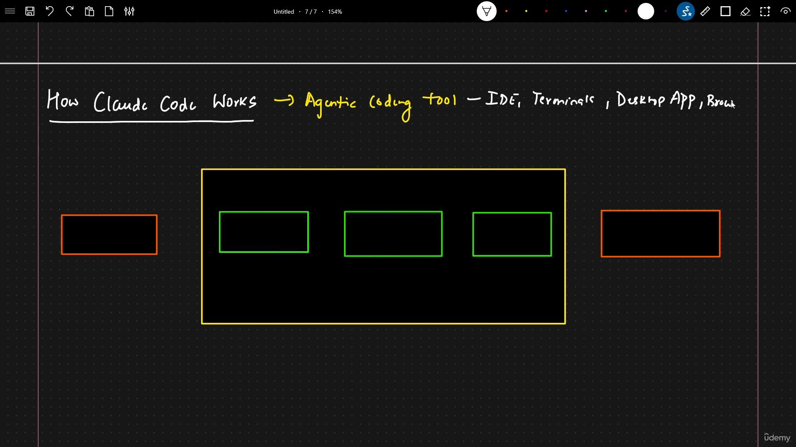
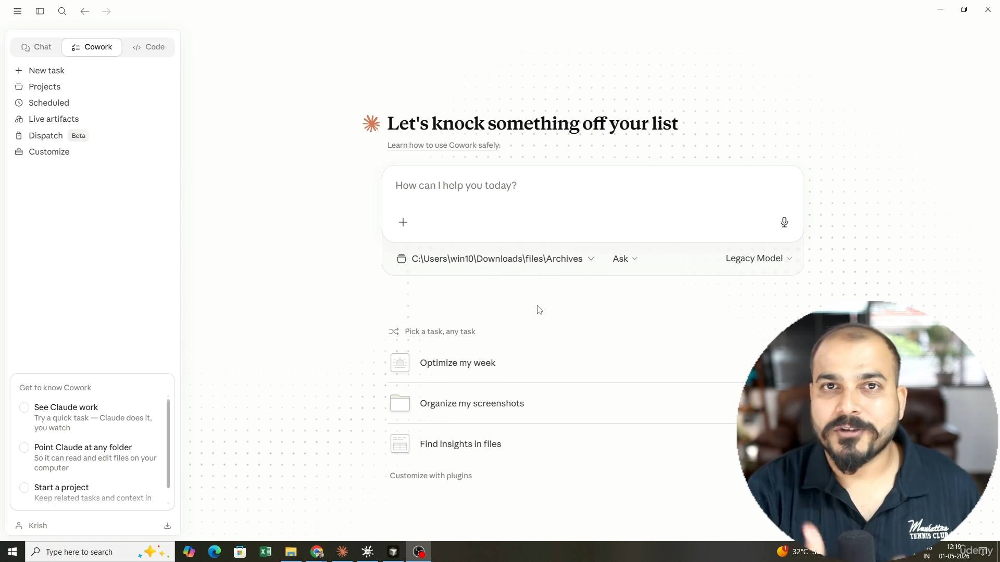
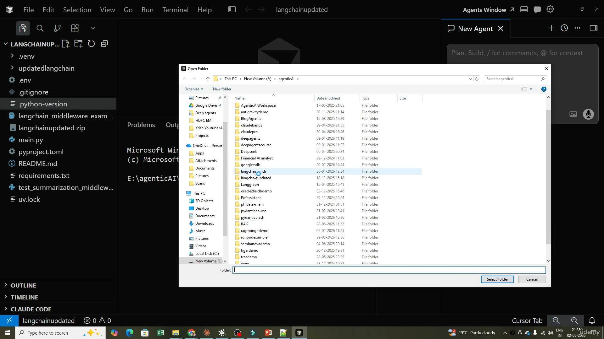
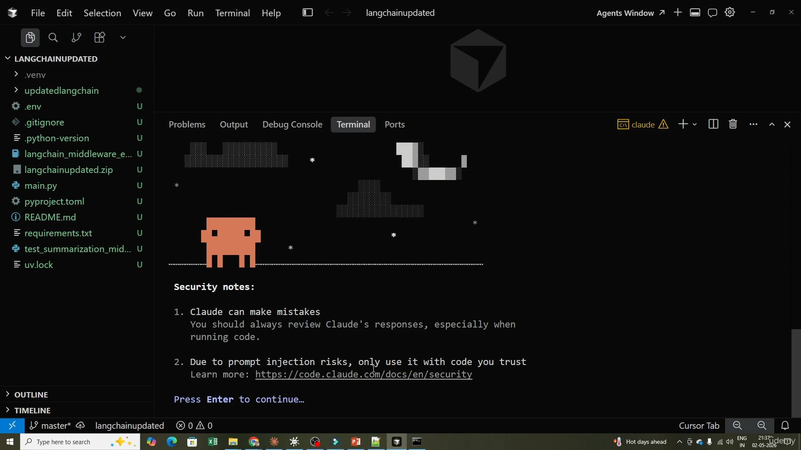
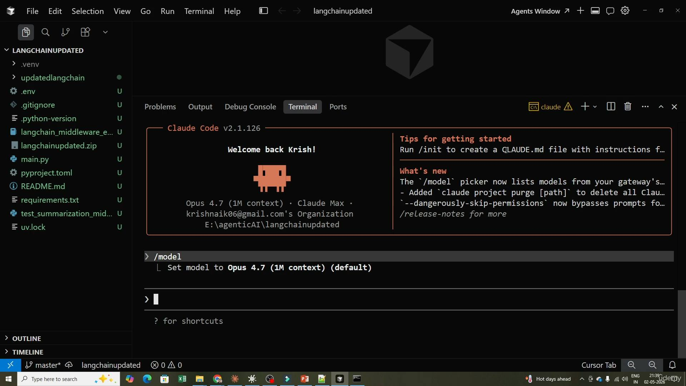
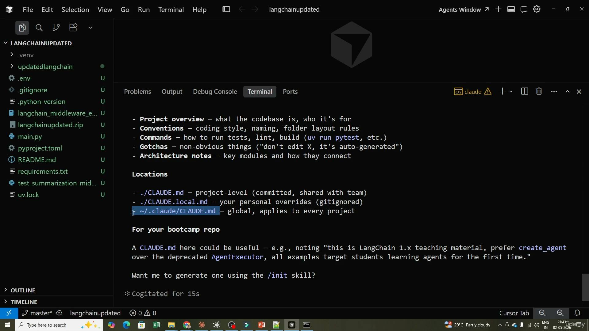
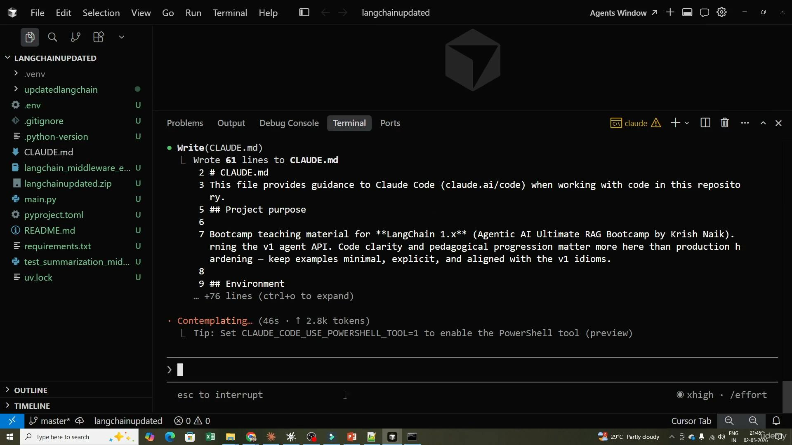
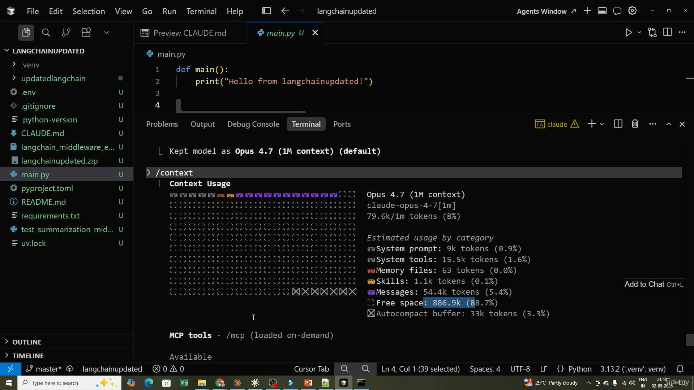
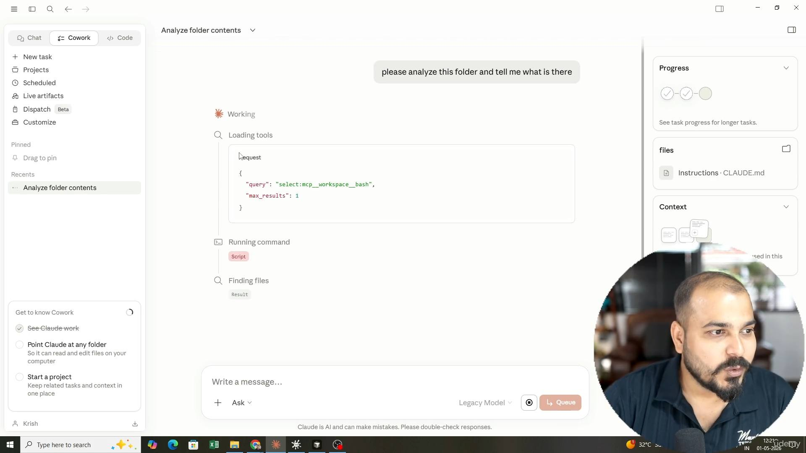
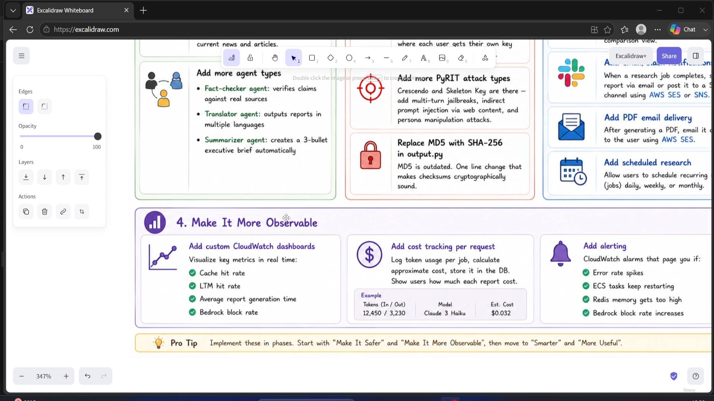

# AI Security Bootcamp Part 3：护栏、网关与可观测（P8–P10）复现文档

## 1. 这一节做什么

P8–P10 不是三个孤立的知识点，而是一条完整的“从项目交付到工程化使用 Claude Code”的路线：

- **P8** 讲的是：项目已经部署完成之后，如何从“能跑”提升到“更聪明、更安全、更有用、更可观测”。讲师给出了搜索源替换、Agent 扩充、多语言输出、认证升级、哈希算法升级、攻击数据集扩充、前端升级、邮件通知、定时研究、Grafana/Prometheus/CloudWatch 可观测、成本追踪与告警等一整套优化路线。
- **P9** 讲的是 Claude 生态的全景：Claude Chat、Claude Code、Claude Co-work、Claude Security，以及它们分别适合谁。重点落在 Claude Code 和 Claude Co-work 的定位差异，并用一个真实的 LangChain 项目演示了“加入一个新团队、拿到一个已有仓库，如何让 Claude Code 先给你做 KT”。
- **P10** 是 Claude Code 系列的第一集，真正开始动手：解释 Claude Code 是什么、agentic loop 如何运转、如何安装、如何在 Cursor/VS Code 里打开项目、如何在终端启动、如何登录、如何选模型、如何用 `/init` 生成 `CLAUDE.md`、如何用 `/context` 看 token 占用、如何用 `/agents` 创建 subagent、如何在 plan mode 下让 Claude Code 先出计划再动手。

读者照着本文档做完，应该能得到一个可用的 Claude Code 环境，并在一个已有项目里完成第一次“让 AI 读项目、生成 CLAUDE.md、解释 main.py、查看上下文占用、创建 subagent、用 plan mode 产出 plan.md”的完整闭环。P8 的优化项作为后续路线图保留，不要求一次做完。

> "Claude Code 就是一个 agentic coding tool。它会读你的代码库、编辑文件、运行命令、集成你正在使用的开发工具。"
> —— p010 [02:07]



---

## 2. 讲师原话

下面按主题引用讲师原话（英文逐字稿已翻译为中文，技术产品名保留英文）。

**关于 Claude Code 的定位：**

> "Claude Code 面向的是正在做开发的开发者。非编程背景的人也能用，但真实用例是：你加入一个团队，项目已经存在，来了新需求，你可以用 Claude Code 做规划和需求分析，经你批准后再做 vibe coding 开发。"
> —— p009 [02:24]

> "Claude Code 是围绕 Claude 的 agentic harness。它提供工具、上下文管理和执行环境，把一个大型语言模型变成一个有能力的 coding agent。"
> —— p010 [09:03]

**关于 agentic loop：**

> "整个 agentic loop 有三个主要部分：收集上下文、采取行动、验证结果。这三步会一直循环，直到得到满意的结果。"
> —— p010 [04:29]

> "验证结果这一步，人可以参与，Claude Code 自己也会做。如果结果不够好，就重新收集上下文、重新行动、重新产出；满意了才进入 done。"
> —— p010 [05:25]

**关于 CLAUDE.md：**

> "CLAUDE.md 是一个特殊的指令文件，Claude Code 会在项目每次对话开始时自动把它加载进上下文。你可以把持久性的指导写进去，这样就不用每个 session 重复说。"
> —— p010 [19:16]

> "项目级的 CLAUDE.md 可以提交、可以分享给整个团队；`.claude.local.md` 只给你个人用，不要分享；全局的 `.claude/CLAUDE.md` 对你这台机器上所有项目生效。"
> —— p010 [20:15]

**关于模型选择：**

> "默认推荐是 Opus 4.7，带一百万上下文，最适合复杂工作。Sonnet 4.6 适合日常任务，Haiku 4.5 最快，适合简单问题。"
> —— p010 [15:03]

**关于安全提示：**

> "Claude 会犯错。你应当始终检查 Claude 的回复，尤其是在运行代码时，因为有 prompt injection 风险。只在你信任的代码上使用它。"
> —— p010 [14:06]

**关于可观测性（P8）：**

> "现在你只把 LangSmith 用于 tracing 和 evaluation。要让它对整个 AI 系统更可观测，你可以用 Grafana、Prometheus；如果你全在 AWS 上，也可以用 CloudWatch 的 dashboard。"
> —— p008 [03:20]

**关于成本追踪（P8）：**

> "你可以加一个成本追踪系统：当 OpenAI 超过五美元预算时，切换到 Groq API；也可以追踪每个请求花了多少成本。"
> —— p008 [03:50]

**关于 Co-work 的定位：**

> "Claude Co-work 就像你本地电脑上的个人 AI 助手。你只需要给它一个文件夹的访问权限，然后让它做任务，它会自己创建 agent workflow 去完成。"
> —— p009 [06:02]



---

## 3. 从零复现

### 3.1 前置条件

你需要准备：

1. 一个 Claude 账号。讲师在 P9 明确讲了三种计划：**Free、Pro、Max**。Free 可以在 Web、iOS、Android、桌面端聊天，能生成代码、可视化数据、写/编辑/创建内容、分析文本和图像、联网搜索。Pro 和 Max 是付费计划。讲师建议日常生产力用 **17 美元/月的年订阅**；如果要做大量开发和分析，用 **Max**，他本人用的是 **100 美元/月的 Max 计划**。P10 又提了一次“20 美元/月”的 Pro/Max 入门说法，这里以你实际在 Claude 官网看到的计价为准。
2. 一台 Windows、macOS 或 Linux 机器。讲师演示用的是 Windows + Cursor。
3. 一个已经存在的项目文件夹。P10 用的是他本地的 **updated LangChain** 项目，里面有 `requirements.txt`、多个 notebook 文件、`main.py`、`README` 等。你不需要从零建项目，拿一个已有仓库效果更接近课程。
4. 终端（Windows CMD、PowerShell、macOS Terminal、WSL 均可）。

> "请确保你至少是 Pro、Max、Team 或 Enterprise 之一，因为 Claude Code 需要这些计划之一才能登录。"
> —— p010 [13:14]

### 3.2 下载并安装 Claude 桌面端

P9 里讲师先演示的是桌面端：

1. 打开 Claude 官网，点击下载。
2. Windows 会得到一个 `.exe` 文件；macOS 会得到对应平台的安装包。讲师原话是“如果你是 Mac，会得到不同的扩展文件；Windows 会得到 `.exe`”。
3. 双击安装，过程就是普通 exe 安装。
4. 安装完成后打开，你会看到左侧是历史聊天列表，顶部/侧边有三个核心入口：**Chat、Co-work、Code**。

> "安装完之后，它就是像一个装在桌面上的 app。里面有三大块：chat、co-work、code。"
> —— p009 [05:04]

### 3.3 安装 Claude Code CLI

P10 里讲师打开的是 Claude Code 官方文档的安装页。文档按平台给出不同命令：

- **macOS / Linux / WSL**：用文档里的第一条安装命令。
- **Windows PowerShell**：用文档里的 PowerShell 命令。
- **Windows CMD**：用文档里的 `curl` 命令。

讲师没有在视频里逐字念出这些命令，只演示了“打开 CMD、粘贴文档里的命令、回车”。所以本文档不编造具体命令，你应当到 Claude Code 官方文档的 Installation 页面复制与你平台对应的那一条。

> "如果你是 macOS、Linux 或 WSL，就从这条命令安装；如果你是 Windows PowerShell，就用这条；如果你用 Windows CMD，就用这条 curl 命令。打开 CMD，把命令粘进去，安装就开始了。"
> —— p010 [10:23]

安装完成后，在终端输入 `claude`，如果能看到 Claude Code 的启动界面，说明 CLI 已就位。



### 3.4 在 IDE 中打开项目

讲师用的是 **Cursor**，并明确说 VS Code 也可以：

1. 关闭当前 Cursor 窗口。
2. 重新打开 Cursor，选择 `Open Folder`，选中你要让 Claude Code 操作的项目文件夹。
3. 关闭 IDE 自带的终端，再重新打开一个新终端，避免旧 shell 的环境变量干扰。
4. 清屏，输入 `claude`。

> "我用的是 Cursor IDE，你也可以用 VS Code。把项目文件夹打开，关闭终端再重新打开，然后输入 claude。"
> —— p010 [11:19]

### 3.5 首次启动 Claude Code

第一次运行 `claude` 会进入初始化向导：

1. **选择终端主题**：讲师选了 `dark mode`，并说不喜欢 light mode 或 color blind friendly 主题。
2. **选择登录方式**：需要 Pro、Max、Team 或 Enterprise。讲师用的是公司 Max 账号，选了第一项。
3. 浏览器会弹出授权页，点击授权。
4. 页面提示 “Build something that you all set for Claude Code. You can now close this window.”，关闭窗口。
5. 终端显示 `Logged in as ...`，按 Enter 继续。
6. 出现安全提示：Claude 会犯错，运行代码前要检查，注意 prompt injection 风险，只在你信任的代码上使用。
7. 询问是否启用推荐终端设置（Shift+Enter 换行），选 Yes。
8. 进入 Claude Code 主界面。



### 3.6 选择模型

在 Claude Code 里输入 `/model`，会列出可用模型。讲师看到的清单包括：

- **Sonnet**
- **Sonnet with 1 million context**
- **Haiku**（逐字稿语音识别为 “high Q”）
- 默认推荐：**Opus 4.7 with 1 million context**，最适合复杂工作
- **Sonnet 4.6**：适合日常任务
- **Sonnet 4.6 with 1 million token context**：需要额外用量
- **Haiku 4.5**：最快，适合快速回答和简单任务
- `/fast` 可以打开 fast mode

讲师选择默认的 **Opus 4.7 + 1M context**，按 Enter 确认。

> "默认推荐是 Opus 4.7 带一百万上下文，它最适合复杂工作。Sonnet 4.6 适合日常任务，Haiku 4.5 最快。"
> —— p010 [15:03]

### 3.7 第一次让 Claude Code 分析项目

在项目根目录启动 Claude Code 后，直接输入：

```text
请告诉我这个项目是做什么的
```

讲师的原话是 “please tell me what this project is all about”。

Claude Code 会：

1. 列出目录、README、md 文件，收集上下文。
2. 需要执行 bash 命令查看文件夹内部时，会弹出权限请求，讲师按 `1` 批准。
3. 检查每个文件；如果遇到错误，会重新迭代，这就是 agentic loop 在跑。
4. 最后给出摘要。讲师的项目被识别为 “Krishna 的 LangChain bootcamp companion repo，包含 6 个 tutorial notebooks，还没有 commit”。

> "它会分析整个项目仓库，检查每一个文件，找出这个项目到底是做什么的，然后给你一个总结。"
> —— p010 [16:52]



### 3.8 创建 CLAUDE.md

讲师强调：**项目第一阶段最重要的事情之一，就是创建 `CLAUDE.md`**。

在 Claude Code 里输入：

```text
/init
```

`/init` 会基于当前项目的所有信息，在**项目级**自动生成 `CLAUDE.md`。生成过程中会弹出“是否允许编辑”的确认，选 Yes。

生成后可以预览，内容大致是：

- 这个仓库是 bootcamp 教学材料
- 使用 `uv sync` 之类的命令
- 项目结构、测试方式、注意事项

> "CLAUDE.md 会在每次对话开始时自动加载。你关闭再打开、重新启动 Claude 对话，它仍然会把这份上下文载入。"
> —— p010 [22:08]

### 3.9 CLAUDE.md 的三个位置

讲师明确讲了三种位置：

| 位置 | 作用 | 是否提交 |
|---|---|---|
| 项目根目录 `CLAUDE.md` | 项目级上下文，团队共享 | 可以提交到 GitHub |
| 项目根目录 `.claude.local.md` | 个人级上下文，只给自己用 | 不要提交，不要分享 |
| `C:\Users\vinten\.claude\CLAUDE.md`（全局） | 对这台机器上所有项目生效 | 不属于某个仓库 |

讲师现场打开了 `C:\Users\vinten\.claude` 目录，说明全局文件放在这里。

> "项目级的 CLAUDE.md 你可以提交、可以分享给团队；`.claude.local.md` 只给你个人用，不要分享；全局的 `.claude/CLAUDE.md` 对你所有项目生效。"
> —— p010 [20:41]





### 3.10 用 `/context` 查看上下文占用

输入 `/context`，Claude Code 会可视化当前上下文的占用情况。讲师屏幕上看到的信息包括：

- 总上下文来自 100 万 token
- system 98 tokens，占 0.9%
- system 5.5 / 15.5K tokens
- memory 63 tokens
- skills 1.1 tokens
- free space
- auto impact buffer tokens

讲师说：“如果整个 token 被填满会发生什么？后续视频会讲。”

> "你可以用 `/context` 可视化整个上下文，看它是怎么被占用的。"
> —— p010 [24:34]



### 3.11 用 `/agents` 创建 subagent

输入 `/agents`，当前没有 agent 时，可以创建新 agent。讲师解释：subagent 是 Claude 可以委托的专门化子代理，拥有**不同的 memory、不同的 context**，适合不同任务。

常见 subagent 用途：

- 提交前更新 README
- 提交前创建 PR
- 提交前运行测试用例
- 作为 notebook 的 reviewer

讲师现场问 Claude：“基于这个项目，我可以创建哪些 subagents？”Claude 分析后建议了 “strong” 和 “notebook learn lesson reviewer” 之类的子代理。

> "subagent 的主要用途是：你可以给不同 subagent 不同的 memory、不同的 context，然后为不同任务创建它们。"
> —— p010 [26:56]

### 3.12 三种交互模式与 plan mode 实操

在 Claude Code 里按 **Shift+Tab** 可以切换模式。讲师提到的模式包括：

- **accept edit**：自动接受编辑
- **plan mode on**：只做计划，不改文件
- **auto mode on**：自动模式

plan mode 的实操：

1. 按 Shift+Tab 切到 plan mode。
2. 输入需求：

```text
我想创建一个关于 vectorless RAG 的 Jupyter notebook，使用 Python 和 Page Index 库。请制定详细计划，并保存到 plan.md 文件，这样我们可以查看。
```

3. plan mode 会限制 Claude Code 只能写计划，不能直接改代码。
4. Claude Code 会做多次 web search，搜索 “page index”、“rectify”、“vectorless rag” 等关键词，并读取 GitHub 信息。
5. 每次需要权限时都会询问，讲师强调这就是 **human-in-the-loop approval**。
6. 计划生成后，会在项目里创建 `plan.md`。

> "plan mode 会限制我只能写计划。等你批准后，我可以再在仓库里放一份 plan.md 副本。"
> —— p010 [30:13]

### 3.13 恢复会话

关闭终端后重新打开，输入：

```text
claude -r
```

或：

```text
claude --resume
```

会列出之前的会话，包括项目摘要、overview request、时间等。选择某一条，就能把之前的上下文重新加载回来。

> "你可以用 claude -r 或 claude --resume 恢复之前的对话，之前的信息会重新加载。"
> —— p010 [26:00]

### 3.14 Claude Co-work 演示（P9）

Co-work 是桌面端的个人 AI 助手，操作步骤：

1. 打开 Claude 桌面端，进入 Co-work。
2. 选择一个文件夹（讲师选了一个叫 `files` 的 dummy
文件夹，里面有发票 PDF、`invoice summary`、`expense tracker`、`product inventory` 之类的 Excel/PDF 文件）。
3. 点击 **Allow** 授权该文件夹。
4. 输入第一个问题：

```text
请分析这个文件夹，告诉我里面有什么
```

5. Co-work 会先「load the tool」，再跑脚本。讲师屏幕上出现过 `workspace unavailable` 的提示，随后它自己找到了目录里的发票摘要、PDF、`expense tracker` Excel、`product inventory` 等文件。
6. 追问第二个问题：

```text
给我发票的详细信息，并生成一份报告
```

7. Co-work 会反问澄清需求，屏幕上出现过：“What format do you want the invoice report in?” 讲师回答“随便，纯文本就行”，并补充“只要五张发票”。
8. 生成过程中右侧会显示**文件访问列表**（它到底读了哪些文件），同时项目里会自动出现一个 `claude.md` 文件。
9. 最后通过 live artifact 展示发票报告，包含公司名、发票号、金额、人名（讲师用的都是 dummy 数据）。

> "Co-work 就像你本地电脑上的个人 AI 助手。你只要给它一个文件夹的访问权限，让它做任务，它会自己创建 agent workflow 去完成。"
> —— p009 [06:02]

> "它对非技术背景的人特别有用，比如经理。你就像在跟私人助理说话一样。而且最好的一点是你能看到文件访问记录，它到底访问了哪些文件。"
> —— p009 [08:52]



### 3.15 Co-work、Code、Chat 三者的分工

讲师在 P9 把三个入口的关系讲得很清楚，你选工具时按这个判断：

| 入口 | 形态 | 适合谁 | 典型任务 |
|---|---|---|---|
| **Claude Chat** | 网页/桌面聊天 | 所有人 | 通用问答、写内容、分析文本和图片、联网搜索 |
| **Claude Co-work** | 桌面端的个人 AI 助手 | 非技术岗、管理者 | 给它一个文件夹，让它自己跑 agent workflow 做汇总、做报表、做行政事务 |
| **Claude Code** | 终端 / IDE / 桌面 | 开发者 | 读代码库、改文件、跑命令、集成开发工具、做 KT、做重构 |

讲师的原话是：这个系列会先讲 Claude Code，再讲 Co-work，再讲 Chat；三个都覆盖，所以不管你是编程背景还是非编程背景都能用。

> "我们先从 Claude Code 开始，然后理解 Claude Co-work，然后再说 Claude Chat。这样整个系列下来，不管你是编程还是非编程背景，都适用。"
> —— p009 [19:54]

### 3.16 P8：项目部署完之后，怎么继续往上加

P8 的内容不是新代码，而是**在你已经跑通的项目上继续做的四类升级**。讲师把话说得很直白：这个项目会有几百个人做，怎么脱颖而出？答案是「更聪明、更安全、更有用、更可观测」。下面按这四类整理成可执行的清单，每条都标注课里讲到什么程度。

**（1）更聪明**

- **换搜索源**：search agent 现在用的是普通搜索，可以换成 **Tavily** 或 **Serp API** 这类专门给 AI 用的搜索 API，拿到更新的数据。

  > "对 search agent，用 Tavily 或 Serp API 之类的东西，这样你能取到更新的数据。"
  > —— p008 [00:27]

- **加 agent 数量**：现在有 4 个 AI agent，可以扩到 8 个、10 个。可以加 **fact checker agent**（事实核查）、**translator agent**（翻译）。
- **多语言输出**：有人要 Hindi，有人要 Arabic，有人要 Urdu，可以让结果直接以不同语言输出。已有的 summarizer agent 也可以再做一个「更详细版」。

  > "你可以加一个 fact checker agent，加一个 translator agent。基本上你可以用很多语言输出结果。"
  > —— p008 [00:54]

**（2）更安全**

- **认证升级**：现在只有**一个** authentication key 存在 secrets manager 里，UI 里不填这个 key 就不工作；如果 authentication key 里不提供任何 API，反而一切正常，也就是等于没有认证。讲师说，生产级做法是**每个用户有自己的 authentication key**。

  > "现在只需要一个 authentication key，但你可以做成更生产级的项目，每个用户都有自己的 key。"
  > —— p008 [01:23]

- **哈希算法升级**：现在用的是 **MD5**，MD5 已经相当老了，改成 **SHA-256**，位置在你们写的 `output.py` 文件里。

  > "密码学我们用了 MD5，但 MD5 相当老了，你可以在 output.py 里改用 SHA-256。"
  > —— p008 [01:53]

- **扩充攻击数据集**：讲师在 Udemy 课程里讲过很多种攻击，但只讲了主要的几种。你要自己去研究更多 **jailbreak** 写法，攒成一个攻击数据集，拿去打自己的 LLM。

  > "研究一下，写更多 jailbreak 攻击，建一个攻击数据集，去打你自己的 LLM 数据库。"
  > —— p008 [01:53]

**（3）更有用**

- **前端升级**：现在只是 `index.html` 这种很基础的前端，可以换 React、Next，用真正的现代前端库，配合云端的工具做漂亮界面。
- **邮件通知**：PDF 报告生成后，自动发到对应用户的邮箱。
- **定时研究**：给一个主题（比如“什么是 AI”），设定 7 天后自动重跑这个主题，拿回新的结论。

  > "你可以加邮件通知：PDF 报告生成后，发给对应用户的邮箱。然后做定时研究，比如设一个主题，七天后重新跑，看有什么新事实。"
  > —— p008 [02:51]

**（4）更可观测**

- **现状**：只用 **LangSmith** 做 tracing 和 evaluation，而且只追踪了 LLM 模型本身，**没有追踪整个 agent、整个 AI 系统**。
- **升级方向**：**Grafana**、**Prometheus**；如果全套都在 AWS 上，用 **CloudWatch dashboard**。
- **成本追踪**：现在只有 tier 0——一个 API 挂了就切到第二个 API。可以改成「OpenAI 花费超过 5 美元预算，就切到 Groq API」；还可以追踪**每个请求的成本**。
- **告警**：ECS 反复失败时发告警，这套也能在 AWS 上配。

  > "现在只追踪 LLM 模型，没追踪整个 AI agent、整个 AI 系统。为此你可以用 Grafana、Prometheus；如果全在 AWS 上，也可以用 CloudWatch dashboard。"
  > —— p008 [03:20]

  > "你可以做成这样：OpenAI 超过五美元预算就切到 Groq API。也可以做成本追踪，看每个请求花了多少钱。还能做告警：ECS 反复失败就报警。"
  > —— p008 [03:50]



讲师最后说，所有这些资源都会放在课程的 resource 区。

> "这些你都能配上，所有资源都会放在 resource 区。"
> —— p008 [04:18]

**关键判断**：P8 的这一整段是**路线图**，不是必做作业。讲师没有带你配 Grafana、没有带你写成本追踪代码。所以第 4 节里我只给出一份「优化项清单表格」和一段**明确标注为示意**的成本守卫代码骨架，绝不假称这是讲师写过的实现。

---

## 4. 完整代码

### 4.1 你要创建的文件清单

```
my-project/                        # 你的项目根目录（P10 里是 updated langchain）
├── CLAUDE.md                      # 项目级上下文，要提交
├── .claude.local.md               # 个人级上下文，不提交
├── .gitignore                     # 至少忽略 .claude.local.md
├── plan.md                        # plan mode 产出的计划（可提交也可不提交）
├── .claude/
│   └── agents/
│       └── notebook-reviewer.md   # subagent 定义
└── main.py                        # 你项目里已有的文件，用来测试 Claude Code 能不能读
```

全局文件（不在仓库里）：

```
Windows:  C:\Users\<你的用户名>\.claude\CLAUDE.md
macOS/Linux:  ~/.claude/CLAUDE.md
```

> **注意**：P10 里讲师确实演示了 `C:\Users\vinten\.claude` 这个目录，也确实用 `/init` 生成了项目级 `CLAUDE.md`。但**他没有展示 `CLAUDE.md` 的完整全文**，也没有展示 subagent 文件的内部格式（只演示了 `/agents` 界面）。因此下面 4.2–4.6 的文件内容，是按讲师屏幕上出现过的关键词（bootcamp 教学材料、`uv sync`、notebook、LangChain）**重建的可用模板**，不是逐字复刻。4.7 起明确标注为「课里没有代码，以下为示意」。

### 4.2 `CLAUDE.md`（项目级，可提交）

```markdown
# Updated LangChain — 教学仓库

## 这个仓库是什么

本仓库是 LangChain 1.1 的教学材料，包含 6 个 tutorial notebook，
演示 create_agent 与 middleware 系统（用于替代旧的 agent 写法）。

## 技术栈

- Python
- LangChain（新版 agent 接口：create_agent + middleware）
- 依赖用 uv 管理

## 常用命令

```bash
# 安装 / 同步依赖
uv sync

# 启动某个 notebook 对应的脚本
python main.py
```

## 目录约定

- `*.ipynb`：教学用 notebook，一节一个主题，编号递增
- `main.py`：最小可运行入口，用来验证环境是否正常
- `requirements.txt` / `pyproject.toml`：依赖声明

## 写代码时请遵守

1. 新 notebook 请沿用现有编号规则，不要跳号。
2. 每个 notebook 开头写一段 markdown 说明「这一节讲什么、学完能做什么」。
3. 示例代码优先用新版 API，不要引入已废弃的旧写法。
4. 改动依赖前先说明影响范围，不要静默升级大版本。
5. 提交前跑一遍 notebook 的最后一个 cell，确认没有报错。

## 不要做的事

- 不要提交 `.env`、任何 API key、任何 `.claude.local.md`。
- 不要在没有我确认的情况下删除 notebook 文件。
```

> 上面这种「技术栈 + 常用命令 + 目录约定 + 请遵守 + 不要做」的结构，是让 `CLAUDE.md` 真正起作用的写法。讲师只说了「把持久性指导写进去，不用每个 session 重复说」，具体分节是这个原则的落地方式。

### 4.3 `.claude.local.md`（个人级，不提交）

```markdown
# 我的个人偏好（不要提交）

## 我的环境

- 我在 Windows 上用 Cursor + CMD 终端。
- 我的 Python 解释器在项目内 `.venv`，不要用系统 Python。

## 解释风格

- 解释代码时先给一句话结论，再展开。
- 涉及 notebook 时，告诉我改的是第几个 cell。
- 不确定的 API 请先查官方文档，不要猜参数名。

## 我当前在做的事

- 我在补 vectorless RAG 这一节，计划写在 plan.md 里。
```

### 4.4 `.gitignore`

```gitignore
# Claude Code 个人级上下文，绝不提交
.claude.local.md

# 环境变量与密钥
.env
.env.*

# Python
.venv/
__pycache__/
*.pyc

# 编辑器
.DS_Store
```

> 讲师明确说过「`.claude.local.md` 只给你自己用，不要分享、不要提交」。但**他没有演示 `.gitignore` 怎么写**，这一段是把这个要求落地的必要步骤，属于工程补全。

### 4.5 `plan.md` 的提示词与产出骨架

先按 Shift+Tab 切到 **plan mode**，然后发这条提示词（P10 讲师原话的整理版）：

```text
我想创建一个关于 vectorless RAG 的 Jupyter notebook，
使用 Python 和 Page Index 库。
请制定详细计划，并保存到 plan.md 文件，这样我们可以查看。
```

产出的 `plan.md` 大致长这样（骨架，不是讲师原文）：

```markdown
# Plan：Vectorless RAG 教学 Notebook

## 目标

新增一个 notebook，用 Page Index 演示 vectorless RAG，
不依赖向量数据库，直接对文档结构做检索。

## 前置调研

- [ ] Page Index 的安装方式与最小示例
- [ ] vectorless RAG 与向量检索的差别
- [ ] 需要哪些额外依赖

## 步骤

1. 在现有 notebook 序列末尾新增一节，按现有编号规则命名。
2. 写一段 markdown 说明本节目标和适用场景。
3. 写一个最小可跑示例：加载文档 → 建索引 → 提问 → 取回答。
4. 加一段对比说明：什么时候该用 vectorless，什么时候该用向量库。
5. 在 `CLAUDE.md` 的目录约定里登记这个新 notebook。

## 风险与待确认

- Page Index 是否需要单独的 API key？如果需要，放在 `.env` 里，不进仓库。
- 现有 notebook 的依赖版本可能与 Page Index 冲突，需要先验证。
```

### 4.6 `.claude/agents/notebook-reviewer.md`（subagent 定义）

> **课里没有展示 subagent 文件的内部格式**。P10 只演示了 `/agents` 界面和「subagent 可以有不同 memory、不同 context」这个结论。下面这份文件是按「给 notebook 做 reviewer」这个讲师明确点过的用途写的示意模板，**frontmatter 字段名请以 Claude Code 官方文档为准**。

```markdown
---
name: notebook-reviewer
description: 审查教学 notebook 的质量。在新增或修改任何 .ipynb 后使用，
  检查结构、可运行性、说明完整度。
tools: Read, Grep, Glob
---

你是这个教学仓库的 notebook 审查员。你的职责是审查，不是重写。

## 检查清单

1. **结构**：开头是否有 markdown 说明本节目标？
2. **可运行性**：每个 cell 是否按顺序可执行？有没有依赖前一个 cell 的隐藏状态？
3. **代码质量**：是否用了已废弃的旧版 API？
4. **教学性**：关键参数是否有一句话解释？输出是否有解读？
5. **一致性**：命名、编号、目录约定是否与 `CLAUDE.md` 一致？

## 输出格式

按严重程度分三组输出，每条给出文件名 + cell 序号 + 一句修改建议：

- 必须改（会导致跑不通）
- 建议改（影响理解）
- 可选（风格问题）

不要直接改文件。只报告。
```

### 4.7 P8 优化项清单（设计决策表）

| # | 优化项 | 现状 | 目标 | 讲师提到的工具/参数 | 课里是否给了实现 |
|---|---|---|---|---|---|
| 1 | 搜索源 | 普通搜索 | 实时数据 | Tavily、Serp API | 只提名字 |
| 2 | Agent 数量 | 4 个 | 8–10 个 | fact checker agent、translator agent | 只提思路 |
| 3 | 输出语言 | 单一 | 多语言 | Hindi、Arabic、Urdu | 只提思路 |
| 4 | 认证 | 单个 authentication key | 每用户独立 key | secrets manager | 只提思路 |
| 5 | 哈希 | MD5 | SHA-256 | `output.py` | 只给文件名和目标算法 |
| 6 | 安全测试 | 少量主要攻击 | 攻击数据集 | jailbreak 变体 | 只提思路 |
| 7 | 前端 | `index.html` | React / Next | 现代前端库 | 只提思路 |
| 8 | 通知 | 无 | PDF 生成后发邮件 | 邮件 | 只提思路 |
| 9 | 定时任务 | 无 | 7 天后重跑主题 | scheduled research | 只提思路 |
| 10 | 可观测 | LangSmith，仅 LLM | 整个 AI 系统 | Grafana、Prometheus、CloudWatch | 只提名字 |
| 11 | 成本控制 | 一个 API 挂了切下一个 | 超预算切模型 | OpenAI 超过 5 美元 → Groq API | 只提阈值思路 |
| 12 | 告警 | 无 | ECS 反复失败告警 | AWS 告警 | 只提思路 |

### 4.8 成本守卫骨架（课里没有代码，以下为示意）

这是把第 11 项落成代码的最小样子。**讲师只说了「OpenAI 超过五美元预算就切 Groq」，没有给实现**，下面这段是我按这个意图写的示意，不是课程代码。

```python
"""
cost_guard.py —— 按预算在多个 LLM provider 之间切换。

⚠️ 课里没有这段代码，这是按 P8 讲师口述的
「OpenAI 超过五美元预算就切换到 Groq API」写的示意实现。
课里没讲具体 SDK 调用、没讲预算怎么持久化、没讲并发下怎么记账。
"""

from dataclasses import dataclass, field

BUDGET_USD = 5.0


@dataclass
class Provider:
    name: str
    spent_usd: float = 0.0

    def call(self, prompt: str) -> str:
        raise NotImplementedError("接你自己的 SDK 调用")


@dataclass
class CostGuard:
    primary: Provider
    fallback: Provider
    budget_usd: float = BUDGET_USD
    log: list = field(default_factory=list)

    def pick(self) -> Provider:
        if self.primary.spent_usd >= self.budget_usd:
            return self.fallback
        return self.primary

    def run(self, prompt: str, cost_of_call: float) -> tuple[str, str]:
        provider = self.pick()
        answer = provider.call(prompt)
        provider.spent_usd += cost_of_call
        self.log.append(
            {"provider": provider.name, "cost": cost_of_call, "total": provider.spent_usd}
        )
        return provider.name, answer
```

前端背景的等价理解：这段就是「带降级的请求封装」——主通道超预算就 `fallback`，和 React 里主接口失败切备用接口是同一个思路。如果在 Node 里写，`Provider` 就是一个带 `call()` 的对象，`CostGuard` 是一个闭包持有 `spent` 变量；`spent` 是共享可变状态，多请求并发时要考虑用单例或数据库行锁（讲师**没讲**并发记账，这里只是提醒）。

### 4.9 MD5 → SHA-256 的等价写法（课里只给目标，没给代码）

讲师原话是「MD5 相当老了，你可以在 output.py 里改用 SHA-256」。原文件我们看不到，所以给你两种语言的等价写法，替换掉原来算哈希那几行即可。

Python：

```python
import hashlib

def digest(text: str) -> str:
    return hashlib.sha256(text.encode("utf-8")).hexdigest()
```

Node（前端背景对照用）：

```javascript
import { createHash } from "node:crypto";

export function digest(text) {
  return createHash("sha256").update(text, "utf8").digest("hex");
}
```

> 注意：如果这个哈希是用来**存密码**的，换 SHA-256 也不够，应该用 bcrypt/argon2 这类带盐的慢哈希。讲师**没有讨论**这个区别，只说「MD5 老、换 SHA-256」。

---

## 5. 逐行解释

### 5.1 为什么第一步是「让 Claude Code 读项目」，而不是直接让它改代码

讲师演示的顺序是：`/model` → 「请告诉我这个项目是做什么的」→ `/init` → 「解释 main.py」→ `/context` → `/agents` → plan mode。这个顺序不是随便排的。

第一次问「这个项目是做什么的」时，Claude Code **没有任何项目上下文**，所以它会扫每个文件，屏幕上能看到它列目录、读 README/md 文件、请求执行 bash 命令。这次扫描很慢。`/init` 的价值就在于：**把这次扫描的结论固化到 `CLAUDE.md`**，之后每次对话自动加载，不用重复付这个成本。

> "在第一个问题里它没有任何项目上下文，就去扫每一个文件，生成信息，花了不少时间。所以你可以用 CLAUDE.md 提供初始上下文。"
> —— p010 [18:18]

对应到前端：这相当于第一次冷启动要把整个 bundle 编译一遍，`CLAUDE.md` 就是那份缓存产物。

### 5.2 `CLAUDE.md` 每一块为什么这么写

- **「这个仓库是什么」**：一句话定位。没有这句，Claude 会把教学仓库当成生产项目，给你加日志、加重试、加配置管理——全是多余的。
- **「技术栈」**：决定它生成代码时用哪个版本的 API。讲师这个项目专门讲 LangChain 1.1 的 `create_agent` 和 middleware，如果不写，Claude 很可能给你写旧的 agent 写法。
- **「常用命令」**：`uv sync` 是讲师屏幕上实际出现过的命令。不写命令，Claude 可能用 `pip install -r requirements.txt`，装出来的环境跟你的不一致。
- **「目录约定」**：让新文件自动落在正确位置。讲师强调过 notebook 是「一节一个主题」，所以要写编号规则。
- **「写代码时请遵守」**：这就是讲师说的「持久性指导」。写在这里一次，比每次 prompt 里重复十句都管用。
- **「不要做的事」**：这是安全边界。`.env`、API key、`.claude.local.md` 绝不能进仓库。

### 5.3 三个位置的取舍

| 你遇到的问题 | 该写在哪 |
|---|---|
| 团队所有人都该遵守的规范 | 项目根 `CLAUDE.md`，提交 |
| 只有你本机才有的路径、解释风格偏好 | `.claude.local.md`，不提交 |
| 你所有项目都想用的通用习惯（比如「回答先给结论」） | `~/.claude/CLAUDE.md`，全局 |

讲师在屏幕上打开过 `C:\Users\vinten\.claude`，说明全局文件就是放在用户目录的 `.claude` 文件夹下，跟具体仓库无关。

**为什么 `local` 版本必须不进 git**：一旦提交，同事拉下来会拿到你本机的路径（`C:\Users\vinten\...`）和你的个人偏好，Claude 会按错误的前提工作。这也是一种提示注入面——别人可以往你的 `local` 文件里塞指令。

### 5.4 `/context` 每个字段在说什么

讲师屏幕上出现的字段：总上下文 100 万 token、`system` 98 tokens / 0.9%、`system` 5.5 / 15.5K tokens、`memory` 63 tokens、`skills` 1.1 tokens、`free space`、`auto impact buffer tokens`。

- **100 万 token 上限**：来自你选的模型。选 Opus 4.7 with 1M context，池子就是 100 万；选 Sonnet 4.6 普通版，池子小得多。所以「换模型」不只是换智商，也是换记忆容量。
- **`system`**：系统提示词，也就是你自己的 `CLAUDE.md`、全局 `CLAUDE.md`、内置规则占掉的量。63 tokens 的 `memory` 说明你的 `CLAUDE.md` 还很短，写长了这里会涨。
- **`skills`**：讲师说「别担心 skills，后面会讲怎么创建」，所以这里只当它是「已加载技能占的额度」。
- **`free space`**：还能塞多少对话。这个数字掉到接近 0，就会触发上下文压缩/淘汰。
- **`auto impact buffer tokens`**：预留给自动操作的缓冲。该字段的准确含义请以你实际版本的界面为准。

> "这里你能看到这个上下文填了多少，从一百万 token 里 system 占了多少，memory 多少，skills 多少，free space 多少。"
> —— p010 [24:34]

**为什么要看这个**：讲师留了个悬念「如果整个 token 被填满会怎样」。答案是上下文会被压缩或淘汰，早期对话内容会丢。所以长任务要在中途用 `/init` 把结论写回 `CLAUDE.md`，或者用 subagent 把子任务隔离掉。

### 5.5 三种模式的区别，以及为什么 plan mode 很重要

按 Shift+Tab 循环切换，屏幕上出现过 `accept edit`、`plan mode on`、`auto mode on`。

- **默认模式**：每改一个文件都问你。安全但慢。
- **accept edit**：自动接受编辑。快，但你失去了逐次确认的机会。
- **plan mode**：只读、只写计划，**不改代码**。讲师用它来跑 vectorless RAG 那个需求，Claude 做了多次 web search、读了 GitHub，但没有动仓库里的代码，最后只产出一个计划。

> "plan mode 会限制我只能写计划。"
> —— p010 [30:13]

**为什么先 plan 再执行**：这正好对应 P10 开头讲的 agentic loop——收集上下文 → 行动 → 验证。plan mode 把「行动」这一步换成「写计划」，等于让你在**最便宜的阶段**（还没改任何文件）做 human-in-the-loop 审查。如果计划就是错的，你一行代码都没浪费。

前端类比：plan mode 像先出设计稿再写组件；accept edit 像开了 `--watch` 自动部署。

### 5.6 `/agents` 与「不同 memory、不同 context」

讲师的原话是 subagent 主要用途是「不同 subagent 有不同 memory、不同 context」。这句话的含义是：主对话的上下文会被大量细节塞满（比如跑了哪些测试、读了哪些文件），而 subagent 在自己的上下文里干这些脏活，只把结论交回主对话。

所以 subagent 适合**边界清晰、可独立验证**的活：

- 提交前更新 README（只需要知道改了哪些文件）
- 提交前创建 PR（只需要 diff 和模板）
- 提交前跑测试（只需要命令和结果）
- 做 notebook reviewer（只需要读文件、报告问题，不改文件）

这也是为什么 4.6 那份示意定义里 `tools` 只给了 `Read, Grep, Glob`——reviewer 不该有写权限。

> "subagent 主要用途是你可以给不同 subagent 不同的 memory、不同的 context，为不同任务创建它们。"
> —— p010 [26:56]

### 5.7 `claude -r` 与 `/init` 为什么要配合用

`claude -r`（或 `claude --resume`）会列出历史会话，讲师屏幕上显示的是「project summary / overview request / 一分钟前、一天前」。选中一条，之前的对话上下文重新载入。

但如果上下文太长，恢复后 `/context` 的 free space 会很小。这就是为什么要在关键节点用 `/init` 或手动更新 `CLAUDE.md` 把结论落盘——**会话是易失的，`CLAUDE.md` 是持久的**。

### 5.8 P8 那些优化项的取舍逻辑

讲师给的不是「全都做」，而是按投入产出排的：

- **换搜索源（Tavily/Serp）**：改一个函数，立刻能拿到实时数据，投入最小收益最大。
- **加 fact checker / translator agent**：只是多写两个 agent 定义，边际成本低。
- **每用户独立 authentication key**：这是架构级改动，要动 secrets manager 和 UI，但讲师说「这是很好的用例」，因为它是从 demo 走向生产的分水岭。
- **MD5 → SHA-256**：一行改动，纯收益。
- **攻击数据集**：投入大（要自己研究 jailbreak 变体），但这是安全岗的核心竞争力。
- **Grafana / Prometheus / CloudWatch**：讲师特别指出「现在只追踪 LLM 模型，没追踪整个 agent、整个系统」。这是可观测性最容易漏的一层——你的 trace 里有 LLM 调用，但看不到「agent 决策了几轮、工具调用失败率多少、整个请求端到端多久」。
- **成本守卫（$5 → Groq）**：讲师说的是 **tier 0 现有逻辑是「一个 API 挂了切下一个」**，要升级成「按预算切」。这是把故障转移变成成本控制，两件事共用一个切换机制。
- **ECS 告警**：只在 AWS 全栈时成立，所以讲师加了限定「如果你全在 AWS 上」。

---

## 6. 复现检查清单

照着打勾，全勾上说明你已经把 P8–P10 的可复现部分跑通了。

**环境**

- [ ] Claude 账号是 Pro / Max / Team / Enterprise 之一（Free 登不进 Claude Code）
- [ ] Claude 桌面端已下载安装，能打开并看到 Chat / Co-work / Code 三个入口
- [ ] 从官方文档复制了对应平台的 Claude Code 安装命令并执行成功
- [ ] 终端输入 `claude` 能出现启动界面

**首次启动**

- [ ] 选了终端主题（dark mode）
- [ ] 完成浏览器授权，终端显示 `Logged in as ...`
- [ ] 读了安全提示（Claude 会犯错、注意 prompt injection、只用在信任的代码上）
- [ ] 接受了推荐终端设置（Shift+Enter 换行）

**项目接入**

- [ ] 在 Cursor 或 VS Code 里 `Open Folder` 打开了自己的项目
- [ ] 关掉旧终端、重开新终端，再运行 `claude`
- [ ] `/model` 确认当前模型（默认 Opus 4.7 with 1M context）
- [ ] 问「这个项目是做什么的」，批准了 bash 权限，拿到了项目摘要
- [ ] `/init` 生成了项目根目录的 `CLAUDE.md`，并选 Yes 接受编辑
- [ ] 预览了 `CLAUDE.md`，里面包含项目定位、命令、目录约定
- [ ] 手动补了「不要做的事」一节（`.env`、API key 不进仓库）
- [ ] 创建了 `.claude.local.md` 写个人偏好
- [ ] 在 `.gitignore` 里加了 `.claude.local.md`（讲师要求不提交，但没演示写法）
- [ ] 确认全局文件路径 `~/.claude/CLAUDE.md`（Windows 在 `C:\Users\<用户名>\.claude\`）

**命令验证**

- [ ] `/context` 能打开，能看到 system / memory / skills / free space 各项占用
- [ ] `/agents` 能打开，能新建一个 agent
- [ ] 有一个 subagent 是「只读审查」类型（`tools` 不含写权限）
- [ ] 按 Shift+Tab 能看到 `accept edit`、`plan mode on`、`auto mode on`
- [ ] 在 plan mode 下发了一个需求，产出了 `plan.md`，且**没有改动其他代码文件**
- [ ] 关闭终端后 `claude -r` 能列出历史会话并恢复
- [ ] 问一句「main.py 里是什么」，Claude 能直接读文件并给出摘要

**P8 路线图（可选，讲师明确是加分项）**

- [ ] 已经列出自己要改的优化项，并标了优先级
- [ ] 决定 search agent 换 Tavily 还是 Serp API
- [ ] 决定要不要加 fact checker / translator agent
- [ ] 认领了 MD5 → SHA-256 这个改动，定位到了 `output.py` 里算哈希的位置
- [ ] 想清楚可观测性缺口：现在只有 LLM trace，没有 agent 级 trace
- [ ] 想清楚成本阈值（讲师用的是 5 美元 + 切 Groq）

---

## 7. 课里没讲但你会撞上的

**1. 登录可能受地区/网络限制。**
P10 演示的授权流程是「浏览器弹窗 → 点授权 → 回终端」。实际网络环境不通时，这个回调会卡住，终端一直等。课里没讲代理、镜像或离线授权，遇到就只能按官方文档的排障说明处理。

**2. `.claude` 目录一开始可能不存在。**
讲师直接打开了 `C:\Users\vinten\.claude`，但新装机器上这个文件夹可能还没被创建。需要你手动建目录再建 `CLAUDE.md`。课里没讲这一步。

**3. `/init` 生成的 `CLAUDE.md` 不一定准。**
它是模型读仓库推断出来的。讲师的项目被正确识别成「LangChain bootcamp companion repo、6 个 notebook、还没 commit」，但你的仓库如果结构混乱，生成的内容会带猜测。**必须人工过一遍再提交**。课里没讲如何校验生成质量。

**4. plan mode 下也可能触发权限请求。**
讲师在 plan mode 里让 Claude 做 web search，屏幕上连续出现权限确认（他说「请务必给每一次权限，这就是 human-in-the-loop approval」）。也就是说 plan mode 限制的是「改文件」，不是「联网」。课里没细讲权限粒度的完整规则。

**5. 上下文填满之后会发生什么，讲师说「后面会讲」。**
`/context` 里 free space 归零后，一般会触发压缩或淘汰，早期对话细节会丢。缓解办法是自己主动用 `/init` 更新 `CLAUDE.md`、把长任务拆成 subagent。这部分 P10 没有展开。

**6. subagent 的文件格式课里没给。**
`/agents` 只演示了界面。subagent 定义文件的准确位置和 frontmatter 字段（`name` / `description` / `tools` 等）请以官方文档为准。本文 4.6 那份是示意。

**7. skills 与 settings 只在界面上出现过名字。**
讲师说「我创建了很多 skills：setup co-work、skill creator、safe and tech agent」，并说「别担心 skills，怎么创建后面会讲」。**P8–P10 没有讲 skills 的创建方法**，也没讲 memory settings / project settings 的具体配置项。

**8. MCP server 只被提了一句。**
P10 让 Claude 列出工具时，屏幕上出现过「MCP server」这个类别，讲师说「你可以集成各种 MCP server」。但**怎么配 MCP server 课里没讲**。

**9. `CLAUDE.md` 里的 `uv sync` 依赖 uv 已安装。**
如果机器上没有 uv，`uv sync` 会直接报 command not found。课里没讲 uv 的安装。前端背景可以类比：`uv` 之于 Python，接近 `pnpm` 之于 Node。

**10. P8 的可观测性全是名词，没有实操。**
Grafana、Prometheus、CloudWatch dashboard 讲师只说了「可以用」，**没有演示任何一个的接入**。所以第 4 节我只能给清单，不能给配置。真要落地，需要额外补 OpenTelemetry 或各云厂商的 SDK 文档——这部分完全超出本段课程范围。

**11. 成本守卫的「5 美元」是个硬编码阈值。**
讲师说的是「OpenAI 超过五美元预算就切 Groq」。真实系统里你要决定：按天算、按月算还是按会话算？跨进程怎么共享这个计数？并发请求同时读到「还没超」怎么办？这些**讲师都没讲**。我在 4.8 里给的是单进程示意，`spent_usd` 是内存里的可变状态，多实例部署时它会各算各的。如果要在 Node 里做同样的事，用 Redis 的 `INCRBY` + 阈值判断会比内存变量靠谱得多。

**12. Co-work 会自动往文件夹里写 `claude.md`。**
讲师演示时提到「`claude.md` 文件也被创建了」。这意味着 Co-work 会改动你授权的目录。给它文件夹权限前想清楚：这个目录里有没有不该被读写的文件。课里没讲 Co-work 的权限边界细节。

**13. `workspace unavailable` 是正常现象。**
Co-work 演示中屏幕上出现过这个提示，随后它自己重试成功了。课里没解释原因（大概率是沙箱还没就绪）。不要以为这是你操作错了。

**14. 讲师自己的用量数据只是参考，不是目标。**
他提到公司账号「6 个 session、380.7K tokens」，个人账号「快 3 million tokens」，三天连续使用。这些数字取决于你做什么任务，没有 benchmark 意义。