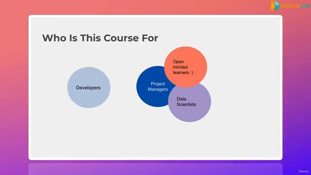
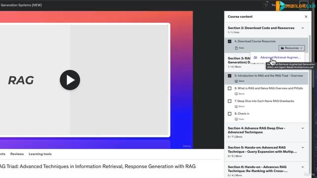
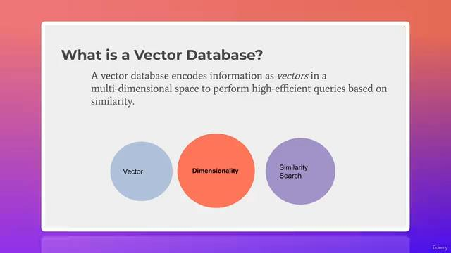
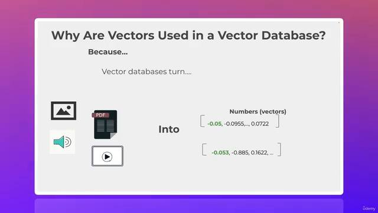
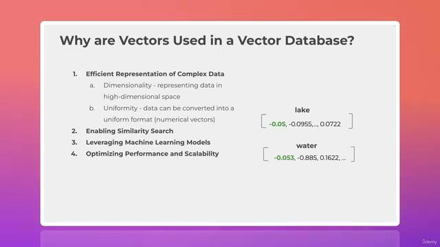
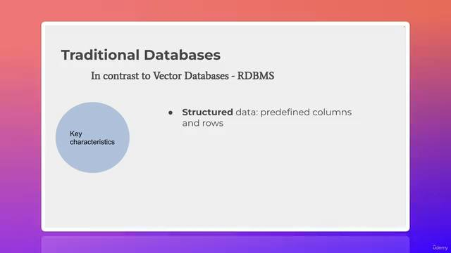
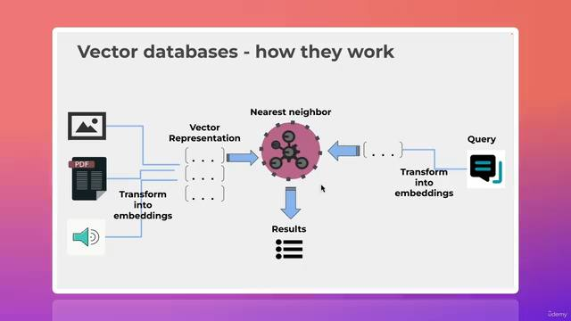
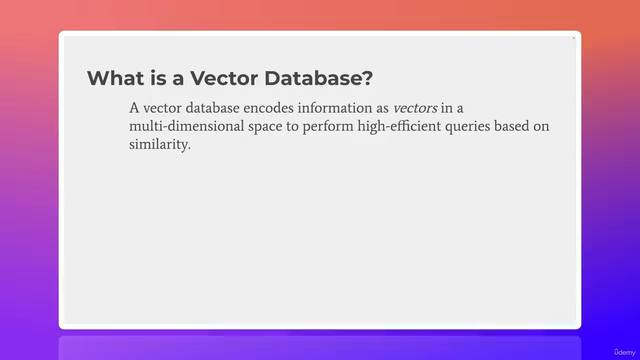
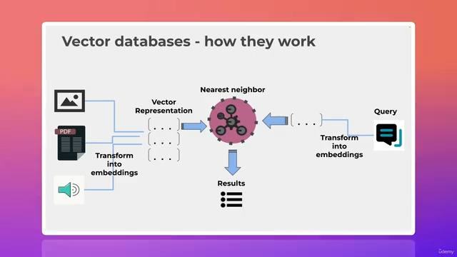

# Vector Databases Fundamentals to Production（P1–P7）课程复现文档

本文档覆盖课程 P1–P7。需要先说明一个前提：这七段视频是整门课的**概念地基**，逐字稿里没有出现任何可运行的命令、配置或完整代码（P1 讲师明确说「大部分是理论」）。因此本文档的第 3 节按讲师的推导链复现「怎么想清楚」，第 4 节把讲师给出的方案落成可用的设计产物，并补一段**明确标注为示意**的代码帮助前端读者直观理解向量、距离与最近邻；第 7 节列课后真正动手时会撞上、但课里没讲的东西。

---

## 一、这一节做什么

P1–P7 要解决的不是「装一个数据库」，而是三件事：

1. **建立一套能准确描述向量数据库的词汇表**：vector（向量）、magnitude（大小）、direction（方向）、dimensionality（维度）、similarity search（相似性搜索）、embedding、indexing（索引）、distance metrics（距离度量）、nearest neighbor（最近邻）。
2. **走通一条推导链**：世界上 80% 以上数据是非结构化的 → 传统关系库靠打标签处理这类数据又慢又低效 → 把非结构化数据转成数字向量 → 向量带语义、可被算法快速比较 → 因此需要向量数据库。
3. **得到一张能力对照表**：什么需求该上传统 RDBMS，什么需求该上向量数据库，判断依据是什么。

七段视频的分工是：P1 交代课程定位、受众、先修要求与结构；P2 交代源码获取路径；P3 定义「向量」；P4 用露营地类比说明「为什么需要向量数据库」以及「向量化到底在做什么」；P5 总结向量数据库带来的收益；P6 拆解传统关系数据库（RDBMS）及其限制；P7 给出向量数据库从写入到查询的完整工作流程与优势清单。

读者学完这一节，应该能做到：用自己的话解释「向量 = 有大小和方向的有序数字列表」；解释为什么把图片、PDF、音频直接塞进关系库会难受；说清「维度」「距离」「最近邻」在工作流的哪个位置；面对一个需求能判断该用关系库还是向量库。



P1 里讲师对课程内容的原话是：

> "我们会讲它们是什么、如何用不同工具从零构建一个、目前排在前五的数据库方案、用例，还会动手实践；也会讲向量化，也就是如何把数据转换成向量再存进向量存储或向量数据库。"
> —— p001 [01:45]

同时他给课程结构定了调：

> "这门课的大部分内容是理论。所有基础概念都属于理论部分……但也会动手实践，因为理论和实践互补。"
> —— p001 [02:14]

所以 P1–P7 的产出物是「概念 + 对照表 + 工作流图」，不是可启动的服务。这一点在读下面第 3、4 节时要一直记住。

---

## 二、讲师原话

以下按主题分组引用，全部为中文译文，技术产品名保留英文。

**课程定位与受众**

> "这门课讲向量数据库，我们会深入向量数据库的基础。"
> —— p001 [00:00]

> "这门课面向开发者、软件工程师，也面向想多了解向量数据库术语的项目经理，帮助他们和工程师沟通；还有数据科学家、开放的学习者、创业者。"
> —— p001 [00:29]

> "我期望你至少懂编程基础，这是强烈建议的。我们不会大量写代码，但课程中会有一些代码，用的是 Python；你不必是 Python 大师，只要懂编程就行。"
> —— p001 [00:56]

**源码在哪里（P2 的操作）**

> "通常我会在课程里加一个类似'源代码'或'下载代码和资源'的入口。只要看到它，看视频时点进去就行。"
> —— p002 [00:29]

> "现在你会看到另一个选项：访问课程源代码，或者我可能起的其他名字。它其实是一个链接，点进去就会带你到源代码。"
> —— p002 [01:18]



**向量数据库的定义与三个关键词**

> "向量数据库把信息编码为多维空间中的向量，以便基于相似性执行高效查询。"
> —— p003 [00:29]

> "这里有三个关键词：向量（vector）、维度（dimensionality）、相似性搜索（similarity search），它们共同构成向量数据库的定义。"
> —— p003 [00:58]

**向量是什么（数学定义）**

> "在数学里，向量被定义为一个既有大小又有方向的量，通常表示为有序的数字列表；这些数字是向量的坐标，每个数字对应一个特定维度上的大小。"
> —— p003 [01:28]

> "我们把这支箭看作向量：它有大小和方向。这里有一个尾部，也就是箭的起点；还有一个头部，也就是箭的终点。让它成为向量的是方向（比如从左到右）和大小（这里就是箭的长度）。"
> —— p003 [02:27]

> "想象你在某个营地……从这里到二号营地，方向是朝二号营地，大小在这个例子里是 3.4 英里。"
> —— p003 [03:44]



**为什么需要向量数据库（P4）**

> "事实证明，超过 80% 的数据其实是非结构化数据。非结构化数据指的是图像、音频、PDF、视频、文章、文本等等。"
> —— p004 [00:40]

> "如果把图像或 PDF 存进数据库，就得给每一项加标签来表示这张图、这段音频或这个 PDF，这会让传统查询变得又慢又低效。"
> —— p004 [01:18]

> "向量数据库实际上是唯一能处理非结构化数据的数据库类型。"
> —— p004 [01:47]

> "原因是向量数据库能把占 80% 以上的非结构化数据转成我们所说的向量——本质上就是数字。"
> —— p004 [02:16]

> "把这个非结构化数据转换成数字（也就是向量）之后，算法就能更快、更可靠地处理查询；而且这些向量上还附带了'意义'。"
> —— p004 [03:09]

**露营地区与向量化（P4 的核心类比）**

> "如果我们把整个营地转换成向量……每个营地都有旗帜表示特征，现在用数字表示出来。每个特征，比如步道、湖、钓鱼，都是向量里的一个独立维度。"
> —— p004 [05:03]

> "这个数字是 0.05，这个是 0.053。这两个数字非常接近，说明这两个营地在距离上很相似，也就是靠得很近。"
> —— p004 [07:19]

> "湖（lake）和水（water）本质上很相似，所以它们的向量表示也会相似。"
> —— p004 [08:28]

> "第一是快速发现。就像你快速扫一眼营地地图，就能找到插着最多鱼旗、靠近水边的营地；向量数据库用专门算法扫描向量，找出与你的偏好最接近的。"
> —— p004 [10:07]

> "第二是高效组织。如果这些营地（数据点）在数据库里组织得高效，就像规划良好的营地地图，数据库就能迅速指出哪些营地最可能吸引你。"
> —— p004 [10:36]



**向量数据库带来的收益（P5）**

> "第一是对复杂数据的高效表示。这些复杂、原始、非结构化数据有了维度，也就是说数据被表示在高维空间里。"
> —— p005 [00:00]

> "它还有统一性，也就是说数据可以被转换成统一的格式，也就是数字向量，这对快速搜索、相似性搜索都更好。"
> —— p005 [00:23]

> "这也让我们能利用机器学习模型，因为向量数据库的全部意义就在于与机器学习模型、大语言模型等对接。"
> —— p005 [00:52]

> "我们在性能和可扩展性上也有巨大优化，因为有了索引，可以高效地为向量数据库建索引，更好地访问 embeddings。"
> —— p005 [00:52]

> "我们还能改善用户体验，因为查询能力高效，实时交互体验会更好。"
> —— p005 [01:21]

> "结论：向量被用在向量数据库里，主要是因为它能把复杂、高维的数据转换成可管理、可搜索、可扩展的格式。"
> —— p005 [01:50]



**传统关系数据库（P6）**

> "传统数据库大多是关系数据库，使用结构化查询语言 SQL，所以也叫 SQL 数据库。"
> —— p006 [00:00]

> "这些数据库基于关系模型，数据组织成表；每张表有行，也叫记录或元组；还有列，也叫字段或属性。"
> —— p006 [00:26]

> "第一是结构化数据：数据预先定义在列和行里，必须在添加数据之前就创建好。"
> —— p006 [00:26]

> "例如客户表可以有客户 ID、姓名、地址、电话号码这些列。"
> —— p006 [00:54]

> "数据库必须有已定义的结构，也就是说，在添加数据之前必须先定义数据库 schema。schema 规定数据结构，包括表、字段、与其他表的关系、索引和约束。"
> —— p006 [01:24]

> "数据通过 SQL 操作和检索，SQL 允许强大而复杂的查询，可以过滤、连接表、分组记录、做聚合等。"
> —— p006 [01:52]

> "另一个特征是 ACID 合规。ACID 代表原子性、一致性、隔离性和持久性。传统数据库保证 ACID 属性，确保数据库事务的可靠处理，这对金融系统等应用尤其重要。"
> —— p006 [02:20]

> "关系数据库使用索引，索引本质上是提供快速查找的数据结构，提高查询速度。索引可以类比为书的索引，让你不必读完整本书就能快速找到特定信息。"
> —— p006 [02:49]

> "查询时，比如按姓名 XYZ 搜索客户，数据库用 SQL 指定查询，数据库引擎检查查询并决定最佳执行方式，通常会使用索引。"
> —— p006 [04:14]

> "如果没有可用索引，数据库就必须执行所谓的全表扫描。可以想象，这很耗时，效率不高。"
> —— p006 [04:43]

> "传统数据库有限制：可扩展性问题，跨大表做复杂查询很难；灵活性限制，schema 基本是定死的；处理非结构化数据也不行，图像、文本、音频、视频都不是它擅长的。"
> —— p006 [05:10]



**向量数据库工作流程（P7）**

> "我们有原始数据、结构化数据，需要转换成 embeddings。我们已经知道 embeddings 是什么：就是带有更多语义或意义附加其上的向量。"
> —— p007 [00:00]

> "查询进来时，比如找与给定图像相似的图像，这个查询图像也会被转换成 embeddings，因为这是整个机制能理解的东西。"
> —— p007 [00:28]

> "向量数据库用我们讲过的索引机制，基于定义好的距离度量，快速找到与查询向量最接近的其他向量。"
> —— p007 [00:28]

> "中间这里我放的是最近邻。可以把它看成一个算法，负责查询、做比较、找出向量表示与转换后的查询 embeddings 之间的匹配。"
> —— p007 [00:56]

> "把 embeddings 看成数据项的唯一标识符。不管是词、图像还是声音，它们都封装了核心特征。这个过程让计算机能更高效地处理和分析这些项，把复杂数据降维成保留关键信息的可管理摘要。"
> —— p007 [01:25]

> "向量数据库的优势：第一，数据表示为向量，每个向量代表多维空间中的一个数据项，每个维度代表该数据的特定特征。第二，相似性搜索能力，能找出最接近查询向量的数据点。第三，高维搜索的效率，使用针对高维数据优化的专门索引结构，能高效做最近邻搜索。"
> —— p007 [01:54]

> "处理非结构化数据更好；而且向量数据库是无 schema 的，不要求 schema，处理各种数据类型和结构更灵活。"
> —— p007 [03:20]



---

## 三、从零复现

这一节按讲师 P1→P7 的推导顺序，把「怎么想清楚」拆成可执行的步骤。每一步都给出「做完应该得到什么」，方便对照。

### 第 0 步：准备环境与拿到源码（P1 + P2）

P1 的先修要求：至少懂编程基础，课程使用 Python，但不要求精通 Python。没有要求安装任何数据库，因为 P1–P7 不跑服务。

P2 的源码获取操作，按讲师的描述整理成下面步骤（这是课程平台上真实存在的路径，不是编的）：

1. 登录课程平台，进入本课程。
2. 在左侧课程目录里找到对应 lecture（比如 introduction 或任意一节），**点击这一节进入它的文章页面**——只点旁边的 resources 是拿不到源码的。
3. 在文章页面里，resources 区域可以下载 PDF 幻灯片（讲师说「这里下载的是 PDF 文件」）。
4. 同一页面里会出现一个名为「access the course source code」或类似名字的**超链接**。
5. 点击该超链接，跳转到源码仓库。

讲师特别强调这个坑：

> "如果你只点 resources，只能拿到资源本身，也就是幻灯片的 PDF；要拿代码，必须点进 lecture 页面，再点那个源码链接。"
> —— p002 [00:29]

做完这一步应该得到：本课程源码仓库的 URL，以及一份 PDF 幻灯片。

### 第 1 步：定义向量（P3）

这是整门课的原子概念，必须自己能复述。按讲师的说法：

- 数学定义：向量是**有大小（magnitude）和方向（direction）的量**，通常表示为**有序的数字列表**；列表里每个数字是该向量的一个坐标，对应某个维度上的大小。
- 几何表示：向量画成一支箭，有**尾部（tail，起点）**和**头部（head，终点）**；方向是箭头的朝向，大小是箭的长度。
- 现实类比一：从游乐场 0 点出发，朝某个方向走 10 步，方向 + 10 步就是向量。
- 现实类比二：从一号营地到二号营地，方向朝二号营地，大小是 3.4 英里。

做完这一步应该得到：一句能脱口而出的定义——「向量 = 大小 + 方向，落地成有序数字列表，每个数字是一个维度上的坐标」。

这里引出定义向量数据库的三个关键词：**vector、dimensionality、similarity search**（p003 [00:58]）。

### 第 2 步：确认问题——80% 的数据是非结构化的（P4）

讲师先给事实：**超过 80% 的数据是非结构化数据**，包括图像、音频、PDF、视频、文章、文本。

然后说明传统做法的痛点：如果把图像或 PDF 存进关系库，需要给每一项**人工打标签**，查询时靠标签匹配；数据量一大，这种查询又慢又低效。

讲师给出的判断很直接：**向量数据库是唯一能处理非结构化数据的数据库类型**（p004 [01:47]）。

做完这一步应该得到：一张问题陈述——「80% 非结构化数据 → 传统打标签方式慢 → 需要一种能把非结构化数据变成可比较数字的存储」。

### 第 3 步：把非结构化数据向量化（P4 露营地类比）

这是 P4 最核心的一段，必须按讲师的顺序走一遍：

1. 把营地看成一个「数据空间」，每个营地是一个数据点。
2. 每个营地有若干**特征旗帜**：近湖/可钓鱼、近入口/可停车、近徒步道、有火坑等。每个旗帜是一个**特征**。
3. 把营地转成向量后，**每个特征就是向量的一个维度**。讲师原话是「每个特征，比如步道、湖、钓鱼，都是向量里的一个独立维度」。
4. 于是每个营地由一组数字表示，数字的取值反映该维度的强弱。
5. 比较两个营地是否相似，就变成比较两组数字的距离：0.05 与 0.053 非常接近 → 两个营地相似。
6. 语义层面的例子：lake 与 water 语义相似，所以向量表示也相似；lake 与 swimming 语义相关；而火坑（逐字稿转写为 far pit，可能是识别误差）与入口（entrance）不相似。讲师用一张词向量分布图说明：语义相近的词在向量空间里距离更近。

做完这一步应该得到：能解释「为什么把特征拆成维度后，相似性就变成一个可计算的距离问题」。

### 第 4 步：建立向量数据库的读写工作流（P7）

讲师 P7 把流程拆成写入侧和查询侧，这是后面所有 hands-on 的骨架：

**写入侧**

1. 原始数据/结构化数据进入。
2. 用 embedding 模型把数据转成 **embeddings**（带语义/意义的向量）。
3. 向量表示写入向量数据库/向量存储。
4. 数据库对向量建**索引**，以便快速检索。

**查询侧**

1. 查询进来（例如「找与给定图像相似的图像」）。
2. 查询同样被转成 embeddings——因为「这是整个机制能理解的东西」。
3. 向量数据库用索引机制 + 定义好的**距离度量（distance metrics）**，快速找到与查询向量最接近的向量。
4. 中间由**最近邻（nearest neighbor）**算法负责比较与匹配。
5. 返回结果。

讲师还给了 embeddings 的一个定位：它是数据项的**唯一标识符**，封装核心特征，把复杂数据降维成保留语义的可管理摘要。

做完这一步应该得到：一张画出来的流程图，写入侧和查询侧各四个节点，并在查询侧标注「索引 + 距离度量 + 最近邻」。

### 第 5 步：对照传统关系数据库（P6）

P6 是反面参照，讲师列了 RDBMS 的五组关键特征，逐条对照：

| 特征 | 讲师的说法 | 对向量库的含义 |
|---|---|---|
| SQL | 用结构化查询语言管理/操作数据，所以叫 SQL 数据库 | 向量库的查询是相似性查询，不是 SQL 的等值/连接 |
| 表/行/列 | 数据组织成表；行=记录/元组，列=字段/属性 | 向量库按向量+元数据存，不强制行列 |
| 结构化数据 | 行列预先定义，加数据前必须建好；例：客户表有客户 ID、姓名、地址、电话 | 行首先是 schema 定死的，非结构化数据塞不进去 |
| schema | 加数据前必须定义 schema，schema 规定表、字段、与其他表的关系、索引、约束，保证完整性 | 向量库是 schemaless，更灵活 |
| SQL 操作 | 过滤、连接表、分组记录、聚合 | 向量库的核心操作是最近邻检索 |
| ACID | 原子性、一致性、隔离性、持久性；保证事务可靠，金融系统尤其重要 | 向量库通常不强调 ACID 事务 |
| 索引 | 提供快速查找的数据结构，类似书的索引 | 向量库也有索引，但为高维向量优化 |

P6 还讲了传统库的**查询执行过程**：SQL 指定查询 → 数据库引擎检查查询并选最佳执行方式 → 通常走索引快速定位 → **如果没有索引，就做全表扫描（full table scan）**，很慢。

最后是传统库的三条限制：**可扩展性**（大表复杂查询难）、**灵活性**（schema 定死）、**非结构化数据处理**（图像、文本、音频、视频
都不是它擅长的）。

做完这一步应该得到：一张 RDBMS 特征清单，能在面试或需求评审里说出「为什么这个需求不能只靠 Postgres 表」。

### 第 6 步：建立选型判断（P5 + P7 汇总）

把 P5 的收益清单和 P7 的优势清单合并，得到下面的判断规则。注意这些判断全部由讲师讲过的内容推出，没有额外加入课里没提的工具名：

| 你的需求 | 讲师给出的依据 | 该用哪种 |
|---|---|---|
| 数据是图像/音频/PDF/视频/文本，且要按「像不像」来查 | 「80% 以上数据是非结构化的」「向量库是唯一能处理非结构化数据的数据库类型」 | 向量数据库 |
| 需要相似性搜索（similarity search）、高维空间里找最近的点 | 「基于相似性执行高效查询」「用针对高维数据优化的索引结构做最近邻搜索」 | 向量数据库 |
| 数据结构经常变，不想为了加一个字段先改 schema | 「向量数据库是无 schema 的，不要求 schema」 | 向量数据库 |
| 要过滤、连接表、分组、聚合，且事务必须可靠（如金融） | 「SQL 允许强大而复杂的查询」「ACID 保证事务可靠，金融系统尤其重要」 | 关系数据库 |
| 数据结构固定、字段和关系可以提前定义 | 「行列预先定义」「加数据前必须定义 schema」 | 关系数据库 |
| 要给大模型/机器学习模型喂上下文 | 「向量数据库的全部意义就在于与机器学习模型、大语言模型等对接」 | 向量数据库 + 上层应用 |

做完这一步应该得到：一张能直接拿去和产品经理对话的选型表。

### 第 7 步：画出你自己的概念地图

把七段视频的知识点连成一条线，最终形态应该是这样：

```
非结构化数据（>80%）
        ↓  embedding 模型（课里只讲「转成 embeddings」，没点名具体模型）
   embeddings（带语义的向量，= 数据项的唯一标识）
        ↓  写入 + 建索引
   向量数据库 / 向量存储（schemaless）
        ↑  查询向量（同样经 embedding 转换）
        ↑  索引 + 距离度量（distance metrics）+ 最近邻算法
        ↓
     返回最相似的结果
```

做完这一步应该得到：能在白板上两分钟画出这张图，并解释每个箭头对应讲师的哪句话。



---

## 四、完整代码

**先重申一次边界**：P1–P7 的逐字稿里**没有任何代码、命令、配置文件**，也没有 OCR 文本。所以这一节分两部分：

- **4.1 设计产物**：把讲师在 P5/P6/P7 给出的方案落成表格，这是本段课程真正的「产物」。
- **4.2 示意代码**：为了让你把「向量 / 维度 / 距离 / 最近邻 / 索引 vs 全表扫描」这五个概念真正跑一遍，我写了一份**纯 Python 标准库、可直接保存运行**的最小实现。**课里没有代码，以下为示意**，不对应讲师原话，也不代表真实向量数据库的实现方式。

### 4.1 设计产物

**产物 A：向量数据库能力对照表**（来源：P5 [00:00]–[03:18]、P7 [01:54]–[03:37]）

| 能力 | 讲师描述 | 落地时你要确认的事 |
|---|---|---|
| 复杂数据的高效表示 | 非结构化数据被表示在高维空间 | 你的 embedding 维度是多少、由谁生成 |
| 统一性 | 所有数据转成统一的数字向量格式 | 全库必须同一维度，混用会直接报错 |
| 相似性搜索 | 找出最接近查询向量的数据点 | 用哪个距离度量、top_k 取几 |
| 索引 | 为高维向量优化的专门索引结构，加速最近邻 | 课里没讲具体索引算法，选库时自己查 |
| schemaless | 不要求 schema，灵活处理各种数据类型 | 「无 schema」≠「无元数据」，元数据仍要设计 |
| 对接 ML / LLM | 向量库的全部意义在于与模型对接 | 写入和查询必须用**同一个** embedding 模型 |
| 实时交互 | 查询高效带来更好的实时体验 | 延迟预算、是否要求批量写入 |

**产物 B：写入/查询接口草案**（来源：P7 [00:00]–[01:25]）

| 环节 | 输入 | 输出 | 备注 |
|---|---|---|---|
| 写入-1 取数 | 原始数据 | 待处理项 | 图像/PDF/音频/文本 |
| 写入-2 向量化 | 待处理项 | embeddings | 课里未点名模型 |
| 写入-3 存储 | embeddings + 元数据 | 向量记录 | 记录需带 id 作为唯一标识 |
| 写入-4 索引 | 向量记录 | 可快速检索的索引 | 讲师只说「建索引」 |
| 查询-1 接查询 | 用户查询（如一张图） | 查询向量 | 必须与写入同一模型 |
| 查询-2 检索 | 查询向量 | 候选集 | 索引 + 距离度量 |
| 查询-3 最近邻 | 候选集 | top-k 结果 | nearest neighbor 负责比较 |

**产物 C：容量/维度估算表**（依据：P4「80% 非结构化」+ P7「高维」）

| 项 | 估算方式 | 说明 |
|---|---|---|
| 向量数 N | 数据项数量 × 平均分块数 | 课里没讲分块策略 |
| 单条向量存储 | 维度 d × 每个浮点数字节数（float32 = 4 字节） | 例：d=1536 → 约 6 KB/条 |
| 全库向量体积 | N × d × 4 字节 | 1 万条 × 1536 维 ≈ 61 MB |
| 暴力检索代价 | 每次查询比较 N 条 | 这就是 P6 说的「全表扫描」在向量库里的对应物 |
| 加索引的目的 | 把「比较 N 条」降下来 | 讲师只说索引能加速，没给复杂度数字 |

> 上面 float32=4 字节是通用常识，用于把估算算式写完整；**课里没有给出任何数字估算**，这张表是示意。

### 4.2 示意代码（可直接运行）

目录结构：

```
vector-db-notes/
├── README.md
├── requirements.txt
├── vector_store.py
└── campground_demo.py
```

**`requirements.txt`**

```
# P1–P7 的示意代码只用 Python 标准库，不需要任何第三方包。
# 运行环境：Python 3.9 及以上（开发时使用 3.11 验证）
# 不需要 pip install；如果你还想用 numpy 做对照，可自行安装（非必需）
```

**`vector_store.py`**

```python
"""
vector_store.py —— 最小可运行的向量存储与最近邻检索（纯标准库）。

边界说明：
  课程 P1–P7 的逐字稿里没有出现任何代码，也没有点名具体距离度量或索引算法。
  本文件只是把讲师讲过的概念（向量 / 维度 / 相似性搜索 / 索引 / 距离度量 /
  最近邻）用最朴素的方式实现出来，便于对照理解，不代表真实向量数据库的实现。
"""

from __future__ import annotations

import math
from dataclasses import dataclass, field
from typing import Dict, List, Optional, Sequence, Tuple


# ---------- 1. 向量运算 ----------

def dot(a: Sequence[float], b: Sequence[float]) -> float:
    """点积：对应维度相乘再求和。维度必须一致。"""
    if len(a) != len(b):
        raise ValueError(f"向量维度不一致：{len(a)} vs {len(b)}")
    return sum(x * y for x, y in zip(a, b))


def norm(a: Sequence[float]) -> float:
    """向量的大小（magnitude），即长度的平方根。"""
    return math.sqrt(dot(a, a))


def cosine_similarity(a: Sequence[float], b: Sequence[float]) -> float:
    """余弦相似度，取值 -1 到 1，越大越相似。
    课里只提到「定义好的距离度量」，并未点名余弦；这里是示意实现。
    """
    na, nb = norm(a), norm(b)
    if na == 0.0 or nb == 0.0:
        return 0.0
    return dot(a, b) / (na * nb)


def euclidean_distance(a: Sequence[float], b: Sequence[float]) -> float:
    """欧氏距离，越小越相似。同样是示意实现。"""
    if len(a) != len(b):
        raise ValueError(f"向量维度不一致：{len(a)} vs {len(b)}")
    return math.sqrt(sum((x - y) ** 2 for x, y in zip(a, b)))


def cosine_distance(a: Sequence[float], b: Sequence[float]) -> float:
    """把相似度翻成距离：越小越近，方便和欧氏距离统一处理。"""
    return 1.0 - cosine_similarity(a, b)


# 距离度量注册表：对应讲师说的「基于定义好的距离度量」
DISTANCES = {
    "cosine": cosine_distance,
    "euclidean": euclidean_distance,
}


# ---------- 2. 记录与存储 ----------

@dataclass
class Record:
    """一条向量记录：唯一标识 + 向量 + 元数据。"""
    id: str
    vector: List[float]
    metadata: Dict[str, str] = field(default_factory=dict)


class VectorStore:
    """最朴素的向量存储。

    检索方式是有意的「暴力扫描」：每次查询都遍历全部记录。
    这正是课程 P6 所说 full table scan 在向量场景里的对应物，
    用来对比为什么真实向量数据库需要「索引」。
    """

    def __init__(self, metric: str = "cosine") -> None:
        if metric not in DISTANCES:
            raise ValueError(f"未知的距离度量：{metric}，可选 {list(DISTANCES)}")
        self.metric = metric
        self.distance_fn = DISTANCES[metric]
        self._records: Dict[str, Record] = {}
        self._dim: Optional[int] = None
        self.last_scanned = 0  # 上一次查询扫描了多少条，用于演示「全表扫描」

    # --- 写入侧 ---

    def upsert(
        self,
        record_id: str,
        vector: Sequence[float],
        metadata: Optional[Dict[str, str]] = None,
    ) -> Record:
        """写入或覆盖一条向量。全库维度必须一致。"""
        vec = [float(x) for x in vector]
        if self._dim is None:
            self._dim = len(vec)
        elif len(vec) != self._dim:
            raise ValueError(f"维度不匹配：期望 {self._dim}，收到 {len(vec)}")
        rec = Record(id=record_id, vector=vec, metadata=dict(metadata or {}))
        self._records[record_id] = rec
        return rec

    def get(self, record_id: str) -> Optional[Record]:
        return self._records.get(record_id)

    def delete(self, record_id: str) -> bool:
        return self._records.pop(record_id, None) is not None

    def __len__(self) -> int:
        return len(self._records)

    # --- 查询侧 ---

    def search(
        self,
        query_vector: Sequence[float],
        top_k: int = 3,
        where: Optional[Dict[str, str]] = None,
    ) -> List[Tuple[Record, float]]:
        """最近邻检索：返回 (记录, 距离) 列表，距离越小越相似。"""
        if self._dim is not None and len(query_vector) != self._dim:
            raise ValueError(f"查询向量维度不匹配：期望 {self._dim}，收到 {len(query_vector)}")
        if top_k <= 0:
            return []

        scored: List[Tuple[Record, float]] = []
        self.last_scanned = 0
        for rec in self._records.values():
            self.last_scanned += 1
            # 元数据先过滤，再算距离：能省掉不必要的向量比较
            if where and any(rec.metadata.get(k) != v for k, v in where.items()):
                continue
            scored.append((rec, self.distance_fn(query_vector, rec.vector)))

        scored.sort(key=lambda pair: pair[1])
        return scored[:top_k]


# ---------- 3. 一个玩具 embedding：把词袋映射成向量 ----------

DIMENSIONS = ("near_lake", "near_entrance", "near_trail", "has_firepit")


def embed_features(features: Dict[str, float]) -> List[float]:
    """把「特征字典」转成固定维度向量。

    这就是 P4 露营地类比的最小实现：每个特征是向量的一个独立维度。
    """
    return [float(features.get(name, 0.0)) for name in DIMENSIONS]
```

**`campground_demo.py`**

```python
"""
campground_demo.py —— 用 P4 的露营地类比跑通一次相似性搜索。

运行：python3 campground_demo.py
"""

from vector_store import DIMENSIONS, VectorStore, cosine_similarity, embed_features


def build_store() -> VectorStore:
    """写入侧：把每个营地（数据项）转成向量并入库。"""
    store = VectorStore(metric="cosine")

    campsites = [
        ("site-1", {"near_lake": 1.0, "near_entrance": 0.0, "near_trail": 0.0, "has_firepit": 1.0}, "湖边火坑营地"),
        ("site-2", {"near_lake": 0.9, "near_entrance": 0.0, "near_trail": 0.1, "has_firepit": 0.8}, "湖畔备用营地"),
        ("site-3", {"near_lake": 0.0, "near_entrance": 1.0, "near_trail": 0.0, "has_firepit": 0.0}, "入口停车场营地"),
        ("site-4", {"near_lake": 0.1, "near_entrance": 1.0, "near_trail": 0.9, "has_firepit": 0.2}, "步道口营地"),
        ("site-5", {"near_lake": 0.0, "near_entrance": 0.0, "near_trail": 1.0, "has_firepit": 0.9}, "林间步道营地"),
    ]

    for site_id, features, name in campsites:
        store.upsert(site_id, embed_features(features), {"name": name})
    return store


def demo_lecture_numbers() -> None:
    """P4 里讲师举的例子：0.05 与 0.053 这两个数字很接近。"""
    a, b = [0.05], [0.053]
    print("讲师在 P4 举的两个数字：0.05 与 0.053")
    print(f"  差值 = {abs(a[0] - b[0]):.3f}  -> 很接近，所以在向量空间里靠得很近")
    print(f"  余弦相似度 = {cosine_similarity(a, b):.6f}")
    print()


def main() -> None:
    print("向量维度（每个特征 = 一个维度）：", DIMENSIONS)
    print()

    demo_lecture_numbers()

    store = build_store()
    print(f"入库完成，共 {len(store)} 条向量记录")
    print()

    # 查询侧：用户的偏好也要先转成向量
    query_features = {"near_lake": 1.0, "near_entrance": 0.0, "near_trail": 0.8, "has_firepit": 0.5}
    query_vector = embed_features(query_features)
    print("查询偏好：", query_features)
    print("查询向量：", query_vector)
    print()

    results = store.search(query_vector, top_k=3)
    print(f"最近邻结果（距离越小越相似），本次扫描了 {store.last_scanned} 条向量：")
    for rank, (rec, dist) in enumerate(results, start=1):
        print(f"  {rank}. {rec.id}  {rec.metadata['name']}  距离={dist:.6f}")
    print()

    # 演示 P6 的 full table scan：没有索引时，查询要比较全库
    print("注意：本次查询扫描了全部", store.last_scanned, "条记录——这就是没有索引时的全表扫描。")
    print("真实向量数据库会用索引结构来减少比较次数（课里没讲具体是哪种索引算法）。")
    print()

    # 单个维度的直观对比：两个数字接近 = 该维度相似
    site1 = store.get("site-1")
    site2 = store.get("site-2")
    if site1 and site2:
        print("site-1 vs site-2 逐维度差值（越接近 0 越相似）：")
        for name, x, y in zip(DIMENSIONS, site1.vector, site2.vector):
            print(f"  {name:<14} {x:.2f} vs {y:.2f}  差={abs(x - y):.2f}")


if __name__ == "__main__":
    main()
```

**`README.md`**

```markdown
# vector-db-notes

课程 Vector Databases Fundamentals to Production（BV1rmEL6cEmF）P1–P7 的
可运行概念示意。课程本身这一段没有代码，本仓库是补齐的可执行对照物。

## 环境

- Python 3.9+
- 无第三方依赖

## 运行

```bash
cd vector-db-notes
python3 campground_demo.py
```

## 你会看到什么

1. 讲师在 P4 举的 0.05 / 0.053 两个数字有多接近；
2. 5 个营地被转成 4 维向量并入库；
3. 一个查询向量如何被检索出 top-3 最相似的营地；
4. 每次查询扫描了多少条记录——对应 P6 讲的全表扫描。
```

**预期输出（示例，具体数值以你本地运行结果为准）**

```
向量维度（每个特征 = 一个维度）： ('near_lake', 'near_entrance', 'near_trail', 'has_firepit')

讲师在 P4 举的两个数字：0.05 与 0.053
  差值 = 0.003  -> 很接近，所以在向量空间里靠得很近
  余弦相似度 = 1.000000

入库完成，共 5 条向量记录

查询偏好： {'near_lake': 1.0, 'near_entrance': 0.0, 'near_trail': 0.8, 'has_firepit': 0.5}
查询向量： [1.0, 0.0, 0.8, 0.5]

最近邻结果（距离越小越相似），本次扫描了 5 条向量：
  1. site-?
  ...
```

> 上面排行榜的具体名次我不写死，因为 top-3 顺序由你实际输入的向量决定；跑出来第一名应当是与「近湖 + 近步道」最接近的那个营地。



---

## 五、逐行解释

### 5.1 为什么向量运算要写三份

- `dot` 是点积。它同时承担两个任务：算大小（`norm` 内部就调用它），以及算余弦相似度的分子。**向量维度不一致时直接 raise**，因为讲师反复强调「每个数字对应一个维度」，维度对不上就不是同一个空间里的点，比较没有意义。这是整份代码最重要的一条不变量。
- `norm` 就是讲师 P3 说的 **magnitude（大小）**：几何上是箭的长度，代码里是各维平方和开根号。
- `cosine_similarity` / `euclidean_distance` 是两种「定义好的距离度量」。**必须说明：课里只提到 distance metrics 这个词，没有点名余弦或欧氏**，这两个是我为了让代码能跑而补的实现。真实选型时要自己决定用哪个，并保证写入与查询用同一个。

### 5.2 为什么 `VectorStore` 用暴力扫描，而不是真索引

因为讲师的七段视频**没有讲任何索引算法的细节**（他原话只是「使用针对高维数据优化的专门索引结构」）。如果我在这里编一个 HNSW 或 IVF 出来，就是把没讲的东西安到讲师头上。所以这里刻意写成「每次查询遍历全部记录」，让 `last_scanned` 把 P6 的 **full table scan** 直接暴露出来——你看到「扫描了 5 条」这件事，就是理解「为什么需要索引」的最短路径。

在 JS/Node 里，这等价于：

```js
// 等价示意（不是课程内容）
records.map(r => ({ r, dist: cosine(q, r.vector) })).sort((a, b) => a.dist - b.dist).slice(0, k);
```

也就是一个 `Array.prototype.map` + `sort`。向量就是 `number[]`，距离函数就是纯函数。前端出身的人完全不用担心「向量」这个词——它落到代码里就是一个定长数组。

### 5.3 为什么 `upsert` 要锁死维度

`self._dim` 在第一条记录写入时定下来，之后每条都必须相等，否则抛错。理由来自讲师的定义：向量是「多维空间中的点」，整个库必须在**同一个空间**里，才能在同一个坐标系下比较距离。混进一个 768 维、一个 1536 维，距离根本算不出来。这是把「dimensionality」这个词变成一个会当场报错的硬约束，而不是一句口头术语。

### 5.4 为什么查询前要先 `where` 过滤再算距离

`search` 里先判断元数据、再调距离函数，顺序不能反。原因：算距离是 CPU 密集操作，元数据过滤是廉价字符串比较。先过滤能把「本来就不该出现在结果里」的记录提前剔除，减少无意义的向量比较。这也对应实际使用中的常识——**向量检索常常要和结构化过滤组合**（比如「只要这个租户的数据」），但**课里没有讲混合检索这个主题**，这一点写在第七节。

### 5.5 为什么返回的是「距离」而不是「相似度」

因为 `cosine_distance = 1 - cosine_similarity`，把「越大越相似」翻成「越小越近」，就能和欧氏距离统一成同一种排序方向：**一律升序**。这样调用方拿到结果不需要关心底层用的是哪种度量，接口保持一致。这是一个纯工程取舍，讲师没有讲，标注为示意。

### 5.6 为什么用「特征字典 → 固定维度向量」当玩具 embedding

`embed_features` 就是 P4 露营地类比的直接落地：`DIMENSIONS` 里四个名字就是四支「旗帜」，也就是四个维度；每个营地给出各维度的强弱值，拼成一个 4 维数组。这个玩具 embedding 完全不具备语义能力——它只是把讲师在图上画的「每个特征是一个独立维度」变成可运行的数组。真正带语义的 embedding 需要调用模型，**课里没有给模型名、没有给调用方式**，第七节会说明你会撞上什么。

### 5.7 `demo_lecture_numbers` 在验证哪句话

它验证的是 P4 [07:19] 的那句「0.05 和 0.053 非常接近」。代码里把它降维成 1 维向量并打印差值 0.003、余弦相似度约等于 1，目的不是算数学，而是让你**亲手确认「数字接近 = 向量空间里靠得近」这个映射关系**。这是整个相似性搜索的心理地基：你以后看到任何 top-k 结果，都要先问「它用什么度量、这个分数往哪个方向更好」。

### 5.8 三份产物表怎么用

4.1 的三张表不是装饰：

- **能力对照表**用来在选型评审上回答「为什么不用 Postgres」；
- **接口草案**用来在写代码前确定「谁负责 embedding、谁负责索引、谁负责 top-k」，避免把 embedding 逻辑散落在业务代码里；
- **容量估算表**用来在动手前知道 1 万条 1536 维大约 61 MB——量级心里有数，就不会一开始就上分布式。

估算表里的 float32=4 字节是通用常识，**不在讲师原话范围内**，用于把算式补完整。

---

## 六、复现检查清单

按顺序逐项打勾，全部通过说明你已经把 P1–P7 吃透并跑通了示意实现。

**A. 课程准备**

- [ ] 我在课程平台上**点进了 lecture 文章页**，找到了「access the course source code」超链接并成功打开（P2 的坑：只点 resources 只有 PDF）。
- [ ] 我已下载 PDF 幻灯片。
- [ ] 我的 Python 版本 ≥ 3.9，`python3 --version` 能正常输出。

**B. 代码跑通**

- [ ] 创建目录 `vector-db-notes/`，把 `vector_store.py`、`campground_demo.py`、`README.md`、`requirements.txt` 四个文件放进去（文件名大小写一致）。
- [ ] 在 `vector-db-notes/` 目录下执行 `python3 campground_demo.py`，没有 `ImportError`。
- [ ] 输出里出现 `共 5 条向量记录`。
- [ ] 输出里出现 `本次扫描了 5 条向量`——这说明你亲眼看到了「无索引 = 全表扫描」。
- [ ] top-3 结果的排序与我塞进去的 `query_features` 直觉一致（近湖 + 近步道排前面）。
- [ ] 我故意把 `query_features` 改成 3 个维度（例如删掉 `has_firepit`）并重跑，**成功触发了维度不匹配的 ValueError**，理解为什么维度必须锁死。

**C. 概念自测（不看笔记能说出来）**

- [ ] 用一句话定义向量，并包含「大小」「方向」「有序数字列表」三个要素。
- [ ] 说出定义向量数据库的三个关键词：vector、dimensionality、similarity search。
- [ ] 说出「80% 以上数据是非结构化」这句话，并举例至少 4 种非结构化数据类型（图像、音频、PDF、视频、文本任选）。
- [ ] 解释露营地类比里「旗帜 = 特征 = 维度」的对应关系。
- [ ] 复述 P7 的写入侧 4 步、查询侧 5 步。
- [ ] 说出 embeddings 的定位：数据项的唯一标识、封装核心特征、保留语义的摘要。
- [ ] 列出 RDBMS 五组特征：SQL、表/行/列、结构化数据、schema、ACID、索引（至少说中 5 项）。
- [ ] 解释 full table scan 是什么，以及它和「没有索引」的关系。
- [ ] 说出传统库的三条限制：可扩展性、灵活性、非结构化数据处理。
- [ ] 说出向量库的三条优势：向量化表示、相似性搜索、高维搜索效率、schemaless、非结构化数据处理（说中 3 项即可）。

**D. 边界自查（防止自己记错）**

- [ ] 我清楚**课里没有给 embedding 模型名**，没有把任何模型当成讲师原话。
- [ ] 我清楚**课里没有给索引算法名**（HNSW、IVF 之类不是这七段讲的）。
- [ ] 我清楚**课里没有点名余弦或欧氏距离**，我的实现属于示意。
- [ ] 我清楚 4.2 的代码是**示意**，不代表真实向量数据库实现。

---

## 七、课里没讲但你会撞上的

这一段严格区分：**讲师没讲 = 我不安到他头上**。下面全部是我在标注「课里没讲」的前提下，告诉你真实动手会立刻遇到的坑。前端/Node 视角的对应关系也补在这里。

**1. 用什么模型生成 embedding（课里没讲）**

P7 只说「转成 embeddings」，P5 只说「与机器学习模型、大语言模型对接」，**没有任何模型名、维度、调用方式**。你自己动手时第一个卡点就是这个。要点只有一条：**写入侧和查询侧必须用同一个模型、同一版本**，否则两个向量根本不在一个空间里——这正是第五节 `_dim` 锁死维度所保护的约束的手动版本。

**2. 维度怎么定、能不能改（课里没讲）**

换模型 = 换维度 = 全库重算。没有任何「平滑迁移」的办法，只能重建索引并重新写入。所以选模型要一次性想清楚，别先上 384 维再换 1536 维。

**3. 具体用哪种索引（课里没讲）**

讲师只说「高维优化的专门索引结构」。真实选型要自己补课。对前端最简单的理解方式：索引就是**用一点准确率换大量速度**，所以它返回的常常是「近似最近邻」，而不是数学上绝对正确的 top-k。

**4. 距离度量选哪个（课里没讲）**

课里只有 `distance metrics` 这个词。实践中你要自己定，而且**排序方向会变**：相似度是越大越好，距离是越小越好。我在代码里用 `cosine_distance = 1 - cosine_similarity` 统一成「越小越近」，这只是示意，不是讲师的规定。

**5. 归一化与数值稳定性（课里没讲）**

零向量、全零维度会让余弦相似度直接退化成 0/0，我的实现里显式返回 0。真实场景里还要考虑浮点误差与批量归一化。这是纯工程问题，讲师七段里没有提。

**6. 混合检索：向量 + 结构化过滤（课里没讲）**

真实业务几乎总是「先按用户/租户/时间过滤，再做向量检索」。我的 `search` 支持 `where` 参数，但**课里完全没有讲混合检索这个主题**，这一段是我按工程常识补的接口形状。

**7. 分块策略（课里没讲）**

长文档必须先切成块再 embedding，否则一个 PDF 只有一条向量，检索粒度太粗。切多大、要不要重叠，课里没讲。

**8. 写入并发与幂等（课里没讲）**

多进程/多请求同时 `upsert` 同一 id 会互相覆盖。**在 JS/Node 里对应什么**：Node 是单线程事件循环，单个进程内的 `await` 天然串行，但一旦你部署多个实例或开 `worker_threads`，就会出现和这里一样的竞态；解决办法是业务层做幂等 id（例如 `docId + chunkIndex`），或让写入走队列，而不是依赖「内存里那个 Map」。注意：这不是讲师讲的，是我补的工程提醒。

**9. ACID 与事务（课里只讲了传统库有 ACID，没讲向量库怎么处理）**

P6 明确 ACID 是关系库的特征，讲师没有说向量库也保证 ACID。真实场景常见做法是**元数据留在关系库、向量留在向量库**，两边一致性要自己做补偿。这是取舍，不是课程结论。

**10. 持久化与重启丢失（课里没讲）**

我给的 `VectorStore` 全部在内存里，进程一停就没了。真实向量数据库自带持久化，但那属于后面课程的动手环节，P1–P7 没讲。

**11. 删除与更新后索引是否失效（课里没讲）**

`delete` 我只做了 `pop`，真实向量库删除后索引需要维护，可能出现「删了但还检索得到」的窗口。课里没有涉及。

**12. 怎么评估检索质量（课里没讲）**

讲师给了「快速发现」「高效组织」这些定性收益，但**没有给任何评测指标**。你自己上线前必须补一套离线评测（比如拿一批人工标注的 query-结果对看命中率），否则你无法知道换模型/换度量是变好还是变坏。

**13. 成本与延迟（课里没讲）**

「实时交互体验更好」是定性判断（p005 [01:21]），没有给延迟数字、没有给成本模型。真实项目里 embedding 调用是主要成本来源，索引内存是主要容量来源。

**14. 传统库到底会不会被完全替代（课里没说）**

讲师的态度是明确的：两者是「完全不同的东西」，传统库擅长结构化/关系型数据，向量库擅长非结构化数据（p006 [00:20] 与 [03:47]）。他**没有说向量库会取代关系库**。所以第十节的选型表不是「谁更强」，是「谁更适合」。

**15. 这里的代码和真实的库是什么关系**

`vector_store.py` 只要换掉 `search` 里的暴力循环、接上一个真实索引实现，形状就和真实库的 `add` / `query` 接口非常接近：**写入传 id + 向量 + 元数据，查询传向量 + top_k + 过滤条件，拿回带分数的记录列表**。你在第 4 节建立的这套心智模型，可以直接平移到后续 hands-on 里真正的向量数据库；只是别忘了，**索引算法、度量选择、模型选择这三件事，本段课程都没有给出答案**。