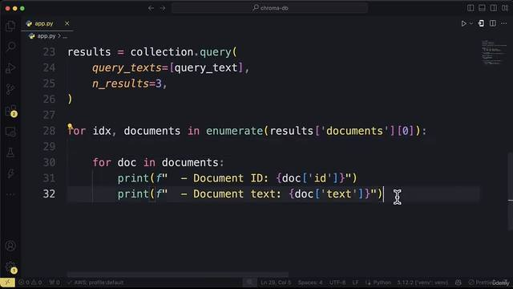
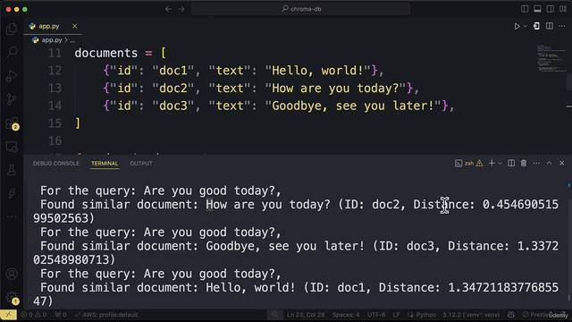
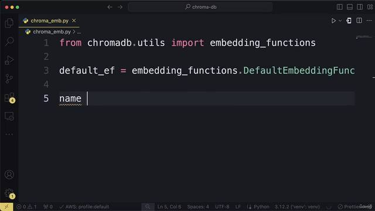
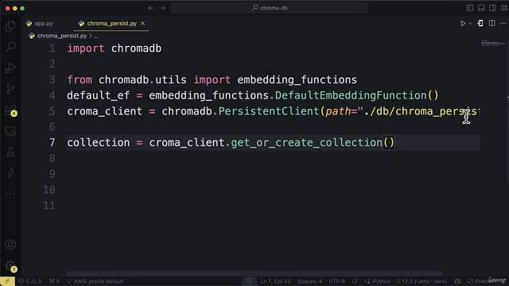
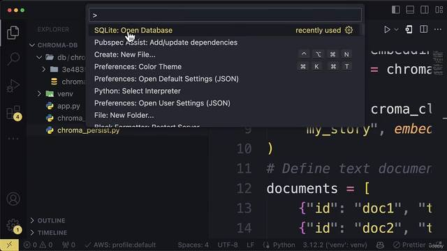
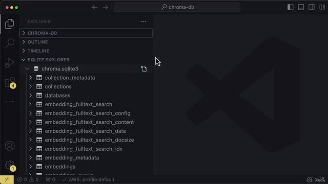
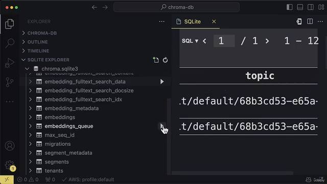
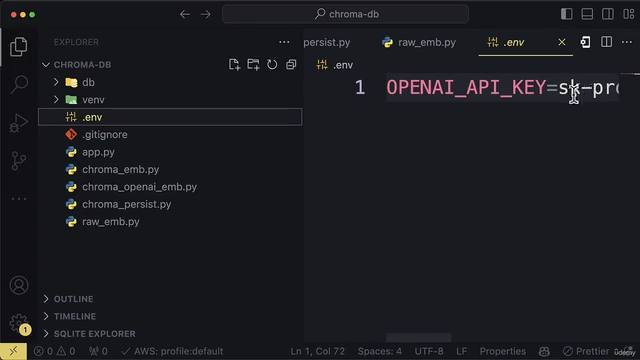
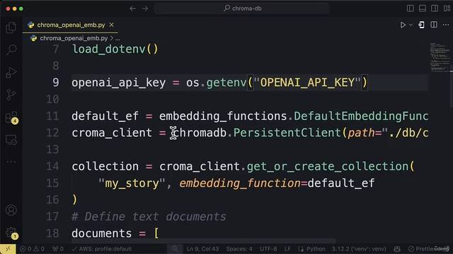
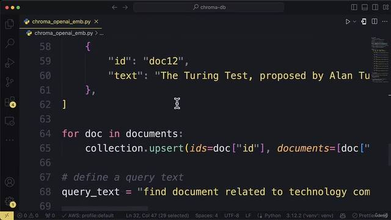

## 1. 这一节做什么

这一段课程（P21–P25）把 ChromaDB 从“能查”推进到“能持久化、能换 embedding 供应商”。具体完成五件事：

1. 把 P21 的查询结果用 `for` 循环格式化打印，观察 `documents`、`ids`、`distances` 三个返回结构，并用 `n_results` 控制返回条数。
2. 用 ChromaDB 自带的 `DefaultEmbeddingFunction` 把一段文本变成向量，理解 Chroma 默认的 embedding 能力。
3. 用 `PersistentClient` 把 collection 持久化到本地 `db/chroma_persistent`，运行后得到 `chroma.sqlite3`，并用 VS Code 的 SQLite 扩展查看 `collections`、`metadata`、`embeddings`、`embeddings_queue` 等表。
4. 脱离 Chroma，直接用 OpenAI SDK 调 `text-embedding-3-small` 生成 embedding，跑通 `.env` + `python-dotenv` + `OpenAI` 客户端。
5. 把 Chroma 的 embedding function 从默认实现换成 `OpenAIEmbeddingFunction`，重建数据库，并用 “technology company”“Turing” 两个查询验证语义检索效果。

读完后你应当能得到一个本地目录：里面有一份可重复运行的 Chroma 持久化数据库、几个独立 Python 脚本，以及一个可选的 OpenAI embedding 实验脚本。



## 2. 讲师原话

> "我们让查询返回相似文档，文档是 hello world，ID 是 document，距离是 0，说明它最相似。"
> —— p021 [02:22]

> "如果查询是 hello world，文档也是 hello world，那当然应该是最相似的。"
> —— p021 [02:49]

> "嵌入是 AI 原生的数据表示方式，因此非常适合所有 AI 工具和算法；它可以表示各种原始数据或非结构化数据。"
> —— p022 [00:00]

> "Chroma 默认使用的是 all-mini-lm-l6-v2。"
> —— p022 [05:38]

> "内存数据库主要把数据放在 RAM，RAM 是易失的，程序退出数据就没了；但内存数据库让整个应用更快、延迟更低。"
> —— p023 [00:00]

> "持久化内存数据库是在内存数据库的速度、低延迟优势，和传统磁盘数据库的数据持久性要求之间取得平衡。"
> —— p023 [00:29]

> "我们要把数据主要保存在 RAM 里获得低延迟，同时定期写入非易失存储介质，把数据持久化。"
> —— p023 [00:56]

> "运行后应该能看到一个叫 DB 的新文件夹，以及一个 SQLite 数据库被创建。"
> —— p023 [04:16]

> "metadata 表显示 collection 名称是 my_story，维度是 384，还有 database ID。"
> —— p023 [07:09]

> "新的 embedding 模型是 text-embedding-3-small 和 text-embedding-3-large，它们更好、成本更低、多语言性能更高，并有新参数控制整体大小。"
> —— p024 [00:51]

> "我们需要 pip install openai，还要 pip install python-dotenv 来处理环境变量。"
> —— p024 [02:10]

> "这里必须叫 model_name，不是 model。"
> —— p025 [04:50]

> "查询 find document related to technology，最相似的是 Microsoft，距离 1.3；下一个 natural language 是 1.6。"
> —— p025 [07:09]

> "查询 Turing 时，第 12 个文档应该最接近，距离 0.8，内容正是 Alan Turing 和图灵测试。"
> —— p025 [08:06]

## 3. 从零复现

### 3.1 目录与 Python 环境

在任意空目录下创建项目：

```text
chroma-course/
├── .env
├── .env.example
├── requirements.txt
├── chroma_embed.py
├── p21_query_loop.py
├── chroma_persist.py
├── raw_embed.py
├── chroma_openai.py
└── db/
    └── chroma_persistent/
        └── chroma.sqlite3
```

`db/` 不需要手动创建，`PersistentClient` 运行时会自动创建。建议 Python 3.10 或 3.11。

```bash
cd chroma-course
python -m venv .venv
source .venv/bin/activate        # Windows PowerShell: .venv\Scripts\Activate.ps1
python -m pip install --upgrade pip
pip install -r requirements.txt
```

`requirements.txt` 里给出参考版本。课里没有逐字念版本号，下面是按录制时常见 API 写的可工作组合；如果安装失败，优先升级到同大版本的最新小版本。

```text
chromadb==0.5.5
openai==1.40.0
python-dotenv==1.0.1
```

### 3.2 配置 OpenAI Key

创建 `.env`，不要提交到 git：

```bash
OPENAI_API_KEY=sk-your-key-here
```

同时保留 `.env.example` 作为模板：

```bash
OPENAI_API_KEY=sk-your-key-here
```

讲师在 P24 明确说过：`.env` 里放 `OPENAI_API_KEY`，值用你自己的 key，通常以 `sk` 开头。P25 再次强调从环境变量读取，不要在代码里硬编码。

### 3.3 运行 P21：循环打印查询结果

运行：

```bash
python p21_query_loop.py
```

预期终端会打印类似：

```text
Query: Hello world
Query found similar document: Hello world, id: doc1, distance: 0.0
Query found similar document: How are you today?, id: doc2, distance: 1.19...
Query found similar document: 文档三：课里没有展示原文，这里用占位文本, id: doc3, distance: ...
```

关键观察点：

- 查询 `Hello world` 时，文档 `Hello world` 距离为 0，说明完全相似。
- 文档 3 的距离会明显更高，约 1.19 这一类量级；距离越大越不相似。
- 把查询改成 `are you good today?`，与 `How are you today?` 的距离会降到 0.45 左右，其他文档距离大于 1。
- 把查询改成 `age of the earth`，所有距离都会很高，说明没有相似文档。
- 把 `n_results` 改成 `1` 或 `2`，返回条数会变化。



### 3.4 运行 P22：默认 embedding function

运行：

```bash
python chroma_embed.py
```

预期输出是一长串浮点数，也就是 `Paolo` 这段文本的向量；同时会打印类型和长度。Chroma 默认 embedding function 使用 `all-MiniLM-L6-v2`，P23 的 `metadata` 表里可以看到维度是 384。



### 3.5 运行 P23：持久化到 SQLite

运行：

```bash
python chroma_persist.py
```

运行后检查目录：

```bash
ls -la db/chroma_persistent
```

应看到 `chroma.sqlite3`，以及若干 Chroma 内部目录。讲师在 P23 明确说：`db` 文件夹和 `chroma.sqlite3` 会自动创建；内部文件夹是 Chroma 自己用的，不需要手动改。



然后用 VS Code 查看数据库：

1. 在扩展市场搜索 `SQLite`，安装 “SQLite” 扩展（讲师说的是 SQLite / explore and query SQLite databases 这一类扩展）。
2. 重启 VS Code。
3. 按 `Command+Shift+P`（Windows 用 `Ctrl+Shift+P`）打开命令面板。
4. 输入 `Open Database`，选择 `db/chroma_persistent/chroma.sqlite3`。
5. 左侧会出现 `SQLite Explorer`，展开后能看到 `collections`、`databases`、`embedding_full_text_search`、`metadata`、`embeddings`、`embeddings_queue`、`doc_size`、`config` 等表。



重点看 `metadata` 表：讲师展示的 `my_story` collection 的 `dimensions` 是 `384`，还有 database ID。



再看 `embeddings` 表：讲师口述字段包括 `id`（integer）、`segment_id`、`embedding_id`、`seq_id`（blob）、`created_at`。`embeddings_queue` 表里还能看到 sequence id、created_at、operation、topic/id、vector 等列；讲师把 vector 列口述成了类似 “GBrush” 的音，实际列名请以你打开的数据库为准，不要按口述拼字段名。



### 3.6 运行 P24：裸调 OpenAI embeddings

确认 `.env` 已配置，然后运行：

```bash
python raw_embed.py
```

预期先打印一个很大的 response 对象，再打印 `response.data[0].embedding` 的向量数组。讲师在 P24 说：response 里能看到 `object`、`data`、`embedding`、`index`、`model`、`usage` 等信息；这一步还没有接 Chroma，只是单独验证 OpenAI SDK 能生成 embedding。



### 3.7 运行 P25：Chroma + OpenAI embedding

P25 的关键动作是“换 embedding function”。因为默认函数和 OpenAI 函数生成的向量维度/空间不同，旧 collection 不能直接混用。讲师在 P25 开头明确要求先删除整个 `db` 文件夹，重新建库：

```bash
rm -rf db                  # macOS / Linux
# Windows PowerShell:
# Remove-Item -Recurse -Force db
```

然后运行：

```bash
python chroma_openai.py
```

预期：

- 重新生成 `db/chroma_persistent/chroma.sqlite3`。
- 查询 `find document related to technology company` 时，`Microsoft` 相关文档距离约 1.3，`natural language` 相关文档距离约 1.6；距离越小越相似。
- 查询 `find document related to Turing` 时，`doc12`（Alan Turing / 图灵测试）最接近，距离约 0.8，其他文档距离更高。





注意：你实际跑出来的距离和排序可能和讲师屏幕不完全一样，因为 OpenAI 模型输出、文档集合、模型版本都会影响结果；课里给出的 0.8、1.3、1.6 是那一次运行的观测值，不是固定常量。

## 4. 完整代码

以下文件按讲师口述重构。`documents` 数组里个别文本课里没有逐字展示，下面用课里出现过的文本 + 必要的占位文本补成可运行示例；涉及“课里没讲”的地方已在注释或第 7 节标注。

### 4.1 `requirements.txt`

```text
chromadb==0.5.5
openai==1.40.0
python-dotenv==1.0.1
```

### 4.2 `.env.example`

```bash
OPENAI_API_KEY=sk-your-key-here
```

### 4.3 `chroma_embed.py`

```python
from chromadb.utils import embedding_functions

# 课里：使用 Chroma 自带的默认 embedding function
default_embedding_function = embedding_functions.DefaultEmbeddingFunction()

text = "Paolo"

# 课里讲师直接传字符串，打印得到的向量
embedding = default_embedding_function(text)

print(embedding)
print(type(embedding))
print(len(embedding))
```

### 4.4 `p21_query_loop.py`

```python
import chromadb

# 课里前面一直用 in-memory 数据库；这里用 Chroma 的内存客户端
chroma_client = chromadb.Client()

collection = chroma_client.get_or_create_collection(name="p21_demo")

# 课里提到有 3 个文档：
# - Hello world
# - How are you today?
# - 第三个文档原文课里没有逐字展示，这里用占位文本，运行时可替换
collection.add(
    ids=["doc1", "doc2", "doc3"],
    documents=[
        "Hello world",
        "How are you today?",
        "文档三：课里没有展示原文，这里用占位文本"
    ]
)

query_text = "Hello world"

# n_results 可以改成 1 或 2，控制返回文档数量
results = collection.query(
    query_texts=[query_text],
    n_results=3
)

print(f"Query: {query_text}")

# query 返回的是二维列表：documents[0] 是第一个查询的结果列表
for idx, document in enumerate(results["documents"][0]):
    doc_id = results["ids"][0][idx]
    distance = results["distances"][0][idx]
    print(
        f"Query found similar document: {document}, "
        f"id: {doc_id}, distance: {distance}"
    )
```

### 4.5 `chroma_persist.py`

```python
import chromadb
from chromadb.utils import embedding_functions

# 默认 embedding function
default_embedding_function = embedding_functions.DefaultEmbeddingFunction()

# 持久化客户端：path 必须是字符串
# 课里：把数据库放在当前目录下的 db/chroma_persistent
chroma_client = chromadb.PersistentClient(path="./db/chroma_persistent")

# 创建或获取 collection，并把默认 embedding function 传进去
collection = chroma_client.get_or_create_collection(
    name="my_story",
    embedding_function=default_embedding_function
)

# 课里：旧文档 + 新增一个文档
# 个别文本课里没有逐字展示，下面补成可运行示例
documents = [
    {"id": "doc1", "text": "Hello world"},
    {"id": "doc2", "text": "How are you today?"},
    {"id": "doc3", "text": "Goodbye"},
    {"id": "doc4", "text": "ChromaDB persistence example"}
]

for document in documents:
    collection.add(
        ids=[document["id"]],
        documents=[document["text"]]
    )

query_text = "Hello world"

# 课里：查询返回 2 条
results = collection.query(
    query_texts=[query_text],
    n_results=2
)

print(f"Query: {query_text}")

for idx, document in enumerate(results["documents"][0]):
    doc_id = results["ids"][0][idx]
    distance = results["
"distances"][0][idx]
    print(
        f"Query found similar document: {document}, "
        f"id: {doc_id}, distance: {distance}"
    )
```

### 4.6 `raw_embed.py`

```python
import os

import openai
from dotenv import load_dotenv
from openai import OpenAI

# 课里：加载 .env 里的环境变量
load_dotenv()

# 课里：从环境变量读取 OPENAI_API_KEY
openai_api_key = os.getenv("OPENAI_API_KEY")

# 课里：实例化 OpenAI 客户端时把 api_key 传进去
client = OpenAI(api_key=openai_api_key)

# 课里：使用 text-embedding-3-small 模型生成 embedding
# 输入文本课里没有逐字念出，这里用 "Paolo" 作为示例
response = client.embeddings.create(
    input="Paolo",
    model="text-embedding-3-small"
)

# 课里：先打印整个 response 对象
print(response)

# 课里：再打印真正的向量
print(response.data[0].embedding)
```

### 4.7 `chroma_openai.py`

```python
import os

import chromadb
from chromadb.utils import embedding_functions
from dotenv import load_dotenv

# 课里：加载 .env
load_dotenv()

# 课里：从环境变量读取 OpenAI API key
openai_api_key = os.getenv("OPENAI_API_KEY")

# 课里：创建 OpenAI embedding function
# 注意参数名是 model_name，不是 model
openai_embedding_function = embedding_functions.OpenAIEmbeddingFunction(
    api_key=openai_api_key,
    model_name="text-embedding-3-small"
)

# 课里：持久化客户端，路径和之前一样
chroma_client = chromadb.PersistentClient(path="./db/chroma_persistent")

# 课里：collection 名称仍然是 my_story，但 embedding_function 换成 OpenAI
collection = chroma_client.get_or_create_collection(
    name="my_story",
    embedding_function=openai_embedding_function
)

# 课里：更丰富的文档集合；doc12 是 Turing test
# 部分文本课里没有逐字展示，这里按主题补成可运行示例
documents = [
    {"id": "doc1", "text": "Hello world"},
    {"id": "doc2", "text": "How are you today?"},
    {"id": "doc3", "text": "Goodbye"},
    {"id": "doc4", "text": "ChromaDB persistence example"},
    {
        "id": "doc5",
        "text": "Artificial intelligence refers to the simulation of human intelligence by machines."
    },
    {
        "id": "doc6",
        "text": "Machine learning is a subset of artificial intelligence that enables systems to learn from data."
    },
    {
        "id": "doc7",
        "text": "Deep learning uses neural networks with many layers to model complex patterns."
    },
    {
        "id": "doc8",
        "text": "Natural language processing helps computers understand and generate human language."
    },
    {
        "id": "doc9",
        "text": "Microsoft is a technology company that builds software and cloud services."
    },
    {
        "id": "doc10",
        "text": "Vector databases store embeddings and support similarity search."
    },
    {
        "id": "doc11",
        "text": "Embeddings map text into high-dimensional vectors."
    },
    {
        "id": "doc12",
        "text": "The Turing test, proposed by Alan Turing, is a measure of a machine's ability to exhibit intelligent behavior equivalent to, or indistinguishable from, that of a human."
    }
]

for document in documents:
    collection.add(
        ids=[document["id"]],
        documents=[document["text"]]
    )

# 课里：第一个查询，返回 3 条
query_text = "find document related to technology company"
results = collection.query(
    query_texts=[query_text],
    n_results=3
)

print(f"Query: {query_text}")
for idx, document in enumerate(results["documents"][0]):
    doc_id = results["ids"][0][idx]
    distance = results["distances"][0][idx]
    print(
        f"Query found similar document: {document}, "
        f"id: {doc_id}, distance: {distance}"
    )

# 课里：第二个查询，验证 Turing
query_text = "find document related to Turing"
results = collection.query(
    query_texts=[query_text],
    n_results=3
)

print(f"Query: {query_text}")
for idx, document in enumerate(results["documents"][0]):
    doc_id = results["ids"][0][idx]
    distance = results["distances"][0][idx]
    print(
        f"Query found similar document: {document}, "
        f"id: {doc_id}, distance: {distance}"
    )
```

## 5. 逐行解释

### 5.1 `chroma_embed.py` 为什么这样写

- `from chromadb.utils import embedding_functions`：Chroma 把各种 embedding 供应商的实现都收在 `chromadb.utils.embedding_functions` 这个命名空间下。讲师在 P22 打开这个模块时，屏幕上能看到 `AmazonBedrockEmbeddingFunction`、`CohereEmbeddingFunction`、`OpenAIEmbeddingFunction`、`GoogleGenerativeAIEmbeddingFunction`、`GooglePalmEmbeddingFunction`、`VertexEmbeddingFunction`、`HuggingFaceEmbeddingFunction`、`SentenceTransformerEmbeddingFunction`、`OpenCLIPEmbeddingFunction` 等一长串。这就是“可插拔”的物理位置。
- `DefaultEmbeddingFunction()`：Chroma 自带的默认实现。讲师在 P22 说它内部用的是 `all-MiniLM-L6-v2`；P23 打开 `metadata` 表时，`dimensions` 显示 `384`，正好对应这个模型。所以后面你看到 384 维向量不要惊讶，这是默认模型的输出维度。
- `default_embedding_function(text)`：Chroma 的 embedding function 实例是“可调用对象”，直接像函数一样传字符串就返回 `list[float]`。讲师在 P22 就是这么一行 `m = default_embedding_function("Paolo")` 然后 `print(m)`。
- `print(type(embedding))` 和 `print(len(embedding))`：课里没有逐字念这两行，但讲师强调“you can see indeed it is a vector”，所以打印类型和长度是验证“它真的是向量、长度是 384”的最快方式。如果你跑出来不是 384，说明你装的 Chroma 版本换了默认模型，需要回头确认版本。

### 5.2 `p21_query_loop.py` 为什么这样写

- `chromadb.Client()`：P21 阶段用的还是内存客户端，进程退出数据就没了。讲师在 P23 开头专门回顾了这一点：“内存数据库主要把数据放在 RAM，RAM 是易失的”。所以 P21 的脚本每次运行都要重新 `add`。
- `get_or_create_collection(name="p21_demo")`：幂等。第一次运行创建，第二次运行直接拿。课里没有强调这一点，但这是 Chroma 的标准用法。
- `collection.add(ids=..., documents=...)`：`ids` 和 `documents` 都是 list，长度必须一致。Chroma 会自动调用 collection 上挂的 embedding function 把 `documents` 转成向量存进去。P21 里讲师说“we start inserting those documents into the database”，指的就是这一步。
- `query_texts=[query_text]`：注意这里是 list，即使你只有一个查询。讲师在 P23 也强调过“we pass the query texts in a list”。如果你传字符串，Chroma 会报参数类型错误。
- `n_results=3`：控制返回条数。讲师在 P21 结尾说“I could say one or two, if we do that, you'll see that we should only get back to results or two documents essentially”。所以这个参数是可以随便改的。
- `results["documents"][0]`：`query` 返回的是二维结构，第一维是“第几个查询”，第二维是“这个查询的第几个结果”。因为只有一个查询，所以取 `[0]`。如果你一次传 `query_texts=["a", "b"]`，就要分别取 `[0]` 和 `[1]`。
- `results["ids"][0][idx]` 和 `results["distances"][0][idx]`：同样的二维结构，`ids` 和 `distances` 与 `documents` 一一对应。讲师在 P21 说“we get the ID, the doc ID and also all the distance”，就是靠这两个下标对齐的。
- `enumerate(...)`：拿 `idx` 用来同时索引 `ids` 和 `distances`。讲师在 P21 说“we are enumerating them, so we are able to pass this ID X, which is going to be the iterator essentially”。

在 JS/Node 里对应的是 `for (const [idx, doc] of results.documents[0].entries())`，`results.ids[0][idx]` 和 `results.distances[0][idx]` 的取值方式完全一样。

### 5.3 `chroma_persist.py` 为什么这样写

- `chromadb.PersistentClient(path="./db/chroma_persistent")`：这是 P23 的核心。讲师说“we want to persist with there's actually a function we can call called persist persistent client”。`path` 必须是字符串，指向一个目录；Chroma 会在这个目录下自动创建 `chroma.sqlite3` 和内部文件夹。讲师在 P23 说“I don't have to put that DB because it knows that's going to be added as the DB extension”，意思是 `path` 指向的是目录，不是 `.sqlite3` 文件本身。
- `get_or_create_collection(name="my_story", embedding_function=default_embedding_function)`：这里显式把 embedding function 传进去。讲师在 P22 说“whenever we instantiate our client or our collection I should say here, we could also have passed along say embedding... embedding function that we want to be used”。P23 就是按这个方式写的。如果你不传，Chroma 会用默认的，但显式传更清楚，也方便 P25 换成 OpenAI。
- `for document in documents: collection.add(...)`：逐条插入。讲师在 P23 说“we're going to start adding things into our collection... getting each text field from document and ID and everything and set it up”。注意每次 `add` 传的都是长度为 1 的 list，这是为了和 `ids` / `documents` 的 list 语义保持一致。
- `n_results=2`：P23 里讲师说“the results we want, we just want to get to documents when we get back”，然后循环打印。这里用 2 是为了让输出短一点，方便看。
- 运行后为什么会出现 `db/chroma_persistent/chroma.sqlite3`：`PersistentClient` 在第一次写入时创建 SQLite 文件。讲师在 P23 说“we should be able to see a new folder directory called DB, and of course, a new database SQLite database that it's going to be created”。

### 5.4 `raw_embed.py` 为什么这样写

- `load_dotenv()`：从当前目录的 `.env` 读取键值对，塞进 `os.environ`。讲师在 P24 说“we're also going to say pip install python.env for environment variables that we're going to be needing”，然后“create a .env file... add your OpenAI API key”。
- `os.getenv("OPENAI_API_KEY")`：从环境变量取 key。讲师在 P24 说“now I can say opening API key say OS get ENV and then open AI API key, which is indeed the key that I have here in my .env”。变量名必须和 `.env` 里写的一致，大小写敏感。
- `OpenAI(api_key=openai_api_key)`：实例化客户端时把 key 传进去。讲师在 P24 说“from inside here I can go ahead and pass the API key directly here... we have our client opening I, we pass the API key, that's very important”。
- `client.embeddings.create(input="Paolo", model="text-embedding-3-small")`：调用 OpenAI 的 embeddings 接口。讲师在 P24 说“we're going to create an embedding from this text here, we're using the model text embedding three small”。`text-embedding-3-small` 是录制时的新模型，讲师说它“better and lower cost, higher multilingual performance”。
- `print(response)`：先打印整个 response 对象。讲师在 P24 说“we have the object list, the actual embedding, index and everything... it's using the model text embedding three small objects list usage, and all of that”。
- `print(response.data[0].embedding)`：再打印真正的向量。`response.data` 是 list，每个元素有 `embedding` 字段。讲师在 P24 说“we get to the data and then get the embedding”。

在 Node 里对应的是 `import OpenAI from "openai"; const client = new OpenAI({ apiKey: process.env.OPENAI_API_KEY }); const res = await client.embeddings.create({ input: "Paolo", model: "text-embedding-3-small" });`，`res.data[0].embedding` 的取值路径完全一样。

### 5.5 `chroma_openai.py` 为什么这样写

- 先删 `db` 文件夹：这是 P25 最容易漏的一步。讲师在 P25 开头说“let's go ahead and delete this whole folder here... because when we run this once we have, once we are using the OpenAI embeddings, we're going to have some issues. So it's just better to just delete this whole folder here in this DB also so that we can create everything afresh”。原因是默认 embedding function 和 OpenAI embedding function 生成的向量维度/空间不同，旧 collection 里存的向量和新函数不兼容，混在一起会报维度错误或者检索结果乱掉。
- `embedding_functions.OpenAIEmbeddingFunction(api_key=..., model_name="text-embedding-3-small")`：这是 P25 的核心替换。讲师在 P25 说“instead of that, I'm going to create... open AI embedded function like this. And the beauty of this here is that now we are able to pass a few parameters... we must actually pass the API key and as well as the model”。
- **参数名是 `model_name` 不是 `model`**：这是 P25 里讲师实际踩到的坑。他第一次写 `model=`，运行报 `expected argument model`，然后说“it has to be model name, where we instantiated here. This is model name, not just model”。你写的时候直接写 `model_name` 就不会踩。
- `get_or_create_collection(name="my_story", embedding_function=openai_embedding_function)`：collection 名称不变，但 embedding function 换成 OpenAI 的。讲师在 P25 说“make sure that here for embedding function instead of default, right, we need to pass our open AI if embedded function such that is a just that is a distinction here”。
- 两个查询：第一个 `find document related to technology company` 验证“语义上和技术公司相关的文档会被拉近”；第二个 `find document related to Turing` 验证“doc12 会被拉近”。讲师在 P25 说“I already have because some of these documents do have something related to technology company and you'll see what will happen”，以及“I know this is Turing, right? So I'm going to use that in my text... number 12 document here should be the closest one”。
- `n_results=3`：P25 里讲师说“let me just say I want three results”。所以两个查询都返回 3 条，方便对比距离。

## 6. 复现检查清单

按顺序打勾，任何一项不过都先停下来排查，不要往下走。

**环境层**

- [ ] Python 版本 ≥ 3.10（`python --version` 确认）。
- [ ] 虚拟环境已激活（命令行提示符前有 `(.venv)`）。
- [ ] `pip install -r requirements.txt` 无报错。
- [ ] `python -c "import chromadb, openai, dotenv; print('ok')"` 输出 `ok`。
- [ ] `.env` 文件存在，且 `OPENAI_API_KEY` 有值（`cat .env` 确认，不要把 key 贴到聊天里）。

**P21 层**

- [ ] `python p21_query_loop.py` 能跑通。
- [ ] 输出里 `Hello world` 这条文档的 `distance` 是 `0.0` 或极接近 0。
- [ ] 把 `query_text` 改成 `are you good today?`，`How are you today?` 这条的距离明显下降（讲师观测约 0.45）。
- [ ] 把 `query_text` 改成 `age of the earth`，所有距离都变高。
- [ ] 把 `n_results` 改成 `1`，只返回 1 条。

**P22 层**

- [ ] `python chroma_embed.py` 输出一长串浮点数。
- [ ] `print(len(embedding))` 输出 `384`（如果版本不同可能不是 384，以实际为准，但要在 384 附近）。
- [ ] `print(type(embedding))` 输出 `<class 'list'>` 或 numpy 数组类型。

**P23 层**

- [ ] `python chroma_persist.py` 跑通。
- [ ] `ls db/chroma_persistent` 能看到 `chroma.sqlite3`。
- [ ] VS Code 装了 SQLite 扩展并重启过。
- [ ] `Command+Shift+P` → `Open Database` → 选中 `chroma.sqlite3` 能打开。
- [ ] 左侧 `SQLite Explorer` 能看到 `collections`、`metadata`、`embeddings`、`embeddings_queue` 等表。
- [ ] `metadata` 表里 `my_story` 的 `dimensions` 是 `384`。
- [ ] `embeddings` 表里能看到 `doc1` 到 `doc4` 的 `embedding_id`。

**P24 层**

- [ ] `python raw_embed.py` 能打印 response 对象。
- [ ] 能打印出 `response.data[0].embedding` 的向量数组。
- [ ] response 里能看到 `model` 是 `text-embedding-3-small`。
- [ ] 如果报 401，说明 `.env` 没加载或 key 错了；如果报 429，说明额度/限流问题。

**P25 层**

- [ ] 运行前已经 `rm -rf db`（或 PowerShell 的 `Remove-Item -Recurse -Force db`）。
- [ ] `python chroma_openai.py` 跑通，没有 `expected argument model` 报错。
- [ ] 重新生成了 `db/chroma_persistent/chroma.sqlite3`。
- [ ] `find document related to technology company` 查询里，`Microsoft` 相关文档距离最小（讲师观测约 1.3），`natural language` 相关文档距离约 1.6。
- [ ] `find document related to Turing` 查询里，`doc12` 距离最小（讲师观测约 0.8）。
- [ ] 打开 SQLite 扩展，`metadata` 表里 `my_story` 的 `dimensions` 这次不是 384（OpenAI `text-embedding-3-small` 默认 1536 维，以实际为准）。

## 7. 课里没讲但你会撞上的

**OpenAI 计费与限流**：课里没有讲价格细节，只说了 `text-embedding-3-small` “pretty cheap”。实际跑 `raw_embed.py` 和 `chroma_openai.py` 都会消耗 token，尤其是 `chroma_openai.py` 里 12 个文档 + 2 个查询。如果报 429，先看 OpenAI 控制台的用量和限额，不要反复重试。

**模型版本会变**：讲师在 P24 明确说“things change fast in the AI world. This may look different may have different things”。`text-embedding-3-small` 和 `text-embedding-3-large` 是录制时的模型，未来可能被新模型替代。如果 `model_name` 报“model not found”，去 OpenAI 文档查当前可用的 embedding 模型名。

**维度不匹配**：这是 P25 删 `db` 文件夹的根本原因。默认 embedding function 是 384 维，OpenAI `text-embedding-3-small` 默认 1536 维。如果你不删旧库直接换函数，Chroma 会在写入或查询时报维度错误。课里没有逐字解释“为什么维度会不匹配”，但讲师用“delete this whole folder”这个动作表达了这一点。

**`.env` 没加载**：常见原因是 `.env` 不在当前工作目录，或者变量名拼错（比如写成 `OPENAI_KEY`）。`load_dotenv()` 默认从当前工作目录找 `.env`，如果你在子目录里运行脚本，需要 `load_dotenv(dotenv_path=...)` 指定路径。课里没有讲这个细节。

**Windows 路径**：`PersistentClient(path="./db/chroma_persistent")` 在 Windows 上用正斜杠也能工作，但如果你用反斜杠，记得用原始字符串 `r".\db\chroma_persistent"`，否则 `\d` 会被当成转义字符。课里没有讲 Windows 特例。

**SQLite 扩展的版本差异**：讲师在 P23 说“I have it already installed. It's called SQL light”。VS Code 市场里叫 SQLite 的扩展不止一个，选下载量最高的那个（通常是 `alexcvzz.vscode-sqlite` 或类似）。不同扩展的“Open Database”命令名可能略有差异，找不到就搜 `SQLite: Open Database`。

**Chroma 的 telemetry**：Chroma 默认会发匿名遥测。如果你在公司网络里跑，可能会看到超时日志。课里没有讲怎么关，需要的话查 Chroma 文档里的 `anonymized_telemetry` 设置。

**首次运行会下载模型**：`DefaultEmbeddingFunction` 第一次运行时会从 HuggingFace 下载 `all-MiniLM-L6-v2` 模型权重，需要网络。如果公司网络有限制，会卡住或报下载失败。课里没有讲这个前置条件，但这是 P22 第一次跑会遇到的真实问题。

**collection 名称冲突**：`get_or_create_collection` 是幂等的，但如果你先跑 P23 再跑 P25 且没删 `db`，P25 会拿到 P23 创建的旧 collection，embedding function 不会自动替换。这就是为什么 P25 必须先删 `db`。课里没有逐字解释这个机制，但讲师的删除动作就是这个意思。

**并发写入**：SQLite 是单写多读，如果你同时跑多个 `chroma_persist.py` 实例，可能会遇到 `database is locked`。课里是单进程顺序执行，没有讲并发场景。在 Node 里对应的是“不要用多个 worker 同时写同一个 SQLite 文件”。

**`documents` 文本是重构的**：P25 里讲师说“I'm going to get a new document that I just created... this is more elaborate has more documents”，但屏幕上没有逐字展示全部 12 条文本。本文档里的 `doc5` 到 `doc12` 是按主题（AI、ML、DL、NLP、Microsoft、vector database、embeddings、Turing test）补的可运行示例，不是讲师原文。你跑出来的距离数值会和讲师屏幕上的 0.8 / 1.3 / 1.6 有差异，这是正常的，排序关系（Microsoft 最相似、doc12 最相似）才是要验证的点。