## 1. 这一节做什么

这一节覆盖 P026–P034，目标不是“知道向量数据库是什么”，而是把一个最小可运行的 **Chroma + OpenAI Embeddings** 入库流程做出来：读取一批 `.txt` 新闻文章，按固定 `chunk_size=1000`、`chunk_overlap=20` 切成片段，用 `text-embedding-3-small` 生成 embedding，再通过 `collection.upsert()` 写入本地持久化的 Chroma 数据库。

最终你会得到三个东西：

1. 一个可执行文件 `vector_db_llm.py`；
2. 一个数据目录 `data/news/articles/*.txt`；
3. 一个 Chroma 持久化目录 `db/`，里面能看到 collection、文本 chunk 和 embedding。

课程前半段先讲评价向量数据库的指标、Chroma 内部常见数据结构、三种向量相似度度量，然后进入 RAG 管线：文档切块 → embedding → 入库 → 查询 → 把最相似片段和问题一起交给大语言模型。P033–P034 实际写代码时，只推进到“切块、生成 embedding、写入 ChromaDB”这一步；查询和 LLM 回答的完整代码，课里没讲。

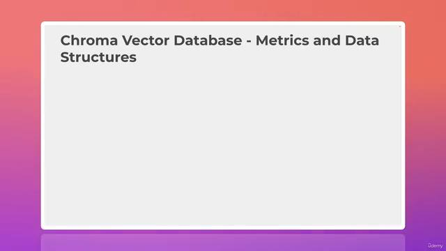

课程强调的评价指标可以整理成下面这张表：

| 指标 | 定义 | 课程里的判断 |
|---|---|---|
| Latency 延迟 | 完成一次查询所需时间 | 实时检索场景关键，例如推荐系统、实时内容过滤 |
| Throughput 吞吐量 | 单位时间能处理多少查询 | 面向大量用户或大数据集时，高吞吐是可扩展性的关键 |
| Precision 精确率 | 返回结果中有多少是相关的 | 用来评估搜索结果准确性 |
| Recall 召回率 | 总相关结果中有多少被查询捕获 | 用来评估搜索结果完整性 |
| Memory usage 内存使用 | 处理高维数据时的内存效率 | 向量库通常处理大量高维数据，内存优化直接影响性能 |
| Scalability 可扩展性 | 数据量和查询负载增长时，性能不明显下降 | 对动态扩展的应用非常关键 |

Chroma 和很多向量数据库一样，会在内部使用专门的数据结构管理高维向量。逐字稿提到：

- **Inverted indexes 倒排索引**：讲师说用于存储向量，以便在向量数据库中快速事务和查询。逐字稿没有展开它和关键词倒排索引的区别。
- **KD trees**：一种空间划分数据结构，用来组织 K 维空间中的点；适合低维数据，或查询负载不是特别高的向量数据库。
- **HNSW 图**：Hierarchical Navigable Small World，高维空间里近似最近邻搜索的索引方法；优点是平衡速度和准确性，适合实时搜索。
- **LSH 局部敏感哈希**：把数据点哈希到“相似项所在的桶”里。
- 逐字稿最后还出现了一个音近 “priority cubes” 的词，讲师没有进一步解释；本文不把它强行写成某个确定术语。

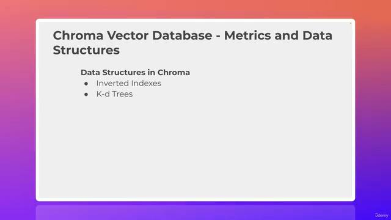

向量相似度部分，课程只做概念和手算示例，不要求你手写数学库。核心判断是：**向量相似度是在向量空间里衡量两个数据点的接近程度或方向对齐程度**。它受方向、大小、相对位置影响；如果两个点距离很小，通常表示它们语义相似。课程重点讲了三种度量：

| 度量 | 关注点 | 课程里的手算例子 | 课程给出的典型用途 |
|---|---|---|---|
| Cosine similarity | 方向，忽略向量长度 | A=(3,1)，B=(
| Cosine similarity | 方向，忽略向量长度 | A=(3,1)，B=(2,2)，cos≈0.894 | 主题建模、文档相似度、协同过滤 |
| Euclidean distance | 距离，考虑向量长度/大小 | A=(3,1)，B=(2,2)，距离≈1.41 | 聚类分析、异常检测、欺诈检测 |
| Dot product | 方向与大小的综合作用 | 讲师口述“约 13”；按 A=(3,1)、B=(2,2) 算是 8 | 图像检索与匹配、神经网络/深度学习、音乐推荐 |

余弦相似度的例子要特别说清楚：讲师把两个向量想成两个人从操场中心朝不同方向走。两个人走的**方向越接近**，最后的位置就越接近；两个人走的**方向相反**，距离就远。关键不是谁走得更长，而是方向夹角。公式是：

```text
cos(A, B) = (A · B) / (||A|| * ||B||)
```

用课程里的 A=(3,1)、B=(2,2) 代入：

```text
A · B = 3*2 + 1*2 = 8
||A|| = sqrt(3^2 + 1^2) = sqrt(10)
||B|| = sqrt(2^2 + 2^2) = sqrt(8)
cos = 8 / (sqrt(10) * sqrt(8)) ≈ 0.894
```

结果越接近 1，两个向量越相似；越接近 0，方向越不相关；接近 -1，方向相反。讲师反复强调：**余弦相似度不看向量长度，只看角度/方向**。

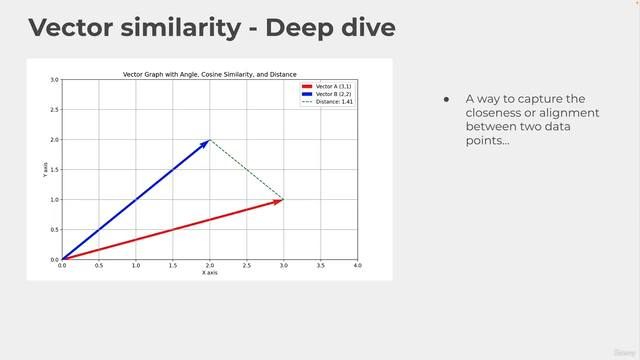

欧氏距离，也叫 L2 范数，是两点之间的直线距离。公式是：

```text
d(A, B) = sqrt((x2 - x1)^2 + (y2 - y1)^2)
```

用 A=(3,1)、B=(2,2)：

```text
d = sqrt((3-2)^2 + (1-2)^2)
  = sqrt(1^2 + (-1)^2)
  = sqrt(2)
  ≈ 1.41
```

讲师说，欧氏距离适合**需要考虑向量大小/长度**的场景，典型是 K-means 聚类。余弦相似度里长度不重要，欧氏距离里长度会影响结果。

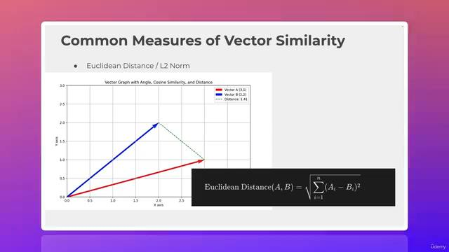

点积的公式是：

```text
A · B = x1*x2 + y1*y2
```

按 A=(3,1)、B=(2,2)，点积是 `3*2 + 1*2 = 8`。讲师在 P030 口述“约 13”，这和前面坐标算出的 8 不一致；很可能是他当时指向的图中向量或口述数字有偏差。这里不要死记数字，课程真正强调的判断是：

- 点积是**正数**：两个向量大体同向，更多是“合作”而不是“对抗”；
- 点积是**零**：两个向量垂直，互不帮助也不直接相反；
- 点积是**负数**：两个向量方向相反，更多是“对抗”。

讲师用“两个人拉同一根绳子”的类比：朝同一方向拉，合作；朝相反方向拉，对抗。点积适合图像检索与匹配、音乐推荐、欺诈检测，也出现在神经网络/深度学习里。

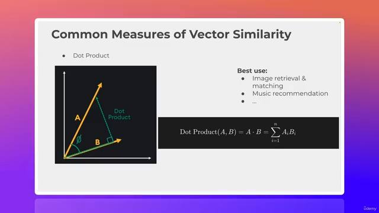

三种度量的用途总结如下。讲师说不需要背，只要知道向量数据库会实现这些度量，不同算法会选不同度量：

| 度量 | 最适合的课程例子 |
|---|---|
| 余弦相似度 | 主题建模、文档相似度、协同过滤 |
| 欧氏距离 | 聚类分析、异常检测、欺诈检测 |
| 点积 | 图像检索与匹配、神经网络/深度学习、音乐推荐 |

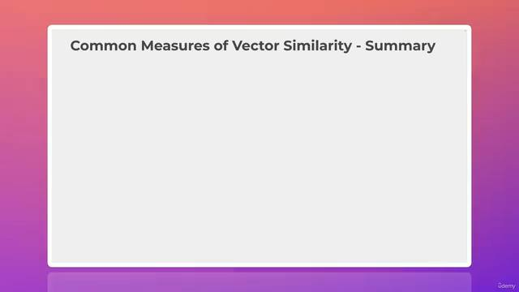

进入 RAG 管线后，课程把“只做相似度搜索”推进到“让大语言模型基于检索结果回答”。完整逻辑是：

1. 加载源文档；
2. 把文档切成更小的 chunk；
3. 把每个 chunk 转成 embedding；
4. 把 embedding 和原始文本一起存进向量数据库；
5. 用户问题也转成 embedding；
6. 在向量库里做相似度搜索，取出最相似的 chunk；
7. 把用户问题和最相似 chunk 一起传给大语言模型；
8. 大语言模型给出最终答案。

讲师特别提醒：embedding 不只是“一个向量”，它对应的原始文本 chunk 也要一起存。否则你搜到了相似向量，却拿不到可以喂给 LLM 的原文。索引的作用是让“在所有条目里比较”这件事更快；没有索引也能暴力比较，但规模大了会慢。

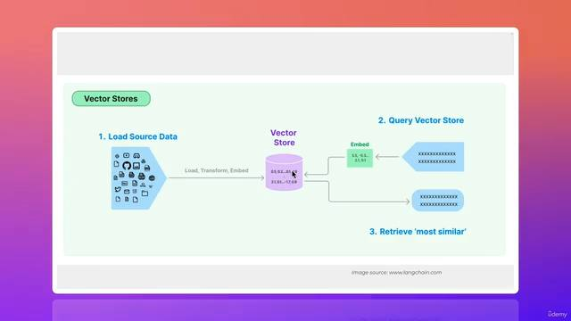

P033–P034 只实现了“加载 → 切块 → 生成 embedding → 写入 ChromaDB”。查询代码和调用 GPT 生成答案的完整代码，课里没讲。讲师在 P034 演示了 OpenAI 文档里的 `client.embeddings.create`，也提到 `chat.completion.create` 和 system/user 消息，但没有把查询与回答函数写完。因此下面复现到“数据已入库、可以用 SQLite Explorer 看到 chunk 和文本”为止。

## 2. 讲师原话（带「—— pNNN [MM:SS]」）

> "延迟是完成一次查询所需的时间。在向量数据库中，低延迟对于需要实时数据检索的应用至关重要，比如推荐系统或实时内容过滤。"
> —— p026 [00:26]

> "吞吐量衡量单位时间内可以处理多少查询。高吞吐对于可扩展性很关键，尤其是在面对大量用户或大数据集时。"
> —— p026 [00:53]

> "精确率衡量返回结果中有多少是相关的；召回率评估查询捕获了多少总相关结果。"
> —— p026 [01:20]

> "高效的内存使用非常关键，因为向量数据库通常要处理大量高维数据。优化内存使用会显著影响性能，尤其是在硬件资源有限时。"
> —— p026 [01:50]

> "可扩展性是处理数据量和查询负载增长、同时性能不明显下降的能力。这对动态扩展的应用非常关键。"
> —— p026 [01:50]

> "Chroma 和很多向量数据库一样，内部使用复杂的数据结构来管理高维向量数据。第一个是倒排索引，用来存储向量，以便在向量数据库中快速事务和查询。"
> —— p026 [02:18]

> "KD 树是一种空间划分数据结构，用来组织 K 维空间中的点。它非常适合低维数据的向量数据库，或者查询负载不是特别高的场景。"
> —— p026 [02:44]

> "HNSW 图是高维空间中近似最近邻搜索的一种索引方法。它的优点是平衡
></br>

> "HNSW 图是高维空间中近似最近邻搜索的一种索引方法。它的优点是平衡速度和准确性，因此适合实时搜索应用。"
> —— p026 [03:12]

> "LSH 局部敏感哈希用来把数据点哈希到相似项所在的桶里。"
> —— p026 [03:39]

> "通过关注这些指标并使用高效的数据结构，你就可以优化 Chroma 向量数据库，获得更好的性能、准确性和可扩展性。"
> —— p026 [03:39]

> "这一节我们实际动手构建向量数据库：先搭好开发环境——VS Code、Python、OpenAI API key；然后看 Chroma 数据库的工作流总览，也就是 Chroma 在后端是怎么工作的、有哪些组成部分和积木块；接着我们真的创建了一个 Chroma 数据库，先用默认 embedding 函数，然后用 OpenAI embeddings 来生成我们的 embedding。"
> —— p027 [00:00]

> "向量数据库最核心的东西、最核心的目标，就是做相似度搜索——在向量空间里找到那些相似的数据点。"
> —— p028 [00:00]

> "所谓向量，就是既有大小又有方向的量。当我们做向量相似度时，我们其实是在找一种方式，去刻画两个数据点在向量空间中的接近程度或对齐程度。"
> —— p028 [00:58]

> "如果我们看到这两个向量之间的距离非常小，那就意味着它们在语义上是相似的。"
> —— p028 [01:27]

> "相似度受方向影响，也受大小和这些点的相对位置影响。所以在分析数据或者使用向量数据库时，选择哪种度量来衡量向量之间的相似度或距离，是至关重要的。"
> —— p028 [01:53]

> "常用的向量相似度方法，第一个是余弦相似度，第二个是欧氏距离，第三个是点积。"
> —— p028 [02:16]

> "想象你和朋友站在一个巨大空旷的操场中心，你们决定沿直线走，但方向不同……如果你们两个走的方向几乎一样，最后就会靠得很近；如果方向完全不同，最后就会离得很远。余弦相似度衡量的就是你们选择的方向有多相似，而不用担心你们各自走了多长、大小是多少。"
> —— p028 [02:59]

> "要得到 A 和 B 的余弦相似度，我们做的是 A 和 B 的点积，再除以各自向量的模长。"
> —— p028 [04:55]

> "这个数字越接近 1，这两个箭头、这两个向量就越接近，也就意味着它们越相似。"
> —— p028 [07:46]

> "余弦相似度里，模长不重要，重要的是角度、是余弦值。"
> —— p028 [08:02]

> "下一个常用的向量相似度度量叫欧氏距离，也叫 L2 范数。当需要考虑向量大小的时候，我们最好用它。注意在上一个度量里，向量的模长根本没被考虑，它更看方向；而现在向量的模长被考虑进来了，它非常适合聚类任务，比如 K-means 聚类。"
> —— p029 [00:00]

> "所以这个例子里距离是 1.41。也就是说这两个人之间最短距离大约是 1.41 个单位。"
> —— p029 [00:58]

> "点积这个度量最适合用于图像检索与匹配，以及音乐推荐、欺诈检测等等。"
> —— p030 [00:00]

> "想象你和朋友各抓住绳子的一端，你往一个方向拉，你朋友往另一个方向拉。点积帮我们判断你们俩有多少是在合作、有多少是在对抗。如果你们完全朝同一个方向拉，那就是完美合作；如果朝相反方向拉，那就是完全对抗。"
> —— p030 [00:29]

> "一个像 13 这样的正数告诉我们，这两个向量大体上指向同一个大致方向，所以它们更多是在合作而不是对抗。如果这个乘积是 0，那说明两个箭头互相垂直、成直角，既不帮忙也不直接对抗。"
> —— p030 [00:56]

> "这只是个概览，你不需要记住任何东西，这不是数学课。这些是向量相似度的度量，被用在不同的算法里，帮助数据库高效地做向量相似度搜索。"
> —— p030 [01:49]

> "余弦相似度最适合主题建模、文档相似度和协同过滤。欧氏距离要注意，我们是关心向量模长的；而余弦相似度里模长不重要，重要的只是方向。欧氏距离最适合聚类分析、异常检测和欺诈检测。点积最适合图像检索与匹配、神经网络和深度学习，以及音乐推荐。"
> —— p031 [00:00]

> "到目前为止，我们能做到最重要的事情就是加载源数据……把它加载进我们的向量存储、向量数据库，这里说的是 Chroma。然后我们就能传入一个查询，文本被转换成一个 embedding、进入向量空间，送到向量库里做搜索，也就是相似度搜索，然后我们就能看到结果，拿到文档中最相似的片段。"
> —— p032 [00:00]

> "我们真正想达成的东西要更深一层，因为向量数据库背后的整个想法是：我们希望借助大语言模型、或者一般的模型，去查询它们。"
> —— p032 [00:50]

> "我们有一堆文档，想把它们切成更小的 chunk；切完之后把它们转成 embedding；这些 embedding 就是存进向量库的东西。而且这些 embedding 是向量，它们身上不仅挂着向量，还挂着切分出来的原始文本片段。"
> —— p032 [01:01]

> "接下来我们有一个索引，索引会帮助把查询、搜索、比较向量库里所有条目的整个过程变得快得多。"
> —— p032 [01:42]

> "我们不想只做到『告诉我关于物理的内容』然后给我一些相关片段就完了——这当然可以，我们已经做到了。我们要再往前走一步：拿到这些相似结果、这些相似的 embedding，把它们送进大语言模型。"
> —— p032 [02:34]

> "把用户问的原始问题和最相似的条目、也就是那些最相关的文档 chunk 放在一起，一起送进大语言模型，然后我们就能拿到真正的答案。这就是接下来几节课要演示的东西。"
> —— p032 [03:10]

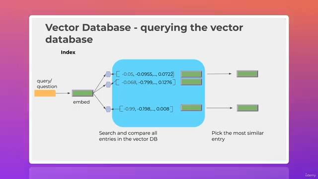

> "现在我们有这个 data 目录，里面是新闻文章，就是网上找到的一堆文章，每篇文章各自放在一个 TXT 文档里。我们会用上所有这些文档，把它们加载进数据库、也就是向量库。但在那之前，我们要先把它们切分，切分的同时创建 embedding，然后放进数据库、把这些信息持久化，确保我们能像之前那样查询这个向量空间，把查询和查询得到的结果一起推给大语言模型。"
> —— p033 [00:00]

> "我这里新建了一个文件，叫 vector DB LLM，也就是大语言模型。"
> —— p033 [00:53]

> "先做一些 import。最重要的是，我从 chroma 里拿到 utils 和 embedding functions，这样我们就能传入非默认的 embedding——我们要用 OpenAI embeddings，和之前一样。我还引入了 chroma DB、OpenAI 这些。然后在这里加载 .env 文件里的变量。"
> —— p033 [01:22]

> "接着我创建 OpenAI embedding 函数，用的是 text-embedding-3-small 这个模型，当然要把 OpenAI key 传进去，这样我们才能真正通过 API 拿到 embedding。"
> —— p033 [02:16]

> "下一步我们初始化带持久化的 Chroma client，这非常重要。我们传进去的只是路径，我打算写成 db，这样它就落在当前目录下的 db 文件夹里。"
> —— p033 [02:31]

> "这里我们有一个 collection 名字，我们叫它 document QA collection。然后这里我创建 client、get or create collection，把 collection 名字和 embedding 函数传进去——这里用我们刚实例化的 OpenAI embedding 函数。"
> —— p033 [03:01]

> "现在我们把实现目标的那些函数拼起来。我们真正想做的是把所有这些数据、也就是这些新闻文章加载进数据库。为此我用了这个已经有的函数，它从目录里加载文档。我们传目录路径进去，还有一个 print，写着 loading documents from directory。"
> —— p033 [03:25]

> "本质上就是走到 data/news/articles 这个目录，找到所有以 TXT 结尾的文件，然后创建文档对象。每循环一次就 append 一个文档格式，id 就是文件名，text 就是那个文件的内容，最后把这些文档返回。"
> —— p033 [03:54]

> "下一部分是真正把文本切成 chunk，因为我们必须保证它们是小的片段，这些片段才是要转成 embedding 再放进向量数据库的东西。"
> —— p033 [04:22]

> "chunk size 我们说 1000，这只是我随手取的一个数字，你可以调小或调大；chunk overlap 是 20。overlap 是为了让上下文不丢失。这个稍微进阶一点，但思路是：overlap 越大，每个片段保留的上下文就越好。"
> —— p033 [04:48]

> "这里我犯了个错，应该叫 news 的，写成了 new，就这样吧。"
> —— p033 [06:12]

> "运行一下。好，loading 21 documents。我大概建了 21 个文档，实际加载了 21 个。"
> —— p033 [06:41]

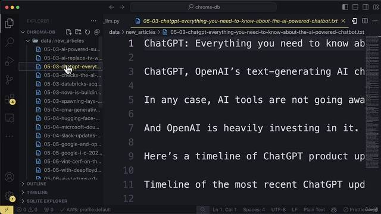

> "我们知道文档被加载了，因为执行 print 的时候真的能看到所有文档。接下来要把文档切分成小块。我们创建一个空列表，遍历所有文档，调用这个 split text，把文本、chunk size、chunk overlap 传进去，它会返回一个切分结果的列表。"
> —— p034 [00:00]

> "现在我们有了这些 chunk，需要把它们转成 embedding，本质上就是完全照着前面讲过的流程走。为此我下面写了 client，OpenAI，把 API key 传进去。"
> —— p034 [00:28]

> "然后是 get OpenAI embeddings，我们把文本传进去，它会被转成 embedding。这里用的是 client.embeddings.create。"
> —— p034 [00:56]

> "你可以回到 OpenAI 文档确认怎么用。它告诉你怎么开始、怎么装 Python 等等；往下翻有 chat completion。它们的调用方式改过一些，所以随时回来确认自己是不是最新的。"
> —— p034 [01:21]

> "现在这个是 completion 的 create，不过我可以去 embeddings 那一页，那才是我要给你看的。点 embeddings，代码就写着 client.embeddings.create，然后是 input，然后是 model。"
> —— p034 [02:13]

> "所以我们写 client.embeddings.create，input 是 text，model 是 text-embedding-3-small，就这些。然后从这个 response 里取出我们传进去的文本对应的 embedding，返回出去。它是一串浮点数——你知道的，所有 embedding、我们整个向量空间其实都是浮点数。"
> —— p034 [02:42]

> "现在有了 embedding 函数，接下来我要把切好的每个 chunk 拿出来生成实际的 embedding。遍历这些 chunked documents，对于 get OpenAI embedding，我们传 doc 的 text 字段，然后把生成的 embedding 挂回这个文档。"
> —— p034 [03:32]

> "现在我们有 embedding 了。注意这个流程：拿到文档、切成小块、再创建 embedding，然后它们被加进向量数据库。看到这个流程了吗？"
> —— p034 [04:00]

> "现在可以插库了，因为我们有 embedding。我们遍历 chunked documents，用 collection.upsert，传入 id、传入文档文本；注意这里我们写 embeddings 等于 doc 的 embedding，因为我们已经提前算好了。所以每个文档现在都有了自己的 embedding，我们把它和 id、文本一起插进去。"
> —— p034 [04:27]

> "如果我打开 DB，你能看到之前的数据库。但现在如果我运行这个文件，就能把所有东西插进数据库。"
> —— p034 [04:56]

> "清屏再跑一次。你会看到它在切分、在生成 embedding，因为信息量不小，会花一点时间。然后显示 inserting chunks into DB。"
> —— p034 [05:44]

> "Command+Shift+P，输入 open database，选 Chroma persist……再打开 SQLite Explorer，刷新一下。你可以看到，运行这些查询，我们所有的数据都在这里——数据库里有所有文本。所以所有 chunk 都真的加进数据库了。再跑一个别的，比如 search，你能看到全文搜索，每一条都是不同的 chunk，带着所有的 overlap。"
> —— p034 [06:36]

> "好，这个真的跑通了。再看 collection，应该会给我们 document 关键字 collection、维度和其它东西。所以我们成功把所有 chunk 转成了 embedding，并把这些 embedding 加进了 ChromaDB 这个向量数据库。"
> —— p034 [07:33]

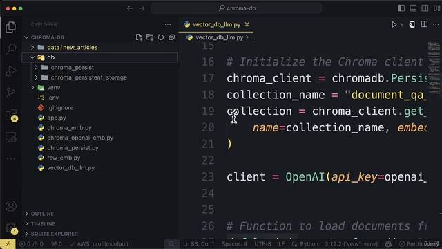

## 3. 从零复现

下面每一步都可以照着敲。做完之后，`python vector_db_llm.py` 应该能打印“加载 21 个文档”“切分成 N 个 chunk”“生成 embedding”“插入数据库”，并且 `db/chroma.sqlite3` 里能看到内容。

### 3.1 目录结构

先在任意位置建一个项目根目录，最终结构如下：

```
vector-db-fundamentals/
├── .env                      # 只放 OPENAI_API_KEY，不要提交到 git
├── .gitignore                # 忽略 .env 和 db/
├── requirements.txt
├── vector_db_llm.py          # 主脚本
├── db/                       # 首次运行后由 Chroma 自动创建
│   └── chroma.sqlite3
└── data/
    └── news/
        └── articles/
            ├── article_01.txt
            ├── article_02.txt
            ├── ...
            └── article_21.txt
```

Linux / macOS：

```bash
mkdir -p vector-db-fundamentals/data/news/articles
cd vector-db-fundamentals
touch vector_db_llm.py requirements.txt .env .gitignore
```

Windows PowerShell：

```powershell
New-Item -ItemType Directory -Force vector-db-fundamentals\data\news\articles
Set-Location vector-db-fundamentals
New-Item -ItemType File vector_db_llm.py, requirements.txt, .env, .gitignore
```

注意目录名：讲师在录像里把 `news` 写成了 `new`（`data/new/articles`），他自己也承认“应该叫 news 的，写成了 new”。**路径名本身不重要，重要的是脚本里的 `directory_path` 和磁盘上的真实目录一致。** 本文统一用 `data/news/articles`，如果你的磁盘上是 `data/new/articles`，改脚本里那一行就行。

### 3.2 准备 21 篇 TXT 文章

讲师的数据是“网上找的一堆文章”，每篇文章各自一个 `.txt` 文件，一共 21 个。**这批文章课程没有提供下载地址，课里没讲数据从哪来。** 你可以用任何英文/中文新闻稿代替，只要满足：

- 全部是 `.txt` 后缀（脚本按后缀筛选）；
- 每个文件是一篇完整文章，纯文本，没有 HTML 标签；
- 起始阶段 20 篇左右就够，跑通流程比数据量重要。

快速造假数据用于验证流程（内容随便，只用来跑通管线）：

```bash
cd data/news/articles
for i in $(seq -w 1 21); do
  printf "Article %s\n\nThe quick brown fox jumps over the lazy dog. Apple reported quarterly results. This paragraph exists only to give the splitter enough characters to produce more than one chunk.\n" "$i" > "article_$i.txt"
done
```

> 上面这段 `for` 循环是文档补充的造数据命令，课程里没有这条命令。目的只是让你不用先去找 21 篇真新闻就能验证代码。

### 3.3 建虚拟环境并安装依赖

```bash
python -m venv .venv

# macOS / Linux
source .venv/bin/activate

# Windows PowerShell
# .venv\Scripts\Activate.ps1

pip install --upgrade pip
pip install -r requirements.txt
```

`requirements.txt` 内容：

```text
chromadb==0.5.23
openai==1.59.7
python-dotenv==1.0.1
```

**版本号课里没讲。** 上面是写本文时一组互相兼容的参考版本；如果你安装时失败，直接卸掉版本约束改用：

```bash
pip install chromadb openai python-dotenv
```

仍然装不上，再单独看 Chroma 的版本说明——Chroma 在 0.4 前后 API 有变化，`PersistentClient` 是 0.4 以后才稳的写法。

### 3.4 写 `.env`

```text
OPENAI_API_KEY=sk-你的真实key
```

`.gitignore`：

```text
.env
.venv/
db/
__pycache__/
```

`.env` 不提交是硬要求：讲师整套代码的唯一凭据就是这个 key，泄漏了别人可以直接刷你的额度。

### 3.5 写入 `vector_db_llm.py`

完整内容见第 4 节。**不要抄成片段**，整份保存，然后运行：

```bash
python vector_db_llm.py
```

预期终端输出形状（具体 chunk 数取决于你的文章长度，数字不是固定的）：

```text
Loading documents from data/news/articles
Loaded 21 documents
[...打印出文档列表...]
Splitting article_01.txt into 3 chunks
Splitting article_02.txt into 2 chunks
...
Generated 58 chunks
Generating embeddings...
Inserting chunks into DB...
Done.
```

课里讲师没有打印 “Done.”，他在 `inserting chunks into DB` 之后直接切到数据库查看。这句是文档为了判断“什么时候可以去看库”加的。

### 3.6 验证数据真的进去了

三种方式，任选：

**方式一（讲师用的）**：VS Code 里 `Command+Shift+P`（Windows 是 `Ctrl+Shift+P`）→ 输入 `open database` → 选 Chroma 持久化出来的库 → 打开 `SQLite Explorer` → 刷新 → 执行 `SELECT * FROM embeddings;` 之类的查询，能看到 chunk 文本。

**方式二（命令行）**：

```bash
python - <<'PY'
import sqlite3
con = sqlite3.connect("db/chroma.sqlite3")
cur = con.cursor()
cur.execute("SELECT name FROM sqlite_master WHERE type='table'")
print(cur.fetchall())
PY
```

**方式三（用 Chroma 自己读回来，最稳）**：

```bash
python - <<'PY'
import chromadb
client = chromadb.PersistentClient(path="db")
col = client.get_collection("document_qa_collection")
print("count =", col.count())
print(col.peek(limit=1))
PY
```

`col.count()` 应该等于你终端打印的 chunk 总数。`peek` 能看到 id、documents、embeddings（embedding 会打印一长串浮点数）。**`count()` / `peek()` 是文档补充的验证手段，课程里没有出现这两个调用。**

### 3.7 RAG 后半段（课程没给代码）

课程把管线讲到了“把最相似 chunk + 问题一起交给 LLM”，但**查询函数和调用 GPT 的代码课里没讲**。如果你要自己接上去，结构就是：

1. `question_embedding = get_openai_embedding(question)`；
2. `collection.query(query_embeddings=[question_embedding], n_results=5)`；
3. 取出返回的 `documents`，拼成 context；
4. 调 `client.chat.completions.create(model=..., messages=[{role:"system",...},{role:"user",...}])`。

第 4 步的 `chat.completion.create` 和 system/user 两种角色，讲师只是在 P034 划到 OpenAI 文档时口述过，**没有写进文件**。所以这一节不要指望本文给出可直接跑的问答代码——那会是编造。

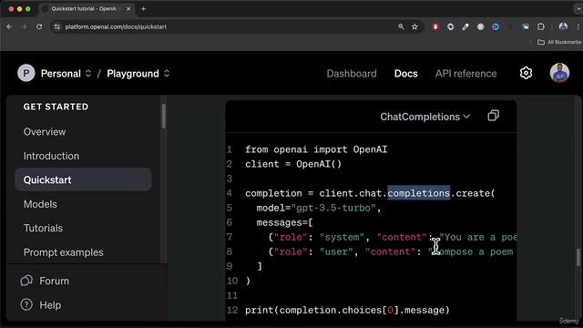

## 4. 完整代码

以下三个文件保存即可运行。

### 4.1 `vector_db_llm.py`

```python
import os

from dotenv import load_dotenv
import chromadb
from chromadb.utils import embedding_functions
from openai import OpenAI

# 1) 加载 .env，拿到 OpenAI API key
load_dotenv()
OPENAI_API_KEY = os.getenv("OPENAI_API_KEY")
if not OPENAI_API_KEY:
    raise RuntimeError("没有找到 OPENAI_API_KEY，请检查 .env 文件")

# 2) 用 OpenAI 的 text-embedding-3-small 作为 collection 的 embedding 函数
openai_ef = embedding_functions.OpenAIEmbeddingFunction(
    api_key=OPENAI_API_KEY,
    model_name="text-embedding-3-small",
)

# 3) 初始化带持久化的 Chroma client，数据落到 ./db
client = chromadb.PersistentClient(path="db")

COLLECTION_NAME = "document_qa_collection"

# 4) 拿到（或创建）collection，并把 embedding 函数绑定上去
collection = client.get_or_create_collection(
    name=COLLECTION_NAME,
    embedding_function=openai_ef,
)

# 5) 单独再建一个 OpenAI 客户端，用于手动生成 embedding
openai_client = OpenAI(api_key=OPENAI_API_KEY)


def load_documents_from_directory(directory_path):
    """读取目录下所有 .txt 文件，返回 [{id, text}]。"""
    print(f"Loading documents from {directory_path}")
    documents = []
    for filename in os.listdir(directory_path):
        if filename.endswith(".txt"):
            file_path = os.path.join(directory_path, filename)
            with open(file_path, "r", encoding="utf-8") as f:
                text = f.read()
            documents.append({"id": filename, "text": text})
    return documents


def split_text(text, chunk_size=1000, chunk_overlap=20):
    """把长文本切成 chunk_size 大小的片段，相邻片段重叠 chunk_overlap 个字符。"""
    if chunk_size <= chunk_overlap:
        raise ValueError("chunk_size 必须大于 chunk_overlap，否则会死循环")
    chunks = []
    start = 0
    while start < len(text):
        end = start + chunk_size
        chunks.append(text[start:end])
        if end >= len(text):
            break
        start = end - chunk_overlap
    return chunks


def get_openai_embedding(text):
    """调用 OpenAI embeddings 接口，把一段文本变成向量（float 列表）。"""
    response = openai_client.embeddings.create(
        input=text,
        model="text-embedding-3-small",
    )
    return response.data[0].embedding


def main():
    # 6) 加载文档
    directory_path = "data/news/articles"
    documents = load_documents_from_directory(directory_path)
    print(f"Loaded {len(documents)} documents")
    print(documents)

    # 7) 切成 chunk，每个 chunk 带一个稳定 id
    chunked_documents = []
    for doc in documents:
        chunks = split_text(doc["text"], chunk_size=1000, chunk_overlap=20)
        print(f"Splitting {doc['id']} into {len(chunks)} chunks")
        for index, chunk in enumerate(chunks):
            chunked_documents.append(
                {
                    "id": f"{doc['id']}_chunk_{index}",
                    "text": chunk,
                }
            )
    print(f"Generated {len(chunked_documents)} chunks")

    # 8) 逐块生成 embedding
    print("Generating embeddings...")
    for chunk in chunked_documents:
        chunk["embedding"] = get_openai_embedding(chunk["text"])

    # 9) 写入 ChromaDB
    print("Inserting chunks into DB...")
    for chunk in chunked_documents:
        collection.upsert(
            ids=[chunk["id"]],
            documents=[chunk["text"]],
            embeddings=[chunk["embedding"]],
        )

    print(f"Done. collection '{COLLECTION_NAME}' now has {collection.count()} entries.")


if __name__ == "__main__":
    main()
```

### 4.2 `requirements.txt`

```text
chromadb==0.5.23
openai==1.59.7
python-dotenv==1.0.1
```

### 4.3 `.env`

```text
OPENAI_API_KEY=sk-替换成你自己的key
```

### 4.4 可选：`verify.py`（用来确认入库成功，课程里没有）

```python
import chromadb

client = chromadb.PersistentClient(path="db")
collection = client.get_collection("document_qa_collection")

print("entries:", collection.count())
print(collection.peek(limit=1))
```

运行：

```bash
python verify.py
```

## 5. 逐行解释

**`load_dotenv()` + `os.getenv("OPENAI_API_KEY")`**
讲师强调 key 要放在 `.env` 里，不要在代码里硬编码。`load_dotenv()` 把 `.env` 的键值对读进 `os.environ`，`os.getenv` 再取出来。加一句 `if not ... raise` 是文档补的保护：key 没读到的话，后面调 OpenAI 会报 401，报错位置离真正原因很远，不如在入口就炸。

**`embedding_functions.OpenAIEmbeddingFunction(...)`**
这就是讲师说的“从 chroma 里拿 utils 和 embedding functions，这样我们能传入非默认 embedding”。课程前面（P026 之前）用过 Chroma 的默认 embedding 函数，这一节换成 OpenAI 的，模型是 `text-embedding-3-small`。这个对象交给 collection 之后，**以后如果你只传 `documents=` 不传 `embeddings=`，Chroma 会自动用它把文本转成向量**。

**`chromadb.PersistentClient(path="db")`**
讲师原话：“初始化带持久化的 Chroma client，这非常重要……传进去的只是路径，我写成 db，这样它就落在当前目录下的 db 文件夹里。” 不写持久化的话，进程退出数据就没了。`path="db"` 是相对当前工作目录的路径，所以**必须在你执行 `python` 的那个目录下运行脚本**，否则会在别处生成 `db/`。

**`get_or_create_collection(name=..., embedding_function=...)`**
讲师说“我们有一个 collection 名字，叫它 document QA collection”，然后“get or create collection，把 collection 名字和 embedding 函数传进去”。`get_or_create` 的语义是：存在就复用，不存在就建。这意味着脚本重复运行不会报“collection 已存在”，也不会重复建第二个 collection。

**`load_documents_from_directory`**
讲师的描述：“走到这个目录，找到所有以 TXT 结尾的文件……每循环一次就 append 一个文档格式，id 就是文件名，text 就是那个文件内容，最后返回。” 这里有两个要点：
- 用 `filename.endswith(".txt")` 过滤，所以目录里放别的文件不会报错，会被跳过；
- `encoding="utf-8"` 是文档补的。不加的话 Windows 默认 `cp936`，读到非 ASCII 字符会 `UnicodeDecodeError`。讲师在 macOS 上演示，没遇到这个问题。

**`split_text(text, chunk_size=1000, chunk_overlap=20)`**
讲师原话：“chunk size 我们说 1000，这只是我随手取的一个数字，你可以调小或调大；chunk overlap 是 20。overlap 是为了让上下文不丢失……overlap 越大，每个片段保留的上下文就越好。”
滑窗逻辑：从 `start` 开始取 `chunk_size` 个字符，下一窗口不是从 `start + chunk_size` 开始，而是回退 `chunk_overlap` 个字符——这样相邻两个 chunk 有 20 个字符的重叠，跨在切分点上的句子不会两边都读不全。`chunk_size <= chunk_overlap` 的检查是文档加的，否则 `start` 不前进，`while` 永远不结束。
**注意：课程里说的是“字符”层面的切分，不是 token 层面。** 1000 字符大约几百个 token，离 `text-embedding-3-small` 的 token 上限还很远；但如果你换成 8000 字符的 chunk，就可能超限（见第 7 节）。

**`for index, chunk in enumerate(chunks)` 生成 `{文件名}_chunk_{index}`**
讲师只说“传入 id”，没细说 id 怎么拼。这里用 `文件名 + chunk 序号`。**id 稳定非常重要**：同一个 chunk 重复跑得到同一个 id，`upsert` 才会覆盖而不是新增一条；如果 id 里带上时间戳或随机数，每跑一次数据库就膨胀一倍。

**`get_openai_embedding`**
讲师在 P034 现场翻 OpenAI 文档，找到的是 `client.embeddings.create(input=..., model=...)`，然后说：“从这个 response 里取出我们传进去的文本对应的 embedding，返回出去。它是一串浮点数。” 所以取的是 `response.data[0].embedding`。`data` 是个列表（一次可以传多条 input），我们一次只传一条，所以取第 0 个。

**先手动算 embedding、再 `collection.upsert(embeddings=...)`**
讲师在 P034 说得很明确：“注意这里我们写 `embeddings` 等于 `doc` 的 embedding，因为我们已经提前算好了……我们把它和 id、文本一起插进去。” 所以是**显式传 embedding**。既然显式传了，collection 上绑定的 `openai_ef` 在这一步其实不会被调用——两条路是冗余的。冗余不影响正确性（Chroma 看到 `embeddings` 就直接用），但它解释了一个容易困惑的现象：**你把 `embedding_function` 删掉，这段插入代码照样能跑**；只有将来做 `collection.query(query_texts=[...])` 时才必须用到它。这个“冗余”课里没讲。

**`collection.upsert` 而不是 `add`**
讲师用的是 `upsert`（update or insert）。差别：`add` 遇到已存在的 id 会报错，`upsert` 直接覆盖。这决定了脚本可以重复运行——第二遍跑不会因为 id 冲突失败。

**`print(collection.count())`**
文档补的收尾输出，方便你一眼确认入库条数，不用马上打开数据库。课程里讲师是直接在 SQLite Explorer 里看的。

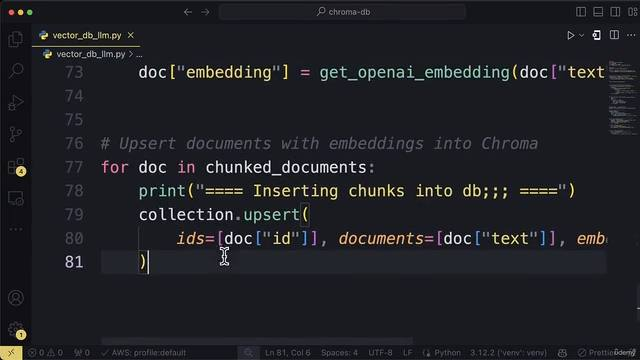

## 6. 复现检查清单

按顺序勾：

- [ ] 项目根目录下有 `vector_db_llm.py`、`requirements.txt`、`.env`；
- [ ] `data/news/articles/` 下至少有若干 `.txt` 文件（课程是 21 个），且**全部以 `.txt` 结尾**；
- [ ] `.env` 里有 `OPENAI_API_KEY=sk-...`，且这个 key 有效、账户有余额；
- [ ] `pip list` 能看到 `chromadb`、`openai`、`python-dotenv`；
- [ ] 终端当前目录就是项目根目录（否则 `db/` 会跑到别的地方）；
- [ ] 运行 `python vector_db_llm.py`，输出里出现 `Loading documents from data/news/articles`；
- [ ] 输出里 `Loaded N documents` 的 N 等于你目录里的 txt 文件数（课程是 21）；
- [ ] 出现 `Loaded 21 documents` 之后，`print(documents)` 打出了文档列表；
- [ ] 出现 `Splitting xxx.txt into K chunks`，K 随文件长度变化；
- [ ] 出现 `Generating embeddings...`，这一步会明显停顿（要发网络请求）；
- [ ] 出现 `Inserting chunks into DB...`；
- [ ] 项目根目录下出现了 `db/`，里面有 `chroma.sqlite3`；
- [ ] `python verify.py` 打印的 `entries` 等于 chunk 总数，且 > 0；
- [ ] `peek(limit=1)` 能看到 id 形如 `article_01.txt_chunk_0`、`documents` 里有真实文本；
- [ ] 用 VS Code 的 `open database` + `SQLite Explorer` 打开 `chroma.sqlite3`，能看到表里有数据；
- [ ] 再跑一次 `python vector_db_llm.py`，`entries` **没有翻倍**（证明 id 稳定、`upsert` 生效）。

如果卡在“第一次跑通了，第二次 entries 翻倍”，说明你的 id 不稳定——回去检查 id 生成逻辑。

## 7. 课里没讲但你会撞上的

**1）Chroma 版本 API 不一致。**
课程录屏里用的是 `chromadb.PersistentClient(path=...)` 这套写法。更老的教程会用 `chromadb.Client(Settings(chroma_db_impl="duckdb+parquet", persist_directory=...))` + `collection.persist()`。你在网上搜到的示例可能是老版本，直接抄会报 `TypeError` 或 `AttributeError`。**看到 `chroma_db_impl` 就说明那篇是老文章。**

**2）`embedding_functions.OpenAIEmbeddingFunction` 找不到。**
要么 `openai` 没装（Chroma 的 OpenAI embedding 函数依赖 `openai` 包），要么 import 路径写错。正确是：

```python
from chromadb.utils import embedding_functions
```

不是 `from chromadb.utils.embedding_functions import OpenAIEmbeddingFunction` 之外的某种变体——后者其实也能用，但前者和讲师写法一致。

**