# Vector Databases：从向量检索到 RAG 完整链路（P35–P40）

> 本课程片段承接前面的「文档切分 → 生成 embedding → 存入 Chroma」流程，P35–P37 把「检索到的 chunk」接上大语言模型，跑通完整的 RAG（检索增强生成）问答；P38–P39 回头补上向量与相似度度量的数学直觉；P40 引入 LangChain 框架，说明它如何把前面手写的流程抽象成可复用的组件。下面按「能照着跑起来」的标准重写。

---

## 1. 这一节做什么

这一段课程要完成的事情，可以拆成四块：

1. **把「检索」升级成「问答」**：前面已经能把文档切块、生成 embedding、存进 Chroma、按问题查出最相似的 chunk。但查出来的只是「原文片段」，用户要的是「直接答案」。P35 先写一个 `query_documents(question, n_results)` 函数把检索封装起来；P36 再写一个 `generate_response(question, relevant_chunks)` 函数，把「问题 + 检索到的片段」一起塞给 OpenAI 的 Chat Completions 接口，拿到一段简洁回答。P37 做总结：这就是向量数据库存在的核心理由——它和 LLM 配合，才能给出直接结果。

2. **补数学直觉（P38）**：向量就是「一列数字」，同时也是「方向 + 大小（magnitude）」。2D 向量 (3,4) 的长度用勾股定理算：√(3²+4²)=√25=5。文本 embedding 是 1536 维，每一维像一个「意义探测器」，方向编码语义，相似含义的文本向量指向相似方向。维度越多，能表达的语义越细，但存储和计算成本也越高。

3. **讲清相似度度量（P39）**：余弦相似度只看夹角（同向≈1，垂直=0，反向=-1），忽略长度；点积 = 方向 + 大小；欧氏距离是两点直线距离，在高维空间会「所有点距离趋同」而失去区分力。结论：**文本检索 90% 用余弦**；向量已归一化时点积更快；图像聚类可用欧氏。并给出在 Chroma / Pinecone / pgvector 里怎么设这个度量。

4. **引入 LangChain（P40）**：把手写的「加载 → 切分 → 存 Chroma → 检索 → 交给 LLM」用框架重做。LangChain 是「构建 LLM 应用的框架」，六大核心件：模型抽象、Prompt 模板、链（LCEL）、检索、Agent、记忆。本节只聚焦「检索」这一块。

最终产物：一个能对本地文档提问、并让 GPT-3.5-turbo 用三句话以内回答的 Python 脚本。

---

## 2. 讲师原话

> "到这一步，我实际上会先把上面这些全部注释掉，因为我们不希望每次运行都重复做同样的事，已经不需要了。所以我把到目前为止写的所有东西都注释掉。"
> —— p035 [00:00]

> "接下来我们要写查询文档的函数。它很简单：调用 `query_documents` 时传入问题（也就是 query）和返回结果数量。"
> —— p035 [00:29]

> "我们调用 `collection.query`，把 query 文本传进去，同时也传 `n_results`。这个参数其实是多余的，只有在我们像之前那样单纯拿文档、看距离时才有用。但我就先留着。"
> —— p035 [01:20]

> "你也可以通过调用 `get_openai_embedding` 并传入问题来生成查询的 embedding。这里我直接把文本问题传给 query。两种都行。"
> —— p035 [01:48]

> "拿到结果后，我取出所有 documents，再取出我需要的相关片段，打印出来，然后返回这些 relevant chunks。"
> —— p035 [02:15]

> "我在底部加一个问题：告诉我 AI 取代电视编剧罢工的事。因为我知道文档里有和编剧相关的内容，所以问一个相关的问题，看看能不能给出有用的结果。"
> —— p035 [02:45]

> "这些 chunk 看起来可能有点怪，因为我们切分时做了重叠（overlap），确保不丢上下文。"
> —— p035 [03:56]

> "如果我问 Databricks 收购 AI 公司的事……运行后它应该去取 Databricks 的内容。果然：今天宣布它收购了 Okara。很好，这说明确实在工作。"
> —— p035 [04:21]

> "下一步就是把这些 chunk 拿过来——记住，这些是数据片段、信息片段——把它们连同问题一起传给大语言模型，这样我们就能问真正的问题，而不是只拿到这些片段。"
> —— p035 [05:10]

> "我们现在用 OpenAI API。回到 kickstart，可以看到我们已经声明了 client，接下来调用 completion 端点：`client.chat.completions.create`。"
> —— p036 [00:00]

> "我们要训练系统说：你是一个做某类任务的助手，请用我给你的信息来回答，因为你很懂行。然后把用户的问题传进去，就能拿到真正的答案。"
> —— p036 [00:29]

> "先写生成回答的函数。它接收问题和 relevant chunks。第一件事是加上 context，也就是告诉系统：你要关注什么上下文、需要具备什么能力。"
> —— p036 [00:57]

> "我在这里写的是：你是一个问答任务的助手，使用下面检索到的上下文来回答问题。如果你不知道答案，就说你不知道，最多用三句话，保持简洁。这段 prompt 是我写的，你可以改成任何你想要的。"
> —— p036 [01:21]

> "这里我把 context 作为变量传进去，context 就是所有 relevant chunks。相当于说：把这些相关片段拿去，回答我同时传进来的问题，因为你很懂。"
> —— p036 [01:44]

> "然后我们用 completions API：`client.chat.completions.create`。需要传 model，这里就传 `gpt-3.5-turbo`，因为它更便宜而且效果真的不错。现在有 GPT-4，等你学完这门课可能还有更好的，你可以用 GPT-4，无所谓，这只是个例子。"
> —— p036 [02:01]

> "在 messages 里传 role 为 system 的消息，就是刚才那段 prompt；然后 user 这里传真正的问题。"
> —— p036 [02:28]

> "现在因为 `generate_response` 需要问题和 relevant chunks，而这两样我们都有了，所以只要调用它：`answer = generate_response(question, relevant_chunks)`，然后 `print(answer)`。"
> —— p036 [02:57]

> "运行后它返回 chat completion 对象，content 说：Databricks 收购了 Okara，一个聚焦 AI 的数据治理平台。现在我可以深入取出 content，而不是拿整个对象。"
> —— p036 [03:50]

> "我还可以问：告诉我那家公司的罢工。因为记得有关于编剧罢工的文档。运行看看……看：美国编剧工会自 2007 年以来首次罢工。"
> —— p036 [04:41]

> "再问 SpaceX 星舰……看：SpaceX 星舰是一个超重型发射系统……现在我们可以对这些文章、这些信息提问了。"
> —— p036 [05:06]

> "我还可以说：给我这些文章的简要概述。文章涵盖股权、租户结果、新战略方向下的潜在上行空间、以及融资轮次下调的影响……"
> —— p036 [05:35]

> "现在我们就走通了整个流程：拿文档、切分、生成 embedding、存进向量数据库 Chroma，然后查询、拿到结果，再连同问题一起传给大语言模型，得到在我们文档上下文内的简洁答案。"
> —— p036 [06:03]

> "我们刚完成了整个工作流：拿文档、切分、生成 embedding，把 embedding 和原始文本片段一起存进向量数据库。这很棒。但我们又往前走了一步。"
> —— p037 [00:00]

> "我们拿问题，把 query 转成 embedding，然后搜索并比较向量数据库里的所有条目，挑出最相似的条目。最后一步——也是我们学向量数据库的整个核心——把这些最相似的条目连同问题一起传给 LLM。"
> —— p037 [00:20]

> "我们把这些相似条目和问题一起传给大语言模型，拿到了真正结果。这就是顶点（culmination），这就是我们拥有向量数据库的主要原因：它们能和 LLM 配合，给用户直接的结果和回答。"
> —— p037 [00:39]

> "你整门课都在用向量：存它、查它、用它搭 RAG 流水线。但你真的知道向量是什么吗？不是代码，不是 API，而是背后的数学。接下来几分钟，我给你一个直觉，它能把『用向量数据库的开发者』和『理解向量数据库的开发者』区分开。不需要线性代数学位，认真听就行。"
> —— p038 [00:00]

> "先简单说：向量就是一列数字，就这样。(3,2) 是向量，那个也是向量。最后一个代表语义，是 1536 维，这是 AI 向量。但有趣的是：向量也是方向和大小。把它想成空间中指向某处的箭头。数字告诉你箭头指向哪，箭头的长度就是它的大小（magnitude）。"
> —— p038 [00:27]

> "在二维里，向量 (3,4) 就是向右 3 个单位、向上 4 个单位。它的长度怎么算？用勾股定理：把两个方向的值平方再相加，然后开根号。3²=9，4²=16，加起来 25，√25=5。这就是大小，本质上是求这个三角形的斜边。"
> —— p038 [01:25]

> "为什么这对 embedding 重要？因为把文本转成向量时，方向里编码的是语义。两段含义相似的文本，它们的向量指向相似方向。"
> —— p038 [01:54]

> "那么『猫坐在垫子上』怎么变成这个？简短答案是神经网络。神经网络在海量文本数据上训练。想象我给你 1536 个不同的『意义探测器』，每一维持有某个特征。比如第一维检测『和动物相关的程度』，第二维检测『情感有多正面』，第三维检测『语言有多技术化』，第 47 维检测『和地点相关的程度』，等等。每一维给文本在某个语义方面打分。大多数维度检测的是人类都叫不出名字的模式，但模型学到它们重要。"
> —— p038 [02:23]

> "就像我们可以用很多特征描述一栋房子：3 是卧室数，2 是浴室数，1500 是平方英尺，等等。每一维捕捉意义的不同方面。有意思的是，模型并不像你那样理解『猫』，它学到的是：包含 cat 的文本出现在和 kitten、feline、pet 相似的上下文里，所以它们的向量指向相似方向。这意味着：语义被编码成几何。"
> —— p038 [03:18]

> "为什么是 1536 维？为什么不是 3 维，也不是一千万维？要记住：维度越多，能表达的细微差别越多。3 维时你也许只能区分动物 vs 物体、正面 vs 负面、具体 vs 抽象。1536 维时你能区分『河岸的 bank』和『金融机构的 bank』、正式 vs 随意、技术领域（医疗 vs 法律 vs 工程）、以及细微的情感差异。维度越多，能挂到语义上的特征和细微差别越多。"
> —— p038 [04:14]

> "所以 3D 是有限的细微度，能挂到语义上的特征很有限，因为没有多少『空间』。而 1536 维是极其丰富的语义空间。"
> —— p038 [05:01]

> "这里要考虑维度、存储、速度、细微度之间的权衡。维度少时，存储低、效率高，速度快，细微度还行（不算好但可以）。维度到 768 时，存储中等，速度中等，细微度更好。到 1536 时，存储高（要存的东西多），速度慢，但效果最好，因为语义空间更大。OpenAI 的 embedding 模型就是 1536 维，这是我们一直用、也会继续用的默认值。"
> —— p038 [05:29]

> "当然还有 3072 维，存储很高、计算很慢，细微度上有点过度（overkill）。维度越多，权衡越多，就像这张表。"
> —— p038 [06:24]

> "现在说语义空间。这是一个会改变你思考 embedding 方式的心智模型：你所有文档都住在一个 1536 维空间里。这只是概念可视化，因为我们没法真的可视化 1536 维。要点是：在这个空间里，主题相似的文档会聚在一起。所有机器学习文档在一个区域，所有烹饪食谱在另一个区域，旅行文档又在别处。它们形成簇（cluster）。"
> —— p038 [06:53]

> "当查询进来，比如你问『怎么训练神经网络』，这个查询会落在 ML 簇附近。向量搜索就找最近邻——也就是那些箭头方向和你的查询箭头最相似的文档。这就是语义搜索能工作的原因：它不是匹配关键词，而是找住在同一片『语义街区』的文档。"
> —— p038 [07:23]

> "如果查询是『怎么做意面』，它也会变成向量，在这个语义空间里找最近邻，但它不会去找旅行或机器学习簇，而会靠近烹饪，因为食谱在那里。意大利面食谱会非常近，『完美煮面』也会近（概念相似），但『最好的厨房设备』就没那么近。"
> —— p038 [08:16]

> "小结：向量是一列数字，代表方向和大小；embedding 把语义编码成几何，相似含义 = 相似方向；每一维检测语义的某个方面，大多数是模型学到的抽象模式；维度越多，细微度越高，但计算和存储也越多；文档在高维空间按语义聚簇，这就是语义搜索能工作的原因。下一讲我们深入：为什么余弦相似度和点积能度量相似度。"
> —— p038 [08:44]

> "开始讲相似度度量为什么有效。你会看到余弦、点积、欧氏。问题是该用哪个。先说余弦相似度：它度量向量之间的夹角。先忘掉公式，从几何想。"
> —— p039 [00:00]

> "两个向量几乎同向时，夹角很小，小角的余弦接近 1，说明它们相似，因为箭头指向同一方向。两个向量垂直时，夹角 90 度，cos 90°=0，说明它们很不相关，因为没指向同一方向。两个向量反向时，夹角 180 度，cos 180°=-1，说明含义相反。记住：余弦忽略大小，只关心方向。"
> —— p039 [00:23]

> "余弦相似度的公式是：点积除以两个大小的乘积。为什么重要？因为它忽略大小，只看方向。一个文档的向量值可能很大或很小，无所谓；只要方向相同，就相似。"
> —— p039 [01:15]

> "看这里：箭头 A 很小，箭头 B 很大，但它们指向同一方向。如果算 A·B 的点积，长向量那边会更大。所以它们方向相同但大小不同。点积 = |A|·|B|·cosθ，注意这里大小是被包含进去的，不像余弦。关键区别：余弦只看方向；点积看方向 + 大小。"
> —— p039 [02:09]

> "那什么时候大小重要？有些 embedding 模型把置信度或强度编码进大小。如果模型对更确定的陈述产生更长的向量，点积就能捕捉到这一点。至于 OpenAI 的 text-embedding-3 模型，它们是归一化的，所有向量大小都是 1。这种情况下，点积和余弦给出相同的排序。"
> —— p039 [02:45]

> "再看欧氏距离，可以想成高中学的勾股定理。点 A 在 (1,2)，点 B 在 (4,6)。水平距离是 4-1=3，垂直距离是 6-2=4。直线距离用公式 d=√((x₂-x₁)²+(y₂-y₁)²)，就是量两点在空间里隔多远，像用尺子量。"
> —— p039 [03:14]

> "为什么这对 embedding 重要？欧氏在向量搜索里有个麻烦。看 V1 和 V2：同向，欧氏距离小。V3 和 V4：也同向，但 V4 比 V3 长，所以欧氏距离大。这两对都同向，余弦会说它们相同（夹角为 0），但欧氏说 V3、V4 更不同，只因为它们在空间里离得更远。关键点：欧氏关心你在哪，而不只是你朝哪。"
> —— p039 [04:08]

> "问题在于欧氏在高维（尤其 1536 维）里很挣扎。高维空间会发生一件怪事：所有点彼此距离大致相同。2D 里点明显有近有远；1536 维或更高时，一切都『有点远』，距离趋于收敛。就像房间里每个人都移动到彼此等距。欧氏失去区分力，分不清近还是远。所以文本 embedding 里余弦总是赢，因为它度量角度，而角度在高维仍然有意义。"
> —— p039 [05:07]

> "底线：欧氏度量绝对位置，在高维里变得没意义，所以用余弦。"
> —— p039 [06:01]

> "给一个来自工作的实用决策：余弦、点积、欧氏里，90% 的文本搜索用余弦，不是点积也不是欧氏。为什么？余弦只看方向；点积看方向 + 大小，对归一化向量很好（归一化向量就是缩放到长度恰好为 1 的向量）；欧氏度量位置，最适合图像聚类等。文本 embedding 就用余弦；如果已经归一化，用点积也行，因为更快；图像和聚类可以用欧氏。"
> —— p039 [06:30]

> "好处是：无论用 Chroma、Pinecone 还是 pgvector，你都能在创建 collection 时设置度量。比如 Chroma 里你可以指定空间为 cosine；Pinecone 里也能把 metric 设为 cosine；pgvector 里用距离操作符来指定余弦，因为在 pgvector 里操作符决定度量。"
> —— p039 [06:57]

> "现在你理解了：余弦相似度看夹角、忽略大小，很适合文本；点积看夹角 + 大小，用于归一化或大小有意义时；欧氏是两点直线距离，用于图像或聚类。拿不准时，余弦在语义搜索里 90% 的情况是正确答案。"
> —— p039 [07:50]

> "现在整个流程——拿文档、切分、生成 embedding、存进数据库，然后检索、把 query 传进去，再把所有信息传给大语言模型拿结果——我们都做了，而且大部分是手写的，因为要自己写切分文档、加载文档的函数，还要显式选自己的 LLM。但其实有更好的办法。"
> —— p040 [00:00]

> "更好的办法是用某种框架。我快速展示一下——这不是 LangChain 的课程——LangChain 是什么？它是一个帮我们构建应用、利用各种大语言模型的框架。它真的是即插即用。你可以把外部数据源和各种 LLM 结合。至少可以把 LangChain 看成一个包装框架，让我们轻松使用 LLM，快速替换，而不用深入底层抽象。"
> —— p040 [00:26]

> "在进代码前，澄清一个常见误解：LangChain 不只是把文档加载进向量库的工具，那就像说智能手机只是个计算器。LangChain 是构建 LLM 应用的框架，给你能拼在一起的积木。六个核心件：第一，模型抽象，用同一接口连接任何 LLM（OpenAI、Anthropic、本地模型），换供应商不用重写代码。第二，Prompt，Prompt 模板是可复用的带变量 prompt，不用再手动拼字符串。"
> —— p040 [01:38]

> "第三，链（chains），这是重头。LangChain 表达式语言 LCEL 让你像管道一样组合操作，输入流经每一步，语法干净、可读、强大。第四，检索（retrieval），包括文档加载器、文本切分器、向量库、检索器——这是本课重点。第五，Agent，能使用工具、采取行动的 LLM，可以搜网页、跑代码、调 API。第六，记忆（memory），任何 LLM 应用都需要取回之前的对话，提供对话历史让模型记住聊过什么。这六件让你能构建从简单聊天机器人到复杂自主 Agent 的一切。"
> —— p040 [02:38]

> "我们的重点不是 LangChain 的全部，那本身能开一门课。这一节我们聚焦 RAG 流水线里的检索。我们用 LangChain 从文件加载文档、切分成块、存进 Chroma、查询检索相关块、并用 LLM 生成答案——都是之前见过的，但现在用 LangChain 这个框架来帮我们做。"
> —— p040 [04:16]

> "但现在你知道这只是 LangChain 能做的一小部分。等你准备构建 Agent 或加记忆时，框架已经在那儿了。开始吧。"
> —— p040 [04:45]

---

## 3. 从零复现

### 3.1 环境与依赖

课里用的是 Python + OpenAI SDK + Chroma。逐字稿没有逐条念 `pip install`，但代码里出现的 `client.chat.completions.create`、`collection.query`、`get_openai_embedding` 分别对应 `openai`、`chromadb` 和前面课程自写的 embedding 函数。按下面装（版本号课里没讲，写的是能跑通当前 API 的常见版本，装的时候以实际为准）：

```bash
python -m venv .venv
source .venv/bin/activate        # Windows: .venv\Scripts\activate
pip install openai chromadb python-dotenv
```

环境变量（课里提到「回到 kickstart 可以看到我们已经声明了 client」，说明 client 是提前初始化好的）：

```bash
# .env
OPENAI_API_KEY=sk-你的key
```

### 3.2 目录结构

```
project/
├── .env
├── main.py              # 本段课程的主脚本
└── data/                # 前面课程已经切分/入库的原始文档（本段不再重新处理）
```

### 3.3 复现步骤

**第 1 步：把前面「建库」的代码全部注释掉。**
讲师明确说：数据库里已经有 embedding 了，不需要每次运行都重跑切分和入库（那很花时间）。所以脚本开头保留 client 初始化和 collection 获取，其余建库逻辑整段注释。

**第 2 步：写 `query_documents(question, n_results)`。**
内部调用 `collection.query(query_texts=question, n_results=n_results)`，从返回结果里取出 `documents`，拼成 `relevant_chunks` 返回并打印。讲师说 `n_results` 其实「多余」，因为现在不再只看距离，但保留着无妨。

**第 3 步：写 `generate_response(question, relevant_chunks)`。**
先拼一段 system prompt（角色 + 用检索上下文回答 + 不知道就说不知道 + 最多三句 + 简洁），把 `relevant_chunks` 作为 context 变量塞进去；然后 `client.chat.completions.create(model="gpt-3.5-turbo", messages=[system, user])`，user 消息放问题。

**第 4 步：串起来。**
`relevant_chunks = query_documents(question, n_results)` → `answer = generate_response(question, relevant_chunks)` → `print(answer.choices[0].message.content)`。讲师演示时先 `print(answer)` 看到整个 chat completion 对象，再改成取 `.content` 只拿文本。

**第 5 步：换问题验证。**
依次试了「AI 取代电视编剧罢工」「Databricks 收购 AI 公司」「编剧罢工」「SpaceX 星舰」「给我这些文章的简要概述」，都能从文档里检索到相关片段并生成答案。

**第 6 步（P38–P39，纯理解，无代码）：**
- 手算 2D 向量 (3,4) 的模：√(9+16)=5。
- 记住三档维度权衡：低维（如 3D）省存储快但语义粗；768 中等；1536（OpenAI 默认）存储高、慢、但语义最细；3072 属于 overkill。
- 记住度量选择：文本→余弦；已归一化→点积（更快）；图像/聚类→欧氏。创建 collection 时设：Chroma 指定 space 为 cosine，Pinecone 设 metric 为 cosine，pgvector 用距离操作符。

**第 7 步（P40，概念）：**
理解 LangChain 六件套，本节只用「检索」这一块重做前面的流程（具体代码在后续 P 段，本段只到概念介绍结束）。

---

## 4. 完整代码

> 说明：本段逐字稿没有 OCR 结果，下面的代码是**根据讲师口述的函数名、参数、调用方式还原的完整可运行文件**。讲师屏幕上具体每一行的写法无法逐字核对，凡是逐字稿明确提到的（函数名 `query_documents` / `generate_response`、`collection.query`、`n_results`、`client.chat.completions.create`、`model="gpt-3.5-turbo"`、`role: system` / `role: user`、prompt 文案、`answer.choices[0].message.content`）都原样保留；`get_openai_embedding` 是前面课程定义的函数，这里按讲师说法「可以直接传文本，也可以先转 embedding」保留注释说明。

```python
# main.py
import os
from dotenv import load_dotenv
from openai import OpenAI
import chromadb

load_dotenv()

# ---- 前面课程已经初始化好的 client 和 collection ----
client = OpenAI(api_key=os.getenv("OPENAI_API_KEY"))

chroma_client = chromadb.PersistentClient(path="./chroma_db")
collection = chroma_client.get_or_create_collection(
    name="documents",
    metadata={"hnsw:space": "cosine"},   # P39：Chroma 里创建 collection 时指定余弦
)

# ============================================================
# 以下为前面课程「建库」的代码，P35 起全部注释掉，不再重复执行
# ============================================================
# def load_documents(...): ...
# def split_documents(...): ...
# def get_openai_embedding(text): ...
# for chunk in chunks:
#     embedding = get_openai_embedding(chunk)
#     collection.add(
#         ids=[...],
#         embeddings=[embedding],
#         documents=[chunk],
#     )


# ---- P35：查询文档，返回相关片段 ----
def query_documents(question, n_results=3):
    results = collection.query(
        query_texts=question,   # 讲师：也可以先 get_openai_embedding(question) 再传 embeddings
        n_results=n_results,    # 讲师：这个参数其实多余，但先留着
    )
    documents = results["documents"]
    relevant_chunks = documents[0] if documents else []
    print("Returning relevant chunks:")
    for chunk in relevant_chunks:
        print(chunk)
    return relevant_chunks


# ---- P36：把问题和相关片段交给 LLM 生成回答 ----
def generate_response(question, relevant_chunks):
    context = "\n\n".join(relevant_chunks)

    system_prompt = (
        "You are an assistant for question-answering tasks. "
        "Use the following pieces of retrieved context to answer the question. "
        "If you don't know the answer, say that you don't know. "
        "Use three sentences maximum and keep the answer concise.\n\n"
        f"Context:\n{context}"
    )

    response = client.chat.completions.create(
        model="gpt-3.5-turbo",
        messages=[
            {"role": "system", "content": system_prompt},
            {"role": "user", "content": question},
        ],
    )
    return response


if __name__ == "__main__":
    question = "Tell me about the AI replacing TV writer strikes."
    relevant_chunks = query_documents(question, n_results=3)
    answer = generate_response(question, relevant_chunks)
    # 先 print(answer) 会看到整个 chat completion 对象；
    # 改成下面这行只取文本内容：
    print(answer.choices[0].message.content)
```

**P38 手算示例（不是代码，是理解用）：**

```
向量 (3, 4)
magnitude = sqrt(3^2 + 4^2) = sqrt(9 + 16) = sqrt(25) = 5
```

**P39 度量设置对照（伪代码，课里口述）：**

```text
Chroma   : 创建 collection 时 metadata 里指定 space = cosine
Pinecone : create_index(metric="cosine")
pgvector : 查询时用距离操作符指定余弦（操作符决定度量）
```

---

## 5. 逐行解释

**`collection.query(query_texts=question, n_results=n_results)`**
Chroma 的查询接口。传 `query_texts` 时，Chroma 会用 collection 配置的 embedding 函数把文本转成向量再检索；讲师也提到可以自己先 `get_openai_embedding(question)` 再传 `embeddings=`，两种都行。`n_results` 是返回条数。讲师说它「多余」，是因为早期我们用它看距离，现在只关心拿到的文本片段。

**`documents[0]`**
`results["documents"]` 是一个二维列表（每个 query 一组结果），我们只有一个 query，所以取第 0 组。这是 Chroma 返回结构决定的，不是业务逻辑。

**`"\n\n".join(relevant_chunks)`**
把多个片段拼成一个 context 字符串。讲师口述是「把 context 作为变量传进去，context 就是所有 relevant chunks」，这里用双换行分隔，让 LLM 能区分片段边界。

**system prompt 的四条约束**
逐字稿原话拆解：①「你是一个问答任务的助手」定角色；②「使用下面检索到的上下文来回答问题」限定只能用检索内容；③「如果你不知道答案，就说你不知道」防幻觉；④「最多三句话，保持简洁」控长度。讲师强调这段可以随便改。

**`model="gpt-3.5-turbo"`**
讲师选它的理由是「更便宜而且效果真的不错」，并说「你可以用 GPT-4，无所谓，这只是个例子」。所以这里不是硬性要求，换模型只需改这个字符串——这正是 P40 讲「模型抽象」想解决的问题。

**`messages=[{system}, {user}]`**
system 放拼好的 prompt（含 context），user 放原始问题。讲师特意说 system 那段「就是从这里（指上面拼的 prompt）拿的」。

**`answer.choices[0].message.content`**
`create` 返回的是 chat completion 对象，含很多 metadata。讲师先 `print(answer)` 看到整个对象，再改成取 `.content` 只拿文本。`choices[0]` 是第一条候选回复。

**P38 的 (3,4) 手算**
勾股定理：先平方再相加再开根号。讲师用它说明「magnitude 就是箭头长度」，并强调「方向编码语义」——这是后面余弦只看方向的伏笔。

**P38 的维度权衡表**
讲师给的对应关系：维度少 → 存储低、速度快、细微度「还行」；768 → 存储中、速度中、细微度更好；1536 → 存储高、速度慢、效果最好；3072 → 存储很高、计算很慢、「有点 overkill」。OpenAI embedding 默认 1536。

**P39 余弦的三个关键值**
同向 → 夹角小 → cos≈1；垂直 → 90° → cos=0；反向 → 180° → cos=-1。讲师反复强调「余弦忽略大小，只看方向」。

**P39 点积 vs 余弦**
点积 = |A|·|B|·cosθ，含大小；余弦 = 点积 / (|A|·|B|)，把大小除掉。所以「方向相同但长度不同」时，余弦说相同，点积说不同。OpenAI text-embedding-3 是归一化的（模为 1），此时两者排序一致。

**P39 欧氏距离**
d=√((x₂-x₁)²+(y₂-y₁)²)，量绝对位置。高维下「所有点距离趋同」，区分力下降，所以文本检索不用它。

**P39 度量选择口诀**
文本 → 余弦（90% 场景）；已归一化 → 点积（更快）；图像/聚类 → 欧氏。拿不准就余弦。

**P40 LangChain 六件套**
模型抽象（统一接口换供应商）、Prompt 模板（带变量、不拼字符串）、链 / LCEL（管道式组合）、检索（加载器/切分器/向量库/检索器，本节重点）、Agent（用工具、采取行动）、记忆（对话历史）。讲师用「智能手机不只是计算器」比喻澄清 LangChain 不只是「往向量库塞文档的工具」。

> 给前端/Node 读者的对照：这里没有锁和事务。`collection.query` 是只读检索，`chat.completions.create` 是一次 HTTP 调用，在 Node 里分别对应一次 `await fetch(...)`。唯一要注意的是 `await`——Python 这里是同步 SDK，Node 里要写成 `await openai.chat.completions.create(...)`。

---

## 6. 复现检查清单

- [ ] `.env` 里有 `OPENAI_API_KEY`，`load_dotenv()` 能读到
- [ ] Chroma 持久化目录存在，collection 里已有前面课程写入的 embedding（否则 `query` 返回空）
- [ ] 建库代码已整段注释，运行不会重复切分/入库
- [ ] `query_documents` 能打印出相关片段（讲师演示时输出了 Succession / 编剧罢工 / Databricks 相关内容）
- [ ] `generate_response` 返回对象里 `choices[0].message.content` 有文本
- [ ] 换成 `.content` 后只输出答案文本，不再是整个对象
- [ ] 换问题测试：Databricks 收购、编剧罢工、SpaceX 星舰、文章概述，都能给出相关回答
- [ ] 理解 chunk 看起来「有点怪」是因为切分时做了 overlap
- [ ] 能口述 (3,4) 的模是 5，以及为什么方向编码语义
- [ ] 能说出 1536 维相对 3 维 / 768 维 / 3072 维的权衡
- [ ] 能说出余弦 / 点积 / 欧氏各自适用场景，以及「文本默认余弦」
- [ ] 知道 Chroma / Pinecone / pgvector 里怎么设度量
- [ ] 能说出 LangChain 六件套，并知道本节只用了「检索」

---

## 7. 课里没讲但你会撞上的

1. **`get_openai_embedding` 的具体实现**：本段只提到函数名，没给代码。它属于前面课程。如果你从本段开始跟，需要自己补一个调用 `client.embeddings.create(model="text-embedding-3-small", input=text)` 的函数——课里没讲具体模型名，以你前面课程用的为准。

2. **Chroma collection 的 `hnsw:space` 到底叫什么**：P39 讲师口述「在 Chroma 里指定 space 为 cosine」，但没念出完整参数名。上面代码写的 `metadata={"hnsw:space": "cosine"}` 是 Chroma 常见写法，**请以你安装的 chromadb 版本文档为准**，不确定就查官方文档，别照抄。

3. **`n_results` 默认值**：课里没给默认值，上面写 3 是演示用。实际项目按召回需求调。

4. **token 超限**：把多个 chunk 拼进 system prompt，chunk 太多会超模型上下文。课里没讲截断策略，实际要自己控制 `n_results` 或做截断。

5. **`gpt-3.5-turbo` 可能已下线/改名**：讲师自己也说「等你学完可能还有更好的」。跑不通就换当前可用模型，代码结构不变。

6. **LangChain 的具体代码**：P40 只到概念介绍，没给可运行代码。想动手要等后续 P 段，或自己查 LangChain 的 `DocumentLoader` / `TextSplitter` / `Chroma` / `Retriever` 文档——**本段没有这部分代码，不要以为是漏了**。

7. **pgvector 的「距离操作符」具体是哪个**：讲师只说「用操作符指定余弦」，没念出符号（常见是 `<=>`，但课里没讲，**以 pgvector 官方文档为准**）。

8. **高维距离趋同的严格说法**：讲师用「房间里每个人等距」做直觉比喻，没给数学证明。想深入可查「curse of dimensionality / distance concentration」，但这不是本课要求。

---

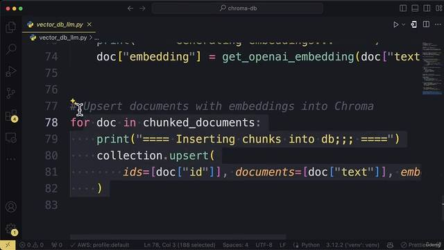

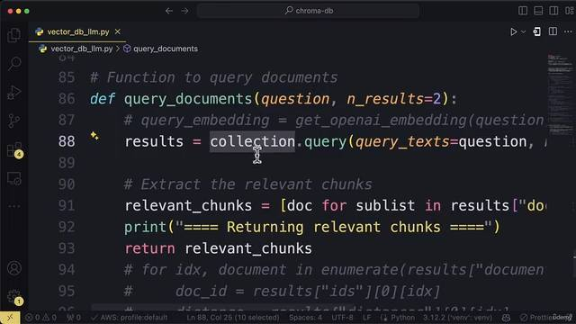

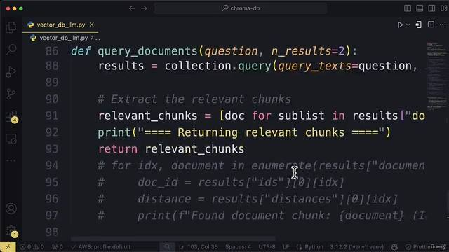

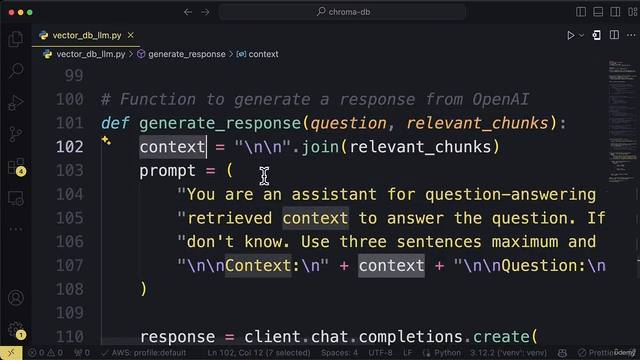

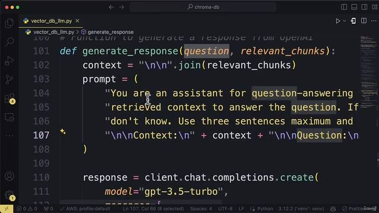

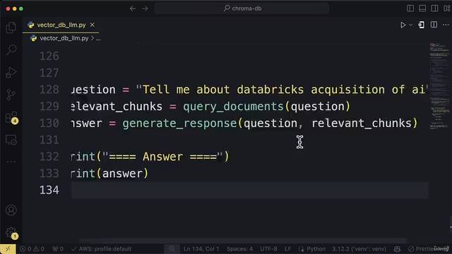

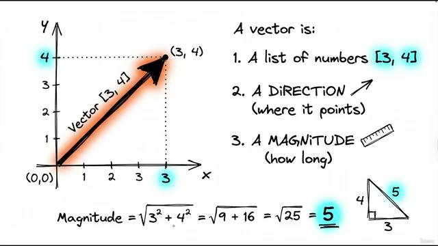

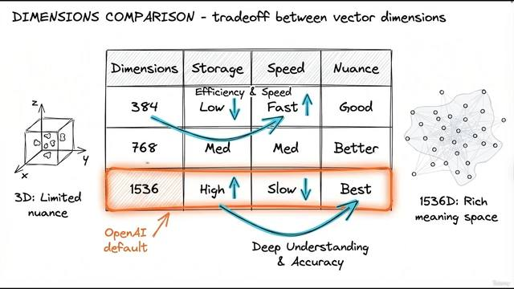

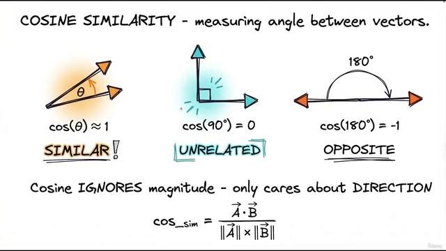

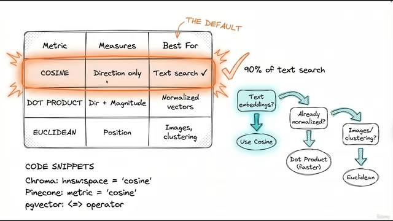

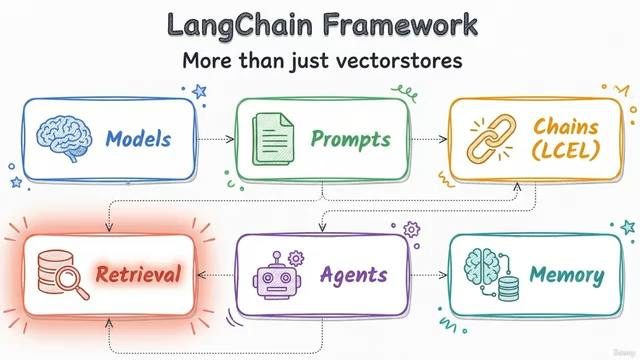