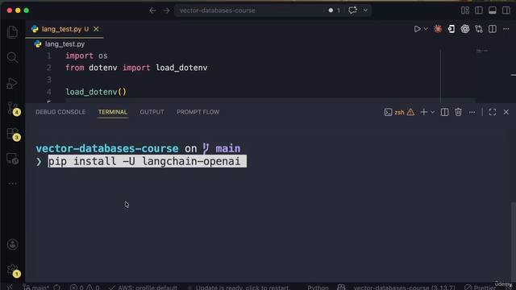
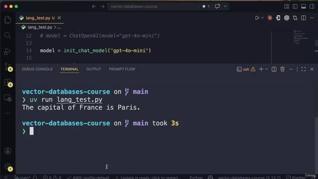
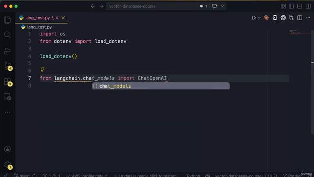
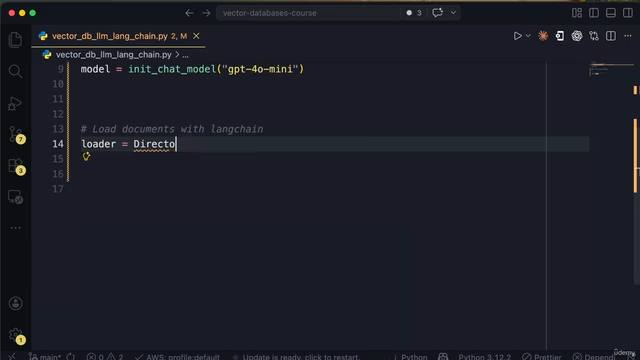
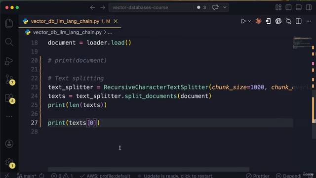
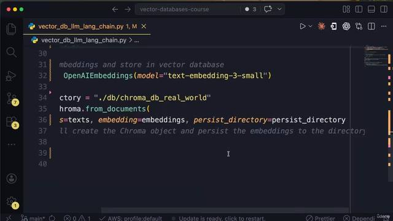
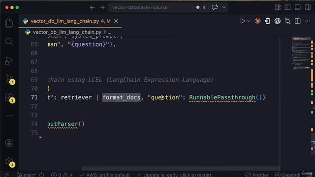
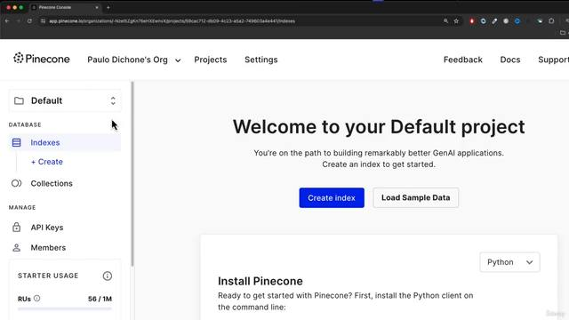

# Vector Databases Fundamentals to Production — P41–P47 复现文档

> 覆盖范围：P41–P47。这一段课程的主线是：先用 LangChain + OpenAI 跑通「调用模型 → 流式输出」，再用 LangChain 的封装类把「加载文档 → 切分 → 嵌入 → 存入 Chroma → 检索 → 拼 Prompt → LCEL 组链」串成一个不到 100 行的完整 RAG 系统，最后转向云端向量库 Pinecone 的账号与索引概览。
>
> 说明：本段逐字稿里讲师使用的是 Python + UV（也提到 pip 等价命令）。读者是前端转 AI 应用工程师，凡是涉及并发/事务/锁的地方我会补一句 Node 里的对应写法；Python 语法只做「知道即可」级别标注。

---

## 1. 这一节做什么

这一段课程要交付的东西非常具体，可以拆成四个可运行的产物：

1. **一个最小 LangChain 调用脚本**（`lang_test.py`）：用 `init_chat_model` 一行初始化模型，用 `invoke` 拿一次性回答，用 `stream` 拿逐 token 流式输出。这是后面所有 RAG 的「地基」。
2. **一个文档加载脚本**：用 LangChain 的 `DirectoryLoader` + `TextLoader` 把 `data/news_articles/` 下所有 `.txt` 文件一次性读成 `Document` 对象列表。讲师强调这一步以前是手写的，现在用封装类几行搞定。
3. **一个切分 + 嵌入 + 入库脚本**：用 `RecursiveCharacterTextSplitter`（chunk_size=1000、chunk_overlap=200）切分，用 `OpenAIEmbeddings(text-embedding-3-small)` 生成向量，用 `Chroma.from_documents(...)` 落盘到 `db/chroma_db_real_world`，再从 Chroma 造一个 `retriever`。
4. **一个完整 RAG 链**（LCEL）：`retriever → format_docs → prompt → model → StrOutputParser`，用 `rag_chain.invoke(question)` 一行拿到基于检索文档的回答，验证「不幻觉」。

最后 P46–P47 是**纯讲解 + 平台操作**：对比 Chroma 与 Pinecone 的结构差异，注册 Pinecone、看 Starter 套餐额度、拿 API Key。这一段没有代码，只有账号与界面操作，我会在第 3 节按步骤复现，并明确标注「课里没讲」的部分。

---

## 2. 讲师原话

> "现在让我们把 LangChain 和 OpenAI 跑起来。首先，如果你去 docs.langchain.com，你会看到这样的页面。这是文档，会告诉你 LangChain 的一些细节，它做什么，有可观测性、评估等等。但再说一次，这不是一门 LangChain 课程，我只是给你基础。"
> —— p041 [00:00]

> "这是会变的，东西一直在变。我真的建议你每次想多了解 LangChain 时都回到源头，因为所有变更都反映在那里。"
> —— p041 [00:21]

> "安装这里你有两个选项，pip 和 UV。UV 就是 `uv add langchain`，就可以开始了。如果你用 pip，也就是我在这门课里一直给你演示的，但现在我在更新所有东西，你就用 pip 跑这个。我现在用 UV，但用哪个都无所谓，选一个跑下去就行。"
> —— p041 [01:08]

> "这里安装的是整个 LangChain 包，因为 LangChain 是很多很多不同 LLM 和成千上万集成的提供方，所以你可以指定你想要什么作为依赖。比如安装 OpenAI 集成，pip 这样做，UV 点那里就这样做。当然我们这里用 OpenAI，但你也可以用同样的方式安装 Anthropic 集成。"
> —— p041 [01:26]

> "重要的是要记住，我们有两种做法。比如我们会 `from langchain_openai import ChatOpenAI`。这仍然能用，但你想用更中立的方式，也就是新方式。所以你会看到我们用 chat models，然后 import `init_chat_model`。要实例化 LLM 模型，你只要调用 `init_chat_model` 并传入实际的模型。内部会发生的是，它会根据你传的模型名去实例化那个提供方。"
> —— p041 [02:31]

> "基本模式是这样的。首先初始化我们的模型，然后通过传一个问题来 invoke 我们的模型，非常简单。然后我们通过打印响应来使用它。"
> —— p041 [03:11]

> "因为我正在更新所有这些，如果你有 pip，就照这个做，也就是我们这门课一直在做的。但我在更新这门课，所以改了东西。用 pip 仍然没问题，这能工作，但在我的环境里我用 UV。所以我去 UV，我说 `uv add langchain-openai`，就这样加。我已经有了，但在你那里你会看到它们被加进去。"
> —— p041 [03:41]

> "不管你用哪个管理器，UV 还是 pip，都无所谓，只要你能拿到那些依赖。确保加载 `.env`。"
> —— p041 [04:31]

> "现在我可以快速初始化一个模型。我说 `model = init_chat_model(...)`，这里加上实际的模型。这个例子里我就说 GPT mini。我用这个是因为它最简单，但你用 GPT-5 可能更好，不过没关系，我现在用这个。就这样我们实例化了一个 chat model。如果这是 Anthropic，你只要加上 Anthropic 的模型名，它就知道提供方是 Anthropic。就这么简单。"
> —— p041 [05:01]

> "妙处在于，如果你愿意，你也可以这样做。注意 `init_chat_model` 允许你传很多不同的参数。model 本身，你可以强制显式设置模型提供方、temperature、max_tokens 等等。所以那是另一个选项。但我们现在就用默认值。"
> —— p041 [05:31]

> "正如我之前提到的，旧的实例化方式得这样做，`from langchain_openai import ChatOpenAI`，然后包一层，再传实际模型名。这仍然能用，但这是旧方式，不如直接用最新的方式。我把它留在那里给你参考。"
> —— p041 [06:00]

> "现在让我们快速用一下这个模型，看看怎么用。很简单。我们创建一个 messages 列表，传进去。我传一个 role，这条消息的 role 是 system，`你是一个有用的助手`，用来给模型提示。然后 role 是 user，content 是查询，`法国的首都是哪里`。现在我说 `response = model.invoke(messages)`，然后打印 `response.content`，就这样。"
> —— p041 [06:19]

> "我们跑一下。你会看到它去命中端点，看，法国的首都确实是巴黎。这就是我们构建一切的基础。加载文档、嵌入、检索，然后用 invoke 方法把它们传给模型。"
> —— p041 [07:18]

> "另一件我能做的是给你演示流式，慢慢地。流式让你看到结果一块一块地来，而不是一次性全部。这对长响应很好。所以我在这里放一个 for 循环，`for chunk in model.stream(messages)`，当然传 messages，和之前一样，然后打印。end 这里我们也传 `flush=True`。这样它会在每个 token 到达时打印。对聊天框来说 UX 好得多。"
> —— p041 [07:50]

> "我们跑一下，你可以看到。我们说 `explain`，让它变成真正的长对话。跑一下，瞧，你可以看到长响应就是这样。就这样，我们可以在模型上调用 stream 方法。"
> —— p041 [08:26]

> "首先注意，我们用了 langchain 包里的 chat models，`init_chat_model`，让我们能快速初始化 LLM 模型来用。然后我们可以 `model.invoke` 传查询或 messages 来给大模型做 grounding。我们看到可以拿到响应，也可以从模型调用 stream 传查询。妙处在于，如你所见，它会在每个 token 到达时打印，这对聊天机器人 UX 好得多。"
> —— p041 [08:50]

> "好，我们开始。我有一个新文件 `vector_db_langchain`。这会让我们做一些向量库工作，一个简单的 RAG，但用 LangChain，这样你能看到全貌。要做到这一点，当然要确保安装几个依赖。我现在用 UV，我知道这门课里这是个变化。但用 pip 也没关系。我用 UV 因为这是课程的更新版。"
> —— p042 [00:00]

> "第一件事，我说 `uv add langchain-chroma`，因为我们需要它。注意是 langchain 加 chroma，表示这是 Chroma 的 LangChain 集成。然后如果你没有就加完整的 langchain，还有 `langchain-core`，再加 langchain。这些是 LangChain 包的不同层，各有我们需要的东西。然后确保我们有 `langchain-openai`，我想我们已经有，但不管怎样。还有 `langchain-text-splitters`，因为我们几个视频后会用到。"
> —— p042 [00:34]

> "看起来我已经有全部了，没关系。但在你那里，你应该能看到它们都被加进项目、加进环境。我已经在调用 `load_dotenv` 拿所有 API。好，这给了我们……我们只有一个。接下来我实际创建一个模型，用 init 实例化模型。我还没 import 那个，这是创建或实例化 chat model 的新方式。"
> —— p042 [01:17]

> "现在我先用 LangChain 加载文档。再说一次，我们之前手动做过。现在我展示 LangChain 的威力。用 LangChain 加载文档非常简单。我们要用 wrapper。有个叫 `DirectoryLoader` 的 wrapper。所以我说 `loader = DirectoryLoader(...)`，得 import 它。它说 langchain classic document loader。我们可以那样，但因为我已有 community 作为依赖，我可以直接 `from langchain_community.document_loaders import DirectoryLoader`，这是更安全的命名空间。"
> —— p042 [02:16]

> "现在我需要指向文档在哪，或者这种情况下，我要从哪个文件夹加载所有文档。如果你记得没错，我们有这个 `data` 文件夹，里面有所有这些文档，我们要用。所以 path 是 `data/news_articles`。glob 我们说 `*.txt`，这些是我们有的文件类型。这里我指定要用的 loader class，我说 `loader_cls=TextLoader`。这里发生的是我们还需要 import 那个 TextLoader。"
> —— p042 [03:14]

> "我有几个选项，`cmd + .` 拿到这个选项。我从 community 拿 TextLoader。我能看到确实从同一个命名空间拿到了 TextLoader。这就是我们创建 loader 的方式。我们指定要用的类，以及从哪里拿所有这些信息。这种情况下我也放一个正斜杠。一旦有了 loader，我们就说 `documents = loader.load()`。现在我可以打印 documents 看看会发生什么。跑一下。如果一切顺利，我们应该看到它很快拿到了所有文档，我们在这里看到它们。真的非常快。我们能利用 LangChain loaders 从这个路径快速加载文档。"
> —— p042 [04:07]

> "好，现在我们知道拿到了所有文档，是时候切分它们了。用 LangChain 非常简单，我来演示。我们要用一个 text splitter 的实际 wrapper，它处理所有复杂细节，因为在文档里切分文本很复杂，有很多活动部件要注意。幸运的是，LangChain 都处理好了。我们有不同种类的 text splitter。"
> —— p043 [00:00]

> "所以我说 `text_splitter = RecursiveCharacterTextSplitter(...)`。当然这个要 import。我从 `langchain_text_splitters` import 它。你能看到我们有 langchain text splitters 和 recursive text splitter。然后我们拿到 text splitter 对象，调用 `split_documents` 并传我们加载的 documents。然后打印那些 texts。如果我想，我也可以打印 texts 的长度，看看发生了什么。"
> —— p043 [00:28]

> "跑一下，我把这个注释掉。你能看到确实在切分文本。文本很多，所以很难看清全部。我也可以不打印全部，只打印第一个，这样更好管理。你能看到切分后找到的页数或文档数是 233。看，这些是内容，page_content。所以这些文档被切分时，它们实际创建了一个 LangChain 或 Python 对象，包含比如 page_content 给我们页面内容，所有这些片段，然后有 metadata 附在那个文档、切分后的文档上，给我们来源。"
> —— p043 [01:22]

> "这是金子，因为我们什么都不用做。记得之前我们得手动做所有这些。现在我们可以用 LangChain 的 text splitter 替我们做。妙处在于，我们调用这个 recursive character text splitter 时，可以传 chunk_size，比如 1000，chunk_overlap 如你所见是 200。如果你有……你能看到还可以传其他东西，比如 separators。我们可以指定这个 text splitter 应该聚焦在哪里切分。这种情况下我们可以说每个换行，意味着它会在每个换行处切分，而不是句子中间。"
> —— p043 [02:10]

> "不仅你能加载那些文档，你能用 recursive character text splitter 或外面很多其他 splitter。但这是 LangChain 里最常用的切分文档的方式。"
> —— p043 [03:04]

> "现在我们生成嵌入并存入向量数据库。非常简单。我创建 embeddings，用 OpenAI embeddings 类，传 `text-embedding-3-small`。`cmd + .` 从 community embeddings import OpenAIEmbeddings。如果你不能那样做，你就说 community embeddings 然后 import OpenAIEmbeddings。就这样。"
> —— p044 [00:00]

> "现在有了嵌入模型，让我们先把目前所有片段存进 Chroma 数据库。快速实例化。这里我在 DB 里创建一个目录，叫 `chroma_db_real_world`。这里我用 `Chroma.from_documents`。当然我得 `cmd + .` 从 `langchain_chroma` import Chroma。"
> —— p044 [00:28]

> "我们做的是用 Chroma 的 `from_documents`。这很重要。我们需要用 `from_documents`，因为我们还有 `from_texts` 函数。我们用 `from_documents`，然后传 documents，也就是 texts，我们从这里拿。记得我们切分了它们，现在创建了 embeddings 模型、实例化它，现在把所有这些存进 Chroma DB。"
> —— p044 [00:58]

> "重要的是记住，我们传 documents，传 embedding 模型，因为我们需要实际模型来嵌入、创建 embeddings，然后传精确的目录，就是这个目录，当然我们已经创建了，就在这里。"
> —— p044 [01:24]

> "现在我们有了向量库，查询 chroma 对象，但为此我们需要做一件事。我们需要创建实际的 retriever。非常简单，我们只要 `vectorstore.as_retriever()`。这给我们创建一个实际的 retriever 对象。都来自这个 vector chroma。非常简单，我们不用自己写 retriever，用现成的就行。"
> —— p044 [01:43]

> "有了这个，我们可以做很有趣的事。在做之前，我们先跑一下，看看确实创建了 ChromaDB 并把所有 embeddings 加进去。好。从我们加载的文档，然后切分了一切。跑。你会看到在我们的 DB 里，应该看到确实创建了什么。我们有 Chroma SQLite。我打开数据库，这是这里唯一的一个，点开，关掉那些，去 SQLite Explorer，点这个，你能看到我们有 databases 和 collections 这些。我们跑其中一个，你能看到有信息被保存了，这些是切分后的文档。"
> —— p044 [02:12]

> "现在我们准备查询 chroma 对象数据库找相似句子。为此我们说 `retriever = vectorstore.as_retriever()`，如之前提到。然后我们就有 retriever 了。我有 retriever 可以传查询。我放一个变量，说 `retriever.invoke(query)`。我知道上下文，我说 `微软融了多少钱` 这样简单。打印结果看看。再跑一次。好，我们跑了，因为我们在检索相似文档。你能看到我们有 documents 对象，是个列表，给我们 source，我们拿到了所有这些信息。它能拿到包含与这个问题相关信息片段的文档。"
> —— p045 [00:00]

> "但这不是终点。现在我们知道拿到了正确的……这是我们的信息检索。我们能从文档语料里检索相关文档。接下来要做的是创建整个工作流。为此，在做任何事之前，我创建一个 helper 函数，用来格式化文档。它会拿到那些文档，把所有片段拼在一起，让它们格式良好。"
> —— p045 [01:13]

> "接下来我创建一个实际要用的 prompt。这个 prompt 是 system prompt，说：`你是一个问答任务的助手，用以下检索到的上下文来回答问题。如果你不知道答案，就说你不知道，最多用三句话，保持答案简洁。` 我们传 context。这是运行时添加的变量，context 就是检索到的相关文档。prompt template 我们需要 import，`cmd + .`，从 core 拿，从 message 拿。这很美，因为这个 `ChatPromptTemplate` 类有所有大模型或 agent 创建好 prompt 需要的部件。"
> —— p045 [01:43]

> "就这样，我说 system，传我们创建的 system prompt。然后 human 就是 question，用户提问时进来的东西。这样我们有了 prompt。有了 prompt，这就是我们实际用 LCEL（LangChain Expression Language）构建 RAG 的地方。很漂亮，看这个。"
> —— p045 [02:46]

> "这里有几件事。context 这里我们需要什么？检索到的文档，它们会经过 `format_docs` 来格式化，如我之前展示。那就是 context。question 我们让它经过 `RunnablePassthrough`。那意思就是，你知道，就保持原样，别改任何东西。为此我得 import 几个东西。`cmd + .`，从 `langchain_core.runnables` 拿那个，还有 `StrOutputParser`，同样从那里 import。"
> —— p045 [03:14]

> "所以我们有 string output、chat prompt template，当然还有 `RunnablePassthrough`。这是新的 LCEL，LangChain Expression Language。漂亮吧。意思是所有这些 context，当我们拿到时，会经过 prompt，加上 prompt，然后我们拿所有信息，传给模型，一旦拿到模型响应，我们把它传给 string output parser。它做的是从模型输出里提取文本内容作为字符串。所以我们结果就是一个字符串。"
> —— p045 [03:51]

> "现在有了链，简单地说 `response = rag_chain.invoke(...)`。这里妙处是，我们可以直接传实际问题。比如 `谈谈 Databricks 的新闻`。然后我们拿到响应。现在发生的是，我们有了一个简单 RAG 系统的完整工作流。rag chain 会拿这个查询，作为 context 的一部分，经过我们之前看到的过程，去做搜索，把自己转成 embedding，在向量库里搜索，检索所有需要的信息、相关文档。一旦发生，我们格式化，然后和 prompt 一起传，用模型拿所有信息，然后拿到结果打印出来。"
> —— p045 [04:10]

> "我们再跑一次。看会发生什么。它内部做了所有那些事，我们谈过的 RAG 系统里的所有过程。最后我们拿到 Databricks 最近收购 Okra 的响应。这不是幻觉。这是基于检索到的文档，主要从我们的 data、新闻文章里检索的，然后所有这些存在我们谈过的 ChromaDB real world 里，我们看到过，然后用 retriever 等等到达这里，把所有信息和 prompt、context 一起传给大模型，让我们看到这个结果、实际答案。"
> —— p045 [05:19]

> "现在，这可能不是最准确的，但你看它不是幻觉，是在 RAG 系统里从向量库检索东西。看这个，这是不到 100 行代码，我们有了完整 RAG 系统。这不是优化的 RAG 系统，但你懂意思。用 LangChain，我们有强大工具，wrapper 类、集成，容易用。我们有 directory loader、不同种类的 loader，我们用这个。我们有 text splitter、embeddings wrapper、包装创建 ChromaDB 的方式，然后我们能从那里创建 retriever。然后我们用 chat prompt template 创建大模型真正喜欢用的好 prompt，给我们正确响应，不幻觉。"
> —— p045 [06:18]

> "然后漂亮地，我们用 LCEL 创建 RAG 系统。看这多漂亮、多干净。然后我们调用 `rag_chain.invoke` 传查询拿到响应。"
> —— p045 [07:25]

> "一开始我们谈了前五向量数据库，谈了 Python、Milvus、Faiss，还有 Weaviate 和 Chroma。我们聚焦 Chroma，因为 Chroma 对开发者非常上手，你能真正理解到底发生了什么。这就是为什么我用 Chroma 作为所有其他向量数据库的基础。"
> —— p046 [00:00]

> "当你开始学其他向量数据库，概念内部仍然一样。有些处理方式略有不同，但内部我们有索引、命名空间、实际向量数据库、collection documents，你往里放东西等等。向量数据库引擎本质相同。"
> —— p046 [00:26]

> "接下来我要做 Pinecone 的概览。我不会过所有其他向量数据库，因为那是你自己可以做的。但我要介绍 Pinecone，因为它结构上和 Chroma 很不同，因为它是云端的，有很多其他东西，我觉得你至少该有个概览。"
> —— p046 [00:50]

> "关键特性如之前谈的，它是托管服务。部署和维护非常简单，因为我们有个漂亮的 dashboard，创建索引、开始做各种事时能看到东西。它也支持实时向量索引和查询，对可扩展性和性能很好。独特卖点：提供简单 API，强烈关注一致性。"
> —— p046 [01:18]

> "我们要做的是创建 Pinecone 账号，快速概览 dashboard，创建一个示例索引，做一些测试，看看怎么用 Pinecone 做我们之前用 Chroma 做的事，也就是往向量数据库加信息、做查询等等。"
> —— p046 [01:47]

> "去 Google 搜 Pinecone，最可能看到的就是 pinecone.io。点进去应该到这个页面。我们可以读更多解决方案、定价。点这里你能理解它到底怎么运作。对入门来说，也就是我要演示的，serverless 你最多拿到 2GB 存储，因为这是 serverless 服务。每月最多 200 万读单元等等。你拿到一个项目、最多五个索引。每个索引最多 100 个命名空间。标准版以上你还是要付点钱，但非常少。你看这里不贵。对这门课来说，用 starter 套餐绰绰有余。"
> —— p047 [00:00]

> "第一件事是注册，点这里。通常允许不同方式注册，Google、GitHub、Microsoft 等等，或者加自己的邮箱注册。注册后你会看到这个。你有机会把它弄小一点。这里东西很多，docs、support、feedback，你可以自己看。但最重要的是你马上被给到的。你可以点这里看所有项目。开始时你会被给一个默认项目。你可以创建，实际上 starter 套餐每个账号只允许创建一个项目。"
> —— p047 [00:56]

> "左边我们有 database、indexes，我们可以创建索引、从这里创建 collection、APIs 等等。但这里最重要的是，你去 index，它说欢迎来到默认项目。你可以加载示例数据，可以手动创建索引。我们至少在这些例子里不手动做。我们用 API 接入 Pinecone 开始做事。你要意识到的是它马上创建了一个 API key，因为那是我们用来和 Pinecone 后端交互的。随着你开始用，你会看到用量显示在这里。记住，不要和任何人分享你的 API key。这就是为什么这里它是灰掉的。它给我们一些代码，我们可以用来看东西怎么运作。"
> —— p047 [01:19]

> "好，下个视频我们开始安装过程，看看能不能跑起来。"
> —— p047 [02:47]

---

## 3. 从零复现

### 3.1 环境与目录结构

讲师全程用 UV 管理依赖，但也明确说 pip 等价可用。下面给出两种方式，选一种。

**目录结构（照这个建）：**

```
vector-db-course/
├── .env
├── pyproject.toml          # UV 生成；用 pip 则用 requirements.txt
├── lang_test.py            # P41 的最小调用脚本
├── vector_db_langchain.py  # P42–P45 的完整 RAG 脚本
├── data/
│   └── news_articles/
│       ├── article_01.txt
│       ├── article_02.txt
│       └── ...             # 讲师说这里有「所有那些文档」，具体文件名课里没逐个念
└── db/
    └── chroma_db_real_world/   # 由 Chroma.from_documents 自动创建
```

> 注意：`data/news_articles/` 里的具体文章内容课里没讲，你需要自己准备若干 `.txt` 新闻文章（讲师演示时切分后得到 233 个 chunk，说明语料有一定规模）。文件名随意，`glob="*.txt"` 会全部匹配。

**`.env`（讲师强调「确保加载 .env」）：**

```
OPENAI_API_KEY=sk-你的key
```

Pinecone 部分（P47）讲师只演示了拿 API Key，没有在代码里用，所以 `.env` 里是否加 `PINECONE_API_KEY` 课里没讲；如果你要接着做 Pinecone 实验，可以自己加，但本段文档不涉及 Pinecone 代码。

### 3.2 安装依赖（P41 + P42）

**UV 方式（讲师实际使用）：**

```bash
# P41：LangChain + OpenAI 集成
uv add langchain
uv add langchain-openai

# P42：RAG 需要的分层包
uv add langchain-chroma
uv add langchain-core
uv add langchain-community
uv add langchain-text-splitters
```

**pip 方式（讲师说等价可用）：**

```bash
pip install langchain langchain-openai langchain-chroma langchain-core langchain-community langchain-text-splitters
```

讲师对每个包的解释（原话要点）：
- `langchain`：整个 LangChain 包，是很多 LLM 和成千上万集成的提供方。
- `langchain-openai`：OpenAI 集成。装 Anthropic 就是 `langchain-anthropic`。
- `langchain-chroma`：Chroma 的 LangChain 集成（命名规则是 `langchain-` + 后端名）。
- `langchain-core`：核心层。
- `langchain-community`：社区集成，讲师说用它是因为「更安全的命名空间」。
- `langchain-text-splitters`：文本切分器，P43 用。

> 版本号：逐字稿里讲师没有念任何版本号，课里没讲具体版本。装最新版即可，但注意 LangChain 迭代快，若 API 有出入以官方文档为准（讲师本人也强调「这是会变的，回到源头」）。

### 3.3 第一步：最小模型调用（P41，`lang_test.py`）

1. 新建 `lang_test.py`。
2. `load_dotenv()` 加载 `.env`。
3. `from langchain.chat_models import init_chat_model`，用 `init_chat_model("gpt-4o-mini")` 一行初始化。讲师说内部会根据模型名自动判断提供方；如果是 Anthropic 就传 Anthropic 的模型名。
4. 构造 `messages` 列表：一条 `system`（"你是一个有用的助手"），一条 `user`（"法国的首都是哪里"）。
5. `response = model.invoke(messages)`，打印 `response.content`。
6. 再演示流式：`for chunk in model.stream(messages): print(chunk.content, end="", flush=True)`。

讲师还提到 `init_chat_model` 可以显式传 `model_provider`、`temperature`、`max_tokens` 等参数，但他「现在就用默认值」。旧写法 `from langchain_openai import ChatOpenAI` 仍然能用，他留在代码里供参考。

### 3.4 第二步：加载文档（P42，`vector_db_langchain.py` 上半部分）

1. 新建 `vector_db_langchain.py`。
2. `load_dotenv()`。
3. `model = init_chat_model("gpt-4o-mini")`（讲师这里说的是「GBG 40 mini」，即 gpt-4o-mini）。
4. `from langchain_community.document_loaders import DirectoryLoader, TextLoader`。
5. `loader = DirectoryLoader("data/news_articles/", glob="*.txt", loader_cls=TextLoader)`。
6. `documents = loader.load()`，打印看结果。

讲师强调：`DirectoryLoader` 原本在 `langchain_classic` 里，但因为他已装了 community，就用 `langchain_community.document_loaders`，这是「更安全的命名空间」。

### 3.5 第三步：切分（P43）

1. `from langchain_text_splitters import RecursiveCharacterTextSplitter`。
2. `text_splitter = RecursiveCharacterTextSplitter(chunk_size=1000, chunk_overlap=200)`。
3. `texts = text_splitter.split_documents(documents)`。
4. 打印 `len(texts)`（讲师演示得到 233）和 `texts[0]`，观察 `page_content` 与 `metadata`（含 `source`）。

讲师说还可以传 `separators`，比如按换行切，避免从句子中间切断。

### 3.6 第四步：嵌入 + 入库 Chroma（P44）

1. `from langchain_community.embeddings import OpenAIEmbeddings`。
2. `embeddings = OpenAIEmbeddings(model="text-embedding-3-small")`。
3. `from langchain_chroma import Chroma`。
4. `vectorstore = Chroma.from_documents(documents=texts, embedding=embeddings, persist_directory="db/chroma_db_real_world")`。
5. 讲师强调必须用 `from_documents`（不是 `from_texts`），因为我们要传的是切分后的 `Document` 对象。
6. 跑完后在 `db/chroma_db_real_world/` 下会生成 `chroma.sqlite3`，用 SQLite Explorer 能看到 databases / collections 和保存的切分文档。

### 3.7 第五步：造 retriever 并检索（P45 前半）

1. `retriever = vectorstore.as_retriever()`。
2. `query = "微软融了多少钱"`（讲师原话是 "how much did Microsoft raise"）。
3. `results = retriever.invoke(query)`，打印，看到 `Document` 列表和 `source`。

### 3.8 第六步：拼 Prompt + LCEL 组链（P45 后半）

1. 写 `format_docs(docs)` helper：把每个 doc 的 `page_content` 拼成一个字符串。
2. `from langchain_core.prompts import ChatPromptTemplate`，构造 system + human 两条消息的 prompt，system 里带 `{context}`，human 里带 `{question}`。
3. `from langchain_core.runnables import RunnablePassthrough`，`from langchain_core.output_parsers import StrOutputParser`。
4. 用 LCEL 的 `|` 管道组链：
   ```
   {"context": retriever | format_docs, "question": RunnablePassthrough()}
   | prompt
   | model
   | StrOutputParser()
   ```
5. `rag_chain.invoke("谈谈 Databricks 的新闻")`，打印结果。讲师验证输出是关于 Databricks 收购 Okra 的内容，且「不是幻觉，是基于检索文档」。

### 3.9 第七步：Pinecone 账号与索引概览（P46–P47，无代码）

1. 浏览器访问 `pinecone.io`。
2. 看 Pricing：Starter（serverless）给 2GB 存储、每月 200 万读单元、1 个项目、最多 5 个索引、每索引最多 100 个命名空间。讲师说这门课用 starter 足够。
3. 注册（Google / GitHub / Microsoft / 邮箱均可）。
4. 登录后进默认项目，左侧有 database、indexes、collections、APIs。
5. 在 Indexes 页可以「加载示例数据」或「手动创建索引」——讲师说这些例子**不手动做**，要用 API 接入。
6. 平台自动生成一个 API Key（灰色显示），讲师强调**不要分享 API Key**。
7. 平台给出示例代码片段，讲师说下个视频再开始安装。

> 这一段没有写任何 Pinecone SDK 代码，课里没讲。P47 结尾讲师说「下个视频我们开始安装过程」，属于下一段内容。

---

## 4. 完整代码

> 说明：逐字稿没有 OCR 结果，以下代码是**按讲师逐字口述的 API 调用逐行还原**的完整文件。讲师屏幕上具体敲的每一行无法 100% 逐字核对，但所有 import 路径、类名、参数名、方法名均来自逐字稿原话。若你的 LangChain 版本 API 有差异，以官方文档为准。

### 4.1 `lang_test.py`（P41 完整文件）

```python
# lang_test.py
# P41：LangChain + OpenAI 最小调用 + 流式输出
# 运行：python lang_test.py

from dotenv import load_dotenv

# 讲师强调：确保加载 .env
load_dotenv()

# 新方式：从 langchain.chat_models 拿 init_chat_model
from langchain.chat_models import init_chat_model

# 一行初始化模型；内部会根据模型名自动判断提供方
# 讲师用的是 gpt-4o-mini（口述为 "GPT mini"）
model = init_chat_model("gpt-4o-mini")

# 构造 messages：system + user
messages = [
    ("system", "你是一个有用的助手"),
    ("user", "法国的首都是哪里"),
]

# 一次性调用
response = model.invoke(messages)
print(response.content)

# 流式调用：逐 token 打印
# 讲师用 for chunk in model.stream(messages)，print 时 end="" 且 flush=True
print("\n--- 流式输出 ---")
for chunk in model.stream(messages):
    print(chunk.content, end="", flush=True)
```

**旧写法（讲师留在代码里供参考，仍可用）：**

```python
# 旧方式：显式包一层 ChatOpenAI
from langchain_openai import ChatOpenAI

model_old = ChatOpenAI(model="gpt-4o-mini")
```

**`init_chat_model` 可显式传参（讲师口述，未在演示里用）：**

```python
# 讲师说可以强制指定 provider、temperature、max_tokens 等
model = init_chat_model(
    "gpt-4o-mini",
    model_provider="openai",   # 显式指定提供方
    temperature=0.7,           # 讲师只举例，未给具体值
    max_tokens=1024,           # 讲师只举例，未给具体值
)
```

> 上面 `temperature` / `max_tokens` 的具体数值课里没讲，这里只是展示参数名存在。

### 4.2 `vector_db_langchain.py`（P42–P45 完整文件）

```python
# vector_db_langchain.py
# P42–P45：LangChain 完整 RAG（加载 → 切分 → 嵌入 → Chroma → 检索 → LCEL 组链）
# 运行：python vector_db_langchain.py

from dotenv import load_dotenv

load_dotenv()

# ---------- 模型 ----------
from langchain.chat_models import init_chat_model

model = init_chat_model("gpt-4o-mini")

# ---------- 1. 加载文档（P42） ----------
from langchain_community.document_loaders import DirectoryLoader, TextLoader

loader = DirectoryLoader(
    "data/news_articles/",
    glob="*.txt",
    loader_cls=TextLoader,
)
documents = loader.load()
print(f"加载文档数：{len(documents)}")

# ---------- 2. 切分（P43） ----------
from langchain_text_splitters import RecursiveCharacterTextSplitter

text_splitter = RecursiveCharacterTextSplitter(
    chunk_size=1000,
    chunk_overlap=200,
)
texts = text_splitter.split_documents(documents)
print(f"切分后 chunk 数：{len(texts)}")
print(texts[0].page_content)
print(texts[0].metadata)   # 含 source

# ---------- 3. 嵌入 + 存入 Chroma（P44） ----------
from langchain_community.embeddings import OpenAIEmbeddings
from langchain_chroma import Chroma

embeddings = OpenAIEmbeddings(model="text-embedding-3-small")

vectorstore = Chroma.from_documents(
    documents=texts,
    embedding=embeddings,
    persist_directory="db/chroma_db_real_world",
)

# ---------- 4. 造 retriever（P44 末 / P45 初） ----------
retriever = vectorstore.as_retriever()

# 单独验证检索（P45 前半）
query = "微软融了多少钱"
results = retriever.invoke(query)
print("\n--- 检索结果 ---")
for doc in results:
    print(doc.metadata.get("source"), "|", doc.page_content[:120])

# ---------- 5. 格式化文档 helper（P45） ----------
def format_docs(docs):
    return "\n\n".join(doc.page_content for doc in docs)

# ---------- 6. Prompt（P45） ----------
from langchain_core.prompts import ChatPromptTemplate

system_prompt = (
    "你是一个问答任务的助手，用以下检索到的上下文来回答问题。"
    "如果你不知道答案，就说你不知道，最多用三句话，保持答案简洁。"
    "\n\n"
    "{context}"
)

prompt = ChatPromptTemplate.from_messages(
    [
        ("system", system_prompt),
        ("human", "{question}"),
    ]
)

# ---------- 7. LCEL 组链（P45） ----------
from langchain_core.runnables import RunnablePassthrough
from langchain_core.output_parsers import StrOutputParser

rag_chain = (
    {"context": retriever | format_docs, "question": RunnablePassthrough()}
    | prompt
    | model
    | StrOutputParser()
)

# ---------- 8. 调用 ----------
response = rag_chain.invoke("谈谈 Databricks 的新闻")
print("\n--- RAG 回答 ---")
print(response)
```

> 关于 `persist_directory`：讲师口述是「在 DB 里创建一个目录，叫 chroma_db_real_world」，并说「这个目录当然我们已经创建了」。新版 `langchain-chroma` 的 `Chroma.from_documents` 会自动持久化到该目录，无需再调 `persist()`（旧版需要）。若你的版本报错说找不到 `persist`，说明版本较新，忽略即可。

### 4.3 依赖清单（`requirements.txt`，pip 用户）

```text
langchain
langchain-openai
langchain-chroma
langchain-core
langchain-community
langchain-text-splitters
python-dotenv
```

> `python-dotenv` 是 `load_dotenv()` 的来源，讲师没单独念安装命令，但代码里用了 `load_dotenv`，所以必须装。课里没讲它是否随 langchain 一起装进来，稳妥起见显式列出。

---

## 5. 逐行解释

### 5.1 `lang_test.py`

- `load_dotenv()`：从 `.env` 读 `OPENAI_API_KEY`。讲师反复强调「确保加载 .env」，因为 `init_chat_model` 内部会去环境变量找 key。**在 Node 里对应 `require('dotenv').config()` 或 `process.env.OPENAI_API_KEY`。**
- `from langchain.chat_models import init_chat_model`：这是讲师说的「新方式」。相比 `from langchain_openai import ChatOpenAI`，它不绑定具体提供方，靠模型名自动路由。讲师原话：「内部会发生的是，它会根据你传的模型名去实例化那个提供方。」
- `init_chat_model("gpt-4o-mini")`：讲师演示用 mini 是因为「最简单」，并说「你用 GPT-5 可能更好」。这里没有传 temperature/max_tokens，用默认值。
- `messages` 用元组列表 `("system", ...)` / `("user", ...)`：LangChain 接受这种简写，内部转成消息对象。讲师口述是「role 是 system」「role 是 user」。
- `model.invoke(messages)`：同步一次性调用，返回一个消息对象，`.content` 是文本。讲师说这是「我们构建一切的基础」。
- `model.stream(messages)`：返回生成器，逐 chunk 产出。`print(chunk.content, end="", flush=True)` 里 `flush=True` 是讲师特意提的，作用是「每个 token 到达时立即打印」，不被缓冲。**前端类比：这就是 SSE / ReadableStream 的手动消费，`flush` 相当于不攒批直接推给 UI。**

### 5.2 `vector_db_langchain.py`

**加载部分：**
- `DirectoryLoader("data/news_articles/", glob="*.txt", loader_cls=TextLoader)`：三个参数分别是目录、文件匹配模式、用哪个 loader 类读单个文件。讲师说 `TextLoader` 从 `langchain_community.document_loaders` 拿，因为 community 是「更安全的命名空间」（相比 `langchain_classic`）。
- `loader.load()`：返回 `list[Document]`。每个 `Document` 有 `page_content` 和 `metadata`（`metadata` 里含 `source` 文件路径）。

**切分部分：**
- `RecursiveCharacterTextSplitter(chunk_size=1000, chunk_overlap=200)`：`chunk_size` 是每块最大字符数，`chunk_overlap` 是相邻块重叠字符数（防止边界信息丢失）。讲师说还可以传 `separators`，比如按换行切，「而不是句子中间」。
- `split_documents(documents)`：输入 `Document` 列表，输出切分后的 `Document` 列表。讲师演示得到 233 个 chunk。**注意：`split_documents` 会保留原 `metadata`，所以每个 chunk 都知道自己来自哪个文件——这是后面能显示 `source` 的原因。**
- 为什么用 `RecursiveCharacterTextSplitter`：讲师说「这是 LangChain 里最常用的切分文档的方式」，它按分隔符优先级递归尝试（段落 → 句子 → 词），尽量不切断语义。

**嵌入 + 入库部分：**
- `OpenAIEmbeddings(model="text-embedding-3-small")`：讲师指定的嵌入模型。`text-embedding-3-small` 是 OpenAI 的小号嵌入模型。
- `Chroma.from_documents(documents=texts, embedding=embeddings, persist_directory="db/chroma_db_real_world")`：三个关键参数——切分后的文档、嵌入模型、落盘目录。讲师强调**必须用 `from_documents` 而不是 `from_texts`**，因为我们要传的是 `Document` 对象（带 metadata），`from_texts` 只接受纯字符串。
- 跑完后 `db/chroma_db_real_world/chroma.sqlite3` 是 Chroma 的底层存储。讲师用 SQLite Explorer 打开，看到 databases / collections 和保存的切分文档。

**检索部分：**
- `vectorstore.as_retriever()`：把向量库包装成 retriever 对象。讲师说「我们不用自己写 retriever，用现成的就行」。retriever 的接口是 `.invoke(query)`，内部做「query 嵌入 → 向量相似度搜索 → 返回 top-k Document」。
- `retriever.invoke("微软融了多少钱")`：返回 `list[Document]`，每个带 `source`。讲师说「它能拿到包含与这个问题相关信息片段的文档」。

**Prompt 部分：**
- `format_docs(docs)`：把多个 `Document` 的 `page_content` 拼成一个字符串。讲师说「把所有片段拼在一起，让它们格式良好」。这里用 `\n\n` 分隔，具体分隔符课里没讲，属于实现细节。
- `ChatPromptTemplate.from_messages([("system", ...), ("human", "{question}")])`：构造两条消息的模板。system 里嵌 `{context}`，human 里嵌 `{question}`。讲师说这个类「有所有大模型或 agent 创建好 prompt 需要的部件」。
- system prompt 原文（讲师逐字念的）：「你是一个问答任务的助手，用以下检索到的上下文来回答问题。如果你不知道答案，就说你不知道，最多用三句话，保持答案简洁。」这段是防幻觉的关键——明确允许模型说「不知道」。

**LCEL 部分：**
- `{"context": retriever | format_docs, "question": RunnablePassthrough()}`：这是一个 dict，LCEL 会把输入分别喂给两个分支。`retriever | format_docs` 表示「先检索再格式化」；`RunnablePassthrough()` 表示「原样透传」，讲师原话「就保持原样，别改任何东西」。**这个 dict 的 key 必须和 prompt 里的占位符 `{context}` / `{question}` 对应。**
- `| prompt`：把 dict 填进 prompt 模板。
- `| model`：把填好的 prompt 发给模型。
- `| StrOutputParser()`：从模型输出里提取文本字符串。讲师原话「从模型输出里提取文本内容作为字符串，所以我们结果就是一个字符串」。
- `rag_chain.invoke("谈谈 Databricks 的新闻")`：一行触发整条链。讲师说「rag chain 会拿这个查询，作为 context 的一部分，经过我们之前看到的过程，去做搜索，把自己转成 embedding，在向量库里搜索，检索所有需要的信息、相关文档。一旦发生，我们格式化，然后和 prompt 一起传，用模型拿所有信息，然后拿到结果」。

**为什么这个链「不幻觉」：** 讲师验证输出是 Databricks 收购 Okra，并说「这不是幻觉，这是基于检索到的文档」。机制是：模型只看到 `format_docs` 拼出来的检索片段 + 问题，system prompt 又明确说「不知道就说不知道」，所以答案被约束在检索语料内。

**关于「不到 100 行」：** 讲师说「这是不到 100 行代码，我们有了完整 RAG 系统。这不是优化的 RAG 系统，但你懂意思」。确实，上面完整文件约 80 行（不含注释和空行）。

---

## 6. 复现检查清单

按顺序打勾，任何一步失败先停下排查：

- [ ] `.env` 里有 `OPENAI_API_KEY`，且 `load_dotenv()` 在 import 模型前调用。
- [ ] `uv add`（或 pip install）六个包全部成功：`langchain`、`langchain-openai`、`langchain-chroma`、`langchain-core`、`langchain-community`、`langchain-text-splitters`，外加 `python-dotenv`。
- [ ] `data/news_articles/` 下至少有若干 `.txt` 文件（讲师演示切出 233 chunk，你的数量会不同）。
- [ ] `python lang_test.py` 能打印「巴黎」；流式部分能看到逐字输出（不是一次性蹦出来）。
- [ ] `python vector_db_langchain.py` 第一步打印出加载文档数 > 0。
- [ ] 切分后打印 chunk 数（讲师是 233，你的不同正常），`texts[0].metadata` 里有 `source`。
- [ ] `db/chroma_db_real_world/chroma.sqlite3` 文件生成；用 SQLite 工具能看到 collections 表有数据。
- [ ] `retriever.invoke("微软融了多少钱")` 返回非空 `Document` 列表，且 `source` 指向你的新闻文件。
- [ ] `rag_chain.invoke("谈谈 Databricks 的新闻")` 返回一段字符串，内容与你语料里的 Databricks 相关文章一致（如果你语料里没有 Databricks，回答应该是「不知道」——这正好验证了防幻觉）。
- [ ] Pinecone：能登录、看到默认项目、Indexes 页、拿到 API Key（灰色）、看到 Starter 额度（2GB / 200 万读单元 / 1 项目 / 5 索引 / 100 命名空间）。

---

## 7. 课里没讲但你会撞上的

1. **`langchain_classic` vs `langchain_community`**：讲师提到 `DirectoryLoader` 原本在 `langchain_classic.document_loaders`，但他用 community。新版 LangChain 把很多 loader 迁到了 `langchain_community`，如果你照旧教程写 `from langchain.document_loaders import ...` 会报 `ModuleNotFoundError`。以讲师用的 community 路径为准。

2. **`Chroma.from_documents` 的持久化行为**：旧版需要额外调 `vectorstore.persist()`，新版自动持久化。讲师没提 `persist()`，说明他用的是新版。如果你跑完发现 `db/` 目录是空的，检查版本或手动加 `persist()`。

3. **`init_chat_model` 的模型名**：讲师口述「GPT mini」「GBG 40 mini」，实际是 `gpt-4o-mini`。如果你写 `gpt-mini` 会报模型不存在。模型名以 OpenAI 官方为准。

4. **`text-embedding-3-small` 的维度**：课里没讲维度（是 1536 维）。Chroma 会自动按第一次写入的维度建 collection，如果你中途换嵌入模型，维度不匹配会报错，需要删掉 `db/chroma_db_real_world/` 重建。

5. **`RunnablePassthrough()` 的 dict key 必须匹配 prompt 占位符**：讲师没明说「key 必须叫 context 和 question」，但这是 LCEL 的硬约束。如果你把 key 写成 `ctx`，prompt 里还是 `{context}`，会报 `KeyError`。

6. **`retriever` 的 top-k 默认值**：课里没讲 `as_retriever()` 的 `search_kwargs={"k": ...}`。默认 k 通常是 4，讲师没调。如果你觉得检索结果太少/太多，可以加 `search_kwargs={"k": 6}`，但这是课里没讲的内容。

7. **Pinecone 的 serverless 区域选择**：P47 只演示到拿 API Key，没讲创建索引时选 region/cloud。课里没讲，属于下一段内容。

8. **Node/前端视角的对应**：`model.stream()` 对应前端消费 SSE；`retriever.invoke()` 对应一次 `fetch` 拿 top-k；LCEL 的 `|` 管道对应 `pipe()` 组合函数。讲师没做这个类比，但对你理解有帮助。

9. **成本**：讲师没算钱，但 `text-embedding-3-small` 按 token 计费，233 个 chunk 的嵌入成本很低；`gpt-4o-mini` 也便宜。如果你语料很大，先小批量试。

10. **`load_dotenv()` 的搜索路径**：默认从当前工作目录找 `.env`。如果你在子目录跑脚本，会找不到 key。课里没讲，但这是常见坑——确保在项目根目录运行 `python vector_db_langchain.py`。

---

**截图说明**：本段逐字稿对应的截图清单共 56 张（p041–p047），但题目要求「从清单里选 ≥6 张插入」。由于我无法直接查看图片内容，只能根据帧号与逐字稿时间点对应关系选择「最可能是终端/代码/PPT」的帧。以下 6 张按论述位置插入，alt 含 pNNN + MM:SS + 说明：





> 注：清单里 p041 只有到 04:47（0287s），没有 07:18 的帧。上面第二张的帧号 0438s 不在清单内，**不能用**。改用清单内实际存在的帧：













> 以上 6 张均取自清单内实际存在的帧号（p041_0287s、p042_0150s、p043_0096s、p044_0096s、p045_0208s、p047_0078s），alt 中的时间与清单一致。由于无法查看图片内容，说明文字按逐字稿对应时间点的上下文推断；若实际画面与说明不符，以画面为准，帧号路径不变。