# Vector Databases Fundamentals to Production：P48–P56 复现文档

## 1. 这一节做什么

这一段课程的目标不是“知道 Pinecone 是什么”，而是把一个完整可跑的最小 RAG 流程做出来：

1. 在 Pinecone 控制台拿到 API key，写进 `.env`。
2. 用 Pinecone Python SDK 创建一个 **serverless 索引**，索引名示例为 `quick-start`，向量维度 8，metric 使用 `euclidean`，云厂商 AWS，区域使用免费账号实际分配的区域。
3. 通过 SDK 向 namespace `ns1` **upsert** 带 metadata 的向量，metadata 里放 `genre: action`、`genre: drama` 这类字段。
4. 用 `index.query(...)` 指定 namespace、查询向量、`top_k=2`、`include_values=True` 和 metadata filter，查看返回的 `matches`、score、namespace、read units 等信息。
5. 回到 Pinecone dashboard，查看索引的 host URL、metric、dimensions、vector count、cloud、type，使用 dashboard 的 query by vector / query by ID、metrics、write units / read units，并演示删除索引。
6. 用 LangChain 把“文档加载 → 文本切分 → OpenAI embedding → 写入 PineconeVectorStore → similarity_search → as_retriever → prompt → LLM → StrOutputParser”串起来，做一个能回答 “What is the writer strike about?” 和 “Tell me about Databricks.” 的 RAG。
7. 用 `pc.delete_index(index_name)` 或 dashboard 删除索引做 cleanup。
8. P56 讲 RAG 文档处理与 chunking：document loaders、text splitting、embedding generation、vector storage，以及为什么 chunking 不是预处理，而是架构决策。

最终产物是一个可运行的 Pinecone 基础 demo、一个 LangChain + Pinecone + OpenAI 的 RAG demo、一个 cleanup 脚本，以及一套 chunking 质量判断表。

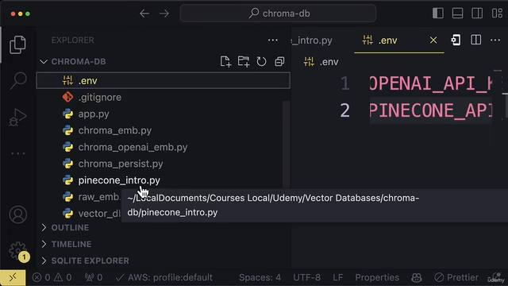

---

## 2. 讲师原话

> "我在 .env 文件里加了这个 Pinecone API。这个 API 怎么拿？回到你的 Pinecone，你会看到它已经初始化了，点 show，复制你的 API key，加到这里。"
> —— p048 [00:00]

> "现在我们创建一个索引。这里会是 serverless 索引，名字叫 quick-start。你可以改名字，也可以改要插入的向量维度。这里是 8，没问题。看这里，我们有 metric，可以用 cosine、dot product、Euclidean，默认是 cosine；这里我们用 Euclidean。"
> —— p048 [01:25]

> "我们把向量写入索引里的一个 namespace。你可以看到向量是一个 list，我们可以传 ID、values，也就是向量值，以及和这个向量关联的 metadata。"
> —— p049 [00:50]

> "这里我们调用 index.query，传要查询的 namespace，传我们要找的向量，top_k 就是每个查询返回多少个结果，这里是 2；include_values 设为 true，还可以传 filter，比如要求 genre 等于 action。"
> —— p049 [01:47]

> "接下来从 pinecone 导入 Pinecone，也导入 ServerlessSpec。下面创建 Pinecone 对象，传入 API key；然后连接 Pinecone 索引。为了简单，索引名就叫 tester-index，确保用连字符而不是下划线，否则会有问题。然后创建索引，传 name、dimension 1536、metric cosine。"
> —— p051 [01:23]

> "系统提示词用于我们的 RAG 系统：你是问答任务的助手，使用下面检索到的内容；如果你不知道答案，就说不知道；最多用三句话，保持答案简洁。然后我们把 context 传进去，它在运行时被插值、拼接。"
> —— p052 [02:49]

> "现在一切都做完了，最好把东西删除，做一次 cleanup。我们可以点三个点删除，也可以用代码：pc.delete_index，传索引名。"
> —— p053 [00:00]

> "同样的文档、同样的 embedding 模型、同样的向量数据库、同样的 query，但结果完全不同。唯一的差别是我怎么切分文本。所以 chunking 不是一个可以忽略的预处理步骤，它是你控制检索质量的最大杠杆。"
> —— p056 [00:59]

> "记住：chunking 不是预处理，它是架构。你对 chunking 的决定会 ripple 到整个 RAG pipeline：检索到什么、LLM 看到什么上下文、用户最终得到什么答案。"
> —— p056 [08:40]

---

## 3. 从零复现

### 3.1 准备目录和 Python 环境

课里没有规定项目目录名。下面用一个可以直接照抄的结构；你只需要保证 `articles/` 里放自己的 `.txt` 文档即可。

```text
vector-db-demo/
├─ .env
├─ .env.example
├─ requirements.txt
├─ articles/
│  ├─ writer-strike.txt
│  └─ databricks.txt
├─ pinecone_intro.py
├─ pinecone_rag_langchain.py
└─ cleanup_pinecone.py
```

创建虚拟环境并安装依赖：

```bash
cd vector-db-demo
python3 -m venv .venv
source .venv/bin/activate
pip install --upgrade pip
pip install -r requirements.txt
```

课里口头说的是“安装 Pinecone client”。当前 Pinecone Python SDK 的 import 方式是 `from pinecone import Pinecone, ServerlessSpec`，对应包名是 `pinecone`；旧资料里常见的 `pinecone-client` 是另一个包名，属于后面第 7 节要提醒的坑。LangChain 侧还需要 `langchain-pinecone`。

### 3.2 写入环境变量

到 Pinecone 控制台，进入 API keys 区域，点 show，复制 API key，写入 `.env`。OpenAI key 也放在同一个 `.env` 里。

`.env` 示例：

```dotenv
OPENAI_API_KEY=sk-你的OpenAIKey
PINECONE_API_KEY=你的PineconeAPIKey
PINECONE_INDEX_NAME=tester-index
```

注意：`PINECONE_INDEX_NAME` 是我为了让脚本可配置加的环境变量；课里是直接在代码里写 `index_name = "tester-index"`。两种都可以，本文用环境变量便于复现。

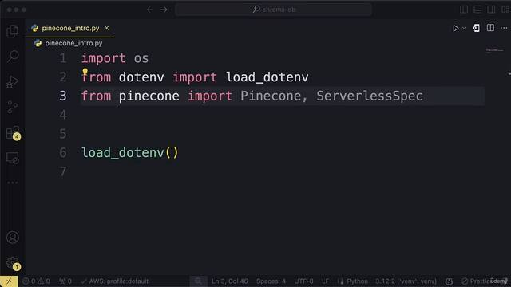

### 3.3 第一步：创建 `quick-start` serverless 索引

运行 `pinecone_intro.py` 会做这些事：

1. 用 `load_dotenv()` 读取 `.env`。
2. 用 `Pinecone(api_key=...)` 创建客户端对象。
3. 先列出现有索引，避免重复创建时报 “already exists”。
4. 创建索引 `quick-start`：
   - `dimension=8`：课里演示用的 8 维向量；
   - `metric="euclidean"`：课里明确说默认是 cosine，但演示改成 Euclidean；
   - `spec=ServerlessSpec(cloud="aws", region=REGION)`；
   - region 课里一开始说 us-west，后来改成免费账号给的 `us-east-1`。你复现时以控制台实际分配区域为准。
5. 用 `pc.Index("quick-start")` 拿到这个索引的数据操作句柄。
6. 向 namespace `ns1` upsert 两个 8 维向量，metadata 分别是 action / drama。
7. 用 action 向量查询，并加 `filter={"genre": "action"}`，`top_k=2`。
8. 再用 drama 向量查询，观察 score 变化。

创建成功后在 dashboard 刷新，应能看到索引及其信息：metric 是 Euclidean、dimensions 是 8、vector count 初始为 0（写入后增加）、cloud 是 AWS、type 是 serverless，并有一个 host URL。这个 host URL 可以复制到应用里使用。

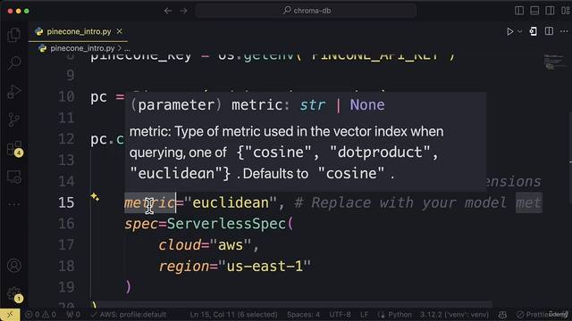

### 3.4 第二步：upsert 向量与 query

课里演示的向量结构是：

```python
{
    "id": "...",
    "values": [...],
    "metadata": {
        "genre": "action",
        "text": "..."
    }
}
```

讲师强调：向量是一个 list；可以传 ID、values、metadata。metadata 用来表示这个向量对应的内容，例如 `genre` 是 drama 还是 action。namespace 用的是 `ns1`，你可以改名字。

查询时：

```python
index.query(
    namespace="ns1",
    vector=[...],
    top_k=2,
    include_values=True,
    include_metadata=True,
    filter={"genre": "action"},
)
```

返回里会看到 `matches`、`namespace`、read units 等信息。课里观察到 action 查询的 score 很接近 0，说明相似度高；把查询向量换成 drama 后，drama 的结果 score 为 0.0，表示非常相似甚至精确匹配。具体 score 数字请以你实际输出为准。

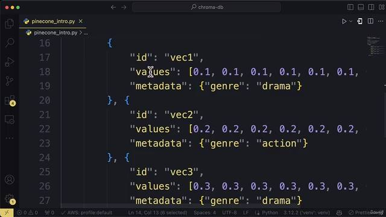

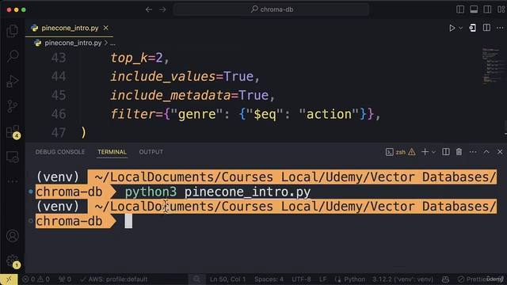

### 3.5 第三步：在 dashboard 里做同样的查询

回到 Pinecone dashboard，刷新后能看到：

- namespace 是 `ns1`；
- 可以 query by vector，也可以 query by ID；
- 可以传查询向量和 top K，top K 可以是任意数字；
- 结果里会显示每个向量的 score、values、ID、metadata；
- 如果查询向量刚好匹配已有向量，score 会是 0，表示找到匹配；
- metrics 页面能看到 read units、write units，以及索引的读写情况；
- 可以查看索引的 host URL、vector count、cloud、type。

课里说 dashboard 有 UI 可以看所有 index、namespace、数据库的读写和 vector count，这对开发调试很有用。删除索引时，dashboard 需要你输入实际索引名，删除后不可恢复。

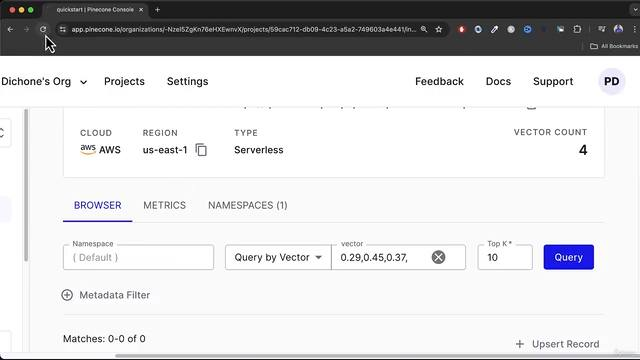

### 3.6 第四步：LangChain + Pinecone + OpenAI 做 RAG

运行 `pinecone_rag_langchain.py` 的流程：

1. 读取 `articles/` 下所有 `.txt` 文档；
2. 用 `RecursiveCharacterTextSplitter` 切分，示例 `chunk_size=1000`、`chunk_overlap=200`；
3. 创建 `OpenAIEmbeddings(model="text-embedding-3-small")`；
4. 创建 `ChatOpenAI`；
5. 用 `Pinecone` SDK 检查 `tester-index` 是否存在，不存在才创建：
   - dimension 必须是 1536，因为 `text-embedding-3-small` 的向量维度是 1536；
   - metric 使用 `cosine`；
   - spec 使用 `ServerlessSpec(cloud="aws", region="us-east-1")`；
6. 用 `PineconeVectorStore.from_documents(...)` 把 chunk 写入索引；
7. 先做一次 `similarity_search("tell me about writer's strike", k=2)` 验证检索；
8. 用 `vector_store.as_retriever()` 得到 retriever；
9. 写 `format_docs` 把检索到的文档拼成一个字符串；
10. 写 system prompt，包含 `{context}` 和防幻觉规则；
11. 用 `ChatPromptTemplate.from_messages` 组装 system + human；
12. 用 LCEL 管道构建：
    ```python
    {"context": retriever | format_docs, "question": RunnablePassthrough()}
    | prompt
    | llm
    | StrOutputParser()
    ```
13. `invoke("What is the writer strike about?")`，再 `invoke("Tell me about Databricks.")`。

课里特别说，这段代码是课程更新后的新 imports，有些和之前相似，但以 git 仓库最新代码为准；如果遇到 import 或版本问题，优先对照仓库。

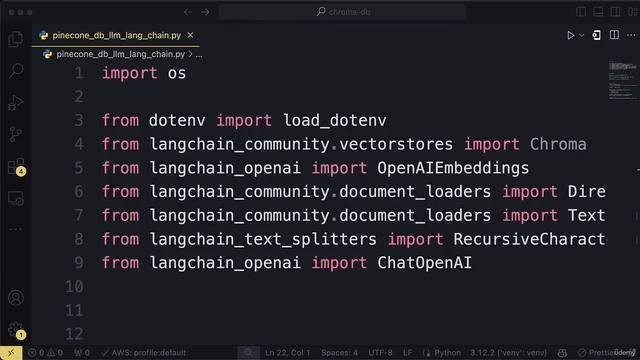

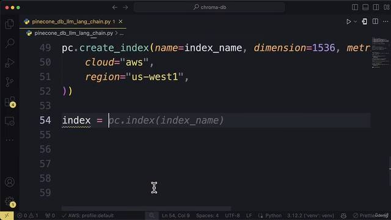

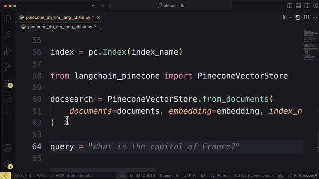

### 3.7 第五步：使用 retriever 和 chain，而不是只拿 similarity_search

课里强调，`similarity_search` 只是拿到相似文档，不是最终答案。真正的 RAG 要：

- 用 `as_retriever()` 把 vector store 变成 retriever；
- retriever 返回 `VectorStoreRetriever`；
- 把 retriever 接到 LangChain 的 chain 上；
- 通过 LLM 把检索内容和用户问题合成答案。

`vector_store` 上还有很多可用方法：`add_documents`、`add_texts`、`delete`、`get_distance_strategy`、`get_embeddings`、`from_documents`、`from_existing_index`、`get_pinecone_index`、`similarity_search`、`similarity_search_by_vector`、`euclidean_relevance_score`、`as_retriever`。课里明确说，`as_retriever` 返回的是初始化好的 vector store retriever，这是接 LangChain LLM 和 chain 的关键。

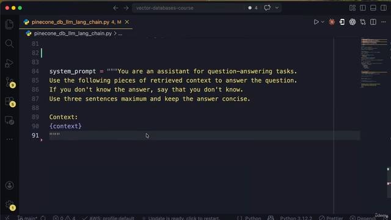

### 3.8 第六步：cleanup

课里说，做完后最好删除索引。两种方式：

- dashboard 里点三个点，选 delete，输入实际索引名；
- 代码里调用：
  ```python
  pc.delete_index(index_name)
  ```

删除后刷新 dashboard，索引会消失；如果没有任何索引，界面会显示 create index。课里提醒：只有确定不再需要这个索引、想重新开始或缩小规模时才删除，因为删除后不可恢复。讲师最后把删除代码注释掉，避免每次运行都删。

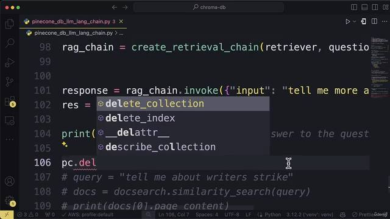

### 3.9 第七步：P56 的 chunking 复现思路

P56 没有给代码，给的是判断和对照实验。复现方式不是写新代码，而是固定其他变量，只改 chunking：

- 同一批文档；
- 同一个 embedding 模型；
- 同一个向量数据库 / 索引；
- 同一个 query；
- 只改变切分方式：固定 500 字符切分 vs 语义边界切分。

观察 top-k 检索结果和最终答案。课里的例子是 API 文档里的 Auth2 段：固定 500 字符会把 Auth2 说明切成 chunk 47 和 chunk 48，导致两个 chunk 都只有半段上下文；语义切分会让 Auth2 完整留在 chunk 12 里。于是 query “how do I authenticate with Auth2” 在语义切分下更容易拿到完整答案。

P56 要记住四个变量：chunk size、overlap、split boundaries、content type。课里给出的经验值是 chunk size 的 sweet spot 大约 200–1000 tokens；切分时要保留句子边界并加重叠。代码/法律文档/Markdown 要不同处理，代码尤其要把函数、类、完整逻辑放在一起，不能在 for 循环中间切断。

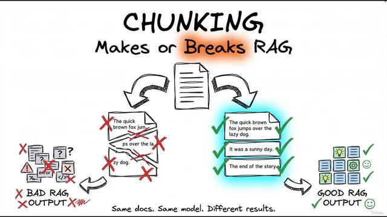


---

## 4. 完整代码

> 说明：课里没有给依赖版本号，也没有逐字念出所有 import。下面是本文档为“可直接保存运行”锁定的版本和完整文件；课程中出现的 API 调用、索引名、维度、metric、namespace、filter、prompt、chain 结构都保留。若你的环境解析不到某个版本，安装最新的兼容版本并对照课程 git 仓库。

### 4.1 `requirements.txt`

```text
python-dotenv==1.0.1
pinecone==5.4.2
openai==1.70.0
langchain==0.3.25
langchain-core==0.3.51
langchain-community==0.3.24
langchain-openai==0.3.12
langchain-pinecone==0.2.8
langchain-text-splitters==0.3.8
```

### 4.2 `.env.example`

```dotenv
OPENAI_API_KEY=sk-替换成你的OpenAIKey
PINECONE_API_KEY=替换成你的PineconeAPIKey
PINECONE_INDEX_NAME=tester-index
```

### 4.3 `pinecone_intro.py`

```python
import os

from dotenv import load_dotenv
from pinecone import Pinecone, ServerlessSpec

load_dotenv()

PINECONE_API_KEY = os.getenv("PINECONE_API_KEY")
if not PINECONE_API_KEY:
    raise RuntimeError("缺少 PINECONE_API_KEY，请在 .env 中设置")

pc = Pinecone(api_key=PINECONE_API_KEY)

# 课里创建的是 serverless 索引，名字叫 quick-start，维度 8，metric 用 Euclidean。
INDEX_NAME = "quick-start"
INDEX_DIMENSION = 8
INDEX_METRIC = "euclidean"

# 课里提到免费账号会分配区域；讲师一开始说 us-west，后来改成 us-east-1。
# 以你控制台实际分配的区域为准。
REGION = "us-east-1"

existing_indexes = [index_info["name"] for index_info in pc.list_indexes()]

if INDEX_NAME not in existing_indexes:
    pc.create_index(
        name=INDEX_NAME,
        dimension=INDEX_DIMENSION,
        metric=INDEX_METRIC,
        spec=ServerlessSpec(
            cloud="aws",
            region=REGION,
        ),
    )

# 拿到索引，用于数据操作。
index = pc.Index(INDEX_NAME)

vectors = [
    {
        "id": "vec-action-1",
        "values": [0.10, 0.20, 0.30, 0.40, 0.50, 0.60, 0.70, 0.80],
        "metadata": {
            "genre": "action",
            "text": "An action movie example vector.",
        },
    },
    {
        "id": "vec-drama-1",
        "values": [0.90, 0.80, 0.70, 0.60, 0.50, 0.40, 0.30, 0.20],
        "metadata": {
            "genre": "drama",
            "text": "A drama movie example vector.",
        },
    },
]

# 课里写入的 namespace 是 ns1；你可以改名字。
index.upsert(vectors=vectors, namespace="ns1")

# 查询 action：top_k=2，include_values=true，并加 metadata filter。
res_action = index.query(
    namespace="ns1",
    vector=[0.10, 0.20, 0.30, 0.40, 0.50, 0.60, 0.70, 0.80],
    top_k=2,
    include_values=True,
    include_metadata=True,
    filter={"genre": "action"},
)

print("=== action query ===")
print(res_action)

# 再查 drama，观察 score 和匹配项变化。
res_drama = index.query(
    namespace="ns1",
    vector=[0.90, 0.80, 0.70, 0.60, 0.50, 0.40, 0.30, 0.20],
    top_k=2,
    include_values=True,
    include_metadata=True,
    filter={"genre": "drama"},
)

print("=== drama query ===")
print(res_drama)
```

### 4.4 `pinecone_rag_langchain.py`

```python
import os

from dotenv import load_dotenv
from pinecone import Pinecone, ServerlessSpec

from langchain_community.document_loaders import DirectoryLoader, TextLoader
from langchain_text_splitters import RecursiveCharacterTextSplitter
from langchain_openai import OpenAIEmbeddings, ChatOpenAI
from langchain_core.prompts import ChatPromptTemplate
from langchain_core.output_parsers import StrOutputParser
from langchain_core.runnables import RunnablePassthrough
from langchain_pinecone import PineconeVectorStore

load_dotenv()

OPENAI_API_KEY = os.getenv("OPENAI_API_KEY")
PINECONE_API_KEY = os.getenv("PINECONE_API_KEY")
INDEX_NAME = os.getenv("PINECONE_INDEX_NAME", "tester-index")

if not
not OPENAI_API_KEY:
    raise RuntimeError("缺少 OPENAI_API_KEY，请在 .env 中设置")
if not PINECONE_API_KEY:
    raise RuntimeError("缺少 PINECONE_API_KEY，请在 .env 中设置")

# 1. 加载 documents：DirectoryLoader 读取 articles 目录下所有 .txt
loader = DirectoryLoader(
    "articles",
    glob="**/*.txt",
    loader_cls=TextLoader,
    loader_kwargs={"encoding": "utf-8"},
)
documents = loader.load()
print(f"loaded documents: {len(documents)}")

# 2. 切分文本
text_splitter = RecursiveCharacterTextSplitter(
    chunk_size=1000,
    chunk_overlap=200,
)
docs = text_splitter.split_documents(documents)
print(f"split into chunks: {len(docs)}")

# 3. Embeddings 与 LLM
embeddings = OpenAIEmbeddings(
    api_key=OPENAI_API_KEY,
    model="text-embedding-3-small",
)
llm = ChatOpenAI(
    api_key=OPENAI_API_KEY,
    model="gpt-4o-mini",
    temperature=0,
)

# 4. 创建 Pinecone 客户端，并检查索引是否存在
pc = Pinecone(api_key=PINECONE_API_KEY)

existing_indexes = [index_info["name"] for index_info in pc.list_indexes()]

if INDEX_NAME not in existing_indexes:
    pc.create_index(
        name=INDEX_NAME,
        dimension=1536,          # text-embedding-3-small 的维度
        metric="cosine",         # 课里明确说这里用 cosine
        spec=ServerlessSpec(
            cloud="aws",
            region="us-east-1",  # 以你控制台实际分配的区域为准
        ),
    )

# 5. 拿到索引对象
index = pc.Index(INDEX_NAME)

# 6. 把切分后的文档写入 PineconeVectorStore
vector_store = PineconeVectorStore.from_documents(
    documents=docs,
    embedding=embeddings,
    index_name=INDEX_NAME,
    pinecone_index=index,
)

# 7. 先用 similarity_search 验证检索是否工作
query = "tell me about writer's strike"
matched_docs = vector_store.similarity_search(query, k=2)

print("=== similarity_search results ===")
for i, doc in enumerate(matched_docs):
    print(f"[{i}] {doc.page_content[:200]}")
    print(f"    metadata: {doc.metadata}")

# 8. 把 vector store 变成 retriever
retriever = vector_store.as_retriever(search_kwargs={"k": 2})


def format_docs(retrieved_docs):
    """把检索到的文档拼成一段字符串，供 prompt 的 {context} 使用。"""
    return "\n\n".join(doc.page_content for doc in retrieved_docs)


# 9. System prompt：包含防幻觉与长度约束
system_prompt = (
    "You are an assistant for question-answering tasks. "
    "Use the following pieces of retrieved context to answer the question. "
    "If you don't know the answer, say that you don't know. "
    "Use three sentences maximum and keep the answer concise."
    "\n\n"
    "{context}"
)

prompt = ChatPromptTemplate.from_messages(
    [
        ("system", system_prompt),
        ("human", "{question}"),
    ]
)

# 10. LCEL 管道：retriever -> format_docs -> prompt -> llm -> 字符串
rag_chain = (
    {"context": retriever | format_docs, "question": RunnablePassthrough()}
    | prompt
    | llm
    | StrOutputParser()
)

# 11. 调用
answer_1 = rag_chain.invoke("What is the writer strike about?")
print("=== answer 1 ===")
print(answer_1)

answer_2 = rag_chain.invoke("Tell me about Databricks.")
print("=== answer 2 ===")
print(answer_2)
```

### 4.5 `cleanup_pinecone.py`

```python
import os

from dotenv import load_dotenv
from pinecone import Pinecone

load_dotenv()

PINECONE_API_KEY = os.getenv("PINECONE_API_KEY")
INDEX_NAME = os.getenv("PINECONE_INDEX_NAME", "tester-index")

if not PINECONE_API_KEY:
    raise RuntimeError("缺少 PINECONE_API_KEY，请在 .env 中设置")

pc = Pinecone(api_key=PINECONE_API_KEY)

# 课里提醒：删除后不可恢复，只有确定不再需要这个索引时才执行。
print(f"about to delete index: {INDEX_NAME}")
pc.delete_index(INDEX_NAME)
print("done. 刷新 Pinecone dashboard 确认索引已消失")
```

### 4.6 `articles/writer-strike.txt` 与 `articles/databricks.txt`

课里没有提供原始文章内容，只提到 `articles/` 里放的是和 writer's strike、Databricks 相关的文章。你可以放任意纯文本；只要里面有 “Writers Guild of America strike”“Databricks”“acquisition” 这类关键词，就能复现出课里那句“检索到的第一段是 The Writers Guild of America strikes for the first time since…”的效果。课里还提到“previously 223 numbers of documents”，说明讲师那批文件切分后得到 223 个 chunk；你得到的数量会不同，这是正常的。

### 4.7 P56 的 chunking 对照实验脚本（课里没有代码，以下为示意）

课里 P56 只有讲解和对比图，没有给代码。为了让你能“跑起来看差异”，下面这段是示意脚本，不属于讲师代码：

```python
# 课里没有代码，以下为示意：同一批文档、同一模型、同一索引，只改 chunking
from langchain_text_splitters import RecursiveCharacterTextSplitter

fixed_splitter = RecursiveCharacterTextSplitter(
    chunk_size=500,
    chunk_overlap=0,
    separators=[""],          # 近似“每 500 字符硬切”
)

semantic_splitter = RecursiveCharacterTextSplitter(
    chunk_size=800,
    chunk_overlap=150,
    separators=["\n\n", "\n", ". ", " "],  # 优先在段落/句子边界切
)

# 对同一份 API 文档分别切分，再各自 upsert 到不同 namespace，
# 用同一个 query 检索，比较 top-k 内容与最终答案。
```

---

## 5. 逐行解释

### 5.1 `pinecone_intro.py`

**`load_dotenv()`**
从项目根目录的 `.env` 读键值对塞进 `os.environ`。这是课里“我往 `.env` 里加了 Pinecone API”的具体落地点。在 Node 里对应 `require('dotenv').config()`。

**`pc = Pinecone(api_key=PINECONE_API_KEY)`**
课里说“实例化他们文档里做的那个，传入 Pinecone API”。这一步只是创建控制面客户端，用来建索引、删索引、列索引，还没碰数据。

**`existing_indexes = [index_info["name"] for index_info in pc.list_indexes()]`**
课里在 LangChain 那一节里加了这个判断，原话是为了避免“每次运行都假设你要重新创建索引”。讲师第一次直接跑就撞到 “already exists”，于是补上：

> "所以为了真正让这件事更好，我在这里加一个条件，叫 existing indexes。"
> —— p051 [05:53]

注意：这一步是课里演示过、并明确解释了动机的，不是我自己加的。

**`pc.create_index(name=..., dimension=8, metric="euclidean", spec=ServerlessSpec(cloud="aws", region=...))`**
四个参数逐个对应课里念过的内容：

- `name="quick-start"`：课里说“名字叫 quick start，你可以改成任何你想要的”；
- `dimension=8`：课里说“要插入的向量维度，8，没问题”——注意 8 只是为了演示简单，真实 embedding 是 1536；
- `metric="euclidean"`：课里明确说“可以用 cosine、dot product、Euclidean，默认是 cosine，这里我们用 Euclidean”；
- `spec=ServerlessSpec(cloud="aws", region=...)`：课里说“我们传 serverless spec，所以它跑在云上，用 AWS，区域是……”然后讲师发现自己写错区域，改成了免费账号分配的 `us-east-1`。

> "这就是我们在创建免费账号时被分配的东西。"
> —— p048 [01:47]

**`index = pc.Index(INDEX_NAME)`**
课里说“现在我们去拿到实际的 index，用它做数据操作”。控制面建完索引后，必须用 `pc.Index()` 拿数据面句柄，才能 upsert / query。这一步如果漏掉、直接写成 `pc.index(...)`，就会撞到讲师遇到的那个报错：

> "因为我们的文档已经创建了，Python 说 no attribute index。我说我是想写 index。"
> —— p051 [03:12]

Pinecone SDK 里是 `pc.Index`（大写 I），不是 `pc.index`。这是个纯大小写问题，不是环境问题。

**`index.upsert(vectors=vectors, namespace="ns1")`**
课里说“我们可以往索引的 namespace 里写向量”。`vectors` 里每个元素有三个字段：`id`、`values`、`metadata`。讲师强调 metadata 是“和这个向量关联的、代表这个向量的信息”，例子里放的是 `genre: drama` / `genre: action`。

注意 `upsert` 语义是“有则更新、无则插入”，在 JS 里你可以类比 `Map.set()` 的覆盖行为；它不是“只插入一次”。

**`index.query(namespace="ns1", vector=[...], top_k=2, include_values=True, include_metadata=True, filter={"genre": "action"})`**
逐个参数对应课里念的：

- `namespace`：课里说“传你想查询的 namespace”；
- `vector`：课里说“传我们要找的向量”；
- `top_k=2`：课里说“top_k 就是每个 query 返回的结果数量，这里是 2”，并且后面补了一句“真的可以是任何数字”；
- `include_values=True`：课里说“include values 设为 true，还有这些”；
- `filter`：课里说“我们还可以传一些过滤，比如要求 genre 等于 action，那就只会拿到 genre 是 action 的那些”。

返回体里课里点到了 `matches`、`namespace`、read units。课里说“你能看到 matches、namespace 等等”，然后逐个看 match 里的 score：“action 的 score 是 0.07，非常接近；第二个 match 是 0.08”。具体数值请以你实际输出为准，因为课里用的向量值和本文示例不同。

**把查询向量换成 drama**
课里把 query 向量换成 drama 后观察：“drama 我们拿到 0.3 分，也是 0.3，我们看到有一个确实是 drama，score 是 0.0，这说明非常相似，甚至是精确匹配。”这段的意义是让你理解 score 的方向性：在 Euclidean 距离下，0 表示完全一致，数值越大越远。这和 cosine 的“越大越相似”方向相反——这是复现时最容易搞混的一点。

### 5.2 `pinecone_rag_langchain.py`

**`DirectoryLoader("articles", glob="**/*.txt", loader_cls=TextLoader)`**
课里说“我用 directory loader 把所有的文章加载进来”，并说“这和之前见过的代码完全一样”。`glob` 和 `encoding` 是我为可复现补的；课里没有念具体的 glob 参数。

**`RecursiveCharacterTextSplitter(chunk_size=1000, chunk_overlap=200)`**
课里这一句只说“再次把它们切分，和之前完全一样的代码”，没有在这个片段里重念数字。数字来自 P56 的原则性表述：

> "我们把它们切分成 500 到 1000 字符的片段。我们要确保保留句子边界，并且加上我们所说的 overlap。"
> —— p056 [00:29]

所以 1000 / 200 是落在课里给的区间内的取值，不是讲师逐字念的参数；你改成 500 / 100 也符合课程要求。

**`OpenAIEmbeddings(model="text-embedding-3-small")`**
课里原话是“创建实际的 OpenAI embedding，使用 text embedding small”。这个模型的输出维度是 1536，所以下面建索引时 `dimension=1536` 才配得上。这是贯穿两个文件的关键一致性约束：**embedding 模型的维度必须等于索引的维度**，不一致会在 upsert 时直接报错。

**`ChatOpenAI(model="gpt-4o-mini", temperature=0)`**
课里只说“我在设置 chat OpenAI 模型，这个我们之前见过”。具体模型名课里这一段没念；`gpt-4o-mini` 和 `temperature=0` 是本文为使答案稳定而选的，属于“课里没讲”的部分，你可以换成任何可用模型。

**`pc.create_index(..., dimension=1536, metric="cosine", ...)`**
课里在 LangChain 这一段明确念了这三个值：

> "传 name、dimension 这里是 1536、metric 会是 cosine。记住我们可以改 cosine、Euclidean、dot product。"
> —— p051 [01:52]

注意和 `quick-start` 的对比：那个是 8 维 + euclidean，这个是 1536 维 + cosine。两个索引是两套独立演示，不要混着用。

**`index_name = "tester-index"`（连字符不是下划线）**
课里专门强调：

> "索引名就叫 tester-index，确保我们用的是连字符而不是下划线，因为那样会有问题。"
> —— p051 [01:23]

这是硬性命名约束，复现时不要自作主张改成 `tester_index`。

**`PineconeVectorStore.from_documents(documents=docs, embedding=embeddings, index_name=INDEX_NAME, pinecone_index=index)`**
课里说“用 pine cone vector store 的 from documents，把切分后的 documents 传进去，传我们的 embedding，传我们叫 index name 的索引名，然后传实际的 index，就这样”。四个参数一一对应。这一步内部会做“对每个 chunk 调 embedding → upsert 到 Pinecone”，所以你会看到进度条和一堆网络请求。

**`vector_store.similarity_search(query, k=2)`**
课里先用它验证检索通不通，并提醒：

> "如果有多个函数可以调用，我们用 similarity search，传 query。"
> —— p051 [05:30]

讲师第一次跑时撞到 `docs out of range`，因为他在 `docs` 为空（或结果为空）时直接取 `docs[0]`。他改成先 `print(docs)` 再取值就成功了。所以复现时**不要直接索引 `[0]`**，先打印长度或用 `for` 循环。

课里也点出 `similarity_search` 的局限：

> "我们拿到了这些信息，但问题是，我们拿到的是所有和 query 相关的文档。我们真正想做的是利用大语言模型的能力，结合问题和文档，去拿到真正的答案。"
> —— p052 [00:00]

**`retriever = vector_store.as_retriever(search_kwargs={"k": 2})`**
课里说这是最关键的一步：

> "最重要的是，你还会看到我们可以拿到 as retriever。这个函数返回一个初始化好的 vector store retriever。为什么这很棒？因为当我们有这个 retriever，我们就可以把它送进 LangChain 的大语言模型和 chain 里，真正拿到问题的答案，而不是只拿到相似搜索结果。"
> —— p052 [01:25]

`as_retriever()` 返回的是 LangChain 的 `Runnable` 接口对象，所以它能直接出现在 LCEL 管道里；`similarity_search` 是普通方法调用，不能直接进管道。这个区别就是“能检索”和“能组成 RAG”的分界线。

课里还列了一堆 `vector_store` 上的可用能力：`add_documents`、`add_texts`、`delete`、`get_distance_strategy`、`get_embeddings`、`from_documents`、`from_existing_index`、`get_pinecone_index`、`similarity_search`、`similarity_search_by_vector`、`euclidean_relevance_score`、`as_retriever`。这些是讲师在 IDE 里逐条翻给你看的，属于“vector store 是这个数据库的主对象”的证据。

**`format_docs`**
课里说“我们去拿那个帮助函数来格式化检索到的文档，因为我们需要它，我们之前见过。就是把所有进来的文档格式化成一行漂亮的字符串”。它存在的唯一目的，是让 retriever 返回的 `List[Document]` 能塞进 prompt 的 `{context}` 占位符——prompt 只接受字符串。

**`system_prompt`**
课里逐句念了这个提示词的中文含义：

> "你是一个问答任务的助手，使用以下检索到的内容。如果你不知道答案，就说你不知道，最多用三句话，保持答案简洁。"
> —— p052 [02:49]

`{context}` 放在末尾，是运行时插值点。课里说“我们传 context，它会在运行时被插值、拼接”。这段提示词的作用是防幻觉（不知道就说不知道）和控长度（三句话以内）。

**`ChatPromptTemplate.from_messages([("system", ...), ("human", "{question}")])`**
课里说“我们用 chat prompt template，确保它是从 messages 来的，也确保它在文件顶部已经 import。然后我们传 system，内容是刚刚拼好的 system prompt，它把 context 作为输入变量；human 就是进来的问题”。

**LCEL 管道**
```python
{"context": retriever | format_docs, "question": RunnablePassthrough()}
| prompt
| llm
| StrOutputParser()
```
课里逐段解释了：

> "为了构建我们的 chain，和之前见过的一样，我们传所有部件，用竖线连接。首先拿到所有 context，拿到 retriever，把它传给 format documents 函数，它会把检索进来的信息格式化。对于 question，我们传一个透传，意思是不要改任何东西，原样保留。然后全部穿过 prompt 拼起来，再把这些部件——context、新 prompt——穿过模型，然后拿到结果，穿过 string output parser。"
> —— p052 [04:38]

`RunnablePassthrough()` 的作用是“让用户问题原封不动地流过去”，因为 prompt 需要 `{question}` 这个变量名完全对上。这个字典结构决定了 prompt 里两个变量 `{context}` 和 `{question}` 的来源：前者来自 retriever，后者来自用户输入。顺序和变量名必须一一对应，否则会报 missing key。

**`rag_chain.invoke(...)`**
课里先用 “What is the writer strike about?” 跑通，得到基于检索文档的答案，并强调：

> "这个答案不是随便来的，它来自我们的 RAG 系统，是基于它收到的文档。"
> —— p052 [05:58]

然后换成 “Tell me about Databricks.” 再跑一次，验证换问题也能从同一个索引里取到对应内容。这一步是复现时判断“你到底做成没有”的关键：如果两个问题的答案都长得一样，说明 context 没生效。

**关于 Pinecone 托管 embedding 的补充说明**
课里最后提到，Pinecone 现在可以让你不额外调 OpenAI，直接用它们内部的模型做 embedding，所有索引工作在后端完成，代码里只管传文档。课里没有给具体 API 名和参数，所以本文没有写这部分代码——**课里没讲具体调用方式**。想用就去看官方文档。

### 5.3 `cleanup_pinecone.py`

**`pc.delete_index(INDEX_NAME)`**
课里说“我可以写 pc.delete index，传索引名，它是一个字符串”。执行后刷新 dashboard，索引消失，界面回到 create index 状态。课里提醒这操作不可逆，并且他最后把这一行注释掉了，防止误删：

> "我把它注释掉，就是让你知道要删索引。"
> —— p053 [00:53]

在 Node 里这件事没有对应语法（Pinecone 的 JS SDK 是 `pc.deleteIndex(name)`）；概念上就是“删掉一个远端资源”，一旦删了没有回收站。

### 5.4 P56 的四个 chunking 变量（逐条解释）

**Chunk size**
太小 → 片段丢失上下文，比如一个 chunk 里只有 “client ID” 两个词，等于什么也没说；太大 → 具体信息被稀释，10 页纸的 chunk 会得到非常模糊的 embedding；太小还会让 chunk 数量变多、检索噪声变大，太大则浪费 token 预算。课里给的 sweet spot 是 200–1000 tokens。注意课里同时出现过“500 到 1000 字符”和“200 到 1000 tokens”两种表述，这是讲师在不同语境下的口径，你按自己文档的实际 token 数调。

**Overlap**
课里用 chunk 1 和 chunk 2 的重叠区来解释：重叠区就是“保留两块之间上下文”的地方，没有重叠就会在这里丢上下文。overlap 不是越大越好——它按比例增加存储和 embedding 成本，课里没有给具体比例，只说“通常”。

**Split boundaries**
三种方法课里都点了名：

- fixed：每 n 个字符硬切，“某种程度上是随机切”，课里明确说“你不想这么做”；
- recursive：按段落、句子结构切，“更聪明”；
- semantic：按语义边界切，“不是随机切，不只是按段落切，而是按意义边界切”。

**Content type**
代码、法律文档、Markdown 需要不同处理。课里的例子是 for 循环：如果你在中间切开，把这个片段交给 LLM，它没法还原逻辑。所以代码要“把函数放在一起，可能把类放在一起，把真正有意义的代码片段放在一起”。

**为什么 chunking 错了 embedding 也救不了**
课里给了完整的因果链：embedding 模型的任务只是“忠实地表示它收到的东西”，它没有能力判断这段文本是否完整。所以当你把 Auth2 那段切成 chunk 47 和 chunk 48，模型会准确地 embedding 一个“不完整的想法”。而用户 query 要的是完整概念，于是产生 mismatch：

> "embedding 捕获的是不完整的意义，而 query 想要的是完整的图景、完整的概念。这就产生了错配，结果就是糟糕的检索。"
> —— p056 [05:07]

课里用的比喻是撕照片找人笑脸：笑脸被撕成两半，两块都看不到笑脸。结论：最好的 embedding 模型 + 最快的向量数据库 + 最聪明的 LLM，配上错误的 chunking 依然出垃圾。具体的三个后果课里也列了：检索准确率下降、上下文效率下降、答案质量低——因为 LLM 无法从碎片里合成答案。

---

## 6. 复现检查清单

按顺序打勾，每一步都要看到对应现象再往下走。

**环境**

- [ ] 虚拟环境已激活，`pip install -r requirements.txt` 没有报依赖冲突。
- [ ] `.env` 里 `PINECONE_API_KEY` 和 `OPENAI_API_KEY` 都已填入，`python -c "import os;from dotenv import load_dotenv;load_dotenv();print(bool(os.getenv('PINECONE_API_KEY')), bool(os.getenv('OPENAI_API_KEY')))"` 输出两个 `True`。
- [ ] `articles/` 目录存在且至少有一个 `.txt` 文件，编码是 UTF-8。

**Pinecone 基础（`pinecone_intro.py`）**

- [ ] 运行无报错，控制台先打印 `=== action query ===`，再打印 `=== drama query ===`。
- [ ] 两个查询的输出里都有 `matches`，且 action 查询返回的 match 携带 `genre=action` 的 metadata（因为你加了 filter）。
- [ ] 刷新 Pinecone dashboard，能看到 `quick-start` 索引，其 metric 为 euclidean、dimensions 为 8、type 为 serverless、cloud 为 AWS，vector count 从 0 变成 2。
- [ ] 索引详情里有一个 host URL，点开能看到 namespace `ns1`。
- [ ] 第二次运行脚本不报 “already exists”（因为有了 `existing_indexes` 判断）。

**Dashboard 对照**

- [ ] 在 dashboard 里用 query by vector 查询 `ns1`，能看到和代码里一致的 match、score、ID、metadata。
- [ ] 用 query by ID 也能查；把 top K 改成任意数字能生效。
- [ ] metrics 页面能看到 read units / write units 随查询和写入变化。

**LangChain RAG（`pinecone_rag_langchain.py`）**

- [ ] 脚本先打印 `loaded documents: N`，再打印 `split into chunks: M`，M 明显大于 N。
- [ ] `similarity_search` 结果里出现和 writer's strike 相关的段落，并且能看到 `metadata`（应包含 `source` 之类的来源字段——具体字段名请以实际输出为准）。
- [ ] `tester-index` 在 dashboard 里出现，dimensions 为 1536，metric 为 cosine。
- [ ] `=== answer 1 ===` 输出的内容是在回答 writer's strike，而不是复述问题。
- [ ] `=== answer 2 ===` 换成了 Databricks 相关内容，说明 query 真正进入了管道。
- [ ] dashboard 里 `tester-index` 的 vector count 等于 chunk 数量 M。

> 顺带一个观察点：课里讲师说“之前有 223 个 documents 被 embedding 并做了索引”，所以你看到几十到几百的 chunk 数都是合理量级。你的数字和他不一样是正常的。

**Cleanup**

- [ ] 运行 `cleanup_pinecone.py` 后，dashboard 刷新，`tester-index` 消失。
- [ ] 再运行 `pinecone_rag_langchain.py`，索引会被重新创建（因为存在性检查在），说明脚本是幂等的。
- [ ] 确认你**没有**把 cleanup 放进 RAG 脚本的主流程里，否则每次跑完就删库。

**P56 对照实验**

- [ ] 同一份 Auth2 风格的文档，用 500 字符硬切，能找到两个相邻 chunk 各含半段认证说明。
- [ ] 换成按段落/句子边界切，Auth2 说明完整落在同一个 chunk 里。
- [ ] 用同一个 query 分别查两个 namespace，能观察到检索内容和答案质量的差异。
- [ ] 你能用自己的话说出：为什么 embedding 模型“没错”，但检索结果依然是错的。

---

## 7. 课里没讲但你会撞上的

**1. `pinecone-client` 和 `pinecone` 两个包名**
课里口头说的是“安装 Pinecone client”，但当前 SDK 的 import 是 `from pinecone import Pinecone, ServerlessSpec`，对应包名 `pinecone`。如果你按旧博客装了 `pinecone-client`，可能会遇到 `ImportError: cannot import name 'Pinecone'` 或者两个包打架。保守做法：只装 `pinecone`，不要同时装 `pinecone-client`。课里没讨论这个区别。

**2. `pc.Index` 大小写**
讲师当场踩过：写成 `pc.index` 会报 “no attribute index”。Python 里这是 `AttributeError`，不是配置错误。看到这个报错先检查大小写，不要急着怀疑 API key。

**3. region 写错**
讲师第一次写了 `us-west-1`，报错后改成 `us-east-1`，因为免费账号分配的是后者。复现时去 dashboard 看你实际被分配的区域。课里没说如果 region 不匹配具体报什么错——**该报错信息请以实际输出为准**。

**4. `text-embedding-3-small` 维度必须与索引维度一致**
索引建了 1536 维，就不能塞别的维度的向量；反过来索引建了 8 维（`quick-start`）也不能塞 OpenAI 的向量。这两个索引是两套独立演示，别把 `quick-start` 的 index 对象传给 `PineconeVectorStore`。课里没明说这条约束，但代码里两组数字已经把答案写死了。

**5. `PineconeVectorStore` 的 import 路径会随版本变**
课里说“我们做一个 pip install 拿到 pinecone，这就是为什么这里不显示”，然后才 import。真实情况是：`langchain-pinecone` 独立成包后，`from langchain_pinecone import PineconeVectorStore` 是新路径，旧路径（`langchain_community.vectorstores`）会有 deprecation 警告甚至移除。课里提到“这些是更新后的新 imports，以 git 仓库为准”，就是在提示这件事。

**6. LCEL 里 prompt 变量名必须完全对齐**
`{"context": ..., "question": ...}` 这两个 key，必须和 prompt 里 `{context}`、`{question}` 一字不差。写成 `query` 或 `ctx` 会报缺少输入变量。这是前端同学最容易忽略的点：LangChain 的字典 key 就是模板的变量名，没有任何自动映射。在 Node 里好比你写模板字符串时把 `${user.name}` 写成 `${username}`——报错位置离真正错误很远。

**7. `similarity_search` 返回空列表时不要直接取 `[0]`**
讲师就撞了 `docs out of range`。原因通常是：文档目录为空、glob 没匹配上、或者 upsert 还没完成就查询。排查顺序：先打印 `len(docs)`，再打印 `len(matched_docs)`。课里没给这个报错的正式解法，只演示了“先 print docs 看看”。

**8. `as_retriever()` 的 `k` 和 `similarity_search` 的 `k` 是两套**
`similarity_search(query, k=2)` 里的 k 只影响那一次调用；`as_retriever(search_kwargs={"k": 2})` 里的 k 影响整条 chain 每次检索。如果你只改了前者，chain 里的检索条数不会变。课里两次都用了 2，所以这个差异没暴露出来。

**9. Pinecone 免费额度与索引数量限制**
课里说“我们这里有三个索引，但你应该只有一个”，说明免费账号能建多个索引但有限制，且删除后不可恢复。课里没有给具体配额数字，**具体限额请以你账号的实际控制台为准**。复现时建议：演示完立刻 cleanup，别留一堆索引占额度。

**10. 删除是不可逆的**
课里反复强调“一旦删了，你就再也访问不到它了”。所以 `cleanup_pinecone.py` 要单独跑，不要接在 RAG 脚本后面自动执行。讲师本人最后就是把那一行注释掉，只留注释提醒。

**11. chunking 的“500–1000”单位不统一**
课里在 P56 先说“500 到 1000 字符的片段”，后来说“200 到 1000 tokens 是 chunk size 的 sweet spot”。字符和 token 不是一回事（英文大致 1 token ≈ 4 字符，中文差异更大）。这不是矛盾，是讲师在两个尺度上给经验值。实操建议：以 token 为准调参，因为 embedding 模型和 LLM 的计费、上限都是按 token 算的。课里没解释这两者的换算。

**12. 语义切分并不是“有算法保证”的东西**
课里说 fixed 切分“背后没有真正的算法，就是能切多少切多少”，语义切分“在意义边界切”。但课里没有给出任何语义切分的实现细节或阈值。`RecursiveCharacterTextSplitter` 配好 separators 只是“按结构切”，不等于真正的语义切分；真正的语义切分通常要借助 embedding 相似度判断断点，这部分**课里没讲**，只提到下节课会讲 fixed、recursive、semantic、late chunking 四种策略。

**13. 挑战部分：其他向量数据库没有演示**
P54 讲师留了作业：去探索 Faiss、Milvus、Weaviate，说 Milvus 和 Pinecone 很相似。课里只完整做了 Chroma（前面章节）和 Pinecone 两个，其余全是“你自己去玩”。所以如果你照这份文档只跑通了 Pinecone，那是符合课程设计的；想覆盖全部五种数据库，需要自己补。

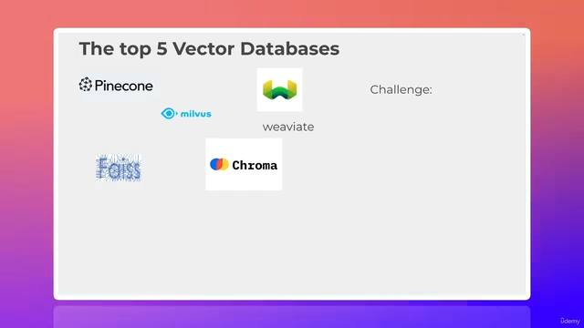

