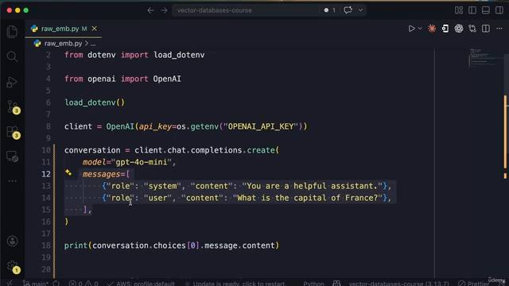
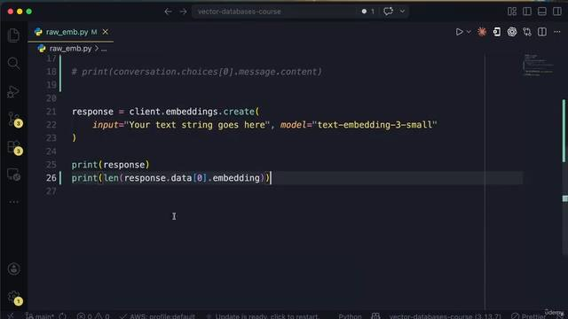
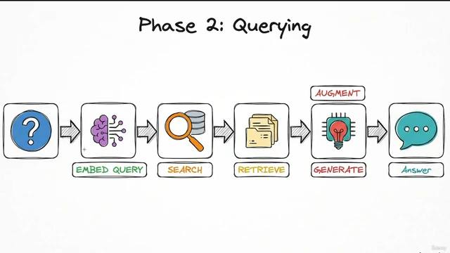
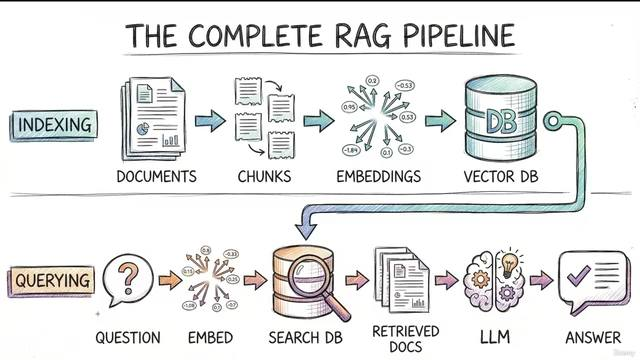
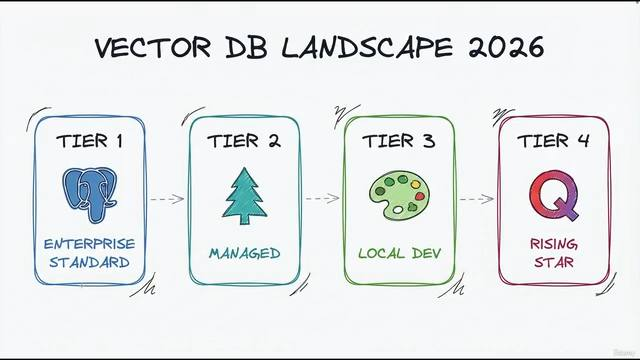
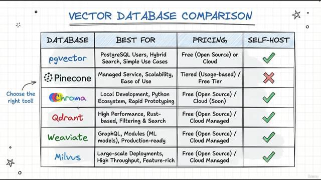
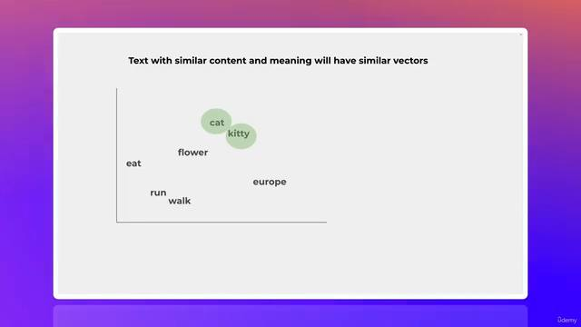
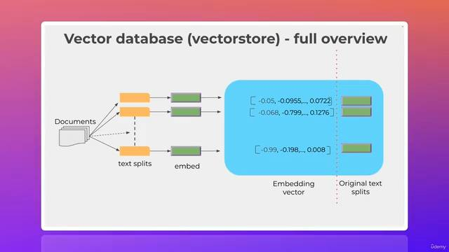
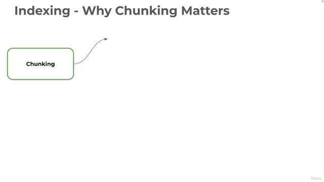

# Vector Databases Fundamentals to Production — P008–P014 复现文档

> 本段课程（P008–P014）是**概念 + 选型 + 少量代码演示**的混合段落：P008–P012 讲 embedding / vector / RAG 管线 / 用例，P013 是章节回顾，P014 是向量数据库选型框架。真正可运行的代码只有 P009 里用 OpenAI SDK 演示「chat model vs embedding model」的两段 Python 片段。因此第 3、4 节会以「把 P009 的演示跑起来 + 把 P010 的 RAG 管线用可运行代码落地」为主线，其余概念按讲师原话与推导复现。

---

## 1. 这一节做什么

这一段课程解决四个问题，按顺序是：

1. **非结构化数据怎么进向量库**（P008）：原始文档 → 切块（chunk）→ embedding → 存进 vector store；查询时 query 也要变成 embedding，靠 index 加速检索，最后把最相似的条目连同问题一起喂给大语言模型。
2. **embedding 到底怎么产生、和 chat model 有什么区别**（P009）：讲师现场用 OpenAI SDK 跑了两段代码，一段 `client.chat.completions.create` 返回文本，一段 `client.embeddings.create` 返回一串数字（1536 维），并解释「维度」的含义与取舍。
3. **完整 RAG 管线与三条生产规则**（P010）：indexing 阶段（一次性）与 querying 阶段（每次提问），两阶段必须用同一个 embedding 模型；chunking 质量决定一切。
4. **向量数据库怎么选**（P014）：四层分级（PGVector / Pinecone / Chroma / Qdrant），以及一个决策框架。

P011 澄清「vector 与 embedding 的关系」，P012 列举五类用例，P013 是回顾。这三节没有代码，属于概念补充，会在第 5 节逐条解释里消化。

---

## 2. 讲师原话

> "我们的想法是，把非结构化数据转换成向量，也就是我们所说的 embedding，我们会讲到这个概念。"
> —— p008 [00:00]

> "embedding 向量保留了文本的内容和含义，这一点非常重要。它比我们在数学里认识的向量多了一点东西，多了一些元数据。"
> —— p008 [01:26]

> "内容和含义相似的文本，会有相似的向量。比如 cat 和 kitty 本质上是相近的意思，所以它们的向量里的数字也会相近，因此向量也相似。"
> —— p008 [02:25]

> "vector store 和 vector database 本质上是同一个东西。有人叫 vector store，有人叫 vector database，就是一回事。"
> —— p008 [02:55]

> "在大多数情况下，当我们谈 embedding 时，它除了向量之外，还附带着原始的文本块（text splits）。两者是绑在一起的：既有数值表示，也有原始文本。"
> —— p008 [03:53]

> "索引（index）是数据库用各种算法创建的另一种数据结构，它让检索变得更高效。索引是让整个向量数据库查询又快又高效的关键，因为索引是一种促进搜索过程的数据结构。"
> —— p008 [05:46]

> "查询进来之后会被转换成 embedding，然后用它去搜索、比较向量库里所有的 embedding 条目，内部会挑出最相似的那一条，再送去进一步处理。"
> —— p008 [06:43]

> "最相似的那些条目会被送到大语言模型，连同问题、查询一起传过去，然后我们就得到了结果或答案。"
> —— p008 [07:41]

> "embedding 模型和 chat 模型是完全不同的东西。你跟 ChatGPT 或 Claude 对话时，用的是 chat 模型：文本进，文本出。"
> —— p009 [00:29]

> "但当你创建 embedding 时，你用的是 embedding 模型，这是完全不同的东西。同一家公司，不同的模型，仍然是文本进，但输出的是一个向量——一串代表该文本含义和语义的数字。"
> —— p009 [00:55]

> "这里我们用的是 `client.embeddings.create`，注意和前面的区别，前面是 `client.chat.completions.create`。这里我们用的是 embedding 模型。"
> —— p009 [02:08]

> "模型这里我们用的是 text-embedding-3-small 作为 embedding 模型。这不是 chat 模型，这就是区别。"
> —— p009 [02:28]

> "现在你能看到我们得到了 1536。我们稍后会讲这个，这就是我们所说的 embedding 的维度（dimension）。"
> —— p009 [03:34]

> "为什么 embedding 是数字？因为数字可以很容易地在数学上做比较。你可以计算两个向量之间的距离，可以找出哪些向量相似，这当然就是全部的意义所在。"
> —— p009 [03:34]

> "不同 embedding 模型输出的向量大小不同。维度越多，意味着它能容纳更多含义、更多特征，用来表示我们转换成向量的东西。"
> —— p009 [04:04]

> "text-embedding-3-small 是 1536 维，这是一个不错的基础维度，是一个很好的平衡。text-embedding-3-large 维度更大，是 3072。"
> —— p009 [04:34]

> "Gemini 的 embedding 稍微低一点，768 维。还有 BGE small，大约 384 维，这非常小。"
> —— p009 [05:33]

> "维度越小，模型计算越快。关键在于：更多维度等于捕获更多语义细节，但更多存储、更慢的搜索。所以这是权衡。对大多数场景来说，768 到 1536 维确实是甜点区（sweet spot）。"
> —— p009 [06:03]

> "第一阶段叫 indexing（索引）。我们加载文档，把文档切成更小的块，比如每块 500 到 1000 个 token。然后第三步走 embedding 流程，每个块经过 embedding 模型生成向量，存进 vector store。"
> —— p010 [00:00]

> "第二阶段是 querying（查询），每次用户提问都会发生。问题进来，用同一个 embedding 模型——这一点很重要——把这段信息、这个 query 变成 query vector。"
> —— p010 [00:47]

> "第二步是搜索。有了 query vector，就用它在向量数据库里做搜索，找到相似的向量，然后走检索流程，也就是把这些向量对应的原始文本块取回来。"
> —— p010 [01:12]

> "第四步是 augmentation（增强）。这里我们把 system prompt、检索到的块、以及用户 query 组合起来。"
> —— p010 [01:12]

> "关键点、critical point 是：两个 embedding 阶段必须用同一个 embedding 模型。这非常关键，因为维度的问题，我们要保证模型或 embedding 是一致的。如果你换了模型，你的向量就不可比较，搜索就会失败。"
> —— p010 [02:19]

> "坏的 chunking 会导致坏的 embedding，进而导致坏掉的 RAG。好的 chunking 带来好的 embedding，进而带来好的 RAG。"
> —— p010 [02:56]

> "垃圾 embedding 等于垃圾检索，等于垃圾答案。LLM 只能用它拿到的东西工作。如果你检索到错误的文档，就算是 GPT 100 也救不了你。"
> —— p010 [04:39]

> "生产 RAG 的三条规则。规则一：到处使用同一个 embedding 模型，索引和查询必须用完全相同的模型，版本也很重要。规则二：embedding 质量大于数量，少量文档上的好 embedding 胜过更多文档上的差 embedding。规则三：单独测试你的检索。在怪 LLM 之前，先检查检索到了哪些文档。90% 的 RAG 失败是检索失败，不是生成失败。"
> —— p010 [05:08]

> "embedding 是向量，但不是所有向量都是 embedding。embedding 是编码了所表示条目之间语义相似性的向量，这让它非常适合 AI 应用。"
> —— p011 [02:16]

> "向量可以被认为是通用的，用于广泛的应用，擅长数值计算。而 embedding 是一种数据结构，允许把原始数据映射到向量空间，但最重要的是，embedding 还把向量与语义关系绑定在一起。"
> —— p011 [01:23]

> "如果你在 2024 年搜『最好的向量数据库』，每篇文章都会说 Pinecone。但在 2026 年及以后，格局看起来完全不同了。PGVector 悄悄赢下了企业市场。"
> —— p014 [00:00]

> "PGVector 之所以强大、之所以在这个阶段赢下比赛，是因为每家公司都已经有 PostgreSQL 了。加向量搜索只是启用一个扩展。所以你不需要新供应商、不需要新基础设施、不需要新的账单。"
> —— p014 [01:24]

> "信息很明确：向量搜索是一个功能（feature），不是一个独立产品（separate product）。如果你在 2026 年及以后为生产环境构建，PGVector 绝对是默认的起点。"
> —— p014 [01:53]

> "Pinecone 现在起步价是每月 50 美元，免费额度非常非常有限。如果你想要零运维（zero ops），并且愿意为便利付费，你可以用 Pinecone，这通常就是权衡。而且它不允许自托管。"
> —— p014 [02:47]

> "第三层是本地开发，这里才是真正好玩的地方，Chroma 在这一层领先。适合本地开发，和 Python 生态集成得非常好，也适合快速原型。免费、开源，也有云版本。"
> —— p014 [02:55]

> "第四层是冉冉升起的新星 Qdrant。Qdrant 是高性能的、基于 Rust 的向量数据库，支持过滤和搜索等很多能力。免费、开源，也有云管理版本。它是值得关注的那个，因为开源而且极快，在没有供应商锁定的前提下想要性能的开发者已经大量采用它。"
> —— p014 [03:25]

> "决策框架。第一个问题：你是在做原型还是在做生产？如果是原型，直接去 Chroma，本地、快，别想太多。如果不是原型，就问自己：你有 Postgres 吗？有就去 PGVector。没有就问下一个问题：你想要托管还是自托管？托管、钱不是约束，就去 Pinecone。自托管或在意成本，就去 Qdrant，通常通过 Supabase、Railway 之类接入。"
> —— p014 [05:58]

> "这门课我们会深入讲其中三个：从 Chroma 开始，然后讲 Pinecone（更偏托管），终点是 PGVector。我们会用六讲来讲 PGVector 的搭建、建索引、和 LangChain 集成、以及通过 Supabase 部署。"
> —— p014 [07:05]

---

## 3. 从零复现

### 3.1 环境准备

这一段课程演示的是 Python + OpenAI SDK。讲师没有在逐字稿里给出 Python 版本和包版本号（课里没讲具体版本），下面给出能跑通演示的最小环境，版本号是本文档为可复现而补的，不是讲师原话。

```bash
# 目录结构
vector-db-course/
├── .env
├── requirements.txt
├── p009_chat_vs_embedding.py
└── p010_rag_pipeline.py
```

`requirements.txt`：

```text
openai>=1.40.0
python-dotenv>=1.0.0
numpy>=1.26.0
```

安装：

```bash
python -m venv .venv
source .venv/bin/activate        # Windows: .venv\Scripts\activate
pip install -r requirements.txt
```

`.env`（环境变量名按 OpenAI SDK 官方约定，讲师在逐字稿里没有念出变量名，课里没讲具体变量名，这里用 SDK 默认读取的 `OPENAI_API_KEY`）：

```text
OPENAI_API_KEY=sk-你的key
```

### 3.2 复现 P009 的对照实验：chat model vs embedding model

讲师在 P009 做的事，按顺序拆成可执行步骤：

**步骤 1 — 先跑 chat model。** 实例化 OpenAI 客户端，模型用 `gpt-4o-mini`（讲师原话说的是「GPT4 mini」，逐字稿写作 "GPT4 mini"，这里用对应的实际模型名），传一个 messages 列表，每条消息有 `role` 和 `content`，内容是 "What is the capital of France?"。运行后得到文本 "Paris"。

**步骤 2 — 把 chat 那段注释掉，换成 embedding 调用。** 注意调用路径从 `client.chat.completions.create` 变成 `client.embeddings.create`；参数从 `messages` 变成 `input`（一段纯文本字符串）；模型从 chat 模型换成 `text-embedding-3-small`。

**步骤 3 — 打印完整响应。** 你会看到一个对象，里面有 `data` 列表，列表第一项的 `embedding` 字段是一长串数字。讲师还打印了 `model`（确认是 text-embedding-3-small）、`object`（是 list）、以及 token 统计（讲师提到 "prompt tokens, total tokens"）。

**步骤 4 — 取维度。** 讲师的做法是：`len(response.data[0].embedding)`，得到 **1536**。这就是 text-embedding-3-small 的维度。

**步骤 5 — 对照其他模型的维度。** 讲师在 PPT 上列出：text-embedding-3-small = 1536，text-embedding-3-large = 3072，Gemini embedding = 768，BGE small ≈ 384。并给出结论：768–1536 是大多数场景的甜点区。





### 3.3 复现 P010 的完整 RAG 管线

讲师在 P010 把管线拆成两阶段八步。这里用可运行代码把八步全部落地（向量库用内存里的 numpy 数组模拟，因为这一段课程还没引入 Chroma——Chroma 是 P014 之后才深入的内容）。

**Indexing 阶段（一次性）：**

1. 加载文档（这里用三段字符串模拟文档）。
2. 切块，每块 500–1000 token（讲师原话给的区间；演示里用小段文本，切块函数按字符近似）。
3. 每个块过 embedding 模型，得到向量。
4. 向量 + 原始文本块一起存进 vector store。

**Querying 阶段（每次提问）：**

5. 问题进来，用**同一个** embedding 模型生成 query vector。
6. 用 query vector 在库里做相似度搜索（余弦相似度）。
7. 检索：把命中向量对应的原始文本块取回来。
8. 增强：system prompt + 检索到的块 + 用户 query 拼成一个 prompt，发给 chat model，得到答案。





### 3.4 复现 P014 的选型决策

这不是敲命令能复现的，而是一张要照着走的判断流程。按讲师原话整理成可执行顺序：

1. 问：**在做原型还是上生产？** 原型 → **Chroma**，本地、快，别想太多。
2. 不是原型 → 问：**你已经有 Postgres 吗？** 有 → **PGVector**（只是启用一个扩展，无新供应商、无新基础设施、无新账单）。
3. 没有 Postgres → 问：**要托管还是自托管？**
   - 托管、钱不是约束 → **Pinecone**（零运维，但起步 $50/月，免费额度很有限，不允许自托管）。
   - 自托管 / 在意成本 → **Qdrant**（Rust 实现、高性能、支持过滤和搜索、开源、有云管理版，通常通过 Supabase、Railway 接入）。
4. 其他备选（讲师一并列出，未进入决策树主干）：**Weaviate**（基于 GraphQL，免费开源，有云管理版）、**Milvus**（面向大规模部署、高吞吐、功能丰富，免费开源，有云管理版）。这几个都允许自托管。

讲师给的参考成本表（原话强调「成本会随时间变化，这些数字仅供参考」）：

| 层级 | 产品 | 开发者 | 小规模 | 中等规模 | 大型企业 |
|---|---|---|---|---|---|
| 企业标准 | PGVector | $0–$10/月 | $50–$200/月 | $250–$800/月 | $1,000–$3,000/月 |
| 托管 | Pinecone | 起步 $50/月，免费额度很有限 | — | — | — |
| 本地开发 | Chroma | 免费/开源 | — | — | — |
| 新星 | Qdrant | 免费/开源 | — | — | — |

（表中「—」表示讲师在这一段只给了 PGVector 的完整四档数字，其余产品只给了定性描述，课里没讲具体分档价格。）





---

## 4. 完整代码

> 说明：P009 的两段代码是讲师屏幕上真实演示过的，下面按逐字稿描述还原为完整可运行文件（逐字稿没有逐字给出源码，变量名按讲师口述的调用路径还原）。P010 的 RAG 管线代码是**本文档为落地讲师描述的八步流程而写的示意实现**，讲师在这一段没有逐行写代码——凡属此类均已标注。

### 4.1 `p009_chat_vs_embedding.py`（还原讲师 P009 演示）

```python
"""
P009 演示：chat model 与 embedding model 的对照。
运行方式：
    python p009_chat_vs_embedding.py
"""

import os
from dotenv import load_dotenv
from openai import OpenAI

load_dotenv()

client = OpenAI(api_key=os.environ["OPENAI_API_KEY"])

# ---------------------------------------------------------------
# 第一段：chat model —— 文本进，文本出
# 讲师原话：这里用的是 client.chat.completions.create
# ---------------------------------------------------------------
def demo_chat_model() -> None:
    response = client.chat.completions.create(
        model="gpt-4o-mini",          # 讲师口述为 "GPT4 mini"，对应实际模型名
        messages=[
            {"role": "user", "content": "What is the capital of France?"}
        ],
    )
    # chat 模型返回的是文本内容
    print("=== CHAT MODEL ===")
    print(response.choices[0].message.content)


# ---------------------------------------------------------------
# 第二段：embedding model —— 文本进，向量出
# 讲师原话：这里用的是 client.embeddings.create
# ---------------------------------------------------------------
def demo_embedding_model() -> None:
    response = client.embeddings.create(
        input="Your text string goes here",   # 讲师原话：就是一段文本字符串，可以是任何东西
        model="text-embedding-3-small",       # 讲师原话：这不是 chat 模型
    )

    print("=== EMBEDDING MODEL ===")
    # 打印完整响应（讲师演示时打印了整个对象）
    print(response)

    # 讲师演示：查看用了哪个模型
    print("model:", response.model)
    # 讲师演示：object 是一个 list
    print("object:", response.object)
    # 讲师演示：token 统计
    print("usage:", response.usage)

    # 讲师演示：取维度 —— len(response.data[0].embedding)
    dimension = len(response.data[0].embedding)
    print("dimension:", dimension)   # text-embedding-3-small -> 1536


if __name__ == "__main__":
    demo_chat_model()
    demo_embedding_model()
```

### 4.2 `p010_rag_pipeline.py`（按讲师 P010 八步流程落地的示意实现）

> **课里没有逐行代码，以下为示意实现**，用于把讲师描述的 indexing / querying 两阶段跑通。向量库用 numpy 内存数组模拟，不引入外部向量数据库。

```python
"""
P010 示意实现：完整 RAG 管线（indexing + querying 两阶段）。
课里没有逐行代码，以下为示意，用于复现讲师描述的八步流程。

运行方式：
    python p010_rag_pipeline.py
"""

import os
import numpy as np
from dotenv import load_dotenv
from openai import OpenAI

load_dotenv()

client = OpenAI(api_key=os.environ["OPENAI_API_KEY"])

# 讲师原话：两个阶段必须用同一个 embedding 模型，版本也要一致
EMBEDDING_MODEL = "text-embedding-3-small"
CHAT_MODEL = "gpt-4o-mini"


# ===============================================================
# Indexing 阶段（一次性）
# ===============================================================

def load_documents() -> list[str]:
    """步骤 1：加载文档。真实场景可以是 PDF / 网页 / 音频转写稿。"""
    return [
        "我们的退款政策：商品签收后 30 天内可无理由退货，运费由买家承担。",
        "退款会在仓库验收后 3 到 5 个工作日内原路退回。",
        "会员订单享受免费上门取件服务，非会员需自行寄回。",
        "生鲜类商品不支持无理由退货，质量问题请联系客服。",
    ]


def chunk_documents(docs: list[str], chunk_size: int = 500) -> list[str]:
    """
    步骤 2：切块。讲师原话给的区间是每块 500 到 1000 个 token。
    这里用字符数近似 token 数，仅作示意。
    """
    chunks: list[str] = []
    for doc in docs:
        for i in range(0, len(doc), chunk_size):
            chunk = doc[i:i + chunk_size]
            if chunk.strip():
                chunks.append(chunk)
    return chunks


def embed_texts(texts: list[str]) -> np.ndarray:
    """步骤 3：每个块过 embedding 模型，得到向量。"""
    response = client.embeddings.create(
        input=texts,
        model=EMBEDDING_MODEL,
    )
    vectors = [item.embedding for item in response.data]
    return np.array(vectors, dtype=np.float32)


class InMemoryVectorStore:
    """
    步骤 4：向量 + 原始文本块一起存进 vector store。
    讲师原话：embedding 除了向量，还附带着原始文本块，两者绑在一起。
    """

    def __init__(self) -> None:
        self.vectors: np.ndarray | None = None
        self.texts: list[str] = []

    def add(self, vectors: np.ndarray, texts: list[str]) -> None:
        self.vectors = vectors
        self.texts = texts

    def search(self, query_vector: np.ndarray, top_k: int = 2) -> list[str]:
        """步骤 6：用 query vector 做相似度搜索，返回最相似的原始文本块。"""
        assert self.vectors is not None, "先调用 add() 建立索引"
        # 余弦相似度
        q = query_vector / np.linalg.norm(query_vector)
        m = self.vectors / np.linalg.norm(self.vectors, axis=1, keepdims=True)
        scores = m @ q
        top_indices = np.argsort(scores)[::-1][:top_k]
        return [self.texts[i] for i in top_indices]


# ===============================================================
# Querying 阶段（每次提问）
# ===============================================================

def answer_question(store: InMemoryVectorStore, question: str) -> str:
    # 步骤 5：用同一个 embedding 模型把 query 变成 query vector
    query_vector = embed_texts([question])[0]

    # 步骤 6 + 7：搜索并检索原始文本块
    retrieved_chunks = store.search(query_vector, top_k=2)

    # 步骤 8：增强 —— system prompt + 检索到的块 + 用户 query
    system_prompt = "你是一个客服助手。只根据下面提供的资料回答问题，资料里没有就说不知道。"
    context = "\n\n".join(retrieved_chunks)
    user_prompt = f"资料：\n{context}\n\n问题：{question}"

    response = client.chat.completions.create(
        model=CHAT_MODEL,
        messages=[
            {"role": "system", "content": system_prompt},
            {"role": "user", "content": user_prompt},
        ],
    )
    return response.choices[0].message.content


if __name__ == "__main__":
    # ---- Indexing ----
    docs = load_documents()
    chunks = chunk_documents(docs)
    vectors = embed_texts(chunks)
    store = InMemoryVectorStore()
    store.add(vectors, chunks)
    print(f"indexed {len(chunks)} chunks, dim={vectors.shape[1]}")

    # ---- Querying ----
    question = "退款政策是什么？多久能到账？"
    print("Q:", question)
    print("A:", answer_question(store, question))
```

---

## 5. 逐行解释

### 5.1 P008：数据怎么进向量库、怎么被查出来

讲师在 P008 用一张流程图讲完了整条链路，逐环节解释：

- **为什么需要转换。** 讲师原话：向量数据库擅长处理非结构化数据，而非结构化数据占世界上所有数据的 80% 以上。数据库只存向量这种格式，所以叫 vector store。
- **切块（split / chunk）。** 原始数据可能是文档、视频、文本文章、音频，统一先切成更小的块。这一步在 P010 被反复强调是质量源头。
- **embedding 不只是数学向量。** 讲师原话：embedding 保留了文本的内容和含义，比数学意义上的向量多了元数据。相似内容和含义的文本 → 相似向量（cat / kitty 的例子）。
- **存储结构。** 关键细节：embedding 在库里通常是「向量 + 原始文本块」绑在一起存的。向量负责被比较，原始文本负责最后喂给 LLM。这一点直接决定了第 4 节代码里 `InMemoryVectorStore` 为什么要同时存 `vectors` 和 `texts` 两个字段。
- **index 的作用。** 讲师原话：index 是数据库用各种算法创建的另一种数据结构，让检索更高效；它是让整个查询又快又高效的关键。类比到前端：就像你给一个数组建了 Map 索引，查找从 O(n) 变成 O(1)；向量库的 index（如 HNSW 之类）是把「和所有条目逐一比较」变成「近似最近邻快速定位」。**课里没讲具体用了哪些索引算法**，只说了「各种算法」。
- **查询流程。** query 是自然语言，必须先转成 embedding，才能和库里的向量在同一空间里比较；然后挑出最相似的条目，连同问题一起送给 LLM，得到答案。





### 5.2 P009：两段代码逐行

**`demo_chat_model()`**

- `client.chat.completions.create(...)`：这是 chat 模型的调用路径。讲师在演示时特意让观众注意这个路径，因为下一段会换成另一个。
- `model="gpt-4o-mini"`：讲师口述是「GPT4 mini」，并说「可以是任何 chat 模型」。
- `messages=[{"role": "user", "content": "..."}]`：讲师原话描述为「传进去几条消息，是一个列表，有 role 和实际内容，也就是进来的 query」。
- 返回：`response.choices[0].message.content` 是文本，演示里输出 "Paris"。讲师原话：「因为用的是 chat 模型，所以拿到的是内容」。

**`demo_embedding_model()`**

- `client.embeddings.create(...)`：路径变了。讲师原话：「注意区别，前面是 `client.chat.completions.create`，这里是 `client.embeddings.create`，我们用的是 embedding 模型。」
- `input="..."`：参数名从 `messages` 变成 `input`，值是一段纯文本字符串。讲师原话：「就是一段文本字符串，可以是任何东西。」
- `model="text-embedding-3-small"`：讲师原话：「这不是 chat 模型，这就是区别。」
- `print(response)`：讲师演示时打印了整个响应对象，屏幕上出现一长串数字。讲师原话：「我们应该得到这些 embedding，就是这一堆数字。还有别的元数据，因为我们拿的是完整响应。」
- `response.model`：讲师原话：「我们还可以看用了哪个模型，我们知道是 text-embedding-3-small。」
- `response.object`：讲师原话：「object 是一个 list。」
- `response.usage`：讲师原话提到「prompt tokens、total tokens 这些」。
- `len(response.data[0].embedding)`：讲师原话：「我去 response 里拿 data，取第一项，再取 embedding，套上 len 拿大小。你会看到 1536，这就是我们说的 embedding 的维度。」

**为什么是数字。** 讲师原话：因为数字可以很容易地在数学上比较，可以算两个向量之间的距离，可以找出哪些向量相似，这就是全部意义。对应到代码：第 4 节的 `search()` 里用余弦相似度 `m @ q`，就是把「比较」落成一次矩阵乘法。

**维度的取舍。** 讲师给的对照：text-embedding-3-small = 1536（基础维度、好平衡）、text-embedding-3-large = 3072（能装更多特征、更多语义）、Gemini embedding = 768（偏小，但免费）、BGE small ≈ 384（非常小）。结论原话：「维度越小计算越快；更多维度 = 更多语义细节，但更多存储、更慢搜索。大多数场景 768 到 1536 是甜点区。」

> 前端类比：维度就像给一个对象建多少个字段来描述它。字段多，描述细，但序列化慢、占内存；字段少，快，但区分度差。

### 5.3 P010：八步逐条

**Indexing（一次性）**

1. **加载文档** —— 对应代码 `load_documents()`。
2. **切块，每块 500–1000 token** —— 对应 `chunk_documents()`。讲师原话给的区间就是 500 到 1000 token；代码里用字符数近似，因为精确 token 计数需要 tiktoken 之类，**课里没讲怎么精确数 token**。
3. **每块过 embedding 模型生成向量** —— 对应 `embed_texts()`。注意这里一次传一个列表，SDK 会批量返回，`response.data` 的顺序和输入顺序一致。
4. **存进 vector store** —— 对应 `InMemoryVectorStore.add()`。讲师原话：「indexing 结束时，vector store 里会有成千上万个向量，每个代表你文档的一个块。」

**Querying（每次提问）**

5. **query 用同一个 embedding 模型变成 query vector** —— 对应 `answer_question()` 第一行。讲师把这一点称为 critical point：两阶段必须同一个模型，因为维度要对齐；换模型向量就不可比较，搜索直接失败。代码里 `EMBEDDING_MODEL` 提成常量，就是为了从结构上杜绝「索引用一个、查询用另一个」。
6. **搜索** —— 对应 `search()` 里的余弦相似度计算。
7. **检索** —— 把命中向量对应的原始文本块取回来，对应 `return [self.texts[i] ...]`。
8. **增强** —— 对应 `system_prompt + context + question` 的拼接。讲师原话：「把 system prompt、检索到的块、用户 query 组合起来，然后发给 chat model，可以是 GPT4、GPT5、GPT10、Claude，无所谓，然后拿到真正的答案。」

**为什么 chunking 决定一切。** 讲师给的因果链：坏 chunking → 坏 embedding → 坏 RAG；好 chunking → 好 embedding → 好 RAG。再往下：embedding 质量决定检索质量，检索质量决定答案质量。讲师举的例子：用户问「退款政策是什么」，好的 embedding 会让 query vector 捕获「退款政策」的含义，检索会命中讲退货、退款、退钱的块，因为比的是含义而不是关键词；坏的 embedding 会返回随机块，LLM 拿到不相关上下文，用户得到错误答案或幻觉。原话总结：「垃圾 embedding = 垃圾检索 = 垃圾答案。LLM 只能用它拿到的东西工作，检索错了，GPT 100 也救不了。」

**三条生产规则（逐条解释为什么）。**

- 规则一：**到处用同一个 embedding 模型**，索引和查询必须完全一致，版本也要一致。原因就是第 5 步说的维度对齐——不同模型输出的向量不在同一空间，距离计算没有意义。
- 规则二：**embedding 质量 > 数量**。少量文档上的好 embedding 胜过更多文档上的差 embedding。原因是检索是按相似度取 top-k，差 embedding 会把噪声顶上来，文档再多也只是噪声更多。
- 规则三：**单独测试检索**。在怪 LLM 之前先看检索到了什么。讲师给的数字：90% 的 RAG 失败是检索失败，不是生成失败。工程含义：把第 4 节代码里 `store.search()` 的返回值单独打印出来看，比反复换 chat 模型有效得多。



### 5.4 P011：vector 与 embedding 的关系

讲师的核心结论一句话：**embedding 是向量，但不是所有向量都是 embedding。** 拆开：

- **vector**：数学概念，n 维空间里的数据表示，每个维度是一个特征；通用、用于广泛领域、擅长数值计算。
- **embedding**：一种数据结构，把原始数据映射到向量空间，**并且**把向量与语义关系绑定在一起。讲师强调这是 AI 的核心——向量上「加载」了语义关系。
- 日常语境：在机器学习、AI、向量数据库里，这两个词基本互换使用。讲师原话：「所以每当我说向量，在机器学习、AI、向量数据库和 embedding 的语境下，我本质上说的是同一个东西。」

对应到代码：`embed_texts()` 返回的 `np.ndarray` 是 vector；它之所以是 embedding，是因为它由 embedding 模型产生、编码了语义相似性，所以第 6 步的余弦相似度才有意义。

### 5.5 P012：五类用例

讲师列了五类，每类都给了具体场景：

1. **图像检索与相似搜索**：电商视觉搜索。顾客上传一件衣服的照片 → 系统把图片转成特征向量 → 在向量空间里找最近邻 → 返回在售的相似商品。讲师原话强调「实时」。
2. **推荐系统**：音乐流媒体。系统学习用户听过、喜欢、不喜欢的内容，聚合成向量存进库，最近邻算法据此推荐「听过且喜欢的相似音乐」，不喜欢的不推。
3. **自然语言处理**：客服 AI。用户提问 → 文本转向量 → 和「历史已答问题」的向量库比对 → 找最接近的匹配 → 返回答案，提升准确率和速度。这一条就是第 4 节 RAG 代码的业务原型。
4. **欺诈检测**：快速比对用户行为模式，标记异常，发出通知。
5. **生物信息学**：比对不同病人样本的基因表达谱。

### 5.6 P014：四层分级与决策框架

**为什么 PGVector 赢。** 讲师给的逻辑链：每家公司已经有 PostgreSQL → 加向量搜索只是启用一个扩展 → 不需要新供应商、新基础设施、新账单。行业信号：Snowflake 收购了向量数据库公司，Databricks 也做了同样的事，说明「向量搜索是功能，不是独立产品」。所以 2026 年及以后做生产，PGVector 是默认起点；免费、开源、可自托管，也有云版本。

**Pinecone 的定位与现实。** 曾经是默认答案，因为托管、可扩展、易用。现实：起步 $50/月，免费额度非常有限，不允许自托管。适用：想要零运维、愿意为便利付费。

**Chroma 的定位。** 本地开发层领先，和 Python 生态集成好，适合快速原型，免费开源，有云版本（讲师说「可能你看到这个视频时已经上线」），允许自托管。对应决策框架第一问：原型 → 直接 Chroma。

**Qdrant 的定位。** 新星，Rust 实现，高性能，支持过滤和搜索，免费开源，有云管理版。在没有供应商锁定的前提下想要性能的开发者已经大量采用。对应决策框架最后一问：自托管 / 在意成本 → Qdrant，通常通过 Supabase、Railway 接入。

**Weaviate 与 Milvus。** Weaviate 基于 GraphQL，免费开源，有云管理版；Milvus 面向大规模部署、高吞吐、功能丰富，免费开源，有云管理版。两者都允许自托管。这两个没有进入决策树主干，属于备选。

**成本表的读法。** 讲师强调数字仅供参考、会随时间变化。PGVector 的四档：开发者 $0–$10/月、小规模 $50–$200/月、中等 $250–$800/月、大型企业 $1,000–$3,000/月。优势在于复用现有 Postgres 基础设施、开销低。

**这门课后续路线。** 深入三个：Chroma（起点）→ Pinecone（托管）→ PGVector（终点，新增六讲：搭建、建索引、和 LangChain 集成、通过 Supabase 部署）。

---

## 6. 复现检查清单

跑完这一段，逐项打勾：

- [ ] `python -m venv .venv` 建好虚拟环境并激活
- [ ] `pip install -r requirements.txt` 成功，`openai`、`python-dotenv`、`numpy` 都能 import
- [ ] `.env` 里 `OPENAI_API_KEY` 已填，`load_dotenv()` 能读到
- [ ] 运行 `p009_chat_vs_embedding.py`，chat 段输出 "Paris"（或等价的城市名）
- [ ] embedding 段打印出完整响应对象，能看到 `data` 列表
- [ ] `response.model` 打印为 `text-embedding-3-small`
- [ ] `response.object` 打印为 `list`
- [ ] `dimension` 打印为 **1536**
- [ ] 能说出 text-embedding-3-large = 3072、Gemini = 768、BGE small ≈ 384
- [ ] 能复述「768–1536 是甜点区」以及维度与速度/存储的权衡
- [ ] 运行 `p010_rag_pipeline.py`，输出 `indexed N chunks, dim=1536`
- [ ] 提问「退款政策是什么？多久能到账？」能拿到基于检索块的回答
- [ ] 手动打印 `store.search()` 的返回值，确认检索到的块和问题相关（对应规则三：单独测试检索）
- [ ] 确认 `EMBEDDING_MODEL` 在 indexing 和 querying 两处是同一个常量（对应规则一）
- [ ] 能画出 P010 的八步流程图并标出哪几步属于 indexing、哪几步属于 querying
- [ ] 能说出「embedding 是向量，但不是所有向量都是 embedding」并解释差别
- [ ] 能背出 P014 决策框架的四个分支：原型→Chroma；有 Postgres→PGVector；托管→Pinecone；自托管/省成本→Qdrant
- [ ] 能说出 PGVector 赢的原因（已有 Postgres、只是扩展、无新供应商/基础设施/账单）
- [ ] 能说出 Pinecone 的起步价 $50/月且不支持自托管

---

## 7. 课里没讲但你会撞上的

1. **精确 token 计数。** 讲师说「每块 500 到 1000 个 token」，但没讲怎么数。实际要用 `tiktoken` 之类按模型分词器计数，按字符数切会在中英文混排时严重偏差。第 4 节代码用字符数近似，只用于演示。
2. **切块的重叠（overlap）。** 讲师强调「块要维持上下文」，但没讲具体策略。工程上常见做法是相邻块留 10%–20% 重叠，避免一句话被切断。课里没讲重叠比例。
3. **索引算法的具体名字。** 讲师只说「数据库用各种算法创建 index」，没点名 HNSW、IVF、PQ 等。真正上生产（尤其 PGVector）时你会需要选索引类型和参数。
4. **余弦相似度之外的度量。** 第 4 节代码用余弦相似度，这是最常见选择；讲师在 P008 只说「计算两个向量之间的距离」，没指定用哪种距离。实际还有内积、欧氏距离，选哪种要和 embedding 模型的训练方式匹配。
5. **批量 embedding 的速率限制。** 代码里 `embed_texts()` 一次传整个列表，文档量大时会撞 OpenAI 的 RPM/TPM 限制，需要分批 + 重试。课里没讲。
6. **维度与成本的隐性关系。** 讲师讲了「更多维度 = 更多存储、更慢搜索」，但没算具体账。实际存储成本 ≈ 向量数 × 维度 × 每维字节数（float32 是 4 字节），1536 维一条就是约 6KB，百万级文档要按 GB 算。
7. **Pinecone 免费额度的具体数字。** 讲师只说「非常非常有限」，没给具体配额。要用请以官网当前页面为准。
8. **Chroma 云版本的状态。** 讲师说「可能你看到这个视频时已经上线」，属于不确定表述，实际可用性请查官网。
9. **成本表的时间敏感性。** 讲师明确说「成本会变，数字仅供参考」，表里除 PGVector 外的产品也没给完整分档价格。做预算时不要直接引用。
10. **Node/前端侧对应物。** 这一段全程 Python。前端同学要注意：OpenAI 官方有 `openai` npm 包，`client.embeddings.create` 的调用形状和 Python 版一致；第 4 节的 `InMemoryVectorStore` 在 Node 里就是一个存 `Float32Array` 的数组加一个手写余弦相似度函数，没有语言特有的坑。真正上生产时 Chroma 有 JS 客户端，PGVector 通过 `pg` 包直接发 SQL 即可——但这些课里都没讲，属于后续内容。