# Claude MCP Masterclass（P1–P3）复现文档：环境、概念与架构

## 1. 这一节做什么

P1–P3 是整门课的“地基段”，它**不产出可运行的 MCP Server 代码**，也不要求你现在就写 `tools`、`resources`、`prompts`。这三节要交付的是两样东西：

1. **一套经过验证的开发环境**：VS Code、Python 3.12+、Git、Node.js、Claude Desktop、Docker，以及后续课程会围绕的 MCP SDK。
2. **一张能指导后续所有项目的架构认知地图**：MCP 为什么存在、Client/Server 各自负责什么、Tools/Resources/Prompts/Messages 的边界在哪里、一个请求从用户输入到结果返回要经过哪些角色。

所以这份文档的复现目标不是“跑通一个 MCP 项目”，而是：**你照着做完，环境自检全部通过，并且能用自己的话解释后续每一个 MCP 项目为什么这样分层、为什么这个能力应该做成 Tool 而不是 Resource。** 下一节开始才会进入传输层、JSON-RPC、STDIO/HTTP 和真正的 Server 实现。

课里给出的项目地图分三类：Integrations 类做 GitHub、Jira、Slack、SQL 数据库的 MCP Server；Automation 类做浏览器自动化、AI 文档助手、智能软件工程工作流；Advanced 类做多 Agent MCP 平台、生产级 AI harness、企业 AI 助手。P1–P3 就是为这些项目准备环境与概念，不提前写业务代码。

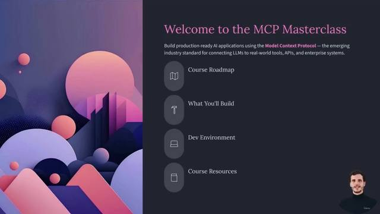

## 2. 讲师原话

> "课程按四个递进阶段组织：基础、核心技能、真实应用、企业级。"
> —— p001 [01:51]

这句话决定了学习顺序。基础段讲 MCP 架构、Client、Server、Resources、Tools；核心技能段才动手写 Server 和 Client；真实应用段接 GitHub、Jira、Slack、数据库、浏览器和多 Agent 工作流；企业段讲生产部署、可观测性、调试、治理。不要跳过基础段直接抄 Server 代码，否则后面分不清哪些能力该暴露成 Tool、哪些该做成 Resource。

> "主要编辑器是 Visual Studio Code；核心编程语言是 Python 3.12 或更高版本；Node.js 提供 JavaScript 工具链并支持许多 MCP 包；我们还会用 Claude Desktop 在开发时与 MCP 服务器交互，用 Docker 一致地打包应用。"
> —— p001 [05:14]

这里是明确的技术栈约束：**Python 是主语言，Node.js 不是可选项**，因为不少 MCP 包和 JavaScript 工具链依赖它；Claude Desktop 是开发期的 MCP 客户端；Docker 用来抹平不同操作系统上的打包差异。MCP SDK 位于中心位置，但课里没有给出具体包名和版本，后面安装时必须以官方文档为准。

> "环境配置遵循五个简单步骤：安装 Python、配置 VS Code、安装 Git、安装 Node.js、配置 Claude Desktop。"
> —— p001 [06:36]

顺序不是随手排的。Python 是后续 Server 的主运行时；VS Code 是写代码和调试的入口；Git 管理课程项目与模板；Node.js 支撑 MCP 相关包；Claude Desktop 最后配置，因为它要连接前面已经装好的运行时。课里强调“每装完一个就验证一个”，不要五个全装完再一起排错。

> "每个小节都遵循同一个学习循环：学概念、看演示、跟着写、测试调试、部署并讨论生产要求。"
> —— p001 [09:55]

这解释了为什么 P1–P3 先讲概念。后面的项目不是“看老师写一遍”，而是同一个循环：先理解概念，再看演示，然后自己写，接着测试、找问题、调试，最后讨论生产部署。P1–P3 处在这个循环的“学概念”和“准备环境”阶段。

> "MCP 是一个开放标准，让大语言模型通过标准化接口，安全地与外部工具、API、数据库、文件和企业系统通信。"
> —— p002 [00:00]

这是全课最核心的定义。注意三个关键词：**开放标准**、**标准化接口**、**安全通信**。MCP 不是某个厂商的私有插件机制，也不是让模型直接连数据库；它是一层协议，把“模型需要外部能力”这件事标准化。

> "在 MCP 之前，每个 AI 应用都要为每一个外部工具单独做集成。"
> —— p002 [01:51]

讲师举的例子是：AI 助手要接 GitHub、Jira、Slack、SQL 数据库和浏览器，就要维护五套完全不同的集成。后果是开发变慢、维护成本上升、被厂商锁定、系统越多越复杂。MCP 的价值就是把这五套自定义连接器收敛成一套协议。

> "MCP 遵循直接的客户端—服务器架构：AI 客户端与 MCP 服务器通信，服务器暴露工具、资源和提示词，与外部系统交互，再把结果返回给语言模型。"
> —— p002 [03:16]

这句话把角色分清楚了：**Client 是智能决策者**，理解用户请求并判断是否需要外部能力；**Server 是安全网关**，控制哪些能力可用、怎么访问；真正的 GitHub 仓库、SQL 数据库、浏览器、文件系统、企业应用在 Server 后面。模型不直接碰这些系统。

> "MCP 并不取代 API。API 仍然是很多系统内部使用的底层机制；MCP 只是在 API 之上提供一个通用接口，让 AI 系统更容易发现、理解和使用它们。"
> —— p002 [06:07]

这是最容易误解的一点。传统 API 是给软件开发者用的，每个 API 有自己的 endpoint、认证方式、请求格式和文档；MCP 是给 AI 应用用的统一协议层。MCP 不消灭 API，而是把 API 包装成 AI 能稳定发现和调用的形状。

> "每个 MCP 应用都由六个核心构件组成：客户端、服务器、工具、资源、提示词和消息。"
> —— p003 [00:00]

六个构件是后面所有项目的骨架。Client 管通信、路由、会话、认证；Server 暴露能力并做权限与错误处理；Tool 执行动作；Resource 提供只读上下文；Prompt 提供可复用指令模板；Message 是它们之间统一的消息格式。

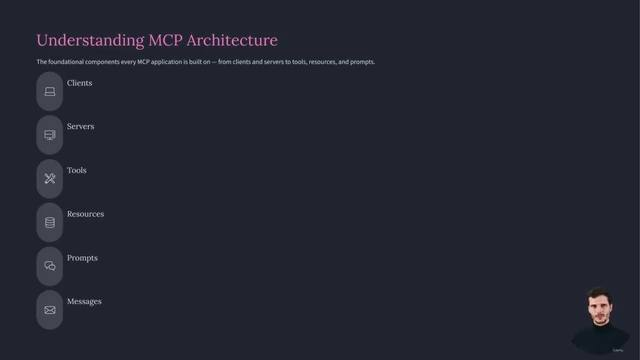

> "MCP 客户端是语言模型与一个或多个 MCP 服务器之间的网关。"
> —— p003 [01:51]

Client 自己不干活。它负责管理通信、路由请求、维护会话、处理认证，并在需要时保留对话上下文。Claude Desktop 可以同时连多个 MCP Server，Claude Code 把 AI 接到开发工具，VS Code 扩展也通过同一套协议工作；企业也可以写自己的 Client。

> "工具让 AI 模型执行动作，而不仅仅是取回信息。"
> —— p003 [04:45]

Tool 有副作用：执行 SQL、读写文件、调用 API、搜索 GitHub 仓库、创建 Jira 工单、发 Slack 消息、自动化浏览器。它接收结构化输入，执行操作，返回结构化输出。讲师用“解释 SQL”和“执行 SQL”对比：解释 SQL 靠模型内部知识，执行 SQL 必须通过 Tool 访问外部数据库。

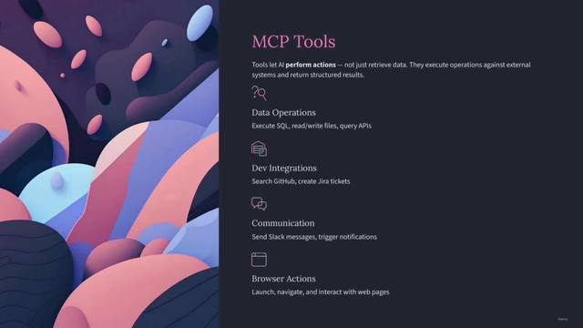

> "资源是只读的上下文来源。"
> —— p003 [06:37]

Resource 不改变外部系统。它可以是文档、技术规格、源码、数据库 schema、配置文件、知识库、业务文档。读配置、读文档不会产生副作用，所以 Resource 适合在推理、规划、分析阶段使用。它的价值是让模型基于权威信息回答，而不是靠训练数据猜。

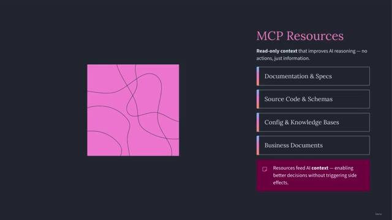

> "MCP 提示词是预定义模板，用来标准化 AI 处理常见任务的方式。"
> —— p003 [07:57]

Prompt 解决“每个人问法不一样，结果不一致”的问题。代码审查、Bug 调查、文档生成、API 脚手架、安全审计都可以做成模板。团队改编码规范或安全策略时，只改模板，不用改几百条分散的请求。它本质上是可复用的工作流指令。

> "MCP 中的每个客户端和服务器都用标准化消息通信。"
> —— p003 [09:48]

消息类型包括初始化、工具请求与响应、资源请求与响应、提示词请求、错误消息和通知。Client 第一次连 Server 时用初始化消息确认能力；要执行工具就发工具请求；Server 返回结构化结果；长任务用通知做异步更新。因为消息结构统一，不同团队写的 Client 和 Server 才能互通。

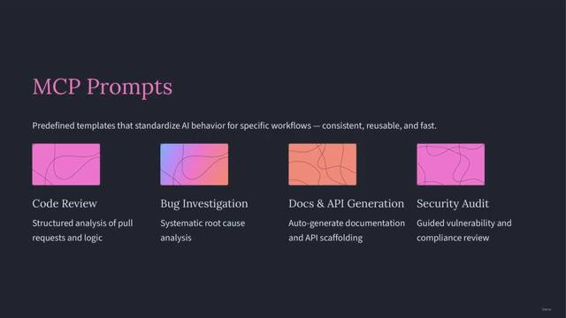

> "每个服务器应该只关注一个职责，这样更容易独立测试、部署和维护。"
> —— p003 [13:09]

这是架构最佳实践的第一条。Server 要模块化，Tool 也要聚焦：不要做一个“什么都能干”的巨型工具，而是做输入清晰、输出可预测的小工具。Resource 和 Tool 要分开，读操作不要伪装成写操作。所有请求都要验证，通信要加密，重要交互要记日志。

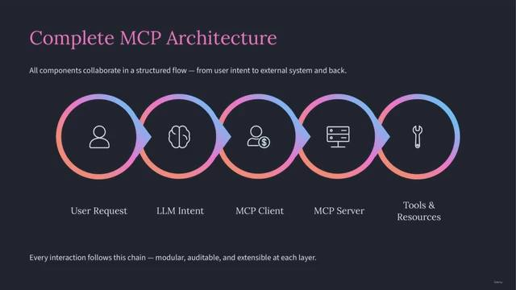

## 3. 从零复现

### 3.1 先定项目地图，不要急着装包

课里的路线是四段递进：Foundation（MCP 架构、Client、Server、Resources、Tools）→ Core Skills（动手写 Server 和 Client）→ Real-World Applications（GitHub、Jira、Slack、数据库、浏览器、多 Agent）→ Enterprise（生产部署、可观测性、调试、治理）。项目分三类：

- **Integrations**：GitHub、Jira、Slack、SQL 数据库的 MCP Server。
- **Automation**：浏览器自动化、AI 文档助手、智能软件工程工作流。
- **Advanced**：多 Agent MCP 平台、生产级 AI harness、企业 AI 助手。

你现在的目录只要给 P1–P3 留一个“环境与笔记”位置即可，不要提前把后面项目的目录全建空。课里提供了 starter projects、MCP templates、配置文件、架构图、带完整答案的练习；这些资源在课程包里，课里没有给出具体下载命令。

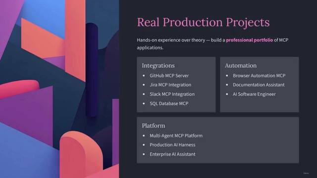

### 3.2 五步环境配置

课里只给了顺序和组件，**没有给具体安装器命令、安装包版本号或 MCP SDK 的包名**。下面按“装一个、验一个”的方式写，安装动作请使用各工具官方安装器；验证命令是通用检查命令，不属于课程原话。

**第 1 步：安装 Python 3.12+。** 这是后续 MCP Server 和 AI 应用的主语言。Windows 安装时注意把 Python 加入 PATH；macOS/Linux 注意区分 `python3` 和 `python`。装完在终端验证：

```bash
python --version
# 或
python3 --version
```

通过标准：输出 `Python 3.12.x` 或更高。如果输出 3.11 或 3.10，说明系统里有多个 Python，需要明确用 `python3.12` 或 Windows 的 `py -3.12`。

**第 2 步：配置 VS Code。** 课里说 VS Code 对 Python、JavaScript、Git 和 AI 扩展支持好。安装 VS Code 后，至少确认 `code` 命令可用：

```bash
code --version
```

课里没有列具体扩展清单，只提到“配置开发所需的扩展和设置”。后续写 Python 时再按需装 Python 扩展，不要在这一步堆一堆用不上的插件。

**第 3 步：安装 Git。** 用于源码控制、版本管理和协作。验证：

```bash
git --version
```

**第 4 步：安装 Node.js。** 课里明确说 Node.js 提供 JavaScript 工具链，并支持许多 MCP 包。验证：

```bash
node --version
npm --version
```

课里没有规定 Node 的具体版本号。实际装 MCP 包时如果遇到引擎版本要求，以包自己的说明为准。

**第 5 步：配置 Claude Desktop。** 课里要求用它连接 MCP Server、和构建出来的应用交互。先完成安装和登录。**课里没有讲 Claude Desktop 配置文件的路径和字段名**，所以这一步不要照抄网上旧版本的 JSON；等下一模块讲传输与连接时再配置 Server。现在只要确认应用能正常打开即可。

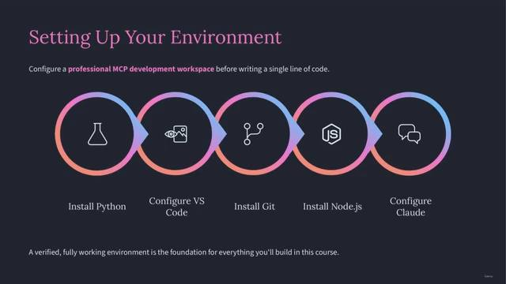

### 3.3 用自检脚本一次性验证

五个组件装完后，把第 4 节的 `verify_env.py` 保存到本地，运行：

```bash
python verify_env.py
```

脚本会检查 Python 版本、Git、Node.js、npm、VS Code、Docker、Claude Desktop 常见安装路径，并输出 JSON。最后一行如果是“全部通过。”，退出码为 0；否则会列出未通过项并以退出码 1 结束。这个脚本是本文档的示意工具，**课里没有这段代码**。

### 3.4 建立六构件心智模型

装完环境后，不要马上写代码，先把下面六个问题答一遍。答不出来，后面写 Server 会反复返工。

1. **Client 负责什么？** 管理通信、路由请求、维护会话、处理认证、保留对话上下文。它不执行具体工作，只做智能协调。
2. **Server 负责什么？** 暴露 Tools、Resources、Prompts；验证请求、执行权限控制、执行操作、返回结构化响应；出错时返回结构化错误，而不是让整个应用崩掉。
3. **Tool 和 Resource 的边界？** Tool 执行动作、有副作用；Resource 只读、无副作用。读文档放 Resource，发 Slack 消息放 Tool。
4. **Prompt 解决什么？** 把代码审查、Bug 调查、文档生成、API 脚手架、安全审计等常见工作流固化成可复用模板，保证团队输出一致。
5. **Message 有哪些类型？** 初始化、工具请求/响应、资源请求/响应、提示词请求、错误、通知。初始化用于建立通信并确认能力；通知用于长任务异步更新。
6. **模型为什么不直接连数据库？** 因为 Server 是安全网关，控制哪些能力可用、怎么访问。模型只负责推理，Client 管通信，Server 管能力暴露，Tool/Resource 碰外部系统。

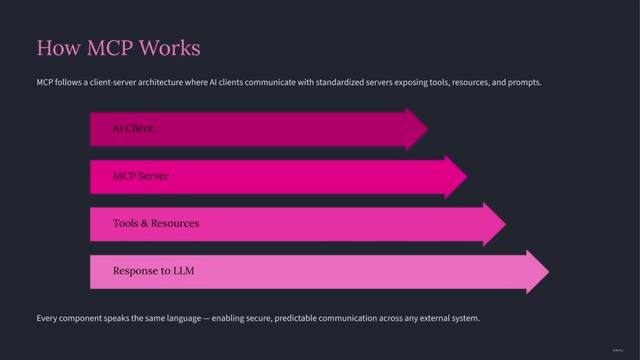

### 3.5 用一个请求生命周期把六个构件串起来

课里给的生命周期是：用户请求 → 语言模型判断是否需要外部信息或功能 → 需要的话，MCP Client 把请求路由到合适的 MCP Server → Server 调用正确的 Tool 或 Resource，取回信息 → 结果返回语言模型 → 模型生成最终回复。整个过程通常几秒完成，但背后每个角色职责清晰：模型推理、Client 通信、Server 暴露受控能力、外部工具执行操作。

这个流程的价值是**一致性**：查数据库、搜 GitHub、操作浏览器，都走同一套结构。所以后续调试、安全、监控、扩展才有统一抓手。你可以在笔记里画一条横向流程，把“谁负责推理、谁负责路由、谁负责权限、谁负责执行”标在四个角色下面。

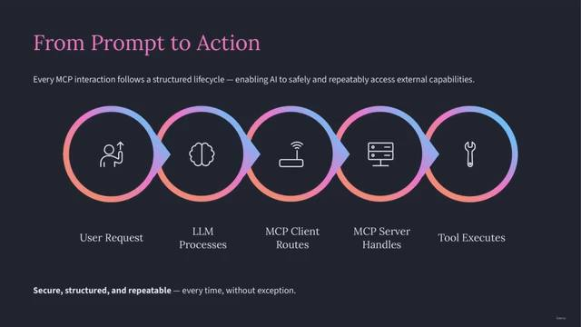

### 3.6 按最佳实践切项目边界

写后续项目前，先用五条最佳实践检查设计：

- Server 模块化：一个 Server 只做一类事，比如 GitHub Server、数据库 Server、浏览器 Server，不要做成万能 Server。
- 输入验证：永远不要假设请求正确，每个 Tool 调用执行前都要验证。
- 优雅失败：不要一错就崩，要返回有意义的错误信息，能重试的适当重试，能恢复的尽量恢复。
- 密钥管理：敏感凭据用专门的密钥管理方案，不要硬编码进源码或配置文件。
- 文档、监控、可观测：生产 Server 要有文档，要记日志、做监控，出问题能排查。

另外两条架构原则也要记住：Tool 要聚焦，不要一个巨型工具干很多不相关的事；Resource 和 Tool 要分离，读操作和写操作不要混。课里还强调验证每个请求、适当加密通信、记录重要交互。

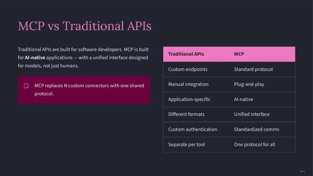

### 3.7 建议目录结构

课里没有给具体目录结构。下面只是按课程项目类型整理的建议，方便你把 P1–P3 的笔记、自检脚本和后续 Server 分开：

```text
mcp-masterclass/
├── p001-003-foundation/
│   ├── verify_env.py
│   └── notes.md
├── servers/
│   ├── github/
│   ├── database/
│   └── browser/
├── clients/
│   └── claude-desktop/
├── templates/
└── README.md
```

`servers/` 下按“一个 Server 一个职责”拆目录，和课里的模块化原则一致。`clients/` 先留空，等讲 Client 实现时再填。`templates/` 放课程提供的 MCP 模板和配置文件。这个结构不是课程原话，只是防止后面项目堆在一个目录里。

## 4. 完整代码

本段课程是概念与环境课，**课里没有给出可运行的 MCP 代码**。下面先给一个完整可保存运行的环境自检脚本，再给六张设计表。脚本是示意工具，不是讲师屏幕上的代码；表是把讲师讲过的决策落成可执行的项目约束。

### 4.1 `verify_env.py`：环境自检脚本（示意，课里没有代码）

```python
#!/usr/bin/env python3
"""
verify_env.py — Claude MCP Masterclass P1-P3 环境自检脚本

说明：
- 本脚本是课程文档的示意工具，课里没有这段代码。
- 它只做“命令是否存在、版本是否能读到”的检查，不安装任何东西。
- Claude Desktop 的安装路径可能随版本变化，脚本只查常见路径；
  如果显示“未在常见路径找到”，请手动打开应用确认。
"""

from __future__ import annotations

import json
import os
import platform
import shutil
import subprocess
import sys
from dataclasses import asdict, dataclass

MIN_PYTHON = (3, 12)


@dataclass
class CheckResult:
    name: str
    ok: bool
    detail: str


def run_version(cmd: list[str]) -> str:
    """执行版本命令，返回第一行输出；找不到命令时返回可读信息。"""
    try:
        completed = subprocess.run(
            cmd,
            capture_output=True,
            text=True,
            timeout=10,
        )
        output = (completed.stdout or completed.stderr).strip()
        first_line = output.splitlines()[0] if output else f"exit={completed.returncode}"
        return first_line
    except FileNotFoundError:
        return "未找到命令"
    except subprocess.TimeoutExpired:
        return "命令超时"
    except Exception as exc:  # noqa: BLE001
        return f"检查失败: {exc}"


def check_python() -> CheckResult:
    ok = sys.version_info >= MIN_PYTHON
    detail = platform.python_version()
    if not ok:
        detail = f"{detail}，需要 {MIN_PYTHON[0]}.{MIN_PYTHON[1]}+"
    return CheckResult("Python", ok, detail)


def check_command(name: str, cmd: list[str]) -> CheckResult:
    executable = shutil.which(cmd[0])
    if not executable:
        return CheckResult(name, False, f"PATH 中找不到 {cmd[0]}")
    version = run_version(cmd)
    return CheckResult(name, True, f"{executable} | {version}")


def check_claude_desktop() -> CheckResult:
    system = platform.system()
    candidates: list[str] = []

    if system == "Darwin":
        candidates = ["/Applications/Claude.app"]
    elif system == "Windows":
        local_app_data = os.environ.get("LOCALAPPDATA", "")
        candidates = [
            os.path.join(local_app_data, "AnthropicClaude", "Claude.exe"),
            os.path.join(local_app_data, "Programs", "Claude", "Claude.exe"),
        ]
    else:
        claude_cli = shutil.which("claude")
        candidates = [claude_cli] if claude_cli else []

    found = next((path for path in candidates if path and os.path.exists(path)), None)
    if found:
        return CheckResult("Claude Desktop", True, found)
    return CheckResult(
        "Claude Desktop",
        False,
        "未在常见路径找到；请手动打开应用确认，路径可能随版本变化",
    )


def main() -> None:
    results: list[CheckResult] = [
        check_python(),
        check_command("Git", ["git", "--version"]),
        check_command("Node.js", ["node", "--version"]),
        check_command("npm", ["npm", "--version"]),
        check_command("VS Code", ["code", "--version"]),
        check_command("Docker", ["docker", "--version"]),
        check_claude_desktop(),
    ]

    print(json.dumps([asdict(item) for item in results], ensure_ascii=False, indent=2))

    failed = [item for item in results if not item.ok]
    if failed:
        print(f"\n有 {len(failed)} 项未通过，请先修复再进入下一课。", file=sys.stderr)
        sys.exit(1)

    print("\n全部通过。")


if __name__ == "__main__":
    main()
```

### 4.2 技术栈与验证方式表

| 组件 | 课程要求 | 作用 | 验证方式 | 备注 |
|---|---|---|---|---|
| VS Code | 必装 | 主编辑器，支持 Python、JavaScript、Git、AI 扩展 | `code --version` | 课里没列具体扩展清单 |
| Python | 3.12 或更高 | MCP Server 与 AI 应用主语言 | `python --version` | 注意系统多版本 |
| Git | 必装 | 源码控制、版本管理、协作 | `git --version` | — |
| Node.js | 必装 | JavaScript 工具链，支持许多 MCP 包 | `node --version` | 课里没规定具体大版本 |
| npm | 随 Node.js | 安装 JavaScript 包 | `npm --version` | — |
| Claude Desktop | 必装 | 开发期连接 MCP Server 的客户端 | 打开应用确认 | 配置文件字段课里没讲 |
| Docker | 必装 | 跨操作系统一致打包 | `docker --version` | 只查版本不等于 Docker daemon 已启动 |
| MCP SDK | 课程中心框架 | 构建 Client、Server、Tools、集成 | 课里没给包名/版本 | 安装前查官方文档 |
| Cursor | 可选 | AI 辅助开发环境示例 | 课里没给验证方式 | 不要求立即掌握 |
| Windsurf | 可选 | AI 辅助开发环境示例 | 课里没给验证方式 | 不要求立即掌握 |
| OpenAI Codex CLI | 可选 | AI 辅助开发环境示例 | 课里没给验证方式 | 不要求立即掌握 |
| Gemini CLI | 可选 | AI 辅助开发环境示例 | 课里没给验证方式 | 不要求立即掌握 |

### 4.3 六大构件职责表

| 构件 | 核心职责 | 典型输入 | 典型输出 | 不该做什么 |
|---|---|---|---|---|
| Client | 管理通信、路由请求、维护会话、处理认证、保留对话上下文 | 用户请求、模型判断结果 | 发往 Server 的请求、返回模型的结果 | 不直接执行外部操作 |
| Server | 暴露 Tools/Resources/Prompts，验证请求、执行权限、执行操作、返回结构化响应 | Client 请求 | 结构化结果或结构化错误 | 不无限制暴露内部系统 |
| Tool | 执行动作，有副作用 | 结构化参数 | 结构化结果 | 不把只读查询伪装成写操作 |
| Resource | 提供只读上下文，无副作用 | 资源 URI/标识（课里未展开） | 文档、源码、schema、配置等 | 不修改外部系统 |
| Prompt | 可复用指令模板，标准化工作流 | 模板参数（课里未展开） | 给模型的指令 | 不替代 Tool 执行动作 |
| Message | 统一通信格式 | 初始化、请求、响应、错误、通知 | 标准化消息 | 不各自定义私有格式 |

### 4.4 MCP 与传统 API 对照表

| 维度 | 传统 API | MCP |
|---|---|---|
| 主要面向 | 软件开发者 | AI 应用 |
| 接口形态 | 每个服务自己的 endpoint、认证、请求格式、文档 | 一套标准化协议 |
| 集成方式 | 每个服务写自定义集成代码 | 支持 MCP 后，兼容的 AI 应用可复用 |
| AI 使用体验 | 模型要学几十种 API 差异 | 所有工具以一致结构呈现 |
| 替换成本 | 换工具常要重写大段集成 | 更容易替换工具 |
| 与 API 关系 | 底层机制 | 在 API 之上提供通用接口，不取代 API |

### 4.5 消息类型表

| 消息类型 | 作用 | 使用场景 |
|---|---|---|
| 初始化 | 建立通信、确认支持的能力 | Client 第一次连 Server |
| 工具请求 | 请求执行某个 Tool | 模型决定需要执行动作 |
| 工具响应 | 返回 Tool 的结构化结果 | Tool 执行完成 |
| 资源请求 | 请求读取 Resource | 模型需要文档、源码、schema 等上下文 |
| 资源响应 | 返回 Resource 内容 | 只读上下文读取完成 |
| 提示词请求 | 请求某个 Prompt 模板 | 需要标准化工作流 |
| 错误消息 | 返回标准化错误，允许 Client 优雅恢复 | API 失败、参数非法等 |
| 通知 | 异步通信 | 长任务执行过程中更新状态 |

### 4.6 生产最佳实践检查表

| 实践 | 具体要求 | 不这样做的后果 |
|---|---|---|
| Server 模块化 | 每个 Server 一个清晰职责 | 难测试、难部署、难维护 |
| Tool 聚焦 | 小工具、清晰输入、可预测输出 | 巨型工具难调试、难复用 |
| Resource/Tool 分离 | 读操作放 Resource，写操作放 Tool | 副作用混入推理阶段，安全风险上升 |
| 输入验证 | 每个 Tool 调用执行前验证 | 非法输入导致意外行为或安全问题 |
| 优雅失败 | 返回有意义错误、适当重试、尽量恢复 | 一个失败拖垮整个应用 |
| 密钥管理 | 用专门密钥管理，不硬编码 | 凭据泄露 |
| 文档与可观测 | 文档、日志、监控 | 出问题无法排查 |
| 通信安全 | 适当加密、验证请求、记录重要交互 | 敏感系统暴露 |

### 4.7 项目地图表

| 分类 | 项目 | 训练目标 |
|---|---|---|
| Integrations | GitHub、Jira、Slack、SQL 数据库 MCP Server | 把 AI 接到企业常用系统 |
| Automation | 浏览器自动化、AI 文档助手、智能软件工程工作流 | 自动化重复业务与开发流程 |
| Advanced | 多 Agent MCP 平台、生产级 AI harness、企业 AI 助手 | 综合设计、部署、治理 |

## 5. 逐行解释

先解释 `verify_env.py`，再解释表里的关键决策。

`#!/usr/bin/env python3` 让 macOS/Linux 可以直接按脚本执行；Windows 上用 `python verify_env.py` 即可。`from __future__ import annotations` 让类型注解在旧一点的 Python 上也不会立即求值，便于脚本在不同 3.12 环境间复制。`dataclass` 用来定义 `CheckResult`，相当于 TypeScript 里的 `interface CheckResult { name: string; ok: boolean; detail: string }`，但在 Python 里自动生成构造函数和 `asdict` 支持。`MIN_PYTHON = (3, 12)` 是课程明确要求的最低版本；不写成字符串是为了用元组比较，避免 `"3.10" > "3.9"` 这种字符串比较陷阱。

`run_version` 里 `subprocess.run(cmd, capture_output=True, text=True, timeout=10)` 做了四件事：不通过 shell 执行，避免命令注入；捕获 stdout/stderr；把字节解码成文本；最多等 10 秒，防止某个命令卡住。这里没有传 `check=True`，所以命令返回非零不会直接抛异常，而是由我们读取 `returncode`，这样能输出更友好的“exit=...”。`FileNotFoundError` 对应命令不存在；`TimeoutExpired` 对应命令卡住；最后的 `Exception` 是兜底，避免一个检查项崩掉整个脚本。JS/Node 里对应 `child_process.execFile`，同样建议不用 `shell: true`。

`check_python` 用 `sys.version_info >= MIN_PYTHON` 判断当前运行脚本的解释器版本，而不是去猜系统里还有没有别的 Python。这样最准确：你用什么解释器跑脚本，就检查什么解释器。`platform.python_version()` 只是把版本号变成可读字符串。`check_command` 先用 `shutil.which(cmd[0])` 查 PATH，找不到就直接返回失败，避免后面执行时报一个难懂的错误；找到后拼上 `path | version`，方便你知道实际用的是哪个可执行文件。JS 里等价于 `which` 包或 `command -v`。

`check_claude_desktop` 分平台查常见路径：macOS 查 `/Applications/Claude.app`，Windows 查 `%LOCALAPPDATA%` 下的两个常见位置，Linux 查 `claude` 命令。这里必须强调：**这些路径可能随 Claude Desktop 版本变化，课里也没有给路径**，所以脚本只把它们当“常见候选”，找不到时提示手动确认，而不是断言“你没装”。`os.path.exists` 只判断路径存在，不判断应用能否登录。

`main` 把七项检查放进列表，`json.dumps([asdict(item) ...], ensure_ascii=False, indent=2)` 输出可读 JSON，字段名就是 `name`、`ok`、`detail`，这些字段来自本脚本的 `CheckResult`，不是课程输出。`failed` 过滤未通过项；有失败就打印数量到 stderr 并 `sys.exit(1)`，这样 CI 或 shell 能通过退出码判断失败。全部通过时打印“全部通过。”。JS/Node 里对应 `process.exit(1)`。脚本没有检查 Docker daemon 是否启动，因为 `docker --version` 只证明 CLI 存在；这是第 7 节要讲的坑。

再解释设计表。技术栈表把“课程要求”和“验证方式”分开，是因为课里只给了组件和顺序，没给安装命令；把“课里没给”的地方明确标出来，避免读者以为 `MCP SDK` 有一个固定包名。六大构件表的核心是“边界”：Client 不执行外部操作，Server 不无限制暴露内部系统，Tool 有副作用，Resource 无副作用，Prompt 不替代 Tool，Message 不各自定义格式。这个边界一旦混淆，后面就会出现“把读文件做成 Tool”“把发消息做成 Resource”这类设计错误。

MCP 与 API 对照表最关键的一行是“与 API 关系”：MCP 在 API 之上，不取代 API。所以后面写 GitHub Server 时，底层仍然调 GitHub API；写数据库 Server 时，底层仍然执行 SQL。MCP 只是把“AI 如何发现和调用这些能力”标准化。消息类型表里，初始化用于确认能力，错误消息用于优雅恢复，通知用于长任务异步更新；这三类最容易被初学者忽略。生产最佳实践表里，“输入验证”和“密钥管理”是安全底线，“优雅失败”和“可观测”是运维底线，“Server 模块化”和“Tool 聚焦”是可维护性底线。

在 JS/Node 里，MCP 的会话和异步消息可以类比为：Client 维护一个长连接/会话对象，Tool 调用返回 `Promise`，长任务通过事件或回调推送通知。课里没有讲锁、事务、并发控制；后面如果数据库 Tool 涉及写操作，课里也没讲具体事务边界，届时需要按实际数据库和业务要求补，不能假设 MCP 自动帮你处理事务。

## 6. 复现检查清单

- [ ] Python 版本 ≥ 3.12，`python --version` 或 `python3 --version` 输出符合。
- [ ] VS Code 已安装，`code --version` 能输出。
- [ ] Git 已安装，`git --version` 能输出。
- [ ] Node.js 已安装，`node --version` 能输出。
- [ ] npm 已安装，`npm --version` 能输出。
- [ ] Claude Desktop 能正常打开并登录；配置文件字段先不照抄网上旧版本。
- [ ] Docker CLI 已安装，`docker --version` 能输出；如要确认 daemon，再运行 `docker ps`（课里没讲这一步）。
- [ ] 已保存 `verify_env.py`，运行 `python verify_env.py` 最后输出“全部通过。”，退出码 0。
- [ ] 能用自己的话解释：MCP 是开放标准，不是替代 API。
- [ ] 能说出六个构件：Client、Server、Tool、Resource、Prompt、Message。
- [ ] 能说出请求生命周期：用户请求 → 模型判断 → Client 路由 → Server 调 Tool/Resource → 结果回模型 → 模型回复。
- [ ] 能区分 Tool 与 Resource：Tool 有副作用，Resource 只读。
- [ ] 能说出至少五条生产最佳实践：模块化、输入验证、优雅失败、密钥管理、文档/监控/可观测。
- [ ] 已把 P1–P3 的笔记和自检脚本放进独立目录，没有和后续 Server 代码混在一起。


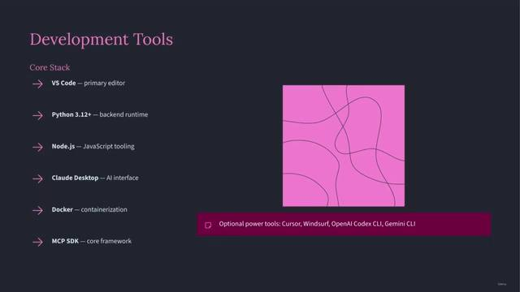

## 7. 课里没讲但你会撞上的

1. **`python` 指向 3.11 或 3.10。** 系统里可能有多个 Python。Windows 用 `py -3.12` 明确版本；macOS/Linux 用 `python3.12`。不要为了省事改系统默认 Python，后面容易把包装错环境。
2. **PATH 没生效。** 装完 Python、Node、Git 后必须新开终端，否则旧终端读不到新 PATH。表现为“命令明明装了却找不到”。
3. **pip 装到全局。** 课里没讲虚拟环境，但实际做 Python 项目建议每个项目一个 venv；JS 类比就是每个项目自己的 `node_modules`。全局装包会把不同项目依赖搅在一起。
4. **Node 版本不满足 MCP 包要求。** 课里没规定 Node 大版本；实际安装某个 MCP 包时如果报 engines 错误，用 nvm/fnm