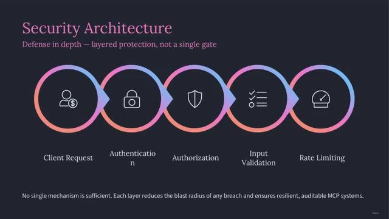
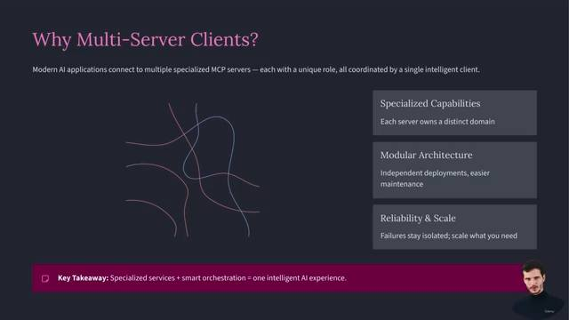
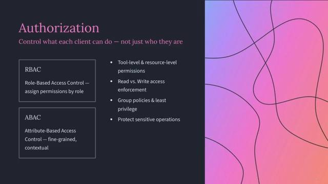
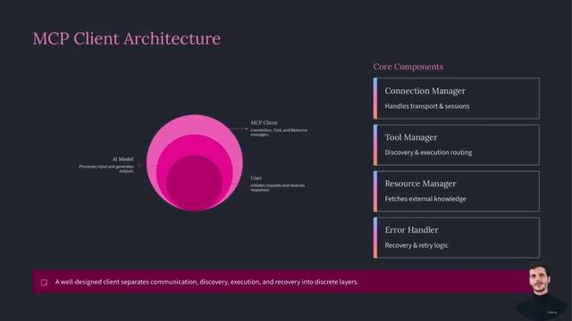
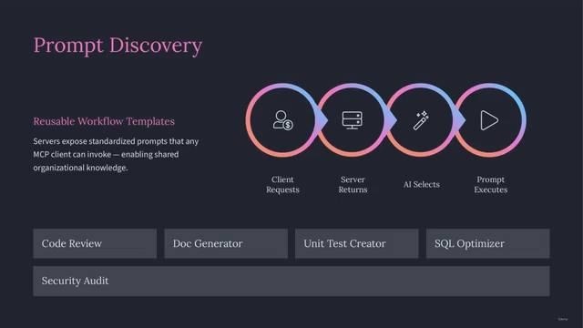
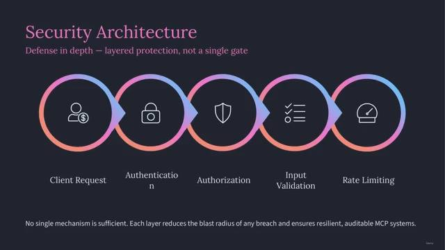
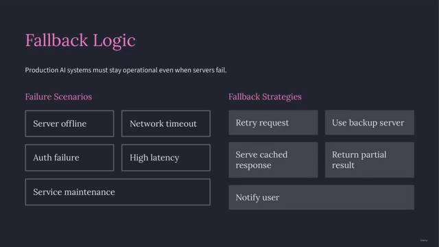

# Claude MCP Masterclass（P010–P012）：生产级 MCP 的安全、客户端与多服务器编排

> **关于这三讲的说明**：P010、P011、P012 三讲在课程里属于**纯架构讲解课**——讲师全程在讲安全防护层级、MCP 客户端内部分层、多服务器编排逻辑，**没有给任何代码、命令、配置文件**，本段课程也没有 OCR 结果。因此本文档第 3、4、5 节按「纯讲解课」的写法处理：第 3 节复现讲师的**推导过程**（需求 → 约束 → 估算 → 方案 → 取舍），第 4 节把讲师的方案落成**可用的设计产物**（决策表、职责表、接口草案、容量估算表），**凡是示意代码都会明确标注「课里没有代码，以下为示意」**，不会把讲师没讲过的东西安到他头上。第 7 节集中写「课里没讲、但你一旦真去实现就会撞上」的坑。

---

## 1. 这一节做什么

这三讲回答的是同一个问题的三个侧面：**一个能上生产的 MCP 系统，除了「服务器能把工具跑通」之外，还缺什么？**

P010 讲**安全**。讲师的原话是：「无论你的 MCP 服务器变得多强大，如果它不安全，价值就很小」。这一讲把生产级 MCP 服务器的安全拆成六根支柱：认证（Authentication）、授权（Authorization）、密钥管理（Secret Management）、输入净化（Input Sanitization）、速率限制（Rate Limiting）、以及贯穿全流程的安全最佳实践。它给出的不是代码，而是一张**检查清单 + 一条流水线**：每一个请求必须依次穿过「认证 → 授权 → 输入校验 → 速率限制」，四层全过，业务逻辑才允许执行。

P011 讲**MCP 客户端**。前面几讲一直在做服务器（server），这一讲把视角翻到架构的另一半——客户端才是「发现能力、使用能力」的那一端。讲师把它定义为「AI 模型和外部世界之间的桥」。这一讲拆出客户端的四大职责（发现、执行、编排、失败恢复）、内部分层（连接管理器 / 工具管理器 / 资源管理器 / 错误处理器）、以及一条完整的生命周期：**建立连接 → 握手 → 能力协商 → 会话激活 → 动态发现 → 执行 → 回收资源 → 失败恢复**。

P012 讲**多服务器客户端**。当能力多到一定程度，一个巨大服务器就不合适了，MCP 鼓励**每个服务器只专精一个领域**，客户端变成中央编排器。这一讲覆盖：为什么拆分（专精化 / 模块化 / 故障隔离）、会话路由（工具归属、能力、延迟、负载、认证、可用性）、跨服务器上下文共享（标识符映射、数据新鲜度、版本同步、权限）、响应聚合（去重、格式统一、排序、保留上下文）、故障回退（重试 / 备用服务器 / 缓存 / 部分响应 / 明确报错）、负载均衡（轮询、最少连接、加权、健康状态路由）、并行执行、以及可观测性（健康指标、性能指标、分布式日志）。

**学完这三讲你应该能产出的东西**：一份自己 MCP 项目的安全分层图、一份客户端模块划分表、一份多服务器路由表、一份失败场景 → 恢复策略对照表。这些都是可以直接贴进设计文档、拿去评审的产物，而不是「我知道了有个东西叫 RBAC」。

---

## 2. 讲师原话

以下引用全部为中文译文，产品名保留 English，出处标注到讲次与时间点。

### 2.1 关于安全的定位

> "欢迎来到本课程最重要的模块之一。无论你的 MCP 服务器变得多强大，如果它不安全，价值就很小。安全不该在开发之后才补上，它应该从设计的第一天起就成为设计的一部分。"
> —— p010 [00:00]

> "这个模块最重要的结论是：安全不是一个功能，它是一种设计哲学。每一个生产级 MCP 应用都应该假设威胁是存在的，并从最开始就纳入多个相互独立的防护层。"
> —— p010 [15:15]

> "安全永远不应该在项目末尾才被加进来。它应该从最开始就被纳入每一个设计决策。"
> —— p010 [13:22]

### 2.2 认证与授权

> "认证要回答的问题很简单，但极其关键：你是谁？没有可靠的认证，任何人都可以尝试连接你的 MCP 服务器、执行工具或访问资源。"
> —— p010 [02:52]

> "认证可以使用多种行业标准方式实现，包括 API 密钥、JWT 令牌、服务账号、OAuth 2.0、OpenID Connect、单点登录，以及使用客户端证书的双向 TLS。每种方式提供的安全级别不同，取决于应用的需求。"
> —— p010 [01:55]

> "认证验证身份，但它不决定客户端被允许做什么。那是授权的职责。授权在认证成功之后控制权限。"
> —— p010 [03:21]

> "最小权限是最重要的安全原则之一：只授予完成任务所需的最小权限，不多给一分。收窄权限可以降低账号被攻破后的影响，并保护敏感业务操作。"
> —— p010 [04:17]

### 2.3 密钥、输入、限流、传输

> "密钥绝不应该被硬编码进源码、配置文件或 Git 仓库。它们应该存放在专为安全凭据存储而设计的密钥管理系统中。"
> —— p010 [04:43]

> "一个简单的规则要记住：代码属于仓库，密钥属于保险库。"
> —— p010 [06:08]

> "净化流程从接收到原始输入开始。应用随后验证数据类型、格式、模式与允许值，然后才决定这个请求应该被接受还是拒绝。只有在验证成功之后，业务逻辑才应该执行。"
> —— p010 [06:36]

> "想象一个客户端因为程序缺陷，每秒误发上千个请求。没有速率限制，这一个客户端就能耗尽所有可用资源，让合法用户无法使用你的服务。"
> —— p010 [08:34]

> "每一个生产级 MCP 服务器都应该强制启用带 TLS 加密的 HTTPS。加密确保客户端与服务器之间传输的数据，在网络传输过程中无法被未授权方读取或篡改。"
> —— p010 [09:32]

> "一个简单的规则在这里适用：每一个连接都应该被加密、被认证、被校验。"
> —— p010 [10:58]

> "一个重要的信息是：没有任何单一安全机制是足够的。如果某一层失效，其余各层会继续保护应用。"
> —— p010 [11:26]

### 2.4 MCP 客户端的职责与结构

> "如果说服务器提供能力，那么客户端就是负责发现和使用这些能力的应用。可以把它看作 AI 模型与外部世界之间的桥梁。"
> —— p011 [00:00]

> "一个 MCP 客户端承担四项主要职责。第一，发现所连服务器上可用的工具、资源和提示词。第二，执行请求——把结构化消息发送到对应的服务器。第三，编排通信——充当 AI 模型与多个 MCP 服务器之间的交通调度员。第四，优雅地处理失败——重试请求、恢复会话，并给出有用的错误信息，而不是让整个 AI 工作流直接崩掉。"
> —— p011 [00:29]

> "连接管理器使用 stdio、HTTP 或 WebSocket 这类传输方式建立并维持通信会话。工具管理器负责发现可用工具，并把执行请求路由到正确的服务器。资源管理器在 AI 请求额外上下文时，取回文档、配置文件、源码或数据库记录这类外部知识。最后，错误处理器监控失败、执行重试，确保临时性问题不打断整体工作流。"
> —— p011 [02:23]

### 2.5 初始化、发现、执行

> "一旦连接建立，客户端就与服务器进行一次握手。在这个阶段，双方交换协议版本、必要的认证信息以及其他初始化细节。接下来是能力协商，服务器公布它提供的工具、提示词、资源和受支持的特性。"
> —— p011 [04:15]

> "这个信息通常包括工具的唯一名称、一段说明用途的人类可读描述、定义必填参数的输入 schema、期望的输出格式、校验规则，有时还包括示例用法。因为一切都用标准化 schema 描述，AI 模型不需要事先了解实现细节，就能知道如何调用工具。"
> —— p011 [06:07]

> "在向服务器发送任何东西之前，客户端会依据该工具的 schema 校验所有输入。这一步确保必填参数在场、数据类型正确，并在早期就拦掉无效请求。"
> —— p011 [07:31]

> "生产级客户端在这个过程中还承担额外职责：记录请求以便可观测、强制执行超时、重试临时性失败、并采集用于排障的诊断信息。"
> —— p011 [08:28]

### 2.6 资源与提示词发现

> "为了不把所有这些信息都塞进模型提示词，客户端只取回 AI 请求的那一份资源。这种按需取用让提示词更小、降低 token 消耗，并确保 AI 始终基于最新可用的信息工作。"
> —— p011 [09:53]

> "客户端向服务器请求可用的提示词模板。选定合适的模板后，它填入必需的变量——比如文件名、项目名或代码片段——再把补全后的提示词发回给 AI 执行。"
> —— p011 [11:47]

### 2.7 失败恢复

> "一种常见的策略是指数退避：客户端在逐步增加的延迟之后重试临时性失败。这样可以避免把已经繁忙的服务器压垮，同时提高重试成功的概率。"
> —— p011 [13:09]

> "如果连接丢失，客户端会自动重连、执行一次新的握手，并以最小的干扰恢复通信。"
> —— p011 [13:36]

### 2.8 多服务器架构

> "与其把所有能力都塞进一个巨大的服务器，MCP 鼓励采用模块化方式，让每个服务器专精于一个特定领域。这就是多服务器客户端变得必要的原因。"
> —— p012 [00:28]

> "这个架构带来三大优势。第一，专精化让每个服务器专注于把一件事做到极致。第二，模块化让部署和维护容易得多，因为服务器可以独立更新而不影响系统的其余部分。第三，可靠性提升，因为故障被隔离了。"
> —— p012 [00:56]

> "路由决策基于几个因素。第一是工具归属。每个工具属于某个特定服务器，所以请求自然被路由到负责该能力的服务器。客户端还可能考量服务器能力、响应延迟、当前负载、认证要求和整体可用性，再选出最佳目的地。"
> —— p012 [04:15]

> "客户端通过维护共享标识符、追踪工作流状态、在请求于服务器之间流转时传递相关上下文，来解决上下文共享的问题。"
> —— p012 [05:39]

> "客户端负责处理重复数据、保持格式一致、正确排序响应，并保全重要上下文。这样能确保 AI 收到一份来自多系统、干净且有条理的信息视图。"
> —— p012 [08:30]

> "当请求失败时，客户端先判断错误是临时性的还是永久性的。网络超时或短暂的服务中断这类临时问题，往往可以通过短暂延迟后重试来解决。如果主服务器仍然不可用，客户端可以把请求重定向到提供类似功能的备用服务器。"
> —— p012 [09:28]

> "除了选出最佳服务器，MCP 客户端还能并行执行相互独立的请求。不必先查 Git 服务器、再查文件系统服务器、最后查数据库服务器，客户端可以同时发出这三个请求。"
> —— p012 [11:49]

> "现代软件工程的一个常见原则是：你无法修复你看不见的东西。"
> —— p012 [12:47]

---

## 3. 从零复现

课里没有可执行代码，所以「复现」的是**讲师的设计推导链**。下面七步，每一步都给出「输入是什么 → 输出是什么 → 产出物长什么样」。你照着走一遍，就能得到一份可以直接评审的设计稿。

### 第 0 步：先确定你要造的到底是哪一端

在做任何事之前先分清：你要写的是 **MCP 服务器**（提供能力）、**MCP 客户端**（发现并使用能力），还是**两端都要**。P010 只针对服务器侧；P011/P012 只针对客户端侧。两者叠加才是完整架构。讲师在 p011 [00:00] 明确说「服务器提供能力，客户端负责发现和使用」。

**产出物**：一句话写清楚你这次做的是什么，例如「我为公司内部知识库写一个 MCP 服务器，同时写一个只对内网开放的自研客户端」。写不出来，后面所有决定都会漂。

### 第 1 步：威胁建模 —— 列出「什么被拿走会出事」

讲师在 p010 [00:29] 列举了现代 AI 应用会碰到的敏感系统：数据库、云平台、Git 仓库、客户记录、内部 API。你要做的是把自己项目里实际涉及的东西填进同一张表。

| 资产 | 一旦泄露的后果 | 一旦被篡改的后果 | 对应讲师提到的防护 |
|---|---|---|---|
| 数据库凭据 | 全库被拖走 | 数据被静默改写 | 密钥管理 + 最小权限 |
| Git 仓库访问令牌 | 源码外泄 | 恶意提交 | 密钥管理 + 授权 |
| 云平台 AK/SK | 云资源被滥用、产生账单 | 实例被改配 | 密钥管理 + 速率限制 |
| 客户记录（PII） | 合规事故、声誉损失 | 业务数据错乱 | 输入净化 + 审计日志 |
| 内部 API 凭据 | 越权调用 | 伪造业务动作 | 认证 + 授权 |

讲师在 p010 [01:26] 强调「保护组织的数据、用户、基础设施和声誉」，这句话正好就是这张表四列的来源。

### 第 2 步：约束 —— 把「不能做什么」写死

讲师给的约束是硬性的，不是建议：

- **密钥不许进源码、配置、Git**（p010 [04:43]）。这意味着你的 `.env` 就算不提交也不能当成最终方案，它只是本地开发期的权宜之计，生产必须走专用密钥管理系统。
- **认证必须在任何其他处理之前**（p010 [02:52]）。所以「先解析参数再认证」这种顺序是不能接受的。
- **校验在业务逻辑之前**（p010 [06:36]）。所以参数解析之后、真正调数据库之前，必须有一道显式的校验关。
- **每一个连接加密**（p010 [10:58]）。所以本机调试可以 `http://localhost`，但任何跨机器的一律 HTTPS/TLS。

### 第 3 步：估算 —— 把「几个数量级」算出来

课里没有给具体数字，以下是**本文档基于讲师描述的量级假设做的推导，用于确定架构量级，不代表课程给出的数值**。你需要先假设三个量：客户端并发数 `C`、单客户端稳态请求速率 `r`（req/s）、单服务器单实例可承受的并发 `Q`。

**(a) 限流阈值**

令牌桶的稳态速率 `R = r × C`，桶容量 `B` 决定允许多大的突发。讲师在 p010 [09:03] 说「现代算法允许短时突发，同时限制长期使用」，翻译成参数就是：

```
允许突发长度 ≈ B / (R × (1 - r_burst/r))   // r_burst 为突发期速率
```

举例：`C = 20`、`r = 5`，则 `R = 100 req/s`。若你想允许 2 秒的 3 倍突发，则 `B ≈ 100 × 3 × 2 = 600` 个令牌。这个数就是你配置限流中间件时的 `capacity` 参数。

**(b) 重试总耗时**

讲师讲的指数退避（p011 [13:09]），重试 n 次、基础超时 T 秒的总耗时上界：

```
T_total = T × (2^n − 1)
```

`n = 3`、`T = 1s` → `1 + 2 + 4 = 7 秒`。这个数字直接决定你的客户端**对外超时应该设多少**：如果对外只给 5 秒，你的重试永远不会跑完第三轮，等于白配。跑得快就浪费了重试预算。

**(c) 并行执行的收益**

三个互相独立的请求，串行耗时 `T1+T2+T3`，并行耗时 `max(T1,T2,T3)`。假设 `T1=800ms`（Git）、`T2=200ms`（文件）、`T3=1200ms`（数据库）：串行 `2200ms`，并行 `1200ms`，节省 45%。讲师在 p012 [11:49] 说「用户更快拿到答案、服务器利用更充分」——这 45% 就是那句话的数字形态。

**(d) 负载均衡的每实例份额**

K 个等价实例做轮询，每实例请求数 `≈ R / K`。`R = 100`、`K = 3` → 每实例约 33 req/s，所以选型时每实例的容量只要留到 50 req/s 就够，不用按 100 配。讲师在 p012 [11:20] 讲的「加权路由优先给高容量服务器」就是把 `R/K` 里的等分换成按权重分。

**(e) 日志量**

若每个请求记一条结构化日志、平均 1.5KB：`100 req/s × 86400 s × 1.5KB ≈ 12.96 GB/天`。这就决定了你**不能全量永久保存**，必须分级采样——这是讲师在 p012 [13:16] 说「分布式日志每一层都要 trace」时没展开但一定会撞上的现实约束。

### 第 4 步：设计安全分层流水线

讲师在 p010 [10:58] 到 [11:55] 把整条链讲得很明确：**认证 → 授权 → 输入校验 → 速率限制 → 业务逻辑**，任何一层失败就短路返回。



**实现上的顺序必须是固定的**，原因是：

- 认证放最前，是因为讲师说「每一个请求都应该来自经过验证的可信客户端，之后才发生其他处理」（p010 [02:52]）。
- 授权紧跟认证，因为授权需要认证产出的「身份」才能判断（p010 [03:21]：授权在认证成功之后控制权限）。
- 校验放在授权之后，因为校验所需的「允许值范围」可能依赖角色——管理员可以传 `scope=all`，普通用户不行。
- 限流放最后（相对而言），是因为限流需要知道「是谁」，而身份来自认证；同时限流要挡的是「合法但过量」的请求，所以必须在合法性判定之后。

### 第 5 步：设计 MCP 客户端的分层

讲师在 p011 [02:23] 给了四个管理器。你是前端出身，按**前端能理解的模块边界**来落：


- **ConnectionManager**：等价于你写 Axios 实例那一层——管 transport（stdio / HTTP / WebSocket / 命名管道）、管连接状态、管重连。
- **ToolManager**：等价于你的 API 客户端注册表——缓存工具元数据、按名字路由到服务器。
- **ResourceManager**：等价于你的按需加载器（`import()` / SWR）——只在需要时取，取完给模型当上下文。
- **ErrorHandler**：等价于你写在前端的重试拦截器 + 全局错误边界。

之所以要这么分，讲师在 p011 [03:21] 说得很清楚：「通过把职责分成这些层，开发者避免了紧耦合的代码，构建出更容易调试和扩展的系统。新的传输方式、额外的服务器、更强的恢复策略，通常可以在不影响客户端其余部分的情况下加进来。」

### 第 6 步：设计多服务器路由与编排

讲师给的决策因素在 p012 [04:15]：**工具归属 → 服务器能力 → 响应延迟 → 当前负载 → 认证要求 → 整体可用性**。这就是一个**带优先级的路由器**，前面的因素优先级高、后面的用来打破平局。



具体的路由表长这样：

| 用户意图 | 目标服务器 | 依据 |
|---|---|---|
| 搜索代码仓库 | Git 服务器 | 工具归属 |
| 读取配置文件 | 文件系统服务器 | 工具归属 |
| 执行 SQL 查询 | 数据库服务器 | 工具归属 |
| 发送通知 | Slack 服务器 | 工具归属 |

这是讲师在 p012 [04:15] 到 [04:43] 逐条举的例子，一个不落。

### 第 7 步：取舍

讲师没有明说「放弃什么」，但每一处设计都隐含了代价，我把它们显式写出来（这是本文档的归纳，不是讲师原话）：

| 你要的 | 你要付的 | 讲师的依据 |
|---|---|---|
| 拆分多个专精服务器 | 客户端复杂度上升，要处理路由和聚合 | p012 [02:48]「管理多个服务器带来额外职责」 |
| 短生命周期令牌 | 刷新逻辑变复杂、时钟偏移敏感 | p010 [10:29]「短令牌降低被窃取凭据的影响」 |
| 严格输入校验 | 开发时要维护 schema，改接口要同步改校验 | p010 [07:35]「校验也提升可靠性」 |
| 指数退避 + 重试 | 单次请求的对外延迟上界变大 | p011 [13:09] |
| 全量分布式日志 | 存储成本和采样策略的复杂度 | p012 [13:16] |
| 缓存响应做回退 | 可能返回陈旧数据 | p012 [09:57]「如果最近取回的信息仍然有效」 |

---

## 4. 完整代码

> **重要澄清**：P010–P012 是纯架构讲解课，**讲师没有给出任何代码、命令或配置文件**，本段课程也没有 OCR 结果。因此本节按「纯讲解课」的要求，把讲师的方案落成四类可用产物：设计决策表、组件职责表、接口/数据模型草案、容量估算表。**4.4 的 TypeScript 是本文档补充的示意代码，用于把讲师描述的结构落成可读的形状，不是讲师提供的实现，也不要当作可以直接跑的库。**

### 4.1 安全分层决策表（来自 P010）

| 层 | 决策 | 具体做法（讲师列举） | 失败时的行为 | 出处 |
|---|---|---|---|---|
| 认证 | 每个请求都必须先验证身份 | API 密钥、JWT 令牌、服务账号、OAuth 2.0、OpenID Connect、单点登录、使用客户端证书的双向 TLS | 拒绝，不进入后续处理 | p010 [01:55] |
| 授权 | 认证通过后再判权限 | RBAC（按预定义角色分配权限）、ABAC（按用户属性、上下文、资源特征判断）、工具级权限、资源级权限、读/写分离、组策略、最小权限 | 拒绝并记审计 | p010 [03:21] |
| 密钥 | 密钥与代码分离 | 专用密钥管理系统；加密存储、按权限访问、审计日志、自动轮换 | 启动即失败（绝不回退到硬编码） | p010 [04:43] |
| 输入净化 | 业务逻辑执行前必须校验 | 校验数据类型、格式、模式、允许值；拒绝意外的 SQL 片段；使用参数化查询；文件路径必须限制在允许目录内 | 拒绝并返回结构化错误 | p010 [06:36] |
| 速率限制 | 控制访问频率 | 每用户配额、IP 节流、令牌桶、滑动窗口、按当前负载自适应 | 拒绝或排队，返回限流提示 | p010 [08:05] |
| 传输 | 每个连接加密 | HTTPS + TLS；高敏环境用双向 TLS；短生命周期令牌；安全 HTTP 头 | 拒绝建立连接 | p010 [09:32] |

讲师在 p010 [05:41] 还特别说明密钥管理系统需要具备的四个能力：**加密凭据、按权限控制访问、维护审计日志、支持自动轮换**——上表「密钥」那一行的具体做法就是这四个。



### 4.2 MCP 客户端组件职责表（来自 P011）

| 组件 | 职责 | 讲师原话里的细节 | 前端类比 |
|---|---|---|---|
| Connection Manager | 建立并维持通信会话 | 传输方式：stdio（本地进程）、HTTP（Web 服务）、WebSocket（持久通信）、命名管道（操作系统级通信） | Axios 实例 / WebSocket 封装 |
| Tool Manager | 发现工具、路由执行请求 | 缓存工具元数据（名称、描述、输入 schema、输出格式、校验规则、示例） | API 方法注册表 |
| Resource Manager | 按需取回外部知识 | 文档、Markdown、源码、API 规范、配置文件、数据库记录、图片、PDF | 按需 `import()` / 懒加载 |
| Error Handler | 监控失败、重试、保工作流不断 | 指数退避、会话重新初始化、结构化日志 | 重试拦截器 + 错误边界 |



### 4.3 接口 / 数据模型草案

**(a) 工具元数据模型**（讲师在 p011 [06:07] 列出的字段，一个不能少）

```json
{
  "name": "search_repository",
  "description": "在指定 Git 仓库中按关键字搜索代码",
  "inputSchema": {
    "type": "object",
    "required": ["repo", "query"],
    "properties": {
      "repo":  { "type": "string", "description": "仓库名" },
      "query": { "type": "string", "description": "搜索关键字" },
      "limit": { "type": "integer", "minimum": 1, "maximum": 100 }
    }
  },
  "outputFormat": "application/json",
  "validationRules": ["repo 必须匹配白名单", "query 长度 <= 256"],
  "examples": [
    { "input": { "repo": "web-app", "query": "useEffect" }, "output": [] }
  ]
}
```

字段对照讲师原话：「工具的唯一名称、一段说明用途的人类可读描述、定义必填参数的输入 schema、期望的输出格式、校验规则，有时还包括示例用法」（p011 [06:07]）。**注意：这段 JSON 是本篇按讲师列出的字段类型补的形状，讲师没有给出具体的 JSON 示例。**

**(b) 服务器注册表模型**（P012 的路由需要的字段）

| 字段 | 用途 | 讲师依据 |
|---|---|---|
| `serverId` | 唯一标识 | p012 [01:53] 客户端要维护到每个服务器的活跃连接 |
| `capabilities.tools[]` | 工具归属判定 | p012 [03:45]「第一是工具归属」 |
| `latencyMs` | 路由平局打破 | p012 [04:15]「响应延迟」 |
| `currentLoad` | 路由平局打破 | p012 [04:15]「当前负载」 |
| `authRequirement` | 路由前必须满足的认证要求 | p012 [04:15]「认证要求」 |
| `availability` | 健康状态 | p012 [04:15]「整体可用性」 |
| `backupOf` | 指向它作为备用服务器的那个主服务器 | p012 [09:28]「重定向到提供类似功能的备用服务器」 |

**(c) 失败场景 → 恢复策略对照表**（P011 + P012 合并）

| 失败场景 | 讲师列出的恢复策略 | 出处 |
|---|---|---|
| 服务器暂时不可用 | 重试；重定向到备用服务器 | p011 [13:09]、p012 [09:28] |
| 网络连接断开 | 自动重连 + 重新握手（会话重新初始化） | p011 [13:36] |
| 认证令牌过期 | 重新认证（讲师在 p011 [12:43] 列为「认证失败」场景） | p011 [12:43] |
| 请求超时 | 短暂延迟后重试 | p012 [09:28] |
| 响应格式错误 | 归类为失败场景，走错误处理器 | p011 [12:43] |
| 无效请求 | 客户端在发送前已用 schema 拦住（p011 [07:31]） | p011 [07:31] |
| 部分工作流成功 | 返回部分响应而不是整体失败 | p012 [09:57] |
| 无法恢复 | 明确告知用户并提供诊断信息 | p012 [09:57] |



### 4.4 示意代码（课里没有代码，以下为示意）

> 下面这段 TypeScript **不是讲师给的**，是本文档为了把 P010–P012 的结构落成可读形状而写的。它不能被直接运行，也没有实现真正的 MCP 协议。请把它当「设计图」，不要当「库」。

```typescript
// ⚠️ 课里没有代码，以下为示意
// 目的：把讲师描述的「安全分层 → 客户端分层 → 多服务器路由」落成类型形状

// ---------- 1. 安全分层（P010） ----------
interface AuthContext {
  subjectId: string;         // 认证产出的身份
  roles: string[];           // RBAC 用的角色
  attributes: Record<string, string>; // ABAC 用的属性
}

interface SecurityPipeline {
  // 顺序固定：认证 → 授权 → 校验 → 限流 → 业务逻辑
  authenticate(req: unknown): Promise<AuthContext>;
  authorize(ctx: AuthContext, tool: string): Promise<boolean>;
  validate(tool: string, input: unknown): Promise<void>;  // 依据工具 schema
  rateLimit(ctx: AuthContext): Promise<void>;
}

// ---------- 2. 客户端分层（P011） ----------
interface ToolMeta {
  name: string;
  description: string;
  inputSchema: unknown;      // 定义必填参数
  outputFormat: string;
  validationRules: string[];
  examples?: unknown[];
}

interface McpClientModules {
  connection: {
    connect(transport: "stdio" | "http" | "websocket" | "named-pipe"): Promise<void>;
    handshake(): Promise<{ protocolVersion: string }>;
    negotiate(): Promise<{ tools: ToolMeta[]; resources: string[]; prompts: string[] }>;
    close(): Promise<void>;
  };
  tools: {
    list(): Promise<ToolMeta[]>;                    // 动态发现
    invoke(serverId: string, name: string, input: unknown): Promise<unknown>;
  };
  resources: {
    read(serverId: string, uri: string): Promise<unknown>; // 按需取，不塞满 prompt
  };
  prompts: {
    list(): Promise<string[]>;                      // 提示词模板发现
    render(templateId: string, vars: Record<string, string>): Promise<string>;
  };
  errors: {
    retry<T>(fn: () => Promise<T>, maxAttempts: number, baseDelayMs: number): Promise<T>;
  };
}

// ---------- 3. 多服务器路由（P012） ----------
interface ServerRegistryEntry {
  serverId: string;
  toolNames: string[];                 // 工具归属
  latencyMs: number;
  currentLoad: number;
  authRequirement: string;
  availability: "up" | "degraded" | "down";
  backupOf?: string;                   // 备用服务器指向的主服务器
}

interface Router {
  // 按讲师给的优先级依次判断
  pick(toolName: string, candidates: ServerRegistryEntry[]): ServerRegistryEntry | null;
}

// ---------- 4. 并行执行与聚合（P012） ----------
interface Aggregator {
  // 去重、格式统一、正确排序、保留上下文
  merge(responses: Array<{ serverId: string; data: unknown }>): {
    merged: unknown;
    partial: boolean;   // 部分失败时置 true
  };
}
```

### 4.5 容量估算表

> 课里没给具体数字。下表是**基于讲师描述的量级假设的推导**，用于决定架构形态（要不要并行、要不要多实例、日志存多久），不是课程结论。公式见第 3 节第 3 步。

| 估算项 | 公式 | 假设值 | 结果 | 影响的设计 |
|---|---|---|---|---|
| 稳态总请求速率 | `R = r × C` | `r = 5`、`C = 20` | 100 req/s | 限流容量、实例数 |
| 令牌桶容量 | `B ≈ R × 突发倍数 × 突发秒数` | 3 倍、2 秒 | 600 令牌 | 限流中间件参数 |
| 最大重试总耗时 | `T × (2^n − 1)` | `T=1s`、`n=3` | 7 s | 客户端对外超时必须 > 7s |
| 并行收益 | `串行和 − 并行最大值` | 800+200+1200 → 1200 | 省 1000 ms（45%） | 独立请求必须并行 |
| 每实例请求份额 | `R / K` | `K=3` | ≈33 req/s | 单实例容量选型 |
| 日志日增 | `R × 86400 × 单条大小` | 1.5 KB/条 | ≈13 GB/天 | 必须分级采样 |

### 4.6 安全最佳实践三类清单（P010 总结页）

讲师在 p010 [12:24] 把最佳实践归成三类，逐条列出如下：

**身份与访问**
- 认证每一个客户端
- 应用最小权限
- 强制执行细粒度权限

**数据保护**
- 安全存储密钥
- 加密通信
- 输入净化

**运维**
- 记录安全事件
- 监控异常活动
- 保持软件依赖更新



### 4.7 多服务器客户端架构最佳实践（P012 总结页）

讲师在 p012 [14:41] 到 [16:08] 给了六条，逐条如下：

1. **保持服务器专精**——每个服务器只focus一个领域（源码管理、数据库、云存储、消息），而不是试图做所有事。
2. **能并行就并行**——相互独立的请求同时发出，缩短响应时间。
3. **面向失败设计**——重试、备用服务器、缓存响应、优雅降级。
4. **每一层都要可观测**——持续监控服务器健康、记录每一个请求、采集性能指标。
5. **安全同等重要**——每个连接都要有认证、授权、加密通信。
6. **为未来扩展而设计**——新服务器应该容易接入，不需要客户端大改。



---

## 5. 逐行解释

这一节把上一节每个决策和每个算式拆开，说明**为什么这样定、不这样会怎样**。

### 5.1 为什么认证必须放在最前面

讲师在 p010 [02:52] 说「每一个请求都应该来自经过验证的可信客户端，之后才发生其他处理」。如果你把认证放到校验之后，会发生什么：攻击者可以用任意非法参数反复打你的校验逻辑，而校验逻辑本身也需要消耗 CPU（正则、schema 解析、甚至查库做白名单）。**没有认证在前面挡，你的校验层就是一个免费的 DoS 放大器。** 这也解释了为什么 p010 [11:26] 的纵深防御图里认证一定在最外层。

在 Node 里对应的写法是：Express / Fastify 的中间件顺序里，`authMiddleware` 必须注册在 `rateLimitMiddleware` 和 `validateBodyMiddleware` 之前。Fastify 的 `preHandler` 阶段就是干这个的。

### 5.2 为什么授权紧跟认证、而不是和认证合并

因为身份和权限是两件事，且**变化频率不同**。身份一次会话不变，权限可能随资源不同而变（RBAC 下同一个用户对 `repo/read` 有权、对 `repo/delete` 无权）。讲师在 p010 [03:50] 举的例子正好说明这点：两个都已登录的用户，只有管理员能删除记录或管理服务器配置。如果合并成一个步骤，你就无法表达「同一身份、不同资源不同权限」。

### 5.3 为什么「密钥不进仓库」是一条不可协商的规则

讲师在 p010 [05:41] 说「始终假设源码最终可能被别人看到」。这句话的现实含义是：**Git 历史是不可撤销的**。一旦一个密钥被 commit 过一次，即使你后来删掉了那一行，它仍然留在历史里。所以规则不是「尽量不提交密钥」，而是「绝不提交」——这就是 p010 [06:08] 那句「代码属于仓库，密钥属于保险库」。

对于前端出身的你，直接对应关系是：`.env` 只是本地开发的临时手段，生产环境的值必须从**专用密钥管理系统**注入（讲师在 p010 [05:41] 说了密钥管理系统的四个能力：加密、权限控制、审计日志、自动轮换）。课里没讲具体是哪家厂商，这里也不替你选。

### 5.4 为什么限流放在校验之后

反直觉但很重要。如果限流在最前面，一个非法请求也会消耗一个配额——攻击者可以用垃圾请求把你的合法用户的配额耗尽。放在校验之后，意味着「非法请求在校验阶段就被拒掉，不计入配额」。代价是校验本身的 CPU 开销暴露在最外面，所以实践中往往会在限流层做一层**粗粒度的 IP 节流**兜底，再做一层**细粒度的用户配额**。讲师在 p010 [08:05] 列举的「每用户配额、IP 节流」正好就是这两层。

### 5.5 容量估算里的每个数字怎么用

回到 4.5 那张表：

- **`R = 100 req/s`** 决定了你需要几个服务器实例——如果单实例扛 50，那至少 3 个（留一个余量）。
- **`B = 600` 令牌** 是令牌桶的 `capacity`。设太小用户正常操作就被限；设太大限流失去意义。讲师在 p010 [08:34] 举的「一个客户端每秒误发上千请求」的例子，就是要靠 `B` 和 `R` 一起把它挡在外面。
- **重试总耗时 7 秒** 是最容易踩的坑：很多客户端框架默认超时 5 秒，你的重试配置永远不会生效。**对外超时必须大于重试预算和**，或者反过来，先根据能接受的用户体验定超时，再反推 `n`。
- **日志 13 GB/天** 说明「每层都要 trace」（p012 [13:16]）不能字面执行成全量永久保存，必须采样 + 分级 + 定期归档。

### 5.6 为什么客户端要拆成四个管理器

讲师在 p011 [03:21] 给了理由：「新的传输方式、额外的服务器、更强的恢复策略，通常可以在不影响客户端其余部分的情况下加进来」。拆开之后得到的具体好处是三个解耦：

- **传输与技术解耦**：从 stdio 换到 WebSocket，只改 Connection Manager。
- **能力与调用解耦**：服务器上新工具，Tool Manager 重新 `list()` 就生效，不用改客户端代码——这就是 p011 [06:37] 说的「组织可以持续扩展 AI 生态，而不需要用户重装应用」。
- **失败处理与业务解耦**：ErrorHandler 统一决定重试策略，业务代码里不出现 `try/catch` 堆砌。

### 5.7 为什么「动态发现」是 MCP 的核心创新

讲师在 p011 [05:12] 对比得很直接：传统应用硬编码集成，加功能就必须更新客户端；MCP 让客户端在运行时 `list tools`，服务器的元数据里有描述、输入 schema、输出格式、校验规则——**AI 模型不需要事先知道实现，就能调用**。这意味着你作为前端开发者，以后加一个「查订单」工具，只需要在服务器侧注册，不用发版客户端。

### 5.8 为什么资源要「按需取」而不是「全塞进 prompt」

讲师在 p011 [09:53] 给了两个后果：**prompt 更小、token 消耗更低**，以及**AI 永远基于最新信息工作**。前者是成本，后者是正确性。全塞进 prompt 的经典错误是：文档更新了，但 prompt 里还是旧版本，模型给的答案是过期的。按需取（讲师叫「just-in-time retrieval」）天然解决这个问题。

### 5.9 为什么提示词要做「服务器侧模板」

讲师在 p011 [11:47] 列了三个好处：团队内一致、更新只需改服务器、可以建立集中式提示词库。对前端来说，这就像把散落在各组件里的文案抽到 i18n 文件里——改一处，所有调用方生效。课里举的例子包括：代码审查、文档生成、单元测试创建、SQL 优化、安全审计、架构分析。

### 5.10 为什么多服务器比一个大服务器好

讲师在 p012 [00:56] 给了三条，逐条展开：

- **专精化**：一个服务器只管一个领域，代码量和心智负担都可控。
- **模块化**：可以独立部署、独立更新。讲师在 p012 [16:02] 说「单个服务器可以被更新、替换或扩展，而不需要改动客户端或影响不相关的服务」。
- **故障隔离**：这是最容易被忽略的一条。单一大服务器一旦挂掉，所有能力全没了；拆开之后，Git 服务器挂了，文件系统服务器和数据库服务器照常工作——这就是 p012 [09:28] 说的回退逻辑能成立的物理基础。

### 5.11 路由为什么按「工具归属 → 能力 → 延迟 → 负载 → 认证 → 可用性」排序

讲师在 p012 [04:15] 列了六个因素，但没明说优先级。从工程上看这个顺序是合理的：

- **工具归属**必须第一，因为一个工具只属于一个服务器，这是硬约束，不满足就直接出局。
- **能力**第二，服务器不支持某个特性就直接排除。
- **延迟 / 负载 / 可用性**是同一层级的质量因素，用来在多个候选之间选最优。
- **认证要求**其实是前置门槛——如果客户端拿不到该服务器的凭据，延迟再低也没用。实践中会被提前过滤掉。

### 5.12 上下文共享的四个坑

讲师在 p012 [06:09] 明确列了四个挑战，逐一解释：

- **标识符不一致**：同一个「用户」在 Git 服务器里是 `user@example.com`，在数据库里是 `user_id = 42`。客户端要做映射，否则跨服务器的信息关联不起来。
- **数据新鲜度**：从 A 服务器拿到的数据，等你从 B 服务器拿到数据时，A 的数据可能已经变了。讲师说「版本同步有助于确保所有取回的信息反映一致的状态」。
- **权限不一致**：每个服务器可能需要不同的凭据或访问权限，客户端要分别管理。
- **工作流状态**：多步操作中途失败，要能知道走到哪一步了。

### 5.13 响应聚合的三个动作

讲师在 p012 [08:30] 说客户端要「处理重复数据、保持格式一致、正确排序响应、保全重要上下文」。翻译成具体实现：

- **去重**：两个服务器返回了同一个 issue，只保留一份。
- **格式统一**：Git 服务器返回 markdown，数据库返回 JSON，要归一成模型能理解的一种结构。
- **排序与保留上下文**：按逻辑顺序排（比如按提交时间倒序），而不是按响应到达顺序——因为并行执行之后到达顺序是不确定的。

### 5.14 并行执行与负载均衡的配合

讲师在 p012 [11:49] 说「不必先查 Git、再查文件系统、最后查数据库，可以同时发出三个请求」。在 Node 里这就是 `Promise.all`（或者需要容错时用 `Promise.allSettled`）。配合负载均衡（p012 [10:51]）的作用是：三个请求各自被路由到不同实例，互不排队，端到端时间从「三段串行」压到「最长那一段」。

**注意一个陷阱**：并行不等于无限并发。讲师在 p011 [17:57] 说「限制不必要的并发」——如果每个请求都发 100 个并行子请求，你只是把压力从串行转成了瞬间洪峰。

### 5.15 为什么「你无法修复你看不见的东西」

讲师在 p012 [12:47] 引了这句话，然后给出三层观测：

- **健康指标**：可用性、uptime、活跃连接数、资源利用率。
- **性能指标**：响应时间、吞吐量、错误率。
- **分布式日志**：服务器选择决策、重试尝试、聚合耗时、认证事件、执行结果。

三者缺一不可：只有健康指标，你不知道为什么慢；只有性能指标，你不知道是哪台机器的问题；只有日志，你没法做容量规划——讲师在 p012 [13:45] 说监控还能「通过识别过载服务器和优化机会支持容量规划」。

---

## 6. 复现检查清单

把这份清单贴到你的 PR 模板或设计评审表里，逐条打勾。

### 6.1 安全（P010）

- [ ] 我列出了项目里所有敏感资产（数据库、Git、云平台、客户记录、内部 API），并写了泄露/篡改的后果
- [ ] 认证方式已选定，并写明了选它的理由（内部自动化 → 服务账号；企业应用 → OAuth / OIDC；高敏 → 双向 TLS）
- [ ] 授权模型已选定（RBAC 还是 ABAC），并且列出了工具级权限
- [ ] 读权限和写权限在代码里是分开的
- [ ] 最小权限原则已应用：每个角色只拿到完成工作所需的最小权限集合
- [ ] 仓库里没有硬编码的密钥（包括 `git log -S` 检查过历史）
- [ ] 生产环境密钥来自专用密钥管理系统，且开启了审计日志与自动轮换
- [ ] 每个工具的输入都有明确的 schema 校验，业务逻辑在校验之后才执行
- [ ] 凡涉及数据库查询的地方使用参数化查询，没有字符串拼接
- [ ] 凡涉及文件路径的地方，校验了路径不能逃出允许目录
- [ ] 限流已配置：至少覆盖每用户配额 + IP 节流两层
- [ ] 限流参数由算式推导得出（`R
= r × C`、`B` 有具体数字，不是拍脑袋）
- [ ] 令牌桶/滑动窗口的具体参数写进了配置，并且有注释说明推导过程
- [ ] 数据库查询拒绝意外的 SQL 片段（讲师 p010 [07:06] 的原话）
- [ ] 全部对外连接强制 HTTPS + TLS，没有明文回退开关
- [ ] 高敏环境评估过双向 TLS（mTLS）——客户端和服务器互验证书
- [ ] 令牌有明确的过期时间（短生命周期），不是永久有效
- [ ] 配置了安全 HTTP 响应头
- [ ] 四层防护顺序在代码里是显式且固定的：认证 → 授权 → 校验 → 限流
- [ ] 每一层失败都短路返回，不会"失败了继续往下走"
- [ ] 安全事件有日志（登录失败、授权拒绝、限流触发、校验拒绝）
- [ ] 依赖有定期更新机制，已知漏洞有跟踪
- [ ] 异常活动有监控与告警，不是等出事故才看日志

### 6.2 MCP 客户端（P011）

- [ ] 客户端内部按四个管理器分了层：连接、工具、资源、错误处理
- [ ] 传输方式已选定并封装在 Connection Manager 内（stdio / HTTP / WebSocket / 命名管道）
- [ ] 初始化序列完整：连接 → 握手（交换协议版本、认证信息）→ 能力协商 → 会话激活
- [ ] 能力不是写死的，而是连接后从服务器 `list` 来的
- [ ] 工具元数据的六个字段都有落库/缓存：名称、描述、inputSchema、输出格式、校验规则、示例
- [ ] 调用前用 inputSchema 校验参数：必填项在场、类型正确
- [ ] 调用有超时，不是无限等
- [ ] 每次请求/响应/错误/重试都有结构化日志
- [ ] 临时失败用指数退避重试，且退避参数可配
- [ ] 连接断开能自动重连并重新握手（会话重新初始化）
- [ ] 资源是按需取回的，没有把整个知识库塞进 prompt
- [ ] 提示词模板从服务器动态发现，变量（文件名/项目名/代码片段）由客户端填入
- [ ] 对外超时 > 重试总预算（否则重试永远跑不完）
- [ ] 并发有上限，不是无限制地并行
- [ ] 失败时给用户的是可读的错误信息 + 诊断上下文，不是裸 stack trace

### 6.3 多服务器（P012）

- [ ] 服务器按领域拆开了，没有出现"一个巨无霸服务器做所有事"
- [ ] 每个服务器只暴露本领域的工具（工具归属边界清晰）
- [ ] 客户端维护了一份服务器注册表：serverId、工具列表、延迟、负载、认证要求、可用性
- [ ] 路由按优先级走：工具归属 → 能力 → 延迟/负载/可用性 → 认证要求
- [ ] 关键能力有备用服务器（backupOf 指向关系存在）
- [ ] 跨服务器的标识符映射表存在（同一个对象在不同系统的 ID 怎么对上）
- [ ] 上下文在工作流中能传递：共享标识符 + 工作流状态
- [ ] 响应聚合做了三件事：去重、格式统一、按逻辑排序
- [ ] 部分成功时返回部分响应，而不是整单失败
- [ ] 完全无法恢复时，明确告知用户 + 给出诊断信息
- [ ] 负载均衡策略已选型并说明理由（轮询 / 最少连接 / 加权 / 健康状态路由）
- [ ] 相互独立的请求是并行发出的（`Promise.allSettled`），不是串行 await
- [ ] 健康指标在采集：可用性、uptime、活跃连接、资源利用率
- [ ] 性能指标在采集：响应时间、吞吐量、错误率
- [ ] 分布式日志能重建一次完整的多服务器工作流（服务器选择、重试、聚合耗时、认证事件、执行结果）
- [ ] 新加一个服务器不需要改客户端核心代码（扩展性检查）
- [ ] 日志有采样/分级策略，不是按 13 GB/天 全量永久存

### 6.4 整体架构自检

- [ ] 我能用一张图画清楚：用户 → AI 模型 → MCP 客户端 → N 个 MCP 服务器 → 底层系统
- [ ] 我能指出这张图上每一个请求经过的每一层安全校验
- [ ] 我能说出任意一个工具调用失败时，客户端会做的三件事
- [ ] 我能说出任意一个服务器挂掉时，哪些能力不受影响
- [ ] 我能量化：稳态 QPS、限流容量、重试总耗时、并行收益、日志日增

---

## 7. 课里没讲但你会撞上的

这一节全部是**课里没讲**的内容。凡是标了「课里没讲」的，都是本文档基于工程经验补充的，不是讲师的观点——你可以当成避坑指南用，但不要引用成课程内容。

### 7.1 安全部分（P010 没讲）

**课里没讲：限流状态存在哪。** 讲师讲了令牌桶、滑动窗口这些算法名称（p010 [08:05]），但没讲状态存内存还是存外部。单机内存版在进程重启后计数清零，多实例部署时各算各的——等于限流形同虚设。多实例场景必须把计数放到共享存储里，那一层用什么，课里没讲。

**课里没讲：JWT 的校验细节。** 讲师只说了 JWT 令牌是一种认证方式（p010 [01:55]），没讲签名算法怎么选、`exp`/`nbf` 怎么校验、密钥怎么轮换、要不要校验 `aud`/`iss`。前端出身的人最容易犯的错是只做 base64 解码就信内容——那是解不是验。**不验签的 JWT 等于没有认证。**

**课里没讲：OAuth 2.0 的授权码流程 / PKCE。** 课里只出现 OAuth 2.0 和 OpenID Connect 这两个名词（p010 [01:55]），流程一步没讲。如果你的客户端是桌面应用或纯前端，用错流程（比如用隐式流程或把 client secret 塞进前端）就是经典事故。

**课里没讲：审计日志该记什么字段、存多久。** 讲师说密钥管理系统要「维护审计日志」（p010 [05:41]）、运维要「记录安全事件、监控异常活动」（p010 [12:53]），但字段和保留期没讲。合规场景下这个必须自己定，且往往有法定期限要求。

**课里没讲：依赖更新怎么做才不会炸。** 讲师强调「保持软件依赖更新」「攻击者常利用过时库里的已知漏洞」（p010 [13:22]），但没讲具体机制（自动 PR、锁文件策略、灰度升级）。这是运维流程问题，不是代码问题。

**课里没讲：参数化查询在前端侧怎么落地。** 讲师说「依赖参数化查询而不是字符串拼接」（p010 [07:06]）。但你是前端出身，真正写 SQL 的机会可能不多，更多是调 API——同样的原则对应到前端就是：**不要把用户输入直接拼进 URL / GraphQL 查询字符串 / 正则**，用参数化接口或转义函数。这个映射课里没讲。

**课里没讲：正则表达式本身的 ReDoS 风险。** 校验层用正则很常见，但灾难性回溯的正则可以让你精心设计的校验层变成 DoS 入口。课里没讲，但和你第 5.1 节的结论直接相关。

### 7.2 客户端部分（P011 没讲）

**课里没讲：stdio 传输在 Node 里具体怎么接。** 讲师说 stdio 用于本地进程（p011 [03:49]），但没讲 `child_process.spawn` 怎么起子进程、stdout/stderr 怎么分流、stderr 要不要单独读（很多实现把 stderr 当日志通道）、子进程退出后怎么清理。这些是本地 MCP 服务器接进客户端的必经之路。

**课里没讲：WebSocket 的断线检测。** 讲师说 WebSocket 用于持久通信（p011 [03:49]），也说连接断了要重连（p011 [13:36]），但没讲心跳/保活（ping-pong）机制。没有心跳，你只能在写数据失败时才知道连接死了——对于「等待服务器推送」的场景等于永远不知道。

**课里没讲：能力缓存的失效策略。** 讲师在 p011 [17:28] 说「缓存发现的能力以减少不必要的网络流量」，但没说缓存多久、服务器更新工具后客户端怎么知道、要不要版本号。缓存太久 → 新工具用不上；缓存太短 → 每次调用前都要多一次网络往返。

**课里没讲：工具调用的幂等性。** 讲师讲了重试（p011 [13:09]），但重试一个「创建订单」的工具会导致重复下单。**只有幂等操作才能无脑重试**——这个判断课里没讲，但它是重试机制能不能用的前提。前端类比：`GET` 可重试，`POST` 要先去重（幂等键）。

**课里没讲：超时是分段的。** 讲师说「强制执行超时」（p011 [08:28]），没说是哪一段的超时——连接超时、首字节超时、整体超时是三回事。超过重试预算的整体超时会杀掉正在运行的重试链（见第 5.5 节）。

**课里没讲：错误分类。** 讲师说失败场景包括「服务器不可用、认证失败、响应格式错误、网络中断、无效请求、执行超时」（p011 [12:43]），但没说哪些该重试、哪些重试也没用。认证失败重试 3 次只是浪费 3 次机会；无效请求重试 3 次同样无效。**只有「临时性」错误值得重试**——这一点讲师在 p012 [09:28] 才提到「先判断错误是临时还是永久」，但 P011 讲重试时没展开。

**课里没讲：提示词模板的注入风险。** 服务器提供提示词模板、客户端填变量（p011 [11:47]），如果变量来自用户输入且没做处理，用户就能在模板里"注入"指令。这和 P010 的输入净化是同一个问题，只是发生在客户端侧。

**课里没讲：资源大小上限。** 讲师说资源可以是 PDF、图片、数据库记录（p011 [09:25]），但没说单个资源多大算大。一个 200MB 的 PDF 取回来，token 和内存双爆。必须有大小上限和截断策略。

### 7.3 多服务器部分（P012 没讲）

**课里没讲：路由表是静态还是动态。** 讲师列了路由依据（p012 [04:15]），但没说这份映射关系是启动时从各服务器 `list tools` 拉到本地，还是每次调用都实时查。实时查保证一致但慢，本地缓存快但可能失效——取舍课里没讲。

**课里没讲：延迟数据怎么采。** 讲师把「响应延迟」列为路由因素（p012 [04:15]），但延迟是滑动平均还是分位数、采多少个样本、冷启动怎么算，都没讲。用平均值会被长尾掩盖，用 P99 又对样本量要求高。

**课里没讲：并行执行的事务性。** 三个并行请求，一个成功两个失败怎么办？讲师说可以返回部分响应（p012 [09:57]），但没讲已经成功的那个副作用要不要回滚。**在 MCP 场景里，很多操作是有副作用的（发通知、写文件、下单），并行 + 部分失败的组合会产生"一半做了、一半没做"的中间状态。** 这个必须有补偿逻辑，课里没讲。

**课里没讲：聚合时的冲突解决。** 两个服务器对同一个字段给出不同值（比如两个来源都说自己是"最新版本"），客户端信谁？讲师说要做去重和格式统一（p012 [08:30]），但没说冲突时以哪个为准。通常需要给来源定优先级。

**课里没讲：跨服务器的上下文传递具体走什么通道。** 讲师说客户端「维护共享标识符、追踪工作流状态、传递相关上下文」（p012 [05:39]），但没讲每次调服务器时这些上下文是塞在请求参数里、还是塞在协议头里、还是客户端本地维护。MCP 协议层怎么做属于课程没覆盖的部分。

**课里没讲：负载均衡需要客户端知道实例列表。** 讲师讲了轮询、最少连接、加权、健康状态路由（p012 [11:20]），但这四种策略全都要求**客户端知道有哪些实例**。如果同一个服务器是以单个域名暴露的、实例数由 DNS 或网关决定，客户端根本没法做这些路由——那就得把负载均衡放到网关层。课里没讲这个前提。

**课里没讲：健康检查的探活方式。** 讲师说要持续追踪服务器可用性（p012 [12:47]），但没讲怎么探——主动发 ping？被动统计失败率？两者的恢复速度和误判率完全不同。

**课里没讲：分布式追踪的关联 ID。** 讲师说「每个请求都应该从客户端穿过工作流中涉及的每一个服务器被追踪」（p012 [13:16]），但没讲靠什么把它们串起来。业界惯例是每个请求带一个唯一 ID 贯穿全程（前端类比：你在 Axios 拦截器里统一加 `X-Request-Id` 就是雏形）。课里没讲这个字段叫什么，具体实现以你所在团队的规范为准。

**课里没讲：日志里的敏感信息脱敏。** 你要记录「服务器选择决策、重试尝试、聚合耗时、认证事件、执行结果」（p012 [13:16]），而认证事件里天然会有 token、执行结果里可能就是客户 PII。**全量日志 = 把 P010 辛辛苦苦做的密钥管理全部绕过去**。脱敏规则课里没讲。

**课里没讲：多租户隔离。** 如果同一个客户端服务多个团队/客户，注册表、上下文、缓存都要按租户隔离。课里完全没提多租户。

**课里没讲：版本兼容。** 讲师说能力协商时交换协议版本（p011 [04:15]），但没说服务器升级后老客户端怎么办、要不要同时支持多版本。P012 的「为未来扩展而设计」（p012 [16:08]）隐含了这点，但没展开。

### 7.4 前端转 AI 应用工程师的具体对照

课里没讲这些对照，但对你最有用：

| 课程概念 | 你在前端世界已经见过的东西 |
|---|---|
| 认证中间件（p010 [01:55]） | 登录态守卫、路由守卫 |
| 授权 / RBAC（p010 [03:50]） | 按钮级权限 `v-permission` / `<Can>` |
| 输入 schema 校验（p010 [06:36]） | Zod / Yup 表单校验，**几乎一模一样** |
| 令牌桶限流（p010 [08:05]） | 接口防抖节流，只是维度从"毫秒"变"每秒请求数" |
| 指数退避（p011 [13:09]） | 轮询失败重试、`retry` 配置项 |
| Connection Manager（p011 [02:23]） | Axios 实例 + 拦截器 |
| Resource 按需取（p011 [09:53]） | 路由级 `import()` 代码分割 |
| 提示词模板（p011 [11:47]） | i18n 文案表 + 变量插值 |
| 多服务器路由（p012 [03:45]） | API 网关 / BFF 层的转发规则 |
| 响应聚合（p012 [07:08]） | BFF 聚合多个后端接口成一个 ViewModel |
| 并行执行（p012 [11:49]） | `Promise.all` / `Promise.allSettled` |
| 负载均衡（p012 [10:51]） | Nginx upstream，只是这次决策可能发生在客户端 |
| 分布式日志（p012 [13:16]） | 前端埋点 + 全链路 traceId |

一句话总结这三讲对你这个背景的价值：**后端的安全分层和分布式编排，你在前端其实都见过小号的版本**。真正新的是「AI 模型作为一个不确定的调用方」这件事——它会幻觉出不存在的工具、传错参数类型、在循环里反复调同一个工具。P010 的输入净化和 P011 的 schema 校验，防的正是这个。课里没讲「模型幻觉导致的调用」这个具体场景，但它是你把安全分层和客户端校验做扎实的最强动机。

---

## 附：三讲内容完整性对照

为确保讲师讲到的每个概念都有落点，最后做一次对照（数字为讲次时间点，可回查原文）：

| 讲次 | 概念 | 本文落点 |
|---|---|---|
| p010 [00:00] | 安全是设计的一部分，不是事后补 | 第 1 节、第 2.1 节、第 6.1 节 |
| p010 [00:00] | 六根支柱：认证/授权/密钥/净化/限流/最佳实践 | 第 1 节、第 4.1 表 |
| p010 [00:29] | 敏感系统：数据库/云/Git/客户记录/内部 API | 第