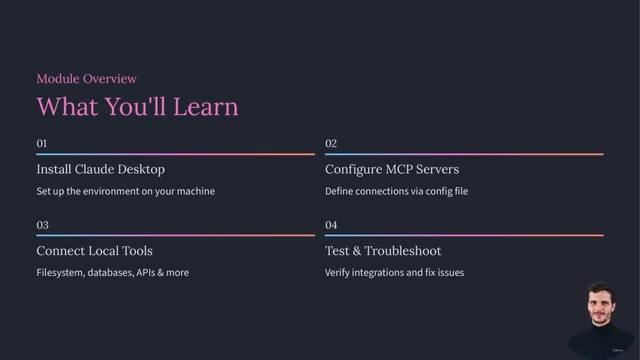
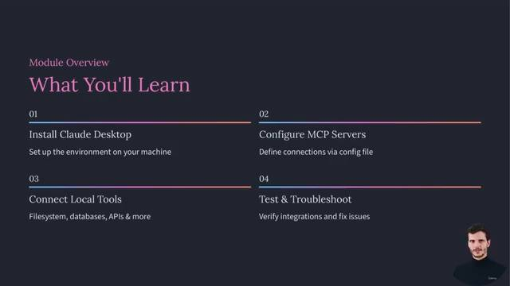
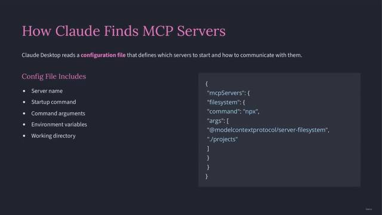
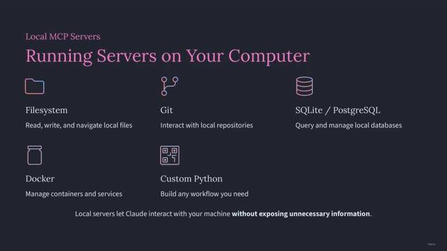
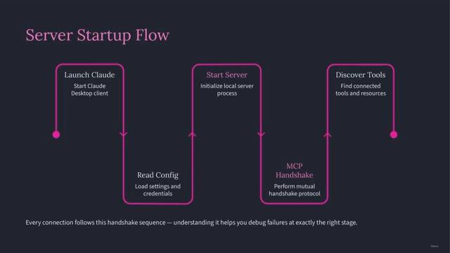
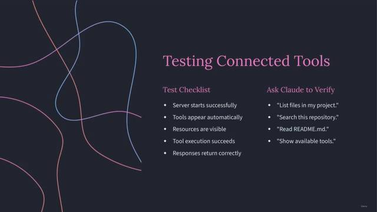
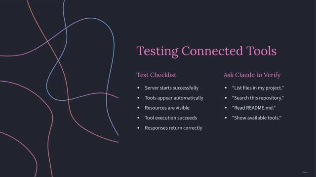
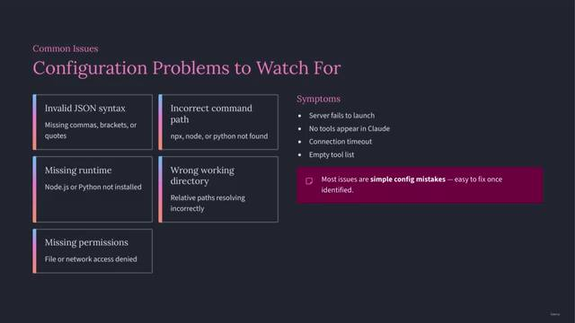
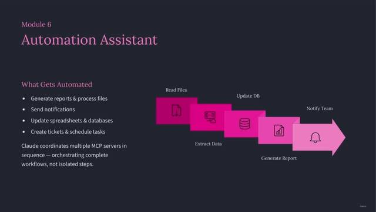
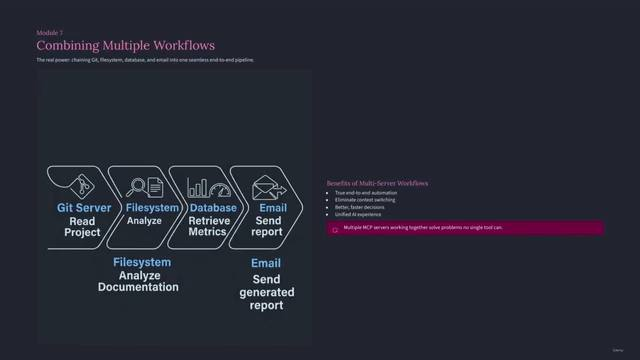

# Claude MCP Masterclass：把 Claude Desktop 接上 MCP 服务器，并跑通一条端到端工作流（P13–P14）

> 说明：这两讲（P13、P14）是**概念讲解 + 演示预告**型课程，逐字稿里没有出现任何可直接复制的代码、命令或配置文件内容，截图清单也没有提供 OCR 文本。因此本文档的「完整代码」一节，凡涉及具体 JSON 结构、命令参数的部分，都会明确标注**「课里没讲，以下为按讲师描述还原的最小可用示例」**，并给出可运行的骨架，读者可照着搭起来；凡是逐字稿里确实讲到的概念、参数类别、判断标准，一律原样保留、不省略。

---

## 1. 这一节做什么

这两讲解决一个非常具体的问题：**怎么把 Claude Desktop 从一个「聊天机器人」改造成一个能读写你本地文件、查 Git 仓库、连数据库、跑 Docker、调自定义 Python 脚本的「AI 工作台」，并且用一条端到端工作流把多个 MCP 服务器串起来。**

拆成可执行的目标，一共五件事：

1. **安装并登录 Claude Desktop**，确认 MCP 配置目录存在（这是后面一切的前提）。
2. **理解并写出 MCP 配置文件**：每个服务器一个条目，包含服务器名、启动命令、命令行参数、环境变量、工作目录。
3. **接上本地 MCP 服务器**（文件系统、Git、数据库、Docker、自定义 Python 等），理解 Claude 启动时的加载顺序：读配置 → 加载设置与凭据 → 启动每个服务器 → 完成 MCP 握手 → 发现工具与资源。
4. **验证集成**：服务器无错启动、工具自动出现在 Claude 里、资源/提示模板可见、实际执行工具并拿到正确返回。
5. **用多服务器编排一条完整工作流**：读仓库 → 生成 README 与架构摘要 → 查数据库拿指标 → 汇总成报告 → 通过邮件/通知服务器「发送」给团队。

P13 偏「装 + 配 + 调」，P14 偏「用 + 编排 + 最佳实践」。两讲合起来是一条从零到跑通的完整路径。

---

## 2. 讲师原话

> "Claude Desktop 是最早原生支持 MCP 的 AI 应用之一，因此它是构建和试验真实 AI 工作流的绝佳平台。"
> —— p013 [00:00]

> "开箱即用时 Claude 是一个强大的对话式 AI 助手。但一旦和 MCP 结合，它就远不止是一个聊天机器人，而是变成一个可扩展的 AI 平台，能够与本地工具、API、数据库、源代码和自定义自动化工作流交互。"
> —— p013 [00:27]

> "Claude Desktop 最大的优势之一是本地执行。很多 MCP 服务器直接跑在你的电脑上，让 Claude 能安全地访问文件、仓库和数据库，而不必把不必要的信息暴露给外部系统。这同时带来了灵活性和更强的隐私性。"
> —— p013 [00:56]

> "安装流程分五步：第一，从 Anthropic 官网下载最新版 Claude Desktop；第二，用你操作系统的安装器安装；第三，启动应用并用 Anthropic 账号登录；第四，确认 Claude 能成功启动、能进入应用设置；最后一个但非常重要的一步，是确认 MCP 配置目录在你的系统上存在。"
> —— p013 [01:54]

> "这个配置目录里放着配置文件，Claude Desktop 靠它来发现并启动 MCP 服务器。本模块后面我们会编辑这个配置，来连接自定义服务器。"
> —— p013 [02:50]

> "与其每次打开 Claude 都手动启动服务器，应用会读取一个配置文件，告诉它到底要启动哪些服务器、以及如何连接它们。"
> —— p013 [03:18]

> "这个配置文件通常包含几项重要信息：每个服务器有一个唯一的名字、启动它所用的命令、任何必需的命令行参数、包含凭据或配置设置的环境变量，以及服务器应当执行的工作目录。"
> —— p013 [03:48]

> "举个例子，一个文件系统服务器可以用一条 NPX 命令启动，它启动官方的 MCP 文件系统服务器，并把它指向某个特定的项目文件夹。"
> —— p013 [04:15]

> "当 Claude Desktop 启动时，它会自动读取这份配置、启动服务器、建立通信，并发现该服务器暴露出来的工具和资源。"
> —— p013 [04:15]

> "这种做法最大的优势之一是灵活。新增一个服务器，往往只需要往配置文件里再加一个条目，不需要修改 Claude Desktop 本身，也不需要安装额外插件。"
> —— p013 [04:44]

> "当 Claude Desktop 启动时，它读取 MCP 配置文件、加载服务器设置和凭据、启动每一个已配置的服务器、执行 MCP 握手，然后发现所有可用的工具和资源。只有这个初始化过程完成之后，工具才能在 Claude 里使用。"
> —— p013 [06:11]

> "理解这个启动顺序对排错特别有价值，因为它精确指出了失败发生在哪一步：是加载配置、启动服务器、完成握手，还是发现工具。"
> —— p013 [06:41]

> "先检查每个服务器在 Claude Desktop 启动时是否无错启动。接着确认连接上的工具是否自动出现在 Claude 里。如果你的服务器暴露了资源或提示模板，确认它们也可用。最后，执行一个或多个工具，确认返回了准确的结果。"
> —— p013 [07:10]

> "比如你可以让 Claude 列出项目目录里的文件、搜索一个 Git 仓库、读取一个 README 文件，或者显示所有已连接服务器暴露的工具。"
> —— p013 [07:40]

> "如果这些测试失败，不要立刻认定服务器坏了。很多问题是由简单的配置错误、错误的路径、缺失的运行时或权限问题引起的，通常都能很快解决。"
> —— p013 [08:08]

> "先检查 MCP 配置文件。少一个逗号、引号写错、或者 JSON 结构非法，都会让 Claude Desktop 根本读不了配置。"
> —— p013 [09:07]

> "接下来确认服务器进程确实启动了。如果服务器启动失败，去看终端输出里关于缺失依赖、命令路径错误或运行时问题的报错。"
> —— p013 [09:35]

> "下一步是检查 Claude Desktop 的日志。这些日志会显示客户端是否成功发现了服务器、是否完成了 MCP 握手、是否加载了可用工具。"
> —— p013 [09:35]

> "如果问题还在，试着脱离 Claude Desktop 单独运行这个 MCP 服务器。这有助于判断问题出在服务器本身，还是出在 Claude 的配置上。"
> —— p013 [10:05]

> "在整个过程中，问自己几个重要问题：服务器启动成功了吗？握手完成了吗？工具被发现了吗？认证成功了吗？有条理地回答这些问题，你几乎能定位任何集成问题的根源。"
> —— p013 [10:05]

> "最常见的问题之一是 JSON 语法非法。哪怕只少一个逗号、括号放错位置、引号不配对，都会让 Claude Desktop 读不了配置文件。"
> —— p013 [10:33]

> "另一个常见问题是命令路径写错。比如 node.js、python 或 npx 没装、或者不在系统 PATH 里，Claude 就无法启动服务器。"
> —— p013 [11:02]

> "开发者还经常遇到运行时环境缺失。如果服务器依赖 Python 或 Node.js，而这两个运行时不存在或版本过旧，启动会立刻失败。"
> —— p013 [11:32]

> "错误的工作目录是另一个常见错误来源，尤其是使用相对路径、结果解析到了错误位置的时候。"
> —— p013 [11:32]

> "权限问题也会导致集成失败。Claude 或 MCP 服务器可能没有足够权限去读文件、访问目录、或与所需服务通信。"
> —— p013 [12:00]

> "典型症状包括：服务器启动失败、Claude 里不出现任何工具、连接超时、或者工具列表为空。"
> —— p013 [12:00]

> "集成跑通之后，监控就成了维护可靠开发环境的重要一环。日志能让你看清 Claude Desktop 是如何与 MCP 服务器通信的，并在问题变严重之前发现它们。"
> —— p013 [12:27]

> "集成过程中每一个重要事件都可以被监控，包括服务器启动、配置加载、连接成功、MCP 握手、工具发现、资源请求、工具执行，以及通信过程中遇到的任何错误。"
> —— p013 [12:57]

> "监控不只对调试有用。它还让你能评估性能：测量启动时间、请求延迟、服务器响应性、资源占用。随着你接的 MCP 服务器越来越多，这种可见性对优化整体系统越来越重要。"
> —— p013 [13:26]

> "好的可观测性把调试从猜测变成结构化流程。你不用再猜为什么集成失败，而是可以沿着从配置加载到工具执行的整条链路追踪，快速定位问题究竟出在哪。"
> —— p013 [13:55]

> "先认真组织你的配置。用描述性的服务器名，清楚表明每个服务器的用途；把配置文件纳入版本控制，这样改动可以被追踪。新增服务器时，一次只加一个，验证通过再上下一个。"
> —— p013 [14:24]

> "安全永远要优先。API 密钥、凭据这类敏感信息应该放在环境变量里，而不是直接写进配置文件。不要把密钥提交到版本控制，并确保本地目录和配置文件有合适的权限。"
> —— p013 [14:51]

> "定期看日志，尤其是在配置更新或软件升级之后。重大改动后重启 Claude Desktop，确保新设置生效。最后，为你写的自定义 MCP 服务器写文档，让同事、也让未来的你能看懂它们怎么工作。"
> —— p013 [15:19]

> "在这个演示里，我们会把第一个 MCP 服务器接到 Claude Desktop 上，并端到端验证一切正常。我们先定位 Claude Desktop 的 MCP 配置文件，加一个新的服务器条目。"
> —— p013 [17:45]

> "这个例子里我们用一个简单的文件系统服务器，它是本地开发中最常用的 MCP 服务器之一。保存配置后，我们重启 Claude Desktop，让它读取更新后的设置并自动启动服务器。"
> —— p013 [18:14]

> "接下来验证连接是否成功建立。我们会让 Claude 列出可用工具，确认文件系统服务器出现在工具列表里。然后执行几条简单命令，比如列出项目文件夹里的文件、读取一个 README 文件、搜索某个特定的源文件。"
> —— p013 [18:14]

> "当 Claude 执行这些操作时，注意它不再只依赖内置知识，而是通过 MCP 服务器直接与你的本地机器交互。"
> —— p013 [18:44]

> "如果哪里不工作，我们会走一遍调试流程：检查配置文件、查看启动日志、确认服务器成功启动。"
> —— p013 [18:44]

> "大多数人想到 AI 助手，想到的是提问然后得到回答。但 Claude Desktop 结合 MCP 走得更远，它变成一个完整的 AI 工作台，能够与文件、源代码、数据库、API 和业务系统交互。"
> —— p014 [00:00]

> "通过 MCP 服务器，比如文件系统服务器、Git 服务器、终端服务器、Docker 服务器和文档工具，Claude 能访问你完整的项目。它可以浏览仓库、检查项目结构、理解依赖，并在真实上下文中推理代码。"
> —— p014 [01:54]

> "这让很多开发任务成为可能：Claude 可以解释陌生的代码、生成新函数、调试错误、重构现有实现、审查 pull request，甚至生成完整的单元测试。"
> —— p014 [02:23]

> "由于它理解的是周边整个项目而不是单个文件，它的建议往往更准确、更一致。"
> —— p014 [02:53]

> "文档工作流是这样开始的：通过文件系统服务器读取你的源代码。Claude 分析项目结构、识别关键组件、检查 API、理解不同模块如何交互。基于这些信息，它生成贴合该项目的专业文档。"
> —— p014 [03:48]

> "这包括 README 文件、API 文档、安装指南、架构概览、代码注释、用户手册和开发者上手材料。生成之后，Claude 甚至能把更新后的文档自动写回你的项目。"
> —— p014 [04:17]

> "当然，生成的内容在发布前始终应该被审阅，但 Claude 大幅减少了所需的人工工作量。"
> —— p014 [05:14]

> "传统文件管理器主要按文件名和文件夹结构来组织文档。而 Claude 理解文件的实际内容，因此能执行复杂得多的操作。"
> —— p014 [05:43]

> "比如，它不是简单地按文件名搜索，而是可以按语义定位文档。你可以让它找出项目里所有的 API 规范、汇总上个月所有的会议记录、识别多个文件夹里的重复文件，或者自动把下载目录整理成合理的分类。"
> —— p014 [05:43]

> "因为 Claude 能读 PDF、Word 文档、Markdown 文件、电子表格、源代码以及很多其他格式，它做的是语义搜索而不是简单的关键词匹配。"
> —— p014 [06:12]

> "数据库工作流从用户的一个简单问题开始。Claude 分析请求，自动生成合适的 SQL 查询。数据库执行查询、返回结果，Claude 再解读数据，用通俗的英文呈现有意义的业务洞察。"
> —— p014 [07:09]

> "除了基础查询，Claude 还能解释数据库 schema、发现趋势和异常、生成汇总报告、对比数据集，甚至给出查询性能改进建议。"
> —— p014 [07:38]

> "想象一下问这样的问题：上个季度我们卖得最好的产品是什么？把支出明显下降的客户列给我。或者总结过去一年的月度收入趋势。Claude 把这些请求转成 SQL，通过 MCP 数据库服务器执行，并用对话方式解释结果。"
> —— p014 [08:06]

> "Claude 最大的优势之一是跨源综合。它不只是总结单个文档，而是识别模式、标出不一致之处、把多个来源里的想法连接起来。"
> —— p014 [10:01]

> "也许 MCP 带来的最强大的工作流是自动化。Claude 不是执行单个任务，而是可以协调多个 MCP 服务器，从头到尾执行完整的工作流。"
> —— p014 [10:30]

> "举个简单的例子：Claude 读取新上传的文件、提取相关信息、更新数据库、生成报告，然后给相应的团队发一条通知。"
> —— p014 [11:00]

> "因为 MCP 支持同时连接多个服务器，Claude 充当编排者，协调流程中的每一步。"
> —— p014 [11:30]

> "当然，自动化要谨慎实施。敏感操作应当包含校验和审批步骤，每一个自动化动作都应当被记录以便审计。"
> —— p014 [12:27]

> "想象这样一条工作流：Claude 读取一个 Git 仓库、分析项目文档、从数据库取性能指标、生成一份汇总报告，然后把结果邮件发给相关方。每一步用的是不同的 MCP 服务器，但从用户视角看，整个过程就像一次交互。"
> —— p014 [12:54]

> "第一条建议是从简单开始。一次只构建并验证一条工作流，再去组合多个系统。这样更容易定位问题、理解每个组件的行为。"
> —— p014 [14:48]

> "其次，限制权限。每个 MCP 服务器只应访问它真正需要的资源。遵循最小权限原则能显著提升安全性。"
> —— p014 [15:18]

> "另一个关键实践是校验输出。Claude 能力很强，但 AI 生成的内容在触发重要动作之前始终应当被审阅。涉及财务数据、客户沟通、或对生产系统的自动更新时尤其如此。"
> —— p014 [15:18]

> "日志和监控同样重要。每一个自动化动作都应当被记录下来，用于审计和排错。详细的日志帮助团队理解发生了什么、定位失败、并持续提升工作流的可靠性。"
> —— p014 [15:46]

> "最后，拥抱持续改进。实用的 AI 工作流会随时间演进。增量测试、收集反馈、随着新需求出现不断打磨流程。"
> —— p014 [16:15]

> "这个模块的核心结论很简单：Claude Desktop 加 MCP 解锁了新一代 AI 助手，它们主动参与你的工作，而不只是回答问题。"
> —— p014 [17:43]

> "注意背后发生了什么。Claude 不是简单地生成文本，它在协调多个 MCP 服务器、在它们之间共享上下文、聚合响应、产出统一的结果。这正是现代 AI 助手在生产环境中开始运作的方式。"
> —— p014 [19:39]

---

## 3. 从零复现

下面按「装 → 配 → 接 → 验 → 编排」的顺序，把这两讲的内容落成可照着做的步骤。**凡是逐字稿没有给出具体值的地方，我会写明「课里没讲」，并给出一个能跑通的最小示例，读者可自行替换。**

### 3.1 前置条件

- 一台 Windows 或 macOS 电脑（讲师明确说 Claude Desktop 目前支持这两个平台）。
- 有效的网络连接。
- 一个可登录的 Anthropic 账号。
- 本地已安装 Node.js（含 `npx`）和/或 Python——因为后面要用 `npx` 启动官方文件系统服务器，用 Python 跑自定义服务器。**具体版本号课里没讲**，建议 Node 18+ / Python 3.10+，以官方 MCP 服务器仓库的 README 为准。

### 3.2 安装 Claude Desktop（五步）

讲师把安装拆成五步，照做即可：

1. 从 Anthropic 官网下载最新版 Claude Desktop。
2. 用操作系统的安装器安装。
3. 启动应用，用 Anthropic 账号登录。
4. 确认 Claude 能正常启动、能进入应用设置（Settings）。
5. **确认 MCP 配置目录存在**——这是讲师反复强调的「最后一个但非常重要的一步」。

配置目录的位置，**逐字稿没有给出具体路径**。按 Claude Desktop 的通行约定（课里没讲，供参考）：

- macOS：`~/Library/Application Support/Claude/`
- Windows：`%APPDATA%\Claude\`

配置文件名为 `claude_desktop_config.json`（课里没讲文件名，以你本机实际为准）。如果目录不存在，先手动创建它，再放入配置文件。



### 3.3 写 MCP 配置文件

讲师明确列出了每个服务器条目要包含的五类信息：

| 字段类别 | 作用 | 讲师原话对应 |
|---|---|---|
| 服务器名 | 唯一标识，建议描述性命名 | "每个服务器有一个唯一的名字" |
| 启动命令 | 用什么程序启动服务器 | "启动它所用的命令" |
| 命令行参数 | 传给命令的参数（如指向哪个项目文件夹） | "任何必需的命令行参数" |
| 环境变量 | 凭据或配置设置 | "包含凭据或配置设置的环境变量" |
| 工作目录 | 服务器在哪个目录下执行 | "服务器应当执行的工作目录" |

讲师举的例子是：**用一条 `npx` 命令启动官方 MCP 文件系统服务器，并把它指向某个特定项目文件夹。**

> 注意：逐字稿只说了「用 npx 启动官方文件系统服务器、指向某个项目文件夹」，**没有念出完整的命令字符串，也没有念出 JSON 的键名**。下面第 4 节给出的 JSON 是**按这五类信息还原的最小可用示例**，键名（`command` / `args` / `env` / `cwd`）以你所用 Claude Desktop 版本的官方文档为准。



### 3.4 接上本地 MCP 服务器

讲师列举了本地 MCP 服务器的类型，以及各自能给 Claude 的能力：

- **文件系统服务器**：让 Claude 在批准的目录内浏览、读取、修改文件。
- **Git 服务器**：访问本地仓库、提交历史、分支。
- **数据库服务器**（如 SQLite、PostgreSQL）：让 Claude 查询和分析结构化数据。
- **Docker 服务器**：管理容器。
- **自定义 Python 服务器**：为几乎任何任务创建专门的工作流。

P14 又补充了 **终端服务器** 和 **文档工具** 两类。

接服务器的动作本质就是：往配置文件里加一个条目 → 保存 → **重启 Claude Desktop**（讲师在演示里明确说「保存配置后重启 Claude Desktop，让它读取更新后的设置并自动启动服务器」）。

### 3.5 理解启动顺序（排错的地图）

讲师把 Claude Desktop 启动时的初始化过程讲成一条链，这条链就是排错地图：

1. 读取 MCP 配置文件
2. 加载服务器设置和凭据
3. 启动每一个已配置的服务器
4. 执行 MCP 握手
5. 发现所有可用的工具和资源

**只有这五步全部完成，工具才能在 Claude 里使用。** 排错时逐段对照：卡在哪一步，问题就在哪一段。



### 3.6 验证集成（四类检查）

讲师给的验证清单，按顺序做：

1. **服务器无错启动**：Claude Desktop 启动时，每个服务器都不报错。
2. **工具自动出现**：连接上的工具自动出现在 Claude 里。
3. **资源/提示模板可见**：如果服务器暴露了 resources 或 prompt templates，确认它们也可用。
4. **实际执行工具**：跑一个或多个工具，确认返回准确结果。

讲师给的验证用提示词（可直接照抄去问 Claude）：

- 列出项目目录里的文件
- 搜索一个 Git 仓库
- 读取一个 README 文件
- 显示所有已连接服务器暴露的工具

演示环节里，讲师具体跑了三条：**列出项目文件夹里的文件、读取一个 README 文件、搜索某个特定的源文件**。



### 3.7 系统化调试流程

讲师强调「不要猜」，按阶段逐项验证：

1. **检查 MCP 配置文件**：少逗号、引号错、JSON 结构非法，都会让 Claude Desktop 根本读不了配置。
2. **确认服务器进程真的启动了**：启动失败就看终端输出里关于缺失依赖、命令路径错误、运行时问题的报错。
3. **检查 Claude Desktop 日志**：日志会显示客户端是否发现服务器、是否完成 MCP 握手、是否加载了工具。
4. **核对环境变量**：API 密钥、配置设置是否正确。
5. **脱离 Claude Desktop 单独运行服务器**：判断问题在服务器本身还是在 Claude 的配置。

贯穿全程的四个自问（讲师原话）：

- 服务器启动成功了吗？
- 握手完成了吗？
- 工具被发现了吗？
- 认证成功了吗？



### 3.8 常见故障与症状对照

讲师列出的高频问题：

| 问题 | 后果 |
|---|---|
| JSON 语法非法（少逗号、括号错位、引号不配对） | Claude Desktop 读不了配置文件 |
| 命令路径错误（node.js / python / npx 没装或不在 PATH） | Claude 无法启动服务器 |
| 运行时缺失或过旧（Python / Node.js） | 启动立刻失败 |
| 工作目录错误（相对路径解析到错误位置） | 服务器在错误目录下执行 |
| 权限不足（读文件、访问目录、与服务通信） | 集成失败 |

典型症状：**服务器启动失败、Claude 里不出现工具、连接超时、工具列表为空。**



### 3.9 监控与日志

集成跑通后，讲师把监控列为维护可靠环境的重要一环。可监控的事件包括：

- 服务器启动
- 配置加载
- 连接成功
- MCP 握手
- 工具发现
- 资源请求
- 工具执行
- 通信过程中的任何错误

日志的两种用途：

- **排错**：按时间顺序还原发生了什么，定位失败握手、缺失环境变量、服务器启动错误。
- **性能评估**：测量启动时间、请求延迟、服务器响应性、资源占用。

讲师建议养成习惯：**每次改配置或加新服务器之后都去看日志**；如果某样东西突然不工作，日志往往直接指向根源。



### 3.10 最佳实践（P13 收尾）

- **组织配置**：用描述性服务器名；配置文件纳入版本控制；新增服务器一次只加一个，验证通过再加下一个。
- **安全**：API 密钥和凭据放环境变量，不写进配置文件；不把密钥提交到版本控制；给本地目录和配置文件设合适权限。
- **保持知情**：定期看日志，尤其是配置更新或软件升级后；重大改动后重启 Claude Desktop；为自定义 MCP 服务器写文档。



### 3.11 P14：把能力串成工作流

P14 的核心不是新装什么，而是**怎么用**。讲师给了六类工作流，每一类都对应一组 MCP 服务器：

**（1）软件工程助手**
用文件系统、Git、终端、Docker、文档工具服务器，让 Claude 访问完整项目：浏览仓库、检查结构、理解依赖、在真实上下文中推理代码。可做的事：解释陌生代码、生成新函数、调试错误、重构、审查 PR、生成单元测试。因为理解的是整个项目而非单个文件，建议更准确、更一致。示例提问：审查仓库找性能瓶颈、提架构改进建议、定位跨模块重复代码。

**（2）文档工作流**
通过文件系统服务器读源码 → 分析结构、识别关键组件、检查 API、理解模块交互 → 生成 README、API 文档、安装指南、架构概览、代码注释、用户手册、开发者上手材料 → 可自动写回项目。讲师强调：**生成内容发布前必须审阅**。

**（3）文件管理助手**
按内容而非文件名理解文件，做语义搜索：找项目里所有 API 规范、汇总上个月会议记录、识别跨文件夹重复文件、把下载目录自动分类。支持 PDF、Word、Markdown、电子表格、源代码等格式。还能对比文档、识别重复内容、总结长报告、统一重命名、按需重组目录结构——全部通过文件系统服务器、在你配置的权限范围内进行。

**（4）数据库工作流**
用户用自然语言提问 → Claude 生成 SQL → 数据库执行 → Claude 解读结果并用通俗英文呈现业务洞察。还能解释 schema、发现趋势与异常、生成汇总报告、对比数据集、给查询性能改进建议。示例提问：上季度卖得最好的产品、支出明显下降的客户、过去一年月度收入趋势。

**（5）研究工作流**
通过 MCP 兼容工具访问本地文档、PDF、内部知识库、API、外部信息源，跨源综合：识别模式、标出不一致、连接想法。适用场景：竞品分析、技术对比、市场调研、政策审查、文献研究。示例：对比多家云厂商、总结 AI 近期进展、分析竞品、从多份内部报告准备高管简报。

**（6）自动化与多服务器编排**
Claude 协调多个 MCP 服务器执行完整流程。讲师给的例子：读新上传文件 → 提取信息 → 更新数据库 → 生成报告 → 通知团队。可做：生成周期性报告、处理来件、更新表格、创建工单、安排任务、跨通信平台触发通知。**安全要求**：敏感操作要有校验和审批步骤，每个自动化动作都要记录以便审计。

**（7）端到端多服务器流水线（P14 演示）**
讲师描述的完整演示流程：

1. 用文件系统 + Git 服务器，让 Claude 读仓库结构、看最近提交、识别关键组件。
2. 让 Claude 生成专业 README，并总结当前架构。
3. 接入数据库服务器，让 Claude 取项目指标（使用统计或性能数据）。
4. 把所有信息合成一份报告，用邮件/通知服务器模拟发给团队。

讲师点题：Claude 不是简单生成文本，而是**协调多个 MCP 服务器、在它们之间共享上下文、聚合响应、产出统一结果**。



### 3.12 P14 最佳实践

- **从简单开始**：一次构建并验证一条工作流，再组合多系统。
- **限制权限**：每个服务器只访问真正需要的资源（最小权限原则）。
- **校验输出**：AI 生成内容在触发重要动作前必须审阅，尤其是财务数据、客户沟通、生产系统自动更新。
- **日志与监控**：每个自动化动作都记录，用于审计和排错。
- **持续改进**：增量测试、收集反馈、随需求演进打磨。



---

## 4. 完整代码

> **重要声明**：P13、P14 的逐字稿里**没有出现任何一行可复制的代码、命令或配置文本**，截图清单也没有提供 OCR 文本。因此本节内容分两类：
> - **A 类（讲师明确描述过结构，但未给出字面值）**：配置文件骨架，字段类别严格按讲师列的五类还原，键名标注为「课里没讲，按官方文档」。
> - **B 类（讲师只说了「自定义 Python 服务器」这个概念，没给代码）**：给出一个最小可运行的 MCP 服务器骨架，标注「课里没有代码，以下为示意」。

### 4.1 `claude_desktop_config.json`（A 类：按讲师描述的五类字段还原）

文件位置（课里没讲具体路径，按通行约定）：

- macOS：`~/Library/Application Support/Claude/claude_desktop_config.json`
- Windows：`%APPDATA%\Claude\claude_desktop_config.json`

```json
{
  "mcpServers": {
    "filesystem": {
      "command": "npx",
      "args": [
        "-y",
        "@modelcontextprotocol/server-filesystem",
        "/absolute/path/to/your/project"
      ],
      "env": {},
      "cwd": "/absolute/path/to/your/project"
    },
    "git": {
      "command": "npx",
      "args": [
        "-y",
        "@modelcontextprotocol/server-git",
        "--repository",
        "/absolute/path/to/your/project"
      ],
      "env": {},
      "cwd": "/absolute/path/to/your/project"
    },
    "sqlite": {
      "command": "npx",
      "args": [
        "-y",
        "@modelcontextprotocol/server-sqlite",
        "/absolute/path/to/your/database.db"
      ],
      "env": {
        "DB_READONLY": "true"
      },
      "cwd": "/absolute/path/to/your/project"
    }
  }
}
```

**逐字段对照讲师原话：**

- `mcpServers`：顶层容器，每个键是一个服务器名（讲师："每个服务器有一个唯一的名字"）。名字用描述性的，如 `filesystem`、`git`、`sqlite`。
- `command`：启动命令（讲师："启动它所用的命令"）。文件系统服务器用 `npx`。
- `args`：命令行参数（讲师："任何必需的命令行参数"）。文件系统服务器的参数里包含**要指向的项目文件夹绝对路径**——这正是讲师说的"把它指向某个特定的项目文件夹"。
- `env`：环境变量（讲师："包含凭据或配置设置的环境变量"）。API 密钥、凭据放这里，**不要写死在别处**。
- `cwd`：工作目录（讲师："服务器应当执行的工作目录"）。用绝对路径，避免讲师点名的"相对路径解析到错误位置"。

> 键名 `mcpServers` / `command` / `args` / `env` / `cwd` 以及各官方服务器的包名，**逐字稿均未念出**，以上为按讲师描述的五类信息 + 官方 MCP 服务器命名惯例还原。请以你所用 Claude Desktop 版本的官方文档为准；若键名不符，Claude Desktop 会表现为「读不到配置」或「工具列表为空」，正好对应讲师列的典型症状。

### 4.2 自定义 Python MCP 服务器骨架（B 类：课里没有代码，以下为示意）

讲师在 P13 提到"自定义 Python 服务器允许开发者为几乎任何任务创建专门的工作流"，但**没有给任何代码**。下面是一个最小骨架，用来演示"一个 MCP 服务器如何暴露工具"，读者可据此扩展。**这不是讲师写的代码，是示意。**

```python
# server.py
# 课里没有代码，以下为示意：一个最小 MCP 服务器骨架
from mcp.server.fastmcp import FastMCP

mcp = FastMCP("demo-server")


@mcp.tool()
def list_project_files(directory: str) -> list[str]:
    """列出指定目录下的文件。"""
    import os
    return sorted(os.listdir(directory))


@mcp.tool()
def read_readme(project_dir: str) -> str:
    """读取项目根目录下的 README 文件。"""
    import os
    for name in ("README.md", "README.txt", "readme.md"):
        path = os.path.join(project_dir, name)
        if os.path.exists(path):
            with open(path, "r", encoding="utf-8") as f:
                return f.read()
    return "未找到 README 文件"


if __name__ == "__main__":
    mcp.run()
```

对应的配置条目（A 类结构 + B 类服务器）：

```json
{
  "mcpServers": {
    "demo-python": {
      "command": "python",
      "args": ["/absolute/path/to/server.py"],
      "env": {},
      "cwd": "/absolute/path/to/your/project"
    }
  }
}
```

> `mcp.server.fastmcp` 是示意用的导入路径，**课里没讲**具体 SDK 与包名。实际以你安装的 MCP Python SDK 文档为准。若导入失败，症状就是讲师说的"服务器启动失败，去看终端输出里关于缺失依赖的报错"。

### 4.3 验证用的提示词清单（可直接照抄）

讲师在 P13 给的验证提示词，原样整理成可复制清单：

```text
列出我项目目录里的所有文件。
读取项目根目录下的 README 文件并总结它。
在 Git 仓库里搜索名为 <某个源文件名> 的文件。
显示所有已连接 MCP 服务器暴露的工具列表。
```

P14 演示用的端到端提示词（按讲师描述的流程整理）：

```text
1. 读取这个仓库的结构，列出最近 5 次提交，并识别关键项目组件。
2. 基于当前代码生成一份专业的 README，并总结当前架构。
3. 从数据库里取出项目的使用统计和性能指标。
4. 把以上所有信息合成一份报告，并通过通知/邮件服务器发给团队。
```

> 以上提示词是**按讲师口述的演示步骤整理**，不是逐字稿原文；逐字稿只描述了"我们会让 Claude 做 X"，没有给出可直接复制的 prompt 文本。

---

## 5. 逐行解释

### 5.1 为什么配置文件是「桥」

讲师把配置文件称为"Claude Desktop 与你的 MCP 生态之间的桥"。理解这句话，就理解了整个 P13：

- Claude Desktop **本身不认识你的服务器**，它只认识配置文件。
- 配置文件里每个条目告诉它三件事：**用什么启动**（command + args）、**在什么环境下启动**（env + cwd）、**叫什么名字**（键名）。
- 所以"新增一个服务器"= "加一个条目"，不需要改 Claude Desktop、不需要装插件——这就是讲师说的"灵活"。

对应到前端：这很像 `package.json` 里的 `scripts` 字段。你不改 npm 本身，只加一行脚本，`npm run xxx` 就能跑。MCP 配置文件就是 Claude Desktop 的"scripts 表"。

### 5.2 为什么启动顺序是排错地图

讲师把启动拆成五步：读配置 → 加载设置与凭据 → 启动服务器 → 握手 → 发现工具。这不是随便分的，**每一步失败的症状不同**：

| 卡在哪一步 | 你会看到什么 | 对应讲师列的常见问题 |
|---|---|---|
| 读配置 | Claude 完全读不到服务器，工具列表空 | JSON 语法非法 |
| 加载设置与凭据 | 服务器起来了但认证失败 | 环境变量缺失/错误 |
| 启动服务器 | 进程根本没起来 | 命令路径错、运行时缺失、工作目录错、权限不足 |
| 握手 | 进程在但 Claude 连不上 | 连接超时 |
| 发现工具 | 连上了但工具列表空 | 服务器没正确暴露工具 |

所以讲师说"知道这个工作流让调试容易得多"——因为你可以**从症状反推卡在哪一步**，而不是盲目重装。

### 5.3 为什么「单独运行服务器」是最有效的调试手段

讲师把"脱离 Claude Desktop 单独运行 MCP 服务器"列为关键一步。逻辑很简单：**它把问题空间一分为二**。

- 单独跑也失败 → 问题在服务器本身（依赖、代码、权限）。
- 单独跑成功、接进 Claude 失败 → 问题在 Claude 的配置（JSON、路径、env、cwd）。

这是一次二分，直接把排查范围砍一半。对应前端调试：接口在 Postman 里通、在页面里不通，那问题就在前端调用层，不在后端。

### 5.4 为什么凭据要放环境变量

讲师反复强调：API 密钥、凭据放 `env`，不写进配置文件正文，不提交到版本控制。原因有两层：

1. **配置文件要进版本控制**（讲师明确建议"纳入版本控制以便追踪改动"），一旦密钥写进去，就会被提交、被扩散。
2. **环境变量是运行时注入的**，不同机器可以有不同的值，配置文件本身可以安全共享。

对应前端：就像 `.env` 文件进 `.gitignore`，`.env.example` 进仓库。同一个道理。

### 5.5 为什么「一次只加一个服务器」

讲师在最佳实践里说"新增服务器时一次只加一个，验证通过再上下一个"。原因是**故障归因**：一次加五个，出问题时你不知道是哪个、也不知道是不是它们之间的交互导致的。一次加一个，出问题就锁定在那一个上。这和 P14"从简单开始，一次构建并验证一条工作流"是同一条原则的两种表述。

### 5.6 为什么监控要记录「握手」和「工具发现」

讲师列的监控事件里，`MCP 握手` 和 `工具发现` 是两个容易被忽略但极关键的节点：

- **握手**是协议层协商，失败通常意味着版本不兼容或进程通信问题。
- **工具发现**是能力层，失败意味着服务器起来了但没正确声明工具。

只监控"服务器是否启动"是不够的——进程活着但握手失败、或握手成功但工具为空，都是常见故障。讲师把这两个单独列出来，就是为了让日志能精确定位到这两层。

### 5.7 P14 的工作流为什么按「服务器类型」分类

P14 列的六类工作流，每一类都对应一组特定服务器，这不是巧合：

- 软件工程 → 文件系统 + Git + 终端 + Docker + 文档工具
- 文档 → 文件系统
- 文件管理 → 文件系统
- 数据库 → 数据库服务器
- 研究 → 文件系统 + API/外部源
- 自动化 → 多服务器编排

**服务器类型决定了 Claude 能"看见"什么，工作流是这些能力的组合。** 理解这个映射，你就能自己设计工作流：先问"这个任务需要什么信息"，再问"哪个服务器能提供这些信息"，最后把它们接上。

### 5.8 为什么多服务器编排是「质变」

讲师在 P14 结尾点题：Claude 不是生成文本，而是"协调多个 MCP 服务器、共享上下文、聚合响应、产出统一结果"。这句话的技术含义是：

- 单服务器：Claude 是一个"会用某个工具的聊天机器人"。
- 多服务器：Claude 是一个"编排器"，它把 A 服务器的输出作为 B 服务器的输入，跨服务器维护上下文。

这就是讲师说的"从聊天机器人到 AI 工作台"的转变。对应前端：单个 API 调用 vs. 一个 orchestrator 把多个微服务的返回聚合渲染——后者才是"应用"，前者只是"接口"。

### 5.9 为什么自动化要「校验 + 审批 + 日志」

讲师在 P14 讲自动化时，连续提了三个约束：敏感操作要有校验和审批、每个动作要记录审计、输出要人工审阅。原因是**自动化的风险不对称**：读错一个文件只是不方便，自动改生产数据库或自动发客户邮件可能是灾难。所以讲师把"最小权限"和"输出校验"放在最佳实践里，和"从简单开始"并列。

---

## 6. 复现检查清单

按顺序打勾，任何一项不过，回到对应小节排查。

**安装与环境**
- [ ] Claude Desktop 已从 Anthropic 官网下载并安装（Windows 或 macOS）
- [ ] 已用 Anthropic 账号登录，能进入 Settings
- [ ] MCP 配置目录存在（不存在则手动创建）
- [ ] 本地已安装 Node.js（含 `npx`）和/或 Python，且在 PATH 里（`node -v`、`npx -v`、`python --version` 能跑通）

**配置**
- [ ] `claude_desktop_config.json` 是合法 JSON（可用任意 JSON 校验器验证，无少逗号/引号不配对/括号错位）
- [ ] 每个服务器条目都有：唯一描述性名字、command、args、env、cwd
- [ ] 所有路径都是绝对路径（避免讲师点名的"相对路径解析到错误位置"）
- [ ] 凭据放在 `env` 里，没有写死在配置文件正文
- [ ] 配置文件已纳入版本控制，且密钥未被提交

**连接与验证**
- [ ] 重启 Claude Desktop 后，每个服务器无错启动
- [ ] 工具自动出现在 Claude 的工具列表里
- [ ] 若服务器暴露 resources / prompt templates，它们也可见
- [ ] 执行"列出项目目录文件"成功
- [ ] 执行"读取 README"成功
- [ ] 执行"搜索某个源文件"成功
- [ ] 执行"显示所有已连接服务器暴露的工具"成功

**排错（仅在失败时走）**
- [ ] 已检查配置文件 JSON 合法性
- [ ] 已确认服务器进程真的启动（看终端输出）
- [ ] 已检查 Claude Desktop 日志（发现服务器？握手？工具？）
- [ ] 已核对环境变量
- [ ] 已脱离 Claude Desktop 单独运行服务器，确认问题归属
- [ ] 已按四问定位：启动成功？握手完成？工具发现？认证成功？

**监控与维护**
- [ ] 知道日志里能看哪些事件：服务器启动、配置加载、连接、握手、工具发现、资源请求、工具执行、错误
- [ ] 改配置或加服务器后会主动看日志
- [ ] 重大改动后会重启 Claude Desktop

**P14 工作流（可选，进阶）**
- [ ] 单服务器工作流已跑通，再尝试组合
- [ ] 每个服务器只授予它真正需要的权限
- [ ] 自动化动作有校验/审批步骤
- [ ] 自动化动作有日志可审计
- [ ] 端到端流水线（读仓库 → 生成 README → 查数据库 → 汇总报告 → 通知）能串起来

---

## 7. 课里没讲但你会撞上的

这一节专门列**逐字稿没提、但你照着做一定会遇到**的问题。写在这里是为了让你撞上时不慌。

1. **配置文件的确切路径和文件名**。讲师只说"确认 MCP 配置目录存在"，没给路径。macOS 和 Windows 的路径不同，且不同 Claude Desktop 版本可能变化。撞上时：在 Claude Desktop 的 Settings 里找 "Developer" 或 "MCP" 相关入口，通常会显示配置文件位置。

2. **JSON 键名的确切拼写**。讲师列了五类信息，但没念键名。`mcpServers` / `command` / `args` / `env` / `cwd` 是通行写法，但**以你所用版本的官方文档为准**。键名写错的表现就是"工具列表为空"——正好是讲师列的典型症状。

3. **官方 MCP 服务器的包名和参数**。讲师只说"用 npx 启动官方文件系统服务器、指向某个项目文件夹"，没给完整命令。`@modelcontextprotocol/server-filesystem` 等包名需以官方仓库为准；参数（如 `--repository`）也可能随版本变化。

4. **`npx -y` 的 `-y` 是干什么的**。课里没讲。它的作用是跳过 npx 的安装确认提示——在 Claude Desktop 这种非交互环境里，没有 `-y` 可能卡在确认提示上，表现为"服务器启动超时"。这是很常见的坑。

5. **Node/Python 版本要求**。课里没讲具体版本。官方 MCP 服务器通常要求较新的 Node（18+）或 Python（3.10+）。版本过旧的表现就是讲师说的"运行时缺失或过旧，启动立刻失败"。

6. **Windows 上 `npx` 的路径问题**。课里没讲。Windows 上有时需要写 `npx.cmd` 或提供 `npx` 的绝对路径，否则 Claude Desktop 找不到命令。这属于讲师说的"命令路径错误"大类。

7. **权限的具体配置方式**。讲师说"确保本地目录和配置文件有合适的权限"，但没讲怎么设。macOS 上可能涉及"完全磁盘访问权限"，Windows 上可能涉及文件夹权限。撞上时：先确认 Claude Desktop 有权限读你指向的项目目录。

8. **日志文件的确切位置**。讲师说"检查 Claude Desktop 日志"，没给路径。通常在配置目录下的 `logs` 子目录，或以应用日志形式存在。撞上时：在配置目录附近找 `*.log`。

9. **MCP 握手失败的具体原因**。讲师把"握手"列为监控事件，但没讲握手失败通常意味着什么（协议版本不匹配、进程通信问题等）。撞上时：先确认服务器单独运行正常，再检查 Claude Desktop 和服务器 SDK 的版本兼容性。

10. **多服务器之间的上下文如何共享**。P14 说 Claude"在服务器之间共享上下文"，但没讲机制。实际上这是 Claude 作为编排者在对话层做的，不是服务器之间直接通信——服务器彼此不知道对方存在。理解这一点，你就不会去设计"服务器 A 直接调服务器 B"的架构。

11. **"邮件/通知服务器"具体是哪个**。P14 演示里说"用邮件或通知服务器模拟发送"，但没指定是哪个 MCP 服务器。撞上时：这类服务器需要额外的凭据（SMTP、webhook 等），且属于讲师强调的"敏感操作"，务必加审批步骤。

12. **数据库服务器的只读模式**。讲师说数据库服务器让 Claude"查询和分析"，但没讲怎么写只读。P14 最佳实践说"最小权限"，落到数据库上就是只读连接——这是你应该主动加的，不是课里教的。

13. **前端视角的类比**：MCP 配置文件 ≈ `package.json` 的 `scripts`；`env` ≈ `.env`；"单独运行服务器" ≈ 用 Postman 单独测接口；"多服务器编排" ≈ 前端 orchestrator 聚合多个微服务。这些类比课里没讲，但对前端转过来的读者理解最快。

---

**一句话总结这两讲**：P13 教你**把 Claude Desktop 接上本地 MCP 服务器并验证跑通**（装 → 配 → 接 → 验 → 调 → 监控 → 最佳实践），P14 教你**用这些服务器串出真实工作流**（编码、文档、文件管理、数据库、研究、自动化、多服务器编排）。配置文件是桥，启动五步是排错地图，一次加一个是纪律，最小权限 + 输出校验 + 日志审计是底线。