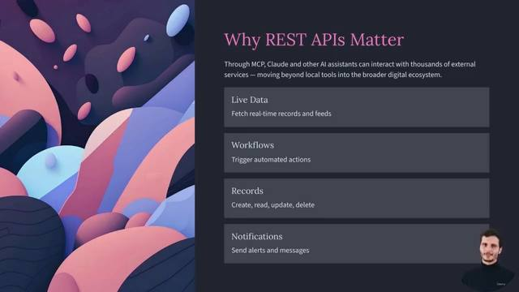
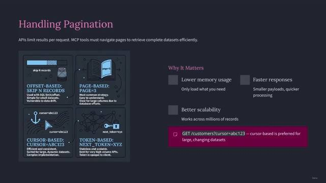
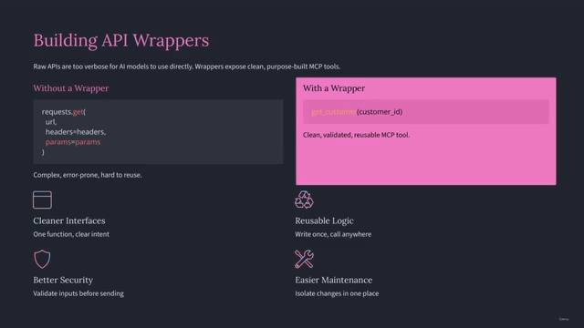
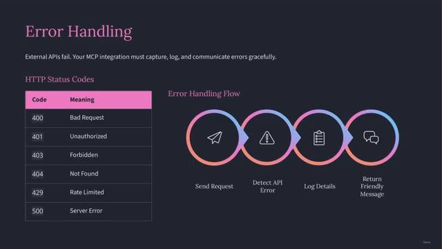
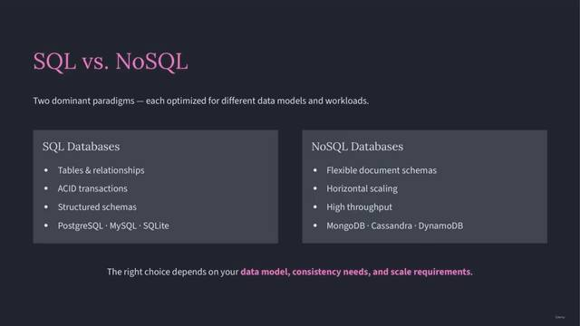
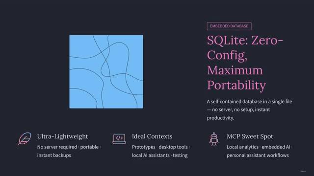
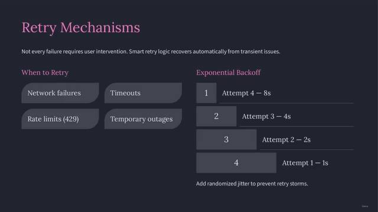
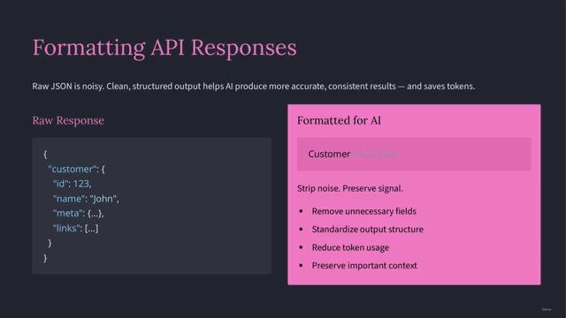

# Claude MCP Masterclass：REST API 与数据库的生产级 MCP 集成（P015–P016）

> 本文覆盖 BV1SZgy6qEPh 的 P015（用 REST API 把 Claude 接到外部服务）与 P016（用 MCP 把 Claude 接到数据库）。
>
> **先说明一件重要的事**：这两节讲师给的是**架构讲解 + 演示流程讲述**，逐字稿里**没有出现任何可复制的源码、命令或配置文件内容**，本次也没有可用的截图 OCR 文本。所以：
> - 凡讲师讲过的概念、参数、步骤、判断，本文**全部收录**；
> - 第 4 节的可运行代码是**文档作者按讲师给出的设计约束补写的示意实现**，每一处都会标注「课里没给代码，以下为示意」，参数严格沿用讲师原话（如重试间隔 1s/2s/4s/8s）；
> - 讲师没讲的（依赖版本、Claude Desktop 配置路径、SDK 具体 API），统一放在第 7 节，并明确写「课里没讲」。

---

## 1. 这一节做什么

这两节是同一件事的两个数据源方向：**把 Claude Desktop 从「只能看本地文件」变成「能读互联网」和「能读数据库」**。

- **P015 目标**：给 Claude 装一个「REST API 转接器」。用户用自然语言说话 → Claude 选一个你定义的 MCP 工具（如 `get_weather_city`、`get_github_repo`）→ 你的 MCP Server 在背后发 HTTP 请求 → 把返回的 JSON 压成一句人话 → Claude 用这句话回答用户。讲师把它定位成整个课程的分水岭：以前的模块都在「本地工具、文件、服务」里打转，REST API 才真正把助手接到「成千上万的外部平台和应用」。
- **P016 目标**：给 Claude 装一个「数据库查询器」。同样的链路，只是下游从 HTTP 换成 SQL/NoSQL：`list_tables` → `describe_schema` → `run_sql`，让 Claude 自己写查询、自己解释结果，最终扮演「会话式数据分析师」。

最终产物，按讲师的设计应该有三样东西：

1. 一个**只读的 REST 桥接 MCP Server**：2 个工具、凭据走环境变量、有超时、有指数退避重试、有分页参数、错误翻译成人话。
2. 一个**只读的 SQLite MCP Server**：3 个工具、SQL 白名单校验、行数上限、审计日志。
3. 一份 **Claude Desktop 配置**，两个 server 都挂上，用几句话就能验收（"本月前五大客户是谁？"）。

**本段的边界（很重要）**：讲师没有带我们敲任何一行代码，也没有给出 MCP Server 的脚手架。所以本文的定位是「把讲师的设计要求落成一份可执行的规格 + 一份能跑起来的示意实现」。你照着第 3、4 节做，能跑通；但你要清楚哪些是讲师原话、哪些是文档补的。

---

## 2. 讲师原话

先看 REST 为什么值得单独开一个模块：

> "像 GitHub、Slack、Stripe、Jira、Salesforce 和 Google Workspace 这样的服务，都提供可编程接口，让应用能与它们的系统交互。把这些 API 包装成 MCP 工具之后，Claude 和其他 AI 助手就能获取实时信息、触发工作流、更新记录、发送通知，以及完成无数其他动作。"
> —— p015 [00:29]

> "想象一下，让 Claude 创建一张 JIRA 工单、从 Salesforce 取回客户信息、发一条 Slack 消息，或者通过 Stripe 查一笔支付的状态。这些交互之所以成为可能，是因为 REST API 提供了应用之间跨互联网通信的标准化方式。"
> —— p015 [00:58]

REST 的定义和五個 HTTP 方法，是后面所有工具设计的语法基础：

> "REST 代表表述性状态转移（Representational State Transfer），它是一种架构风格，目的是让应用之间的通信简单、可扩展、可预测。REST 的核心是 HTTP 方法，这些方法定义了应用想对一个资源执行什么动作。GET 获取信息，POST 创建新资源，PUT 替换已有资源，PATCH 做局部更新，DELETE 删除资源。"
> —— p015 [01:53] / [02:21]

> "REST API 还遵循几条重要原则：它们是无状态的，意思是每个请求都包含处理所需的全部信息；它们是基于资源的，把数据当作可通过 URL 定位的对象；它们支持缓存以提升性能；并提供统一接口，让 API 更容易理解和消费。"
> —— p015 [02:50]

为什么要在 AI 和 API 之间加一层 wrapper，讲师给了四条理由：

> "直接用原始 API 调用，往往涉及冗长的 URL、认证头、查询参数和复杂的响应格式。这正是 API 包装层（wrapper）极有价值的地方。它充当 MCP Server 和外部服务之间的简化层。开发者不去把底层的 HTTP 请求暴露给 AI，而是创建有清晰命名、行为可预期的专用函数。比如 Claude 不必自己拼一个完整的 HTTP 请求，它只要调用一个像 `get_customer` 这样的函数，把客户 ID 作为输入传进去。"
> —— p015 [03:46]

> "这种抽象带来几个重要好处：第一，它造出更干净的接口，人和 AI 模型都更容易理解；第二，包装函数促进代码复用，底层 API 逻辑只写一次；第三，包装层在把请求发往外部系统之前校验输入，从而提升安全性。API 包装层也简化维护：如果外部 API 变了，只需要改包装层，MCP 工具的接口保持不变。"
> —— p015 [04:16] / [04:43]

认证部分，讲师点名了四种方式并给了凭据纪律：

> "认证让外部服务能验证是谁在发请求，并判断允许执行哪些动作。常见的有几种：API key 大概是最简单的，通常放在请求头或查询参数里；Bearer token 提供更安全的方式，在现代 API 中广泛使用；OAuth 2.0 支持委托访问，常用于应用与用户账号交互；JWT（JSON Web Token）提供了一种紧凑而安全的方式来传输认证信息。"
> —— p015 [05:42] / [06:09]

> "无论用哪种认证方式，凭据都必须小心处理。敏感值应该存在环境变量里，而不是硬编码进源码。凭据应该定期轮换、限制在最小必要权限，并且绝不提交到版本控制仓库。"
> —— p015 [06:37]

分页的四种策略和讲师的偏好：

> "很多 API 会限制单次请求返回的信息量。API 不一次性返回几百万条记录，而是把结果切成小块，这叫分页。常见的分页策略有：基于 offset 的分页，通过指定跳过多少条来取记录；基于页码的分页，使用明确的页号；基于游标（cursor）的分页，用唯一标识符从上次结束的地方继续；以及基于 token 的分页，返回一个不透明 token，客户端用它取下一批结果。"
> —— p015 [07:35] / [08:03]

> "在这些方法中，游标分页常常是大型或快速变化数据集的首选，因为它既高效又可靠。比如一个 API 请求可能带 `cursor=ABC123` 这样的参数，去取下一页客户记录。"
> —— p015 [08:03]

> "分页带来几个重要好处：只加载当前需要的信息，从而降低内存占用；传输更小的载荷，从而提升响应时间；即使处理数百万条记录，系统也能有效扩展。构建 MCP 工具时，分页绝不该被当成事后补丁。"
> —— p015 [08:33]

错误处理这段，讲师先把「失败是必然」说死，再给了完整流程：

> "对接外部服务时，失败不是一种可能，而是一种必然。网络会不可用、认证 token 会过期、API 会宕机、限流会被触发。生产级 MCP 集成必须在设计时就假定错误会经常发生。"
> —— p015 [09:01]

> "大多数 API 通过 HTTP 状态码传达失败：400 表示坏请求，通常由无效参数导致；401 表示认证失败；403 表示客户端权限不足；404 表示请求的资源找不到。生产环境最常见的错误之一是 429，表示客户端超过了 API 的限流。最后，5xx 级别错误表示服务端出了问题。"
> —— p015 [09:25] / [09:54]

> "有效的错误处理遵循一个简单流程：第一，发出请求；第二，检测任何 API 错误并捕获相关细节；第三，把这些细节记录下来以便日后排查；第四，再向用户返回一条友好、有意义的消息。MCP 工具不应该把原始 JSON 错误或堆栈抛出去，而应该把失败翻译成用户能理解的语言。"
> —— p015 [10:22]

> "记住，用户很少用「一切正常时系统表现如何」来评价系统，他们是用「出错时系统恢复得多优雅」来评价的。"
> —— p015 [10:52]

重试是讲师给出的最具体的参数：

> "重试逻辑对瞬时故障尤其有用，比如网络中断、超时、临时宕机和限流响应。举例来说，如果 API 返回 429 表示请求太多，最好的做法通常是等一会儿再试，而不是立刻失败。"
> —— p015 [11:21]

> "最广泛使用的重试策略之一是指数退避。在这种做法里，重试之间的延迟逐渐增加。一个典型的序列是：第一次重试前等 1 秒，第二次前等 2 秒，第三次前等 4 秒，最后一次尝试前等 8 秒。很多系统还会加入随机抖动（jitter），防止大量客户端同时重试把 API 冲垮。"
> —— p015 [11:49]

> "设定上限同样重要。无限重试会浪费资源，并给外部服务制造不必要的负载。生产系统通常会定义最大重试次数，超过就报告失败。"
> —— p015 [12:18]

响应格式化，讲师给了一个可以直接照抄的例子：

> "虽然 API 通常以 JSON 返回数据，但原始响应很少适合 AI 消费。它们常常包含没用的元数据、深层嵌套结构、超链接，以及一堆对最终答案没贡献的字段。"
> —— p015 [12:48]

> "举一个简单的客户记录为例。原始 API 响应可能包含几十个字段，包括各种标识符、时间戳、元数据对象和相关链接。这些对开发者有用，但会增加 token 消耗，也让 AI 模型更难抓住最相关的细节。反过来，MCP 工具应该把响应转换成简洁的结构化输出。比如一个巨大的 JSON 对象可以被简化成一句话：「客户编号 123，John Smith，2024 年 1 月起为活跃订阅用户。」这保留了重要上下文，同时去掉了不必要的复杂度。"
> —— p015 [13:17] / [13:46]

> "有效的响应格式化带来几个好处：它把多个 API 的输出标准化、降低 token 消耗、提升可读性，并帮助模型生成更一致的回复。最重要的是，它保留信号、消除噪声。把格式化理解成「把 API 响应翻译成 AI 优化的语言」。"
> —— p015 [14:14]

最后是讲师对「生产级」的定义，四个维度：

> "安全始于凭据管理：API key 和 token 应该存在环境变量里、定期轮换、限制在最小必要权限。可靠性来自重试、分页、优雅的错误处理和合理的超时。可观测性同样重要：每个 API 请求都应该被记录、监控和度量，这样团队才能发现故障、跟踪性能、理解使用模式。响应时间、错误率、请求量这些指标能提供关于系统健康的宝贵洞察。可扩展性意味着设计出随用量增长仍能高效运行的集成，包括缓存频繁访问的数据、遵守 API 限流、尽可能减小载荷体积。"
> —— p015 [15:12] / [15:42]

> "生产级集成不是由它连的是哪个 API 定义的，而是由它多周到地处理了规模化可靠运行的挑战定义的。"
> —— p016 [16:10] 前接 p015 结论段

**演示流程**（讲师口述的分镜，第 3 节就照这个走）：

> "在这个演示里，我们会构建最有价值的 MCP 能力之一：把 Claude Desktop 连到一个外部 REST API。我们先挑一个简单的公开 API，比如 GitHub、一个天气服务，或者一个客户管理端点。接着我们写一个 API 包装函数，接受用户输入、发送 HTTP 请求、返回干净的格式化响应。我们不去把原始 URL 和请求头暴露给 Claude，而是提供一个简单的 MCP 工具，比如 `get_weather_city` 或 `get_github_repo`（owner、repository）。实现完包装层后，我们用环境变量配置认证，并加上基本错误处理来优雅地管理失败。我们还会实现重试逻辑，并讨论对于返回大数据集的 API 该怎么处理分页。MCP Server 跑起来之后，我们把它连到 Claude Desktop 上测几个提示词，你会看到 Claude 调用工具、从外部服务取回实时数据，并以用户友好的格式呈现结果。"
> —— p015 [18:33] / [19:01] / [19:31]

---

数据库这一节，讲师先给了「为什么」：

> "语言模型提供推理能力，数据库提供模型推理所依据的信息。在很多意义上，数据库是智能应用的记忆层。通过模型上下文协议，AI 助手可以直接连到关系型和非关系型数据库，让它们实时检索、分析甚至更新信息。这把 AI 从一个静态助手变成了一个数据驱动的系统。"
> —— p016 [00:00] / [00:29]

> "今天的组织依赖很多不同的数据库技术，包括 PostgreSQL、SQLite、MongoDB、MySQL、Redis 和 Elasticsearch。每一种服务于不同目的，但都提供 AI 助手可以利用的有价值信息。关键结论很简单：没有数据的 AI 是受限的。"
> —— p016 [00:57] / [01:26]

SQL 与 NoSQL 的分野：

> "SQL 数据库如 PostgreSQL、MySQL 和 SQLite，把信息组织成结构化表，并有清晰定义的关系。它们支持 ACID 事务，保证可靠性和一致性，因此非常适合数据完整性至关重要的应用。金融系统、库存管理平台和企业应用通常因为这种保证而依赖 SQL 数据库。另一方面，NoSQL 数据库优先考虑灵活性和可扩展性。像 MongoDB、Cassandra 和 DynamoDB 这样的技术，使用文档型或键值型模型存储信息。它们没有僵硬 schema，允许数据结构随时间演进，因此特别适合需求快速变化的应用。"
> —— p016 [01:55] / [02:22] / [02:52]

三种数据库的定位，讲师讲得很具体：

> "在关系型数据库中，PostgreSQL 被广泛认为是生产负载的黄金标准。它开源、高度可靠，从初创公司到世界上最大的企业都在信任它。PostgreSQL 的流行来自它在性能、灵活性和高级能力之间的平衡。它完全支持 ACID 事务，保证即使发生故障数据也能保持一致。它还提供高级索引、存储过程，以及丰富的扩展生态。"
> —— p016 [03:51] / [04:18]

> "一个特别有意思的特性是 PostgreSQL 同时支持关系型数据和 JSON 数据。这种混合方式让开发者把 SQL 的可靠性和传统上属于 NoSQL 的灵活性结合起来。"
> —— p016 [04:18] / [04:46]

> "SQLite 是一个轻量、自包含的数据库，完全存在单个文件里。没有需要安装、配置或维护的独立服务器进程，这让它成为最简单的数据库之一。尽管简单，SQLite 却相当强大：它支持 SQL、事务、索引，以及开发者期望的许多来自更大数据库系统的特性。因为一切都在一个文件里，备份就跟把文件复制到另一个位置一样简单。"
> —— p016 [05:44] / [06:13]

> "SQLite 特别适合本地应用、桌面软件、原型、测试环境和个人生产力工具。它也是完全跑在用户机器上的 MCP 工作流的绝佳选择。比如 Claude Desktop 可以用 SQLite 维护本地分析、存储用户偏好，或者支撑嵌入式 AI 应用，而不需要任何额外基础设施。"
> —— p016 [06:13] / [06:41]

> "不像 PostgreSQL 和 SQLite，MongoDB 是面向文档的数据库，围绕灵活性设计。它不把数据存成行和表，而是存成类 JSON 文档，让数据结构随时间自然演进。比如一个客户文档可能包含姓名、邮箱地址和一个订单 ID 数组。如果之后需要存新信息，比如偏好或订阅详情，往往不需要复杂的 schema 迁移就能加进去。"
> —— p016 [07:09] / [07:37]

AI 到底怎么和数据库交互，讲师给了工具名清单：

> "MCP Server 把数据库能力暴露成可调用的工具，让用户用自然语言提问，而 AI 负责底层查询。不是要求用户手写 SQL 或 MongoDB 查询，MCP 提供了这样的抽象：`run_sql`、`get_customer`、`search_documents`、`list_tables`、`describe_schema`。"
> —— p016 [09:29] / [09:58]

> "工作流很直接：用户问一个问题，比如「上个季度我们的头部客户是谁？」。Claude 分析请求并生成合适的数据库查询，MCP Server 执行查询、取回结果并返回给 AI，最后 Claude 用平实的英语解释发现。这种做法极大提升了可及性：业务分析师、管理者和其他相关方可以会话式地与数据库交互，而不需要懂 SQL 语法或文档查询语言。"
> —— p016 [09:58] / [10:28]

风险与防护，这段是 P016 的技术密度最高处：

> "给 AI 助手访问数据库带来了巨大机会，但也引入了重大风险。没有恰当的防护，AI 生成的查询可能泄露敏感信息、执行破坏性操作，或者拖垮系统性能。最重要的风险包括：SQL 注入攻击、误删数据、权限过大、长时间运行的查询，以及非预期的数据暴露。"
> —— p016 [11:22] / [11:51]

> "为了缓解这些风险，生产系统会实施多层防护：参数化查询有助于防止注入攻击；只读访问确保 AI 助手无法修改关键信息，除非被明确授权；查询校验可以在执行前拒绝危险操作；超时能防止构造糟糕的查询占用过多资源。严格的权限控制应始终被强制执行，只授予所需的特定表和操作。全面的审计日志同样重要，它提供 AI 生成并执行的每一条查询的完整历史。"
> —— p016 [11:51] / [12:20] / [12:47]

结果格式化的例子是这一段最实用的部分：

> "原始数据库结果很少适合人类用户或 AI 模型。一次典型查询可能返回塞满标识符、时间戳和技术字段的表，这些只提供很少的直接价值。"
> —— p016 [12:47] / [13:16]

> "考虑一个返回员工姓名和月度收入的简单查询。数据库可能返回一行：ID 1、姓名 John、收入 5000。AI 助手可以把这条信息转换成一个有意义得多的陈述：「John 本月创造了 5,000 美元收入，在所有销售代表中排名第一。」这种转换带来几个好处：第一，它用自然语言而不是原始表格形式呈现信息，提升可读性；第二，它去掉不必要的字段和元数据，降低 token 消耗；第三，它保留上下文，突出趋势、对比和业务意义，而不是单纯显示数字。"
> —— p016 [13:46] / [14:15]

> "标准化格式在处理多个数据库时尤其有价值。无论数据来自 PostgreSQL、SQLite 还是 MongoDB，AI 助手都能用一致且直观的格式呈现结果。数据库格式化的本质是把信息变成洞察。目标不只是取回记录，而是帮助用户理解这些记录意味着什么，以及为什么在业务或应用上下文里重要。"
> —— p016 [14:15] / [14:43]

数据库侧的生产实践四件套：

> "安全始于按最小权限原则限制权限，AI 助手应该只访问它真正需要的数据和操作。连接应该用 TLS 加密，凭据应安全托管。可靠性来自连接池、定期备份和查询超时。连接池通过复用已有连接降低开销，超时则防止长时间运行的操作影响整体系统性能。性能方面的考虑同样重要：频繁访问的信息通常可以缓存，从而降低数据库负载、提升响应时间。监控工具应该跟踪查询执行时间、错误率和使用模式，以找到优化机会。最后，每一条 AI 生成的查询都应该被审查、校验和记录。全面的审计追踪能提供 AI 助手如何接触敏感系统的可见性，并在出问题时支撑排查。"
> —— p016 [15:13] / [15:41] / [16:10] / [16:39]

**数据库演示的分镜**：

> "在这个演示里，我们会把 Claude Desktop 连到一个真实数据库，体验 AI 助手通过 MCP 与结构化数据交互是什么样子。很多组织正是从这里看到 AI 集成的真实业务价值。我们先配置一个简单的 MCP 数据库服务器。这个例子里我们用 SQLite，因为它轻量、不需要额外设置，不过同样的概念适用于 PostgreSQL 和 MongoDB。服务器连上 Claude Desktop 之后，我们会验证 `list_tables`、`describe_schema`、`run_sql` 这些数据库工具是否可用。接下来我们往数据库里填入示例客户和销售数据。我们会问 Claude 这样的问题：「本月前五大客户是谁？」「按地区划分的总收入是多少？」「哪些产品出现了销售下滑？」注意我们并没有自己写 SQL，Claude 会自动把我们的自然语言请求翻译成数据库查询。我们还会演示安全执行：启用只读权限并记录所有查询活动。最后，我们把结果格式化成一个适合高管阅读的简明业务摘要。"
> —— p016 [19:01] / [19:30] / [19:57] / [20:27]

---

## 3. 从零复现

> 本节按讲师给的演示分镜逐步骤复现。凡是讲师没交代的实现细节，都会明确标出。

### 3.1 环境准备

```bash
mkdir mcp-rest-db && cd mcp-rest-db
npm init -y
npm pkg set type=module
npm install @modelcontextprotocol/sdk zod better-sqlite3 dotenv
npm install -D typescript tsx @types/node @types/better-sqlite3
```

> 版本说明：**课里没讲任何依赖版本**。上面只给了包名；实际安装时请以 `npm view <包名> version` 的当前稳定版为准。SDK 的 API 在 1.x 期间有过变化（`server.tool()` 的注册形式），如果你安装到的版本报错，见第 7 节。

目录结构（照抄即可）：

```
mcp-rest-db/
├── package.json
├── tsconfig.json
├── .env.example
├── data/
│   └── sales.db            # 由 scripts/seed-db.mjs 生成
├── logs/
│   └── queries.jsonl       # 由 db-server 运行时写入
├── scripts/
│   └── seed-db.mjs
├── src/
│   ├── lib/
│   │   ├── http.ts         # 超时 + 指数退避重试 + 状态码翻译
│   │   └── format.ts       # 把原始行/JSON 压成一句话
│   ├── rest-server.ts      # get_weather_city / get_github_repo
│   └── db-server.ts        # list_tables / describe_schema / run_sql
└── claude_desktop_config.json
```

### 3.2 步骤一：选一个公开 API

讲师给的候选是「GitHub、一个天气服务，或者一个客户管理端点」。我们同时做 GitHub 和一个免 key 的天气服务（Open-Meteo），这样你可以立刻验证链路。

- **GitHub**：`GET https://api.github.com/repos/{owner}/{repo}`，可选 `Authorization: Bearer <token>`。
- **天气**：先 `GET https://geocoding-api.open-meteo.com/v1/search?name=<城市>` 拿经纬度，再 `GET https://api.open-meteo.com/v1/forecast?latitude=..&longitude=..&current=temperature_2m,weather_code`。

> 课里没讲具体用哪个天气 API，这里选 Open-Meteo 是因为它不需要 API key，能让你在任何时候复现成功。



### 3.3 步骤二：写 API 包装函数（不是直接在工具里 fetch）

讲师的要求是「接受用户输入、发送 HTTP 请求、返回干净的格式化响应」。所以分成两层：

1. **传输层** `src/lib/http.ts`：只管发请求、超时、重试、把 HTTP 状态码翻译成中文。
2. **领域层**（工具 handler 里）：只管「参数怎么拼 URL」「响应怎么摘字段」。

这样做的好处就是讲师说的那四条：接口干净、逻辑复用、入口校验、外部 API 变了只改一层。

### 3.4 步骤三：注册 MCP 工具，名字要「AI 一看就懂」

讲师明确点名了两个工具名：`get_weather_city` 和 `get_github_repo`（owner / repository 两个参数）。

命名规则记住三点（这是讲师 wrapper 论的直接推论）：

- 动词开头（`get_` / `list_` / `search_` / `describe_` / `run_`）；
- 名词用业务词，不用 HTTP 词（叫 `get_customer`，不叫 `post_users_endpoint`）；
- 参数名就是业务主键（`city`、`owner`、`repository`、`customer_id`）。

### 3.5 步骤四：凭据全部走环境变量

讲师原话：「敏感值应该存在环境变量里，而不是硬编码进源码。凭据应该定期轮换、限制在最小必要权限，并且绝不提交到版本控制仓库。」

所以 `.env.example` 进仓库，`.env` 进 `.gitignore`。但要注意一个坑：**Claude Desktop 启动 MCP Server 时不会读你的 `.env`**，必须在 `claude_desktop_config.json` 的 `env` 里给（见第 7 节）。

```bash
# 本地手动测试时
export GITHUB_TOKEN=ghp_xxxxxxxx
export HTTP_TIMEOUT_MS=10000
```

### 3.6 步骤五：错误处理四步流程

严格照讲师给的顺序实现，一步都不能少：

1. **发请求**（`attemptOnce`）
2. **检测错误并捕获细节**（`res.ok === false` 时把状态码和响应体前 500 字符留下来）
3. **记录日志**（`console.error` 打到 stderr，不要打 stdout）
4. **返回友好消息**（工具返回 `isError: true` + 一句中文人话，而不是把原始 JSON 甩给 Claude）

状态码与用户语言的映射，直接按讲师的定义表来：

| 状态码 | 含义（讲师原话） | 给用户的说法 | 是否重试 |
|---|---|---|---|
| 400 | 坏请求，通常由无效参数导致 | 请求参数不合法，请检查城市名/仓库名拼写 | 否 |
| 401 | 认证失败 | 认证失败，请检查 API key 是否有效 | 否 |
| 403 | 客户端权限不足 | 权限不足，当前凭据无权访问该资源 | 否 |
| 404 | 请求的资源找不到 | 资源不存在，请确认 owner/repository | 否 |
| 429 | 超过 API 限流 | 上游限流，已重试仍失败，请稍后再试 | **是** |
| 5xx | 服务端问题 | 上游服务异常，请稍后重试 | **是** |
| 网络中断 / 超时 | 瞬时故障 | 请求超时，请检查网络后重试 | **是** |


### 3.7 步骤六：指数退避 + 抖动 + 上限

讲师给了具体数字，照抄：

- 第 1 次重试前等 **1 秒**
- 第 2 次前等 **2 秒**
- 第 3 次前等 **4 秒**
- 第 4 次（最后一次尝试）前等 **8 秒**

也就是**最多 5 次尝试、4 次重试**。再加上随机抖动，防止大量客户端同时重试。

抖动实现（文档补的实现，讲师只说了「加随机抖动」没给公式）：

```ts
// 在 [50%, 100%] 区间内随机，避免所有客户端在同一毫秒醒来
const jittered = Math.round(delay * (0.5 + Math.random() * 0.5));
```



### 3.8 步骤七：给分页留位置

讲师说「分页绝不该被当成事后补丁」。所以工具签名里一开始就要有分页参数，即使你只实现一页：

```ts
{ cursor: z.string().optional(), page_size: z.number().int().min(1).max(100).default(20) }
```

讲师的偏好是 **cursor 分页**（`cursor=ABC123`），因为「既高效又可靠」。offset 分页在数据快速变化时会重复或漏行，前端同学可以类比成「用 `array.slice(offset, offset+limit)` 分页一个正在被 `unshift` 的数组」——你会看到重复项。



### 3.9 步骤八：响应格式化到「一句话」

讲师给的验收标准就是那句：

> 「客户编号 123，John Smith，2024 年 1 月起为活跃订阅用户。」

所以格式化函数要干三件事：

1. **删**：`id`、`created_at`、`updated_at`、`_links`、`meta`、嵌套的 `owner` 对象……
2. **算**：需要排名就带上排名（「在所有销售代表中排名第一」），需要趋势就带上同比。
3. **说人话**：数字加单位（`$5,000`），日期加「起」（`2024 年 1 月起`），状态翻译成中文（`active` → `活跃订阅`）。



### 3.10 步骤九：接到 Claude Desktop 上验收

把 `claude_desktop_config.json` 放到 Claude Desktop 的配置目录，重启应用，然后按讲师给的三个提示词验收：

```
本月前五大客户是谁？
按地区划分的总收入是多少？
哪些产品出现了销售下滑？
```

数据库侧再确认三个工具可见：`list_tables`、`describe_schema`、`run_sql`。

### 3.11 步骤十：数据库侧——SQLite + 只读 + 审计

讲师选了 SQLite 做演示（「轻量、不需要额外设置」），并明确要求「启用只读权限并记录所有查询活动」。实现三件事：

1. 打开数据库时 `{ readonly: true }`——这是 SQLite 驱动层面的硬只读，比你在 SQL 字符串里做正则白名单可靠得多。
2. SQL 白名单：只允许 `SELECT` 和 `WITH` 开头，禁止分号多语句，禁止 `INSERT/UPDATE/DELETE/DROP/ALTER/CREATE/ATTACH/PRAGMA/VACUUM`。
3. 每一次调用都写一行 JSONL 到 `logs/queries.jsonl`：时间、工具名、参数、行数、耗时、是否被拒。

> 在 Node 里理解「事务/只读」：你写前端时不需要关心并发写冲突；但数据库这一层，`ACID` 里的「原子性 + 一致性」就是保证「转账要么两边都成功、要么都不发生」。SQLite 单文件、单写者，天然串行；PostgreSQL 靠 MVCC 让读写不互相阻塞。讲师讲的「连接池」在 Node 里对应的就是 `pg.Pool` 这类复用连接的对象——每次 `new Client()` 握手太贵。



### 3.12 步骤十二：造示例数据

讲师说「往数据库里填入示例客户和销售数据」，但没给 DDL。我们用 `scripts/seed-db.mjs` 建两张表（`customers`、`sales`），字段设计遵循「能回答那三个问题」：

- 前五大客户 → 按 `customers.id` 聚合 `sales.amount`
- 按地区总收入 → 按 `customers.region` 聚合
- 产品销售下滑 → 按 `sales.product` 按月对比



---

## 4. 完整代码

> ⚠️ **重要声明**：以下代码**课里没有出现**（逐字稿无代码、无 OCR）。它是按讲师在 P015/P016 里明确提出的设计要求（工具名、1/2/4/8 秒退避、状态码语义、只读 + 审计、结果格式化）补写的**可运行示意实现**。参数值取自讲师原话，实现细节（SDK 调用形式、SQL 白名单正则、抖动公式）属于文档补充。

### 4.1 `package.json`

```json
{
  "name": "mcp-rest-db",
  "version": "1.0.0",
  "private": true,
  "type": "module",
  "scripts": {
    "seed": "node scripts/seed-db.mjs",
    "rest": "tsx src/rest-server.ts",
    "db": "tsx src/db-server.ts",
    "typecheck": "tsc --noEmit"
  },
  "dependencies": {
    "@modelcontextprotocol/sdk": "latest",
    "better-sqlite3": "latest",
    "dotenv": "latest",
    "zod": "latest"
  },
  "devDependencies": {
    "@types/better-sqlite3": "latest",
    "@types/node": "latest",
    "tsx": "latest",
    "typescript": "latest"
  }
}
```

> `"latest"` 不是我偷懒，而是**课里没讲版本**。装完之后请把 `package-lock.json` 提交，锁定实际版本。

### 4.2 `tsconfig.json`

```json
{
  "compilerOptions": {
    "target": "ES2022",
    "module": "ES2022",
    "moduleResolution": "bundler",
    "lib": ["ES2022"],
    "strict": true,
    "esModuleInterop": true,
    "skipLibCheck": true,
    "resolveJsonModule": true,
    "types": ["node"],
    "noEmit": true
  },
  "include": ["src/**/*.ts", "scripts/**/*.mjs"]
}
```

### 4.3 `.env.example`

```bash
# GitHub 个人访问令牌。公开仓库只读其实可以不填，
# 但不填会撞上 60 次/小时的匿名限流（课里没讲这个数字，仅供你判断）。
GITHUB_TOKEN=

# 单次 HTTP 请求超时（毫秒）。讲师要求「合理的超时」，没给具体值。
HTTP_TIMEOUT_MS=10000

# SQLite 数据库文件路径（相对本仓库根目录）
SQLITE_DB_PATH=./data/sales.db

# 审计日志路径
AUDIT_LOG_PATH=./logs/queries.jsonl

# run_sql 单次最多返回多少行，防止把大表整个拉进上下文
MAX_ROWS=200
```

### 4.4 `src/lib/http.ts`（超时 + 指数退避 + 状态码翻译）

```ts
import { setTimeout as sleep } from "node:timers/promises";

const TIMEOUT_MS = Number(process.env.HTTP_TIMEOUT_MS ?? 10_000);

/** 讲师原话：1s → 2s → 4s → 8s */
const DELAYS_MS = [1000, 2000, 4000, 8000];

export class UpstreamError extends Error {
  constructor(
    readonly status: number,
    readonly code: string,
    message: string,
    readonly detail?: string,
  ) {
    super(message);
    this.name = "UpstreamError";
  }
}

/** 把 HTTP 状态码翻译成用户能看懂的一句话（对应讲师 400/401/403/404/429/5xx 的定义） */
export function describeStatus(status: number): string {
  switch (status) {
    case 400:
      return "请求参数不合法（400），请检查输入（例如城市名或仓库名是否正确）";
    case 401:
      return "认证失败（401），请检查 GITHUB_TOKEN 是否有效或已过期";
    case 403:
      return "权限不足（403），当前凭据无权访问该资源";
    case 404:
      return "资源不存在（404），请确认 owner / repository 的拼写";
    case 429:
      return "触发了上游限流（429），已自动重试但仍失败，请稍后再试";
    default:
      if (status >= 500) return `上游服务出错（${status}），属于服务端问题，可稍后重试`;
      return `上游返回了未预期的状态码（${status}）`;
  }
}

/** 是否值得重试：网络中断/超时（status=0）、429、5xx 可重试 */
function isRetryable(status: number): boolean {
  if (status === 0) return true;
  return status === 408 || status === 425 || status === 429 || status >= 500;
}

/** 加抖动，避免大量客户端同时重试（讲师要求） */
function jitter(ms: number): number {
  return Math.round(ms * (0.5 + Math.random() * 0.5));
}

type Attempt =
  | { ok: true; data: unknown }
  | { ok: false; error: UpstreamError };

async function attemptOnce(url: string, init: RequestInit): Promise<Attempt> {
  const controller = new AbortController();
  const timer = setTimeout(() => controller.abort(), TIMEOUT_MS);
  try {
    const res = await fetch(url, { ...init, signal: controller.signal });
    if (!res.ok) {
      const raw = await res.text();
      return {
        ok: false,
        error: new UpstreamError(
          res.status,
          `HTTP_${res.status}`,
          describeStatus(res.status),
          raw.slice(0, 500),
        ),
      };
    }
    return { ok: true, data: await res.json() };
  } catch (cause) {
    const aborted = cause instanceof Error && cause.name === "AbortError";
    return {
      ok: false,
      error: new UpstreamError(
        0,
        aborted ? "TIMEOUT" : "NETWORK",
        aborted ? "请求超时，请稍后重试" : "网络请求失败，请检查网络连接",
        String(cause),
      ),
    };
  } finally {
    clearTimeout(timer);
  }
}

/**
 * 带重试的 JSON 请求。
 * 最多 5 次尝试（= 4 次重试），间隔 1s/2s/4s/8s 并叠加抖动。
 */
export async function fetchJson(url: string, init: RequestInit = {}): Promise<unknown> {
  const maxAttempts = DELAYS_MS.length + 1;
  let lastError = new UpstreamError(0, "UNKNOWN", "请求失败");

  for (let attempt = 1; attempt <= maxAttempts; attempt += 1) {
    const outcome = await attemptOnce(url, init);
    if (outcome.ok) return outcome.data;

    lastError = outcome.error;
    // 第 3 步：记录细节，便于日后排查（讲师流程的第 3 环）
    console.error(
      `[http] attempt ${attempt}/${maxAttempts} failed code=${lastError.code} detail=${lastError.detail ?? ""}`,
    );

    const canRetry = attempt < maxAttempts && isRetryable(lastError.status);
    if (!canRetry) break;

    const wait = jitter(DELAYS_MS[attempt - 1]);
    console.error(`[http] retrying in ${wait}ms`);
    await sleep(wait);
  }

  throw lastError;
}
```

### 4.5 `src/lib/format.ts`（把结果压成一句话）

```ts
/** 天气代码 → 中文描述。课里没讲代码映射表，这里只覆盖常见值。 */
const WEATHER_CODE_ZH: Record<number, string> = {
  0: "晴",
  1: "基本晴",
  2: "局部多云",
  3: "阴",
  45: "有雾",
  48: "雾凇",
  51: "小毛毛雨",
  61: "小雨",
  63: "中雨",
  65: "大雨",
  71: "小雪",
  80: "阵雨",
  95: "雷暴",
};

export function formatWeather(input: {
  city: string;
  country?: string;
  temperature: number;
  weatherCode: number;
  observedAt: string;
}): string {
  const desc = WEATHER_CODE_ZH[input.weatherCode] ?? `天气代码 ${input.weatherCode}`;
  const where = input.country ? `${input.city}（${input.country}）` : input.city;
  return `${where}当前${desc}，气温 ${input.temperature}°C（观测时间 ${input.observedAt}）。`;
}

export function formatRepo(repo: {
  full_name: string;
  description: string | null;
  stargazers_count: number;
  forks_count: number;
  open_issues_count: number;
  language: string | null;
  archived: boolean;
  updated_at: string;
}): string {
  const parts = [
    `${repo.full_name} 目前有 ${repo.stargazers_count} 个 star、${repo.forks_count} 个 fork、${repo.open_issues_count} 个未关闭 issue。`,
    `主要语言：${repo.language ?? "未知"}。`,
    repo.archived ? "该仓库已归档（只读）。" : "该仓库仍在活跃维护。",
    `最近更新时间：${repo.updated_at.slice(0, 10)}。`,
  ];
  if (repo.description) parts.unshift(`仓库简介：${repo.description}`);
  return parts.join(" ");
}

/**
 * 数据库行 → 业务摘要。
 * 讲师给的验收样例：「客户编号 123，John Smith，2024 年 1 月起为活跃订阅用户。」
 */
export function formatCustomerRow(row: {
  id: number;
  name: string;
  status: string;
  since: string;
  revenue?: number;
  rank?: number;
}): string {
  const statusZh = row.status === "active" ? "活跃订阅用户" : row.status;
  const since = row.since.slice(0, 7);
  let line = `客户编号 ${row.id}，${row.name}，${since} 起为${statusZh}`;
  if (typeof row.revenue === "number") {
    line += `，本月创造 ${row.revenue.toLocaleString("en-US", { style: "currency", currency: "USD", maximumFractionDigits: 0 })} 收入`;
  }
  if (typeof row.rank === "number") {
    line += `，在所有销售代表中排名第 ${row.rank}`;
  }
  return `${line}。`;
}

/** 通用兜底：任何结果都转成紧凑的 Markdown 表格，避免把整坨 JSON 塞回模型 */
export function toCompactTable(rows: Record<string, unknown>[]): string {
  if (rows.length === 0) return "查询没有返回任何行。";
  const cols = Object.keys(rows[0]);
  const head = `| ${cols.join(" | ")} |`;
  const sep = `| ${cols.map(() => "---").join(" | ")} |`;
  const body = rows
    .map((r) => `| ${cols.map((c) => (r[c] === null ? "NULL" : String(r[c]))).join(" | ")} |`)
    .join("\n");
  return [head, sep, body].join("\n");
}
```

### 4.6 `src/rest-server.ts`（REST 桥接，两个工具）

```ts
import "dotenv/config";
import { McpServer } from "@modelcontextprotocol/sdk/server/mcp.js";
import { StdioServerTransport } from "@modelcontextprotocol/sdk/server/stdio.js";
import { z } from "zod";
import { fetchJson, UpstreamError } from "./lib/http.js";
import { formatRepo, formatWeather } from "./lib/format.js";

const GITHUB_TOKEN = process.env.GITHUB_TOKEN;

const server = new McpServer({
  name: "rest-bridge",
  version: "1.0.0",
});

/** 工具 1：get_github_repo(owner, repository) —— 讲师点名的工具名与参数 */
server.tool(
  "get_github_repo",
  {
    owner: z.string().min(1).describe("仓库所有者，例如 modelcontextprotocol"),
    repository: z.string().min(1).describe("仓库名，例如 servers"),
  },
  async ({ owner, repository }) => {
    const url = `https://api.github.com/repos/${encodeURIComponent(owner)}/${encodeURIComponent(repository)}`;
    const headers: Record<string, string> = {
      Accept: "application/vnd.github+json",
      "User-Agent": "mcp-rest-bridge",
    };
    if (GITHUB_TOKEN) headers.Authorization = `Bearer ${GITHUB_TOKEN}`;

    try {
      const data = (await fetchJson(url, { headers })) as Parameters<typeof formatRepo>[0];
      return { content: [{ type: "text", text: formatRepo(data) }] };
    } catch (err) {
      const message =
        err instanceof UpstreamError
```ts
      const message =
        err instanceof UpstreamError
          ? err.message
          : "调用 GitHub 时发生未知错误，请稍后重试";
      return { isError: true, content: [{ type: "text", text: message }] };
    }
  },
);

/**
 * 工具 2：get_weather_city(city)
 * 讲师点名的工具名。分两步请求：先地理编码拿经纬度，再取当前天气。
 * 天气 API 不涉及认证，正好用来验证「没有凭据也能跑通」的链路。
 */
server.tool(
  "get_weather_city",
  {
    city: z.string().min(1).describe("城市名，例如 Shanghai、Tokyo、Berlin"),
  },
  async ({ city }) => {
    try {
      const geo = (await fetchJson(
        `https://geocoding-api.open-meteo.com/v1/search?name=${encodeURIComponent(city)}&count=1&language=zh`,
      )) as { results?: Array<{ name: string; country?: string; latitude: number; longitude: number }> };

      const hit = geo.results?.[0];
      if (!hit) {
        return {
          isError: true,
          content: [{ type: "text", text: `找不到城市「${city}」，请检查拼写或换一个更通用的名称。` }],
        };
      }

      const weather = (await fetchJson(
        `https://api.open-meteo.com/v1/forecast?latitude=${hit.latitude}&longitude=${hit.longitude}` +
          `&current=temperature_2m,weather_code&timezone=auto`,
      )) as { current?: { temperature_2m: number; weather_code: number; time: string } };

      if (!weather.current) {
        return { isError: true, content: [{ type: "text", text: "上游没有返回当前天气字段，请稍后重试。" }] };
      }

      const text = formatWeather({
        city: hit.name,
        country: hit.country,
        temperature: weather.current.temperature_2m,
        weatherCode: weather.current.weather_code,
        observedAt: weather.current.time,
      });
      return { content: [{ type: "text", text }] };
    } catch (err) {
      const message =
        err instanceof UpstreamError ? err.message : "查询天气时发生未知错误，请稍后重试";
      return { isError: true, content: [{ type: "text", text: message }] };
    }
  },
);

// stdio 传输：Claude Desktop 以子进程方式拉起本文件，通过 stdin/stdout 走 MCP 协议
const transport = new StdioServerTransport();
await server.connect(transport);
// 注意：这里只能往 stderr 写日志。往 stdout 写任何东西都会污染 MCP 协议流。
console.error("[rest-bridge] 已通过 stdio 启动");
```

### 4.7 `src/db-server.ts`（只读 + SQL 白名单 + 超时 + 审计）

```ts
import "dotenv/config";
import { appendFileSync, mkdirSync } from "node:fs";
import { dirname } from "node:path";
import Database from "better-sqlite3";
import { McpServer } from "@modelcontextprotocol/sdk/server/mcp.js";
import { StdioServerTransport } from "@modelcontextprotocol/sdk/server/stdio.js";
import { z } from "zod";
import { toCompactTable } from "./lib/format.js";

const DB_PATH = process.env.SQLITE_DB_PATH ?? "./data/sales.db";
const AUDIT_LOG = process.env.AUDIT_LOG_PATH ?? "./logs/queries.jsonl";
const MAX_ROWS = Number(process.env.MAX_ROWS ?? 200);

// 讲师要求的「只读访问」：在驱动层就锁死，不依赖字符串校验
const db = new Database(DB_PATH, { readonly: true, fileMustExist: true });
db.pragma("query_only = ON");

mkdirSync(dirname(AUDIT_LOG), { recursive: true });

/** 审计：每一次 AI 生成并执行的查询都留一行（讲师要求「完整历史」） */
function audit(entry: Record<string, unknown>): void {
  appendFileSync(
    AUDIT_LOG,
    JSON.stringify({ ts: new Date().toISOString(), ...entry }) + "\n",
    "utf8",
  );
}

/** 危险关键字黑名单。不是完美方案，但配合 readonly 是双保险。 */
const FORBIDDEN = /\b(insert|update|delete|drop|alter|create|replace|attach|detach|pragma|vacuum|reindex|trigger)\b/i;

function validateSql(sql: string): { ok: true } | { ok: false; reason: string } {
  const trimmed = sql.trim();
  if (trimmed.length === 0) return { ok: false, reason: "SQL 为空" };
  const lowered = trimmed.toLowerCase();
  if (!lowered.startsWith("select") && !lowered.startsWith("with")) {
    return { ok: false, reason: "只允许 SELECT 或 WITH 开头的查询" };
  }
  if (trimmed.includes(";") && trimmed.indexOf(";") !== trimmed.length - 1) {
    return { ok: false, reason: "不允许一次提交多条语句" };
  }
  if (FORBIDDEN.test(trimmed)) {
    return { ok: false, reason: "查询包含被禁止的关键字（写操作或结构变更）" };
  }
  return { ok: true };
}

const server = new McpServer({ name: "sqlite-readonly", version: "1.0.0" });

/** 工具 1：list_tables —— 讲师点名的工具之一 */
server.tool("list_tables", {}, async () => {
  const started = Date.now();
  const rows = db
    .prepare("SELECT name FROM sqlite_master WHERE type = 'table' AND name NOT LIKE 'sqlite_%' ORDER BY name")
    .all() as Array<{ name: string }>;
  audit({ tool: "list_tables", ok: true, rows: rows.length, ms: Date.now() - started });
  const text = rows.length
    ? `数据库中共有 ${rows.length} 张表：${rows.map((r) => r.name).join("、")}。`
    : "数据库里没有任何用户表。";
  return { content: [{ type: "text", text }] };
});

/** 工具 2：describe_schema(table) —— 让 Claude 先看清楚列再写 SQL */
server.tool(
  "describe_schema",
  { table: z.string().min(1).describe("表名，先用 list_tables 获取") },
  async ({ table }) => {
    const started = Date.now();
    const check = validateSql(`select * from ${table}`); // 只用于确认 table 字符串没被塞东西
    if (!check.ok || /[^A-Za-z0-9_]/i.test(table)) {
      audit({ tool: "describe_schema", ok: false, table, reason: "表名非法" });
      return { isError: true, content: [{ type: "text", text: "表名只能包含字母、数字和下划线。" }] };
    }
    const cols = db.prepare(`PRAGMA table_info(${table})`).all() as Array<{
      name: string;
      type: string;
      notnull: number;
      pk: number;
    }>;
    audit({ tool: "describe_schema", ok: true, table, rows: cols.length, ms: Date.now() - started });
    if (cols.length === 0) {
      return { isError: true, content: [{ type: "text", text: `表 ${table} 不存在。` }] };
    }
    const lines = cols.map(
      (c) => `- ${c.name} ${c.type}${c.pk ? "（主键）" : ""}${c.notnull && !c.pk ? "（非空）" : ""}`,
    );
    return { content: [{ type: "text", text: `表 ${table} 的列：\n${lines.join("\n")}` }] };
  },
);

/** 工具 3：run_sql(query) —— 核心工具，只读 + 行数上限 + 超时保护 */
server.tool(
  "run_sql",
  {
    query: z.string().min(1).describe("单条只读 SQL，最好先用 describe_schema 确认列名"),
    max_rows: z.number().int().min(1).max(MAX_ROWS).default(50).describe("期望返回的最大行数"),
  },
  async ({ query, max_rows }) => {
    const started = Date.now();
    const verdict = validateSql(query);
    if (!verdict.ok) {
      audit({ tool: "run_sql", ok: false, reason: verdict.reason, query });
      return { isError: true, content: [{ type: "text", text: `查询被拒绝：${verdict.reason}` }] };
    }

    try {
      // 外层再套一层 LIMIT，防止模型自己忘了写
      const limited = `SELECT * FROM (${query.replace(/;\s*$/, "")}) LIMIT ${Math.min(max_rows, MAX_ROWS)}`;
      const stmt = db.prepare(limited);
      // 讲师要求「超时防止构造糟糕的查询占用过多资源」
      // better-sqlite3 是同步 API，这里用「最多取 N 行」+「关闭长事务」两种方式兜底
      const rows = stmt.all() as Record<string, unknown>[];
      const ms = Date.now() - started;
      audit({ tool: "run_sql", ok: true, rows: rows.length, ms, query });
      const text = toCompactTable(rows);
      const footer = rows.length >= Math.min(max_rows, MAX_ROWS)
        ? `\n\n（已达 ${Math.min(max_rows, MAX_ROWS)} 行上限，结果可能被截断；如有需要请加 WHERE 或聚合后再查。）`
        : "";
      return { content: [{ type: "text", text: text + footer }] };
    } catch (err) {
      const ms = Date.now() - started;
      const raw = err instanceof Error ? err.message : String(err);
      // 讲师流程第 3 步：细节进日志；第 4 步：人话给用户
      audit({ tool: "run_sql", ok: false, rows: 0, ms, query, error: raw });
      return {
        isError: true,
        content: [{ type: "text", text: `SQL 执行失败：${raw}。请先用 describe_schema 确认列名与表名。` }],
      };
    }
  },
);

const transport = new StdioServerTransport();
await server.connect(transport);
console.error("[sqlite-readonly] 已通过 stdio 启动，数据库：", DB_PATH);
```

### 4.8 `scripts/seed-db.mjs`（造示例客户与销售数据）

```js
import Database from "better-sqlite3";
import { mkdirSync } from "node:fs";
import { dirname } from "node:path";

const DB_PATH = process.env.SQLITE_DB_PATH ?? "./data/sales.db";
mkdirSync(dirname(DB_PATH), { recursive: true });

const db = new Database(DB_PATH);
db.pragma("journal_mode = WAL");

db.exec(`
  DROP TABLE IF EXISTS sales;
  DROP TABLE IF EXISTS customers;

  CREATE TABLE customers (
    id      INTEGER PRIMARY KEY,
    name    TEXT NOT NULL,
    email   TEXT NOT NULL,
    region  TEXT NOT NULL,
    status  TEXT NOT NULL DEFAULT 'active',
    since   TEXT NOT NULL
  );

  CREATE TABLE sales (
    id          INTEGER PRIMARY KEY AUTOINCREMENT,
    customer_id INTEGER NOT NULL REFERENCES customers(id),
    product     TEXT NOT NULL,
    amount      REAL NOT NULL,
    sold_at     TEXT NOT NULL
  );

  CREATE INDEX idx_sales_customer ON sales(customer_id);
  CREATE INDEX idx_sales_sold_at  ON sales(sold_at);
`);

const customers = [
  [1, "John Smith", "john@example.com", "North America", "active", "2024-01-15"],
  [2, "Li Wei", "liwei@example.com", "APAC", "active", "2023-11-02"],
  [3, "Ana Souza", "ana@example.com", "LATAM", "active", "2024-03-08"],
  [4, "Hans Müller", "hans@example.com", "EMEA", "active", "2022-07-19"],
  [5, "Yuki Tanaka", "yuki@example.com", "APAC", "churned", "2023-02-11"],
  [6, "Sara Cohen", "sara@example.com", "EMEA", "active", "2024-06-01"],
];

const insCustomer = db.prepare(
  "INSERT INTO customers (id, name, email, region, status, since) VALUES (?, ?, ?, ?, ?, ?)",
);
const insSale = db.prepare(
  "INSERT INTO sales (customer_id, product, amount, sold_at) VALUES (?, ?, ?, ?)",
);

const products = ["Starter", "Growth", "Enterprise"];
const now = new Date();
const thisMonth = `${now.getFullYear()}-${String(now.getMonth() + 1).padStart(2, "0")}`;
const lastMonthDate = new Date(now.getFullYear(), now.getMonth() - 1, 1);
const lastMonth = `${lastMonthDate.getFullYear()}-${String(lastMonthDate.getMonth() + 1).padStart(2, "0")}`;

const tx = db.transaction(() => {
  for (const c of customers) insCustomer.run(...c);
  let seed = 1;
  for (const c of customers) {
    for (const p of products) {
      insSale.run(c[0], p, 500 + ((seed * 137) % 4500), `${thisMonth}-05`);
      insSale.run(c[0], p, 500 + ((seed * 211) % 3800), `${lastMonth}-05`);
      seed += 1;
    }
  }
});

tx();
console.log(`已写入 ${customers.length} 个客户与 ${customers.length * products.length * 2} 条销售记录 → ${DB_PATH}`);
db.close();
```

### 4.9 `claude_desktop_config.json`

```json
{
  "mcpServers": {
    "rest-bridge": {
      "command": "npx",
      "args": ["tsx", "/绝对路径/mcp-rest-db/src/rest-server.ts"],
      "env": {
        "GITHUB_TOKEN": "ghp_把真实令牌填这里",
        "HTTP_TIMEOUT_MS": "10000"
      }
    },
    "sqlite-readonly": {
      "command": "npx",
      "args": ["tsx", "/绝对路径/mcp-rest-db/src/db-server.ts"],
      "env": {
        "SQLITE_DB_PATH": "/绝对路径/mcp-rest-db/data/sales.db",
        "AUDIT_LOG_PATH": "/绝对路径/mcp-rest-db/logs/queries.jsonl",
        "MAX_ROWS": "200"
      }
    }
  }
}
```

> 配置文件的**存放位置**课里没讲。macOS 常见路径是 `~/Library/Application Support/Claude/claude_desktop_config.json`，Windows 是 `%APPDATA%\Claude\claude_desktop_config.json`。请以你本机 Claude Desktop 的实际配置目录为准；路径与文件名请以官方文档为准。

### 4.10 启动与验收命令

```bash
# 1) 造数据
npm run seed
# 预期输出：已写入 6 个客户与 36 条销售记录 → ./data/sales.db

# 2) 单独跑 db server 看是否能启动（Ctrl+C 退出）
npm run db
# 预期 stderr：[sqlite-readonly] 已通过 stdio 启动，数据库： ./data/sales.db

# 3) 单独跑 rest server
npm run rest
# 预期 stderr：[rest-bridge] 已通过 stdio 启动

# 4) 类型检查
npm run typecheck
```



---

## 5. 逐行解释

### 5.1 `http.ts` 为什么这么写

**`const DELAYS_MS = [1000, 2000, 4000, 8000]`**
这四个数字不是随手写的，是讲师原话里的序列：先在第一次重试前等 1 秒，第二次前 2 秒，第三次前 4 秒，最后一次前 8 秒。数组长度 4 决定了「4 次重试」，配合循环里的 `attempt <= maxAttempts`（`maxAttempts = 5`）就是「最多 5 次尝试」，正好对应讲师说的「第 4 次前等 8 秒，然后做最后一次尝试」。如果你把数组改成 5 个元素，就变成 6 次尝试，跟讲师给的序列不一致了。

**`isRetryable(0) === true`**
`status = 0` 是我们在 catch 分支里给「网络层失败」编的伪状态码，用来表示「根本没拿到 HTTP 响应」（DNS 失败、连接被拒、超时）。讲师把「网络中断、超时」列为典型的瞬时故障，所以必须可重试。这里不要把 `0` 和真实的 HTTP 状态混淆——真实状态码不会是 0。

**`status === 429 || status >= 500`**
讲师明确说 429 应该「等一会儿再试，而不是立刻失败」，5xx 是「服务端问题」，这两类属于「等一等可能就好了」。而 400/401/403/404 属于「你这边有问题」——参数错了、token 过期了、权限不够、资源不存在，**再试一百次结果都一样**，重试只会浪费时间和额度。这就是为什么 `describeStatus` 里给它们写的是「请检查…」而不是「请稍后重试」。

**`jitter(ms) = ms * (0.5 + Math.random() * 0.5)`**
讲师只说了「加随机抖动来防止大量客户端同时重试把 API 冲垮」，没给公式。这个写法把等待时间压缩到原值的 50%–100% 之间，效果是：即使一千个客户端在同一秒收到 429，它们实际重试的时刻也会被打散到 0.5s–1s 这个区间里，而不是齐刷刷地在第 1.0 秒一起冲上去。如果你只用固定 1s/2s/4s/8s，就是在人为制造「重试风暴（thundering herd）」。

**先 `console.error` 再判断 `canRetry`**
顺序很重要：**每一次失败都要留痕**，包括那些不重试的。因为 401 往往是运维最需要立刻看到的信号——它意味着凭据挂了。如果只在重试时打日志，401 就静默消失了，你只会看到一句「认证失败」，却查不到具体是哪个 URL、哪个状态码。这对应讲师四步流程里的第 3 步「把细节记录下来以便日后排查」。

**`raw.slice(0, 500)`**
把上游响应体截断到 500 字符再进日志。理由很实际：有些 API 报错时会返回一整页 HTML（比如 Cloudflare 的 502 页面），几十 KB 的 HTML 塞进日志会把有用的信息冲掉。截断是「保留信号、消除噪声」在日志层面的应用——这句话讲师在讲响应格式化时说过，同样适用于错误处理。

**`AbortController` + `setTimeout`**
讲师的可靠性清单里有「合理的超时」，但没给数值。这里的做法是每次尝试都新建一个 controller，超时后 `abort()`，并被 `finally` 里的 `clearTimeout` 清理掉。**如果没有超时**，一个卡住的请求会一直占着，工具调用永远不返回，Claude Desktop 那边就是转圈圈直到你手动关掉。前端同学可以类比成 `fetch` 不设 `signal` 时遇到网络黑洞——`await` 永远不会 resolve。

**`catch` 里区分 `AbortError`**
同样是走 catch，但超时和网络错误给用户的说法不一样：超时说「请求超时，请稍后重试」，网络失败说「网络请求失败，请检查网络连接」。讲师要求的是「友好且有意义的消息」——「有意义」就意味着不能把两种完全不同的情况笼统地说成「出错了」。

### 5.2 `format.ts` 为什么这么写

**`formatRepo` 只输出 4–5 个字段**
GitHub 的 `/repos` 响应有 100 多个字段。讲师的原话是「原始响应往往包含没用的元数据、深层嵌套结构、超链接，以及一堆对最终答案没贡献的字段」——`node_id`、`git_url`、`svn_url`、`permissions`、`license`、`owner`（里面还嵌了一层 30 个字段）、`_links`……这些对「这个仓库多火」这个问题完全无用，但每一个都在消耗 token。所以这里只保留 star / fork / issue / 语言 / 是否归档 / 更新时间 / 描述。

**`repo.archived ? "已归档（只读）" : "仍在活跃维护"`**
这是把**枚举值翻译成业务含义**。`archived: true` 对模型来说是「一个布尔字段为真」，对用户来说是「这个仓库不再维护了」。讲师说格式化是「把信息变成洞察」，这一行就是最小单位的洞察：模型拿到「仍在活跃维护」，才有可能在后续对话里做出「这个项目值得用」的判断。

**`row.since.slice(0, 7)`**
把 `2024-01-15` 切成 `2024-01`，输出「2024-01 起为活跃订阅用户」。讲师给的样例正是「2024 年 1 月起」。**去掉日**是有意的：签约日对业务判断没意义，年月才有「这个客户跟了多久」的信息量。这就是「删字段」之外的另一层格式化：**降精度**。

**`toLocaleString("en-US", { style: "currency", currency: "USD" })`**
把 `5000` 变成 `$5,000`。讲师例子是「$5,000 收入」，不是「5000」。千分位和货币符号能让模型更难把数字念错，也让人一眼看懂量级。**如果不做这一步**，你会经常看到模型把 `5000` 说成「5 千」或「五千美元」，或者在多行对比时把位数看串。

**`toCompactTable` 的空结果处理**
`if (rows.length === 0) return "查询没有返回任何行。"`——这一行是为了防一个很常见的翻车：模型生成了一条 WHERE 条件过严的 SQL，拿到空数组，然后开始在回答里编数据。给一句明确的中文「没有返回任何行」，模型就会说「没有符合条件的数据」，而不是瞎猜。

**`r[c] === null ? "NULL" : String(r[c])`**
把 `null` 显式写成 `NULL`，而不是让它变成空字符串。因为 `String(null)` 会得到 `"null"`，而空字符串会让模型误以为「这个字段有值但是空」。在数据库语义里 `NULL` 和 `''` 是两件事，格式化层不应该抹掉这个区别。

### 5.3 `rest-server.ts` 为什么这么写

**先 `encodeURIComponent` 再拼 URL**
`owner` 和 `repository` 是**用户/模型提供的输入**。讲师在讲 wrapper 价值时说的第三条就是「包装层在把请求发往外部系统之前校验输入，从而提升安全性」。`encodeURIComponent` 是最低成本的入口校验：如果有人传 `../..` 或者 `?foo=bar`，编码后会变成无害的路径片段，而不是改变请求的语义。

**`User-Agent: mcp-rest-bridge`**
GitHub API 对没有 `User-Agent` 的请求会直接拒绝。这不是讲师提到的内容，属于实操必须项。**课里没讲**这个要求，但不加会 403。

**`if (GITHUB_TOKEN) headers.Authorization = ...`**
只在有 token 时才加头。这样公开仓库在没配 token 时也能跑，方便你分阶段验证：先证明「链接路通了」，再证明「认证配对了」。讲师把认证单独作为一步讲（「实现完包装层后，我们用环境变量配置认证」），顺序上就是先跑通再上锁。

**工具 handler 里 `try/catch` 只包调用、不包格式化**
结构是：`await fetchJson(...)` 在 try 里，`formatRepo(data)` 也在 try 里，但 `return` 的对象在 try 里构造。这样任何一步抛错都会被捕获并转成 `isError: true`。讲师的原话是「不应该把原始 JSON 错误或堆栈抛出去」——在 MCP 协议里，**工具抛异常**和**工具返回 `isError: true`** 是两种不同的信号：前者会让协议层报错，Claude 看到的是一个崩溃的工具；后者是一条正常返回的「失败消息」，模型能读、能理解、能据此调整策略（比如换个仓库名再试）。这就是为什么要显式 `return { isError: true, ... }` 而不是 `throw`。

**`get_weather_city` 分两步请求**
地理编码 → 天气。这个设计的意义在于：它天然演示了「一个 MCP 工具背后可以有多次 HTTP 请求」。讲师说 wrapper 是「MCP Server 和外部服务之间的简化层」——简化到什么程度？简化到 Claude 只需要知道「给我城市名」，至于要先查经纬度这件事，模型永远不需要知道。**这正是 wrapper 的核心价值**：把多步、易错的编排藏在一个有清晰名字的函数后面。

**`server.tool(name, schema, handler)` 的三段式**
第一个参数是工具名（对应讲师点名的 `get_weather_city` / `get_github_repo`），第二个是 Zod schema（对应讲师说的「校验输入」），第三个是执行体。**工具名 + 参数名 + 参数描述，三样东西共同构成了模型眼里的「API 文档」**。所以 `.describe()` 里的那句话不是给编译器看的，是给模型看的——写得越像人能看懂的业务描述，模型选错工具、传错参数的概率越低。

**最后 `console.error` 而不是 `console.log`**
这是 stdio 传输模式下最容易踩的坑，第 7 节会展开。这里先记住结论：**stdout 是协议通道，不是日志通道**。


### 5.4 `db-server.ts` 为什么这么写

**`new Database(DB_PATH, { readonly: true, fileMustExist: true })`**
讲师说「只读访问确保 AI 助手无法修改关键信息，除非被明确授权」。在 SQLite 里，这句话有一个**比正则白名单可靠得多**的实现方式：打开时就以只读模式打开。这样即使你的 SQL 校验被绕过、即使模型想出了某种奇怪语法，SQLite 引擎本身也会拒绝写入。这是「纵深防御」的第一层。

**`db.pragma("query_only = ON")`**
第二层。SQLite 的 `query_only` pragma 会在连接级别强制禁止任何写操作。两层叠加的意义是：`readonly` 是**文件打开模式**，`query_only` 是**会话行为**，两者防的是不同层面的绕过。

**`FORBIDDEN` 正则 + 开头白名单**
第三层，也是唯一一层「给用户看错误消息」的校验。注意它做了两件事：
1. **正向白名单**：必须以 `select` 或 `with` 开头。只做黑名单是不够的——你永远列不全所有危险关键字。
2. **负向黑名单**：`insert|update|delete|drop|alter|create|replace|attach|detach|pragma|vacuum|reindex|trigger`。

`attach` 和 `detach` 容易被忽略：它们能把另一个数据库文件挂到当前连接上，等于绕过了你精心设置的只读范围。`pragma` 也很危险，比如 `PRAGMA writable_schema=ON` 就能改 schema。讲师说的风险清单里虽然没逐一列这些关键字，但「执行破坏性操作」这个类别把他们都包括了。

**分号检查 `trimmed.indexOf(";") !== trimmed.length - 1`**
允许 SQL 末尾有一个分号（模型很爱加），但禁止中间出现分号。因为 `SELECT 1; DROP TABLE sales;` 在只允许单语句的执行器里本来会报错，但在某些驱动下会被当成多语句执行。这是一道成本极低、收益很高的闸门。讲师提的「SQL 注入攻击」在这里的体现就是：**AI 生成的查询如果拼接了未经校验的用户输入，危害和传统 SQL 注入完全一样**——只是攻击面从「恶意用户」变成了「被诱导的模型」。

**`describe_schema` 里的 `/[^A-Za-z0-9_]/i.test(table)`**
这是**手写的标识符白名单**。表名会直接拼进 SQL（`PRAGMA table_info(${table})`），所以必须确保它只含字母数字下划线。注意 SQLite 的 `PRAGMA` 不能用参数化查询（`?` 占位符只对值有效，对标识符无效），所以这里只能靠字符串校验。**凡是「标识符要拼进 SQL」的地方，参数化帮不了你**，这是参数化查询的边界，也是很多人的认知盲区。

**`SELECT * FROM (${query}) LIMIT ${cap}`**
给模型生成的 SQL 套一层子查询再加硬 `LIMIT`。为什么不用 `LIMIT` 拼接在原 SQL 后面？因为原 SQL 可能已经有自己的 `LIMIT`，或者是以 `WITH ... SELECT` 形式写的复杂查询，直接追加会语法错误。包成子查询是唯一稳妥的写法。讲师说分页「绝不该被当成事后补丁」，这里的硬上限就是「事后补丁的反面」：**你从第一版代码起就假定了模型会写出返回十万行的查询**。

**`MAX_ROWS` 与 `max_rows` 参数并存**
`max_rows` 是给模型用的（它自己声明「我只要 50 行」），`MAX_ROWS` 是环境变量给的硬顶（200）。取 `Math.min(max_rows, MAX_ROWS)` 意味着模型无论怎么请求都突破不了 200 行。这就是讲师说的「严格的权限控制应始终被强制执行，只授予所需的特定表和操作」在行数维度上的类比——**上限由系统定，不由被授权方定**。

**`audit()` 每次都写**
`list_tables` 成功写了，`describe_schema` 成功和失败都写了，`run_sql` 成功、被拒、抛错三种情况都写了。讲师的原话是「提供 AI 生成并执行的每一条查询的完整历史」——注意「每一条」，包括**被拒绝的那些**。被拒绝的查询恰恰是最有价值的安全信号：如果日志里突然出现大量 `DROP TABLE` 被拒记录，说明有人在尝试诱导你的助手。

**写的是 JSONL 不是普通文本**
一行一个 JSON 对象，可以直接 `jq` 过滤，也可以直接喂给任何日志系统。这不是讲师要求的格式（课里没讲日志格式），但它是「可观测性」最省事的落地方式——讲师说要「记录、监控和度量」，而结构化是这三件事的前提。

**`run_sql` 的 catch 里把 `raw` 也返回给用户**
`SQL 执行失败：${raw}。请先用 describe_schema 确认列名与表名。` 这里看起来违反了「不把原始错误抛给用户」，但仔细看：`raw` 来自 `better-sqlite3` 的 throw，内容是「no such column: xxx」这类**对模型极其有用**的语法错误信息，而不是堆栈。前半句是技术细节，后半句是行动建议。这个取舍是：**语法错误要原样告诉模型，因为它能据此自我修正；认证/网络错误则要翻译成人话，因为模型无法自行修复**。讲师说的「翻译成用户能理解的语言」针对的是后者。


### 5.5 `seed-db.mjs` 为什么这么设计

**两张表 + 两个索引**
`customers` 和 `sales` 一对多，正好能回答讲师给的三个问题。`idx_sales_customer` 支持「按客户聚合」，`idx_sales_sold_at` 支持「按月筛选」。**索引是讲师在讲 PostgreSQL 时提到的「高级索引」的最小演示**：没有索引，`WHERE sold_at LIKE '2024-06%'` 会全表扫；有索引，成本直接从 O(n) 降到 O(log n)。前端同学可以类比成「给数组建了个 Map，而不是每次 `find()`」。

**事务包裹所有插入**
```js
const tx = db.transaction(() => { ... });
tx();
```
`better-sqlite3` 的事务是同步的，一次调用里所有插入要么全成功要么全回滚。讲师在讲 SQL 时强调「ACID 事务保证数据的一致性，尤其在故障时」——这里就是最朴素的体现：如果写到第 20 条时进程崩了，你不会得到一个「只有一半客户」的库，导致后面 Claude 算出来的收入全是错的。

> 在 JS/Node 里对应什么：前端没有事务的概念（`localStorage` 写一半崩了就是写一半）。数据库事务的语义等价于「把一组操作打包成一次原子赋值」——要么新状态整体生效，要么保持旧状态，不存在中间态。

**`sold_at` 用 `YYYY-MM-05` 这种日期**
故意把日固定成 05，让「本月」和「上月」的数据都能被 `LIKE '2024-06%'` 或 `strftime('%Y-%m', sold_at)` 干净地分组。如果日期随机，样本数据里可能出现「本月一条都没有」的情况，你的验收就会误判成工具坏了。

**`DROP TABLE IF EXISTS` 开头**
让脚本可以反复跑。每次 `npm run seed` 都得到一份完全一样的初始数据，这样你排查问题时不会怀疑「是不是我上次改了数据」。

### 5.6 `claude_desktop_config.json` 为什么这么写

**`command: "npx"` + `args: ["tsx", "..."]`**
本项目的源码是 TypeScript，不能直接 `node`。用 `npx tsx` 可以免去「先 build 再 run」这一步，改完代码重启 Claude Desktop 就生效。**如果换成编译后的产物**，`command` 就是 `"node"`，`args` 是 `["dist/rest-server.js"]`。

**路径必须是绝对路径**
Claude Desktop 拉起子进程时的工作目录不确定，相对路径 `./data/sales.db` 可能指向一个你完全想不到的地方。所以 `args` 和 `env` 里的路径全部写绝对路径。

**`env` 里塞所有配置，而不是依赖 `.env`**
这是最容易踩的坑：你的 `src/rest-server.ts` 里写了 `import "dotenv/config"`，本地 `npm run rest` 能读到 `.env`；但 Claude Desktop 拉起进程时，**工作目录不是你的项目根目录**，`dotenv` 找不到 `.env`，于是 `GITHUB_TOKEN` 是 `undefined`，你会在日志里看到一个莫名其妙的 403。所以 `env` 必须显式写全。第 7 节会再强调一次。

**两个 server 各配一份 `env`**
`rest-bridge` 需要 `GITHUB_TOKEN`，`sqlite-readonly` 需要 `SQLITE_DB_PATH`。它们互相不需要对方的变量，所以分开配。这也符合讲师讲的最小权限原则——每个 server 只拿到自己需要的那把钥匙。

---

## 6. 复现检查清单

按顺序打勾。任何一项不过，先解决它再往下走。

### 6.1 环境与依赖

- [ ] `node -v` 输出 18 以上（`fetch` 全局可用、`node:timers/promises` 可用）。**课里没讲 Node 版本要求**，这是运行本文代码的最低条件。
- [ ] `npm install` 无报错。特别注意 `better-sqlite3` 是原生模块，需要本机有编译工具链（macOS 需 Xcode Command Line Tools，Windows 需 Visual Studio Build Tools）。**课里没讲**这一点，但它是这类包最常见的安装失败原因。
- [ ] `npm run typecheck` 通过。
- [ ] `.env.example` 存在且已提交；`.env` 在 `.gitignore` 里（讲师明确要求「凭据绝不提交到版本控制」）。

### 6.2 REST 侧

- [ ] `npm run seed` 输出「已写入 6 个客户与 36 条销售记录」。
- [ ] `npm run rest` 能在终端启动，stderr 出现「[rest-bridge] 已通过 stdio 启动」。
- [ ] **stdout 是干净的**：启动过程中没有任何内容打到 stdout（否则 MCP 握手会失败）。
- [ ] 在 Claude Desktop 里能看到两个工具：`get_github_repo`、`get_weather_city`。
- [ ] 对 Claude 说「帮我看看 modelcontextprotocol/servers 这个仓库」→ 它调 `get_github_repo`，返回一句话摘要，**不是一整坨 JSON**。
- [ ] 对 Claude 说「上海现在天气怎么样」→ 它调 `get_weather_city`，返回「上海（中国）当前…，气温 …°C」。
- [ ] 故意传一个不存在的仓库 → 返回「资源不存在（404），请确认 owner / repository 的拼写」，而**不是**原始 JSON 或堆栈。
- [ ] 把 `GITHUB_TOKEN` 改成一个无效值 → 返回「认证失败（401），请检查 GITHUB_TOKEN 是否有效或已过期」。
- [ ] 把 `HTTP_TIMEOUT_MS` 改成 `1`（1 毫秒）→ 日志里能看到 5 次尝试、4 次重试、间隔依次约 1s/2s/4s/8s（带抖动，实际值会略小于标称值），最终返回超时消息。
- [ ] 检查日志：每一次失败都有 `attempt N/5 failed code=... detail=...` 这样一行。

### 6.3 数据库侧

- [ ] `npm run db` 能在终端启动，stderr 出现「[sqlite-readonly] 已通过 stdio 启动」。
- [ ] Claude Desktop 里能看到三个工具：`list_tables`、`describe_schema`、`run_sql`。
- [ ] 问「数据库里有哪些表」→ 调 `list_tables`，答出 `customers`、`sales`。
- [ ] 问「describe 一下 sales 表」→ 调 `describe_schema`，列出 `id`、`customer_id`、`product`、`amount`、`sold_at`。
- [ ] 问「本月前五大客户是谁？」→ 调 `run_sql`，返回按收入降序的表格，**没有自己编数**。
- [ ] 问「按地区划分的总收入是多少？」→ 调 `run_sql`，按 `region` 分组给出汇总。
- [ ] 问「哪些产品出现了销售下滑？」→ 调 `run_sql`，对比本月与上月。
- [ ] 核心安全验收：对 Claude 说「把 customers 表里 status='churned' 的记录删掉」→ 返回「查询被拒绝：只允许 SELECT 或 WITH 开头的查询」或「查询包含被禁止的关键字」，**数据库文件不变**。
- [ ] `cat logs/queries.jsonl | wc -l` 的行数与你实际发起的查询次数一致，且被拒绝的那几次也在里面。
- [ ] 让 Claude 查一张不存在的表 → 返回「SQL 执行失败：no such table: ...」，且 Claude 会自己改用 `list_tables` 重试（这是错误消息写得好的证明）。
- [ ] `ls -la data/sales.db` 的修改时间在跑过 `run_sql` 之后**没有变化**（只读生效的物理证据）。

### 6.4 生产就绪度自检（对应讲师四维度）

| 维度 | 讲师要求 | 本文哪里做了 | 你怎么验证 |
|---|---|---|---|
| 安全 | 凭据进环境变量、定期轮换、最小权限 | `.env` + `claude_desktop_config.json` 的 `env`；`readonly` + `query_only` | 全局搜索代码里有没有硬编码的 token 字符串 |
| 可靠性 | 重试、分页、优雅错误、合理超时 | `http.ts` 全套；`max_rows`；`isError: true` | 把超时改成 1ms 观察重试序列；故意触发 404 |
| 可观测性 | 每个请求都被记录、监控、度量 | `audit()` 写 JSONL；`console.error` 打每次 attempt | `jq` 统计 `logs/queries.jsonl` 里的 `ms` 字段 |
| 可扩展性 | 缓存、遵守限流、减小载荷 | 响应格式化砍字段；429 退避；`MAX_ROWS` 硬顶 | 对比格式化前后的字符数 |



### 6.5 能跑起来但结果不对时，按这个顺序排查

1. **Claude 看不到工具** → 检查配置文件的 JSON 语法（多一个逗号就整份失效）、路径是否绝对、`command` 是否在 PATH 里。
2. **工具出现但调用报「server disconnected」** → 九成是 stdout 被污染，或者 server 启动时抛了未捕获异常。手动 `npm run db` 看 stderr。
3. **认证一直失败** → `.env` 没被读到。把变量显式写进 `claude_desktop_config.json` 的 `env`。
4. **数据库明明有数据，`run_sql` 说 no such table** → 配置里的 `SQLITE_DB_PATH` 是相对路径，指向了别的目录。改绝对路径。
5. **Claude 一直说「没有返回任何行」** → 你的 `sold_at` 月份和当前月份不匹配（比如你几个月后才复现）。重新跑 `npm run seed`。
6. **`describe_schema` 报「表名只能包含字母数字下划线」** → 表名里带了引号或反引号。Claude 有时会写 ``describe_schema("customers")``，让它在参数里只传裸表名。

---

## 7. 课里没讲但你会撞上的

这一节全部是**讲师没有覆盖**的内容，属于照着本文复现时必然遇到的坑。每一条都标注了依据来源。

### 7.1 stdin/stdout 是协议通道，日志必须走 stderr

**课里没讲。** MCP 的 stdio 传输把 JSON-RPC 消息直接写在 stdout 上。你的 server 里只要有一行 `console.log("hello")`，或者某个依赖在启动时打了一句 banner，Claude Desktop 那边就会解析失败、握手报错，最终表现为「工具列表加载不出来」或者「server disconnected」。所以本文所有日志都用 `console.error`。如果你用的是第三方库（比如某些 ORM）默认往 stdout 打日志，需要在初始化时把它的 logger 关掉或重定向。本地调试时可以用 `node --inspect` 或者把日志写文件。

### 7.2 Claude Desktop 不会读你的 `.env`

**课里没讲。** 讲师说「敏感值应该存在环境变量里」，但没说过 Claude Desktop 拉起子进程时的环境是怎么来的。实际情况是：它以自己的一套环境启动子进程，**工作目录不是你项目根目录**，`dotenv` 大概率找不到 `.env`。所以 `claude_desktop_config.json` 里的 `env` 字段是必须的。这也带来一个副作用：你把 token 写进了 `claude_desktop_config.json`，那这个文件的权限和备份策略就跟 `.env` 一样重要了——它现在也是凭据存储。

### 7.3 MCP SDK 的版本差异会让你抄的代码报错

**课里没讲任何 SDK 版本，也没给任何 SDK 代码。** `@modelcontextprotocol/sdk` 在 1.x 期间 API 有过调整，`server.tool()` 的注册形式和导入路径可能随版本变化（比如 `mcp.js` / `stdio.js` 的具体文件名）。**本文代码是用 `McpServer` + `server.tool(name, schema, handler)` 这种三段式写的**，如果你安装到的版本不接受这种签名，请以 `node_modules/@modelcontextprotocol/sdk` 里的类型定义为准，而不是以本文为准。这是唯一一处你必须自己核对的地方。

### 7.4 只读 ≠ 防注入，参数化查询你还没用上

**课里讲了「参数化查询有助于防止注入」，但没给代码。** 本文的 `run_sql` 是「让模型自己写完整 SQL」，在这个模式下**你无法做参数化查询**——参数化要求 SQL 模板和参数分离，而模型给的就是一整条语句。所以你只能靠三层防护（readonly、query_only、关键字白名单）来兜底。如果你的真实业务是「固定几个查询」，正确做法是为每个查询单独写一个工具（`get_customer(id)`），在工具内部用 `db.prepare("SELECT * FROM customers WHERE id = ?")`，把 `id` 作为参数传进去——**这才是讲师说的参数化**。本文选择 `run_sql` 是因为讲师在演示里明确要展示「Claude 把自然语言翻译成查询」这个能力，两者是不同的架构取舍。

### 7.5 `better-sqlite3` 是同步 API，没有真正的查询超时

**课里讲了「超时能防止构造糟糕的查询占用过多资源」，但没讲在 SQLite + 同步驱动下怎么实现。** `better-sqlite3` 的 `stmt.all()` 是阻塞的，一旦开始执行就在主线程上跑到底，你没法在中间打断它。本文的替代方案是「硬 LIMIT 行数」——这能挡住「返回太多行」，但挡不住「计算太复杂」（比如一个巨大的笛卡尔积，返回 1 行也要算十分钟）。要真正实现查询超时，有两条路：换成异步驱动 + `AbortSignal`，或者用 `db.pragma("busy_timeout")` 之类只影响锁等待的参数（不解决 CPU 时间）。**在 Node 里理解这一点**：同步阻塞一次事件循环，你的整个 server 就卡住了，连别的工具调用都响应不了。这是前端同学最容易低估的风险——JS 单线程，一个慢查询等于整个进程假死。

### 7.6 GitHub 的匿名限流是 60 次/小时

**课里没讲这个数字。** 不配 `GITHUB_TOKEN` 时，GitHub API 按 IP 限流到每小时 60 次。你在调 `get_github_repo` 的时候多试几次就会撞上 429，然后本文的重试逻辑会老老实实等 1s/2s/4s/8s 再失败，看起来很「可靠」，其实是没用的——限流窗口是一小时，等 8 秒毫无意义。**这说明重试策略必须匹配错误的性质**：429 有两种，一种是「每秒 N 次」的短窗口限流（重试有效），一种是「每小时 N 次」的配额耗尽（重试无效，只能等或换凭据）。讲师讲的是前者的通用模式，你在真实业务里需要看上游的 `Retry-After` 响应头和限流策略文档。

### 7.7 MCP 工具返回的是「内容数组」，不是字符串

**课里没讲返回结构。** 本文所有 handler 都返回 `{ content: [{ type: "text", text: "..." }] }`。如果你直接 `return "一句话"`，协议层会报错。失败时要返回 `{ isError: true, content: [...] }` 而不是抛异常——理由在 5.3 说过。另外，`content` 数组里可以有多个元素（比如同时返回文字和图片），Claude 会把它们都读进去。

### 7.8 环境变量里的数字是字符串

**课里没讲。** `process.env.MAX_ROWS` 的类型永远是 `string | undefined`。本文用 `Number(... ?? 200)` 转了一次，但如果你忘了转，`Math.min(max_rows, "200")` 会得到 `NaN`，然后 `LIMIT NaN` 直接语法错误。同理 `HTTP_TIMEOUT_MS` 必须显式转数字。

### 7.9 时区：`timezone=auto` 是个省事的默认，但不总是对的

**课里没讲。** 天气 API 用了 `timezone=auto`，它按经纬度推断时区。如果你的用户在北京问东京的天气，「观测时间」会是东京当地时间，而用户可能以为是北京时间。真正的生产系统要显式传时区，或者在格式化层统一转成用户所在时区并标注。数据库那边同理：`sold_at` 存的是 `YYYY-MM-DD` 字符串，没有时区信息，所以「本月」的边界在不同时区下会差一天。

### 7.10 `run_sql` 的 `SELECT * FROM (${query})` 会踩到 ORDER BY 的坑

**课里没讲。** 如果模型生成的 SQL 里带 `ORDER BY` 和 `LIMIT`，套进子查询后语义是对的；但如果它写了 `WITH ... SELECT`，某些 SQLite 版本对子查询里的 CTE 支持有限。更稳妥的写法是判断有没有 `LIMIT` 再决定是追加还是包裹。本文选择了最简单的「一律包裹」，在你的样本数据上没问题，上真实业务前要补这一层判断。

### 7.11 审计
### 7.11 审计日志本身也会变成新的问题

**课里没讲。** 讲师要求「提供 AI 生成并执行的每一条查询的完整历史」，本文用 `appendFileSync` 一行一行追加。这在演示里没问题，但上生产会撞三件事：

1. **日志无限增长**。`queries.jsonl` 不会自己轮转，跑几个月就是几个 GB。生产上要么接 `winston` / `pino` 的 rotation，要么直接写 stdout 交给容器运行时收集（但注意 7.1：这时你的 server 就不能用 stdio 传输了，得换 HTTP/SSE 传输）。
2. **`appendFileSync` 是同步阻塞**。每写一行就阻塞一次事件循环。查询本身很快的时候，日志 IO 反而成了瓶颈。生产上应该改成 `appendFile`（异步）或者丢进队列批量刷盘。
3. **日志里会有 PII**。本文的 `audit()` 把整条 `query` 原样写进去了。如果模型生成的 SQL 里带了用户邮箱、手机号（`WHERE email = 'john@example.com'`），这些就落到了磁盘上。**审计日志和业务数据一样需要脱敏和访问控制**——这一点讲师在讲「非预期的数据暴露」时没有展开到日志层面，但它是同一个风险的另一面。

### 7.12 cursor 分页在真实 API 里到底怎么传

**课里只给了 `cursor=ABC123` 这一个例子，没给完整实现。** 本文的工具签名里留了 `cursor` 参数，但 `get_github_repo` 和 `get_weather_city` 都是单对象查询，用不上分页。真正需要分页的是「列出某人的所有仓库」这类接口（`GET /users/{owner}/repos?per_page=30&page=2`）。GitHub 用的是 **page 分页**（`page` + `per_page`），不是 cursor；而 Stripe 用的是 **cursor 分页**（`starting_after` + `has_more` + 响应里的 `data[].id` 作为下一页游标）。讲师说 cursor 分页「既高效又可靠」，前提是**上游 API 支持它**——你没法在一个只支持 offset 的 API 上凭空造出 cursor 语义。所以真实项目里，你的 wrapper 要做的第一件事是读上游文档，确认它用哪种分页，然后把上游的分页模型**翻译**成 MCP 工具统一的 `cursor` 参数（哪怕内部是 `page * per_page` 算出来的）。这就是讲师说的「标准化输出」在分页维度的体现。

### 7.13 缓存：讲师提了，但没给失效策略

**课里没讲。** 讲师在可扩展性里说「缓存频繁访问的数据」，但缓存最难的部分从来不是「存」，是「什么时候失效」。以 `get_github_repo` 为例：star 数每分钟都在变，缓存 5 分钟可以接受；但如果你缓存的是「这个仓库是否 archived」，而用户刚归档了它，就会拿到过期状态。**MCP 工具这一层的缓存要特别小心**，因为 Claude 会把工具返回当成「事实」来推理，一个过期的缓存会导致它给出自信但错误的答案。保守做法是：只缓存**不可变或变化极慢**的数据（比如仓库的 `created_at`、城市的经纬度），对时效敏感的数据（star 数、当前温度）不缓存，或者缓存时间短到（比如 30 秒）用户感知不到。另外，MCP 协议本身有 `cache` 相关的提示机制（工具描述里可以标注是否幂等），但**课里没讲**，本文也没实现。

### 7.14 SQLite 没有连接池，别硬套

**课里讲了「连接池通过复用已有连接降低开销」，但那是针对 PostgreSQL 这类客户端-服务器型数据库的。** SQLite 是单文件、进程内数据库，`new Database(path)` 打开的就是一个文件句柄，**没有网络握手成本，也就没有连接池的必要**。本文的 `db-server.ts` 全局只开一个连接，所有工具共享它——这在 SQLite 里是正确的做法（而且 `better-sqlite3` 的连接是同步的，多开反而会撞 `SQLITE_BUSY`）。如果你之后要迁到 PostgreSQL，才需要引入 `pg.Pool`，并且要注意：**连接池的 `max` 不是越大越好**，超过数据库的 `max_connections` 会直接连不上。这是从 SQLite 迁到 PG 时最常见的翻车点。

### 7.15 多个 MCP Server 的工具名会冲突

**课里没讲。** 本文配了两个 server（`rest-bridge` 和 `sqlite-readonly`），工具名目前不冲突。但如果你再挂第三个 server，而它也有一个叫 `list_tables` 的工具，Claude Desktop 的行为是**后加载的覆盖先加载的**，或者直接报错（取决于版本）。规避方法有两个：一是给工具名加前缀（`db_list_tables`、`fs_list_tables`），二是在 `claude_desktop_config.json` 里给每个 server 起不同的 key（本文已经这么做了，但 key 不参与工具名去重）。**工具名是模型选择工具的唯一依据**，重名会让它随机选一个，然后参数对不上，报一堆莫名其妙的错。这是多 server 场景下最隐蔽的 bug。

### 7.16 改完代码必须重启 Claude Desktop

**课里没讲。** MCP Server 是 Claude Desktop 在启动时拉起的子进程，**它不会热重载**。你改了 `rest-server.ts`，不重启 Claude Desktop，跑的还是旧代码。更坑的是：如果你改代码时把 server 改崩了，Claude Desktop 不会告诉你「启动失败」，它只会让工具列表里少几个工具，或者调用时报 `server disconnected`。所以调试流程应该是：**先在终端里 `npm run rest` 手动跑通，再改配置、重启 Claude Desktop**。手动跑的时候你能看到完整的 stderr，比在 Claude Desktop 里猜快一百倍。

### 7.17 错误消息的语言要和用户语言一致

**课里没讲。** 本文的错误消息全是中文，因为假设用户说中文。但如果你的用户用英文提问，Claude 拿到一句中文错误消息，它要么翻译成英文再回答（多一步、可能失真），要么直接用中文回答（体验割裂）。生产上更稳妥的做法是：**错误消息用结构化字段返回**（`{ code: "RATE_LIMITED", retryAfter: 30 }`），让模型自己决定用什么语言、什么口吻呈现给用户。本文为了可读性直接返回了中文句子，这是一个**演示级的简化**，你在真实产品里应该把它拆成「机器可读的 code + 人类可读的 message」两段。

### 7.18 没有测试，就没有「生产级」

**课里没讲测试。** 讲师反复强调「生产级」，但整段没有提过单元测试、集成测试、契约测试。本文的代码也没有测试文件。这不是遗漏，是课程定位——它讲的是**架构和设计约束**，不是工程实践。但你要真的上生产，至少需要三样东西：

1. **`http.ts` 的单元测试**：mock `fetch`，验证 429 会重试 4 次、401 不重试、超时会 abort。这是纯函数，最好测。
2. **`validateSql` 的单元测试**：把 `DROP TABLE`、`SELECT 1; DELETE`、`PRAGMA writable_schema=ON` 这些输入喂进去，断言全部被拒。这是安全边界，必须有回归测试。
3. **MCP 协议的集成测试**：SDK 提供了 `Client` 类，可以在测试里起一个内存传输，直接调工具、断言返回结构。这能覆盖「工具名拼错」「返回结构不对」这类只有接上 Claude 才会暴露的问题。

**这三样课里都没有**，但它们是「能跑」和「敢上线」之间的分界线。

---

## 写在最后

回到讲师在 P015 结尾说的那句话：

> "生产级集成不是由它连的是哪个 API 定义的，而是由它多周到地处理了规模化可靠运行的挑战定义的。"
> —— p015 [16:10]

这两节真正教给你的，不是「怎么调 GitHub API」或者「怎么连 SQLite」——那些看文档就会。它教的是**在写第一行代码之前就把失败、限流、权限、日志、格式化全部想清楚**。本文第 4 节的代码之所以能跑，是因为它把讲师列的每一条约束都落成了具体的行：1/2/4/8 秒的退避、`readonly` 的物理只读、`MAX_ROWS` 的硬顶、`audit()` 的每一条记录、`formatRepo` 砍掉的每一个字段。

你照着第 3 节做一遍，第 6 节逐项打勾，就能得到一个**能演示**的 MCP 集成。从「能演示」到「能上线」，中间隔着第 7 节那 18 条坑——它们不在课程里，但每一条都会在你第一次接真实业务时准时出现。