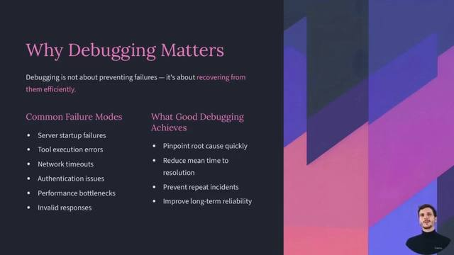
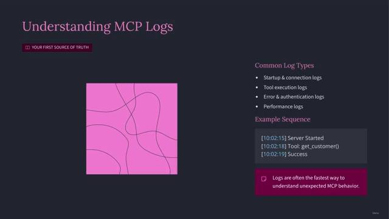
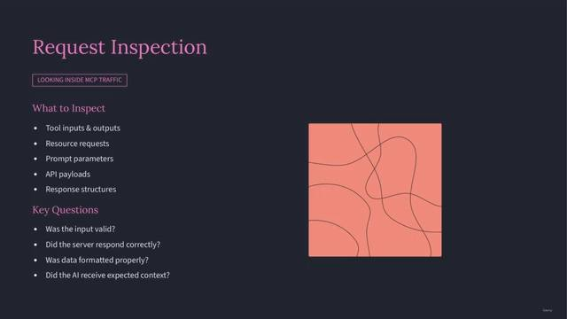
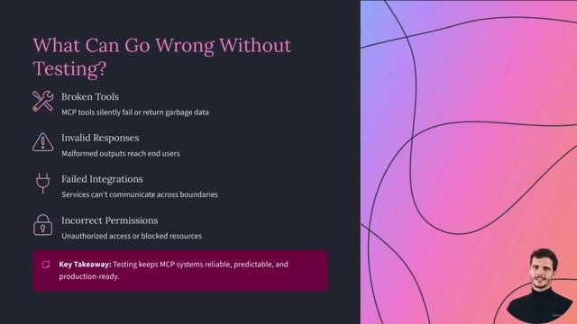
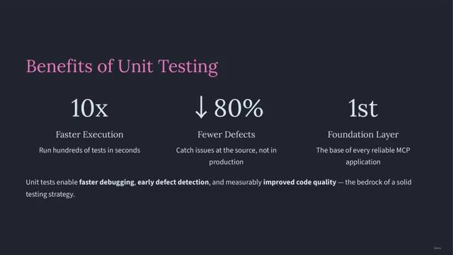
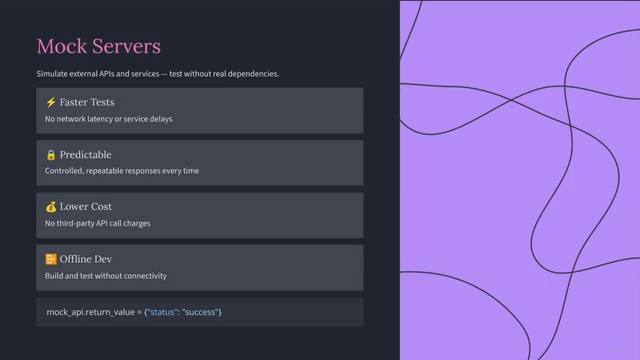
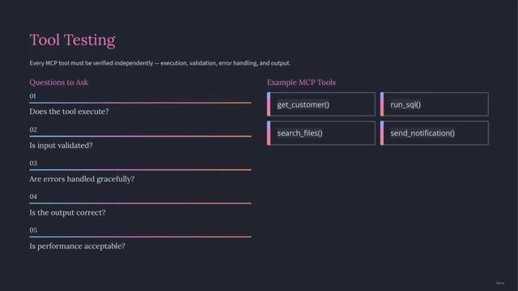
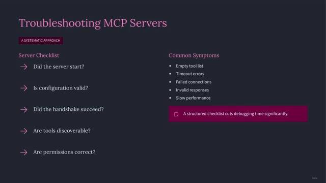

# Claude MCP Masterclass（生产级 MCP 集成）P19–P20：MCP 调试、可观测性与测试

本文覆盖模块 19（调试与可观测性）与模块 20（测试）。这两讲是**讲解型课程**：讲师给出的是判断标准、排查顺序、分层策略和工具选型，没有给出可粘贴的工程代码，也没有在屏幕上留下 OCR 可识别的配置片段。因此本文第 4 节按「把讲师的方案落成可执行产物」来写：设计决策表、组件职责表、事件字段草案、容量估算表，以及**明确标注为示意**的最小可运行代码骨架，帮助你真正把排障流程和测试分层跑起来。凡讲师没讲、OCR 也没有的内容，一律标注「课里没讲」。

---

## 1. 这一节做什么

你要交付两样东西：

1. **一套可执行的 MCP 排障流程**：当 Claude Desktop 在运行、但界面上「看不到工具」时，你能在不乱改配置、不乱重启的前提下，按固定顺序把可能性一条条排除，最终定位到根因。流程覆盖：启动日志 → 配置与环境变量 → MCP 握手与工具可发现性 → 请求追踪 → 请求内容检查 → 性能测量 → 错误归类 → 根因修复。
2. **一套分层的测试策略**：单元测试打底、集成测试验证跨组件边界、E2E 模拟完整用户工作流，中间用 mock server 把外部依赖隔离掉，最后接进 CI/CD 做持续测试，并明确工具测试与资源测试各自要验什么。

换句话说：模块 19 解决「**东西坏了怎么查**」，模块 20 解决「**上线前怎么防止它坏**」。两者合起来才构成讲师反复强调的「production-ready MCP 应用」。

> "欢迎来到模块 19，我们将聚焦任何 MCP 开发者都能掌握的最有价值的技能之一：调试。"
> —— p019 [00:00]

> "构建 MCP 应用只是挑战的一部分，长期理解和维护这个应用同样重要。"
> —— p019 [17:09]

---

## 2. 讲师原话

下面按主题把讲师的关键判断集中列出，正文各节还会就近再引用。

**关于调试为什么重要**

> "生产级 MCP 系统依赖许多活动部件。Claude Desktop 与 MCP 客户端通信，MCP 客户端再与服务器、API、数据库和外部服务通信。"
> —— p019 [00:27]

> "服务器启动失败、工具执行错误、网络超时、认证问题、性能瓶颈以及无效响应，都是你职业生涯中会遇到的常见故障模式。"
> —— p019 [00:27]

> "好的调试能带来几项重要收益：帮助团队快速定位根因、降低平均修复时间、防止事故复发、提升长期系统可靠性。最重要的是，它减少停机并改善整体用户体验。请把调试看作投资，而不是成本。"
> —— p019 [00:56]

**关于日志**

> "日志常被称为软件系统的真相来源，这是有充分理由的。当出问题时，日志提供了精确记录「究竟发生了什么」的时间线，是 MCP 开发者最重要的调试工具之一。"
> —— p019 [01:54]

> "一个典型的 MCP 应用会产生几类日志：启动日志表明服务器何时成功初始化；连接日志记录客户端与服务器之间的交互；工具执行日志记录调用了哪些工具、表现如何；错误日志提供失败信息；认证日志跟踪访问尝试；性能日志衡量响应时间与资源占用。"
> —— p019 [02:04]

> "日志提供三项主要价值：可见性、可审计性、以及排障支持。它们帮助团队重建事故现场、验证假设、并识别随时间出现的模式。没有日志，调试就只剩下有根据的猜测。"
> —— p019 [03:19]

> "作为工程师，你能养成的最重要的习惯之一就是：东西一坏，先读日志。"
> —— p019 [03:47]

**关于追踪**

> "日志告诉我们单个组件内发生了什么，而追踪展示的是整个系统范围内发生了什么。现代 MCP 应用本质上是分布式的，常常需要多个服务协作完成一次请求。"
> —— p019 [03:47]

> "有效的追踪会捕获几类重要信息：请求标识符为每次交互打上唯一标签，使跨系统跟踪请求成为可能；执行时间揭示延迟问题；而工具调用、服务器选择决策和外部依赖则提供额外上下文。"
> —— p019 [04:16]

> "把追踪想象成软件请求的 GPS。它精确显示请求去过哪里，也帮你找出它在哪一段迷了路。"
> —— p019 [05:15]

**关于请求检查**

> "有时候问题不在于请求去了哪里，而在于请求里装了什么。"
> —— p019 [05:42]

> "无论你在调试哪个 MCP 工作流，有四个重要问题要问：输入是否有效？服务器是否正确响应？数据格式是否正确？以及，AI 是否收到了它期望的上下文？"
> —— p019 [06:11]

> "一个工具可能技术上执行成功了，但仍然返回了格式错误的 JSON 或不完整的信息。"
> —— p019 [06:11]

**关于性能**

> "性能调优始于测量。在优化任何东西之前，开发者应当先收集与响应时间、工具执行时长、内存占用、CPU 利用率、查询延迟和网络延迟相关的指标。"
> —— p019 [07:35]

> "开发者最常犯的错误之一就是过早优化。性能调优必须始终由数据驱动。如果你没有测量过问题，你就不能理直气壮地说你解决了它。"
> —— p019 [08:34]

> "用户可能永远注意不到你的系统很快，但他们一定会注意到它很慢。性能是一个特性。"
> —— p019 [09:02]

**关于错误诊断与排查清单**

> "错误诊断的重点是超越「什么失败了」，去理解「为什么失败」。"
> —— p019 [09:30]

> "大多数 MCP 问题会落入若干类别：配置错误发生在设置不正确或不完整时；认证失败源于凭证无效或令牌过期；网络问题来自连通性故障；依赖故障发生在所需服务不可用时。无效输入和第三方宕机也构成许多最常见的生产事故。"
> —— p019 [09:30]

> "一个超时错误看起来像是在提示网络问题，但真正的原因可能是一个过载的数据库，或一个不可用的第三方 API。"
> —— p019 [10:27]

> "修复症状只能带来暂时的缓解，修复根因才能防止问题再次发生。"
> —— p019 [10:56]

> "先从一份简单的检查清单开始：第一，确认服务器确实启动了；第二，验证配置文件有效、所有必需的环境变量都存在；第三，判断 MCP 握手是否成功完成、工具是否能被客户端发现；最后，确认权限与外部依赖配置正确。"
> —— p019 [11:25]

> "空工具列表通常意味着握手失败或配置问题；超时错误可能提示网络问题或服务过载；连接失败通常指向认证或基础设施问题；而无效响应往往表示格式问题；性能变慢则可能由低效查询或资源约束引起。"
> —— p019 [11:54]

**关于可观测性工具**

> "Grafana 与 Prometheus 配合，提供实时指标与可视化看板。OpenTelemetry 提供厂商中立的追踪与埋点能力，让开发者可以跨多个服务跟踪请求。Datadog 与 New Relic 提供全栈应用性能监控，并带有告警与事件管理能力。最后，Elastic Stack 擅长集中式日志收集与历史分析。"
> —— p019 [13:19]

> "每种工具服务于不同目的：指标揭示趋势，追踪定位瓶颈，日志提供细节上下文，看板汇总系统健康度。"
> —— p019 [13:48]

**关于最佳实践与原则**

> "记录所有重要的东西，但不要让不必要的噪音压垮系统。为请求分配唯一标识符，使请求可以跨服务被追踪。持续监控，并在用户发现之前为重要故障配置告警。"
> —— p019 [15:15]

> "当信息分散在多个系统里时，排障会变得显著更困难。自动化诊断可以通过自动识别常见故障模式进一步缩短响应时间。最后，在重大事故之后进行复盘。复盘的目的不是追责，而是理解发生了什么、找出改进机会。"
> —— p019 [15:43]

> "生产环境调试最终建立在四个原则之上：可见性、可靠性、问责、持续改进。"
> —— p019 [16:12]

> "优秀的软件不是由「从不失败」定义的，而是由团队能多快理解、恢复并从中学习来定义的。"
> —— p019 [16:40]

**关于测试**

> "构建 MCP 应用很令人兴奋，但不做测试就发布软件，本质上等于把假设部署到生产环境。"
> —— p020 [00:00]

> "没有测试，很多事情都可能出错：MCP 工具可能静默失败或返回错误数据；无效响应可能送到最终用户手上；集成可能跨服务边界断裂；权限问题可能泄露敏感信息，或阻断合法请求。"
> —— p020 [00:29]

> "把测试想象成软件的保险。它需要前期投入，但未来会节省大量时间和精力。"
> —— p020 [01:28]

> "在 MCP 应用中，很多组件都是单元测试的绝佳候选：工具函数可以被独立测试以验证其行为；数据格式化器与校验器可以被验证，以确保输入输出干净；认证逻辑也可以被测试，以确认凭证与访问控制按预期工作。"
> —— p020 [01:54]

> "集成测试要验证的是「信息是否正确跨越了系统边界」。"
> —— p020 [06:37]

> "一个工具可能通过了单元测试，但在集成阶段仍然失败，因为 API 端点变了，或者数据库连接不可用。"
> —— p020 [06:37]

> "针对真实外部服务做测试并不总是可行：API 可能不可用、网络连接可能失败、第三方提供商可能对每次请求收费。这就是 mock server 在现代测试策略中如此重要的原因。"
> —— p020 [07:33]

> "mock server 会模拟外部依赖的行为，返回预定义响应，而不需要真正的网络通信。"
> —— p020 [07:33]

> "mock 的最大优势之一是控制力。开发者可以轻松模拟那些本来很难复现的场景，比如超时、认证失败或意外响应。"
> —— p020 [08:31]

> "在测试工具时，有五个重要问题要问：第一，工具是否成功执行？第二，输入是否被正确校验？第三，错误是否被优雅处理？第四，输出是否准确且完整？最后，在预期负载下性能是否可接受？"
> —— p020 [09:29]

> "以 run_sql 工具为例，测试不应该只停留在「查询能执行」这一步。开发者还应该验证：当传入无效 SQL 时、当权限不足时、当数据库不可用时，工具分别如何表现。"
> —— p020 [09:58]

> "每一个工具都应该被当作一个独立产品来对待，它有自己的正确性、可用性和性能预期。"
> —— p020 [10:56]

> "资源测试要验证几个重要方面：可用性测试确认资源可以被成功访问；权限测试验证只有被授权的用户和系统才能访问；准确性检查确保数据正确且格式规范；而性能测试衡量资源被获取的速度。"
> —— p020 [11:25]

> "持续测试把校验直接集成进开发生命周期。每一次代码变更都会自动触发一系列测试、生成结果，并且只有所有检查通过才允许部署。"
> —— p020 [12:22]

> "成功的测试不在于写尽可能多的测试，而在于写对的测试。"
> —— p020 [12:51]

> "测试金字塔的底层是单元测试，它们快速、数量多、运行成本低；上面一层是集成测试，验证组件之间的交互；顶层是端到端测试，模拟完整的用户工作流，提供最高级别的信心。"
> —— p020 [13:20]

> "除此之外，团队还应考虑几类覆盖范围：功能测试验证预期行为，回归测试确保此前可用的功能仍然完好，性能与负载测试验证真实条件下的吞吐量，安全测试聚焦认证、权限与数据保护。"
> —— p020 [13:50]

> "测试失败往往比测试成功更有价值。"
> —— p020 [15:18]

---

## 3. 从零复现

本节把讲师的推导过程按可执行步骤重排。你不需要照抄任何代码，只需要按顺序做判断。

### 3.0 需求与约束

**需求**：一个已经在生产环境运行的 MCP 系统（Claude Desktop + MCP 客户端 + MCP 服务器 + API / 数据库 / 外部服务）。讲师给出的典型故障现场是：**Claude Desktop 在运行，但用户报告界面上看不到任何工具**（p019 [19:04]）。

**约束**（讲师明确给出的）：

1. 系统是分布式的，单点日志不足以定位问题 → 必须有跨请求的追踪。
2. 外部服务可能不可用、网络可能失败、第三方按请求计费 → 测试不能依赖真实外部服务。
3. 性能问题往往不产生错误信息，系统仍在「正常工作」，只是变慢 → 必须有测量基线，不能等报错。
4. 时间是最贵的资源 → 排障必须可重复，而不是每次靠直觉。

### 3.1 估算：先把「成本」算出来，才知道该投入多少

课里没给任何具体数字，也没有给公式。下面这些算式是**根据讲师列出的指标推导出来的填写方法**，数字部分请替换成你的实测值；标注「示例」的数字只是为了让算式成立。

- **平均修复时间**：`MTTR = 检测时间 + 定位时间 + 修复时间 + 验证时间`。讲师强调调试投入能降低 MTTR（p019 [00:56]），你能压缩的主要是「定位时间」，而定位时间取决于日志与追踪的完整度。
- **日志体量**：`日增日志条数 = 每请求日志条数 × 日请求量`。示例：每请求 6 条（对应讲师列的六类日志各一条）× 日请求 10,000 = 60,000 条/日。这个数字决定你要不要做采样、集中式收集（Elastic Stack 那一类）。
- **性能预算**：`单请求总耗时 = MCP 服务器处理 + 外部 API + 数据库查询 + 网络延迟`。讲师说「用户期望的是秒级，不是分钟级」（p019 [08:34]），所以这条加法里任何一项超过 1 秒都值得单独测量。
- **测试成本对比**：讲师引用的是「越早发现问题越便宜」（p020 [04:15]），没有给倍数。你能做的是记录「单元测试发现 / 集成测试发现 / 生产发现」三种来源的缺陷数量占比，用占比而不是虚构倍数来论证投入。

### 3.2 方案：排障流程（模块 19 的可执行版）

**Step 1｜定义故障域。** 先把组件链写出来：Claude Desktop → MCP 客户端 → MCP 服务器 → API → 数据库 → 外部服务。讲师在 p019 [00:27] 和 p019 [19:04] 两次强调这条链。链上每一个箭头都是一个可能的断点。

**Step 2｜先读启动日志，不要先改配置。** 讲师在演示里明确说「与其立刻修改配置文件或重启服务，我们先走一套结构化流程」（p019 [19:04]）。第一步是看启动日志，判断服务器到底有没有启动成功。


**Step 3｜验证配置与环境变量。** 配置文件是否有效、所有必需的环境变量是否齐全（p019 [11:25]）。这一步在 MCP 场景下极其常见：工具列表为空，很多时候不是代码问题，而是服务器进程压根没起来，或者起来了但缺一个环境变量。

**Step 4｜确认 MCP 握手完成、工具可被发现。** 「空工具列表」这个症状被讲师单独点名：它通常意味着握手失败或配置问题（p019 [11:54]）。所以你要区分两件事——服务器进程活着，和服务器完成了握手并把工具暴露给客户端。

**Step 5｜追踪请求流。** 如果工具仍然不出现，就沿着客户端 → 服务器追踪交互（p019 [19:31]）。追踪要采集的东西讲师列得很明确：请求标识符、执行时间、工具调用、服务器选择决策、外部依赖（p019 [04:16]）。


**Step 6｜检查请求内容本身。** 到这一步如果请求「走通了但结果不对」，问题就在 payload。讲师给的四个问题按顺序问：输入是否有效 → 服务器是否响应正确 → 数据格式是否正确 → AI 是否收到预期上下文（p019 [06:11]）。要检查的具体元素：工具输入与输出、资源请求、prompt 参数、API payload 与响应结构（p019 [05:42]）。

**Step 7｜测量性能。** 在优化之前先收集六类指标：响应时间、工具执行时长、内存占用、CPU 利用率、查询延迟、网络延迟（p019 [07:35]）。有了基线之后，才允许动用优化手段：缓存、响应压缩、并行执行、连接池、高效查询（p019 [08:04]）。


**Step 8｜错误归类 + 四步诊断。** 分类是为了缩小搜索空间：配置错误、认证失败、网络问题、依赖故障、无效输入、第三方宕机（p019 [09:30]）。四步诊断法：检测错误（监控或用户报告）→ 收集日志与遥测作为证据 → 追踪请求确定失败源头 → 定位根因再实施修复（p019 [09:58]）。

**Step 9｜按固定顺序走检查清单。** 讲师的原话顺序是：服务器是否启动 → 配置与环境变量 → 握手与工具可发现性 → 权限与外部依赖（p019 [11:25]）。关键是「一致性」：每次都走同一套顺序，不要跳步（p019 [12:22]）。

**Step 10｜接入可观测性平台。** 日志、指标、追踪、告警、看板合成一个统一视图（p019 [12:50]）。工具选型见第 4 节表 4-4。

**Step 11｜复盘。** 重大事故后做 postmortem，目的不是追责，而是理解发生了什么、找出改进机会（p019 [15:43]）。

### 3.3 方案：测试分层（模块 20 的可执行版）

**Step 1｜确定被测单元。** 讲师点了三类：工具函数、数据格式化器与校验器、认证逻辑（p020 [01:54]）。它们的共同特点是「纯逻辑、可隔离、跑得快」。

**Step 2｜写第一层单元测试。** 讲师给的示例就是最简单的等价物：验证 2 + 3 返回 5（p020 [02:53]）。这个例子本身不重要，重要的是它的形状——**给定输入、断言输出、不碰网络、不碰数据库**。


**Step 3｜写第二层集成测试。** 要覆盖的交互场景讲师列了五项：API 连通性、数据库访问、认证流程、工具执行、资源获取（p020 [06:12]）。判断标准只有一句：「信息是否正确跨越了系统边界」。


**Step 4｜用 mock server 隔离外部依赖。** 用预定义响应替代真实网络调用，可返回成功响应，也可返回模拟的错误条件（p020 [07:33]–[08:02]）。mock 要能模拟的场景至少包括：超时、认证失败、意外响应（p020 [08:59]）。

**Step 5｜逐个工具做五问检查。** 执行成功？输入校验正确？错误优雅处理？输出准确完整？性能可接受？（p020 [09:29]）每个工具都是独立产品（p020 [10:56]）。


**Step 6｜资源测试四维。** 可用性、权限、准确性、性能（p020 [11:25]）。讲师举的例子是「README 文件是否存在」「数据库连接是否返回预期记录」（逐字稿此处识别为 “Redmi file”，应为 README 文件）。

**Step 7｜接进 CI/CD 做持续测试。** 每次代码变更自动触发测试，全部通过才允许部署（p020 [12:22]）。

**Step 8｜组金字塔 + 补覆盖领域。** 底层单元（快、多、便宜）、中层集成、顶层 E2E（最高信心）；再补功能、回归、性能与负载、安全四类覆盖（p020 [13:50]）。


### 3.4 取舍：讲师明确反对的三件事

1. **反对「先改配置、先重启」。** 演示里他刻意不做这件事，而是先读日志（p019 [19:04]）。
2. **反对过早优化。** 「如果你没有测量过问题，你就不能理直气壮地说你解决了它。」（p019 [08:34]）
3. **反对用测试数量代替测试质量，也反对只堆 E2E。** 「成功的测试不在于写尽可能多的测试，而在于写对的测试」；「过多的端到端测试会显著拖慢开发，而只依赖单元测试可能让重要工作流未被验证」（p020 [12:51]、[14:19]）。

---

## 4. 完整代码

> **说明**：P19–P20 是讲解课，讲师没有给出可粘贴的工程代码，也没有截图 OCR 内容。本节先给出把讲师方案落成可执行产物所需的四张表，再给一段**明确标注为示意**的最小代码骨架，用于让流程真正跑起来。示意代码里的语言（Node.js）和工具（`node:test`、`node:http`）**都是课里没讲的**，只是为了让前端背景的读者能立刻上手；换成你团队的技术栈完全可以。

### 4.1 表 4-1 排障决策表（症状 → 首要怀疑 → 下一步动作）

| 症状 | 首要怀疑（讲师原话依据） | 下一步验证动作 |
|---|---|---|
| 工具列表为空 | 握手失败或配置问题（p019 [11:54]） | 查启动日志 → 查配置合法性 → 查环境变量 → 确认握手完成、工具可被发现（p019 [11:25]） |
| 超时 | 网络问题或服务过载；也可能是数据库过载或第三方 API 不可用（p019 [10:27]） | 追踪请求执行时间，判断延迟落在 MCP 服务器、第三方 API 还是数据库查询（p019 [04:45]） |
| 连接失败 | 认证或基础设施问题（p019 [11:54]） | 查认证日志、确认令牌是否过期、确认凭证是否有效（p019 [09:30]） |
| 无效响应 | 格式问题（p019 [11:54]） | 检查工具输出是否为格式错误的 JSON 或不完整信息；检查 MCP 服务器是否错误转换了 API 响应（p019 [06:11]） |
| 性能变慢 | 低效查询或资源约束（p019 [11:54]） | 先测量六项指标建立基线，再决定用缓存 / 压缩 / 并行 / 连接池 / 查询优化（p019 [07:35]–[08:04]） |
| 工具「执行成功」但结果不对 | 输入无效 / 上下文不符预期（p019 [06:11]） | 走四问：输入有效？响应正确？格式正确？AI 收到预期上下文？ |

### 4.2 表 4-2 可观测性组件职责表（对应 p019 [13:48]）

| 组件 | 职责 | 讲师点名的工具 |
|---|---|---|
| 日志 | 提供详细上下文；重建事故现场；可审计 | Elastic Stack（集中式日志收集与历史分析） |
| 指标 | 揭示趋势；建立性能基线 | Grafana + Prometheus（实时指标与可视化看板） |
| 追踪 | 跨服务定位瓶颈；还原请求路径 | OpenTelemetry（厂商中立的追踪与埋点） |
| 告警 + 事件管理 | 在用户发现之前捕获故障 | Datadog / New Relic（全栈 APM，含告警与事件管理） |
| 看板 | 汇总系统健康度 | Grafana |



### 4.3 表 4-3 日志类别与事件字段草案

讲师列出的六类日志（p019 [02:04]）：启动、连接、工具执行、错误、认证、性能。下面的字段草案是把「讲师说日志要能回答的问题」翻译成结构化字段——**字段名是本文拟定的，不是讲师给的定义**，请按你的日志后端调整。

| 字段 | 类型 | 用途 | 来自讲师哪句话 |
|---|---|---|---|
| `timestamp` | ISO8601 字符串 | 时间线排序 | 「日志提供精确记录发生了什么的时间线」 |
| `request_id` | 字符串（唯一） | 跨服务跟踪同一请求 | 「为请求分配唯一标识符，使请求可以跨服务被追踪」（p019 [15:15]） |
| `category` | 枚举：`startup` / `connection` / `tool_execution` / `error` / `auth` / `performance` | 对应六类日志 | p019 [02:04] |
| `level` | 枚举：`info` / `warn` / `error` | 区分正常与异常 | 「错误日志提供失败信息」 |
| `tool_name` | 字符串，如 `get_customer` | 记录调用了哪个工具 | p019 [02:21] |
| `duration_ms` | 数字 | 性能基线 | 「性能日志衡量响应时间与资源占用」 |
| `error_kind` | 枚举：`configuration` / `auth` / `network` / `dependency` / `invalid_input` / `third_party_outage` | 对应讲师给的六类错误（p019 [09:30]） | p019 [09:30] |
| `server_selection` | 字符串 | 记录服务器选择决策 | 「服务器选择决策提供额外上下文」（p019 [04:16]） |

讲师给的日志示例时间线（p019 [02:51]）：`10:02:15` 服务器启动 → 3 秒后工具 `get_customer` 被执行 → 再过 1 秒请求成功完成。这个例子就是上表字段的最小可用组合。

### 4.4 表 4-4 性能指标基线表

| 指标 | 讲师出处 | 采集方式（课里没讲具体采集实现） | 你的基线值 |
|---|---|---|---|
| 响应时间 | p019 [07:35] | 请求入口打点 | 待填 |
| 工具执行时长 | p019 [07:35] | 工具函数包裹计时 | 待填 |
| 内存占用 | p019 [07:35] | 进程级指标 | 待填 |
| CPU 利用率 | p019 [07:35] | 进程级指标 | 待填 |
| 查询延迟 | p019 [07:35] | 数据库客户端计时 | 待填 |
| 网络延迟 | p019 [07:35] | 外部调用计时 | 待填 |

优化手段与「什么时候用」（全部来自 p019 [08:04]）：缓存（减少重复计算）、响应压缩（降低网络开销）、并行执行（让独立任务同时跑，提升吞吐）、连接池（降低新建连接成本）、高效查询（改善数据库性能）。**讲师没有给任何优化手段的触发阈值**，所以「什么时候该上缓存」属于课里没讲。

### 4.5 表 4-5 测试分层与覆盖领域表

| 层 / 领域 | 验证什么 | 讲师出处 |
|---|---|---|
| 单元测试（金字塔底） | 工具函数、格式化器、校验器、认证逻辑，隔离运行 | p020 [01:54]、[13:20] |
| 集成测试（金字塔中） | API 连通性、数据库访问、认证流程、工具执行、资源获取 | p020 [06:12] |
| 端到端测试（金字塔顶） | 完整用户工作流，最高信心 | p020 [13:20] |
| 功能测试 | 预期行为 | p020 [13:50] |
| 回归测试 | 此前可用的功能仍然完好 | p020 [13:50] |
| 性能与负载测试 | 真实条件下的吞吐量 | p020 [13:50] |
| 安全测试 | 认证、权限、数据保护 | p020 [13:50] |

### 4.6 表 4-6 工具测试五问检查表（p020 [09:29]）

| # | 问题 | 以 `run_sql` 为例要验的用例（讲师在 p020 [09:58] 点名） |
|---|---|---|
| 1 | 工具是否成功执行？ | 正常 SQL 返回结果 |
| 2 | 输入是否被正确校验？ | 传入无效 SQL 时应被拒绝而非崩溃 |
| 3 | 错误是否被优雅处理？ | 权限不足时返回可读错误，不是堆栈 |
| 4 | 输出是否准确且完整？ | 返回字段与行数符合预期 |
| 5 | 性能是否可接受？ | 在预期负载下耗时可控 |

讲师点名的工具清单：`get_customer`、`run_sql`、`search_files`、`send_notification`（p020 [09:29]）。

### 4.7 表 4-7 资源测试四维表（p020 [11:25]）

| 维度 | 验证内容 | 讲师例子 |
|---|---|---|
| 可用性 | 资源能被成功访问 | README 文件存在 |
| 权限 | 只有被授权的用户和系统能访问 | —（课里没给具体例子） |
| 准确性 | 数据正确且格式规范 | 数据库连接返回预期记录 |
| 性能 | 资源被获取的速度 | —（课里没给具体例子） |

### 4.8 示意代码（课里没有代码，以下为示意）

下面四个文件构成一个最小可跑骨架：一个带 `request_id` 的结构化日志器、一个能模拟成功/失败/超时的 mock server、一个工具函数，以及一组单元测试。它们**不是讲师写过的代码**，只是把第 3 节的流程落到可执行状态。

**目录结构**

```
mcp-debug-test-demo/
├── package.json
├── observability/
│   └── logger.mjs
├── mocks/
│   └── mock-api-server.mjs
├── src/
│   └── tools/
│       └── get-customer.mjs
└── tests/
    └── tools/
        └── get-customer.test.mjs
```

**`package.json`**（Node ≥ 20；`node:test` 在 Node 20 为稳定能力）

```json
{
  "name": "mcp-debug-test-demo",
  "version": "0.0.1",
  "private": true,
  "type": "module",
  "scripts": {
    "test": "node --test tests/",
    "mock": "node mocks/mock-api-server.mjs"
  },
  "engines": {
    "node": ">=20"
  }
}
```

**`observability/logger.mjs`**

```js
// 课里没有代码，以下为示意。
// 目的：把讲师要求的「唯一 request id + 时间线 + 六类日志」落成结构化字段。
import { randomUUID } from 'node:crypto';

const CATEGORIES = new Set([
  'startup',
  'connection',
  'tool_execution',
  'error',
  'auth',
  'performance',
]);

export function createRequestLogger(requestId = randomUUID()) {
  function emit(category, level, message, fields = {}) {
    if (!CATEGORIES.has(category)) {
      throw new Error(`unknown log category: ${category}`);
    }
    const line = {
      timestamp: new Date().toISOString(),
      request_id: requestId,
      category,
      level,
      message,
      ...fields,
    };
    console.log(JSON.stringify(line));
    return line;
  }

  return {
    requestId,
    startup: (msg, f) => emit('startup', 'info', msg, f),
    connection: (msg, f) => emit('connection', 'info', msg, f),
    toolExecution: (msg, f) => emit('tool_execution', 'info', msg, f),
    auth: (msg, f) => emit('auth', 'info', msg, f),
    performance: (msg, f) => emit('performance', 'info', msg, f),
    error: (msg, f) => emit('error', 'error', msg, f),
  };
}
```

**`mocks/mock-api-server.mjs`**

```js
// 课里没有代码，以下为示意。
// 目的：按讲师要求「返回预定义响应，包含成功 / 错误 / 超时三种场景」。
import { createServer } from 'node:http';

const PORT = Number(process.env.MOCK_PORT ?? 8787);

// 预定义响应：客户端通过 ?scenario= 选择场景
const SCENARIOS = {
  ok: { status: 200, body: { id: 'C-001', name: 'Ada Lovelace' } },
  not_found: { status: 404, body: { error: 'customer_not_found' } },
  unauthorized: { status: 401, body: { error: 'invalid_token' } },
  malformed: { status: 200, body: '{"id":"C-001",' }, // 故意坏的 JSON
  timeout: null, // 特殊处理：不返回，挂住
};

const server = createServer((req, res) => {
  const url = new URL(req.url, `http://localhost:${PORT}`);
  const scenario = url.searchParams.get('scenario') ?? 'ok';
  const preset = SCENARIOS[scenario];

  if (!preset) {
    res.writeHead(400, { 'content-type': 'application/json' });
    res.end(JSON.stringify({ error: 'unknown_scenario' }));
    return;
  }

  if (preset === null) {
    // 模拟超时：不响应，让调用方自己超时
    return;
  }

  const isString = typeof preset.body === 'string';
  res.writeHead(preset.status, {
    'content-type': isString ? 'application/json' : 'application/json',
  });
  res.end(isString ? preset.body : JSON.stringify(preset.body));
});

server.listen(PORT, () => {
  console.log(`mock api server listening on http://localhost:${PORT}`);
});
```

**`src/tools/get-customer.mjs`**

```js
// 课里没有代码，以下为示意。
// 目的：一个可被单元测试的工具函数，带输入校验与错误分类。
export class ToolInputError extends Error {
  constructor(message) {
    super(message);
    this.kind = 'invalid_input';
  }
}

export async function getCustomer({ customerId }, deps = {}) {
  const { fetchImpl = globalThis.fetch, baseUrl, log } = deps;

  if (typeof customerId !== 'string' || customerId.trim() === '') {
    throw new ToolInputError('customerId must be a non-empty string');
  }

  const started = Date.now();
  let response;
  try {
    response = await fetchImpl(`${baseUrl}/customers?scenario=ok&id=${customerId}`);
  } catch (err) {
    log?.error('upstream request failed', { kind: 'network', detail: String(err) });
    throw Object.assign(new Error('upstream_unreachable'), { kind: 'network' });
  }

  log?.performance('get_customer upstream', { duration_ms: Date.now() - started });

  if (response.status === 401) {
    log?.error('auth rejected', { kind: 'auth' });
    throw Object.assign(new Error('unauthorized'), { kind: 'auth' });
  }

  const text = await response.text();
  try {
    return JSON.parse(text);
  } catch {
    log?.error('malformed upstream payload', { kind: 'invalid_input' });
    throw Object.assign(new Error('malformed_response'), { kind: 'invalid_input' });
  }
}
```

**`tests/tools/get-customer.test.mjs`**

```js
// 课里没有代码，以下为示意。
// 目的：演示讲师说的单元测试形状（隔离、快速、断言输出）。
import test from 'node:test';
import assert from 'node:assert/strict';
import { getCustomer, ToolInputError } from '../../src/tools/get-customer.mjs';

function fakeFetch(handler) {
  return async (url) => handler(String(url));
}

test('customerId 为空时抛出 invalid_input', async () => {
  await assert.rejects(
    () => getCustomer({ customerId: '' }, { baseUrl: 'http://x' }),
    (err) => err instanceof ToolInputError && err.kind === 'invalid_input'
  );
});

test('上游 200 且 JSON 合法时返回解析结果', async () => {
  const result = await getCustomer(
    { customerId: 'C-001' },
    {
      baseUrl: 'http://x',
      fetchImpl: fakeFetch(
        () => new Response(JSON.stringify({ id: 'C-001', name: 'Ada Lovelace' }), { status: 200 })
      ),
    }
  );
  assert.deepEqual(result, { id: 'C-001', name: 'Ada Lovelace' });
});

test('上游 401 时归类为 auth 错误', async () => {
  await assert.rejects(
    () =>
      getCustomer(
        { customerId: 'C-001' },
        { baseUrl: 'http://x', fetchImpl: fakeFetch(() => new Response('{}', { status: 401 })) }
      ),
    (err) => err.kind === 'auth'
  );
});

test('上游返回坏 JSON 时归类为 invalid_input', async () => {
  await assert.rejects(
    () =>
      getCustomer(
        { customerId: 'C-001' },
        { baseUrl: 'http://x', fetchImpl: fakeFetch(() => new Response('{"id":', { status: 200 })) }
      ),
    (err) => err.kind === 'invalid_input'
  );
});
```

**启动与运行命令**

```bash
# 1. 安装（无第三方依赖，只是初始化）
cd mcp-debug-test-demo
npm install

# 2. 启动 mock server（另开一个终端）
npm run mock
# 输出：mock api server listening on http://localhost:8787

# 3. 跑单元测试
npm test
```

---

## 5. 逐行解释

### 5.1 为什么先读日志而不是先改配置

讲师在演示里的第一步是「检查启动日志，判断服务器是否成功启动」，并且明确说「与其立刻修改配置文件或重启服务……我们走一套结构化流程」（p019 [19:04]）。这个选择的逻辑是：**重启和改配置会破坏现场**。日志是唯一还能告诉你「服务器到底有没有起来」的证据。讲师把日志称为「真相来源」（p019 [01:54]），并说「东西一坏，先读日志」，因为「你要找的答案往往已经在那儿了」。

### 5.2 为什么检查清单的顺序是「启动 → 配置 → 握手 → 权限/依赖」

这个顺序不是随意的，它是按「成本从低到高、可从最底层开始验证」排的：

- 如果进程根本没启动（第 1 项），后面三项全无意义；
- 如果配置无效或缺环境变量（第 2 项），进程可能起来但立刻退出；
- 如果前两项都过、握手没完成（第 3 项），症状就正好是「工具列表为空」；
- 只有前三项都过了，才轮到权限和外部依赖（第 4 项）这种更贵、更外部的检查。

讲师强调「关键是保持一致性，每次都用同一个排查序列，而不是直接跳到结论」（p019 [12:22]）——因为跳步会让「这次没查配置」变成下次事故的隐藏成本。

### 5.3 为什么追踪必须带唯一 request id

日志只回答「这个组件内发生了什么」。要回答「这次请求在哪一段迷路了」，就必须把跨组件的日志串成一条线，而串线的针就是唯一标识符（p019 [15:15]）。讲师把追踪比作「软件请求的 GPS」：它显示请求去过哪里，也帮你找出它在哪里走丢（p019 [05:15]）。如果没有 request id，一次慢请求在日志里就是散落的几行，无法关联。

### 5.4 为什么请求检查要问那四个问题

四个问题对应请求生命周期的四个阶段，且**顺序即排查顺序**：

1. 「输入是否有效？」→ 排除 AI 生成了非法参数；
2. 「服务器是否响应正确？」→ 排除服务端逻辑错；
3. 「数据格式是否正确？」→ 排除序列化/转换错；
4. 「AI 是否收到它期望的上下文？」→ 排除上下文注入不完整。

讲师特别指出两个反直觉例子：工具执行成功但返回格式错误的 JSON；API 返回了正确响应但 MCP 服务器在传给 Claude 之前转换错了（p019 [06:11]）。这两种情况都不会产生错误码，所以传统日志看不出来，只能靠直接检查 payload。

### 5.5 为什么性能优化必须排在测量之后

讲师的原话是「如果你没有测量过问题，你就不能理直气壮地说你解决了它」（p019 [08:34]）。这句话有三个可操作的推论：

- **没有基线就无法验收**：你说「加了缓存变快了」，那快了多少？原来是多少？
- **优化可能优化错地方**：延迟可能在第三方 API 而非你的 MCP 服务器（p019 [04:45]），先测量才知道打哪里。
- **性能问题不报错**：系统仍然「能用」，只是变慢，所以只有指标能发现它。

对应到 JS/Node：讲师说的「并行执行」，在 Node 里通常就是 `Promise.all` 并发独立的异步调用；「连接池」在 Node 里对应 HTTP Agent 的 keep-alive 或数据库驱动的连接池。**这两句是给你的对照，课里没讲 Node 具体实现。**

### 5.6 为什么错误要先分类再定位

讲师说「修复症状只能带来暂时的缓解」（p019 [10:56]），而分类的作用是缩小搜索空间。六类错误（配置、认证、网络、依赖、无效输入、第三方宕机）每一类对应的验证动作完全不同。最危险的是症状误导：超时看起来是网络，实际可能是数据库过载或第三方 API 不可用（p019 [10:27]）。所以四步诊断法的第三步「追踪请求确定失败源头」是不能省的。

### 5.7 逐条解释表 4-1 到表 4-7 的决策依据

- **表 4-1**：每一行的「首要怀疑」都直接引自讲师对症状的归类（p019 [11:54]），「下一步动作」引自检查清单（p019 [11:25]）。做这张表的意义是把「凭直觉猜」换成「查表」。
- **表 4-2**：讲师明确说「每种工具服务于不同目的」，并且给了对应关系（p019 [13:48]）。这张表的用途是：老板问「我们上 Datadog 还是 Grafana」时，你能按「我需要趋势、瓶颈、细节还是概览」来选，而不是按品牌选。
- **表 4-3**：字段是本文拟的，但每一行都能追溯到讲师的某句话。注意 `error_kind` 的枚举值完全来自讲师列的六类错误（p019 [09:30]）——这是为了让日志能被自动化诊断消费（讲师在 p019 [15:43] 提到「自动化诊断可以通过自动识别常见故障模式缩短响应时间」）。
- **表 4-4**：六项指标是讲师原话（p019 [07:35]），「采集方式」一列课里没讲。
- **表 4-5**：三层金字塔 + 四类覆盖，全部来自 p020 [13:20] 和 [13:50]。这张表的价值在于它明确写了「平衡」的判据：E2E 太多会拖慢开发，只有单元测试会漏掉工作流。
- **表 4-6**：五个问题原文照录（p020 [09:29]）。之所以每个问题都配 `run_sql` 的用例，是因为讲师专门用它举例：测试不能只停在「查询能执行」（p020 [09:58]）。
- **表 4-7**：四维原文照录（p020 [11:25]）。权限与性能两个维度讲师没给具体例子，表里如实标注。

### 5.8 示意代码逐行解释

**`logger.mjs`**

- `CATEGORIES` 用 `Set` 而不是数组，并在 `emit` 里抛错：这是为了让「日志类别写错」在开发期就炸出来。对应的是讲师说的「不要让不必要的噪音压垮系统」（p019 [15:15]）——先保证每条日志都落在六类之内，再谈量。
- `requestId = randomUUID()` 作为默认参数：调用方不传就自动生成。这就是「为请求分配唯一标识符」的最小实现（p019 [15:15]）。
- `timestamp` 用 `toISOString()` 而不是本地时间：跨机器、跨时区关联日志时，只有 UTC 是可靠的。**这一点课里没讲**，是工程常识。
- `...fields` 放在最后：允许调用方覆盖任意字段（比如 `tool_name`、`duration_ms`、`error_kind`），保持 logger 的通用性。
- 输出用 `console.log(JSON.stringify(line))`：单行 JSON 是「可被集中式日志系统解析」的最低门槛，对应讲师推荐的 Elastic Stack 那条路线。

**`mock-api-server.mjs`**

- `SCENARIOS` 表把「场景名 → 预定义响应」写成数据，而不是写成一堆 `if/else`。这直接对应讲师说的「返回预定义响应」和「配置一个 mock 服务返回可预测的结果，例如成功响应或模拟的错误条件」（p020 [07:33]）。
- `timeout: null` 然后 `return
（不返回任何响应，让调用方自己超时）：这是唯一能真实模拟「超时」而不依赖网络故障的办法，对应讲师说的「开发者可以轻松模拟那些本来很难复现的场景，比如超时、认证失败或意外响应」（p020 [08:31]）。**注意：这个悬挂的连接会占住 Node 的事件循环句柄，长时间跑测试要记得手动清理，课里没讲这一点。**
- `malformed` 场景故意返回 `{"id":"C-001",` 这种残缺 JSON：目的是把「无效响应」从一个抽象症状变成一条可复现的用例，对应讲师说的「无效响应往往表示格式问题」（p019 [11:54]）。
- `PORT` 从 `process.env.MOCK_PORT` 读取、默认 8787：这是让 mock server 能被 CI 同时起多份的前提。**环境变量名 `MOCK_PORT` 是本文起的，课里没给任何环境变量名。**
- `content-type` 那个三元表达式两边都是 `'application/json'`：这是示意代码里的冗余写法，等价于直接写 `'application/json'`。保留它是为了提醒你：真实项目里这里本该区分「返回 JSON」和「返回坏字符串」两种 content-type，但一旦返回坏字符串还标 `application/json`，反而更接近生产环境中真实的「格式错误」事故现场。

**`get-customer.mjs`**

- `ToolInputError` 单独建一个类、并把 `kind` 固定为 `'invalid_input'`：这是把讲师的六类错误（p019 [09:30]）落到代码里的第一步——错误不是靠字符串匹配识别的，而是靠类型和字段。在 JS/Node 里没有 Java 那种受检异常，所以「用 `err.kind` 做分类」是 JS 里最常见的替代方案；Java 那边对应的是自定义 `Exception` 子类，知道即可。
- `deps` 作为第二个参数、默认 `{}`：这是**依赖注入**，也是让这个工具函数「可以被单元测试」的唯一原因。如果不注入 `fetchImpl`，测试就必须打真实网络，那就不是单元测试了。对应讲师说的「工具函数可以被独立测试」（p020 [01:54]）。
- `customerId.trim() === ''` 而不只是判 `undefined`：为了拦住「传了空白字符串」这种在真实 AI 生成参数里极常见的输入。这对应讲师五问里的第二问「输入是否被正确校验」（p020 [09:58]）。
- `try/catch` 包住 `fetchImpl` 并把错误归为 `kind: 'network'`：这是把「网络问题」这类错误（p019 [09:30]）显式建模。注意这里 `String(err)` 只为了日志可读，真实项目应保留原始错误对象。
- `log?.performance(...)` 放在 fetch 之后、状态码判断之前：因为讲师把「工具执行时长」列为性能指标（p019 [07:35]），而这次 fetch 的往返时间就是工具执行时长的主要组成部分。放在前面意味着即使后面 401 或 JSON 解析失败，时长依然被记录——失败请求的耗时同样有价值。
- `response.status === 401` 单独分支：401 被映射到 `kind: 'auth'`，直接对应讲师的「认证失败源于凭证无效或令牌过期」（p019 [09:30]）。这里只处理了 401，其它非 2xx（404、500）会走到 JSON 解析那一步，**这是示意代码的简化，真实项目应按状态码细分**。
- 用 `response.text()` 再手动 `JSON.parse`，而不是直接 `response.json()`：因为 `response.json()` 在坏 JSON 时抛的是系统错误，无法干净地归到我们自己的 `invalid_input`；手动 parse 才能精确控制错误分类。
- 三个 `throw` 都用 `Object.assign(new Error(...), { kind })` 而不是自定义类：这是示意的轻量写法，好处是不用为每种错误建一个类，代价是丢失了 `instanceof` 判断能力。**如果你要跑在 TypeScript 下，更推荐给每种 kind 建一个子类。**

**`get-customer.test.mjs`**

- `import test from 'node:test'` + `assert/strict`：这是 Node 20 内置的测试运行器，不需要 jest/vitest。**课里没讲任何测试框架，这里选它只是因为它零依赖、能直接 `node --test` 跑起来。**
- `fakeFetch(handler)` 这个辅助函数：它的存在本身就是讲师「mock server」概念的进程内版本——用预定义响应替代真实网络（p020 [07:33]）。区别是：`fakeFetch` 是**函数级 mock**（更快、更隔离，适合单元测试），`mock-api-server.mjs` 是**服务级 mock**（更接近真实，适合集成测试）。讲师只讲了服务级 mock，函数级 mock 是本文按「测试金字塔底层要快」这个原则补的。
- 第一个用例断言 `err instanceof ToolInputError`：这是在验「输入校验是否发生」，对应五问第二问。注意它同时验了 `err.kind`，双重保险。
- 第二个用例用 `assert.deepEqual` 而不是 `assert.equal`：因为返回的是对象，浅比较过不了。这条用例对应五问第四问「输出是否准确且完整」。
- 第三、四个用例分别验 401 和坏 JSON：这两条就是讲师说的「测试失败往往比测试成功更有价值」（p020 [15:18]）——它们测的都是异常路径，而不是 happy path。
- `baseUrl: 'http://x'` 是个完全不通的假地址：这是**故意的**。如果被测代码不小心漏了注入、真去请求了网络，测试会因为 DNS 失败而报错，从而暴露「测试不隔离」这个更严重的问题。
- 四个用例覆盖的是五问里的第 1、2、3、4 问；**第 5 问「性能是否可接受」无法用单元测试回答**，它属于性能/负载测试那一层（p020 [13:50]）。

**运行命令**

- `npm install` 在这个项目里几乎什么都不装（`dependencies` 为空）：这是刻意的，为了让「照着文档跑」不被网络和版本问题卡住。
- `npm run mock` 的输出 `mock api server listening on http://localhost:8787` 是本文自定义的，不是讲师屏幕上的内容。
- `npm test` 等价于 `node --test tests/`，它会递归找 `*.test.mjs`。**如果你的 Node 版本低于 20，`--test` 行为不同或不可用**，请升级；这条约束课里没讲。

---

## 6. 复现检查清单

按顺序打勾。**每一项都能独立验证，不依赖前一项的主观判断。**

### 6.1 排障流程是否真的可执行（对应模块 19）

- [ ] 你已经把组件链写下来：Claude Desktop → MCP 客户端 → MCP 服务器 → API → 数据库 → 外部服务，并且链上每个箭头都标注了「怎么验证这一段」（依据 p019 [00:27]）。
- [ ] 你能在不重启服务、不改配置的前提下，找到 MCP 服务器的启动日志，并判断它是否成功启动（依据 p019 [19:04]）。
- [ ] 你确认了配置文件有效、所有必需环境变量存在——**不是「看起来有」，而是打印出来确认过**（依据 p019 [11:25]）。
- [ ] 你能区分「服务器进程活着」和「握手完成、工具可被发现」这两件事，并且有办法分别验证（依据 p019 [11:54]）。
- [ ] 你的日志里有唯一请求标识符，并且你能用同一个 id 把客户端到服务器两端的日志捞出来（依据 p019 [15:15]）。
- [ ] 你的日志能按六类分开：启动、连接、工具执行、错误、认证、性能（依据 p019 [02:04]）。
- [ ] 你采集了六项性能指标，并写下了基线数值（依据 p019 [07:35]）：响应时间 ___ ms、工具执行时长 ___ ms、内存 ___、CPU ___%、查询延迟 ___ ms、网络延迟 ___ ms。
- [ ] 你能对一次真实故障，说出它属于六类错误里的哪一类（配置 / 认证 / 网络 / 依赖 / 无效输入 / 第三方宕机），并给出证据（依据 p019 [09:30]）。
- [ ] 你做了一次「输入是否有效 → 服务器是否响应正确 → 数据格式是否正确 → AI 是否收到预期上下文」的四问检查，并记录了三问之前的答案（依据 p019 [06:11]）。
- [ ] 你确认了「修复的是根因不是症状」：写下「这个改动如果只修症状，会怎么复发」（依据 p019 [10:56]）。
- [ ] 你为至少一个重要故障配置了告警，且**在用户发现之前**能触发（依据 p019 [15:15]）。
- [ ] 你做了至少一次 postmortem，文档里没有任何人名被列为责任人（依据 p019 [15:43]）。

### 6.2 测试策略是否真的分层（对应模块 20）

- [ ] 你至少有一个单元测试，它不发起网络请求、不连数据库（依据 p020 [01:54]）。
- [ ] 你的单元测试能在几秒内全部跑完（依据 p020 [02:24]）。
- [ ] 你有集成测试覆盖 API 连通性、数据库访问、认证流程、工具执行、资源获取这五类场景中的至少三类（依据 p020 [06:12]）。
- [ ] 你的 mock server 能返回至少三种场景：成功、错误、超时（依据 p020 [08:59]）。
- [ ] 你的测试能在断网环境下跑通（依据 p020 [08:31] 提到的「支持离线开发」）。
- [ ] 你对每个对外暴露的工具（`get_customer`、`run_sql`、`search_files`、`send_notification` 这一类）都过了五问检查表（依据 p020 [09:29]）。
- [ ] 你至少有一个「输入无效」的用例、一个「权限不足」的用例、一个「依赖不可用」的用例（依据 p020 [09:58]）。
- [ ] 你的资源测试覆盖了可用性、权限、准确性、性能四个维度（依据 p020 [11:25]）。
- [ ] 每次代码变更是自动触发测试的，而不是手动跑（依据 p020 [12:22]）。
- [ ] 你的测试全部通过才能部署，这个门禁是强制的（依据 p020 [12:22]）。
- [ ] 你能说出自己测试套件里单元 / 集成 / E2E 各多少个，并判断比例是否偏向某一侧（依据 p020 [13:20]、[14:19]）。
- [ ] 你有回归测试，且至少有一条是因为真实事故补上去的（依据 p020 [13:50]）。
- [ ] 你测了 happy path 以外的路径，且异常路径的用例数不少于正常路径（依据 p020 [15:18]）。
- [ ] 你的测试文件能被人读懂、能被人改：随便挑一个测试，不看实现也能说出它在验什么（依据 p020 [16:16]）。

### 6.3 示意代码能否跑起来

- [ ] `node --version` 输出 ≥ 20。
- [ ] `npm run mock` 后终端出现 `mock api server listening on http://localhost:8787`。
- [ ] `curl "http://localhost:8787/customers?scenario=ok"` 返回 `{"id":"C-001","name":"Ada Lovelace"}`。
- [ ] `curl "http://localhost:8787/customers?scenario=malformed"` 返回残缺 JSON（这是预期的，不要修）。
- [ ] `curl "http://localhost:8787/customers?scenario=nope"` 返回 `{"error":"unknown_scenario"}`。
- [ ] `curl "http://localhost:8787/customers?scenario=timeout"` 挂住不返回（用 Ctrl+C 中断，这是预期的）。
- [ ] `npm test` 输出 4 个通过、0 个失败。
- [ ] 把 `get-customer.test.mjs` 里第二个用例的期望值改成 `{ id: 'C-999' }`，`npm test` 必须失败——**如果你改了期望值它还是过，说明你的测试根本没在断言**。

---

## 7. 课里没讲但你会撞上的

这一节全部是**补充预警**，不是讲师内容。凡涉及选择，我都标注了它是本文建议而非课程结论。

### 7.1 环境与版本

- **Claude Desktop 的配置文件和日志位置，课里没讲。** 讲师多次提到 Claude Desktop 与 MCP 客户端通信（p019 [00:27]、[19:04]），但从未给出文件路径。不同操作系统路径不同，请以官方文档为准，别照抄任何博客里的绝对路径。
- **MCP 协议的握手细节，课里没讲。** 讲师把「握手是否完成」列为检查项（p019 [11:25]），但没讲握手的具体报文、版本协商字段、能力声明格式。你会在第一次自己实现服务器时卡在这里。
- **Node 20 以下 `node --test` 不可用。** 本文示意代码依赖它，课里没有任何版本要求。
- **`fetch` 在 Node 18 之前不存在。** 示意代码用了 `globalThis.fetch`，Node 18+ 才有。课里没提这个前提。

### 7.2 日志与可观测性

- **日志采样，课里没讲。** 讲师说「记录所有重要的东西，但不要让不必要的噪音压垮系统」（p019 [15:15]），但没给采样率、没给「什么算重要」。按第 3.1 节的算式估一下自己的日增条数，再决定要不要采样。
- **日志脱敏，课里没讲。** 你的日志里会出现客户 ID、SQL 语句、API payload，这些都可能含敏感信息。讲师强调「可审计性」（p019 [03:19]）和「问责」（p019 [16:12]），但没讲脱敏规则。上生产前必须自己定。
- **OpenTelemetry 具体怎么接，课里没讲。** 讲师只说了它是「厂商中立的追踪与埋点能力」（p019 [13:19]）。SDK 初始化、span 命名、exporter 配置全部需要查官方文档。
- **Prometheus 与 Grafana 的部署方式，课里没讲。** 讲师只说了它们「配合提供实时指标与可视化看板」（p019 [13:19]）。
- **Datadog / New Relic 都是付费服务，课里没讲成本。** 讲师列它们为「全栈应用性能监控」选项（p019 [13:19]），但没提计价模式。小团队先上 OTel + Prometheus 通常更现实——**这是本文建议，不是课程结论。**
- **「自动化诊断」具体怎么做，课里没讲。** 讲师说它能「通过自动识别常见故障模式缩短响应时间」（p019 [15:43]），但没给实现方式。第 4.3 节表 4-3 的 `error_kind` 枚举值，是我按「让机器能识别」的目标拟的，属于本文的落地建议。

### 7.3 性能

- **所有优化手段的触发阈值，课里没讲。** 缓存、压缩、并行、连接池、高效查询这五项讲师都点了名（p019 [08:04]），但没给「多慢才该上缓存」「压缩比多少才值得」。你只能先测基线，再按业务能容忍的延迟倒推。
- **缓存在 MCP 场景下的失效策略，课里没讲。** 工具返回值能不能缓存、缓存多久、客户数据更新后怎么失效——这些都没讲，而它恰恰是缓存最容易出事的地方。
- **并行执行的边界，课里没讲。** 讲师说「让独立任务同时跑」（p019 [08:04]），但没讲「怎么判断两个任务真的独立」。在 JS/Node 里，误把有顺序依赖的两个 `await` 改成 `Promise.all` 会导致数据竞争——**这正是你从后端知识里需要补的那一课：Node 是单线程的，但异步并发下的共享状态依然会出问题，和 Java 里的多线程竞态是同一类坑。**

### 7.4 测试

- **测试框架选型，课里没讲。** 讲师通篇讲「测试」但不绑定框架。本文用 `node:test` 只为零依赖，你团队若是 jest / vitest 照样适用。
- **覆盖率的具体阈值，课里没讲。** 讲师明确说「100% 覆盖率并不总是必要」，但要求「团队应清楚哪些部分是未测的」（p020 [16:16]）。也就是说他给了原则、没给数字。别自己编一个 80% 当团队标准——**这是本文提醒，不是课程要求。**
- **mock 与真实服务的偏差怎么管，课里没讲。** 这是 mock 最大的长期风险：mock 返回的形状一旦和真实 API 漂移，测试全绿但生产全红。讲师只说 mock 提供「可预测、可重复」的环境（p020 [08:31]），没说怎么防止漂移。常见做法是定期用真实服务跑一遍契约测试——**课里没提「契约测试」这个词，这是我补的。**
- **CI/CD 具体平台配置，课里没讲。** 讲师说持续测试「自然地与 CI/CD 流水线集成」（p020 [12:22]），但没给任何 GitHub Actions / GitLab CI 的 YAML。你需要自己写那条「`npm test` 失败就阻断合并」的规则。
- **E2E 测试怎么驱动 Claude Desktop，课里没讲。** 这是 MCP 场景下最实际的空白：单元和集成测试都好办，但「模拟完整用户工作流」（p020 [13:20]）意味着你要么自动化操作 Desktop 界面，要么绕过它直接对 MCP 客户端发请求。讲师没给方案。
- **测试数据的管理，课里没讲。** 资源测试要验「数据库连接返回预期记录」（p020 [11:54]），那这些预期记录从哪来、怎么保证每次跑测试时它们还在、跑完怎么清理——全没讲。

### 7.5 团队与流程

- **postmortem 的模板和格式，课里没讲。** 讲师给了目的（「不是追责，而是理解发生了什么、找出改进机会」，p019 [15:43]）但没给模板。你需要自己定「时间线 / 影响面 / 根因 / 改进项及负责人 / 截止日期」这几栏。
- **告警阈值怎么定，课里没讲。** 讲师要求「在用户发现之前为重要故障配置告警」（p019 [15:15]），但「重要」的判定标准、告警风暴怎么避免，都没讲。告警太少会漏，太多会被无视——这是运维里最常见的两难，课程没有覆盖。
- **「可观测性」和「监控」的区别，课里没明确区分。** 讲师把两者放在一起讲（p019 [12:50]、[14:47]），并说可观测性是「基础能力」而非「奢侈品」。如果你要向老板解释为什么值得投入，讲师给的最有力的一句是「优秀的软件不是由从不失败定义的，而是由团队能多快理解、恢复并从中学习来定义的」（p019 [16:40]）——用它当立项理由，比讲工具清单有效。

### 7.6 两讲之间的衔接（课里没讲但你需要自己补）

模块 19 讲「坏了怎么查」，模块 20 讲「上线前怎么防」，但**两者之间的数据回流，讲师没讲**：事故里发现的根因，应该变成一条新的测试用例、一个新的告警、还是一个日志字段？本文的建议是三者都要，且优先级是「测试 > 告警 > 日志字段」——因为测试能在上线前拦住同类问题，而告警只能在上线后缩短发现时间。这只是本文建议；讲师在两讲里没有把调试与测试显式连起来。