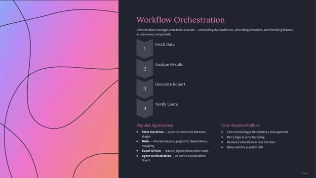
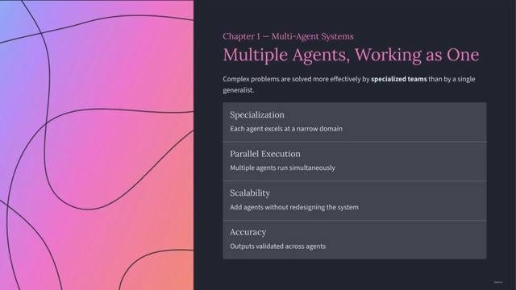
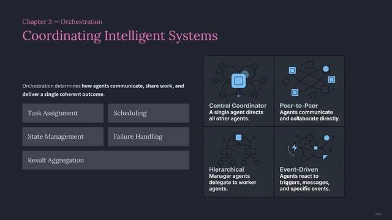
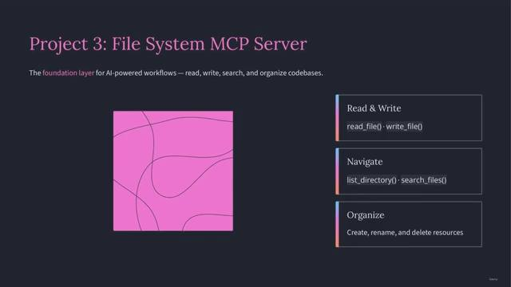
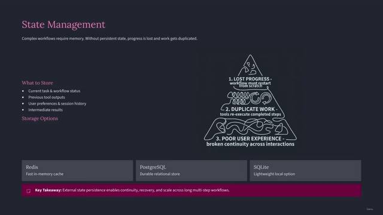
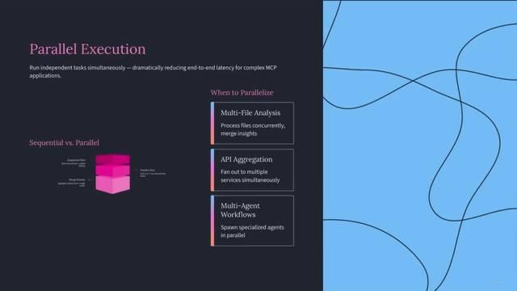
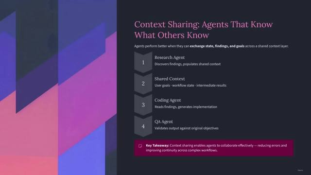
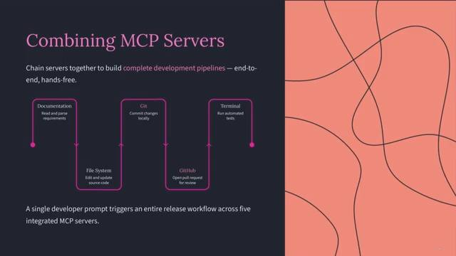
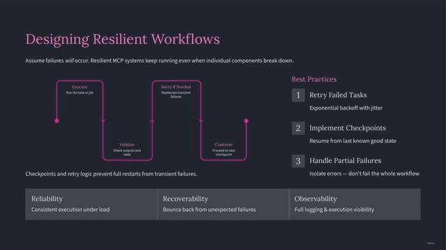
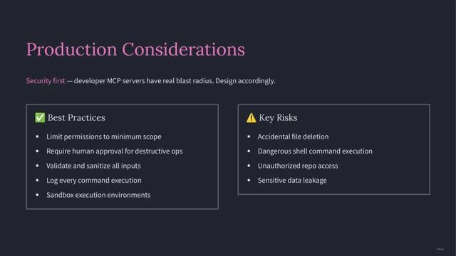

# Claude MCP Masterclass（BV1SZgy6qEPh）P21–P23：高级 MCP 模式、多智能体架构与五个开发者生产力 MCP 服务器

> **关于这份文档和「能跑起来」的关系，先说实话**
>
> P21–P23 这三段是这门课的**架构设计段**。逐字稿里没有出现任何代码、命令、配置文件、依赖清单，OCR 也返回空（本段没有 OCR 结果）。讲师全程在白板/PPT 层面讲“怎么设计”，没有现场敲代码。
>
> 所以这份文档的「复现」不是“复制一段代码去运行”，而是把讲师的设计推导**完整复原成可以照着写代码的规格**：每个服务器有哪些工具、每个工具输入输出是什么形状、工作流怎么串、状态存在哪、失败怎么兜、并发开到几、权限怎么收。照这份文档，你可以从零把五个 MCP 服务器和一条发布流水线写出来——但具体每一行的语法要你自己落笔，因为课里没写。
>
> 凡是课里没讲、我补的，全部会标「课里没讲」。

---

## 1. 这一节做什么

P21–P23 是一条完整的递进链，从“一个工具”走到“一支 agent 团队”：

**P21 解决的是「怎么把多个工具串成一件事」。** 前面二十集你学会的是单个 MCP 工具怎么定义、怎么调用。这一集讲师把它推翻：生产环境的 MCP 应用**天生是多步骤的**。AI 编码助手一次交互里可能要搜索文件、读源码、生成文档、跑测试、建 PR。这五个动作放在一起，就不能再叫“工具集合”了，得叫**智能工作流**。讲师给复杂工作流定了四个特征：多步骤（multi-step）、有状态（stateful）、有韧性（resilient）、可编排（orchestrated）。围绕这四个词，他讲了工具链式调用、工作流编排、长时任务与异步、并行执行、状态管理、上下文保持、韧性设计、生产模式八块内容。

**P22 解决的是「怎么把多个 agent 组成一件事」。** 单个 agent 再强，也有它做不了的事。讲师给出的答案是专业化分工：协调者 agent 收需求，把活分给研究、编码、数据、报告 agent，再合并结果。分工带来三个新问题——基础设施会重复（每个 agent 都自己连一遍数据库？）、agent 之间会撞车（各自不知道对方发现了什么）、谁来调度。对应三个解法：共享 MCP 服务器、上下文共享、agent 编排。最后他给了四种协作模式（顺序、并行、分层、Swarm）和生产环境的四条铁律。

**P23 解决的是「具体做哪五个服务器」。** 这是全课最落地的一段：GitHub、Git、FileSystem、Terminal、Documentation 五个 MCP 服务器，每个服务器的能力边界、典型调用场景、以及把它们串起来之后一条完整的发布流水线长什么样。最后讲师花了一整段讲安全——因为开发者工具的爆炸半径是真实的。

**你读完这份文档应该拿到的东西：**

| 产物 | 出自 |
|---|---|
| 一条五服务器发布流水线的完整时序 | P23 |
| 五个 MCP 服务器的能力清单 + 工具契约草案 | P23 |
| 编排方式选型表（状态机 / DAG / 事件驱动 / agent 编排） | P21 |
| 状态存储选型表（Redis / PostgreSQL / SQLite） | P21 |
| 四种多 agent 协作模式对照表 | P22 |
| 一套安全基线（最小权限 / 人工审批 / 输入校验 / 审计 / 沙箱） | P23 |
| 容量估算表（并行度该开多少、上下文该切多细） | P21 推导 |

---

## 2. 讲师原话

下面按“工作流 → 编排 → 异步 → 并行 → 状态 → 上下文 → 韧性 → 生产模式 → agent → 多 agent → 共享服务器 → 上下文共享 → 编排与模式 → 五个服务器 → 组合 → 安全”的顺序摘录。所有译文都是中文，产品名保留英文。

### 2.1 高级 MCP 系统的本质（P21）

> "要记住的关键点是：高级 MCP 系统并不是简单地把一堆工具收集在一起，它们是智能工作流。它们会保留上下文、管理依赖，并以尽可能少的人工介入端到端执行任务。"
> —— p021 [01:21]

> "现代 MCP 应用天生就是多步骤的。一个 AI 编码助手可能在一次交互里搜索文件、读取源码、生成文档、执行测试，并创建一个 pull request。"
> —— p021 [00:26]

### 2.2 工具链式调用（P21）

> "系统先调用 search_files，它找出相关文档。结果随后被传给 read_file，由它提取这些文件的内容。最后，summarize 生成一份简洁的概览，再由 send_notification 把结果分发出去。注意，整个过程都不需要用户再输入任何内容。"
> —— p021 [02:20]

> "工具链式调用的好处有几条：减少人工操作、提升自动化程度、带来更顺畅的用户体验。开发者还可以把工作流做成可复用的，套用到多个应用和场景里。常见的应用包括报告生成、仓库分析、研究自动化、数据处理流水线。在每一种场景里，AI 助手都扮演编排者的角色，协调多个工具去达成一个更大的目标。"
> —— p021 [02:20]–[02:49]

### 2.3 编排（P21）

> "复杂系统需要编排，也就是协调任务如何执行、管理依赖、分配资源，并处理每一个组件上的失败。"
> —— p021 [03:47]

> "编排有几种常见思路：状态机显式定义各阶段之间的迁移；有向无环图（DAG）为任务之间的依赖建模；事件驱动架构对其他系统发出的信号动态响应；agent 编排则协调多个 AI agent 协同工作。"
> —— p021 [04:16]

> "工作流编排还带来了一些关键能力：重试逻辑、错误处理、资源分配和可观测性。没有编排，工作流很快就会变得难以管理和维护。把编排想象成乐队的指挥：每个乐手可能都很强，但没有协调，演出就会散掉。"
> —— p021 [04:43]–[05:13]

### 2.4 长时任务与异步（P21）

> "这类例子包括视频处理、仓库索引、大规模数据集分析、模型训练和批处理流水线。这些操作可能要跑几分钟甚至几个小时，传统的请求—响应模式在这种情况下根本不可行。"
> —— p021 [05:41]

> "长时任务会带来几个问题：超时可能让操作提前中断；用户需要看到进度；资源管理变得越来越重要；系统还必须提供任务完成时通知用户的机制。"
> —— p021 [06:09]

> "有几种架构模式可以应对这些问题：后台任务队列让任务异步执行；进度跟踪提供执行状态的可视性；状态轮询和事件驱动的 webhook 让应用能够推送更新；工作池帮助把负载高效地分摊到可用资源上。"
> —— p021 [06:09]

> "现代软件工程里最重要的一课之一，就是默认按异步执行来设计。假设总有一些任务会超出预期的时间上限，并据此构建系统。"
> —— p021 [06:38]

### 2.5 并行执行（P21）

> "在顺序工作流里，任务 A 必须先完成，任务 B 才能开始；任务 B 完成后，任务 C 才能开始。在并行工作流里，任务 A、B、C 并发执行，等所有操作都完成后把结果合并。"
> —— p021 [07:32]

> "并行执行带来几个明显好处：改善响应时间、提升吞吐量、让系统更容易扩展。对用户来说，这通常直接意味着更快、更跟手的体验。"
> —— p021 [07:32]

> "有很多场景适合并行：多文件分析可以同时处理几十个文件；API 聚合可以一次性从多个服务取数据；多 agent 工作流可以派生出专门的 agent 同时处理问题的不同侧面。当然，不是所有任务都该并行。依赖关系依然重要，有些操作必须按顺序发生。"
> —— p021 [08:02]

### 2.6 状态管理（P21）

> "设想一个要分析数千份文档的多步骤工作流。如果系统跑到一半崩了，又没有保存任何状态，整个流程就必须从零重来。同样，如果用户每次交互都要反复提供同样的信息，他们也会很沮丧。"
> —— p021 [09:28]

> "值得保存的状态有很多种：当前工作流状态、之前的工具输出、用户偏好、会话历史和中间结果，这些都能带来更智能、更连贯的体验。"
> —— p021 [09:28]

> "Redis 提供适合暂态数据的快速内存存储；PostgreSQL 提供持久且可扩展的关系型存储；SQLite 则为本地应用提供一个轻量选项。"
> —— p021 [09:58]

> "关键的一课很简单：状态带来连续性。把重要信息持久化到外部之后，MCP 系统才能从失败中恢复、才能在多个 worker 之间横向扩展、才能给用户一种长期连贯且聪明的体验。"
> —— p021 [09:58]

### 2.7 上下文保持（P21）

> "状态管理记住的是「发生了什么」；上下文保持保证的是 AI 理解「为什么发生」。这两个概念合起来，才构成从始至终保持连贯的智能工作流。"
> —— p021 [10:25]

> "有几类上下文应该在整个工作流中被保留下来：用户意图提供总目标；此前执行过的动作可以避免重复劳动；工具输出和资源引用保证决策建立在事实之上；中间推理有助于在多个步骤之间保持一致。"
> —— p021 [10:52]–[11:21]

### 2.8 韧性设计（P21）

> "分布式系统里最重要的一条原则是：假设失败一定会发生。网络中断、服务宕机、意外输入都是不可避免的。有韧性的 MCP 工作流按这个现实来设计，并且在单个组件失效时仍然继续运行。"
> —— p021 [12:18]

> "一个有韧性的工作流通常遵循一个简单模式：执行任务、校验结果、必要时重试，操作成功后再继续。检查点特别有价值，因为它让工作流可以从最后一个已知的良好状态恢复，而不是整个重来。"
> —— p021 [12:45]

> "重试逻辑配合指数退避，有助于应对暂态故障；检查点用来在长时间运行的工作流中保留进度；部分失败处理确保某个坏掉的组件不会拖垮整个系统。这些能力共同支撑三个品质：可靠性、可恢复性、可观测性。"
> —— p021 [13:15]

### 2.9 生产模式（P21）

> "第一，工作流应当保持模块化、可组合。每个组件都应该容易复用、替换，并能独立测试。长时间运行的任务应当交给队列处理，同时要小心管理上下文大小，避免过度的内存消耗。"
> —— p021 [14:40]

> "监控同样重要。团队应当跟踪每一个阶段的工作流执行情况，实现审计日志，并对所有外部调用强制执行超时。可观测性提供了在生产环境中维持可靠系统所必需的视野。"
> —— p021 [15:06]

> "为失败而测试是另一个关键实践：模拟部分宕机、验证重试机制、把状态持久化到外部，这些都能带来更有韧性的应用。"
> —— p021 [15:06]

> "最后，生产系统应当从第一天就按规模来设计。无状态 worker、外部状态存储、横向扩展能力，确保应用能够承载不断增长的需求。"
> —— p021 [15:36]

### 2.10 AI Agent（P22）

> "传统 AI 助手等着指令、对单个请求作出回应。而 AI agent 会感知环境、对问题推理、制定计划，并以尽可能少的人工介入采取行动。"
> —— p022 [00:00]

> "现代 agent 有几项核心能力：它们能通过目标规划把大目标拆成小任务；它们基于上下文和可用信息做决策；它们会使用 API、数据库、代码执行环境这类工具；它们还会与其他 agent 协作来完成复杂目标。"
> —— p022 [00:29]

### 2.11 多智能体系统（P22）

> "多智能体系统由若干专业化的 agent 组成，它们共同朝着一个目标工作。系统不再依赖单个通用 agent，而是把任务分给专家：协调者 agent 接收请求，把工作分派给研究、编码、数据或报告 agent，再把这些结果合并成最终回复。"
> —— p022 [03:44]

> "这种做法有几个重要优势。第一，专业化提升质量，因为每个 agent 只聚焦一个很窄的领域。第二，并行执行让多个 agent 可以同时工作，显著缩短完成时间。第三，扩展性大大变好，因为可以在不重新设计整个系统的前提下增加新的 agent。多智能体系统还能提升准确度：一个 agent 产出的结果可以被另一个 agent 审查或校验。"
> —— p022 [04:13]–[04:41]

> "举个例子：研究 agent 负责收集和综合信息；编码 agent 编写、测试并审查软件；数据库 agent 查询并转换结构化数据；规划器 agent 协调工作流、管理依赖；QA agent 校验输出；报告 agent 生成摘要与洞察。"
> —— p022 [05:39]

### 2.12 共享 MCP 服务器（P22）

> "MCP 提供了一个公共的工具层，多个 agent 可以同时访问。每个 agent 不再各自实现一套集成，而是统一与集中式服务交互。共享的 MCP 服务器可以暴露一大类资源，包括文件系统、数据库、API、知识库、自动化工具和提示词库。"
> —— p022 [07:35]

> "这种架构有几个明显优势：减少重复、集中管理、行为一致、简化更新。当共享 MCP 服务器被改进时，所有连接到它的 agent 都会立刻受益。"
> —— p022 [07:35]–[08:33]

### 2.13 上下文共享（P22）

> "上下文共享通过提供一个公共层来解决这个问题，agent 可以在这一层交换状态、发现、目标和中间结果。例如，研究 agent 可以把相关发现写进共享上下文；编码 agent 随后用这些发现来生成实现；QA agent 再拿原始目标去校验产出。"
> —— p022 [09:31]

> "常见的共享信息类型包括：用户目标、工作流状态、之前的输出、中间推理，以及对外部资源的引用。这种共享上下文确保每个 agent 都基于同一个事实来源工作。"
> —— p022 [09:31]–[09:59]

### 2.14 Agent 编排与协作模式（P22）

> "agent 编排包含几项重要职责：任务必须分配给合适的 agent，执行计划必须协调，工作流状态必须管理，失败必须被妥善处理，结果必须聚合成最终回复。"
> —— p022 [10:57]

> "有几种常见的编排模型：在集中式模型里，一个协调者 agent 指挥其他所有 agent；点对点系统让 agent 之间直接通信，不需要中心权威；分层方式用管理者 agent 把工作分派给专业化 worker；事件驱动系统则对消息和触发器动态响应。"
> —— p022 [11:27]

> "第一种模式是顺序协作。在这个模型里，Agent A 把输出交给 Agent B，Agent B 再把结果转给 Agent C。当任务之间有很强的依赖、必须按特定顺序发生时，这种方式最合适。"
> —— p022 [12:53]

> "第二种模式是并行协作：多个 agent 同时工作，所有任务完成后把它们的输出合并。这个模型适合相互独立的子任务，可以显著缩短整体执行时间。分层协作引入管理者 agent 来协调专业化 worker，特别适合跨领域的大规模工作流。最后，Swarm 架构让许多 agent 集体朝着一个共同目标贡献，这类系统在探索、优化和涌现式问题求解场景中尤其有效。"
> —— p022 [13:21]–[13:50]

### 2.15 多智能体的生产实践（P22）

> "第一，让 agent 保持专业化，避免范围蔓延。agent 应当有清晰定义的职责，并始终聚焦于它本来的领域。工作流状态应当外部持久化，这样系统才能从失败中优雅恢复。工具权限应当遵循最小权限原则，确保 agent 只能访问它真正需要的能力。"
> —— p022 [14:47]

> "可观测性同样重要：团队应当记录决策、监控 agent 之间的交互，并实时跟踪工作流执行。针对暂态故障应当实现重试机制，并且要定期测试协作路径以确保可靠性。生产系统最终要实现四个目标：可靠性、可扩展性、可观测性和可维护性。"
> —— p022 [15:14]–[15:43]

### 2.16 五个开发者生产力 MCP 服务器（P23）

> "开发者整天都在和源代码管理系统打交道，管理文件、执行终端命令、搜索文档、分析代码。MCP 提供了一种标准化的方式，把这些能力暴露给 AI 助手。在本模块里，我们聚焦五个实用的 MCP 服务器：GitHub、Git、FileSystem、Terminal 和 Documentation。"
> —— p023 [00:28]–[00:57]

> "GitHub 提供仓库管理，Git 负责本地版本控制，文件系统管理代码库，终端支撑自动化，文档则让组织知识变得可以即时访问。"
> —— p023 [01:26]

**GitHub 服务器：**

> "GitHub MCP 服务器暴露了几项强大的能力：AI 助手可以列出仓库、搜索代码、获取提交历史、创建 issue、审查 pull request，甚至可以触发 GitHub Actions 工作流。"
> —— p023 [01:55]–[02:24]

**Git 服务器：**

> "Git MCP 服务器支持许多常见操作，包括查看仓库状态、提交更改、推送更新、创建分支、合并代码、查看历史以及解决冲突。本质上，它通过 MCP 工具把完整的本地 Git 生命周期暴露了出来。"
> —— p023 [03:51]–[04:20]

> "想象一下对 Claude 说：告诉我哪些文件变了，用合适的提交信息把它们提交，并把分支准备好用于评审。AI 可以执行 git_status、分析改动、生成有意义的提交信息，并自动完成必要的 Git 操作。"
> —— p023 [04:20]

> "当然，生产实现应当加入防护措施，比如在执行可能有破坏性的操作前弹出审批提示，以及审计日志。"
> —— p023 [04:47]

**FileSystem 服务器：**

> "这个服务器提供几项核心能力：它可以读写文件、浏览目录、搜索代码库、创建文件夹、重命名资源、组织项目结构。这些操作构成了各种上层工作流的基础。"
> —— p023 [05:43]

> "文件系统 MCP 服务器通过暴露 read_file、write_file、list_directory 和 search_files 这类工具，让这件事成为可能。"
> —— p023 [06:12]

> "不过，文件访问也带来了风险。生产系统应当强制执行严格的权限控制，并尽可能把访问限制在已批准的目录内。"
> —— p023 [06:41]

**Terminal 服务器：**

> "AI 助手可以执行 shell 命令、运行测试、安装依赖、构建应用、监控进程、查看日志。例子包括运行 npm test、执行 pytest、用 docker ps 检查正在运行的容器，以及监控长时间运行的进程。"
> —— p023 [07:38]–[08:06]

> "当然，终端访问意味着重大责任。危险命令、未授权访问和意外修改，必须通过沙箱、校验、日志和审批机制来缓解。"
> —— p023 [08:33]

**Documentation 服务器：**

> "开发者花大量时间在文档、API 参考、内部 wiki 和项目指南里翻找。文档 MCP 服务器让 AI 助手能够即时访问这些知识。这个服务器支持多种格式，包括 Markdown 文件、PDF、API 规范和内部文档仓库。AI 助手可以搜索文档、检索相关章节、总结技术概念并回答问题，而不需要开发者切换上下文。"
> —— p023 [09:29]–[09:57]

### 2.17 五服务器组合成流水线（P23）

> "文档服务器先读取并理解需求；文件系统服务器根据需求更新源码；接着 Git 服务器在本地提交更改，终端服务器执行自动化测试；最后 GitHub 服务器创建一个 pull request 交给团队评审。注意这里发生了什么：单个 prompt 触发了横跨五个集成 MCP 服务器的整条发布工作流。"
> —— p023 [11:22]–[11:51]

> "把 MCP 服务器想象成一个开发团队的成员。单独看，每个成员贡献一项专门能力；合在一起，它们构成一个智能工程助手，能支撑整个软件交付生命周期。"
> —— p023 [12:20]

### 2.18 安全（P23）

> "开发者生产力工具往往能直接访问源代码、仓库、文件系统和命令执行环境。换句话说，它们有非常真实的爆炸半径。因此安全必须始终放在首位考虑。权限应当遵循最小权限原则，只给 AI 助手它真正需要的能力。对于删除文件、强制推送分支、执行潜在危险命令这类破坏性操作，应当要求人工审批。"
> —— p023 [12:48]–[13:17]

> "输入校验和清洗同样重要：每一条命令、每一个参数，在执行前都必须校验。完整的审计日志应当记录 MCP 服务器执行的所有动作，既保证可追责，也简化事后响应。沙箱提供另一层关键保护，它隔离执行环境，降低故障或误用的影响。"
> —— p023 [13:47]

> "有几类风险值得特别注意：意外删除文件、执行危险的 shell 命令、未授权的仓库访问，以及敏感数据泄漏。这些担忧不是理论上的，而是每一个生产级 MCP 部署都必须面对的真实挑战。关键结论很简单：强大的工具需要强大的防护。构建安全的 MCP 系统不是可选项。"
> —— p023 [14:16]

### 2.19 端到端示例（P23）

> "设想一位开发者发出这样一个 prompt：更新 README，修好坏掉的测试，提交更改并创建一个 pull request。第一眼看这似乎是个简单请求。实际上，它触发了一条由多个 MCP 服务器协同完成的复杂工作流。"
> —— p023 [14:46]

> "一个 prompt。多个服务器。一条完整的工程工作流。这就是 MCP 所开启的未来：AI 助手不只是帮助开发者，而是与开发者并肩工作。"
> —— p023 [16:13]

> **注**：逐字稿此处把 README 识别成了「Redmi」，按上下文（改文件 → 修测试 → 提交 → 开 PR）应为 README。

---

## 3. 从零复现

这一节把讲师的设计推导按顺序还原。你照着走一遍，就能得到一个可以开始写代码的完整规格。

### 步骤 0：先把目标场景钉死

讲师在 P23 用一句话给出了本段的终极验收场景，把它当作你的**集成测试用例**：

> 用户输入一句话：“更新 README，修好坏掉的测试，提交更改并创建一个 pull request。”

系统必须**在没有第二次人工输入**的情况下完成：读需求 → 改文件 → 跑测试 → 本地提交 → 推远端 → 开 PR。

这句话里隐含了五个能力域：知识检索（改什么、按什么规范改）、文件读写（改哪里）、命令执行（测）、本地版本控制（提交）、远端协作（PR）。这正好对应后面要做的五个服务器，不是巧合——**讲师是先有工作流，再倒推服务器划分的**。

### 步骤 1：把需求拆成三层

| 层 | 需求 | 对应 P21/P22 概念 |
|---|---|---|
| 能力层 | 我需要 AI 能读代码、写代码、跑测试、管版本、查文档 | P23 五个 MCP 服务器 |
| 协调层 | 这五件事有先后依赖，谁先谁后、失败怎么办 | P21 工具链式调用 + 工作流编排 |
| 治理层 | 这些工具能删文件、能推代码，怎么不出事 | P23 安全基线 + P22 最小权限 |

前端同学可以这么类比：能力层是你的 API 层，协调层是你的状态管理 + 副作用编排（想想 redux-saga 或者 React Query 的串联 mutation），治理层是你后端的鉴权中间件 + 审计日志。

### 步骤 2：列出约束（讲师在 P21/P23 逐条点名的）

1. **多步骤、有状态**：一次交互里可能有几十个动作，中间结果必须活下来。
2. **长时任务**：仓库索引、全量测试、模型训练这类事要跑几分钟到几小时，传统请求—响应扛不住。
3. **可能超时**：超时会提前掐断操作，所以每个外部调用都要有超时。
4. **用户要看到进度**：不能黑盒跑半小时。
5. **任务完成要能通知**：这是讲师列的第四个长时任务挑战。
6. **依赖必须尊重**：不是所有步骤都能并行。
7. **上下文不能无限涨**：讲师的原话是“小心管理上下文大小，避免过度的内存消耗”。
8. **失败是必然的**：网络中断、服务宕机、意外输入。
9. **爆炸半径真实存在**：能删文件、能执行 shell、能推代码。
10. **需要横向扩展**：无状态 worker + 外部状态存储。

### 步骤 3：选编排模型

讲师给了四种编排方式，每种解决不同形状的问题。这一步不要凭喜好选，按你的工作流形状选：

| 编排方式 | 讲师描述 | 什么形状的工作流适合 | 什么时候别用 |
|---|---|---|---|
| 状态机 | “显式定义各阶段之间的迁移” | 阶段有限、迁移规则明确、需要严格的状态审计（如 PR 评审流程：草稿→待审→通过→合并） | 分支爆炸、动态任务数 |
| DAG（有向无环图） | “为任务之间的依赖建模” | 步骤多、依赖关系复杂但单向（多文件分析、构建流水线） | 有循环、需要动态插入节点 |
| 事件驱动 | “对其他系统发出的信号动态响应” | 需要响应外部事件（CI 失败、新 issue、webhook 回调） | 需要强一致顺序 |
| Agent 编排 | “协调多个 AI agent 协同工作” | 需要动态决策“下一步做什么”、步骤数事先不知道 | 流程完全固定、追求确定性 |

**本段课程的推荐落点**：主体用 **DAG**（五个服务器之间的依赖是单向的：文档 → 文件系统 → git → terminal → GitHub），单步内部用 **状态机**（每个工具调用有 pending / running / succeeded / failed 四个状态）。P22 的多 agent 场景再叠一层 agent 编排。

### 步骤 4：画出五服务器依赖图

讲师在 P23 [11:22] 给出的顺序是唯一的：

```
[Documentation]  读取并理解需求
        │
        ▼
[FileSystem]     按需求更新源码
        │
        ▼
[Git]            本地提交更改
        │
        ▼
[Terminal]       执行自动化测试
        │
        ▼
[GitHub]         创建 pull request
```

注意几个**课上没明说但图里隐含的判断**（我标出来，你写代码时要自己决定）：

- **测试失败要不要阻断提交？** 讲师给的顺序是先 git commit 再 terminal 测试。这意味着本地提交在前、验证在后。这样一来测试挂了，你手上有一个坏 commit。实践上更稳的做法是先跑测试再提交，或者提交后失败就回滚。**课里没讲**这个取舍，你得自己定。
- **GitHub 在最后**，说明 push 和开 PR 是整条链的终点。如果前面任何一步失败，PR 不应该被创建。这是天然的 DAG 终止条件。

### 步骤 5：定并行边界

讲师在 P21 [08:02] 给了三个天然可并行的场景，直接映射到本项目：

| 场景 | 串行做法 | 并行做法 | 收益 |
|---|---|---|---|
| 多文件分析 | 一个文件一个文件读 | 同时读几十个文件 | 讲师原话：“可以同时处理几十个文件” |
| API 聚合 | 依次调 GitHub / 文档 / 数据库 | 一次性并发取回 | 讲师原话：“一次性从多个服务取数据” |
| 多 agent | 研究完再编码再 QA | 研究 + 编码并行，QA 最后 | P22 多智能体 |

**但讲师明确说了“不是所有任务都该并行”**。本工作流的硬依赖边界：

- 文档检索必须先于文件修改（不知道需求改什么）
- 文件修改必须先于 git commit（没东西可提交）
- git commit 必须先于 push（否则推空）
- 测试可以在文件修改后、push 前并行跑（多个测试套件可并发）

### 步骤 6：定状态存储

讲师给了三个选项，选型判断依据是**数据的生命期和跨进程需求**：

| 存储 | 讲师的原话定位 | 存什么 | 前端类比 |
|---|---|---|---|
| Redis | “适合暂态数据的快速内存存储” | 工作流当前状态、进度百分比、正在跑的任务 id、短期会话 | 内存缓存 / 带 TTL 的 localStorage |
| PostgreSQL | “持久且可扩展的关系型存储” | 审计日志、历史工作流记录、用户偏好、需要查询统计的中间结果 | 主数据库 |
| SQLite | “为本地应用提供一个轻量选项” | 单人本地跑的 MCP 服务器（比如你自己电脑上的 FileSystem server 的索引缓存） | IndexedDB |

讲师列出的**该保存的状态类型**（P21 [09:28]）：当前工作流状态、之前的工具输出、用户偏好、会话历史、中间结果。这五类要分别映射到上表。

### 步骤 7：写上下文保持策略

讲师在 P21 [10:52]–[11:21] 列了四类必须保留的上下文，这四类对应四种存储位置：

| 上下文类型 | 讲师原话 | 存哪 | 为什么 |
|---|---|---|---|
| 用户意图 | “提供总目标” | 工作流元数据（PostgreSQL） | 每一步决策都要回头对一遍 |
| 已执行动作 | “避免重复劳动” | 状态存储（Redis） | 幂等去重 |
| 工具输出 + 资源引用 | “保证决策建立在事实之上” | 对象存储 / 文件 + 引用指针 | 原始输出可能很大，只传引用 |
| 中间推理 | “跨多个步骤保持一致” | 工作流日志（PostgreSQL） | 排查问题时唯一线索 |

### 步骤 8：定韧性三件套

讲师在 P21 [13:15] 给了三条，每条都要落到具体参数：

1. **重试 + 指数退避**：应对暂态故障。哪些算暂态？网络超时、限流（429）、5xx。哪些不算？401/403（权限）、404（不存在）、400（参数错）。
2. **检查点**：长时任务每完成一个可原子化的单元就落一次盘。讲师的原话是“从最后一个已知的良好状态恢复，而不是整个重来”。
3. **部分失败处理**：“某个坏掉的组件不会拖垮整个系统”。落到本项目：5000 个文件里 3 个读失败，不应该让整条工作流失败，应该标记跳过、继续、最后汇总报告。

### 步骤 9：写安全基线

讲师在 P23 [12:48]–[14:16] 给的安全要求，逐条落成可检查的规则：

| 讲师要求 | 落地规则 |
|---|---|
| 最小权限 | 每个服务器只暴露工作流真正用到的工具。FileSystem 服务器的写权限只对 `src/` 和 `docs/` 开放，不给整个磁盘 |
| 破坏性操作要人工审批 | `rm`、`git push --force`、`DROP TABLE`、`docker rm -f` 走 approval 通道 |
| 输入校验与清洗 | shell 命令禁止拼接用户字符串，走参数数组；路径做 `..` 越界检查 |
| 审计日志 | 每次工具调用记：时间、agent id、工具名、参数摘要、结果状态、耗时 |
| 沙箱 | Terminal 服务器在容器里跑，挂载只读代码副本 + 可写临时目录 |
| 风险清单 | 意外删除文件、危险 shell 命令、未授权仓库访问、敏感数据泄漏——这四条写进 code review checklist |

### 步骤 10：定多 agent 分工

按 P22 [05:39] 的六种角色，本项目的映射：

| 讲师角色 | 本项目对应 | 职责边界 |
|---|---|---|
| 规划器 agent | Orchestrator | 拆解 prompt、生成 DAG、调度、聚合结果 |
| 研究 agent | Docs agent | 只调 Documentation 服务器，产出需求摘要 |
| 编码 agent | Coder agent | 调 FileSystem + Git，产出代码变更 |
| 数据库 agent | **本项目不需要**（讲师举的例子，不是所有项目都有） | — |
| QA agent | Test agent | 调 Terminal 跑测试，输出通过/失败报告 |
| 报告 agent | Reporter agent | 调 GitHub 开 PR，汇总全流程结果 |

关键设计原则来自讲师 P22 [14:47]：“让 agent 保持专业化，避免范围蔓延。”也就是说 **Coder agent 不应该有 GitHub 权限**——开 PR 是 Reporter 的事。

---

## 4. 完整代码

> **重要说明**：P21–P23 的逐字稿和截图 OCR 中**没有任何代码、命令、配置文件或依赖清单**。所以本节不是可运行的源码，而是把讲师口述的方案落成**可以直接照着写代码的契约**：设计决策表、组件职责表、工具接口草案、数据模型草案、容量估算表。
>
> 唯一在逐字稿里被讲师亲口念出名字的工具是：`search_files`、`read_file`、`summarize`、`send_notification`、`git_status`、`write_file`、`list_directory`。其余工具名课程未命名，下表标注为「课程未命名」。
>
> **课里没有代码，本节末尾的示意代码是为帮助理解补的，不是讲师提供的实现。**

### 4.1 设计决策表

| 编号 | 决策 | 讲师依据 | 备选方案 | 不这样选会怎样 |
|---|---|---|---|---|
| D1 | 工作流整体用 DAG 建模 | P21 [04:16] 「DAG 为任务之间的依赖建模」 | 状态机 | 分支多时状态爆炸，五服务器线性依赖用状态机是浪费 |
| D2 | 单步内部
| 单步内部用状态机 | P21 [04:16] 「状态机显式定义各阶段之间的迁移」 | 纯 DAG 节点 | 单个工具调用卡死时没有明确状态，无法判断是「在跑」还是「已死」，进度条和检查点都无从落盘 |
| D3 | 长时任务不占请求线程，交给后台队列 | P21 [06:09] 「后台任务队列让任务异步执行」 | 同步阻塞等待 | 讲师点名的后果：超时提前掐断操作、无法给用户进度、资源被长时间占死 |
| D4 | 状态外置，worker 保持无状态 | P21 [15:36] 「无状态 worker、外部状态存储、横向扩展能力」 | 状态放进程内存 | 进程一挂整个流程从零重来（讲师 P21 [09:28] 的原话场景），且无法多 worker 并行 |
| D5 | 上下文只传引用，不传全文 | P21 [14:40] 「小心管理上下文大小，避免过度的内存消耗」 | 把工具输出全文塞进 prompt | 几千份文件的正文会把上下文撑爆，成本线性上涨 |
| D6 | 重试只针对暂态故障，配合指数退避 | P21 [13:15] 「重试逻辑配合指数退避，有助于应对暂态故障」 | 所有错误一律重试 | 401/403/400 重试一万次也不会成功，只是把失败时间拉长、把限流打得更狠 |
| D7 | 检查点粒度 = 一个可原子化的完成单元 | P21 [12:45] 「从最后一个已知的良好状态恢复，而不是整个重来」 | 整个流程跑完才落盘一次 | 检查点等于没有，崩了照样重来 |
| D8 | 部分失败不阻断整体，标记跳过并汇总 | P21 [13:15] 「部分失败处理确保某个坏掉的组件不会拖垮整个系统」 | 任一失败即整体失败 | 5000 个文件里 3 个读失败就让 4997 个白跑 |
| D9 | 每个 agent 只绑它需要的服务器 | P22 [14:47] 「工具权限应当遵循最小权限原则」 | 所有 agent 共享全部五个服务器 | Coder agent 顺手就能开 PR、删分支，爆炸半径覆盖全流程 |
| D10 | 破坏性操作走人工审批 | P23 [13:17] 「删除文件、强制推送分支、执行潜在危险命令这类破坏性操作，应当要求人工审批」 | 全部自动执行 | 讲师点名的风险之一：意外删除文件、危险 shell 命令 |
| D11 | Terminal 在沙箱里执行 | P23 [13:47] 「沙箱提供另一层关键保护，它隔离执行环境」 | 直接在宿主机跑 | 一条误判的 `rm` 或一次依赖安装污染，直接影响开发者本机 |
| D12 | 所有外部调用强制超时 | P21 [15:06] 「对所有外部调用强制执行超时」 | 依赖调用方自己控制 | 一个卡住的网络请求能把整个 worker 挂死，且无日志可查 |



### 4.2 组件职责表

**A. 五个 MCP 服务器的能力边界**（内容全部来自 P23 讲师列举，工具名只有讲师念出的那几个是原文，其余标「课程未命名」）

| 服务器 | 讲师列出的能力 | 讲师念出的工具名 | 是否具破坏性 | 沙箱要求 |
|---|---|---|---|---|
| GitHub | 列出仓库、搜索代码、获取提交历史、创建 issue、审查 pull request、触发 GitHub Actions 工作流 | 课程未命名 | 是（可创建/修改远端资源） | 需要 token 最小作用域；开 PR、改 issue 要审批 |
| Git | 查看仓库状态、提交更改、推送更新、创建分支、合并代码、查看历史、解决冲突 | `git_status` | 是（push / merge / 冲突解决可改写历史） | push、merge、force 类操作必须审批 |
| FileSystem | 读写文件、浏览目录、搜索代码库、创建文件夹、重命名资源、组织项目结构 | `read_file`、`write_file`、`list_directory`、`search_files` | 是（写、删、重命名） | 只挂载批准目录；写入白名单 |
| Terminal | 执行 shell 命令、运行测试、安装依赖、构建应用、监控进程、查看日志 | 课程未命名（讲师举的命令例子：`npm test`、`pytest`、`docker ps`） | 极高（任意命令执行） | 必须在容器/沙箱内，网络与文件系统受限 |
| Documentation | 搜索文档、检索相关章节、总结技术概念、回答问题；支持 Markdown、PDF、API 规范、内部文档仓库 | 课程未命名 | 否（只读） | 只读挂载即可 |

补充一个讲师在 P21 [02:20] 用过的通用工具链，它不属于上面五个服务器，但属于「工具链式调用」的示范：`search_files` → `read_file` → `summarize` → `send_notification`。其中 `send_notification` 在五个开发者服务器里没有对应实现，**课里没讲**它该由谁提供。

**B. 多 agent 角色职责**（P22 [05:39] 讲师列了六种角色，本项目用其中五种，数据库 agent 用不上）

| agent | 绑定服务器 | 输入 | 输出 | 禁止做的事 |
|---|---|---|---|---|
| Orchestrator | 不直接调工具 | 用户原始 prompt | DAG + 最终汇总 | 不直接改文件、不直接开 PR |
| Docs agent | Documentation（只读） | 目标描述 | 需求摘要 + 相关文档引用 | 不写文件 |
| Coder agent | FileSystem + Git | 需求摘要 | 变更文件列表 + 本地 commit | 不 push、不开 PR |
| Test agent | Terminal（沙箱） | commit 引用 | 测试报告（通过/失败/跳过） | 不改代码 |
| Reporter agent | GitHub | 全流程结果 | PR 链接 + 汇总报告 | 不改代码、不跑命令 |





### 4.3 工具接口草案

下面每一条都是「你写 MCP 服务器时要暴露的 tool schema」的规格说明。字段名是我的草案（课里没有给 schema），但能力边界严格按讲师 P23 的原话。

**FileSystem 服务器**

| 工具 | 输入 | 输出 | 审批 | 超时 | 幂等 |
|---|---|---|---|---|---|
| `read_file` | `{ path }` | `{ content, bytes, encoding }` | 否 | 5s | 是 |
| `write_file` | `{ path, content }` | `{ path, bytesWritten }` | 白名单外需审批 | 10s | 是（同内容覆盖） |
| `list_directory` | `{ path, depth? }` | `{ entries: [{ name, type, size }] }` | 否 | 10s | 是 |
| `search_files` | `{ pattern, root, maxResults? }` | `{ matches: [{ path, line, preview }] }` | 否 | 30s | 是 |

**Git 服务器**

| 工具 | 输入 | 输出 | 审批 | 超时 | 幂等 |
|---|---|---|---|---|---|
| `git_status` | `{ repoPath }` | `{ branch, changed: [...], untracked: [...] }` | 否 | 10s | 是 |
| commit（课程未命名） | `{ repoPath, message, files }` | `{ commitSha }` | 否（但需审计） | 15s | 否（重试会重复提交，必须先去重） |
| push（课程未命名） | `{ repoPath, remote, branch }` | `{ pushed: bool }` | **是** | 60s | 否 |
| 创建分支（课程未命名） | `{ repoPath, name }` | `{ branch }` | 否 | 10s | 是 |
| merge / 冲突解决（课程未命名） | `{ repoPath, source }` | `{ merged, conflicts: [...] }` | **是** | 60s | 否 |

**Terminal 服务器**

| 工具 | 输入 | 输出 | 审批 | 超时 | 幂等 |
|---|---|---|---|---|---|
| 执行命令（课程未命名） | `{ argv: string[], cwd, env? }` | `{ stdout, stderr, exitCode }` | 危险命令需审批 | 按用例给：测试 600s，构建 1200s | 否 |
| 运行测试（课程未命名） | `{ runner: "npm" \| "pytest", target? }` | 同上 | 否 | 600s | 是（理想情况） |
| 查看进程 / 容器（课程未命名） | `{ kind }` | 列表 | 否 | 10s | 是 |

> **字段说明**：`exitCode` 是我的草案命名。讲师只说了「执行测试、捕获输出、识别失败用例」，**没有念出任何输出字段名**。你写实现时该字段叫什么以你自己的实际输出为准，不要照抄这一列当协议。

**GitHub 服务器**

| 工具 | 输入 | 输出 | 审批 |
|---|---|---|---|
| 列出仓库（课程未命名） | `{ owner?, query? }` | 仓库列表 | 否 |
| 搜索代码（课程未命名） | `{ repo, query }` | 匹配列表 | 否 |
| 获取提交历史（课程未命名） | `{ repo, ref?, limit? }` | 提交列表 | 否 |
| 创建 issue（课程未命名） | `{ repo, title, body }` | `{ issueNumber, url }` | **是** |
| 审查 PR（课程未命名） | `{ repo, prNumber }` | `{ files, comments }` | 否 |
| 创建 PR（课程未命名） | `{ repo, head, base, title, body }` | `{ prNumber, url }` | **是** |
| 触发 Actions（课程未命名） | `{ repo, workflow, ref }` | `{ runId }` | **是** |

**Documentation 服务器**

| 工具 | 输入 | 输出 | 审批 |
|---|---|---|---|
| 搜索文档（课程未命名） | `{ query, sources? }` | `{ hits: [{ source, section, excerpt }] }` | 否 |
| 检索章节（课程未命名） | `{ source, sectionId }` | `{ content, refs }` | 否 |
| 总结概念（课程未命名） | `{ question }` | `{ answer, citations }` | 否 |



### 4.4 数据模型草案

> 课里没有给任何表结构。下面是我按讲师在 P21 [09:28] 和 [10:52] 列出的「该保存的五类状态 + 该保留的四类上下文」倒推出的最小表设计。字段名是草案，不是课程原文。

**表 1：workflow_runs（工作流实例，PostgreSQL）**

| 字段 | 类型 | 说明 | 讲师依据 |
|---|---|---|---|
| `run_id` | uuid | 一次 prompt 触发的整个流程 | 「当前工作流状态」 |
| `user_goal` | text | 用户原始意图 | 「用户意图提供总目标」 |
| `status` | enum | running / succeeded / failed / partial | D2 状态机 |
| `dag` | jsonb | 本次流程的节点与依赖 | D1 |
| `created_at` / `updated_at` | timestamptz | — | 审计需要 |

**表 2：step_states（单步状态，Redis + PostgreSQL 双写）**

| 字段 | 类型 | 说明 |
|---|---|---|
| `run_id` | uuid | 外键 |
| `step_id` | text | DAG 节点 id |
| `state` | enum | pending / running / succeeded / failed / skipped |
| `attempt` | int | 第几次尝试，配合 D6 |
| `last_error` | text | 最后一次错误摘要 |
| `checkpoint_ref` | text | 指向检查点快照 |

**表 3：context_entries（上下文共享层，P22 [09:31] 的「公共层」）**

| 字段 | 类型 | 说明 | 讲师依据 |
|---|---|---|---|
| `run_id` | uuid | — | — |
| `kind` | enum | goal / action / tool_output / reasoning / resource_ref | P21 [10:52] 四类 + P22 [09:59] 五类取并集 |
| `producer` | text | 哪个 agent 写的 | P22 上下文共享 |
| `payload_ref` | text | 大对象只存引用（D5） | 「小心管理上下文大小」 |
| `payload_inline` | jsonb | 小对象直接存 | — |

**表 4：audit_log（审计，PostgreSQL，只追加）**

| 字段 | 类型 | 说明 | 讲师依据 |
|---|---|---|---|
| `ts` | timestamptz | — | P23 [13:47] 审计日志 |
| `agent_id` | text | 谁调的 | P23 最小权限要能追责 |
| `server` | text | github / git / fs / terminal / docs | — |
| `tool` | text | 工具名 | — |
| `args_digest` | text | 参数脱敏后的摘要 | 「敏感数据泄漏」风险 |
| `approved_by` | text | 人工审批人，无审批则 null | D10 |
| `result_status` | text | 成功/失败/被拒绝 | — |
| `duration_ms` | int | — | P21 可观测性 |

**表 5：user_prefs（用户偏好，PostgreSQL）**

讲师在 P21 [09:28] 明确把「用户偏好」列为该保存的状态之一，但没说具体有哪些字段。**课里没讲**，你自己定（提交信息风格、PR 模板、允许的目录白名单都是候选）。



### 4.5 容量估算表

讲师没有给任何数字。下面每个算式都是我按他的约束推的，标注清楚哪些数字是假设、哪些是讲师的硬约束。

| 估算项 | 算式 | 结论 | 讲师的硬约束 |
|---|---|---|---|
| 顺序 vs 并行的多文件读取 | 3000 个文件 × 单次 50ms = 150s；并发 20 → 150s / 20 ≈ **7.5s** | 并行收益 20 倍 | P21 [08:02]「可以同时处理几十个文件」——「几十」→ 并发上限取 20~50 |
| 上下文预算 | 3000 文件 × 平均 4KB = **12MB 正文** | 不能全塞 prompt | P21 [14:40]「小心管理上下文大小」 |
| 只传引用的上下文体积 | 3000 × 引用条目约 80 字节 ≈ **240KB** | 可接受，但超过 1000 条要分批 | 同上 |
| 单步超时预算 | 读文件 5s + 写文件 10s + git 15s + 测试 600s + push 60s + 开 PR 30s ≈ **720s 上限** | 整条流水线 P99 目标 < 15 分钟 | P21 [15:06]「对所有外部调用强制执行超时」 |
| 重试时间上限 | 指数退避 base 500ms × 2^n，上限 5 次：0.5+1+2+4+8 = **15.5s 额外开销** | 可接受；但要计入上面的超时预算 | P21 [13:15] 指数退避 |
| worker 数量 | 假设同时 10 个开发者，每个 1 条流水线，单条并发 20 → **200 并发** | 需要无状态 worker + 外部状态 | P21 [15:36]「无状态 worker、横向扩展」 |
| 检查点体积 | 每步一份快照，假设 200KB × 8 步 = **1.6MB / 次运行** | Redis 存当前，历史落 PostgreSQL | P21 [09:58] 三存储分工 |
| 长时任务时长区间 | 讲师原话「几分钟甚至几个小时」 | 队列必须支持小时级任务，不能靠 HTTP 长连接 | P21 [05:41] |



### 4.6 并发与状态写入：给前端同学的对照

讲师在 P21 通篇讲「状态外置」「检查点」「无状态 worker」，但从头到尾**没有讲锁、也没有讲事务**。你一旦真的动手写，第一天就会撞上：两个 worker 同时写同一个 `run_id` 的检查点。

在 JS/Node 里对应的概念（这部分是我的补充，不是课程内容）：

- **单进程事件循环不等于没有并发**：`await` 让出执行权之后，另一个请求可以插进来改同一个对象。你写的「读状态 → 改 → 写回」三步如果中间有 await，就是典型的 lost update。
- **跨进程写状态文件**：不要直接 `fs.writeFile` 覆盖同一个 `state.json`，先写临时文件再 `fs.rename`（同分区内 rename 是原子的）。这叫「原子替换」，是检查点落盘最省事的做法。
- **数据库层去重**：给 `(run_id, step_id, attempt)` 建唯一约束，插入冲突就说明别人已经在跑这一步，直接跳过——这比在 Node 里加内存锁可靠，因为 worker 是无状态的。
- **前端类比**：`step_states` 那张表就是你的 redux store，只不过它必须能跨进程共享；`audit_log` 就是你的埋点队列，只不过只追加、不可改。



### 4.7 示意代码（课里没有代码，以下为示意）

> **声明**：P21–P23 全程没有出现任何代码。下面这段是我按讲师在 P21 提出的六条要求（DAG 编排、并行、超时、重试+指数退避、检查点、部分失败）写的**最小可运行骨架**，用来帮你迈出第一步。五个「工具」都是桩函数，真实实现应替换为对 MCP 服务器的工具调用。
>
> - 文件路径：`workflow-demo.mjs`
> - 运行方式：`node workflow-demo.mjs`
> - 依赖：**仅 Node 内置模块**，Node ≥ 18；不需要装任何包
> - 退出码：全部成功为 0，有步骤最终失败为 1

```javascript
// workflow-demo.mjs
// 课里没有代码。这是按 P21 的架构要求（DAG / 并行 / 超时 / 重试退避 / 检查点 / 部分失败）写的示意骨架。
// 运行: node workflow-demo.mjs

import { promises as fs } from 'node:fs';
import path from 'node:path';

// ---------- 配置（数字是假设值，讲师没给具体参数） ----------
const CONFIG = {
  checkpointDir: '.mcp-workflow',
  retry: { maxAttempts: 3, baseDelayMs: 500, maxDelayMs: 8000 },
  concurrency: 4,                      // 讲师说"几十个"，本示例取 4 便于观察输出
  defaultTimeoutMs: 10_000,
};

const runId = 'run-' + Date.now();
const stateFile = path.join(CONFIG.checkpointDir, `${runId}.json`);
const auditFile = path.join(CONFIG.checkpointDir, 'audit.log');

// ---------- 审计日志：P23 要求"记录 MCP 服务器执行的所有动作" ----------
async function audit(event) {
  const line = JSON.stringify({ ts: new Date().toISOString(), runId, ...event }) + '\n';
  await fs.appendFile(auditFile, line, 'utf8');
}

// ---------- 超时包装：P21 "对所有外部调用强制执行超时" ----------
function withTimeout(promise, ms, label) {
  let timer;
  const timeout = new Promise((_, reject) => {
    timer = setTimeout(() => reject(new Error(`TIMEOUT:${label} after ${ms}ms`)), ms);
  });
  return Promise.race([promise, timeout]).finally(() => clearTimeout(timer));
}

// ---------- 重试 + 指数退避：P21 "重试逻辑配合指数退避" ----------
function isRetryable(err) {
  const msg = String(err && err.message);
  // 只重试暂态故障：超时、限流、5xx。权限/参数错误不重试。
  return msg.startsWith('TIMEOUT:') || /RATE_LIMIT|E5\d\d/.test(msg);
}

function sleep(ms) {
  return new Promise((r) => setTimeout(r, ms));
}

async function withRetry(fn, label) {
  let lastErr;
  for (let attempt = 1; attempt <= CONFIG.retry.maxAttempts; attempt++) {
    try {
      return await fn(attempt);
    } catch (err) {
      lastErr = err;
      await audit({ step: label, attempt, error: String(err.message), retryable: isRetryable(err) });
      if (!isRetryable(err) || attempt === CONFIG.retry.maxAttempts) throw err;
      const delay = Math.min(CONFIG.retry.baseDelayMs * 2 ** (attempt - 1), CONFIG.retry.maxDelayMs);
      await sleep(delay);
    }
  }
  throw lastErr;
}

// ---------- 工具桩：真实实现应替换为对 MCP 服务器的 tools/call ----------
const tools = {
  async docsSearch(goal) {
    return { summary: `需求摘要: ${goal}`, refs: ['docs/README.md', 'docs/testing.md'] };
  },
  async fsUpdate(ctx) {
    const files = ['README.md'];                      // 只改白名单目录内的文件
    return { changed: files, note: `依据 ${ctx.summary.slice(0, 12)}... 更新` };
  },
  async gitCommit({ changed }) {
    if (!changed.length) throw new Error('NOTHING_TO_COMMIT');  // 非暂态错误，不重试
    return { commitSha: 'abc1234', message: 'docs: update readme' };
  },
  async runTests(_, attempt) {
    if (attempt === 1) throw new Error('TIMEOUT:test-suite after 600000ms'); // 演示重试
    return { passed: 128, failed: 0, skipped: 3 };
  },
  async githubPR({ commitSha }) {
    return { prNumber: 42, url: `https://example.invalid/pull/42`, head: commitSha };
  },
};

// ---------- DAG 定义：顺序严格按 P23 [11:22] 讲师给的图 ----------
const DAG = [
  { id: 'docs',    dependsOn: [],           run: (c) => tools.docsSearch(c.goal),            timeout: 30_000 },
  { id: 'fs',      dependsOn: ['docs'],     run: (c) => tools.fsUpdate(c.docs),              timeout: 10_000 },
  { id: 'git',     dependsOn: ['fs'],       run: (c) => tools.gitCommit(c.fs),               timeout: 15_000 },
  { id: 'test',    dependsOn: ['git'],      run: (c, a) => tools.runTests(c.git, a),          timeout: 600_000 },
  { id: 'pr',      dependsOn: ['test'],     run: (c) => tools.githubPR(c.git),               timeout: 30_000 },
];

// ---------- 检查点：P21 "从最后一个已知的良好状态恢复" ----------
async function loadCheckpoint() {
  try {
    return JSON.parse(await fs.readFile(stateFile, 'utf8'));
  } catch {
    return { results: {}, done: [] };
  }
}

async function saveCheckpoint(state) {
  const tmp = stateFile + '.tmp';
  await fs.writeFile(tmp, JSON.stringify(state, null, 2), 'utf8');
  await fs.rename(tmp, stateFile);         // 原子替换，避免并发写坏文件
}

// ---------- DAG 执行器：按依赖并行调度 ----------
async function runDag(goal) {
  const state = await loadCheckpoint();
  const failed = new Set();
  let cursor = 0;

  while (cursor < DAG.length) {
    // 收集当前所有"依赖已满足"的节点
    const ready = DAG.filter(
      (n) =>
        !state.done.includes(n.id) &&
        !failed.has(n.id) &&
        !state.inflight?.includes(n.id) &&
        n.dependsOn.every((d) => state.done.includes(d)),
    );

    // 依赖被跳过/失败的节点，标记为 skipped，链继续往下走（部分失败处理）
    for (const n of DAG) {
      if (state.done.includes(n.id) || failed.has(n.id)) continue;
      if (n.dependsOn.some((d) => failed.has(d))) {
        failed.add(n.id);
        await audit({ step: n.id, event: 'skipped_due_to_upstream' });
      }
    }

    if (ready.length === 0) break;

    const batch = ready.slice(0, CONFIG.concurrency);
    state.inflight = batch.map((n) => n.id);
    await saveCheckpoint(state);

    const settled = await Promise.allSettled(
      batch.map((n) =>
        withRetry(
          (attempt) =>
            withTimeout(Promise.resolve(n.run(state.results, attempt)), n.timeout, n.id),
          n.id,
        ),
      ),
    );

    settled.forEach((res, i) => {
      const node = batch[i];
      if (res.status === 'fulfilled') {
        state.results[node.id] = res.value;
        if (!state.done.includes(node.id)) state.done.push(node.id);
        console.log(`[OK]   ${node.id}`, JSON.stringify(res.value));
      } else {
        failed.add(node.id);
        state.results[node.id] = { error: String(res.reason.message) };
        console.error(`[FAIL] ${node.id}: ${res.reason.message}`);
      }
    });

    state.inflight = [];
    await saveCheckpoint(state);
    cursor++;
  }

  const ok = DAG.every((n) => state.done.includes(n.id));
  console.log('\n运行结束:', ok ? '全部成功' : `部分失败 -> ${[...failed].join(', ')}`);
  console.log('检查点:', stateFile);
  console.log('审计日志:', auditFile);
  return ok;
}

await fs.mkdir(CONFIG.checkpointDir, { recursive: true });
const ok = await runDag('更新 README，修好坏掉的测试，提交更改并创建一个 pull request');
process.exit(ok ? 0 : 1);
```



---

## 5. 逐行解释

这一节解释上一节的每一个决策和每一行估算**为什么这样定、不这样会怎样**。

### 5.1 为什么编排整体选 DAG，而不是状态机（D1）

讲师在 P21 [04:16] 把状态机和 DAG 并列给出，没说哪个更好。判断依据在 P23 的依赖图里：五步之间是**单向线性依赖**，没有回退、没有条件分支。状态机的价值在于「有限阶段的迁移规则清晰可审计」，但它要求你显式枚举所有迁移，五步线性流程用它属于过度设计，而且每加一个服务器就要重画一遍迁移表。DAG 的节点是数据驱动的，加一个服务器就是加一个节点 + 一条边，符合讲师 P21 [14:40] 的「模块化、可组合」要求。

反过来说：如果你要做的是 PR 评审流程（草稿 → 待审 → 通过 → 合并，且可能打回重来），那状态机才是对的，因为存在**环**和**明确的阶段语义**。DAG 不支持环，硬套会在「打回重审」这一步卡死。

### 5.2 为什么单步内部还要状态机（D2）

DAG 管的是「步骤之间」，而讲师要求「进度跟踪提供执行状态的可视性」和「检查点」。这两件事都需要知道**单个工具调用此刻到底在哪**。只有 pending / running / succeeded / failed 四个状态全落盘，你才能做到：

- 进度条：succeeded 数 / 总数
- 断点续跑：跳过 succeeded 的
- 僵尸检测：running 但 `updated_at` 超过超时阈值 → 判定死亡重跑

不这样做，进程一崩，你只知道「这个 run 没完成」，不知道具体是哪一步卡住，只能从零重来——正好违反讲师 P21 [12:45] 的要求。

### 5.3 为什么长时任务要交给后台队列（D3）

讲师 P21 [05:41] 点名了五类长时任务：视频处理、仓库索引、大规模数据集分析、模型训练、批处理流水线。他给了时长区间的原话是「几分钟甚至几个小时」。

对一个 HTTP 请求来说，这个时长区间直接越过了三层超时：浏览器/客户端超时、反向代理超时、服务器超时。硬扛的结果就是讲师 P21 [06:09] 说的第一件事：「超时可能让操作提前中断」。而中断之后，如果没有检查点，你前面跑的一小时全废。

队列的真正价值不是「异步」，而是**解耦生命周期**：请求只负责入队和返回 run_id，worker 的生命周期由队列管，可以跑一小时也可以跑十小时，客户端掉线不影响。讲师同时提示了配套的四件套（任务队列、进度跟踪、状态轮询/webhook、工作池），缺任何一件都不完整——只有队列没有进度，用户就是黑盒等待；只有进度没有队列，进度无处可查。

### 5.4 为什么状态必须外置（D4）

讲师 P21 [09:28] 举的反例是决定性的：分析数千份文档，跑到一半崩了，没保存状态，整个流程从零开始。这个例子里有 3000 次工具调用，每一次都可能有费用和时间成本。

外置还有一个更隐蔽的理由：**并行**。讲师 P21 [15:36] 要求「无状态 worker」+「横向扩展」。如果状态在进程内存里，两个 worker 各自持有一半状态，谁也不知道对方做了什么，就无法在同一个 run 上协同。状态外置是横向扩展的**前置条件**，不是可选项。

### 5.5 为什么上下文只传引用（D5）

算式在 4.5：3000 个文件 × 4KB = 12MB 正文。这不是「有点大」，是远超任何模型的上下文窗口。而且成本是线性的：每一步都把全文塞进去，第 5 步的 prompt 里就有 5 份全文。

讲师的原话是「小心管理上下文大小，避免过度的内存消耗」。落地成规则就是：**大对象进存储，prompt 里只放引用 + 摘要**。你需要摘要工具（讲师 P21 [02:20] 的 `summarize` 正是这个位置）把 4KB 压成 100 字，再让下一步拿着这个摘要 + 一个能按需取全文的 `payload_ref` 去工作。

不这样做还有一个质量后果：上下文里噪声多了，模型抓重点的能力会下降。这不在讲师的话里，是工程经验。

### 5.6 为什么重试要分类（D6）

讲师只说「重试逻辑配合指数退避有助于应对暂态故障」，重点是「暂态」两个字。把非暂态错误也重试，会付出三重代价：

1. 时间代价：指数退避 5 次约 15.5 秒（算式在 4.5）。
2. 限流代价：本来只是 429，你越重试越被限。
3. 可观测性代价：真正的错误（权限不足）被埋在 5 次重试日志里，排查时找不到。

分类标准在示意代码的 `isRetryable` 里写死了：`TIMEOUT:` 前缀和 `RATE_LIMIT` / `E5xx` 重试，其余一律不重试。`NOTHING_TO_COMMIT` 这种业务错误更不该重试——重试一百次也不会有文件可提交。

### 5.7 为什么检查点要按「可原子单元」落盘（D7）

粒度过粗（整个流程跑完才落一次）等于没有检查点。粒度过细（每读写一个文件落一次）会把 IO 打满——3000 个文件就是 3000 次快照写入。

正确粒度是「一步做完，状态确定」。在本项目里就是每个 DAG 节点完成时落一次：docs 完成落一次、fs 完成落一次、git 完成落一次……任何一次崩溃，最多损失当前正在跑的那一步。这就是讲师说的「从最后一个已知的良好状态恢复，而不是整个重来」。

示意代码里 `saveCheckpoint` 用了「写临时文件 + `fs.rename` 原子替换」，因为如果直接覆盖 `state.json` 时进程被杀，你会得到一个半截的 JSON，下次启动直接解析失败——检查点反而成了故障源。

### 5.8 为什么部分失败不能整体失败（D8）

讲师 P21 [13:15] 的原话是「部分失败处理确保某个坏掉的组件不会拖垮整个系统」。落到 3000 文件场景：3 个文件读失败（可能是权限、可能是软链接成环），如果整体失败，4997 个文件的成果全部作废。

示意代码里的做法是：失败节点进 `failed` 集合，依赖它的下游节点标 `skipped_due_to_upstream`，其余分支继续跑。最后汇总时明确报告「哪些成功、哪些跳过、为什么」。这比「全成功 or 全失败」的二元结果有用得多。

注意这里有个取舍：**PR 要不要在部分失败时开？** 讲师的 DAG 顺序是测试在 PR 之前，测试失败 → PR 节点 skipped，这个行为是对的。但如果是「代码改了 4997 个文件成功、3 个失败」，你要自己定是开 PR 还是不开。**课里没讲**。

### 5.9 为什么每个 agent 一个权限域（D9）

讲师在 P22 [14:47] 和 P23 [13:17] 两处强调最小权限。多 agent 场景下这条尤其重要，因为 agent 之间会互相传递上下文——**一旦上下文被注入（prompt injection），最小权限就是最后一道墙**。

具体到本项目：Coder agent 手里有 FileSystem 写权限和 Git commit 权限，但没有 push、没有 GitHub。即使它被诱导「去开一个 PR」，它物理上没有那个工具。这就是讲师说的「只给 AI 助手它真正需要的能力」的真实价值——不是方便管理，是限制爆炸半径。

### 5.10 为什么破坏性操作要人工审批（D10）

讲师 P23 [13:17] 列举了三个例子：删除文件、强制推送分支、执行潜在危险命令。共同点是**不可逆或影响他人**。

审批的粒度很重要。如果所有操作都要审批，AI 的价值就没了（用户点按钮点到手软）。合理的分界是：

- **影响自己的、可撤销的**（改本地文件、跑测试、本地 commit）→ 自动
- **影响他人的、不可撤销的**（push、开 PR、merge、force push、删文件、触发 Actions）→ 审批

这个分界是我的建议，不是讲师原话。讲师只说「破坏性操作要人工审批」，没给清单。

### 5.11 为什么要沙箱（D11）

讲师 P23 [13:47] 说沙箱「隔离执行环境，降低故障或误用的影响」。Terminal 服务器是这个项目里最危险的一环——它能执行任意命令。

沙箱要挡住三类事：**误删**（`rm -rf` 打错路径）、**污染**（`npm install` 装了个有问题的包改到你本机全局）、**外泄**（命令把 `.env` 里的 token 打印到日志里）。讲师的建议是隔离执行环境，具体怎么隔离（容器、只读挂载、临时目录、网络出口白名单）**课里没讲**，见第 7 节。

### 5.12 为什么所有外部调用都要超时（D12）

讲师 P21 [15:06] 在「监控」这一段里说「对所有外部调用强制执行超时」，语气很平淡，但这条是整套韧性设计的地基。没有超时：

- 重试无从触发（因为你永远不知道它失败
，只能一直等到它自己返回；如果它永远不返回，这个 worker 就永远被占着）
- 检查点无从判断（你分不清「还在跑」和「已经死了」）
- 部分失败无法隔离（一个卡住的调用会拖住整批 `Promise.allSettled`，让并行的其他分支也拿不到结果）

示意代码里 `withTimeout` 用 `Promise.race` 实现，**但它不会真的取消底层操作**——这一点非常重要，前端同学最熟悉这个坑：`Promise.race` 只是让「等待」提前结束，底下的 `fetch` 或者子进程还在跑。要真正取消，Node 里对应的是 `AbortController`（`fetch` 支持 `signal`）和 `child_process` 的 `kill()`。课里没讲取消机制，你写 Terminal 服务器时必须自己补：超时之后要 `SIGTERM`（不行再 `SIGKILL`），否则超时只是「假装结束了」，容器里还挂着一堆孤儿进程。

### 5.13 示意代码逐块解释

这一节把 4.7 的示意代码一块一块拆开，说明每一块对应讲师的哪条要求。

**① `CONFIG` 常量块**

```javascript
const CONFIG = {
  checkpointDir: '.mcp-workflow',
  retry: { maxAttempts: 3, baseDelayMs: 500, maxDelayMs: 8000 },
  concurrency: 4,
  defaultTimeoutMs: 10_000,
};
```

- `checkpointDir` 单独抽出来，是因为检查点必须落在**重启后还在**的位置。如果放在 `os.tmpdir()`，机器一重启就没了，那就不叫持久化。生产上这个位置对应讲师 P21 [09:58] 说的 Redis / PostgreSQL / SQLite——目录只是本地演示的替身。
- `retry.maxAttempts: 3` 而不是 5：重试次数是「次数 × 单次超时」的时间预算问题。如果单次 600 秒（测试），3 次就是 30 分钟。讲师在 P21 [05:41] 强调这些任务本身就要跑几分钟到几小时，重试预算不能拍脑袋。
- `maxDelayMs: 8000` 是退避上限。没有上限的指数退避在长时间故障时会退到几十分钟一次，恢复之后你还得等半天。上限的作用是「让探测保持一定频率」。
- `concurrency: 4` 是演示值。真实值来自讲师 P21 [08:02] 的「几十个」，具体取多少取决于下游限流（见 4.5 的 20~50 估算）。
- `defaultTimeoutMs` 只是兜底，每个 DAG 节点自己还带 `timeout` 字段覆盖它。**超时必须是每步单独可配的**，因为测试要 600 秒、读文件只要 5 秒，用一个全局值必然要么太松要么太紧。

**② `audit()` 审计块**

```javascript
async function audit(event) {
  const line = JSON.stringify({ ts: new Date().toISOString(), runId, ...event }) + '\n';
  await fs.appendFile(auditFile, line, 'utf8');
}
```

对应讲师 P23 [13:47]：「完整的审计日志应当记录 MCP 服务器执行的所有动作，既保证可追责，也简化事后响应。」

- 用 `appendFile` 而不是「读出来、push 进去、写回去」：追加写入是 O(1)，且并发情况下多条日志不会互相覆盖（小写入下 append 在多数文件系统上是原子的）。这就是 4.6 里说的「`audit_log` 只追加、不可改」。
- `runId` 打进去，是为了事后能把散落的日志按一次运行串起来——否则 200 个 worker 的日志混在一起，没法排查。
- 关键点：`audit` 本身**不能被重试逻辑包裹**，它失败了不能拖垮主流程。示例里没有处理它的异常，生产上应该 `try/catch` 掉并降级到 stderr。

**③ `withTimeout()` 超时块**——已在 5.12 解释，补充一点：`clearTimeout(timer)` 放在 `.finally()` 里，是为了成功路径也清掉定时器，否则 Node 进程会因为挂着的定时器迟迟不退出。这是新手最常见的「脚本跑完了但不退出」的原因。

**④ `isRetryable()` + `withRetry()` 重试块**

```javascript
function isRetryable(err) {
  const msg = String(err && err.message);
  return msg.startsWith('TIMEOUT:') || /RATE_LIMIT|E5\d\d/.test(msg);
}
```

对应讲师 P21 [13:15] 的「指数退避应对暂态故障」。这里最关键的一行是**默认返回 false**——即「不认识的一律不重试」。这是个**安全默认值**：宁可少重试一次让用户看到真实错误，也不要盲目重试把限流打爆。

```javascript
const delay = Math.min(CONFIG.retry.baseDelayMs * 2 ** (attempt - 1), CONFIG.retry.maxDelayMs);
```

`2 ** (attempt - 1)` 就是 1、2、4、8…… 的退避序列。`Math.min(..., maxDelayMs)` 加封顶。**这里的「指数」是讲师原话里的关键词，不是可选的**——等间隔重试在服务刚恢复时会造成「重试风暴」，所有等待者同时冲进去。

还有一处细节：重试时 `audit` 记录了 `retryable` 字段。这在事后排查时很有用——你能一眼看出「这个错误被重试了 3 次都是不可重试类型」，那说明分类逻辑本身有 bug。

**⑤ `tools` 桩函数块**

```javascript
const tools = {
  async docsSearch(goal) { ... },
  async fsUpdate(ctx) { ... },
  async gitCommit({ changed }) { ... },
  async runTests(_, attempt) { ... },
  async githubPR({ commitSha }) { ... },
};
```

这五个桩**有意做成最小返回**，每个只返回下一步真正需要的字段，而不是把整个文件内容或整个 API 响应往下传。这直接落实 5.5 的「只传引用 + 摘要」：

- `docsSearch` 返回 `summary` + `refs`，而不是把 README 全文往上传。
- `fsUpdate` 返回 `changed: ['README.md']`，只是文件名字符串。
- `gitCommit` 返回 `commitSha`，只是 7 个字符。

你替换成真实的 MCP 工具调用时，**这个形状要保持**——这是最容易写歪的地方：新手往往把 `read_file` 的整个 `content` 塞进 `state.results`，然后下一步又把整个 `state.results` 拼进 prompt，上下文当场爆掉。

`gitCommit` 里的 `throw new Error('NOTHING_TO_COMMIT')` 是故意演示非暂态错误的：它不以 `TIMEOUT:` 开头、不含 `RATE_LIMIT`，所以 `isRetryable` 返回 false，`withRetry` 第一次就抛出去，不进重试循环。这正是 5.6 讲的分类价值。

`runTests` 里的 `if (attempt === 1) throw new Error('TIMEOUT:...')` 是故意演示暂态故障的重试路径：第一次超时、第二次成功。跑一遍代码你能在终端看到 `[OK] test` 而不是 `[FAIL]`，就能确认重试链路是通的。

**⑥ `DAG` 定义块**

```javascript
const DAG = [
  { id: 'docs',    dependsOn: [],           timeout: 30_000 },
  { id: 'fs',      dependsOn: ['docs'],     timeout: 10_000 },
  { id: 'git',     dependsOn: ['fs'],       timeout: 15_000 },
  { id: 'test',    dependsOn: ['git'],      timeout: 600_000 },
  { id: 'pr',      dependsOn: ['test'],     timeout: 30_000 },
];
```

- 顺序严格照 P23 [11:22] 讲师给的图（文档 → 文件系统 → Git → 终端 → GitHub）。**这不是我随便排的**。
- 每个节点带自己的 `timeout`：读文件 10 秒、测试 600 秒。如果统一 10 秒，测试必然超时；如果统一 600 秒，一个卡死的读文件会占住 worker 10 分钟。讲师在 P21 [15:06] 要求「对所有外部调用强制执行超时」，隐含的就是**按调用类型分别设值**。
- `dependsOn` 用数组而不是单个字符串，是为了将来支持「多依赖」——比如你想加一个 `lint` 节点让它和 `test` 都依赖 `git`，再让 `pr` 同时依赖 `test` 和 `lint`，改一行就行。这是 5.1 说的「DAG 的节点是数据驱动的」的具体好处。

**⑦ 检查点读写块**

```javascript
async function saveCheckpoint(state) {
  const tmp = stateFile + '.tmp';
  await fs.writeFile(tmp, JSON.stringify(state, null, 2), 'utf8');
  await fs.rename(tmp, stateFile);
}
```

已在 5.7 解释原子替换。再补一条：`loadCheckpoint` 用 `try/catch` 吞掉读取失败返回初始状态，这是**故意宽松**——文件不存在是正常首次运行，但文件损坏（半截 JSON）也被吞掉了，会静默丢进度。生产实现应该区分 `ENOENT`（正常）和 `SyntaxError`（异常，要告警）。课里没讲这个区分。

**⑧ `runDag()` 主循环块**

```javascript
const ready = DAG.filter((n) =>
  !state.done.includes(n.id) &&
  !failed.has(n.id) &&
  !state.inflight?.includes(n.id) &&
  n.dependsOn.every((d) => state.done.includes(d)),
);
```

四个否定条件分别对应四件事：

1. `!state.done.includes(n.id)`——已完成的跳过（**断点续跑**，对应讲师 P21 [12:45] 的检查点）
2. `!failed.has(n.id)`——已失败的跳过（避免死循环）
3. `!state.inflight?.includes(n.id)`——正在跑的不重复派发（**幂等/去重**，对应 4.6 的并发问题）
4. `n.dependsOn.every(...)`——依赖全满足才可跑（**DAG 依赖**，对应讲师 P21 [04:16]）

第 3 条是新手最容易漏的。没有它，只要循环多转一圈，同一个节点就会被派发两次——`git commit` 被执行两次，你就有了两个重复 commit，push 上去之后 PR 里莫名其妙多一个空提交。

```javascript
for (const n of DAG) {
  if (n.dependsOn.some((d) => failed.has(d))) { failed.add(n.id); ... }
}
```

这是**部分失败传播**：上游失败，下游标 skipped，但**不让整个 run 失败**。对应讲师 P21 [13:15] 的「部分失败处理确保某个坏掉的组件不会拖垮整个系统」。注意它只标记直接下游，靠循环多转几圈做传递闭包——简单但正确。

```javascript
const batch = ready.slice(0, CONFIG.concurrency);
```

这一行就是**并行执行**的全部实现：从就绪集合里取前 N 个一起跑。对应讲师 P21 [08:02] 的「多文件分析可以同时处理几十个文件」。

```javascript
const settled = await Promise.allSettled(batch.map(...));
```

**必须是 `allSettled` 不是 `all`**。这是整个示例里最关键的一行：`Promise.all` 在第一个 reject 时立刻 reject，其他还在跑的 Promise 结果你永远拿不到——部分失败处理就没了。`allSettled` 等所有结果回来，成功失败都有账。这一行就是讲师 D8 那条要求的代码化身。

```javascript
await saveCheckpoint(state);
```

每个批次结束后落一次盘 = 每个 DAG 节点完成后落一次盘，这就是 5.7 说的「可原子单元」。

```javascript
process.exit(ok ? 0 : 1);
```

退出码是给外壳（shell、CI、未来包一层 MCP 工具时）看的。0 = 全成功，1 = 有步骤失败。如果你的 MCP 工具要返回结果给模型，**这个退出码最好别直接透传给模型**——模型看到 `1` 会以为工具彻底挂了，实际上可能只是 5000 个文件里 3 个读失败。你可以把退出码映射成结构化结果（`{ status: 'partial', ok: 4997, failed: 3 }`）。课里没讲这层映射。

### 5.14 容量估算逐条解释

回看 4.5 那张表，逐行说清每个数怎么来的、错了会怎样。

**并行收益 20 倍**：3000 × 50ms = 150s 是纯串行。并发 20 之后是 150/20 = 7.5s。这个收益是**理想上限**，真实值受三件事打折：下游限流（GitHub API 有明确速率限制）、磁盘 IO、以及 Node 单线程里每次 `await` 的调度开销。所以实践中别拿 20 倍去承诺 SLA，按 10 倍算更安全。

**上下文 12MB 不可行**：这个数的意义不是「算得多准」，而是让你直观看到「3000 文件全文」这个量级**超出任何模型窗口十几倍以上**，方案本身不成立，必须换成引用。换完之后 240KB 也不小，所以表里补了「超过 1000 条要分批」——上下文管理不是一次性的，是每步都要做的预算控制。

**整条流水线 720s 上限**：这是把每步 timeout 直接相加。注意它和「并行」不冲突——本项目五步是严格串行的，所以相加就是最坏路径。如果你把 `lint` 和 `test` 改成并行，最坏路径就变成 max 而不是 sum。**这就是并行对超时预算的真实贡献**：不是让单步更快，是让关键路径变短。

**重试 15.5s 额外开销**：base 500ms 的等比数列前 5 项和。它的意义是让你意识到**重试是花钱的**，要计入前面的 720s 总预算。如果你给每步都配 5 次重试，最坏情况下总时间会膨胀到 720 + 8×15.5 ≈ 844s。所以要么限次数，要么给整条流水线再加一个「总时长上限」——超过就整体失败，别让重试无限叠加。课里没讲总时长上限。

**200 并发 worker 需求**：10 个开发者 × 每条流水线并发 20。这个数直接决定了架构：单进程扛不住 200 并发的外部调用（尤其是 600 秒的测试进程），必须无状态 worker 池化。这就是讲师 P21 [15:36] 那句「无状态 worker、外部状态存储、横向扩展能力」的量化依据——**先算出并发数，再反推需要什么架构**，不是先选架构再凑场景。

**检查点 1.6MB/次运行**：8 步 × 200KB 快照。这个数决定了存哪：1.6MB 放 Redis 完全没问题，但如果你一天跑 1 万次，30 天就是 480GB——所以历史必须落 PostgreSQL 并按周期清理。讲师给的三存储分工（Redis 暂态 / PostgreSQL 持久 / SQLite 本地）在这里就有了明确的写入比例。



### 5.15 为什么协作模式选「顺序 + 并行」混合，不用分层和 Swarm

讲师 P22 [12:53]–[13:50] 给了四种协作模式。本项目实际用的是**混合**：

- **agent 之间是顺序协作**：Docs → Coder → Tester → Reporter。因为存在强依赖（不知道需求就改不了代码），讲师明确说了顺序协作「当任务之间有很强的依赖、必须按特定顺序发生时最合适」。
- **agent 内部是并行协作**：Coder 改 3000 个文件、Tester 跑多个测试套件，都是独立子任务。对应讲师说的「这个模型适合相互独立的子任务，可以显著缩短整体执行时间」。

不用**分层协作**的理由：讲师说它「特别适合跨领域的大规模工作流」。本项目只涉及一个仓库、一个技术栈、一条流水线，插一层 manager 是多余的中转——每个请求多一次模型调用，成本和延迟都翻倍。什么时候该加？当你的 agent 数超过 10 个、或者跨了多个仓库/多个语言生态，人力上管不过来时。

不用 **Swarm** 的理由：讲师说它「尤其适合探索、优化和涌现式问题求解」。发布流水线恰恰相反——它是**确定性流程**，你要的是「每次跑都一模一样」，而 Swarm 的集体涌现天然带来不确定性。用 Swarm 做发布流水线，等于用骰子决定今天要不要开 PR。

这段推理的直接结论：**协作模式不是越新越好，是按工作流的确定性程度选**。讲师在 P22 [14:19] 收尾那句正好落在这里：「最成功的多智能体系统，都是围绕它们要解决的特定问题被刻意设计出来的。」

### 5.16 数据模型逐字段解释

**为什么 `workflow_runs` 要存 `dag` 原始定义**：一次运行的 DAG 可能在代码升级后变化。如果你只存结果不存「当时用的是哪张图」，三个月后回溯「这次为什么跳过 fs 节点」时，你手上的代码已经改过三版了，无法对应。存下快照，这个 run 就永远可解释。

**为什么 `step_states` 要双写 Redis + PostgreSQL**：Redis 供实时进度查询（快、会丢），PostgreSQL 供事后审计（慢、不会丢）。这是讲师 P21 [09:58] 三存储分层的直接应用——不是二选一，是各管一段。

**为什么 `attempt` 要单独一列而不是合成到状态里**：因为你要回答「这一步是第一次就成功，还是重试了 3 次才成功」。这个数字直接反映上下游稳定性；把它合并到状态字符串里（比如 `succeeded_3`）就没法聚合统计了。

**为什么 `context_entries.kind` 取 P21 和 P22 的并集**：P21 [10:52] 讲了四类（用户意图、已执行动作、工具输出、中间推理），P22 [09:59] 讲了五类（用户目标、工作流状态、之前的输出、中间推理、外部资源引用）。两边并不完全重合——P22 多了「外部资源引用」，P21 多了「已执行动作」。既然两个模块讲的是同一个共享层，取并集才不会丢信息。

**为什么 `audit_log.args_digest` 是「摘要」不是原文**：这是为了防讲师 P23 [14:16] 点名的第四类风险——**敏感数据泄漏**。如果 `write_file` 的 `content` 参数里恰好有 token，你把原文写进审计日志，就等于把密钥永久存档了。做法是只存参数长度 + 哈希 + 少量脱敏预览。

**为什么 `audit_log` 要有 `approved_by`**：对应讲师 P23 [13:17] 的人工审批要求。「谁批的」这件事必须在日志里查得到——这是「可追责」的具体含义。只有审批功能、没有审批记录，等于没有问责链。

**为什么 `audit_log` 不做 UPDATE/DELETE**：审计日志一旦可改，它的全部价值就归零。工程上要落到权限层——给审计表只发 INSERT 权限，连管理员都没有 DELETE。课里没讲这一层，是我补的。



---

## 6. 复现检查清单

下面按「能跑起来」的顺序排。每一项都是可勾选的，前面没勾后面先别做。所有带 ⚠️ 的项，是本课程**没有给出答案、你必须自己定**的。

### 6.1 环境与骨架

- [ ] Node ≥ 18（示意代码用了顶层 `await`、`node:fs` 的 promise API）
- [ ] 建一个空目录，`node --version` 能跑通
- [ ] 新建 `workflow-demo.mjs`，粘贴 4.7 全文，`node workflow-demo.mjs` 能跑完并打印 `[OK] docs / fs / git / test / pr`
- [ ] 看到生成了 `.mcp-workflow/<runId>.json` 和 `.mcp-workflow/audit.log`
- [ ] 故意把 `tools.runTests` 改成永远抛 `TIMEOUT:`，确认它重试 3 次后才失败
- [ ] 故意把 `tools.gitCommit` 改成抛 `NOTHING_TO_COMMIT`，确认它**只失败一次、不重试**
- [ ] 手动删掉 `.mcp-workflow/<runId>.json` 里的 `done` 数组前两项，重跑同一条命令，确认它从 `fs`（而不是 `docs`）继续 —— 这是检查点唯一的验收方式

### 6.2 五个 MCP 服务器（按难度从低到高）

- [ ] **Documentation（只读，最容易起步）**：能列目录、能按关键词搜索、能按章节取全文
- [ ] **FileSystem**：`read_file` / `write_file` / `list_directory` / `search_files` 四个工具名对齐讲师 P23 [06:12] 的原话
- [ ] ⚠️ FileSystem 的路径白名单是你自己定：`write_file` 收到的 `path` 必须 `path.resolve` 之后仍在允许根目录内，否则抛错（防 `../` 穿越）
- [ ] **Git**：`git_status` 可用；commit 可用；**push / force push / merge 一律挂审批开关，默认关闭**
- [ ] **Terminal**：只能在沙箱里跑；命令必须用 `argv` 数组，**禁止 `shell: true`**
- [ ] **GitHub**：先用只读能力验证（列仓库 / 搜索代码 / 拉提交历史 / 看 PR），写能力（建 issue / 建 PR / 触发 Actions）最后再开

### 6.3 编排层

- [ ] 有一份显式的 DAG 定义，节点顺序与 P23 [11:22] 一致
- [ ] 每个节点有自己的 timeout，且测试节点的 timeout 明显大于其他节点
- [ ] 就绪判断包含「未完成 / 未失败 / 不在飞行中 / 依赖全满足」四个条件
- [ ] 用 `Promise.allSettled` 而不是 `Promise.all`
- [ ] 有并发上限（不是 `map` 全量打出去）
- [ ] ⚠️ 你的 `withTimeout` 是否真的取消底层操作？如果是子进程，超时后要 `kill`
- [ ] ⚠️ 是否有整条流水线的总时长上限（讲师没要求，但重试叠加会超预算）

### 6.4 状态与上下文

- [ ] 检查点写文件用「临时文件 + rename」原子替换
- [ ] ⚠️ `loadCheckpoint` 能区分「文件不存在」和「JSON 损坏」
- [ ] 工具输出在进入下一步之前**已经过摘要**，不是原文
- [ ] `state.results` 里没有任何一个字段超过几 KB（超了就该改成引用）
- [ ] 失败节点的错误信息被记下来，且下游节点被标记为 skipped 而不是让整轮崩掉

### 6.5 安全基线（逐条对讲师 P23 [12:48]–[14:16]）

- [ ] 每个 agent 只拿到它必需的服务器（Coder 没有 GitHub，Reporter 没有 FileSystem）
- [ ] 破坏性操作有审批开关，且**默认是关的**
- [ ] 所有路径做过 normalize + 前缀校验
- [ ] 所有 shell 命令走参数数组，不拼字符串
- [ ] 审计日志记录：时间、agent、服务器、工具、参数摘要、审批人、结果、耗时
- [ ] 审计日志不可改、不可删
- [ ] Terminal 在容器/沙箱内执行，文件系统只挂必要目录
- [ ] 四类风险（误删、危险命令、未授权仓库访问、敏感数据泄漏）写进 code review 清单

### 6.6 端到端验收

按讲师 P23 [14:46] 给的那句话当唯一验收用例：

> 「更新 README，修坏掉的测试，提交更改并创建一个 pull request。」

- [ ] 一句话输入，不需要第二次人工输入
- [ ] 执行过程中能看到五步各自的进度
- [ ] 中途 kill 掉进程，重跑能从断点继续
- [ ] 故意让测试失败，确认 **PR 节点不会被执行**（DAG 的下游阻断生效）
- [ ] 完成后能在审计日志里按 `run_id` 查出完整时间线
- [ ] ⚠️ 部分失败时要不要开 PR —— 这是你的产品决策，课里没讲，先写进文档

---

## 7. 课里没讲但你会撞上的

这一节全是**动手就会遇到、但 P21–P23 完全没有涉及**的东西。列出来的目的不是吓你，是让你知道「卡住了不是你没听懂，是课没讲到」。

### 7.1 MCP 协议本身的接入细节

课里讲了五个服务器「有什么能力」，但**没讲这些服务器怎么被 Claude 接上去**：是本地 stdio 进程，还是 HTTP 端点？怎么注册？配置写在哪个文件？这些属于这门课前面模块的内容，本段没讲。你按 4.3 的工具契约写完之后，还需要自己去找 MCP 的 transport 配置方式，才能让 Claude 真正调用到它们。

### 7.2 五个服务器是「一个进程五个工具」还是「五个进程」

课里用「服务器」这个词，但讲师**没有说明部署形态**。这会直接影响你的实现：

- **单进程多工具**：简单，但 Terminal 的沙箱就没意义了——它和文件系统在同一个进程里，隔离形同虚设。
- **多进程**：隔离好，但你要自己解决进程管理、健康检查、崩溃重启。

按讲师 P23 [13:47] 强调沙箱的逻辑推，**Terminal 应该单独一个进程/容器**。这是推断，不是讲师原话。

### 7.3 Git 在你的机器上可能根本 commit 不了

这是最容易第一次就撞上的：新机器没配 `user.name` / `user.email`，`git commit` 直接报错退出。而你的 `withRetry` 会把它当成业务错误（不重试，对的），但错误信息对模型来说完全不可读。

课里没讲怎么处理这类**环境前置条件**。实践上应该在服务器启动时做一次 preflight 检查（git 是否存在、是否在仓库内、user 是否配置），把错误提前暴露，而不是等到第三步才失败。

### 7.4 `npm test` 的退出码语义和你想的不一样

讲师的例子是 `npm test`、`pytest`、`docker ps`。你没看到但会遇到的是：

- `npm test` 在某些配置下「没有测试」也会返回 0，你会误判为通过。
- 有的测试框架返回非 0 表示「有跳过」而不是「有失败」。
- 长测试可能因为输出刷屏撑爆你的缓冲区——必须做输出截断，只保留尾部 N 行 + 失败用例摘要。

课里只说了「执行测试、捕获输出、识别失败用例」，**没有讲怎么识别**。这块要按你的测试框架文档自己定。

### 7.5 GitHub 的速率限制会直接打爆你的并行

讲师 P21 [08:02] 鼓励并行、P23 让你调 GitHub。这两件事有冲突：GitHub API 对未认证/低权限调用有很低的每小时配额，你开 20 并发去搜代码，几分钟就被限流。

课里没讲速率限制。实践上要给 GitHub 服务器单独配一个更小的并发池 + 令牌桶，而不是复用全局的 `concurrency: 4`。

### 7.6 Token 的作用域没人帮你检查

讲师说了最小权限，但**没讲怎么验证「现在这个 token 到底有多大权限」**。你会遇到的问题：本地调试时用了一个全权限 token，上线时忘了换，而代码里没有任何地方检查这件事。

建议做法：启动时用只读接口探一次，把 token 的 scopes 打印到审计日志里。这样每次上线都能对照。课里没讲。

### 7.7 `Promise.race` 不取消（再说一次，因为一定会踩）

5.12 已经提过，这里再强调，因为它是这类项目里**最隐蔽的 bug 来源**：

```javascript
// 看起来超时了，实际上没超时
await Promise.race([longRunningTask(), timeout(10000)]);
```

`longRunningTask` 还在跑、还占着连接、还可能在你「已经判定失败并重试」之后**又成功了一次**——于是你有了两个 commit。

正确做法是传 `AbortSignal`，或者对子进程显式 `kill`。示意代码里没有实现取消，因为它是骨架。

### 7.8 上下文压缩是持续进行的，不是一次性的

讲师 P21 [14:40] 说了「小心管理上下文大小」。你以为做一次摘要就完事了，实际不会：五步走完，每步的输出会累积，到第四步时上下文里已经有四份摘要 + 四份引用。你得在**每一步开始时**做一次预算检查，超了就压缩。

具体阈值课里没讲。你得按你用的模型窗口自己定。

### 7.9 测试是「有时通过有时失败」的

真实项目的测试套件里总有 flaky test。你做一个「测试失败就阻断 PR」的流水线，第一天好用，第七天开始被 flaky test 搞疯。

讲师没说怎么处理。常见做法：失败自动重跑一次（不是同一次运行内，而是新起一次）、连续两次失败才判死。但你得想清楚这会不会掩盖真 bug。

### 7.10 审批 UI 根本不存在

讲师反复强调「破坏性操作要人工审批」，但**没说审批长什么样**。你写完服务器会发现：

- MCP 工具调用是模型发起的，没有一个天然的「确认弹窗」。
- 你需要在服务器端阻塞等待一个外部信号（HTTP 回调？文件？），而阻塞又和你的超时预算冲突。

这是个真实的架构缺口。**课里没讲**。你在设计审批层时必须自己决定：阻塞等待（简单但占资源）还是异步挂起（复杂但可扩展）。

### 7.11 Windows 路径与 shell 差异

讲师用的是 `npm test`、`docker ps` 这类 Unix 友好命令。你在 Windows 上会撞上：路径分隔符、`rm` 不存在、`&&` 在 cmd 和 bash 里语义不同。

如果你的 Terminal 服务器跑在容器里，这个问题自动消失——这也是 7.2 里「Terminal 应该单独容器」的另一个理由。

### 7.12 「一次 prompt 触发整条流水线」的前提

讲师 P23 [15:44] 描述的场景是「用户不需要切换工具、不需要记命令、不需要手动协调每一步」。

但要实现这个，你的 Orchestrator 必须能把「更新 README，修好坏掉的测试」这句话**翻译成一个 DAG 实例**——而 DAG 在示例里是硬编码的。真实的动态规划（模型自己决定有多少个文件要改、要不要加一步 lint）**课里完全没讲**。

所以 4.7 的代码只能跑固定流程。你要做动态 DAG，得自己在 Orchestrator 里加一层：模型输出结构化计划 → 校验计划合法性 → 再交给执行器。这一步是本段最重要的、也是最没被讲到的缺口。

---

## 附：本段的完整概念索引（对照讲师原话，便于回查）

| 概念 | 出处 | 落地位置 |
|---|---|---|
| 智能工作流（non 工具集合） | p021 [01:21] | 1 / 3 步骤 1 |
| 工具链式调用 | p021 [02:20] | 4.2 补充链 / 5.13 ⑥ |
| 状态机 / DAG / 事件驱动 / agent 编排 | p021 [04:16] | 4.1 D1、D2 / 5.1、5.2 |
| 长时任务的四类挑战 | p021 [06:09] | 3 步骤 2 / 5.3 |
| 后台队列 + 进度 + 轮询/webhook + 工作池 | p021 [06:09] | 3 步骤 2 |
| 顺序 vs 并行 | p021 [07:32] | 4.5 / 5.14 |
| Redis / PostgreSQL / SQLite | p021 [09:58] | 4.1 D4 / 4.4 / 5.16 |
| 四类上下文 | p021 [10:52] | 3 步骤 7 / 4.4 表 3 |
| 重试 + 指数退避 / 检查点 / 部分失败 | p021 [13:15] | 4.1 D6–D8 / 5.6–5.8 / 5.13 ④ |
| 模块化、无状态 worker、横向扩展 | p021 [14:40]–[15:36] | 4.1 D4 / 5.4 |
| 多智能体 + 六种角色 | p022 [03:44]、[05:39] | 4.2 B |
| 共享 MCP 服务器 | p022 [07:35] | 4.2 A |
| 上下文共享的公共层 | p022 [09:31] | 4.4 表 3 / 5.16 |
| 四种编排模型 | p022 [11:27] | 3 步骤 3 |
| 四种协作模式 | p022 [12:53] | 5.15 |
| 最小权限 / 审批 / 校验 / 审计 / 沙箱 | p023 [12:48]–[13:47] | 3 步骤 9 / 4.1 D9–D11 / 6.5 |
| 四类风险 | p023 [14:16] | 6.5 最后一项 / 7.6 |
| 五服务器流水线 | p023 [11:22] | 3 步骤 4 / 4.7 / 6.6 |
| 一句话触发全流程 | p023 [14:46] | 6.6 / 7.12 |

**最后一句提醒**：P21–P23 是**设计段**，它给你的是「应该做成什么样」，不是「具体怎么写」。这份文档把设计补到了可动手的粒度，但真正写代码时，第 7 节里那 12 个坑，每一个都在等你。