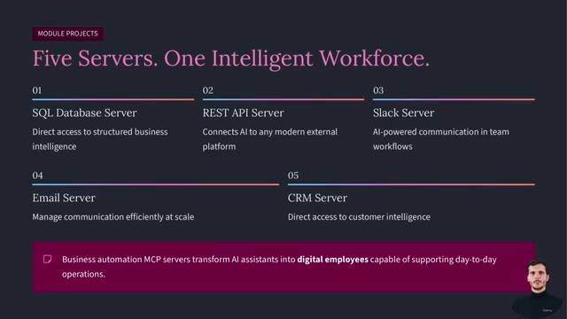
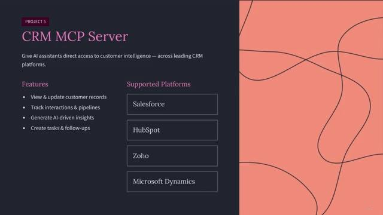
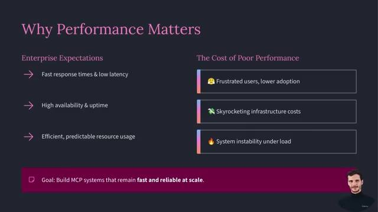
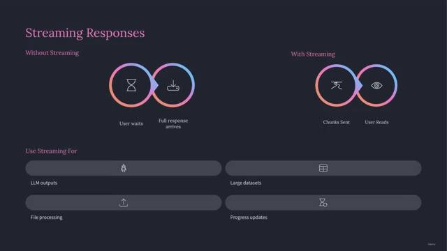
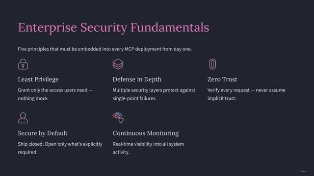
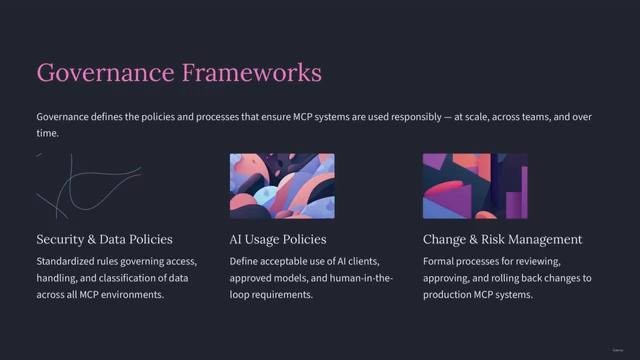
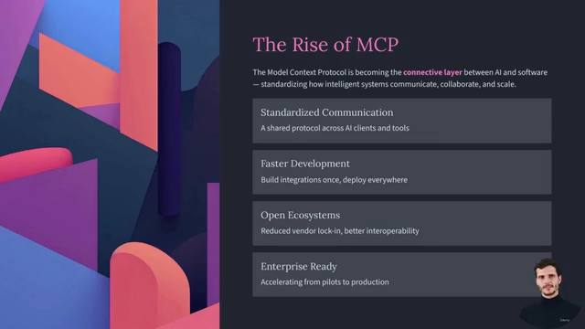
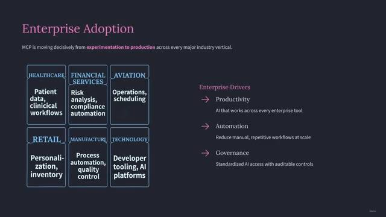

# Claude MCP Masterclass（生产级 MCP 集成）P24–P27 复现文档

> 说明：本段课程（P24–P27）是**架构讲解 + 演示型**内容，逐字稿里没有出现任何可执行代码、命令或配置文件，截图 OCR 清单也为空。因此本文档按「纯讲解课」的七段结构撰写：第 3 节把讲师的推导过程按步骤复现，第 4 节把讲师给出的方案落成可用的产物（设计决策表、组件职责表、接口草案、容量估算表、检查清单），第 5 节逐条解释每个决策为什么这样定。凡逐字稿没讲的内容，一律标注「课里没讲」，不编造实现。

---

## 1. 这一节做什么

P24–P27 是整门课从「会写单个 MCP server」走向「能在企业里落地」的四连讲，四集各自解决一个工程问题：

- **P24 业务自动化**：把 MCP 从「问答助手」升级为「数字员工」。讲师规划了五个 MCP server——SQL 数据库、REST API、Slack、Email、CRM——并演示它们如何串成一条端到端的业务流程（识别流失风险客户 → 生成报告 → 通知销售团队 → 安排跟进沟通）。核心论点是：**业务价值不来自单个工具，而来自工具协作形成的工作流**。
- **P25 性能优化**：系统建起来只是完成一半，另一半是让它在大规模下依然快、稳、省。讲师给出四维性能目标（快响应、高可用、可预测、高效率）、五问排障法、缓存 / 流式 / 精简资源 / 懒加载 / 内存与成本优化五套手段，以及可观测性与持续度量。
- **P26 安全与治理**：MCP server 直连敏感系统，是攻击面的一部分。讲师给出五大安全原则（最小权限、纵深防御、零信任、默认安全、持续监控）、认证与授权、访问控制、审计日志、合规框架、治理政策，最后落到一张「企业 MCP 蓝图」分层图。
- **P27 MCP 生态**：从单点走向标准。讲师论证 MCP 正在成为 AI 与软件之间的连接层，类比 HTTP 之于 Web、SQL 之于数据库，并展望工具生态、社区 server、多智能体协作、企业采用与 AI 原生软件趋势。

**读者产出**：读完并照做后，你应该能画出自己项目的「五 server 业务流水线」、给每个 server 配上性能与安全基线、并写出一份可评审的企业 MCP 架构蓝图。由于本段没有代码，第 4 节给出的是**可直接填写的表格与接口草案**，不是可运行程序——这一点必须说清楚，避免读者误以为漏了代码。

---

## 2. 讲师原话

以下引用均为逐字稿中文翻译，产品名保留英文。

**P24 业务自动化**

> "欢迎来到模块 24，我们将探索 MCP 应用最大的机会之一：业务自动化。各行各业的企业都在寻找减少重复工作、提升运营效率、让员工专注于更高价值活动的方法。MCP 提供了把这一愿景变成现实所需的基础设施。"
> —— p024 [00:00]

> "在本模块中，我们将构建五个实用的 MCP server：SQL 数据库、REST API、Slack、Email 和 CRM。这些 server 合在一起，构成一支能够支撑日常业务运营的智能劳动力。"
> —— p024 [00:57]

> "把这些 MCP server 想象成数字员工。每一个都专精于某个领域，但合在一起，它们协作执行完整的业务流程。"
> —— p024 [01:26]

> "本模块展示了 MCP 的一条重要原则：业务价值不来自单个工具，而来自这些工具协同工作时所创造的工作流。"
> —— p024 [03:24]

> "SQL 数据库 server 暴露了几个核心能力，包括 run_sql、get_KPIs 和 generate_report。这些工具让 AI 助手无需人工介入就能检索指标、分析趋势并生成业务报告。"
> —— p024 [03:53]

> "当然，直接访问数据库需要谨慎对待。生产实现应当强制权限、校验查询，并尽可能把操作限制在已批准的数据集上。"
> —— p024 [04:51]

> "REST API server 支持现代 API 应有的一切能力，包括 GET 和 POST 请求、认证处理、分页、错误处理和响应格式化。"
> —— p024 [05:47]

> "想象一下让 AI 助手『创建一个 Jira 工单、更新 Salesforce、并通知支持团队』。REST API MCP server 通过统一接口让这类多系统工作流成为可能。"
> —— p024 [06:16]

> "Slack MCP server 支持多种能力，包括发送消息、发布告警、创建摘要、安排通知和搜索对话。"
> —— p024 [07:42]

> "这个 server 暴露了几个关键能力，包括 read_email、send_email 和 draft_reply。"
> —— p024 [09:36]

> "当然，邮件自动化必须谨慎实现。对于敏感通信，应当引入人工审批工作流、访问控制和审计日志。"
> —— p024 [10:34]

> "这个 server 支持广泛的能力，包括查看和更新客户记录、跟踪互动、监控销售管道、生成 AI 驱动的洞察，以及自动创建跟进任务。"
> —— p024 [11:32]

> "这个流程从 CRM server 检索客户信息开始。接着 SQL server 分析历史数据与趋势。然后 REST API server 与外部平台通信，Email server 发送客户沟通，Slack server 通知内部相关方。"
> —— p024 [13:25]

> "请注意发生了什么：一个端到端的业务流程在部门之间没有任何人工交接的情况下完成了。"
> —— p024 [13:53]

> "安全与治理必须被当作一等公民。每一次生产部署都应实施若干最佳实践：访问控制应强制基于角色的权限，确保 AI 助手只执行被授权的操作；数据在传输和静态存储时都应加密；所有 AI 活动都应记录日志以供审计。"
> —— p024 [15:15]

> "每一个请求在执行前都应被清洗，以防止意外行为或恶意输入。对于高影响操作，例如修改客户记录或发送对外沟通，还应要求人工审批工作流。"
> —— p024 [15:44]

> "这个教训很简单：强大的业务自动化需要同样强大的防护措施。"
> —— p024 [16:12]

**P25 性能优化**

> "构建 MCP 系统只是挑战的一半。另一半是确保它们随着需求增长依然快速、可靠、成本可控。在企业环境中，无论用户是 10 个还是 10000 个，用户都期望 AI 系统快速且稳定地响应。"
> —— p025 [00:00]

> "大规模下的性能由四个特征定义：快速响应、高可用、可预测的行为、高效的资源使用。"
> —— p025 [00:26]

> "性能优化始于识别瓶颈，也就是限制整体速度与可扩展性的那部分。最常见的瓶颈包括慢数据库查询、外部 API 延迟、过大的负载和过度的内存消耗。"
> —— p025 [01:52]

> "排查性能问题时，问自己五个问题：什么慢？为什么慢？多久发生一次？这个操作能缓存吗？能并行化吗？"
> —— p025 [02:20]

> "优化必须始终由数据驱动。不要猜问题在哪，而要收集指标、分析行为、做出有依据的决策。"
> —— p025 [02:48]

> "缓存的思路很简单：如果你已经计算或获取过某个东西一次，就把它临时存起来，避免再做一次。"
> —— p025 [03:18]

> "考虑一个需要两秒执行的数据库查询。有了缓存，后续请求可能只需几毫秒就返回。"
> —— p025 [04:14]

> "流行的缓存技术包括 Redis、Memcached 和内存内应用缓存。许多企业系统还实施称为 TTL 的缓存过期策略，以确保数据保持新鲜。"
> —— p025 [04:14]

> "作为一般规则：如果数据不常变化且被频繁请求，它就是缓存的绝佳候选。"
> —— p025 [04:44]

> "流式改变了这一行为：数据一就绪就增量发送。用户不必等待完整响应，而是立即开始收到结果。"
> —— p025 [05:12]

> "想想 ChatGPT 如何一个 token 一个 token 地显示文本，那就是流式在起作用。"
> —— p025 [05:41]

> "一个低效的 API 可能在单次响应中返回 10000 条记录。更好的做法是返回前 50 条，并提供分页控制，让用户在需要时请求更多数据。"
> —— p025 [07:06]

> "高效资源设计遵循四条原则：第一，只返回必需字段；第二，用 Gzip 或 Brotli 这类技术压缩大负载；第三，实现分页，把大数据集切成可管理的块；最后，尽可能去重以消除冗余。"
> —— p025 [07:34]

> "懒加载的原则很简单：只在真正需要时才加载资源。不要在启动时初始化一切，而是把工作推迟到用户请求时。"
> —— p025 [08:30]

> "常见的内存问题包括长运行进程中的内存泄漏、过大的对象、重复的数据集，以及永不过期的无界缓存。"
> —— p025 [10:22]

> "主要的成本驱动包括计算资源、LLM 使用、API 调用和 token 消耗。组织可以通过选择合适规模的基建、尽可能使用更小的 AI 模型、积极缓存 API 响应、优化 prompt 以减少 token 用量来降低成本。"
> —— p025 [11:20]

> "工程学中最重要的原则之一很简单：你无法优化你没有度量的东西。"
> —— p025 [12:17]

> "性能监控始于跟踪关键指标，包括响应时间、吞吐量、错误率、内存利用率、CPU 消耗和每请求成本。"
> —— p025 [12:17]

> "Prometheus 广泛用于采集指标，Grafana 提供强大的仪表盘，OpenTelemetry 支持分布式追踪，Datadog 提供全面的监控能力。"
> —— p025 [12:46]

> "性能优化不是一次性事件，而是一门纪律。"
> —— p025 [13:41]

**P26 安全与治理**

> "MCP server 常常直连敏感系统、业务数据库和专有信息，这使它们成为组织攻击面的关键部分。"
> —— p026 [00:00]

> "挑战在 MCP 环境中被放大，因为多个 AI 客户端、用户和团队经常共享同一套基础设施。如果没有恰当的控制，单个漏洞就能影响整个平台。"
> —— p026 [00:29]

> "第一个原则是最小权限：用户只应获得完成工作所必需的权限，不多不少。第二个原则是纵深防御：实施多层安全，使单点失败不会危及整个系统。第三是零信任：现代企业架构假定没有任何请求天然可信，每个用户、客户端和服务在访问资源前都必须持续验证身份。第四是默认安全：系统应从最严格的状态开始，只显式开启所需能力。最后，持续监控提供对系统活动的实时可见性，并能快速发现可疑行为。"
> —— p026 [03:20]

> "现代企业系统支持多种认证方式。OAuth 2.0 常用于委托授权，OpenID Connect 在 OAuth 之上提供身份层，SAML 支持企业联邦，API key 常用于服务间通信。"
> —— p026 [05:15]

> "多因素认证应对所有用户强制启用。token 应设置较短的有效期，以在泄露时把暴露面降到最小。凭据应始终通过加密的密钥管理系统安全存储。最后，企业应采用集中式身份提供方，以简化用户管理并提升一致性。"
> —— p026 [05:41]

> "企业系统通常实施三种权限模型之一：基于角色的访问控制（RBAC）按 HR、财务、管理员等预定义角色分配权限；基于属性的访问控制使用部门、地点、安全许可等动态属性；基于策略的访问控制对每个访问请求应用业务规则与条件。"
> —— p026 [07:09]

> "企业 MCP 系统通常在多个层级实施访问控制：用户级访问提供针对个人的权限；团队级访问允许协作组共享资源；资源级访问控制谁能与特定数据集或工具交互；环境级访问确保开发、预发和生产环境彼此隔离。"
> —— p026 [08:34]

> "若干最佳实践指导企业访问控制策略：第一，默认拒绝，用户从零权限开始，只获得显式要求的权限；第二，授予完成任务所需的最低访问级别；第三，定期复核权限；最后，自动化开通与回收，以减少管理开销并消除人为错误。"
> —— p026 [09:02]

> "每一次登录、工具调用、权限变更和失败的认证尝试都应被记录并安全存储。"
> —— p026 [09:58]

> "没有审计日志，就可能无法确定谁访问了系统、活动何时发生、执行了什么操作。"
> —— p026 [10:53]

> "作为最佳实践，假定 MCP 生态内的每一个动作都应可追溯。"
> —— p026 [11:21]

> "SOC2 关注软件提供方的信任服务准则；ISO 27001 建立信息安全管理标准；HIPAA 管辖医疗数据保护；GDPR 规范欧盟内的个人数据；PCI DSS 适用于处理支付信息的组织。"
> —— p026 [11:49]

> "重要的是理解合规不等于安全。合规框架建立的是最低要求，而安全项目往往超越这些标准以应对不断演进的威胁。"
> —— p026 [12:48]

> "治理是确保 MCP 系统在团队、部门与业务单元之间被负责任使用的框架。安全聚焦于保护系统，治理聚焦于建立政策、流程与问责。"
> —— p026 [13:47]

> "企业组织依赖正式流程来评审、批准和回滚对生产系统的变更。这些流程降低运营风险，并确保更新被安全地实施。"
> —— p026 [14:15]

> "最终的企业 MCP 蓝图结合了多层保护。每个请求在到达 MCP 基础设施之前，都要经过身份验证、访问强制、日志记录和持续监控。"
> —— p026 [16:10]

> "这个蓝图由五条原则支撑：零信任、最小权限、完全可观测、持续合规、安全设计。"
> —— p026 [18:04]

> "安全与治理不是可以事后添加的功能，它们必须从最开始就构建进架构。"
> —— p026 [16:37]

**P27 MCP 生态**

> "模型上下文协议正在迅速成为 AI 与软件之间的连接层。"
> —— p027 [00:00]

> "几个趋势在推动这一增长：第一，标准化通信让 AI 客户端与工具无缝交互；第二，MCP 通过『一次构建、处处使用』大幅加速开发；第三，MCP 促进开放生态，减少厂商锁定、提升互操作性；最后，MCP 正变得越来越企业就绪，组织正从实验走向生产部署。"
> —— p027 [00:25]

> "我们今天看到的，类似 HTTP 之于 Web、REST API 之于现代应用的崛起。MCP 有潜力成为 AI 时代的基础技术。"
> —— p027 [00:53]

> "在没有标准协议的情况下，每次集成都需要独特的代码、独立的认证方式和自定义工作流。随着时间推移，这会产生技术债并限制互操作性。"
> —— p027 [01:50]

> "MCP 完全改变了这一模式。工具变得可移植，资源变得可复用，AI 工作流变得跨平台。结果是一个简单而强大的理念：一次构建，处处使用。"
> —— p027 [02:18]

> "正如 HTML 标准化了 Web 内容、SQL 标准化了数据库交互，MCP 被定位为标准化 AI 系统与软件通信的方式。"
> —— p027 [02:48]

> "如今流行的 MCP 工具包括文件系统、数据库、Web 浏览器、终端访问、GitHub 集成和云平台。"
> —— p027 [03:14]

> "新兴类别包括向量数据库、AI 可观测性平台、安全工具、工作流自动化系统和多智能体编排框架。"
> —— p027 [03:43]

> "一旦某个工具兼容 MCP，它就可能与任何支持 MCP 的 AI 客户端配合工作。这创造了强大的网络效应。"
> —— p027 [04:10]

> "流行的社区 server 包括用于仓库访问的 GitHub server、用于消息工作流的 Slack server、用于结构化数据访问的 PostgreSQL server，以及用于与本地或云存储交互的文件系统 server。"
> —— p027 [04:36]

> "与其花数周从零构建一个集成，团队往往能在数小时内采用一个经过验证的方案。"
> —— p027 [05:02]

> "如今，Claude、ChatGPT、Gemini 以及众多开源 agent 正开始参与一个共享的协议层。"
> —— p027 [05:52]

> "医疗组织正在探索用 MCP 支撑患者工作流与临床系统；金融机构用它做风险分析与合规自动化；航空与民航公司利用 AI 做排班与运营；零售商采用 MCP 做个性化与库存管理；制造与科技公司把 MCP 集成进自动化与开发者平台。"
> —— p027 [07:18]

> "最显著的趋势是从试点走向生产。组织不再问『我们能不能用 AI』，而是问『我们如何在整个企业里负责任地部署 AI』。"
> —— p027 [08:12]

> "想象一个多智能体工作流：一个研究 agent 从外部来源收集信息，一个规划 agent 制定执行策略，一个执行 agent 完成必要任务，一个报告 agent 为相关方总结结果。每个 agent 有专门角色，却通过 MCP 无缝协作。"
> —— p027 [08:40]

> "MCP 路线图反映了社区打造一个简单、可移植、可扩展、可治理的协议的努力。"
> —— p027 [10:06]

> "一个最大的趋势是 AI 操作系统的兴起，AI 成为应用与服务的主要编排层。智能体 AI 是另一项重大发展，使自主系统能够独立执行复杂的多步任务。上下文工程也正受到关注，组织希望精确控制 AI 知道什么、何时知道。本地 AI 模型代表另一个重要趋势。"
> —— p027 [11:27]

> "五个特征定义了这一愿景：连接、协作、智能、可治理、可互操作。"
> —— p027 [13:19]

> "MCP 可能成为 AI 的通用语言，就像 HTTP 成为 Web 的通用语言一样。"
> —— p027 [13:47]

---

## 3. 从零复现

本段没有可执行代码，所以「复现」指的是**按讲师的推导顺序，把一套企业 MCP 平台的设计从需求推到落地**。下面按 P24 → P25 → P26 → P27 的顺序给出可照做的步骤，每一步都对应讲师的原话。

### 步骤 0：准备（读者环境）

课里没讲具体环境要求。按本课程前序模块的惯例（前端转 AI 应用工程师），你需要：Node.js 18+、一个支持 MCP 的 AI 客户端（如 Claude Desktop / Claude Code）、以及五个 server 各自要连的外部系统账号（数据库、Slack workspace、邮件服务、CRM 沙箱、任意 REST 服务）。**具体版本号课里没讲**，以你所用 MCP SDK 的官方要求为准。

### 步骤 1：定义五个 MCP server 的职责边界（P24）

讲师把五个 server 定位为「数字员工」，每个专精一个领域。照做时先建一张职责表（见第 4 节表 4-1），把每个 server 的**工具名、输入、输出、依赖的外部系统**写死。讲师明确点名的工具：

- SQL server：`run_sql`、`get_KPIs`、`generate_report`
- REST API server：GET / POST、认证处理、分页、错误处理、响应格式化
- Slack server：发送消息、发布告警、创建摘要、安排通知、搜索对话
- Email server：`read_email`、`send_email`、`draft_reply`
- CRM server：查看/更新客户记录、跟踪互动、监控销售管道、生成 AI 洞察、自动创建跟进任务

> 注意：讲师念出的工具名是语音识别结果（如 `run underscore SQL`），本文档统一写作 `run_sql`。实际命名以你实现的 server 为准，课里没给完整 schema。

### 步骤 2：把五个 server 串成一条业务流水线（P24 演示）

讲师给出的演示场景是：**识别有流失风险的客户 → 生成报告 → 通知销售团队 → 安排跟进沟通**。照做时按这个顺序编排：

1. **CRM server** 检索客户记录，找出互动度下降的账户；
2. **SQL server** 分析历史使用模式、支持交互、收入趋势，计算流失风险分；
3. AI 助手生成高管摘要，标出最关键的账户；
4. **Slack server** 向客户成功团队发告警；
5. **Email server** 为每个客户起草个性化跟进邮件；
6. **REST API server** 更新外部系统、跨平台同步数据；
7. **CRM server** 记录每一步动作，形成完整审计轨迹。

讲师强调：整个过程无人工介入，多个 server 协作完成端到端流程。

### 步骤 3：给流水线加性能基线（P25）

按讲师的五问排障法，对步骤 2 的每个环节逐一问：什么慢？为什么慢？多久发生一次？能缓存吗？能并行化吗？然后按五套手段落地：

- **缓存**：API 响应、数据库查询结果、工具输出、prompt 模板、用户偏好、会话数据。用 Redis / Memcached / 内存缓存，配 TTL。
- **流式**：LLM 输出、文件处理、大数据集传输、长任务的进度更新，改为增量发送。
- **精简资源**：只返回必需字段、Gzip/Brotli 压缩、分页（讲师举例：10000 条改返回前 50 条 + 分页）、去重。
- **懒加载**：用户资料按需取、文件按请求取、API 调用延后、资源在访问时动态生成。
- **内存与成本**：垃圾回收与资源清理、对象复用、高效数据结构、缓存过期策略；选合适规模基建、能用小模型就用小模型、积极缓存 API 响应、优化 prompt 省 token。

### 步骤 4：建立度量（P25）

讲师的原则是「你无法优化你没有度量的东西」。照做：跟踪响应时间、吞吐量、错误率、内存利用率、CPU 消耗、每请求成本；用 Prometheus 采指标、Grafana 做仪表盘、OpenTelemetry 做分布式追踪、Datadog 做综合监控；**改动前先建基线**，以便量化改进。

### 步骤 5：套上安全五原则（P26）

对步骤 2 的每个 server、每个工具调用，逐条检查：最小权限、纵深防御、零信任、默认安全、持续监控。任何一条被违反，就回到设计阶段。

### 步骤 6：实现认证、授权、访问控制、审计（P26）

- **认证**：OAuth 2.0（委托授权）、OpenID Connect（身份层）、SAML（企业联邦）、API key（服务间）。强制 MFA、短 token 有效期、加密密钥管理、集中式身份提供方。
- **授权**：三选一或组合——RBAC（按角色）、ABAC（按属性）、PBAC（按策略）。
- **访问控制**：用户级 / 团队级 / 资源级 / 环境级四层；默认拒绝、最小授权、定期复核、自动化开通回收。
- **审计**：记录每次登录、工具调用、权限变更、失败认证；接集中式日志平台与 SIEM；假定每个动作都可追溯。

### 步骤 7：对齐合规与治理（P26）

识别你所在行业适用的框架（SOC2 / ISO 27001 / HIPAA / GDPR / PCI DSS），建立数据保留、加密、访问复核、事件报告、文档化政策；把合规放在设计早期而非事后补。治理层面建立安全与数据政策、AI 使用政策（批准哪些模型、哪些用例、何时需要人工监督）、变更与风险管理流程。

### 步骤 8：画出企业 MCP 蓝图（P26 最后一张幻灯片）

讲师给出的分层模型：**身份验证 → 访问强制 → MCP 基础设施**，全程贯穿日志、监控、合规。五条支撑原则：零信任、最小权限、完全可观测、持续合规、安全设计。照做时把步骤 5–7 的产物填进这张分层图（见第 4 节表 4-4）。

### 步骤 9：规划生态与演进（P27）

评估你的集成能否「一次构建、处处使用」；优先复用社区 server（GitHub、Slack、PostgreSQL、文件系统）；关注新兴类别（向量数据库、AI 可观测性、安全工具、工作流自动化、多智能体编排）；为多智能体协作预留共享上下文与工具层。

---

## 4. 完整代码

> **重要声明**：P24–P27 逐字稿中**没有任何代码、命令或配置文件**，截图 OCR 清单也为空。因此本节不提供可运行程序，而是把讲师给出的方案落成**可直接填写、可直接评审的产物**。若你需要示意代码，本文档不编造——课里没有代码。

### 表 4-1 五个 MCP server 职责表（源自 P24）

| Server | 讲师点名的工具/能力 | 依赖的外部系统 | 典型用例 |
|---|---|---|---|
| SQL 数据库 | `run_sql`、`get_KPIs`、`generate_report` | 关系型数据库 | 销售仪表盘、财务报告、客户分析、运营洞察 |
| REST API | GET、POST、认证处理、分页、错误处理、响应格式化 | Stripe、Salesforce、HubSpot、Jira、ServiceNow、Zendesk | 创建 Jira 工单、更新 Salesforce、通知支持团队 |
| Slack | 发送消息、发布告警、创建摘要、安排通知、搜索对话 | Slack workspace | 运营报告、事件管理、高管更新 |
| Email | `read_email`、`send_email`、`draft_reply` | 邮件服务 | 分类请求、总结长线程、起草个性化回复、升级关键问题 |
| CRM | 查看/更新客户记录、跟踪互动、监控管道、生成 AI 洞察、自动创建跟进任务 | Salesforce、HubSpot、Zoho、Microsoft Dynamics | 识别流失风险、销售管道分析、账户管理 |

### 表 4-2 端到端业务流水线（源自 P24 演示）

| 步骤 | 执行者 | 动作 | 输出 |
|---|---|---|---|
| 1 | CRM server | 检索客户记录，识别互动度下降的账户 | 风险账户列表 |
| 2 | SQL server | 分析历史使用、支持交互、收入趋势，算流失风险分 | 风险分 |
| 3 | AI 助手 | 生成高管摘要 | 摘要（标出最关键账户） |
| 4 | Slack server | 向客户成功团队发告警 | 团队通知 |
| 5 | Email server | 为每个客户起草个性化跟进邮件 | 邮件草稿 |
| 6 | REST API server | 更新外部系统、跨平台同步 | 外部系统状态 |
| 7 | CRM server | 记录每一步动作 | 审计轨迹 |

### 表 4-3 性能优化检查清单（源自 P25）

| 类别 | 检查项 | 讲师依据 |
|---|---|---|
| 缓存 | API 响应、数据库查询、工具输出是否恰当缓存？是否配 TTL？ | p025 [03:18]–[04:44] |
| 流式 | 长任务是否给用户即时反馈？ | p025 [05:12]–[06:40] |
| 资源设计 | 响应是否分页、压缩、只含必需字段？是否去重？ | p025 [07:06]–[08:02] |
| 懒加载 | 资源是否按需加载？ | p025 [08:30]–[09:56] |
| 内存 | 缓存是否配过期策略？内存是否持续监控？ | p025 [10:22]–[10:51] |
| 度量 | 是否定期压测、监控基建成本、为关键服务建性能基准？ | p025 [14:40]–[15:07] |

关键指标（p025 [12:17]）：响应时间、吞吐量、错误率、内存利用率、CPU 消耗、每请求成本。

### 表 4-4 企业 MCP 蓝图分层（源自 P26 最后一张幻灯片）

| 层 | 内容 | 讲师原话依据 |
|---|---|---|
| 身份验证层 | OAuth、单点登录、多因素认证 | p026 [17:36] |
| 访问强制层 | RBAC、ABAC、最小权限策略 | p026 [18:04] |
| MCP 基础设施 | 各 MCP server 本体 | p026 [18:04] |
| 贯穿层 | 日志、监控、合规，持续监督 | p026 [18:04] |
| 五原则 | 零信任、最小权限、完全可观测、持续合规、安全设计 | p026 [18:04] |

### 表 4-5 安全五原则自检表（源自 P26）

| 原则 | 定义（讲师原话） | 自检问题 |
|---|---|---|
| 最小权限 | 用户只获得完成工作所必需的权限 | 这个工具是否给了多余权限？ |
| 纵深防御 | 多层安全，单点失败不危及全局 | 是否只有一层防护？ |
| 零信任 | 没有请求天然可信，持续验证 | 每个请求都验证身份了吗？ |
| 默认安全 | 从最严格状态开始，只显式开启所需 | 默认配置是否过宽？ |
| 持续监控 | 实时可见性 + 快速发现可疑行为 | 有实时告警吗？ |

### 表 4-6 合规框架对照（源自 P26）

| 框架 | 管辖范围（讲师原话） |
|---|---|
| SOC2 | 软件提供方的信任服务准则 |
| ISO 27001 | 信息安全管理标准 |
| HIPAA | 医疗数据保护 |
| GDPR | 欧盟个人数据 |
| PCI DSS | 支付信息处理 |

### 表 4-7 生态趋势与采用行业（源自 P27）

| 维度 | 讲师列举 |
|---|---|
| 现有工具类别 | 文件系统、数据库、Web 浏览器、终端访问、GitHub 集成、云平台 |
| 新兴类别 | 向量数据库、AI 可观测性平台、安全工具、工作流自动化、多智能体编排 |
| 社区 server | GitHub、Slack、PostgreSQL、文件系统 |
| 采用行业 | 医疗（患者工作流/临床）、金融（风险/合规）、航空（排班/运营）、零售（个性化/库存）、制造与科技（自动化/开发者平台） |
| 多智能体角色 | 研究 agent、规划 agent、执行 agent、报告 agent |
| AI 原生趋势 | AI 操作系统、智能体 AI、上下文工程、本地 AI 模型 |

---

## 5. 逐行解释

**为什么五个 server 要拆开而不是做成一个巨型 server？** 讲师用「数字员工 / 部门」类比：每个 server 专精一个领域，合起来才协作。工程上的含义是——职责单一才好做权限隔离（P26 的最小权限）、才好独立缓存与扩容（P25）、才好被不同 AI 客户端复用（P27 的「一次构建、处处使用」）。如果你把所有工具塞进一个 server，P26 的「资源级访问控制」和「环境级隔离」就无从谈起。

**为什么 SQL server 要限制在「已批准的数据集」？** 讲师在 p024 [04:51] 明确说生产实现要强制权限、校验查询、限制操作范围。因为 `run_sql` 本质是把任意 SQL 交给 AI 生成——这是 P26 所说「输入校验」和「最小权限」的直接落点。前端同学可以类比：这相当于永远不把用户输入直接拼进 SQL，而是走参数化 + 白名单。

**为什么 REST API server 要内置分页和错误处理？** 讲师在 p024 [05:47] 把它列为「现代 API 应有的一切能力」。原因在 P25：不分页就会一次返回上万条记录，拖慢传输、吃内存。所以 P24 的 REST server 设计和 P25 的资源设计原则是同一件事的两面。

**为什么邮件自动化必须配人工审批？** p024 [10:34] 说敏感通信要有人工审批、访问控制、审计日志。这是 P26「高影响操作需人工审批」的具体例子——发外部邮件不可逆，属于高影响操作。

**为什么缓存是 ROI 最高的优化？** p025 [03:18] 的逻辑：算过一次的东西存起来，避免重算。讲师举例两秒的查询缓存后变几毫秒。判断标准（p025 [04:44]）：数据不常变 + 被频繁请求 = 缓存候选。反面就是 p025 [10:22] 说的「永不过期的无界缓存」——那是内存问题，不是优化。

**为什么流式能「提升感知性能」而不是真实性能？** p025 [05:41] 说得很清楚：用户立即收到反馈，即使总处理时间不变。ChatGPT 逐 token 显示就是例子。对 MCP 的意义：长任务不会因为等完整响应而超时。

**为什么懒加载能提升可扩展性？** p025 [09:27]：未使用的对象从不分配，所以同样基建能支撑更多并发用户。这和前端路由懒加载是同一个思路。

**为什么「你无法优化你没有度量的东西」？** p025 [12:17] 把度量列为优化前提。讲师还强调改动前先建基线（p025 [13:14]），否则无法判断优化是否真的有效。工具链：Prometheus 采指标、Grafana 仪表盘、OpenTelemetry 追踪、Datadog 综合监控。

**为什么安全五原则要「从第一天」嵌入？** p026 [02:52] 说安全考量必须从架构讨论开始就纳入，而不是部署后补。p026 [16:37] 再次强调「不是可以事后添加的功能」。原因是 MCP server 直连敏感系统（p026 [00:00]），且多团队共享基建，单点漏洞影响面大（p026 [00:29]）。

**认证 vs 授权 vs 访问控制，三者区别？** 讲师在 p026 [06:40] 明确：认证确认「你是谁」，授权决定「你能做什么」，访问控制是授权的「实际执行机制」（p026 [08:05]）。三者是递进关系，不能混为一谈。

**为什么默认拒绝？** p026 [09:02]：用户从零权限开始，只获得显式要求的权限。这是最小权限原则在访问控制层的落地。反面是默认放开再收——一旦漏收就是越权。

**为什么合规不等于安全？** p026 [12:48]：合规是最低要求，安全项目往往超越标准以应对演进威胁。所以不能「过了 SOC2 就万事大吉」。

**为什么治理是「企业 MCP 平台的操作系统」？** p026 [14:44] 的类比：治理建立预期、促进问责、提供长期成功的结构。没有治理，各团队各搞一套，系统碎片化、风险上升。

**为什么 MCP 可能成为「AI 的 HTTP」？** p027 [00:53] 的类比链：HTTP 标准化 Web、REST 标准化应用、SQL 标准化数据库交互，MCP 标准化 AI 与软件的通信。判断依据是网络效应（p027 [04:10]）：工具越多 MCP 越有价值，采用越多越多人建工具。

**为什么多智能体需要 MCP？** p027 [08:40]：研究、规划、执行、报告四类 agent 各有专精，靠 MCP 共享工具与上下文才能协作。MCP 提供的是「通信层」。

---

## 6. 复现检查清单

按顺序打勾，全部通过才算把 P24–P27 落地：

- [ ] 五个 server 的职责表已填写（表 4-1），每个工具名、输入、输出、依赖系统都明确
- [ ] 端到端流水线七步已编排（表 4-2），每步的输入输出可追溯
- [ ] 每个 server 都过了五问排障法（什么慢/为什么慢/多久一次/能缓存吗/能并行吗）
- [ ] 缓存候选已列出，且每个都配了 TTL
- [ ] 长任务已改为流式，用户能即时看到反馈
- [ ] 所有列表型响应已分页、压缩、只含必需字段、去重
- [ ] 资源按需加载，启动时不初始化全部
- [ ] 缓存有界且会过期，内存有监控
- [ ] 六项关键指标（响应时间/吞吐量/错误率/内存/CPU/每请求成本）已接入采集
- [ ] 改动前已建性能基线
- [ ] 安全五原则逐条自检通过（表 4-5）
- [ ] 认证方式已选定（OAuth 2.0 / OIDC / SAML / API key），MFA 已强制
- [ ] 授权模型已选定（RBAC / ABAC / PBAC）
- [ ] 访问控制四层（用户/团队/资源/环境）已实现，默认拒绝
- [ ] 审计日志覆盖登录、工具调用、权限变更、失败认证
- [ ] 适用合规框架已识别（表 4-6），数据保留/加密/访问复核/事件报告政策已文档化
- [ ] AI 使用政策已定义（批准模型、用例、人工监督要求）
- [ ] 变更与回滚流程已建立
- [ ] 企业 MCP 蓝图分层已画出（表 4-4），五原则已标注
- [ ] 集成优先复用社区 server，避免重复造轮子
- [ ] 已评估多智能体协作的共享上下文与工具层需求

---

## 7. 课里没讲但你会撞上的

1. **具体 SDK 与版本**：P24–P27 完全没提 MCP SDK 的包名、版本、安装命令。你需要回到本课程前序模块（P1–P23）或官方文档确认。本文档不编造版本号。
2. **五个 server 的实际代码**：讲师只讲了能力和场景，没给任何实现。`run_sql` 的 SQL 校验逻辑、REST server 的认证中间件、Slack 的 OAuth scope、Email 的 IMAP/SMTP 配置——课里都没讲。
3. **数据库 schema**：流失风险分怎么算、需要哪些表字段，课里没讲。你需要在步骤 2 自己定义。
4. **缓存的具体实现**：Redis 的连接方式、key 命名规范、TTL 具体秒数，课里没讲，只给了「配 TTL」的原则。
5. **Prometheus / Grafana / OpenTelemetry / Datadog 的接入代码**：讲师只点名了工具，没给配置。前端同学注意：OpenTelemetry 在 Node.js 里对应 `@opentelemetry/sdk-node` 一类包，但**具体包名课里没讲**，以官方文档为准。
6. **OAuth 2.0 / OIDC / SAML 的具体流程**：讲师只列了协议名和用途，没讲授权码流程、token 刷新、SAML 断言解析。这些是独立的大话题。
7. **RBAC / ABAC / PBAC 的数据模型**：角色表、属性来源、策略引擎选型，课里没讲。
8. **审计日志的存储格式与保留期**：课里只说「安全存储」「接 SIEM」，没给 schema。
9. **合规的具体审计证据清单**：SOC2 / ISO 27001 要准备哪些文档，课里没展开。
10. **多智能体编排框架**：P27 提到「多智能体编排框架」是新兴类别，但没点名任何具体框架，也没给协作协议细节。
11. **「AI 操作系统」「上下文工程」「本地 AI 模型」的落地方式**：P27 只作为趋势提及，没有实现指导。
12. **成本估算的具体数字**：P25 说「选合适规模基建」「用小模型」，但没给任何单价或容量公式。你需要按自己云厂商的报价单算。
13. **并发/锁/事务**：本段涉及数据库查询和跨系统同步，但讲师没讲事务边界。前端同学注意：在 Node.js 里跨 server 的「事务」通常要靠补偿逻辑（saga）而非数据库事务，因为五个 server 是独立进程——这一点课里没讲，但你的流水线一定会撞上「第 5 步失败、第 6 步已执行」的一致性问题。
14. **错误重试与幂等**：流水线七步中任何一步失败怎么办，课里没讲。REST API server 的「错误处理」只被列为能力，没给策略。

---

### 截图索引（本文档引用的帧）

