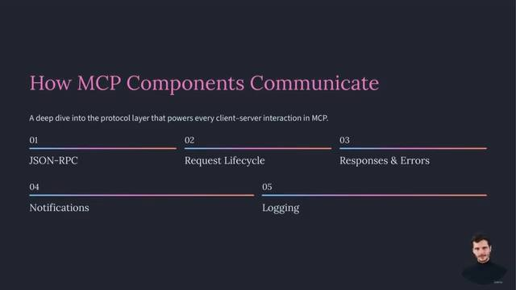
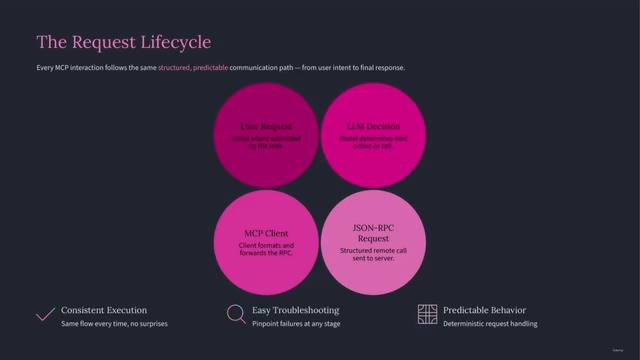
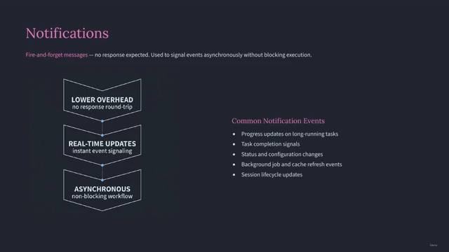
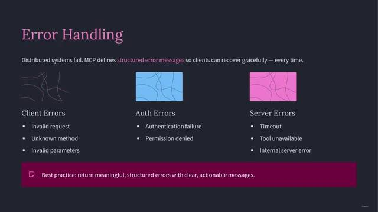
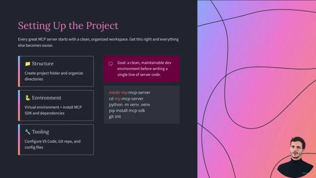
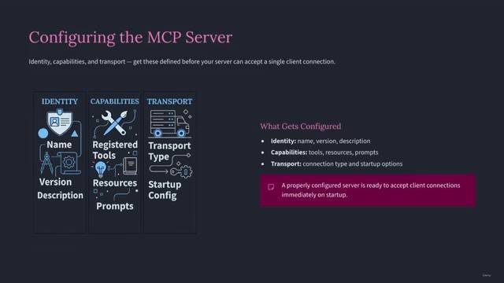
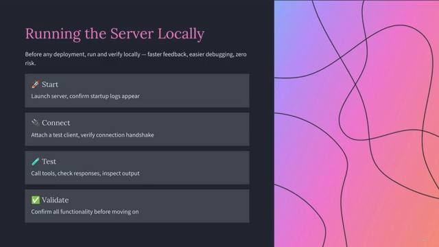
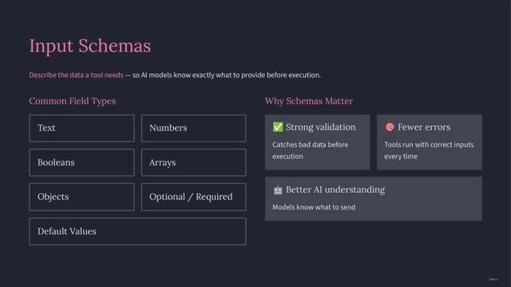
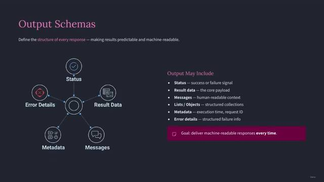
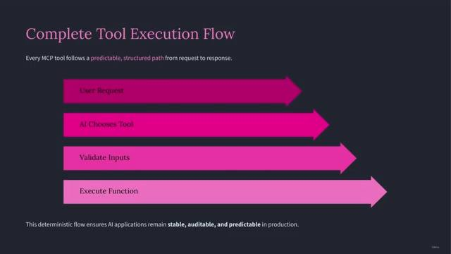

# Claude MCP Masterclass（生产级 MCP 集成）P4–P6 复现文档

> 适用读者：前端转 AI 应用工程师。本文档覆盖 P004（MCP 通信模型）、P005（从零搭建第一个 MCP Server）、P006（MCP Tools 设计与实现）三节。三节里 P004 是纯讲解（无代码），P005 与 P006 是「边讲边搭」的实操，但**讲师在屏幕上没有贴出可 OCR 的完整代码**（本段 OCR 结果为空），因此第 4 节「完整代码」会明确区分「讲师口述的步骤」与「按讲师描述补全的可运行示例（标注为示意）」。凡课里没讲的，一律写「课里没讲」。

---

## 1. 这一节做什么

这三节构成一条完整的「从理解协议 → 搭起服务器 → 加上工具」的主线：

- **P004 通信模型**：讲清楚 MCP 客户端和服务器之间到底用什么「语言」说话。核心是 **JSON-RPC**：请求（method / params / id）、响应（id / 成功状态 / result / 元数据与耗时 / error）、通知（notification，fire-and-forget，不等回复）、结构化错误（客户端错误 / 认证错误 / 服务器错误三类）、日志（请求响应 ID、工具执行细节、耗时、认证事件、会话活动、异常）。这一节不写代码，但它是后面所有调试的「地图」。
- **P005 第一个 MCP Server**：从建目录、建 Python 虚拟环境、装 MCP SDK、初始化 Git、配 VS Code 开始，到配置服务器身份（name / version / description）、能力（tools / resources / prompts）、传输层（STDIO / HTTP 等），再到用装饰器注册一个 `Hello` 工具、本地跑起来、连测试客户端、调试、测试、提交 Git 的完整工程闭环。
- **P006 MCP Tools**：把工具讲透——工具是什么（一个被 MCP server 暴露、AI 可调用的函数）、输入 schema（字段类型、必填/可选、默认值）、输出 schema（成功状态、结果数据、消息、元数据、结构化错误）、执行前校验（必填、类型、范围、枚举、格式如邮箱/URL、安全校验防注入）、结构化错误处理（不要抛原始 stack trace）、可复用工具设计（单一职责、通用可配置输入、结构化输出、可独立单测、版本控制），以及工具执行的完整生命周期（用户请求 → 模型选工具 → 校验 → 执行业务逻辑 → 结构化输出 → 模型生成最终回答）。

一句话：**P004 给你协议，P005 给你骨架，P006 给你肌肉。**

---

## 2. 讲师原话

> "MCP 依赖一套标准化的通信模型，围绕 JSON-RPC 构建，配合结构化的请求、响应、通知、错误处理和日志。这些组件协同工作，在客户端和服务器之间建立可靠、可预测的通信。"
> —— p004 [00:00]

> "可以把通信想象成两台计算机之间说的语言。就像人类需要语法和词汇才能互相理解，软件系统也需要约定好的消息格式。"
> —— p004 [00:29]

> "MCP 最大的优势之一是：每一次交互都遵循相同的通信模式。无论你是在查询数据库、搜索 GitHub，还是控制浏览器，通信方式都保持一致。"
> —— p004 [00:57]

> "MCP 通信的基础是 JSON-RPC，一个轻量级协议，让应用可以用简单的 JSON 消息调用远程过程。每一个 JSON-RPC 请求都包含几个重要元素：标识要执行操作的 method、包含所需输入数据的 parameters、唯一标识该请求的 request ID，以及服务器返回的 result 或 error。"
> —— p004 [01:27]

> "第一，它轻量，消息小、易于在网络上传输。第二，它语言无关，开发者可以用 Python、JavaScript、Java、Go、Rust 或几乎任何编程语言来构建 MCP 应用。第三，JSON 是人类可读的，这让开发期间的检查和调试容易得多。"
> —— p004 [02:23]

> "想象让 AI 助手去搜索一个 GitHub 仓库。客户端发送一个 JSON-RPC 请求，描述操作及其参数。服务器处理该请求，返回另一个 JSON 对象，里面要么是请求的信息，要么是解释哪里出错的错误。"
> —— p004 [02:52]

> "每一次交互都始于用户的请求。语言模型先分析请求，判断它是否需要访问外部工具或资源。如果需要，MCP 客户端就把这个决定转换成结构化的 JSON-RPC 请求，发给对应的 MCP 服务器。服务器执行请求的操作，把结构化响应返回给客户端，让语言模型生成最终答案。"
> —— p004 [03:20]

> "这个生命周期是刻意设计成可预测的。无论用哪个工具，每个请求都遵循相同的顺序。无论你是在执行 SQL 查询、阅读文档，还是与 GitHub 交互，通信流程都完全相同。"
> —— p004 [04:18]

> "服务器处理完请求后，会返回一个客户端能可靠理解的结构化响应。每个响应都包含几项重要信息：request ID 把响应链接回原始请求；成功状态表明操作是否成功完成；result 数据包含工具或资源产生的实际输出；额外的元数据和耗时提供执行细节；出错时则包含错误详情。"
> —— p004 [04:47]

> "结构化响应是 MCP 最大的优势之一，因为客户端永远不用猜服务器返回了什么。每个响应都遵循同样可预测的格式。"
> —— p004 [05:15]

> "不是每次交互都需要响应，这正是通知的价值所在。通知是「发射后不管」的消息。与标准 JSON-RPC 请求不同，通知不期望接收方回传任何东西，它只是告知另一个组件某个事件已经发生。"
> —— p004 [06:14]

> "通知对长时间运行的工作流特别有用。想象一个 AI agent 处理成千上万个文件。与其等整个任务结束，服务器可以定期发送进度更新，告诉客户端任务完成了 25%、50% 或 90%。其他常见的通知事件包括任务完成信号、配置更新、后台任务执行、缓存刷新和会话生命周期事件。"
> —— p004 [06:43]

> "没有软件系统是完美的。网络会失败，服务器会不可用，用户会提供错误输入，外部服务偶尔会宕机。这就是为什么有效的错误处理在每个 MCP 应用中都至关重要。MCP 把错误分为三大类：客户端错误、认证错误和服务器错误。客户端错误包括无效请求、未知方法或错误参数；认证错误发生在凭据缺失或权限不足时；服务器错误包括超时、工具不可用和意外的内部故障。"
> —— p004 [08:11]

> "MCP 的一个优势是错误总是以结构化格式返回。服务器不是简单显示「出错了」，而是提供详细信息，说明什么失败了、为什么失败。这让客户端能智能地反应：有些错误可以触发自动重试，另一些则需要用户输入或管理员操作。"
> —— p004 [08:40]

> "作为开发者，我们的目标不是消除每一个错误——那不可能。我们要设计的是能优雅失败、提供有意义反馈、并尽可能恢复的系统。"
> —— p004 [09:07]

> "一旦 MCP 应用进入生产，日志就成为开发者最有价值的工具之一。每一个重要交互都应该被记录，包括请求和响应 ID、工具执行细节、耗时信息、认证事件、会话活动，以及执行期间发生的任何错误或异常。"
> —— p004 [09:36]

> "日志还通过创建系统活动的审计轨迹来支持安全与合规。组织可以审查谁访问了哪些工具、请求何时发出、敏感操作是如何执行的。但日志应始终在可见性与隐私之间取得平衡。避免记录密码、API key 或机密客户信息。"
> —— p004 [10:33]

> "在生产系统中，好的日志往往能把调试时间从数小时缩短到数分钟。"
> —— p004 [11:03]

> "生产系统遵循有纪律的通信实践，以提升可靠性、安全性和可维护性。第一条最佳实践是在处理前校验每一个请求。输入校验能防止畸形或恶意数据进入你的应用。响应应始终遵循结构化格式，让客户端能一致地解释结果。错误处理应使用标准化的错误码和描述性消息，而不是笼统的失败。记录每一次交互，创建有价值的审计轨迹并简化调试。安全的通信通道，包括认证和加密，保护在客户端与服务器之间移动的敏感信息。性能也应持续监控，测量请求延迟能让团队在用户受影响之前发现变慢。"
> —— p004 [13:00]

> "无论你的应用集成哪些工具或服务，底层的通信模型都保持一致。下一模块我们会探索 MCP 传输层，学习客户端和服务器如何用 STDIO、HTTP、服务器发送事件（SSE）以及其他传输机制来交换这些 JSON-RPC 消息，以及每种方式的优势和理想用例。"
> —— p004 [15:21]

> "到目前为止我们专注于理解 MCP 的概念、架构和通信。现在该动手构建了。本模块我们会从零创建一个功能完整的 MCP 服务器。"
> —— p005 [00:00]

> "本模块的设计是模仿专业开发者的工作方式。我们不会写完代码就祈祷它能跑，而是增量构建、逐步验证、尽早发现问题，并全程遵循工程最佳实践。"
> —— p005 [00:29]

> "我鼓励你跟着我一起写代码，而不是只看演示。在你自己的电脑上创建项目，亲手敲每一条命令，边做边试验这些例子。"
> —— p005 [00:57]

> "第一步是创建一个干净的项目结构。我们会创建专用项目文件夹、初始化 Python 虚拟环境、安装 MCP SDK 和其他必需依赖、为版本控制配置 Git，并把 Visual Studio Code 准备成我们的主要开发环境。"
> —— p005 [01:26]

> "使用虚拟环境尤其重要，因为它把项目依赖与系统其余部分隔离。这能防止版本冲突，也让项目更容易与其他开发者共享。"
> —— p005 [02:24]

> "每个 MCP 服务器都需要三大配置区域：它的身份、它的能力，以及它的传输配置。服务器身份包括名称、版本号和描述等信息，让 MCP 客户端能识别服务器并理解它提供什么。接下来定义服务器的能力，包括 AI 可以执行的工具、可以访问的资源，以及引导 AI 工作流的可复用提示词。注册这些能力就是告诉客户端到底有哪些服务可用。最后配置传输层，这决定客户端如何与服务器通信，是通过 STDIO、HTTP 还是其他支持的传输机制。启动配置也属于这里，确保服务器每次启动都能正确初始化。"
> —— p005 [02:54]

> "把这个步骤想象成在开门迎接请求之前，先创建服务器的身份证和说明书。"
> —— p005 [04:16]

> "构建一个基础服务器只需要几个关键步骤。首先导入 MCP SDK 的类。接着创建服务器实例，提供它的名称和版本。然后用装饰器注册工具、资源或提示词，定义对应的处理函数，最后启动服务器，让它监听传入的请求。在示例中我们创建了一个名为 Hello 的简单工具。当客户端调用这个工具并传入用户名时，服务器返回个性化的问候。"
> —— p005 [04:16]

> "重要的不是问候语本身，而是架构。你之后构建的每一个高级 MCP 服务器都遵循同样的模式。唯一的区别是，你的工具可能不再返回问候，而是执行 SQL 查询、搜索 GitHub 仓库、调用 API 或自动化浏览器。"
> —— p005 [05:14]

> "在把 MCP 服务器部署到任何地方之前，必须验证它在本地机器上能正确工作。本地开发遵循四个简单阶段：第一，启动服务器，确认启动日志表明初始化成功；第二，连接一个测试客户端，验证通信握手；第三，执行工具调用，检查响应并查看服务器输出；第四，在考虑部署之前，验证每个功能都按预期工作。"
> —— p005 [06:10]

> "在本地运行能提供即时反馈。如果存在配置错误或工具注册失败，你会在几秒内发现，而不是部署到另一个环境之后才发现。"
> —— p005 [06:39]

> "经验丰富的软件工程师的习惯之一是频繁测试。与其写几百行代码再检查是否工作，他们在每次有意义的改动后就持续测试。"
> —— p005 [07:07]

> "每个开发者都会遇到 bug。初学者和有经验的工程师的区别不在于避免问题，而在于知道如何高效地解决问题。结构化的调试从仔细阅读错误消息开始。现代编程语言提供的 stack trace 往往直接指向出问题的代码行。在随意改动之前，先理解错误在告诉你什么。接着检查服务器日志：启动日志能揭示配置问题，运行时日志帮助定位工具执行期间的问题。如果某个工具没有被客户端发现，检查你的配置，确认它已正确注册到服务器。另一个有价值的调试技巧是检查请求和响应载荷。查看客户端与服务器之间交换的 JSON，往往能发现缺失的参数、错误的数据类型或协议不匹配。调试应始终遵循系统化流程：读错误、收集证据、隔离问题、一次只改一处、再测试。"
> —— p005 [07:36]

> "测试从一份简单的清单开始：确认服务器成功启动、客户端能连接、注册的工具正确执行、资源正确加载、提示词可用、响应有效、错误被优雅处理、整体性能可接受。测试不只是找 bug，而是建立信心，相信你的应用在正常和意外条件下都能可靠运行。"
> —— p005 [09:04]

> "不要只测试成功的请求。试试无效输入、缺失参数和边界情况。验证你的服务器返回有意义的错误消息，而不是意外崩溃。"
> —— p005 [09:33]

> "专业 MCP 开发遵循持续改进的循环，而不是一次性的编码会话。工作流从写代码开始。功能实现后，在本地启动服务器，用 MCP 客户端测试。出现的任何问题都在再次测试前被调查和修正。功能行为正确后，把改动提交到 Git，然后循环进入下一个功能。注意测试出现在每次提交之前，而不是只在项目末尾。"
> —— p005 [10:28]

> "版本控制也扮演关键角色。频繁提交创建还原点，让你能安全地试验新功能，而不危及之前能工作的代码。这个开发循环——写、运行、测试、调试、提交、重复——被全世界的软件工程团队遵循，因为它能持续产出可靠、可维护的软件。"
> —— p005 [11:25]

> "这张幻灯片总结了有经验的开发者一贯遵循的四个习惯。第一，保持组织性，维护干净的项目结构，把配置文件与应用逻辑分开。第二，构建小而专注的工具，每个 MCP 工具应把一件具体的事做好，而不是试图解决多个不相关的问题。第三，实现结构化日志和优雅的错误处理。第四，给一切做版本控制，用 Git 频繁提交，经常测试，避免大量未跟踪的改动。"
> —— p005 [11:54]

> "虽然这第一个服务器是刻意简单的，但它展示了你在未来构建每个 MCP 应用时都会用到的完整生命周期。更大的项目可能包含几十个工具、多个资源、高级认证和企业集成，但底层工作流完全相同。最重要的教训是：成功的软件开发是迭代的。"
> —— p005 [13:18]

> "工具让 AI 能够超越回答问题。AI 模型不再只是生成文本，而是可以执行真实动作，比如查询数据库、调用 API、读取文件或与外部服务交互。把工具想象成推理与执行之间的桥梁。语言模型决定需要做什么，而工具执行实际的工作。"
> —— p006 [00:00]

> "本模块你将学习如何定义工具、用 schema 描述它们的输入输出、校验传入数据、优雅地处理错误，以及设计可跨多个项目复用的组件。学完这一课你会明白：工具不只是单个函数，它们是现代 AI 自动化的构建块。"
> —— p006 [00:29]

> "一个 MCP 工具，就是 MCP 服务器暴露出来的、AI 模型可以调用以执行特定任务的函数。每个工具都包含几个重要组成部分：描述性的名称、解释其用途的文档、输入参数、包含业务逻辑的函数、结构化的返回值，以及校验和错误处理逻辑。"
> —— p006 [01:28]

> "一个工具可能搜索 GitHub 仓库、执行 SQL 查询、从磁盘读取文件、发送 Slack 消息或调用 REST API。虽然这些操作差异很大，但它们都遵循相同的 MCP 结构。这种标准化极其强大：一旦你知道如何构建一个 MCP 工具，你几乎可以构建任何集成，只需改变底层的业务逻辑。"
> —— p006 [01:57]

> "给工具命名时，始终选择清晰、描述性的名字。好的文档能帮助开发者和 AI 模型准确理解每个工具应在何时使用。记住，一个工具应该只有一个明确定义的职责。小而专注的工具更容易维护、更容易测试，也更容易被 AI 模型有效使用。"
> —— p006 [02:25]

> "输入 schema 定义传入数据的结构。它们指定字段类型，如文本、数字、布尔、数组和对象，同时指明哪些字段必填、哪些可选、是否应应用默认值。schema 有几个重要用途。第一，它在执行开始前校验传入数据，防止许多由缺失或格式错误输入引起的常见运行时错误。第二，schema 改善 AI 模型与工具之间的沟通，因为模型准确理解期望什么输入，就能更准确地构造请求。"
> —— p006 [02:55]

> "想象一个发送邮件的工具。schema 可能要求收件人地址、主题行和消息正文。如果邮箱地址缺失或格式不正确，校验能立即发现问题，而不是让工具稍后失败。设计良好的 schema 让工具更可靠、更易文档化，在生产 AI 系统中使用起来也安全得多。"
> —— p006 [03:52]

> "正如输入 schema 定义工具期望什么，输出 schema 定义工具确切返回什么。结构化输出可以包含成功状态、结果数据、描述性消息、列表或对象、元数据（如执行时间或请求标识符），以及出错时的结构化错误信息。为什么这很重要？当响应遵循可预测的结构时，AI 系统表现得好得多。语言模型不再需要解释不一致的文本，而是收到组织良好、易于理解和推理的数据。"
> —— p006 [04:20]

> "想象一个天气工具。与其返回一段描述今天天气的文字，它可以返回温度、湿度、风速和预报状况等结构化字段。AI 随后可以决定如何把信息呈现给用户。结构化输出也简化了调试和与其他系统的集成，因为开发者始终知道会返回什么信息。"
> —— p006 [04:50]

> "即使设计得最好的工具，如果收到错误输入也会失败。这就是为什么校验应始终在任何业务逻辑执行之前进行。校验检查传入数据的几个方面：验证必填字段存在、确认正确的数据类型、强制取值范围和允许值、校验邮箱地址或 URL 等格式，并执行安全检查以防止恶意或不安全的输入。"
> —— p006 [05:48]

> "考虑一个处理客户订单的工具。没有校验，负数量、无效产品标识符或格式错误的邮箱地址可能到达下游系统，造成意外失败。安全校验尤其重要。永远不要假设传入数据是安全的。在与数据库或外部 API 交互之前，净化用户输入、校验业务规则、防范注入攻击。"
> —— p006 [06:18]

> "好的校验带来两大好处。第一，它通过尽早捕获问题来防止失败。第二，它通过返回清晰、可操作的错误消息，准确说明需要修正什么，来改善用户体验。在整个 MCP 开发旅程中要记住一条简单规则：先校验，后执行。"
> —— p006 [06:46]

> "无论你把工具设计得多仔细，失败偶尔都会发生。外部 API 可能不可用，数据库可能遇到连接问题，用户可能提供无效输入，或者执行期间出现意外异常。常见的失败点包括：缺失输入、无效值、API 或数据库失败、网络中断、认证问题、权限错误，以及意外的运行时异常。"
> —— p006 [07:13]

> "错误处理的目标不是消除每一种可能的失败，而是确保工具在出错时能优雅响应。最重要的最佳实践之一是返回结构化错误消息，而不是原始 stack trace。stack trace 对开发者有用，但对 AI 模型和最终用户来说令人困惑。结构化错误应清楚说明什么失败了、为什么失败，并在可能时说明如何修正问题。例如，与其返回「第 42 行的 index error」，你的工具可以返回「请求的客户 ID 在数据库中不存在」。"
> —— p006 [07:42]

> "专业的 MCP 工具把失败当作预期事件，而不是意外灾难，这让应用显著更可靠、更易维护。"
> —— p006 [08:41]

> "随着 MCP 应用增长，你会很快意识到许多工具解决的问题在不同项目中反复出现。可复用工具设计一次，然后在多个应用中使用。关键原则是单一职责。每个工具应把一件具体的事做得极好，而不是把许多不相关的操作合并到一个函数里。可复用工具还使用通用、可配置的输入，从而无需改代码就能支持多种场景。结构化输出确保每个应用无论怎样使用该工具都收到一致的响应。另一个重要特征是独立测试：由于每个工具只承担一个职责，单元测试写起来和维护起来都简单得多。版本控制也扮演重要角色，让团队在跟踪改动的同时保持向后兼容。"
> —— p006 [09:08]

> "把 MCP 工具想象成积木。一个设计良好的工具可以与许多其他工具组合，构建越来越复杂的 AI 工作流。今天在可复用工具设计上投入时间，会大幅减少未来项目的开发工作量，同时提升整个 AI 生态的一致性。"
> —— p006 [10:07]

> "每一次交互都始于用户请求。AI 模型分析请求，确定应使用哪个工具。在工具执行之前，所有传入数据都经过校验以确保正确性。校验成功后，工具执行其业务逻辑，把结构化输出返回给 AI 模型，模型再生成给用户的最终响应。这个工作流是刻意确定性的，意味着它每次都遵循相同的顺序。可预测的执行让 MCP 应用更容易调试、监控和维护。注意校验发生在执行之前而不是之后。这防止无效请求到达外部系统，并减少不必要的处理。"
> —— p006 [10:35]

> "无论工具是在查询数据库、调用 API、自动化浏览器，还是与云服务交互，整体执行模式都保持一致。理解这个生命周期将帮助你构建可靠、安全、易于集成到更大 AI 工作流中的工具。"
> —— p006 [11:32]

> "第一个建议是让每个工具专注于单一职责。第二，校验所有传入数据，永远不要假设输入正确，在执行任何逻辑前检查数据类型、必填字段、范围、格式和业务规则。第三，始终返回结构化输出。第四，优雅地处理每一种可能的错误，为调试记录重要事件，同时确保用户收到有意义、易理解的错误消息，而不是原始异常。最后，为每个工具编写文档并做版本控制。"
> —— p006 [12:02]

> "输入 schema 定义工具需要什么信息，输出 schema 确保响应保持结构化和可预测。校验通过在执行前捕获问题来保护执行，而周到的错误处理让应用即使在失败发生时也保持可靠。"
> —— p006 [13:51]

> "在下一个模块，我们会把焦点转向 MCP 资源。你将学习如何暴露文档、知识库、配置文件、源代码和其他只读信息，让 AI 模型能基于准确的真实世界上下文进行推理，而不是仅依赖训练数据。"
> —— p006 [14:50]

---

## 3. 从零复现

> 说明：P004 是纯讲解，没有可执行步骤，它的「复现」就是理解协议字段（见第 5 节逐条解释）。P005 与 P006 讲师口述了完整工程流程，但**没有在屏幕上贴出可 OCR 的完整源码**（本段 OCR 为空）。下面第 3 节严格按讲师口述的步骤复现；第 4 节给出「按讲师描述补全的可运行示例」，并明确标注哪些是讲师讲的、哪些是补全的示意。

### 3.1 环境准备（P005 [01:26]–[02:24]）

讲师描述的初始化工作流是：建目录 → 进目录 → 建虚拟环境 → 装 SDK → 初始化 Git。对应命令（讲师在幻灯片上「示意」了这套基本工作流，逐字稿未逐条念出具体命令，以下为按该工作流补全的标准命令，标注为示意）：

```bash
# 1. 创建专用项目文件夹并进入
mkdir mcp-server-demo
cd mcp-server-demo

# 2. 创建 Python 虚拟环境（隔离项目依赖，防止版本冲突）
python3 -m venv .venv

# 3. 激活虚拟环境
# macOS / Linux:
source .venv/bin/activate
# Windows (PowerShell):
# .venv\Scripts\Activate.ps1

# 4. 安装 MCP SDK（讲师只说「安装 MCP SDK 和其他必需依赖」，未给版本号）
pip install mcp

# 5. 初始化 Git 仓库
git init
```

> 依赖版本：**课里没讲**具体版本号。讲师只强调「安装 MCP SDK 和其他必需依赖」。实际安装时请以 `pip install mcp` 拉到的当前版本为准，并在 `requirements.txt` 里锁定。

### 3.2 配置服务器三大区域（P005 [02:54]–[04:16]）

讲师明确说每个 MCP 服务器需要三大配置区域：

1. **身份（identity）**：name、version、description —— 让客户端识别服务器、理解它提供什么。
2. **能力（capabilities）**：tools（AI 可执行）、resources（可访问）、prompts（可复用提示词）—— 注册即告诉客户端有哪些服务。
3. **传输层（transport）**：STDIO、HTTP 或其他支持的机制；启动配置也归这里，确保每次启动正确初始化。

在代码里，这三块分别对应：创建 server 实例时传 name/version（身份）、用装饰器注册 tool/resource/prompt（能力）、最后 `run()` 时指定 transport（传输）。见第 4 节。

### 3.3 写第一个服务器 + Hello 工具（P005 [04:16]–[05:44]）

讲师给的步骤顺序是固定的：

1. 导入 MCP SDK 的类；
2. 创建 server 实例，提供 name 和 version；
3. 用**装饰器**注册 tools / resources / prompts；
4. 定义对应的 handler 函数；
5. 启动服务器，监听传入请求。

示例工具叫 `Hello`：客户端调用并传入用户名，服务器返回个性化问候。讲师强调「重要的不是问候语，而是架构」——后面所有高级服务器都是这个模式，只是把「返回问候」换成「执行 SQL / 搜 GitHub / 调 API / 自动化浏览器」。

### 3.4 本地验证四阶段（P005 [06:10]–[07:07]）

1. 启动服务器，确认**启动日志**表明初始化成功；
2. 连接一个**测试客户端**，验证通信握手；
3. 执行**工具调用**，检查响应、查看服务器输出；
4. 部署前验证每个功能都按预期工作。

讲师强调本地跑能「几秒内」发现配置错误或工具注册失败，而不是部署后才发现。

### 3.5 结构化调试流程（P005 [07:36]–[09:04]）

讲师给的系统化流程，按顺序执行：

1. **读错误消息**：现代语言的 stack trace 往往直接指向出问题的代码行，改之前先理解错误在说什么；
2. **查服务器日志**：启动日志看配置问题，运行时日志看工具执行问题；
3. **工具没被发现**：检查配置，确认已正确注册到服务器；
4. **检查请求/响应载荷**：看客户端与服务器之间交换的 JSON，常能发现缺失参数、错误数据类型、协议不匹配；
5. **一次只改一处，再测试**。

### 3.6 测试清单（P005 [09:04]–[10:28]）

讲师给的清单，逐项打勾：

- [ ] 服务器成功启动
- [ ] 客户端能连接
- [ ] 注册的工具正确执行
- [ ] 资源正确加载
- [ ] 提示词可用
- [ ] 响应有效
- [ ] 错误被优雅处理
- [ ] 整体性能可接受

并且强调：**不要只测成功请求**，要测无效输入、缺失参数、边界情况，验证返回的是有意义的错误消息而不是崩溃。

### 3.7 开发循环（P005 [10:28]–[11:54]）

讲师反复强调的循环：**写 → 运行 → 测试 → 调试 → 提交 Git → 重复**。测试出现在**每次提交之前**，而不是项目末尾。频繁提交 = 还原点，能安全试验新功能。

### 3.8 工具设计落地（P006 全程）

把 P006 的设计原则落成可执行动作：

1. **命名**：清晰、描述性；一个工具一个职责。
2. **输入 schema**：定义字段类型（文本/数字/布尔/数组/对象）、必填/可选、默认值。
3. **输出 schema**：成功状态、结果数据、描述性消息、列表/对象、元数据（执行时间、请求 ID）、结构化错误。
4. **校验先于执行**：必填、类型、范围、枚举、格式（邮箱/URL）、安全（防注入）。
5. **结构化错误**：说明什么失败、为什么、如何修正；不抛原始 stack trace。
6. **可复用**：单一职责、通用可配置输入、结构化输出、可独立单测、版本控制。

---

## 4. 完整代码

> **重要声明**：本段课程 OCR 为空，讲师在屏幕上没有贴出可复制的完整源码。以下 `server.py` 是**按 P005 [04:16]–[05:44] 讲师口述的步骤（导入 SDK → 建实例传 name/version → 装饰器注册 → handler → 启动）和 P006 的 schema/校验/结构化错误原则补全的可运行示意**，不是讲师逐字稿里的原文。凡涉及具体 API 名称（如 `FastMCP`、`@mcp.tool`、`mcp.run`）的地方，请以你安装的 `mcp` 包实际导出的符号为准——**课里没讲**具体用哪个类名。

### 4.1 目录结构（按 P005「干净项目结构」原则）

```
mcp-server-demo/
├── .venv/                 # 虚拟环境（不提交）
├── .gitignore
├── requirements.txt
├── server.py              # 服务器入口：身份 + 能力 + 传输
└── README.md
```

`.gitignore`（示意，课里没讲具体内容）：

```
.venv/
__pycache__/
*.pyc
.env
```

`requirements.txt`（版本课里没讲，安装后 `pip freeze` 生成）：

```
mcp
```

### 4.2 server.py（示意，按讲师口述步骤补全）

```python
"""
MCP Server 示意实现。
按 P005 [04:16]-[05:44] 讲师口述的五步构建：
  1. 导入 MCP SDK 的类
  2. 创建 server 实例，提供 name 和 version（身份）
  3. 用装饰器注册 tools / resources / prompts（能力）
  4. 定义 handler 函数
  5. 启动服务器（传输层）
P006 的 schema / 校验 / 结构化错误原则体现在 hello 工具里。
注意：具体类名与装饰器名以你安装的 mcp 包为准，课里没讲。
"""

from mcp.server.fastmcp import FastMCP  # 示意导入；实际符号以安装包为准

# ---- 2. 身份：name + version（P005 [02:54] 三大配置区域之一）----
mcp = FastMCP("demo-server")


# ---- 3 & 4. 能力 + handler：注册一个 Hello 工具（P005 [04:16]）----
@mcp.tool()
def hello(name: str) -> dict:
    """
    返回对指定用户的个性化问候。

    输入 schema（P006 [02:55]）：
      - name: str，必填，用户名
    输出 schema（P006 [04:20]）：
      - success: bool
      - data: dict（含 greeting）
      - message: str
      - error: str | None
    """
    # ---- 校验先于执行（P006 [05:48]「先校验，后执行」）----
    if not isinstance(name, str) or not name.strip():
        # 结构化错误，不抛原始 stack trace（P006 [07:42]）
        return {
            "success": False,
            "data": {},
            "message": "参数校验失败",
            "error": "name 必须是非空字符串",
        }

    # ---- 业务逻辑 ----
    greeting = f"Hello, {name.strip()}!"

    # ---- 结构化输出（P006 [04:20]）----
    return {
        "success": True,
        "data": {"greeting": greeting},
        "message": "ok",
        "error": None,
    }


# ---- 5. 传输层 + 启动（P005 [02:54] 第三大配置区域）----
if __name__ == "__main__":
    # 默认走 STDIO（讲师在 P004 [15:21] 提到 STDIO 是传输机制之一）
    mcp.run()
```

### 4.3 本地测试客户端（示意）

讲师在 P005 [06:10] 说「连接一个测试客户端，验证通信握手」。课里没讲具体客户端代码，以下为按 MCP 客户端调用工具的通用模式补全的示意，**不是讲师原文**：

```python
"""
本地测试客户端示意。
用途：对应 P005 [06:10] 本地验证四阶段的第 2、3 步——
连接服务器、执行工具调用、检查响应。
具体 API 以你安装的 mcp 包为准，课里没讲。
"""

import asyncio
from mcp import ClientSession, StdioServerParameters
from mcp.client.stdio import stdio_client


async def main():
    server_params = StdioServerParameters(
        command="python",
        args=["server.py"],
    )

    async with stdio_client(server_params) as (read, write):
        async with ClientSession(read, write) as session:
            # 握手
            await session.initialize()

            # 列出工具（验证工具已注册，对应 P005 [08:06]「工具没被发现」排查）
            tools = await session.list_tools()
            print("已注册工具:", tools)

            # 调用 hello 工具
            result = await session.call_tool("hello", {"name": "Alice"})
            print("调用结果:", result)

            # 测无效输入（P005 [09:33] 要求测边界情况）
            bad = await session.call_tool("hello", {"name": ""})
            print("无效输入结果:", bad)


if __name__ == "__main__":
    asyncio.run(main())
```

### 4.4 启动与验证命令

```bash
# 激活虚拟环境
source .venv/bin/activate

# 启动服务器（STDIO 模式下它会等待客户端连接，终端看起来「卡住」是正常的）
python server.py

# 另开一个终端跑测试客户端
python client.py
```

> 说明：STDIO 传输下服务器通过标准输入输出与客户端通信，直接在终端 `python server.py` 不会有花哨输出，这是预期行为。课里没讲 STDIO 的具体握手细节，P004 [15:21] 只预告了下一模块会讲 STDIO / HTTP / SSE 的差异。

---

## 5. 逐行解释

### 5.1 P004 通信模型：每个字段为什么存在

**JSON-RPC 请求四要素**（P004 [01:27]）：`method`（要执行什么操作）、`parameters`（输入数据）、`request ID`（唯一标识）、以及服务器回的 `result` 或 `error`。讲师强调这四样是「每个请求都包含」的。为什么要有 request ID？因为响应要靠它「链接回原始请求」（P004 [04:47]）——异步场景下响应可能乱序回来，没有 ID 就配不上对。**在 JS/Node 里对应什么**：就像 `fetch` 的 Promise 靠内部 id 把响应配回调用，或 WebSocket 消息里带 `id` 字段做请求-响应配对（课里没提 WebSocket，这里只是类比）。

**JSON 的三个优势**（P004 [02:23]）：轻量、语言无关（Python/JS/Java/Go/Rust 都能写）、人类可读便于调试。语言无关这点对前端转 AI 很重要——你完全可以用 Node 写 MCP server，不必被迫学 Python。

**请求生命周期**（P004 [03:20]）：用户请求 → 模型判断是否需要外部工具 → 客户端转成 JSON-RPC 请求 → 服务器执行 → 结构化响应 → 模型生成最终答案。讲师反复说这个流程「刻意可预测」「无论哪个工具都一样」（P004 [04:18]）。可预测的价值：调试时你知道请求卡在哪个阶段，监控时每个交互都是同一套模式。

**响应字段**（P004 [04:47]）：request ID、成功状态、result 数据、元数据与耗时、error 详情。讲师说「客户端永远不用猜服务器返回什么」（P004 [05:15]）。举例：数据库查询成功，result 里是返回的行；语法错误，则返回结构化错误说明具体问题。

**通知 vs 请求**（P004 [06:14]）：通知是 fire-and-forget，不等回复。用途：长任务进度（25%/50%/90%）、任务完成信号、配置更新、后台任务、缓存刷新、会话生命周期事件。为什么用通知？减少通信开销、支持实时更新、不阻塞执行。**在 JS/Node 里对应什么**：类似 EventEmitter 的 `emit`——发出去就不管了，没有回调。

**错误三分类**（P004 [08:11]）：客户端错误（无效请求、未知方法、错误参数）、认证错误（凭据缺失、权限不足）、服务器错误（超时、工具不可用、内部故障）。讲师的关键判断：错误总是结构化返回，客户端据此决定「自动重试」还是「要用户/管理员介入」（P004 [08:40]）。目标不是消除错误，而是优雅失败（P004 [09:07]）。

**日志**（P004 [09:36]）：记录请求/响应 ID、工具执行细节、耗时、认证事件、会话活动、异常。价值：用户报「AI 返回错误信息」时，能重建整个工作流、定位哪个工具、每步多久、认证是否成功、失败在哪。还支持安全合规审计。**但要在可见性与隐私间平衡**：不记密码、API key、机密客户信息（P004 [10:33]）。讲师原话「好的日志把调试从数小时缩短到数分钟」（P004 [11:03]）。

**六条生产最佳实践**（P004 [13:00]）：校验每个请求、响应结构化、错误用标准码+描述消息、记录每次交互、安全通道（认证+加密）、持续监控延迟。

### 5.2 P005 工程流程：每步为什么这样定

**虚拟环境**（P005 [02:24]）：隔离项目依赖，防版本冲突，便于共享。**在 JS/Node 里对应什么**：就是 `node_modules` + `package.json` 的隔离效果，Python 的 venv 是同一思路。

**三大配置区域**（P005 [02:54]）：身份（客户端靠它识别服务器）、能力（注册即宣告有哪些服务）、传输（决定怎么通信）。讲师比喻成「开门前的身份证和说明书」（P005 [04:16]）。不这样会怎样：身份缺失客户端认不出；能力没注册工具就「不被发现」（对应 P005 [08:06] 的排查点）；传输配错根本连不上。

**五步建服务器**（P005 [04:16]）：导入 → 建实例（name/version）→ 装饰器注册 → handler → 启动。讲师强调「重要的是架构不是问候语」（P005 [05:14]）——这个模式是后面所有服务器的模板。

**本地四阶段验证**（P005 [06:10]）：启动看日志 → 连客户端握手 → 调工具看响应 → 全功能验证。为什么本地先做：几秒内发现问题 vs 部署后才发现（P005 [06:39]）。

**调试五步**（P005 [07:36]）：读错误 → 查日志 → 查注册 → 查 JSON 载荷 → 一次改一处。为什么「一次只改一处」：多处同改无法归因，是调试大忌。

**开发循环**（P005 [10:28]）：写→运行→测试→调试→提交。测试在每次提交前，不是项目末尾。频繁提交=还原点，能安全试验。

**四个习惯**（P005 [11:54]）：组织性（配置与逻辑分离）、小而专注的工具、结构化日志+优雅错误、版本控制一切。

### 5.3 P006 工具设计：每条原则的后果

**工具是什么**（P006 [01:28]）：MCP server 暴露的、AI 可调用的函数。组成：名称、文档、输入参数、业务逻辑函数、结构化返回值、校验与错误处理。讲师说「会建一个就会建任何」（P006 [01:57]）——因为结构统一，只换业务逻辑。

**输入 schema**（P006 [02:55]）：定义类型（文本/数字/布尔/数组/对象）、必填/可选、默认值。两个作用：执行前校验防运行时错误；让模型准确构造请求。邮件工具例子：缺收件人或格式错，校验立即发现而非稍后失败（P006 [03:52]）。

**输出 schema**（P006 [04:20]）：成功状态、结果数据、描述消息、列表/对象、元数据（执行时间、请求 ID）、结构化错误。为什么重要：模型处理结构化数据比处理不一致文本强得多。天气工具例子：返回温度/湿度/风速/预报字段，而不是一段文字（P006 [04:50]）。

**校验先于执行**（P006 [05:48]）：查必填、类型、范围、枚举、格式（邮箱/URL）、安全（防注入）。订单工具例子：负数量、无效产品 ID、坏邮箱会流到下游造成故障（P006 [06:18]）。安全校验尤其重要——「永远不要假设输入安全」，与数据库/外部 API 交互前净化输入、校验业务规则、防注入。两大好处：早捕获防失败、清晰错误消息改善体验。金句「先校验，后执行」（P006 [06:46]）。

**错误处理**（P006 [07:13]）：失败点包括缺失输入、无效值、API/DB 失败、网络中断、认证问题、权限错误、运行时异常。目标不是消除失败而是优雅响应。最佳实践：返回结构化错误而非原始 stack trace（对开发者有用，对模型和用户困惑）。例子：不返回「第 42 行 index error」，而返回「请求的客户 ID 在数据库中不存在」（P006 [07:42]）。把失败当预期事件而非灾难（P006 [08:41]）。

**可复用工具**（P006 [09:08]）：单一职责、通用可配置输入、结构化输出、可独立单测、版本控制保向后兼容。比喻成积木（P006 [10:07]）。

**执行生命周期**（P006 [10:35]）：用户请求 → 模型选工具 → 校验 → 业务逻辑 → 结构化输出 → 模型生成回答。确定性、每次同序。**校验在执行前而非后**，防止无效请求到达外部系统、减少无用处理。

**五条生产实践**（P006 [12:02]）：单一职责、校验所有输入、结构化输出、优雅处理所有错误（记日志+给用户有意义消息）、文档+版本控制。

---

## 6. 复现检查清单

按顺序打勾，任何一项不过就回到对应小节：

**环境（P005 [01:26]）**
- [ ] 建了专用项目文件夹
- [ ] 建了 `.venv` 虚拟环境并激活
- [ ] `pip install mcp` 成功
- [ ] `git init` 完成，有 `.gitignore` 排除 `.venv/`

**配置（P005 [02:54]）**
- [ ] server 实例传了 name 和 version（身份）
- [ ] 至少注册了一个 tool（能力）
- [ ] 明确了传输方式（STDIO 或 HTTP）

**Hello 工具（P005 [04:16]）**
- [ ] 用装饰器注册
- [ ] handler 接收 `name` 参数
- [ ] 返回个性化问候
- [ ] 返回结构化输出（success/data/message/error）

**本地验证（P005 [06:10]）**
- [ ] 启动日志显示初始化成功
- [ ] 测试客户端能握手
- [ ] `list_tools` 能看到 hello
- [ ] `call_tool("hello", {"name":"Alice"})` 返回正确问候

**测试清单（P005 [09:04]）**
- [ ] 服务器成功启动
- [ ] 客户端能连接
- [ ] 工具正确执行
- [ ] 资源正确加载（若已注册）
- [ ] 提示词可用（若已注册）
- [ ] 响应有效
- [ ] 错误被优雅处理
- [ ] 性能可接受
- [ ] **测了无效输入**（空 name 返回结构化错误而非崩溃）

**工具设计（P006）**
- [ ] 工具名清晰描述性
- [ ] 单一职责
- [ ] 输入 schema 有类型和必填标记
- [ ] 输出 schema 结构化
- [ ] 校验先于业务逻辑
- [ ] 错误是结构化消息不是 stack trace
- [ ] 有文档字符串
- [ ] 已提交 Git

**开发循环（P005 [10:28]）**
- [ ] 每次提交前都跑过测试
- [ ] 提交信息清晰
- [ ] 没有大量未跟踪改动

---

## 7. 课里没讲但你会撞上的

1. **MCP SDK 的具体类名和装饰器名**：讲师口述「导入 SDK 类、用装饰器注册」，但没念出 `FastMCP`、`@mcp.tool()` 这些具体符号。你装完 `mcp` 包后要 `python -c "import mcp; print(dir(mcp))"` 自己确认，或看官方 README。第 4 节的 `FastMCP` 是示意，**以实际包为准**。

2. **依赖版本号**：讲师只说「安装 MCP SDK 和其他必需依赖」，没给版本。生产项目务必 `pip freeze > requirements.txt` 锁定，否则队友装到不同版本会踩坑。

3. **STDIO 下服务器「看起来卡住」**：`python server.py` 在终端没输出是正常的——它在等标准输入上的客户端消息。别以为挂了。课里没讲这个现象，但第一次跑必懵。

4. **测试客户端代码**：讲师说「连接一个测试客户端」但没给客户端代码。第 4.3 节是示意，实际 API 以包为准。你也可以用 MCP 官方提供的调试工具（课里没提具体工具名）。

5. **传输层细节**：P004 [15:21] 只预告了下一模块讲 STDIO / HTTP / SSE 的差异和用例，本节没展开。你现在用 STDIO 能跑通就行，HTTP/SSE 的配置（端口、CORS、认证）留到下一模块。

6. **认证与加密的具体实现**：P004 [13:00] 把「安全通道（认证+加密）」列为最佳实践，但没讲怎么配。生产部署时这是必答题，本节只到「知道要有」的程度。

7. **日志落地到哪个库**：讲师反复强调结构化日志，但没指定 Python 的 `logging` 还是第三方库。前端转过来可以类比 `pino`/`winston` 的思路——结构化 JSON 日志、带 request ID、脱敏敏感字段。

8. **并发/锁**：本段课程没涉及并发控制。如果后续工具要写数据库，**在 JS/Node 里对应什么**：单进程 Node 靠事件循环天然串行，但多实例部署仍需数据库层的事务/锁；Python 多线程要注意 GIL 和共享状态。本节不展开，课里没讲。

9. **错误码的具体取值**：P004 说「用标准化错误码」，但没给 JSON-RPC 的标准错误码表（如 -32600 之类）。实际实现时查 JSON-RPC 2.0 规范，课里没列。

10. **`resources` 和 `prompts` 的写法**：P005 说三大能力都要注册，但示例只演示了 tool。resources/prompts 的具体装饰器和参数课里没讲，下一模块（P006 结尾预告的 MCP Resources）才展开。

---

### 附：本文档引用的截图



















