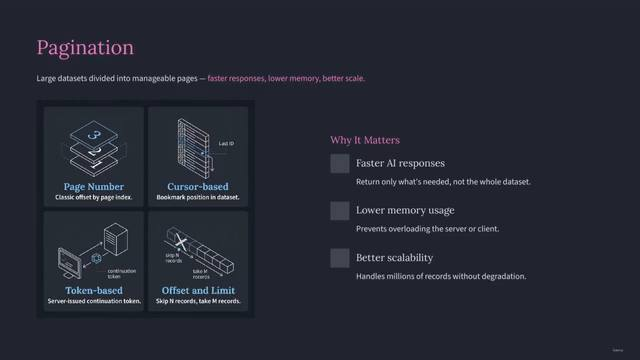
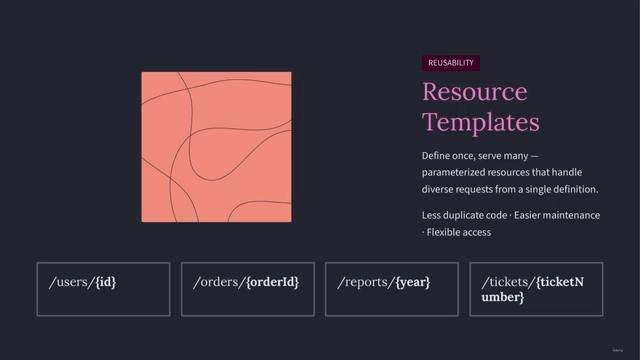
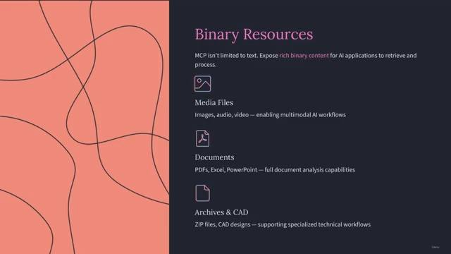
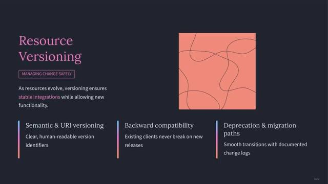
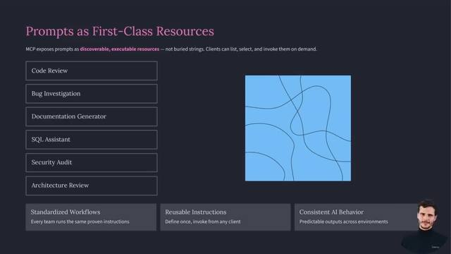
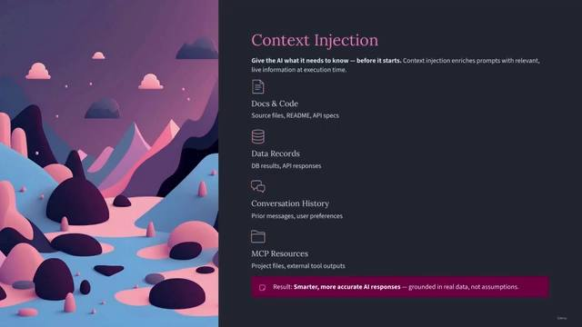
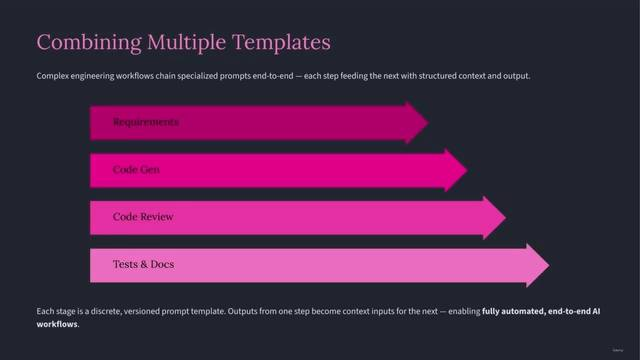
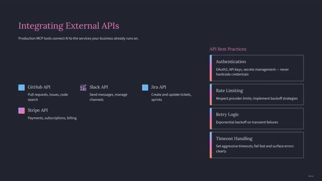
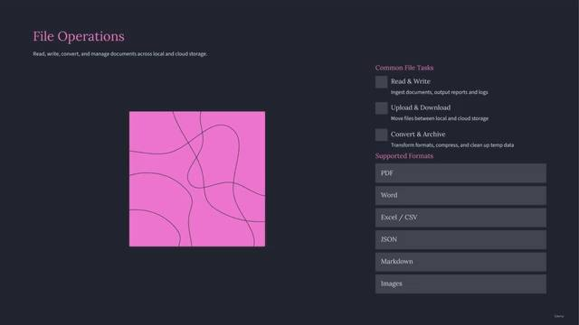
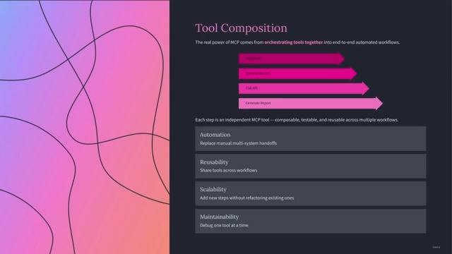

# Claude MCP Masterclass（P007–P009）生产级 MCP 集成复现文档

> 适用范围：P007《MCP Resources》、P008《MCP Prompt Templates》、P009《Building Production-Ready MCP Tools》。  
> 重要说明：这三段逐字稿是概念与架构讲解，**没有出现代码、命令、配置文件、依赖版本、环境变量名或启动命令**，截图 OCR 也为空。因此本文按“纯讲解课”方式复现：第 3 节复现讲师的推导过程，第 4 节把结论落成设计资产；凡是我补充的示意结构，都会明确标注“课里没有代码，以下为示意”。没有依据的内容一律写“课里没讲”。

## 1. 这一节做什么

这三节要解决的问题不是“再写一个 MCP demo”，而是把 MCP 从“能跑的工具调用”推进到“企业可用的知识层与自动化层”。P007 先解决**知识从哪里来**：资源（Resources）让 AI 读取结构化、真实世界的信息，但不执行操作、不修改外部系统；静态资源负责稳定、可缓存的知识，动态资源负责实时、个性化数据，资源模板负责把大量相似资源收敛成参数化入口，分页负责大数据集，二进制资源负责多模态，版本化负责长期兼容。P008 解决**AI 行为如何标准化**：提示模板把一次性提示词变成可发现、可执行、可版本化、可组合的工程资产，变量负责运行时定制，上下文注入负责把文档、源码、API 响应、数据库记录、对话历史、用户偏好和 MCP 资源送进模型，提示库负责集中管理，提示组合负责把多个专用模板串成完整工作流。P009 解决**如何把工具做成生产系统**：多步工具拆分验证、上下文加载、业务逻辑、数据库/外部服务查询；异步执行和队列 worker 解决长耗时任务；第三方 API 集成要处理认证、密钥、限流、超时、指数退避重试；数据库工具要用参数化 SQL、最小权限、查询白名单、连接池；文件工具要校验路径、权限、敏感目录和临时文件清理；最后用工具组合和分层架构把客户端、输入校验、业务逻辑、数据库、外部 API、文件系统串起来，并用单一职责、结构化日志、请求 ID、端到端集成测试保证可运维。

读者照着这份文档，最终应产出一套可评审、可落地、可扩展的 MCP 设计包：资源目录与 URI 模板、提示模板目录与组合链、生产工具流水线、分层职责表、安全控制表、容量估算表和复现检查清单。**课里没有给出可直接运行的工程代码，所以本文不虚构 SDK 版本和启动命令**；需要写代码时，按你选定的 MCP SDK 文档补齐，本文会把“课里没讲、但你必须补”的点列在第 7 节。

## 2. 讲师原话

### 2.1 资源：AI 的可靠知识层

> "资源为 AI 提供结构化、真实世界的信息，而不执行操作或修改外部系统。它们提供上下文，通过让模型引用当前文档、配置文件、数据库和其他知识源，提高 AI 回答的质量和准确性。"
> —— p007 [00:00]

复现要点：资源是“读知识”，不是“做动作”。设计资源时先问“这是不是只读知识”，如果不是，应该放到工具层。

> "静态资源包含不经常变化的信息，可以安全地在多个 AI 会话中复用。常见例子包括文档、readme 文件、API 规范、配置文件、技术指南、产品手册、公司政策和 Markdown 文档。"
> —— p007 [01:49]

复现要点：静态资源优先缓存，优先保证一致性和低延迟。课里强调静态资源让每个用户拿到同一份权威文档，减少冲突和过期回答。

> "动态资源在请求时检索或生成信息，确保 AI 始终使用最新可用数据。例子包括客户档案、数据库记录、库存水平、工单状态、分析仪表盘、天气信息、API 响应和实时系统健康指标。"
> —— p007 [03:16]

复现要点：动态资源的关键是新鲜度和个性化。两个用户问相似问题，可能因为账户、权限或当前活动不同而得到不同回答。

> "资源模板用参数定义可复用模式。不是为每个客户、订单或报告创建单独资源，而是创建一个接受不同标识符的模板。例子包括 `/users/{id}`、`/orders/{orderId}`、`/reports/{year}` 和 `/tickets/{ticketNumber}` 这样的路由。"
> —— p007 [05:09]

复现要点：模板是资源层的“函数”。它减少重复代码，提升可维护性和可扩展性；逻辑变化时改一个模板，而不是改成百上千个资源。

> "分页把大数据集拆成更小、可管理的页。常见策略包括页码、基于游标的分页、基于 token 的分页，以及 offset 和 limit 查询。"
> —— p007 [06:36]

复现要点：分页不是可选优化，而是大数据集的生命线。课里举例：100 万条客户记录，不应一次性发给 AI，而应只返回前 20 条匹配结果，需要时再请求下一页。

> "MCP 也支持二进制资源，让 AI 应用检索和处理富媒体，例如图片、PDF、电子表格、演示文稿、音频、视频、zip 压缩包，甚至 CAD 文件。"
> —— p007 [08:29]

复现要点：二进制资源把 MCP 从纯文本扩展到多模态工作流。课里举例：AI 帮工程师审查 CAD 文件，或帮财务分析师汇总大量 Excel 报告。

> "资源版本化让开发者引入改进，同时为现有客户端保持兼容。常见策略包括语义化版本、URI 版本、修订号，以及基于时间戳的版本。"
> —— p007 [09:54]

复现要点：版本化要解决向后兼容、弃用策略、迁移路径和可追溯性。课里强调：不要立刻删除旧资源，而要定义弃用政策和迁移路径。

> "流程从用户请求开始。语言模型判断需要额外上下文，并识别合适资源。MCP 客户端向 MCP 服务器发送请求，服务器检索请求内容后返回给客户端。最后，AI 把信息纳入给用户的回答。"
> —— p007 [11:16]

复现要点：这是确定性、可预测、可审计的流水线。无论信息来自文档、数据库还是配置文件，顺序一致，便于监控、调试和安全控制。

> "每个资源都应该有一个单一、定义明确的目的。避免创建包含无关信息的大型、包罗万象的资源。命名同样重要，使用描述性的 URI 和资源名，清楚说明暴露的是什么信息。敏感资源必须用认证和访问控制保护。最后，监控并记录每个资源。"
> —— p007 [12:37]

复现要点：资源设计四件事：单一目的、描述性命名、认证与访问控制、监控与文档。课里还强调版本化要一起用，才能长期可维护。

### 2.2 提示模板：把提示词变成工程资产

> "提示模板把一次性指令变成可复用、参数化的资产，可以跨应用和团队共享。不是反复写同样的提示，而是创建一次、需要时复用。"
> —— p008 [00:00]

复现要点：提示模板同时提升生产力和一致性。每个用户拿到同一套高质量指令，减少回答波动，也更容易维护。

> "变量让一个提示模板支持无数用例：在运行时用用户提供的值替换占位符。不是为每种编程语言或仓库创建单独提示，而是创建一个模板，执行时替换合适变量。"
> —— p008 [03:20]

复现要点：变量不只是语言名，还可以是用户名、文件路径、客户 ID、项目名、数据库连接、部署环境等。课里强调这能大幅减少重复。

> "上下文注入在提示到达语言模型之前，用相关信息丰富提示。系统自动提供文档、源码、API 响应、数据库记录、对话历史、用户偏好和 MCP 资源等支持上下文。"
> —— p008 [04:45]

复现要点：上下文要“有意注入”。课里明确提醒：给太多信息会压垮模型、降低回答质量；目标是给对的信息，不是给所有信息。

> "提示库提供集中位置，用来存储、分类和管理可复用提示模板。提示可以按开发、安全、文档、市场、客户支持、分析、研究和运营等领域分组。"
> —— p008 [08:05]

复现要点：提示库要支持快速发现、版本控制、回滚、协作和跨项目复用。课里把提示库类比软件库：复用已经测试和打磨过的可信组件。

> "提示组合把多个专用提示串成完整工作流。需求分析提示喂给代码生成提示，生成的代码再传给代码审查提示，接着是测试、文档生成和部署准备。每个阶段贡献结构化输出，成为下一阶段的上下文。"
> —— p008 [09:29]

复现要点：组合的价值是每个提示只负责一件事，容易测试和改进；组合后又形成端到端自动化。测试标准变了，只改测试提示，不用重做整个工作流。

> "提示模板在 MCP 应用中执行时，MCP 客户端先从服务器注册表发现合适模板。接着，用户提供的变量注入模板，替换占位符。系统再从 MCP 资源加载额外上下文，然后生成最终提示，发送给语言模型推理。"
> —— p008 [10:52]

复现要点：模型收到的不是通用模板，而是包含用户输入、上下文信息和标准化指令的完整提示。这个生命周期可预测、可审计、可优化。

> "让每个提示专注于一个清晰目的。使用描述性名称和清晰定义的变量。只注入相关上下文。把提示模板当作生产软件：充分测试、仔细版本化、记录用途、部署前审查变更。"
> —— p008 [12:19]

复现要点：这四条是提示模板的工程底线。课里还强调：提示工程正在从个人技能变成软件工程学科，提示应该像源码一样被版本化、共享、测试和复用。

### 2.3 生产工具：从函数到企业自动化组件

> "生产工具远不止简单函数。它们协调多个系统、执行业务工作流、与数据库交互、与外部 API 通信、管理文件，并自动化复杂企业流程。"
> —— p009 [00:00]

复现要点：真实组织里，AI 很少只做单个孤立动作。一个客户请求可能需要查数据库、调多个 API、生成报告、保存文档，再通过 Slack 通知团队；生产工具要把这些编排成一个智能工作流。

> "不是每个任务都会立即完成。有些操作可能耗时几秒甚至几分钟。阻塞整个应用等待是低效的，所以生产 MCP 系统使用异步执行。文件上传、数据库导入、报告生成、AI 推理、批处理和邮件发送可以在后台执行，主应用继续处理其他请求。"
> —— p009 [02:55]

复现要点：异步执行用队列 worker 把后台任务和主请求周期分开。课里强调好处：吞吐量提升、主请求线程零阻塞、通过独立 worker 进程接近无限扩展。

> "生产 MCP 工具通常集成 GitHub、Slack、Jira、Stripe、Salesforce、Microsoft Graph、Google Workspace 等外部 API。认证应始终使用安全方法，例如 OAuth 2.0、API key 或专用密钥管理系统。凭据绝不能硬编码到源码里。应用还必须尊重 API 速率限制，使用带指数退避的重试机制，并设置合适超时。"
> —— p009 [04:50]

复现要点：API 集成不是“发个 HTTP 请求”这么简单。认证、密钥、限流、重试、超时是生产可靠性的五个基本点。

> "生产工具通常执行 select、insert、update、delete、存储过程执行和分析查询。每个查询都应使用参数化 SQL，通过把查询逻辑和用户输入分开来防止 SQL 注入。访问控制应遵循最小权限原则。生产系统通常白名单批准的操作，并在请求到达数据库前验证。连接池通过复用连接提升性能。"
> —— p009 [06:17]

复现要点：数据库工具的安全四件套：参数化 SQL、最小权限、查询白名单、连接池。课里强调不要让 AI 任意执行 SQL。

> "MCP 工具可以执行多种文件操作，包括读写文档、上传下载文件、格式转换、归档已完成工作，以及清理执行期间产生的临时文件。支持格式包括 PDF、Microsoft Word、Excel 和 CSV、JSON、Markdown、图片和纯文本。"
> —— p009 [08:12]

复现要点：文件操作要校验路径、执行访问权限、避免暴露敏感目录，并自动清理临时文件。课里举例：AI 从数据库取客户数据、生成 PDF 报告、保存到云存储、再邮件发给相关方，全在一个工作流里完成。

> "复杂工作流通过编排多个独立工具形成完整自动化流水线。例子中，工作流搜索数据库、检索客户记录、调用外部 API，最后生成报告。每个阶段执行一个特定任务，再把结果传给下一阶段。"
> —— p009 [09:38]

复现要点：工具组合像 LEGO 积木。单个工具保持简单、专注，容易开发测试维护；同样的工具可以跨多个工作流复用；新增能力只需插入另一个工具，不用重做架构。

> "每个用户请求在生成响应前会经过多个协调层。MCP 客户端接收请求并管理服务器通信。输入校验确保请求在任何处理开始前是安全的。业务逻辑协调工作流，数据库、外部 API 和文件系统提供完成任务所需的信息和服务。最后结果通过服务器流回客户端，最终到用户。"
> —— p009 [11:05]

复现要点：分层职责是客户端负责通信、校验层保护系统、业务逻辑编排操作、外部服务提供专门能力。这样更容易扩展、更容易安全、更容易维护。

> "每个工具都应该有单一职责，让复杂工作流通过组合构建，而不是靠超大函数。只要操作预计超过几百毫秒，就使用异步执行。凭据应存储在安全密钥管理系统，而不是硬编码。数据库交互应使用参数化 SQL。每个重要操作都应生成带请求标识的结构化日志。不要只依赖单元测试，生产系统需要端到端集成测试。"
> —— p009 [12:31]

复现要点：这是 P009 的收束：单一职责、异步阈值、密钥管理、参数化 SQL、结构化日志、请求 ID、端到端测试。课里说这些实践把演示项目和企业软件区分开。

## 3. 从零复现

> 再次说明：课里没有代码、命令、依赖版本、环境变量名和启动命令。下面复现的是“设计推导过程”。目录结构、字段名、容量参数是复现建议或示例假设，不是讲师屏幕上的代码。

### 3.0 建立设计工作区

课里没给工程目录，以下为复现建议，用来承载本课产出的设计资产：

```text
mcp-design/
├── resources/
│   ├── catalog.md              # 资源清单：静态/动态、URI、参数、分页、版本、安全
│   ├── uri-templates.md        # 资源模板与参数校验规则
│   ├── pagination.md           # 分页策略与页大小
│   ├── binary.md               # 二进制资源类型与大小限制
│   └── versioning.md           # 版本、弃用、迁移
├── prompts/
│   ├── catalog.md              # 提示模板目录
│   ├── templates/              # 每个模板的用途、变量、上下文来源
│   ├── library.md              # 提示库分类与负责人
│   └── composition.md          # 提示组合链
├── tools/
│   ├── pipeline.md             # 多步工具阶段
│   ├── async.md                # 异步任务与 worker
│   ├── api-integration.md      # 外部 API 认证、限流、重试、超时
│   ├── database.md             # SQL 白名单、参数化、权限、连接池
│   └── files.md                # 文件操作、路径校验、临时文件
├── architecture/
│   ├── layers.md               # 分层职责
│   ├── decisions.md            # 设计决策记录
│   └── security.md             # 安全控制表
└── tests/
    └── e2e-checklist.md        # 端到端集成测试清单
```

这一步为什么先做：P007 到 P009 的知识点很多，如果不先把“资源、提示、工具、架构、测试”分开，后面会把知识读取、行为标准化和业务动作混在一起，安全和维护都会失控。


### 3.1 资源层复现：从知识源到可审计 URI

**步骤 1：需求盘点。** 先把组织里的知识源列出来，并按“变化频率”和“是否只读”分类。静态资源包括文档、readme、API 规范、配置文件、技术指南、产品手册、公司政策、Markdown 文档；动态资源包括客户档案、数据库记录、库存水平、工单状态、分析仪表盘、天气信息、API 响应、实时系统健康指标。课里强调：资源只提供知识，不执行操作、不修改外部系统；如果要写数据库、发消息、付款，那是工具，不是资源。

**步骤 2：约束。** 每类资源都要回答：能不能缓存？数据多久算新鲜？谁有权限读？数据量多大？是否是二进制？是否需要长期兼容？课里给的原则是：静态资源可缓存、强调一致性；动态资源请求时取、强调新鲜度和个性化；敏感资源必须认证和访问控制；版本化要保证向后兼容。

**步骤 3：估算。** 课里只给了“100 万条客户记录、每页 20 条”的例子，其他参数是复现示例。按这个例子：

- 总记录数 `N = 1,000,000`
- 页大小 `S = 20`
- 总页数 `ceil(N / S) = ceil(1,000,000 / 20) = 50,000` 页
- 假设单条记录 `b = 2 KB`，则单页大小 `S × b = 40 KB`
- 全量大小 `N × b = 2,000,000 KB ≈ 1.91 GB`（按 1 GB = 1024 MB、1 MB = 1024 KB 估算）
- 假设每 4 个字符约 1 个 token，单页约 `40 × 1024 / 4 = 10,240` 个 token；全量约 `512,000,000` 个 token，显然不能一次性塞给模型。

这个估算直接支撑讲师的判断：分页不是“优化项”，而是必须项。一次性返回全量会拖垮响应时间、内存和网络，也会让模型上下文爆炸。



**步骤 4：方案。** 按讲师给出的模式落成资源目录：

| 资源 | 类型 | URI 模板 | 参数 | 分页 | 缓存 | 版本 | 安全 |
|---|---|---|---|---|---|---|---|
| 产品文档 | 静态 | `/docs/{product}/{version}` | product、version | 不需要 | 强缓存 | URI 版本 + 语义化版本 | 公开或租户内 |
| API 规范 | 静态 | `/apis/{service}/spec` | service | 不需要 | 强缓存 | 语义化版本 | 公开或租户内 |
| 客户档案 | 动态 | `/customers/{customerId}` | customerId | 不需要 | 不缓存或短缓存 | 修订号 | 按用户权限 |
| 客户订单 | 动态 | `/users/{id}/orders` | id、page/cursor | 必须 | 短缓存 | URI 版本 | 按用户权限 |
| 年度报告 | 动态/静态混合 | `/reports/{year}` | year | 可选 | 按年份缓存 | 时间戳版本 | 按角色 |
| 工单 | 动态 | `/tickets/{ticketNumber}` | ticketNumber | 可选 | 短缓存 | 修订号 | 按支持团队权限 |
| 库存 | 动态 | `/inventory/{sku}` | sku | 不需要 | 不缓存 | 修订号 | 内部服务 |
| 系统健康 | 动态 | `/health/{service}` | service | 不需要 | 极短缓存 | 时间戳版本 | 运维角色 |
| 设计文件 | 二进制 | `/assets/{assetId}` | assetId | 可选 | 按内容哈希 | 修订号 | 按项目权限 |

模板 URI 必须做参数校验。课里没讲具体校验库，但原则很清楚：模板是参数化入口，不是任意路径拼接。`/users/{id}/orders` 里的 `id` 必须限制为合法 ID，不能让调用方通过 `../` 或特殊字符越权。



**步骤 5：分页与二进制。** 分页策略四选一或组合：页码、游标、token、offset/limit。课里没有规定必须用哪种，但生产上要保证排序稳定、游标不可伪造、页大小有上限。二进制资源要覆盖图片、PDF、电子表格、演示文稿、音频、视频、zip、CAD 文件；传输方式、大小限制、缓存策略课里没讲，需要在实现时补。



**步骤 6：版本化。** 课里给出四种策略：语义化版本、URI 版本、修订号、时间戳版本。复现时至少选一种写进资源目录，并定义弃用政策和迁移路径。比如 `/v1/users/{id}/orders` 保持兼容，新增 `/v2/...` 时旧客户端继续可用；旧资源标记 deprecated，给出迁移截止时间。版本化还要支持追溯：测试、调试、审计时能知道用了哪个版本。



**步骤 7：检索流程与设计原则。** 按讲师给的流程画一条固定管线：用户请求 → 模型判断需要上下文并识别资源 → MCP 客户端请求 MCP 服务器 → 服务器检索内容 → 返回客户端 → AI 纳入回答。资源设计遵循：单一目的、描述性 URI 和名称、认证与访问控制、监控与文档、版本化。到这里，资源层才算可复现。

### 3.2 提示模板层复现：从硬编码提示到可组合资产

**步骤 1：需求盘点。** 课里列出的提示模板类型包括代码审查、缺陷调查、文档生成、SQL 助手、安全审计、架构审查；可复用场景还包括拉取请求审查、SQL 生成、会议摘要、自动文档、测试生成。复现时先列“团队最常重复写的提示”，再把它们变成模板。

**步骤 2：约束。** 提示模板要可发现、可执行、可版本化、可测试、可共享；变量要清晰定义；上下文只注入相关的；模板要能组合；提示库要能分类和回滚。课里强调提示工程正在变成软件工程学科，提示要像源码一样被版本化、共享、测试和复用。

**步骤 3：估算。** 课里没给具体数字，以下为示例假设：假设 20 个团队，每团队 10 个模板，去重后 60 个模板；每个模板保留 3 个版本，则库里有 180 个条目；每次执行注入 5 KB 上下文，按 4 字符/token 估算约 `5 × 1024 / 4 = 1,280` 个 token。这个估算用来提醒：上下文不是越多越好，模板库也不是越大越好，必须有分类、负责人和清理机制。

**步骤 4：方案。** 把每个提示做成“可发现、可执行”的资源，并定义变量表：

| 提示模板 | 目的 | 变量 | 上下文来源 | 输出 | 负责人 | 测试用例 |
|---|---|---|---|---|---|---|
| 代码审查 | 统一审查标准 | language、repo、diff | 源码、规范、历史评论 | 审查意见 | 平台组 | 含安全缺陷的 diff |
| 缺陷调查 | 结构化定位问题 | service、errorId、timeRange | 日志、追踪、最近变更 | 根因假设 | SRE | 已知故障复盘 |
| 文档生成 | 统一文档风格 | module、audience、format | 源码、README、API 规范 | Markdown | 文档组 | 新模块 |
| SQL 助手 | 安全生成查询 | schema、question、limit | 表结构、权限、白名单 | SQL 草案 | 数据组 | 注入尝试 |
| 安全审计 | 一致的安全检查 | repo、threatModel | 依赖、配置、策略 | 风险清单 | 安全组 | 已知漏洞 |
| 架构审查 | 结构化评审 | system、constraints | 设计文档、ADR、API 规范 | 评审意见 | 架构组 | 高并发场景 |

变量不要只限编程语言。课里明确说变量可以代表用户名、文件路径、客户 ID、项目名、数据库连接、部署环境等。复现时每个变量都要写类型、是否必填、校验规则、默认值（如果有）、敏感级别。




**步骤 5：上下文注入。** 课里把上下文来源列得很具体：文档、源码、API 响应、数据库记录、对话历史、用户偏好，以及 MCP 资源。复现时要把“每个提示注入哪些上下文、注入多少、谁负责裁剪”写进模板定义里。讲师特别强调一句判断：上下文必须是有意的，给太多会压垮模型、降低回答质量，目标是给“对的信息”，不是“所有信息”。所以模板目录里除了变量表，还要有一列“上下文字段清单 + 最大长度”，超过上限就截断或摘要，而不是硬塞。



**步骤 6：提示库与组合链。** 提示库按领域分类：开发、安全、文档、市场、客户支持、分析、研究、运营；能力上要支持发现、版本控制、回滚、协作、跨项目复用。组合链按讲师给的例子落成一条固定流水线：需求分析 → 代码生成 → 代码审查 → 测试 → 文档生成 → 部署准备，每一阶段的输出作为下一阶段的上下文。复现时要额外写清两件事：第一，每个阶段只负责一个职责，独立可测；第二，阶段之间传递的是“结构化输出”，不是随便一段自然语言，否则下游无法稳定消费。



**步骤 7：执行生命周期。** 按讲师给的顺序复现：MCP 客户端从服务器注册表发现模板 → 注入用户提供的变量替换占位符 → 从 MCP 资源加载额外上下文 → 组装最终提示 → 发送给语言模型推理。关键判断是：模型永远收不到“通用模板”，只收到“完全组装好的提示”，里面同时含用户输入、上下文信息、标准化指令。这条管线可预测、可审计，也方便逐阶段优化。

**步骤 8：设计准则固化。** 课里给了四条：每个提示只做一件清晰的事；用描述性名称和清晰定义的变量；只注入相关上下文；把提示当生产软件——充分测试、仔细版本化、记录用途、部署前审查变更。复现时把这四条写成评审清单，任何新模板进库前逐条打勾。

### 3.3 生产工具层复现：把函数做成流水线

**步骤 1：需求盘点。** 课里描述的真实场景是：一个客户请求可能要查数据库记录、调多个 API、生成报告、保存文档，再通过 Slack 通知团队。所以工具清单不能只列“函数名”，要列“业务流程 + 涉及的系统 + 涉及的数据 + 失败后怎么办”。

**步骤 2：约束。** 多步工具必须按阶段拆分：验证请求 → 加载所需上下文 → 执行业务逻辑 → 查询数据库或其他外部服务。异步执行要满足“超过几百毫秒就用异步”的阈值判断。外部 API 集成必须满足：用 OAuth 2.0、API key 或专用密钥管理系统做认证；凭据绝不硬编码；尊重速率限制；带指数退避的重试；设置合适超时。数据库工具必须满足：参数化 SQL、最小权限、查询白名单与请求验证、连接池。文件工具必须满足：校验路径、执行访问权限、不暴露敏感目录、自动清理临时文件。

**步骤 3：估算。** 课里没给具体数值，下面全是示例假设，用来演示“怎么估”：假设某工作流每天 10,000 次请求，其中 8% 属于长耗时任务，则每天约 800 个异步任务；若平均每个任务耗时 30 秒，单个 worker 一天可处理 `86400 / 30 = 2,880` 个任务，理论上 1 个 worker 够用，但考虑峰值集中在 4 小时内，则峰值需要 `800 / (4 × 3600 / 30) ≈ 800 / 480 ≈ 1.67`，向上取整至少 2 个 worker 才能不排队积压。这个算式说明讲师那句“按需增加 worker、不改应用本身”的价值：扩容只是加进程，不是改代码。再假设外部 API 限流 100 次/分钟，而工作流每次要调 3 次外部 API，则每分钟最多支撑约 `100 / 3 ≈ 33` 个此类工作流，超过就要排队或分批。

**步骤 4：方案——多步工具流水线。** 把每个工具拆成四段，并明确每段的输入输出与失败处理：

| 阶段 | 职责 | 输入 | 输出 | 失败处理 |
|---|---|---|---|---|
| 验证 | 校验参数、权限、白名单 | 用户请求参数 | 校验通过的请求 | 立即返回错误，不进入业务逻辑 |
| 上下文加载 | 取所需记录、配置、文档 | 校验后的请求 | 上下文对象 | 可独立重试 |
| 业务逻辑 | 编排决策与计算 | 上下文对象 | 待执行动作清单 | 记录中间状态，可续跑 |
| 外部访问 | 查数据库 / 调 API / 读写文件 | 动作清单 | 结果集合 | 超时、退避重试、幂等保护 |

课里对这套拆法的判断很明确：某一步失败时能把问题隔离在一段里，而不是调试一大块代码；单步可以独立重试，不必重跑整个工作流；每一步独立，替换或扩展组件时不用重做整个应用；同一个验证或数据库查询步骤可以跨多个工具复用。

**步骤 5：方案——异步执行。** 按讲师给的清单，把文件上传、数据库导入、报告生成、AI 推理、批处理、邮件发送这几类操作放进后台。流程是：主请求立刻确认收到，把任务交给队列，worker 在后台执行，主应用继续处理其他请求。收益课里讲得很清楚：吞吐量提升、主请求线程零阻塞、通过独立 worker 进程接近线性扩展。



**步骤 6：方案——外部 API 集成。** 集成对象按课里列举：GitHub、Slack、Jira、Stripe、Salesforce、Microsoft Graph、Google Workspace 以及其他外部 API。每个集成都落一张卡：认证方式（OAuth 2.0 / API key / 密钥管理系统）、所需 scope、限流阈值、超时值、重试策略（指数退避）、幂等键、失败告警。凭据只从密钥管理系统读取，源码和配置文件里不出现明文。

**步骤 7：方案——数据库工具。** 操作类型：select、insert、update、delete、存储过程执行、分析查询。安全控制四层：参数化 SQL 把查询逻辑与用户输入分开；最小权限让每个工具只拿它真正需要的权限；查询白名单加请求验证，不允许任意 SQL 执行；连接池复用连接而不是反复开关。给前端同学的一句对应：在 Node 里你熟悉的 `pg` 的 `$1, $2` 占位符、`mysql2` 的 `?` 占位符就是参数化查询的形态；字符串拼接 SQL 等价于把用户输入当代码执行，是同一个注入问题的不同语言版本。

**步骤 8：方案——文件操作。** 能力清单：读写文档、上传下载、格式转换、归档已完成工作、清理临时文件；格式清单：PDF、Word、Excel、CSV、JSON、Markdown、图片、纯文本。控制清单：路径校验、权限校验、敏感目录隔离、临时文件自动清理。课里的端到端例子要能跑通：从数据库取客户数据 → 生成 PDF 报告 → 保存到云存储 → 邮件发给相关方，全在一条工作流内。

**步骤 9：方案——工具组合。** 按课里的例子落成链路：搜索数据库 → 检索客户记录 → 调用外部 API → 生成报告。判断依据是三条：每个工具保持简单专注，便于开发测试维护；同样的工具能跨多个工作流复用，减少重复开发；新增能力只需在链路里插入另一个工具，不用重做架构；某个工具出问题可独立调试或替换，不影响整条流水线。



**步骤 10：方案——分层架构。** 按讲师给的层次画：MCP 客户端（接收请求、管理通信）→ 输入校验层（在任何处理开始前保证请求安全）→ 业务逻辑层（编排工作流）→ 数据与服务层（数据库、外部 API、文件系统）→ 结果经服务器回流到客户端再到用户。每层职责单一：客户端管通信、校验层保护系统、业务逻辑编排、外部服务提供专门能力。



**步骤 11：工程实践固化。** 课里给的六条：单一职责、超过几百毫秒就用异步、凭据存密钥管理系统、数据库用参数化 SQL、重要操作生成带请求标识的结构化日志、不能只靠单元测试而要端到端集成测试，覆盖从客户端请求经业务逻辑、外部服务到最终响应的完整链路。

### 3.4 端到端验收

最后一步不是写代码，而是把三条链路各跑一遍设计走查：

1. 资源链路：用户提问 → 模型识别资源 → 客户端请求 → 服务器检索 → 返回 → 纳入回答。检查点：资源是否只读、是否有认证、URI 是否描述性、大数据集是否分页、二进制是否有类型与大小约束、版本是否可追溯。
2. 提示链路：发现模板 → 注入变量 → 加载资源上下文 → 组装最终提示 → 推理。检查点：变量是否校验、上下文是否裁剪、模板是否单一职责、是否可版本回滚、组合链每段输出是否结构化。
3. 工具链路：验证 → 上下文加载 → 业务逻辑 → 数据库/API/文件 → 结果回流。检查点：长耗时是否异步、凭据是否来自密钥管理、SQL 是否参数化且白名单、路径是否校验、日志是否带请求 ID、是否有端到端集成测试。

三条链路都过一遍，才算把 P007–P009 复现完。

## 4. 完整代码

> **课里没有代码，以下为示意。** 这三节的逐字稿是概念与架构讲解，没有出现任何源码、命令、依赖版本、环境变量名或启动命令，截图 OCR 也为空。因此本节交付的是“讲师给出的方案落成的可用产物”：设计决策表、组件职责表、接口/数据模型草案、容量估算表，最后附一段**不依赖任何第三方包**的示意代码，用来演示多步流水线加异步队列的骨架。示意代码可以保存为 `pipeline-demo.mjs` 用 `node pipeline-demo.mjs` 直接运行，但它只是骨架，字段名和实现均为示意，**不是课里出现的代码**。

### 4.1 设计决策表（`architecture/decisions.md`）

| 编号 | 决策 | 依据（讲师观点） | 不这样做的后果 |
|---|---|---|---|
| D1 | 资源只读，写操作一律归工具 | 资源“不执行操作或修改外部系统” | 读写混在一层，权限与审计无法分离 |
| D2 | 静态资源强缓存、动态资源请求时取 | 静态内容少变可缓存；动态要新鲜度 | 静态资源反复打源站，动态资源给出过期答案 |
| D3 | 相似资源统一走参数化 URI 模板 | 模板减少重复、易维护、可扩展 | 为每个 ID 建资源，数量爆炸无法维护 |
| D4 | 大数据集强制分页，页大小设上限 | 100 万条记录只返回前 20 条的例子 | 响应变慢、内存暴涨、上下文溢出 |
| D5 | 二进制资源单列一类，标注类型与大小 | 图片、PDF、表格、音视频、zip、CAD | 二进制混进文本通道，解析失败或撑爆上下文 |
| D6 | 资源版本化并定义弃用与迁移路径 | 语义化版本 / URI 版本 / 修订号 / 时间戳 | 升级即破坏旧客户端，无法追溯 |
| D7 | 提示模板进库，变量显式声明 | 变量让一个模板覆盖多场景 | 提示散落各处，行为不一致、无法回滚 |
| D8 | 上下文按需注入并设上限 | “给对的信息，不是所有信息” | token 浪费、延迟上升、模型被无关信息干扰 |
| D9 | 提示组合按阶段串联，阶段间传结构化输出 | 需求分析→生成→审查→测试→文档→部署 | 一个巨型提示难以测试、难以局部替换 |
| D10 | 工具按验证/上下文/逻辑/外部访问四段拆分 | 失败可隔离、单步可重试、组件可替换 | 单块函数出错难定位，无法局部重试 |
| D11 | 超几百毫秒的操作走异步队列 | 长耗时任务阻塞主请求低效 | 请求排队、超时、用户体验崩塌 |
| D12 | 凭据只从密钥管理系统取 | “凭据绝不能硬编码到源码” | 密钥进仓库，泄露即事故 |
| D13 | 数据库只用参数化 SQL + 白名单 + 最小权限 + 连接池 | 防注入、防越权、提性能 | 注入漏洞、越权读取、连接耗尽 |
| D14 | 文件操作校验路径、限权限、清临时文件 | 避免暴露敏感目录、避免占满存储 | 目录穿越、敏感文件外泄、磁盘写满 |
| D15 | 重要操作输出带请求 ID 的结构化日志 | 便于排障与审计 | 出问题无法关联同一请求的多段日志 |
| D16 | 验收必须包含端到端集成测试 | “不要只依赖单元测试” | 单测全绿但真实链路不通 |

### 4.2 组件职责表（`architecture/layers.md`）

| 层 | 组件 | 单一职责 | 输入 | 输出 | 不该做什么 |
|---|---|---|---|---|---|
| 接入 | MCP 客户端 | 接收请求、管理与服务器通信 | 用户请求 | 标准化请求 | 不写业务规则 |
| 防护 | 输入校验 | 在处理前判定请求是否安全 | 标准化请求 | 通过/拒绝 | 不查业务数据 |
| 编排 | 业务逻辑 | 协调工作流、决定调用顺序 | 已校验请求 + 上下文 | 动作清单 | 不直接拼 SQL、不直连外部 API |
| 知识 | 资源层 | 提供只读知识 | 资源 URI + 参数 | 文档/记录/二进制 | 不产生副作用 |
| 行为 | 提示层 | 提供标准化指令与变量装配 | 模板 ID + 变量 + 上下文 | 最终提示 | 不执行外部动作 |
| 能力 | 工具层 | 执行单个明确动作 | 动作参数 | 结构化结果 | 不承担多职责 |
| 数据 | 数据库 / 外部 API / 文件系统 | 提供专门能力 | 受控请求 | 数据或文件 | 不做业务判断 |
| 运维 | 日志与观测 | 记录带请求 ID 的结构化事件 | 各层事件 | 日志流 | 不记录明文密钥 |

### 4.3 接口 / 数据模型草案

以下字段名为**本文示意**，课里没有给出任何 schema。

```json
{
  "resource": {
    "uri": "/v1/users/{id}/orders",
    "kind": "static | dynamic | binary",
    "params": [
      { "name": "id", "type": "string", "required": true, "pattern": "^[A-Za-z0-9_-]{1,64}$" },
      { "name": "cursor", "type": "string", "required": false },
      { "name": "limit", "type": "integer", "required": false, "max": 100 }
    ],
    "pagination": { "strategy": "page | cursor | token | offset-limit", "pageSize": 20 },
    "cache": { "enabled": true, "ttlSeconds": 0 },
    "version": { "strategy": "semver | uri | revision | timestamp", "value": "1.0.0" },
    "auth": { "required": true, "scopes": ["orders:read"] }
  },
  "prompt": {
    "id": "code-review",
    "purpose": "统一代码审查标准",
    "variables": [
      { "name": "language", "required": true },
      { "name": "repo", "required": true },
      { "name": "diff", "required": true }
    ],
    "contextSources": [
      { "type": "resource", "uri": "/docs/{repo}/coding-standard", "maxChars": 4000 },
      { "type": "resource", "uri": "/apis/{repo}/spec", "maxChars": 4000 }
    ],
    "version": "1.2.0",
    "owner": "platform-team"
  },
  "tool": {
    "name": "customer-report",
    "stages": ["validate", "loadContext", "businessLogic", "externalCalls"],
    "async": true,
    "timeoutMs": 30000,
    "retry": { "strategy": "exponential-backoff", "maxAttempts": 4 },
    "db": { "parameterized": true, "whitelist": ["select", "insert"], "leastPrivilege": true, "pool": true },
    "files": { "pathValidation": true, "sensitiveDirsBlocked": true, "tempCleanup": true },
    "logging": { "structured": true, "requestId": true }
  }
}
```

### 4.4 容量估算表（示例假设，非课里数据）

| 项目 | 公式 | 示例值 | 说明 |
|---|---|---|---|
| 总页数 | `ceil(N / S)` | `ceil(1,000,000 / 20) = 50,000` | 课里给了 100 万条、每页 20 条 |
| 单页大小 | `S × b` | `20 × 2KB = 40KB` | `b` 为单条大小假设 |
| 全量大小 | `N × b` | `≈1.91GB` | 不能一次性返回 |
| 单页 token | `bytes × 1024 / 4` | `≈10,240` | 4 字符≈1 token 的粗略换算 |
| 异步任务量 | `Q × r` | `10,000 × 8% = 800/天` | `r` 为长耗时占比假设 |
| 单 worker 日处理 | `86400 / T` | `86400 / 30 = 2,880` | `T` 为平均任务秒数假设 |
| 峰值 worker 数 | `ceil(Z / (H × 3600 / T))` | `ceil(800 / 480) ≈ 2` | `Z` 峰值任务量、`H` 峰值小时假设 |
| API 可支撑工作流 | `R / C` | `100 / 3 ≈ 33/分钟` | `R` 限流、`C` 每次调用数假设 |

### 4.5 示意代码：多步流水线 + 异步队列骨架（`pipeline-demo.mjs`）

> 课里没有代码，以下为示意。无第三方依赖，可 `node pipeline-demo.mjs` 运行；这里的函数名、字段名、队列实现全部是示意，**不是讲师屏幕上的内容**。

```javascript
// pipeline-demo.mjs
// 课里没有代码，以下为示意：演示 P009 的
// 1) 四段式多步工具 2) 超时即转异步 3) 白名单+参数化占位 4) 带 requestId 的结构化日志
// 5) 指数退避重试 6) 文件路径校验与临时文件清理

const SLOW_THRESHOLD_MS = 300; // 课里说“超过几百毫秒就用异步”，这里是示意阈值

// ---- 结构化日志（带 requestId）----
function log(requestId, stage, event, extra = {}) {
  console.log(JSON.stringify({
    requestId,
    stage,
    event,
    ts: new Date().toISOString(),
    ...extra
  }));
}

// ---- 第 1 段：验证 ----
function validate(request) {
  const errors = [];
  if (typeof request.customerId !== "string" || !/^[A-Za-z0-9_-]{1,64}$/.test(request.customerId)) {
    errors.push("customerId 不合法");
  }
  if (request.op && !["select", "insert"].includes(request.op)) {
    errors.push("操作不在白名单内"); // 查询白名单，课里强调不要放行任意 SQL
  }
  return { ok: errors.length === 0, errors };
}

// ---- 第 2 段：上下文加载（示意：可独立重试）----
async function loadContext(request) {
  // 课里没讲具体数据源实现，这里只返回占位结构
  return { customerId: request.customerId, profile: { id: request.customerId } };
}

// ---- 第 3 段：业务逻辑（不下 SQL、不直连外部 API）----
function businessLogic(context) {
  return {
    actions: [
      { type: "db.query", sqlKey: "getOrdersByCustomer", params: [context.customerId] }, // 参数化占位
      { type: "api.call", target: "orders-api", payload: { customerId: context.customerId } },
      { type: "file.write", path: `reports/${context.customerId}.pdf` }
    ]
  };
}

// ---- 第 4 段：外部访问（超时 + 指数退避）----
async function withRetry(fn, { maxAttempts = 4, baseDelayMs = 200 } = {}) {
  let lastError;
  for (let attempt = 1; attempt <= maxAttempts; attempt++) {
    try {
      return await fn(attempt);
    } catch (err) {
      lastError = err;
      if (attempt === maxAttempts) break;
      const delay = baseDelayMs * 2 ** (attempt - 1); // 指数退避
      await new Promise((r) => setTimeout(r, delay));
    }
  }
  throw lastError;
}

async function externalCalls(actions, requestId) {
  const results = [];
  for (const action of actions) {
    const result = await withRetry(async () => {
      // 示意：真实实现替换为数据库查询 / HTTP 调用 / 文件写入
      return { type: action.type, ok: true };
    });
    log(requestId, "external", "action-done", { type: action.type });
    results.push(result);
  }
  return results;
}

// ---- 文件路径校验与临时文件清理（示意）----
function safePath(path) {
  if (path.includes("..")) throw new Error("路径校验失败：禁止目录穿越");
  if (path.startsWith("/etc") || path.startsWith("/root")) throw new Error("禁止访问敏感目录");
  return path;
}

// ---- 异步队列（示意：内存队列 + worker）----
const queue = [];
let seq = 0;
function enqueue(job) {
  const id = `job-${++seq}`;
  queue.push({ id, ...job });
  return id;
}

async function workerLoop(workerId) {
  while (queue.length > 0) {
    const job = queue.shift();
    log(job.requestId, "worker", "start", { workerId, jobId: job.id });
    try {
      const ctx = await loadContext(job.request);
      const plan = businessLogic(ctx);
      const results = await externalCalls(plan.actions, job.requestId);
      log(job.requestId, "worker", "done", { jobId: job.id, count: results.length });
    } catch (err) {
      log(job.requestId, "worker", "failed", { jobId: job.id, message: err.message });
    }
  }
}

// ---- 编排：验证 → 判断快慢 → 同步执行或转异步 ----
async function handleRequest(request, requestId) {
  log(requestId, "validate", "start");
  const v = validate(request);
  if (!v.ok) {
    log(requestId, "validate", "rejected", { errors: v.errors });
    return { ok: false, errors: v.errors };
  }

  const startedAt = Date.now();
  const ctx = await loadContext(request);
  const plan = businessLogic(ctx);
  const elapsed = Date.now() - startedAt;

  if (elapsed > SLOW_THRESHOLD_MS || request.async === true) {
    const jobId = enqueue({ request, requestId });
    log(requestId, "orchestrate", "accepted-async", { jobId, elapsed });
    return { ok: true, accepted: true, jobId };
  }

  const results = await externalCalls(plan.actions, requestId);
  log(requestId, "orchestrate", "done-sync", { elapsed });
  return { ok: true, accepted: false, results };