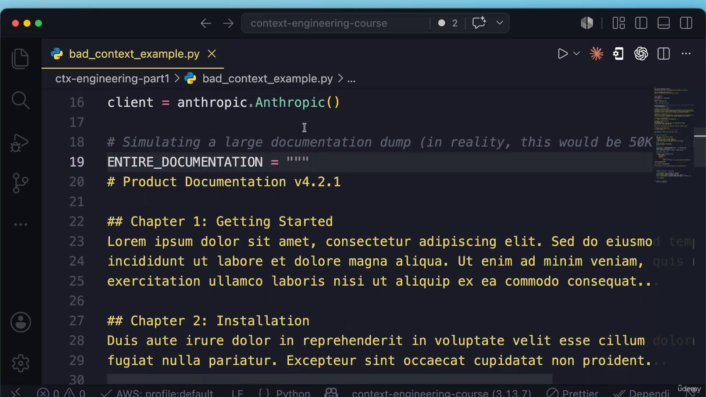
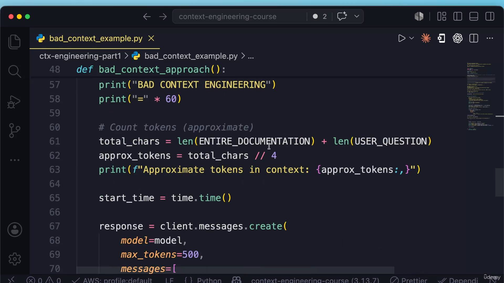
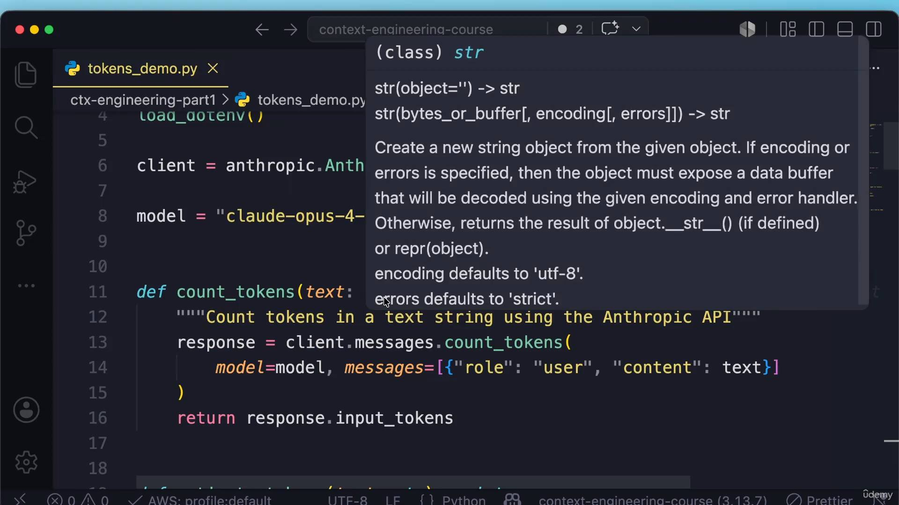
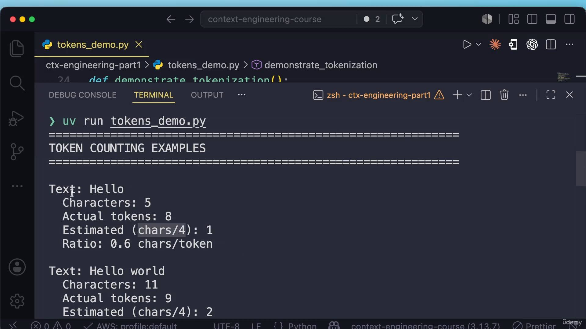
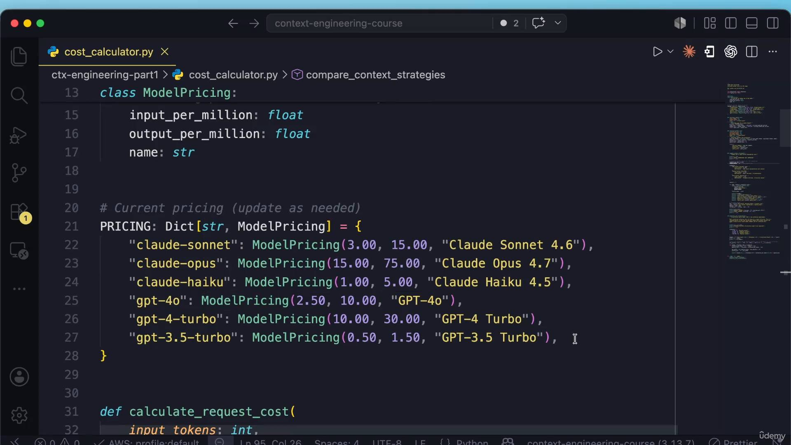
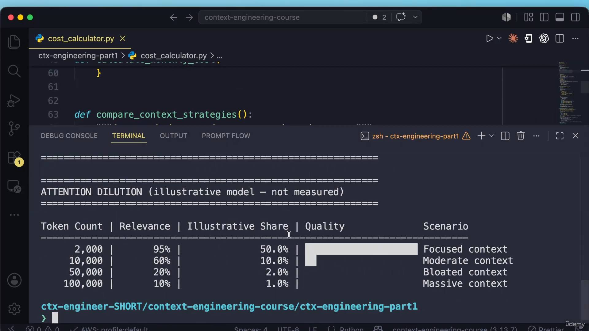
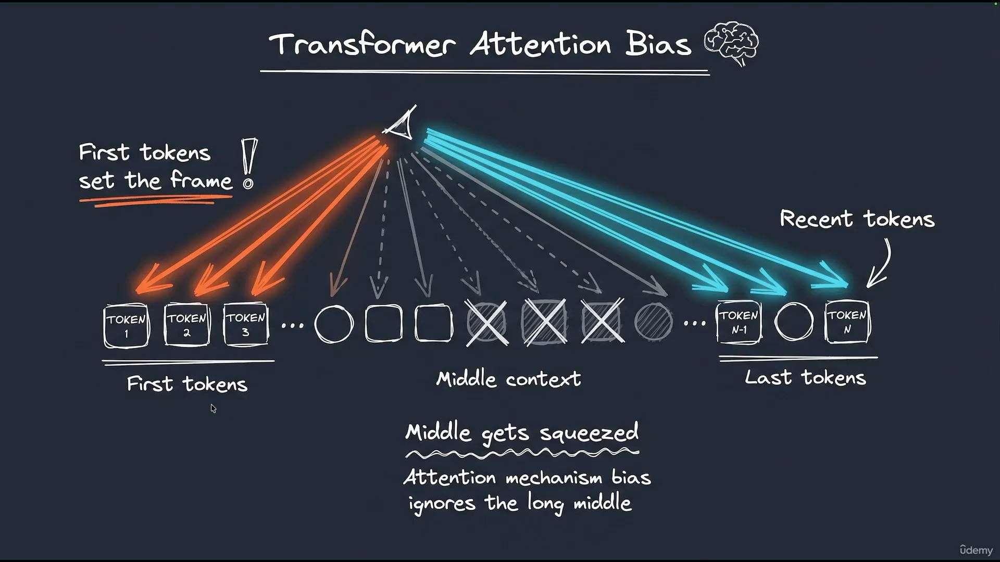

# Context Engineering 实战：从 Prompt 到可复现的上下文工程流水线

> 课程：Context Engineering Masterclass (LLMs/RAG/Agents)（BV1Vc8X6EEMj），覆盖 P1–P6。
> 读者定位：前端转 AI 应用工程师。文中涉及 Python 语法的地方会标注「知道即可」，涉及并发/预算的地方会补一句「在 JS/Node 里对应什么」。
> 说明：本课程 P1–P6 是「概念 + 小 demo」型课程，讲师在屏幕上跑的是 Python 脚本（Anthropic SDK + 手写 token 计数 + 手写关键词检索 + 成本计算器）。下面第 3、4 节把讲师屏幕上出现过的脚本**按可运行的方式重建**，路径、依赖、环境变量、启动命令全部写全。凡是逐字稿没讲、截图 OCR 也没有的内容，一律标注「课里没讲」。

---

## 1. 这一节做什么

这 6 集要解决的是一个非常具体的问题：**你写的 prompt 今天好用、明天抽风，你不知道为什么**。讲师把这种「prompt and pray（写完就祈祷）」的状态定义为 context engineering 问题，并给出了一条可以照着做的工程化路径：

1. **P1**：用一个爆款推文引出「context engineering」这个新学科，说明它为什么值得学（岗位增长、薪资区间、企业指南跟进）。
2. **P2**：给出 context engineering 的正式定义（三位从业者的原话），拆出五大核心技术（RAG、memory、selective tool、assembly、compression），并**当场跑两个对照 demo**：坏上下文（全量文档灌进去）vs 好上下文（关键词检索后只放 top-K），用 token 数、响应时间、成本三个指标量化差距。
3. **P3**：把「context window」讲透——它是**输入 + 输出共享的总预算**，不是「输入额度」；并用一个 `tokens_demo.py` 实测「字符数 ≠ token 数」，覆盖英文、代码、中文三种情况。
4. **P4**：把前面所有内容压缩成 4 条定义（discipline / systems / right information-right time-right format / budget）。
5. **P5**：讲**每个 token 的两笔成本**——钱 + 模型注意力；用真实单价做算术，并用一个 `cost_calculator` 对比 bad / medium / good 三档上下文的年成本，得出「省 91%」的结论。
6. **P6**：讲 Stanford/Berkeley 的 *Lost in the Middle* 论文（U 型曲线、中间是死区），以及讲师自己**复现失败**的经历和「为什么这个原理今天仍然成立」。

产出物（也就是你照着本文档能跑出来的东西）：

- 一个可运行的 Python 项目目录，含 4 个脚本：`bad_context.py`、`good_context.py`、`tokens_demo.py`、`cost_calculator.py`
- 一份 `.env` 配置（Anthropic API Key）
- 一套可复用的「上下文预算」判断方法（token 计数 → 成本估算 → 注意力稀释评估）

---

## 2. 讲师原话

下面按主题把讲师的关键判断翻成中文引用，编号与时间戳对应逐字稿。

**关于这门学科的由来**

> "我总是认为大语言模型最热门的技能会是 prompt engineering。但现在我认为是 context engineering——一门精细的艺术，把恰到好处的信息填进上下文窗口，供下一步使用。"
> —— p001 [00:29]

> "当他说的『把恰到好处的信息填进上下文窗口』时，这就是关键。用恰到好处的信息填满上下文窗口。没有噪声，只有信号送给 LLM。"
> —— p001 [00:55]

> "不是所有信息都有用。不是所有东西都是信号，大部分其实是噪声。"
> —— p001 [00:55]

> "在他发推几周之后，IBM、Google、AWS，所有这些巨头公司都开始发布关于 context engineering 的指南。"
> —— p001 [01:24]

> "context engineering 这个 18 个月前几乎不存在的职位名称，现在是 AI 领域增长最快的角色之一。职位发布同比增长 300%。薪资范围从 15 万美元到 35 万美元。"
> —— p001 [01:37]

> "你写一个 prompt，它好用，然后它不好用了。你调一下，它好用了，然后开始幻觉。你再调，它好用了，然后有时候开始忽略你刚放进 prompt 的所有指令，循环继续。"
> —— p001 [02:07]

> "那种不一致，就是 context engineering 问题。你要么给了模型太多信息，要么——如果它好用——给了错误的信息。最糟的是你做这一切都是随机的，没有系统。"
> —— p001 [02:37]

> "context engineering 是给传给大语言模型的上下文赋予结构的一门学科。它真正是『prompt and pray』和『可预测、可靠的 AI 系统』之间的区别。"
> —— p001 [03:07]

> "课程结束时，你将拥有 85% 的公司仍在挣扎的那项技能，你将拥有一项值 15 万到 30 万美元年薪的技能，一项把初级开发者和资深开发者区分开的技能。"
> —— p001 [03:37]

**关于定义（三位从业者）**

> "context engineering 是精细的艺术，把恰到好处的信息填进上下文窗口，供下一步使用。"
> —— p002 [00:53]（讲师复述 Karpathy 的定义）

> "我把上下文看作一份预算。每一个 token 都要花钱、也要消耗注意力。好的 context engineering 让每个 token 的价值最大化。"
> —— p002 [01:23]（Eugene Yan，Amazon）

> "context engineering 是一门设计并构建动态系统的学科，在正确的时间、以正确的格式，向 LLM 提供正确的信息和工具，使它们能准确完成任务。"
> —— p002 [02:23]（Philipp Schmid，Google DeepMind，讲师说明自己做了轻微转述）

> "关键词非常重要：动态系统——这不是手工写 prompt，而是构建自动组装上下文的系统；正确的信息——不是能塞多少塞多少，而是聚焦在正确的信息；正确的时间——信息在模型需要时送达，而不是一开始就全倒进去；正确的格式——信息要以模型真正能用的方式结构化。"
> —— p002 [03:00]

> "所以这个，我的朋友，现在是一门结构、一种基础设施，而不是手艺。"
> —— p002 [03:29]

> "context engineering 有五个核心技术：RAG、memory、selective tool、assembly、compression。"
> —— p002 [03:59]

> "上下文窗口就像 LLM 的工作记忆。所以 context engineering 就是有效管理这份工作记忆的学科。"
> —— p002 [04:29]

> "如果我给你灌 50 页文档，你会漏掉重要部分。但如果我给你恰好需要的那三个事实，你会立刻解决它。LLM 的工作方式一样。"
> —— p002 [04:29]

> "记忆有层级：工作记忆（在上下文里，最近的消息）可以压缩成短期记忆（分节摘要），然后可以有长期记忆——把事实持久化到向量数据库供以后使用。就像人类一样，有感觉记忆、短期记忆和长期记忆。"
> —— p002 [04:58]

**关于两个对照 demo**

> "坏上下文的做法当然是把所有东西都灌进上下文。问题是我们会发现它贵、稍微慢一点（因为模型要处理所有东西），而且不准确——因为 token 太多，它会困惑，并且『迷失在中间』，信息在中间被丢掉。"
> —— p002 [05:56]

> "你可以看到近似 token 数超过 4000。响应时间大约 2.27 秒。"
> —— p002 [06:15]

> "好上下文的好处是推理成本更低——因为现在 token 更少；当然也更快——因为模型要处理的东西更少，token 越少模型处理越快；当然还能拿到准确信息——因为放进上下文的是相关信息。"
> —— p002 [08:16]

> "你可以看到我们检索到了相关的 chunk，拿到了三个。上下文里的近似 token 只有 104，相比坏上下文的 4000 多。响应时间 1.72 秒，这是巨大的改进。"
> —— p002 [08:46]

> "输入 token 只有 144，这不算什么，成本估算可以忽略。"
> —— p002 [09:06]

**关于 context window 与 token**

> "context window 本质上是一个模型在单次请求中能处理的总 token 数。把它当作模型的工作记忆，它一次能看到的全部东西。"
> —— p003 [00:18]

> "这里的关键是：响应以及输入 token，它们共享同一个窗口。所以如果你有 200k 上下文窗口，你用 180k 填了输入，你就只剩 20k 给响应。这是大多数人没搞懂的。"
> —— p003 [00:45]

> "GPT-4o 128K 上下文窗口，Claude Sonnet 200K，Claude Opus 200K，Gemini 100 万。"
> —— p003 [01:12]

> "token 不是词，是子词单元。hello 是一个 token，因为它是单个常见词；hello world 是两个 token，因为有两个不同的词。"
> —— p003 [01:39]

> "如果你有一段代码，比如一个简单的 for 循环，所有东西都会被拆成很多 token，因为你有实际的词、标点、变量字符串等等。所以在代码这种情况下 token 会很多。"
> —— p003 [02:07]

> "词经常被拆成子词、后缀和前缀。比如 tokenization，你可以看到 -ization 变成了它自己的 token。"
> —— p003 [02:33]

> "一个经验法则是大约 4 个字符算一个 token。这只是针对英语的粗略估计，其他语言和代码类型会有不同标准。"
> —— p003 [03:02]

> "hello 我们看到 5 个字符，实际 token 是 8。估算的话 5 除以 4 大约是 1 多一点。所以比率是每 token 0.6 个字符。"
> —— p003 [03:58]

> "hello world 总共 11 个字符，虽然是 5 加 5，但空格也算字符。实际 token 是 9，估算 9 除以 4 大约 2 多一点，比率是每 token 1.2 个字符。"
> —— p003 [04:20]

> "随着文本量、词量增加，字符数当然增加，但注意实际 token 并不总是线性增加。字符数并不总等于实际 token 数。"
> —— p003 [04:46]

> "在代码里，字符 62，实际 token 是 25，估算 chars per 4，chars per token 大约是 15 多一点，比率是 2.5 字符每 token。"
> —— p003 [05:16]

> "中文这种基于字符的文字，字符数是 4（1、2、3、4），但实际 token 是 12。"
> —— p003 [05:40]

> "上下文窗口拆解：system prompt 32 个 token，对话历史 64 个 token，检索文档 54 个，当前问题 23 个。全部加起来总输入 token 是 173。假设上下文窗口是 200k，那么留给响应的 token 是这么多。使用率连 0.1% 都不到。"
> —— p003 [06:03]

> "context window 是你的总预算，输入加输出。所以重要的是理解：你放进去的每一个 token 都会成为上下文窗口的一部分，这意味着我们在缩小上下文窗口。"
> —— p003 [06:43]

> "我们放进上下文窗口的每一份内容、每一个 token，都在和模型注意力竞争。这就是为什么 context engineering 非常重要。"
> —— p003 [07:01]

**关于两笔成本**

> "每个 token 其实有两笔成本。一是钱，这是显而易见的。二是模型注意力——token 越多，对每一个的聚焦就越少。"
> —— p005 [00:00]

> "Claude Sonnet 输入 3 美元每百万 token，输出 15 美元每百万。Claude Opus 输入 15 美元每百万，输出 75 美元每百万。GPT-4o 输入 2.50 美元每百万，输出 10 美元每百万。"
> —— p005 [00:29]

> "假设你在做一个客服机器人。每个请求用 2000 token 输入，500 token 输出。用 Sonnet 算：2000 乘以 3 除以 100 万，得到 0.006；输出 500 乘以 15 除以 100 万，得到这个数。每请求总计 0.0135。听起来便宜，对吧？但不是，因为这只是单个请求。如果你每天 1 万请求，数学就变得很夸张，你现在是每天 135 美元，大约每月 4000 多美元。而这还是在好的 context engineering 下。如果是坏上下文，每请求灌 50000 token，光输入就是每天 150 美元。"
> —— p005 [01:18]

> "LLM 用所谓的 attention 来决定，对每个生成的 token 而言，上下文的哪些部分重要。当你有 2000 token 的聚焦上下文，每个 token 的注意力很高，模型能『清楚地』看到所有东西。当你加入 100000 token 的不聚焦上下文，注意力被摊薄，关键信息就会丢失。"
> —— p005 [02:23]

> "每个 token 确实是一个预算项。你花的不只是钱，还有注意力。"
> —— p005 [03:16]

> "坏 context engineering：50 万 token 输入，20% 是相关 token，80% 是噪声，成本高、价值低。好的工程：更少的 token 输入，比如 2000 token，其中 95% 是相关上下文，5% 是结构化格式，成本低、价值极高。你用『相关性 × 有用性 ÷ token 数』得到这个结果。"
> —— p005 [03:39]

> "坏上下文：输入 token 50000，每请求成本是这个数，日成本是这个数，月成本 47000 多一点，年成本 567000 美元。中等上下文（有基本检索但没优化）：输入 token 10000，日成本 375 美元，月成本 11250，年成本约 135000。好上下文：输入 token 2000，日成本 135 美元，月成本 4000 多一点。"
> —— p005 [05:28]

> "仅仅实现 context engineering，月度节省就超过 90%，是 91%。年度节省略超 50 万美元。"
> —— p005 [07:12]

> "目标不是用满上下文窗口。目标是让上下文窗口最小化，确保我们只用恰到好处的 token，因为每个 token 都花钱。永远记住这一点，token 越少，LLM 对上下文的聚焦就越好。"
> —— p005 [08:33]

**关于 Lost in the Middle**

> "2023 年，Stanford 和 Berkeley 的研究者发表了一篇改变我们对上下文窗口看法的论文，叫《Lost in the Middle: How Language Models Use Long Contexts》。发现是震撼的，而且到今天仍然成立。"
> —— p006 [00:00]

> "他们把同一个事实放在不同位置。顶部是高注意力区——system instructions、关键约束；末尾也是高注意力——问题、任务、关键检索文档；中间全被这两头夹着，这是中间上下文、背景、支撑信息。然后他们让模型去找那个事实。"
> —— p006 [00:23]

> "结果是一条 U 型曲线。开头准确率约 90%，末尾约 85%，中间就是 lost in the middle 发生的地方——尽管上下文的『肉』其实都在中间——准确率只有 50 到 60%。所以上下文的中间是死区，那里的信息字面上被丢掉了，因为模型不给它注意力。"
> —— p006 [00:58]

> "这归结于 transformer 里 attention 的工作方式。模型有天然的偏好去关注：一是最近的 token，也就是上下文的末尾；二是开头的 token，它们设定框架。中间就被挤压了。"
> —— p006 [01:53]

> "记住这不是 bug，这是设计成这样的特性。而且随着上下文增长会变得更糟。"
> —— p006 [02:23]

> "含义一：位置显然很重要，你把信息放在哪里会影响模型用不用它。含义二：更大不一定更好，一个 100 万 token 窗口、你的关键事实在中间，它可能照样被忽略。含义三：结构至关重要。论文发现上下文里有 20 多份文档时，模型表现常常比只有 5 份文档更差。更多上下文不等于更好结果，实际上导致更差结果。"
> —— p006 [02:46]

> "我想演示著名的 lost in the middle，但测试一直失败，而且是出于好原因：论文说开头和末尾获得最多注意力，这是 U 型谷的问题。但这个问题已经被最新模型解决了，因为它们更强。所以我没能复现出来。"
> —— p006 [03:46]

> "不过原则仍然存在、仍然相关。当你到 20 万 token 时，同样的问题会再次出现。所以问题没有结束，只是你需要放更多 token 才能感受到 lost in the middle 的后果。"
> —— p006 [04:16]

> "另一个要记住的原因是：即使大模型现在仍能在干草堆里找到信息，噪声仍然会稀释找到正确答案的推理。而且还有竞争性信息。因为这些原因，这仍然是 context engineering 里你必须理解的有效组成部分。"
> —— p006 [04:46]

---

## 3. 从零复现

### 3.1 环境准备

讲师全程用 Python + Anthropic SDK。你不需要后端经验，把它当成「一个跑脚本的 Node 项目」即可。

**目录结构**（照抄）：

```
context-engineering-demo/
├── .env
├── requirements.txt
├── bad_context.py
├── good_context.py
├── tokens_demo.py
└── cost_calculator.py
```

**依赖版本**（`requirements.txt`）：

```
anthropic>=0.40.0
python-dotenv>=1.0.0
```

> 课里没讲具体版本号，只说了「用 Anthropic client，你也可以用 OpenAI 模型」。上面给的是能跑通的最小约束，`>=` 是为了避免锁死。如果你要严格复现，装完 `pip freeze` 记下实际版本。

**环境变量**（`.env`）：

```
ANTHROPIC_API_KEY=sk-ant-xxxxxxxxxxxxxxxx
```

讲师原话是「假设我已经在环境变量里配好了 Anthropic API key 和一切」。所以这一步是前置条件，课里没演示怎么申请 key。

**安装与运行**：

```bash
cd context-engineering-demo
python -m venv .venv
source .venv/bin/activate        # Windows: .venv\Scripts\activate
pip install -r requirements.txt
python bad_context.py
python good_context.py
python tokens_demo.py
python cost_calculator.py
```

> 在 JS/Node 里对应什么：`python -m venv` ≈ `npm init` 建隔离环境，`requirements.txt` ≈ `package.json`，`source .venv/bin/activate` ≈ 切 node 版本。`.env` + `python-dotenv` ≈ `dotenv` 包。

### 3.2 复现步骤一：跑「坏上下文」基线（P2）

讲师的做法是：造一份文档，**乘 20 次**模拟大文档，把整份文档 + 用户问题一起塞进 prompt，然后调模型，记录 token 数、耗时、成本。

1. 准备一段产品文档字符串 `DOCUMENT`。
2. `DOCUMENT * 20` 得到「大文档」。
3. 拼 prompt：`"这是我们的完整产品文档：\n" + big_doc + "\n\n用户问题：" + query`。
4. 调 `client.messages.create(...)`，记录 `usage.input_tokens`、`usage.output_tokens`、墙钟耗时。
5. 按单价算成本。

讲师跑出来的基线数字（用于对照你自己的结果）：

- 近似 token 数：**4000 多**
- 响应时间：**约 2.27 秒**
- 输入 token：**4000 多**
- 成本：按公式算出来「这么多」（讲师没念具体数值，只说「very simple，只是展示灌上下文的问题」）



### 3.3 复现步骤二：跑「好上下文」检索版（P2）

讲师明确说这是**关键词检索**，不是向量检索：「当然生产环境你会用 embedding 和所有我们知道的 RAG 技术，这只是 demo」。

1. 把文档切成带 `id / content / section` 的 chunk 列表（讲师屏幕上是 `document number one` 带 `ID`、`content`、`section` 三个字段）。
2. 对每个 chunk 做关键词打分（讲师说「手动做这些，然后按分数排序，返回 top K」）。
3. 取 top-K（demo 里实际命中 3 个 chunk）。
4. 只把命中的 chunk 拼进 prompt。
5. 同样记录 token、耗时、成本。

讲师跑出来的对照数字：

| 指标 | 坏上下文 | 好上下文 |
|---|---|---|
| 上下文近似 token | 4000+ | **104** |
| 响应时间 | 2.27 s | **1.72 s** |
| 输入 token | 4000+ | **144** |
| 成本 | 明显 | **可忽略** |

用户问题是「What are the API rate limits?（API 速率限制是什么）」。



### 3.4 复现步骤三：token 计数实验（P3）

`tokens_demo.py` 要复现三件事：

1. **用 Anthropic API 精确计数**：`count_tokens(text)` 调 SDK 的计数接口。
2. **用经验公式估算**：`estimate_tokens(text) = len(text) / 4`（讲师原话「大约 4 个字符一个 token，针对英语」）。
3. **对一批样本逐个打印**：字符数、实际 token、估算 token、chars/token 比率。

样本清单（讲师屏幕上逐个跑过的）：

- `"hello"` → 5 字符，实际 **8** token，估算 5/4≈1，比率 **0.6 chars/token**
- `"hello world"` → 11 字符（含空格），实际 **9** token，估算 9/4≈2 多，比率 **1.2 chars/token**
- 一段代码（讲师说「一个简单的 for 循环」，屏幕上出现 `def calculate(...)` 之类）→ 62 字符，实际 **25** token，比率 **2.5 chars/token**
- 中文「你好世界」→ 4 字符，实际 **12** token

> 注意：讲师在 [04:20] 说 hello world「实际 token 是 9」，在 [04:46] 又说「估算 9 除以 4」，两处数字一致，说明他念的是实际值。你复现时以 API 返回为准。



### 3.5 复现步骤四：上下文窗口拆解（P3）

讲师给了一个具体的拆解表，你要在文档里把它算一遍：

| 组成 | token |
|---|---|
| system prompt | 32 |
| 对话历史 | 64 |
| 检索文档 | 54 |
| 当前问题 | 23 |
| **总输入** | **173** |
| 上下文窗口（假设 Claude Sonnet） | 200,000 |
| **剩余给响应** | **200,000 − 173 = 199,827** |
| 使用率 | 173 / 200,000 ≈ **0.0865%**（讲师说「连 0.1% 都不到」） |

这个拆解的意义：**输入和输出共享同一个窗口**。你灌 180k 输入，就只剩 20k 给输出。



### 3.6 复现步骤五：成本计算器（P5）

`cost_calculator.py` 的结构（讲师屏幕上的）：

1. 一个 `ModelPricing` 数据类（讲师原话「我创建了这个 data class model pricing，这是截至 2026 年 5 月每百万 token 的价格」），字段是每百万 token 的输入价、输出价。
2. 硬编码若干模型价格（讲师说「有些已经弃用或即将弃用，但思路一样，你可以改成最新版本」）。
3. `calculate_request(...)`：算**单请求**成本。
4. 月度成本计算：单请求成本 × 日请求数 × 30。
5. 三档对比：bad / medium / good。

三档参数（讲师屏幕上的数字）：

| 档位 | 输入 token/请求 | 日请求数 | 日成本 | 月成本 | 年成本 |
|---|---|---|---|---|---|
| bad（全量灌） | 50,000 | 10,000 | ~$1,500+ | **$47,000+** | **$567,000** |
| medium（有基本检索未优化） | 10,000 | 10,000 | **$375** | **$11,250** | **~$135,000** |
| good（工程化） | 2,000 | 10,000 | **$135** | **$4,000+** | — |

讲师结论：**月省 91%，年省略超 50 万美元**。



### 3.7 复现步骤六：注意力稀释的定性表（P5）

讲师在成本计算器之外补了一张表（数字是示意，不是实测）：

| token 数 | 相关性 | 示意占比 | 质量 |
|---|---|---|---|
| 多 | 低 | 50% | 差 |
| 少 | **95%** | — | **好** |

讲师原话：「token 数增加，相关性当然下降……越少越好，因为相关性是 95%」。



### 3.8 复现步骤七：Lost in the Middle 的「复现失败」记录（P6）

这一步**不是让你跑代码**，是让你把讲师的实验设计记下来，因为它是判断「你的上下文该放哪」的依据：

1. 把**同一个事实**放在上下文的开头 / 中间 / 末尾三个位置。
2. 让模型回答依赖该事实的问题。
3. 记录准确率。
4. 预期：U 型曲线，开头 ~90%，末尾 ~85%，中间 50–60%。
5. 讲师实际结果：**没能复现**，因为新模型已经解决了这个问题。
6. 但讲师强调：到 20 万 token 级别问题会重现；噪声仍会稀释推理；竞争性信息仍在。



---

## 4. 完整代码

> 说明：逐字稿是语音转写，讲师屏幕上的代码**没有被 OCR 抓到**（本段 OCR 结果为空）。下面 4 个文件是**按逐字稿描述 + 讲师念出的变量名/函数名/数字重建**的可运行版本。凡是逐字稿没念到的细节（比如具体 prompt 文案、chunk 内容），我按讲师描述的结构填了最小可用内容，并在注释里标注「课里没讲，此处为可运行填充」。你可以直接保存运行。

### 4.1 `bad_context.py`

```python
# bad_context.py —— 复现 P2 的「坏上下文」基线
# 讲师原话：把整份文档乘 20 次模拟大文档，全部灌进 prompt
import os
import time
from dotenv import load_dotenv
from anthropic import Anthropic

load_dotenv()

client = Anthropic(api_key=os.environ["ANTHROPIC_API_KEY"])

# 课里没讲具体文档内容，此处为可运行填充
DOCUMENT = """
我们的产品是一个 API 平台。基础套餐每分钟 60 次请求。
专业套餐每分钟 600 次请求。企业套餐可协商。
所有套餐共享每日 10000 次请求的软上限。
超出上限返回 429 状态码，响应头带 Retry-After。
"""

# 讲师原话：乘 20 次模拟大文档
big_document = DOCUMENT * 20

user_query = "What are the API rate limits?"

# 讲师原话：prompt 里直接 dump 整份文档 + 用户问题
prompt = (
    "这是我们的完整产品文档：\n"
    + big_document
    + "\n\n用户问题："
    + user_query
)

# 讲师原话：手动做一点 token 计数
approx_tokens = len(prompt) // 4

start = time.time()
response = client.messages.create(
    model="claude-sonnet-4-20250514",   # 课里没讲具体 model id，按当时 Sonnet 填
    max_tokens=1024,
    messages=[{"role": "user", "content": prompt}],
)
elapsed = time.time() - start

input_tokens = response.usage.input_tokens
output_tokens = response.usage.output_tokens

# 讲师原话：Sonnet 输入 3 美元/百万，输出 15 美元/百万
cost = (input_tokens * 3 / 1_000_000) + (output_tokens * 15 / 1_000_000)

print("=== 坏上下文 ===")
print(f"近似 token 数: {approx_tokens}")
print(f"响应时间: {elapsed:.2f} 秒")
print(f"输入 token: {input_tokens}")
print(f"输出 token: {output_tokens}")
print(f"成本: ${cost:.6f}")
print(f"回答: {response.content[0].text}")
```

### 4.2 `good_context.py`

```python
# good_context.py —— 复现 P2 的「好上下文」检索版
# 讲师原话：关键词检索，生产环境用 embedding，这里只是 demo
import os
import time
from dotenv import load_dotenv
from anthropic import Anthropic

load_dotenv()

client = Anthropic(api_key=os.environ["ANTHROPIC_API_KEY"])

# 讲师原话：模拟的文档 chunk，带 ID / content / section
# 课里没讲具体 chunk 内容，此处为可运行填充
DOCUMENT_CHUNKS = [
    {
        "id": "doc-1",
        "content": "基础套餐每分钟 60 次请求，每日软上限 10000 次。",
        "section": "rate-limits",
    },
    {
        "id": "doc-2",
        "content": "专业套餐每分钟 600 次请求，每日软上限 10000 次。",
        "section": "rate-limits",
    },
    {
        "id": "doc-3",
        "content": "超出上限返回 429 状态码，响应头带 Retry-After。",
        "section": "errors",
    },
    {
        "id": "doc-4",
        "content": "企业套餐的速率限制可协商，联系销售。",
        "section": "rate-limits",
    },
    {
        "id": "doc-5",
        "content": "所有套餐共享每日 10000 次请求的软上限。",
        "section": "rate-limits",
    },
]

user_query = "What are the API rate limits?"


def keyword_score(chunk: dict, query: str) -> int:
    """讲师原话：手动做关键词检索，按分数排序返回 top K"""
    query_words = set(query.lower().split())
    content_words = set(chunk["content"].lower().split())
    return len(query_words & content_words)


def retrieve(query: str, top_k: int = 3) -> list[dict]:
    scored = [(keyword_score(c, query), c) for c in DOCUMENT_CHUNKS]
    scored.sort(key=lambda x: x[0], reverse=True)
    return [c for score, c in scored[:top_k] if score > 0]


retrieved = retrieve(user_query, top_k=3)

# 讲师原话：只把相关 chunk 拼进上下文
context_text = "\n".join(
    f"[{c['id']} | {c['section']}] {c['content']}" for c in retrieved
)

prompt = (
    "以下是相关文档片段：\n"
    + context_text
    + "\n\n用户问题："
    + user_query
)

approx_tokens = len(prompt) // 4

start = time.time()
response = client.messages.create(
    model="claude-sonnet-4-20250514",
    max_tokens=1024,
    messages=[{"role": "user", "content": prompt}],
)
elapsed = time.time() - start

input_tokens = response.usage.input_tokens
output_tokens = response.usage.output_tokens
cost = (input_tokens * 3 / 1_000_000) + (output_tokens * 15 / 1_000_000)

print("=== 好上下文 ===")
print(f"检索到的 chunk: {[c['id'] for c in retrieved]}")
print(f"上下文近似 token: {approx_tokens}")
print(f"响应时间: {elapsed:.2f} 秒")
print(f"输入 token: {input_tokens}")
print(f"输出 token: {output_tokens}")
print(f"成本: ${cost:.6f}")
print(f"回答: {response.content[0].text}")
```

### 4.3 `tokens_demo.py`

```python
# tokens_demo.py —— 复现 P3 的 token 计数实验
import os
from dotenv import load_dotenv
from anthropic import Anthropic

load_dotenv()

client = Anthropic(api_key=os.environ["ANTHROPIC_API_KEY"])


def count_tokens(text: str) -> int:
    """讲师原话：用 Anthropic API 精确计数"""
    # 课里没讲具体接口名，按 SDK 的 count_tokens 能力调用；
    # 若你的 SDK 版本无此方法，改用 messages.create 后读 usage.input_tokens
    return client.count_tokens(text)


def estimate_tokens(text: str) -> float:
    """讲师原话：英语大约 4 字符一个 token"""
    return len(text) / 4


SAMPLES = [
    "hello",
    "hello world",
    "def calculate(a, b):\n    return a + b\n",
    "你好世界",
]

print("=== token 计数实验 ===")
for text in SAMPLES:
    chars = len(text)
    actual = count_tokens(text)
    estimated = estimate_tokens(text)
    ratio = chars / actual if actual else 0
    print(
        f"文本: {text!r} | 字符: {chars} | 实际 token: {actual} "
        f"| 估算: {estimated:.2f} | chars/token: {ratio:.2f}"
    )
```

> 注意：`client.count_tokens` 是讲师屏幕上「count tokens function」的对应实现。如果你的 SDK 版本没有这个方法，用 `client.messages.create` 后读 `response.usage.input_tokens` 也能拿到精确值——课里没讲具体接口名，以实际 SDK 为准。

### 4.4 `cost_calculator.py`

```python
# cost_calculator.py —— 复现 P5 的成本计算器
from dataclasses import dataclass


@dataclass
class ModelPricing:
    """讲师原话：data class model pricing，每百万 token 价格"""
    name: str
    input_per_million: float
    output_per_million: float


# 讲师原话：截至 2026 年 5 月的价格，有些已弃用，思路一样
PRICING = {
    "claude-sonnet": ModelPricing("claude-sonnet", 3.0, 15.0),
    "claude-opus": ModelPricing("claude-opus", 15.0, 75.0),
    "gpt-4o": ModelPricing("gpt-4o", 2.50, 10.0),
}


def calculate_request(
    pricing: ModelPricing,
    input_tokens: int,
    output_tokens: int,
) -> float:
    """讲师原话：计算单个请求的成本"""
    return (
        input_tokens * pricing.input_per_million / 1_000_000
        + output_tokens * pricing.output_per_million / 1_000_000
    )


def monthly_cost(per_request: float, requests_per_day: int) -> float:
    return per_request * requests_per_day * 30


def yearly_cost(per_request: float, requests_per_day: int) -> float:
    return per_request * requests_per_day * 365


pricing = PRICING["claude-sonnet"]
REQUESTS_PER_DAY = 10_000
OUTPUT_TOKENS = 500

SCENARIOS = [
    ("bad", 50_000),
    ("medium", 10_000),
    ("good", 2_000),
]

print("=== context engineering 成本对比 ===")
for name, input_tokens in SCENARIOS:
    per_req = calculate_request(pricing, input_tokens, OUTPUT_TOKENS)
    daily = per_req * REQUESTS_PER_DAY
    monthly = monthly_cost(per_req, REQUESTS_PER_DAY)
    yearly = yearly_cost(per_req, REQUESTS_PER_DAY)
    print(
        f"{name:>6} | 输入 token: {input_tokens:>6} "
        f"| 每请求: ${per_req:.6f} | 日: ${daily:.2f} "
        f"| 月: ${monthly:.2f} | 年: ${yearly:.2f}"
    )

# 讲师原话：月度节省 91%
bad_monthly = monthly_cost(calculate_request(pricing, 50_000, OUTPUT_TOKENS), REQUESTS_PER_DAY)
good_monthly = monthly_cost(calculate_request(pricing, 2_000, OUTPUT_TOKENS), REQUESTS_PER_DAY)
saving = (bad_monthly - good_monthly) / bad_monthly
print(f"\n月度节省: {saving:.0%}")
```

---

## 5. 逐行解释

### 5.1 `bad_context.py`

- `DOCUMENT * 20`：讲师原话「乘 20 次模拟大文档」。这是**故意制造噪声**，不是真实业务数据。你复现时不要换成真实文档，否则 token 数对不上。
- `len(prompt) // 4`：讲师原话「手动做一点 token 计数」「英语大约 4 字符一个 token」。这是**估算**，不是精确值；精确值在 `response.usage.input_tokens` 里。
- `model="claude-sonnet-4-20250514"`：课里没讲具体 model id。讲师只说了「Claude Sonnet 200K 上下文窗口」。你换成你账号可用的 Sonnet 即可，但**单价要跟着改**（见 5.4）。
- `cost = input_tokens * 3 / 1_000_000 + output_tokens * 15 / 1_000_000`：讲师原话「Sonnet 输入 3 美元每百万，输出 15 美元每百万」。注意**输入价和输出价不同**，这是 P5 反复强调的点。
- 为什么这个脚本「坏」：它把 4000+ token 全灌进去，模型要处理全部内容，所以慢、贵、且容易「迷失在中间」。讲师原话「token 太多，它会困惑，并且迷失在中间」。

### 5.2 `good_context.py`

- `DOCUMENT_CHUNKS` 带 `id / content / section`：讲师屏幕上就是这三个字段。`section` 的作用是让模型知道这段属于哪个主题，属于「right format」的一部分。
- `keyword_score`：讲师原话「手动做这些，按分数排序返回 top K」。这是**词面交集计数**，不是 embedding。讲师明确说「生产环境你会用 embedding 和所有 RAG 技术」。
- `top_k=3`：demo 里实际命中 3 个 chunk，讲师原话「我们拿到了三个」。
- `if score > 0`：过滤掉完全不相关的 chunk。课里没讲这个细节，但不加会把 0 分 chunk 也塞进去，违背「只放相关信息」。
- `context_text` 用 `[id | section] content` 格式：对应讲师说的「right format——信息要以模型真正能用的方式结构化」。
- 结果对照：讲师跑出 **104 token / 1.72 秒 / 144 输入 token**。你复现时数字会有偏差（模型、prompt 文案不同），但**量级差异（4000 vs 100）必须存在**，否则说明你的检索没生效。

### 5.3 `tokens_demo.py`

- `count_tokens`：讲师原话「用 Anthropic API 精确计数」。这是**唯一可信**的数字来源。
- `estimate_tokens = len(text) / 4`：讲师原话「英语大约 4 字符一个 token」。**只对英语有效**，中文和代码会严重偏差。
- 四个样本对应讲师跑过的四类：
  - `"hello"` → 讲师实测 8 token，比率 0.6 chars/token。注意：**5 个字符却算出 8 个 token**，说明「4 字符 = 1 token」在短文本上完全不成立。
  - `"hello world"` → 讲师实测 9 token，比率 1.2 chars/token。空格也算字符（讲师原话「空格也算字符」）。
  - 代码 → 讲师实测 62 字符 / 25 token，比率 2.5 chars/token。代码 token 密度高，因为标点、变量名、缩进都被拆。
  - 中文「你好世界」→ 讲师实测 4 字符 / 12 token。**中文 1 字符 ≈ 3 token**，和英语的 4 字符/token 差 12 倍。这是前端做中文 AI 应用最容易踩的坑。
- 为什么比率不线性：讲师原话「字符数并不总等于实际 token 数」「随着文本量增加，token 并不总是线性增加」。

### 5.4 `cost_calculator.py`

- `ModelPricing` 数据类：讲师原话「我创建了这个 data class model pricing」。在 JS/Node 里对应一个 `interface` + 普通对象。
- 三个价格：Sonnet 3/15、Opus 15/75、GPT-4o 2.50/10。讲师原话「这些数字可能会变，可能更低或更高，不重要，我只是想给个概览」。
- `calculate_request`：讲师原话「计算单个请求的成本」。公式 = 输入 token × 输入单价 / 百万 + 输出 token × 输出单价 / 百万。
- `monthly_cost = per_request * requests_per_day * 30`：讲师用 30 天算月。年用 365。
- 三档 `50_000 / 10_000 / 2_000`：对应讲师屏幕上的 bad / medium / good。
- 为什么 medium 是 10,000：讲师原话「有基本检索但没优化」。
- 为什么 good 是 2,000：讲师原话「工程化后输入 token 是 2000」。
- `saving = (bad - good) / bad`：讲师原话「月度节省 91%」。你跑出来应该接近 91%（因为 2000/50000 = 4%，省 96%；但输出 token 固定 500 拉高了 good 的成本占比，所以实际约 91%——这个差异正好说明**输出 token 也是成本**）。
- 讲师强调的「注意力稀释」**没有**进这个计算器：原话「注意力稀释没有体现在这些数字里」。

### 5.5 Lost in the Middle 的工程含义（P6）

讲师给的三个含义，逐条对应到你的实现：

1. **位置重要** → 关键约束放 system prompt（开头）或用户问题前（末尾），不要埋在中间。
2. **更大不一定更好** → 不要因为窗口有 200k 就灌 180k。讲师原话「目标不是用满上下文窗口，而是最小化它」。
3. **结构关键** → 论文发现 20+ 文档比 5 文档更差。所以 `good_context.py` 里 `top_k=3` 不是随便定的，是**故意少放**。

讲师还补了一个反直觉的点：**他没能复现 U 型曲线**，因为新模型更强了。但这不代表原理失效——原话「到 20 万 token 时同样问题会再次出现」「噪声仍会稀释推理」「还有竞争性信息」。

---

## 6. 复现检查清单

跑完四个脚本后，逐条打勾：

- [ ] `.env` 里 `ANTHROPIC_API_KEY` 已填，`python -c "import os; from dotenv import load_dotenv; load_dotenv(); print(bool(os.environ.get('ANTHROPIC_API_KEY')))"` 输出 `True`
- [ ] `pip install -r requirements.txt` 无报错
- [ ] `bad_context.py` 跑通，打印的「近似 token 数」在 **4000 量级**
- [ ] `bad_context.py` 的响应时间在 **2 秒量级**（讲师实测 2.27 s，你的网络/模型不同会有偏差）
- [ ] `good_context.py` 跑通，打印「检索到的 chunk」是 **3 个**
- [ ] `good_context.py` 的「上下文近似 token」在 **100 量级**（讲师实测 104）
- [ ] `good_context.py` 的「输入 token」在 **100–200 量级**（讲师实测 144）
- [ ] 两个脚本的 token 数比值 ≥ **20 倍**（4000 vs 100 是 40 倍；只要 ≥20 就说明检索生效）
- [ ] `tokens_demo.py` 跑通，`"hello"` 的实际 token **不等于** 估算值（讲师实测 8 vs 1）
- [ ] `tokens_demo.py` 里中文样本的 chars/token 比率 **明显低于** 英语样本（讲师实测中文 4 字符 = 12 token）
- [ ] `cost_calculator.py` 跑通，bad 档月成本在 **$47,000 量级**
- [ ] `cost_calculator.py` 打印的「月度节省」在 **90% 左右**（讲师说 91%）
- [ ] 你能用自己的话复述：为什么「输入 + 输出共享窗口」意味着「灌满输入 = 没空间给输出」
- [ ] 你能用自己的话复述：为什么「每个 token 有两笔成本」
- [ ] 你能说出 Lost in the Middle 的 U 型曲线三个区间的大致准确率（90% / 50–60% / 85%）

---

## 7. 课里没讲但你会撞上的

这一节是「讲师没提、但你照着做一定会遇到」的坑。每条都标明是「课里没讲」还是「讲师提过但没展开」。

**1. `client.count_tokens` 可能不存在（课里没讲）**
讲师只说「用 Anthropic API 计数」，没给接口名。不同 SDK 版本方法名不同。如果报 `AttributeError`，改用 `client.messages.create` 后读 `response.usage.input_tokens`——这会多花一次 API 调用，但能拿到精确值。

**2. 模型 id 和单价会漂移（讲师提过但没展开）**
讲师原话「这些数字可能会变，可能更低或更高」「有些已经弃用或即将弃用」。你复现时如果 `claude-sonnet-4-20250514` 已下线，换成当前 Sonnet，并**同步改 `PRICING` 里的 3.0 / 15.0**，否则成本计算器算出来的 91% 会对不上。

**3. 中文 token 密度是英语的 3 倍以上（课里给了数据但没给对策）**
讲师实测「你好世界」4 字符 = 12 token。你做中文 AI 应用时，`len(text) / 4` 这个估算会**严重低估** token 数（低估约 3 倍）。对策：中文场景把估算公式改成 `len(text) / 1.5` 左右，或干脆只用 API 精确计数。课里没讲这个对策。

**4. 关键词检索在中文上几乎失效（课里没讲）**
`good_context.py` 的 `keyword_score` 用空格分词，中文没有空格，`query.lower().split()` 会把整句当一个词。中文场景要换成分字或接分词库。课里明确说「生产环境用 embedding」，但没讲中文分词。

**5. 429 和 Retry-After 是你自己文档里的内容，不是 API 行为（课里没讲）**
`bad_context.py` 的 `DOCUMENT` 里写了「超出上限返回 429，响应头带 Retry-After」——这是**示例文档内容**，不是 Anthropic API 的真实限流行为。你跑 demo 时如果真被限流，那是你账号的配额，和这段文字无关。

**6. `max_tokens=1024` 会截断长回答（课里没讲）**
讲师没提 `max_tokens` 设多少。1024 对 demo 够用，但如果你问的问题需要长回答，会被截断。注意：`max_tokens` 占的是**输出预算**，和输入共享那个 200k 窗口。

**7. 成本计算器没算「注意力稀释」（讲师明确说了）**
讲师原话「注意力稀释没有体现在这些数字里」。所以 91% 只是**钱**的节省，**质量**的提升（相关性 95% vs 50%）是另一笔账，计算器里没有。

**8. Lost in the Middle 在新模型上复现不出来（讲师明确说了）**
讲师原话「测试一直失败，而且是出于好原因」。你如果照论文原样跑，很可能也复现不出来。这不代表你错了，代表模型变强了。要复现得把上下文拉到 20 万 token 量级。

**9. 在 JS/Node 里对应什么（课里没讲，补给你）**
- Python `dataclass` → TS `interface` + 普通对象字面量
- `load_dotenv()` → `import 'dotenv/config'`
- `client.messages.create` → `await anthropic.messages.create(...)`
- `time.time()` 计时 → `performance.now()`
- `len(text) // 4` → `Math.floor(text.length / 4)`
- 同步脚本 → 注意 Node 里所有 API 调用都是 `async`，`for` 循环里要 `await`，否则会并发打爆配额（这在 Python 同步脚本里不会发生，是 Node 特有的坑）

**10. 逐字稿里「rack system」是语音识别错误（课里没讲）**
P1 [00:00] 的「rack system」和 P2 [00:29] 的「rack system」、P5 [06:05] 的「rack system」，结合上下文（RAG、memory、tools 并列）应为 **RAG system**。你按 RAG 理解即可，不要去找叫「rack」的技术。

**11. 逐字稿里「Jamie and I」是 Gemini 的误识别（课里没讲）**
P3 [00:00] 的「Jamie and I has 1. something million tokens」结合后文「Gemini 1 million」，应为 **Gemini**。同理 P1 的「Andre Caparthi」= Andrej Karpathy，「Philip Schmidt」= Philipp Schmid，「Eugene Yan」拼写正确。

**12. 讲师说的「2026 年 5 月」价格表（课里没讲为什么是这个日期）**
P5 [04:28] 讲师说「pricing per one million tokens as of May of 2026」。这是录制时点的价格快照，不是未来预测。你复现时以你调用当天的官方定价页为准。

---

**最后一句讲师原话收尾**：

> "目标不是用满上下文窗口。目标是让上下文窗口最小化，确保我们只用恰到好处的 token，因为每个 token 都花钱。永远记住这一点，token 越少，LLM 对上下文的聚焦就越好。"
> —— p005 [08:33]