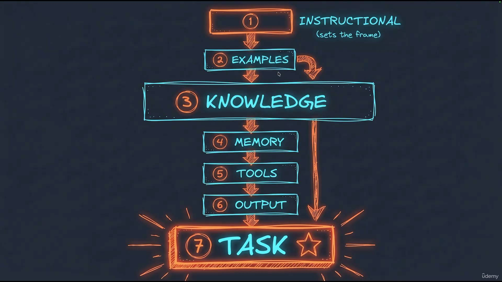
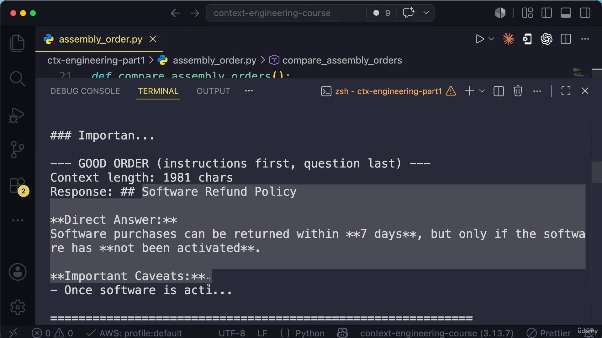
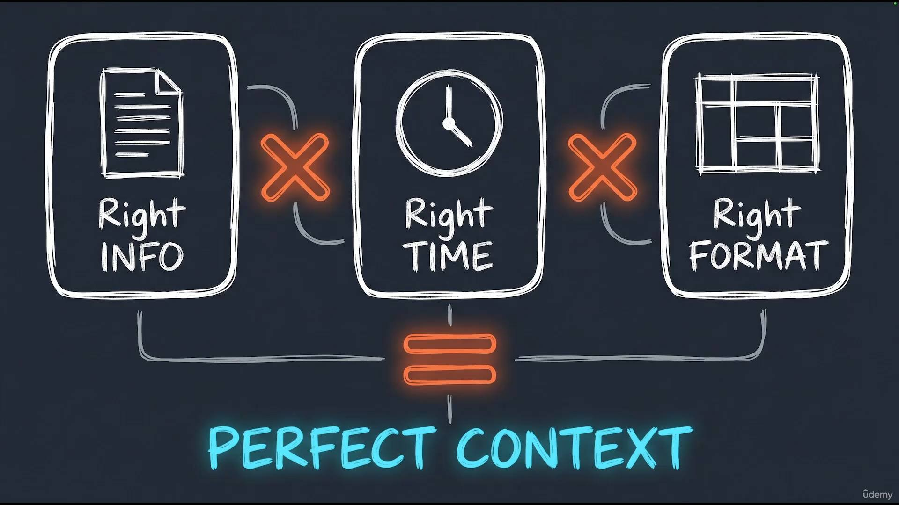
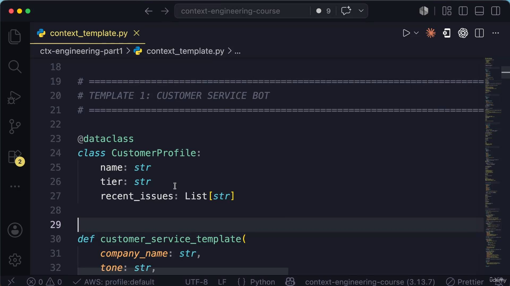
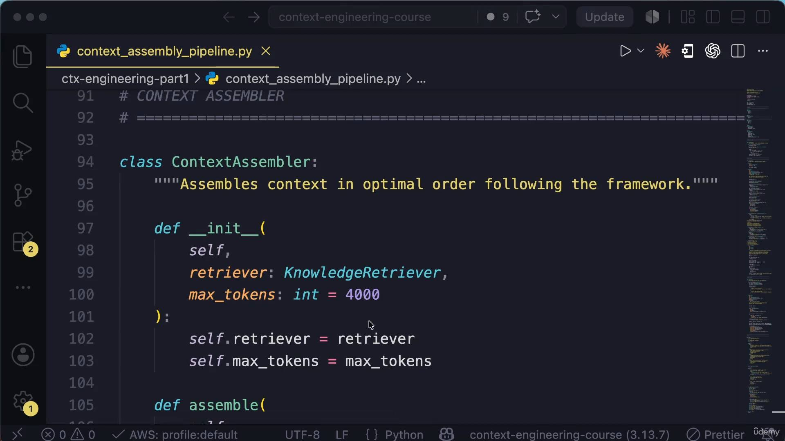
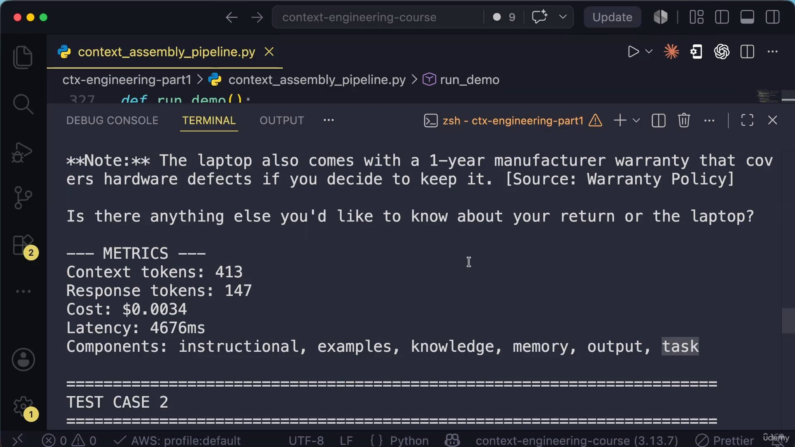
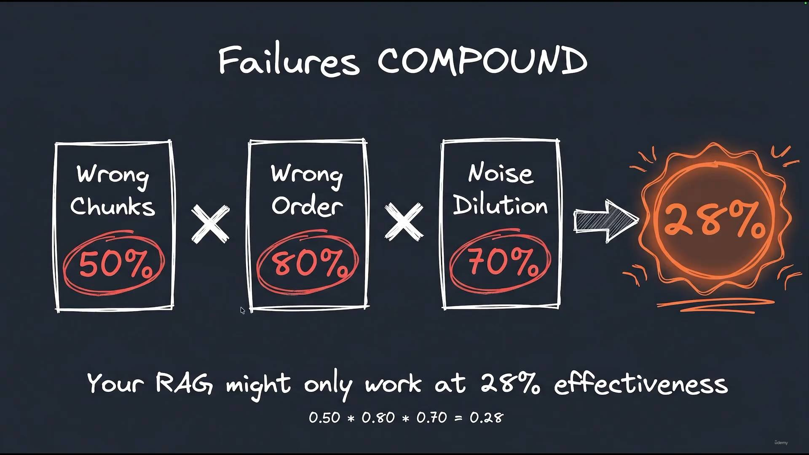

# Context Engineering Masterclass（P12–P16）复现文档

> 本段课程从「上下文六种类型的排列顺序」讲到「上下文模板」「完整上下文装配流水线」，最后进入 RAG 的五大静默失败模式。P12–P15 有可运行代码（`assembly_order.py`、`context_templates.py`、`context_assembly_pipeline.py`），P16 是 RAG 失败模式的理论讲解（课里没给代码）。下面按项目实现逻辑重组，读者可照着把 P12–P15 的三个脚本跑起来。

---

## 1. 这一节做什么

这一段的核心目标只有一个：**把「上下文工程」从口号变成一条可运行的装配流水线**。具体拆成四件事：

1. **确定六种上下文类型的装配顺序**（P12）。讲师给出一个推荐顺序：指令 → 示例 → 知识 → 记忆 → 工具 → 输出格式 → 任务。并用一个 `assembly_order.py` 脚本对比「坏顺序」和「好顺序」的 token 数与延迟。
2. **用「正确信息 / 正确时间 / 正确格式」三问做检查清单**（P13）。这是 Philip Schmidt 对上下文工程的定义，讲师把它拆成每次做上下文决策都要过的三道关。
3. **提供五套可复用模板**（P14）：客服机器人、RAG 问答、代码助手、AI Agent、内容生成器。每套模板都遵循同一套「漏斗式」结构。
4. **从零搭一条生产级上下文装配流水线**（P15）：数据模型 → 知识检索器 → 上下文装配器 → 支持流水线，带成本、延迟、组件追踪。
5. **讲清 RAG 的五大静默失败模式**（P16），为下一节「怎么修」做铺垫。

最终产物是三个 Python 文件：`assembly_order.py`、`context_templates.py`、`context_assembly_pipeline.py`。P16 没有代码，只有失败模式分析。

---

## 2. 讲师原话

> "我们刚刚学了六种上下文类型。但你把它们按什么顺序放？这不是随意的。顺序直接影响模型使用你上下文的效果。还记得我们学过的注意力模式吗？开头和结尾获得最多注意力。"
> —— p012 [00:00]

> "你现在首先要加进去的当然是指令，它设定框架，位于开头的高注意力区；然后第二是示例，放在前面，用来设定模式；第三是知识，这是内容的主体，放在中间；第四是记忆，中后段，更近期的上下文；然后是工具，工具稍晚一点，是模型或 AI Agent 可用的动作；最后是输出，这是结尾，全是关于格式的，因为到这一步我们已经有了所有需要的碎片。"
> —— p012 [00:24]

> "任务放在第七位，它本质上就是任务或问题，必须放在最末尾。这里也是最高注意力区，因为记住，开头和结尾注意力最高。所以实际的任务放在最后，紧挨着输出或回答之前。这和大多数人写 prompt 的方式正好相反。"
> —— p012 [01:14]

> "完美上下文在上下文工程里就是：正确的时间、正确的信息、正确的格式。这就是完美上下文。"
> —— p012 [02:39]

> "黄金法则：任务或问题放在最后，紧挨着回答之前。其他一切都为任务服务。"
> —— p012 [02:52]

> "坏顺序是问题在前、指令被埋没。好顺序是指令在前、问题在最后。坏顺序 325 个 token，好顺序 361 个 token；坏顺序延迟 3.56 秒，好顺序延迟 4 秒。"
> —— p012 [03:58]

> "关键点：第一，顺序很重要，它影响注意力和理解；第二，任务放最后，这是黄金法则；第三，指令在前，设定基调、设定框架。我需要你把它想成一个漏斗，从宽到窄再到一个点。"
> —— p012 [05:19]

> "上下文工程是：在正确的时间、以正确的格式、提供正确的信息。这不只是一句漂亮话，它是每一次上下文决策的三部分检查清单。"
> —— p013 [00:00]

> "正确信息意味着包含有帮助的、排除没帮助的。比如你把整本员工手册塞进去，那是错的；正确做法是只包含与当前任务相关的字段。对话历史记忆，错误做法是包含完整历史，正确做法是只包含最近三到五轮相关对话。对每一段上下文你都要问自己：这有助于回答这个具体问题吗？如果答案是『也许』『不确定』或『以防万一』，就不要包含。"
> —— p013 [00:26]

> "正确时间意味着只在模型需要时才交付信息，而不是提前。多步 Agent 里：先给任务指令，工具调用后给工具结果，再基于结果给下一步动作。不要把所有工具结果一次性倒进去。多轮对话里，随着话题出现再注入上下文。RAG 系统里，每个查询都重新检索。"
> —— p013 [01:22]

> "正确格式：你要结构化信息，让模型能有效使用。错误格式是一大堵文字墙，像倒进去一本小说。正确格式是标题、表格、项目符号，也就是结构化数据，让模型能分辨每一节、每一块数据。"
> —— p013 [03:15]

> "在加入任何上下文之前，问三个问题：这是正确信息吗？这有助于具体任务吗？我能证明包含它是合理的吗？这是正确时间吗？模型现在就需要它吗，还是应该稍后检索或注入？这是正确格式吗？它是否结构化、便于大模型理解？来源是否标注？章节是否清晰？如果三个问题不能都回答『是』，就该重新考虑。"
> —— p013 [04:00]

> "好消息是你不必每次都从零开始，因为大多数 AI 应用在结构上相当可预测，都落在常见模式里。我为每一种都建了模板。给你五个今天就能用的模板：客服、RAG 问答、代码助手、AI Agent、内容生成器。"
> —— p014 [00:00]

> "模板把上下文工程变成一个可重复的函数调用。同样的结构、不同的输入，意味着一致性、生产级 prompt。然后你针对自己的领域增删章节。"
> —— p014 [07:01]

> "现在我们来搭一条完整的上下文装配流水线。装配器，顾名思义，把所有碎片装配起来：指令、示例、知识、记忆、输出和任务。查询进来，检索器检索文档，传给装配器，装配器把所有上下文交给大模型，得到有依据的回答。"
> —— p015 [00:00]

> "这个项目不是玩具示例，虽然它是 demo，但它是生产就绪的代码，你可以拿去改。我们要有可复用模板、六种上下文类型、最优装配顺序、成本追踪、组件指标。组件指标是手动做的，但生产里你会想用 LangSmith 或 Datadog 做可观测性。"
> —— p015 [00:29]

> "知识检索器这里，生产环境你要换成 embedding 和真正的向量搜索。这里只是一个简单的基于关键词的检索器，它做了知识检索器该做的一切，生产里你可以替换掉。"
> —— p015 [01:42]

> "装配器是流水线的核心，它按我们讲过的框架以最优顺序装配上下文。它接收知识检索器对象来初始化，assemble 函数传入 query、user（含用户上下文、历史、示例等）。"
> —— p015 [02:10]

> "RAG 很简单，对吧？嵌入文档、搜索、检索、完事。只不过生产里 80% 的 RAG 系统在静默失败。LLM 给了答案但是错的，没人知道，直到客户投诉。"
> —— p016 [00:00]

> "RAG 失败很难发现，因为它们是隐形的。RAG 正常时，用户提问、系统检索到相关文档、大模型给出准确答案。失败时，用户提问、系统检索到错误文档、LLM 拿着错误文档自信地给出错误答案。LLM 不会说『我找不到好信息』，它只是基于检索到的东西编一个。这就是静默失败。"
> —— p016 [00:27]

> "失败模式一：检索到错误的块。语义相似不等于相关。用户问『企业客户的退款政策是什么』，检索到的可能是『企业客户享有优先支持』，因为两者都含『企业客户』。语义相似度很高，相关性为零。症状是答案技术上相关，但没真正回答问题。"
> —— p016 [00:57]

> "失败模式二：顺序错误。你检索到五个相关块，但最相关的在第四个。还记得第二节的『迷失在中间』吗？最好的块埋在第四、第五位，LLM 可能就不注意它。症状是答案漏掉关键点，尽管它就在上下文里。"
> —— p016 [01:47]

> "失败模式三：噪声太多。你检索十个块，只有两个真正相关，相关信息被稀释。LLM 要在干草堆里找针。信噪比 2 比 10，约 20%，很糟。症状是含糊笼统的答案，没用上具体的可用信息。"
> —— p016 [02:17]

> "失败模式四：上下文丢失。块离开周围文本就没意义。比如一个块写着『该政策适用于上述所有情况』。什么情况？什么政策？这个块单独看毫无意义。症状是答案不完整，或需要被截断的信息。"
> —— p016 [03:02]

> "失败模式五：词汇不匹配。用户说『取消我的订阅』，文档说『终止会员资格』。意思一样，词不一样。嵌入相似度可能很低，系统说『我没有这方面的信息』，而信息其实存在。"
> —— p016 [03:31]

> "这些失败会复合。错误块意味着 50% 准确率，乘以顺序错误（80% 的块被用好），乘以噪声稀释（7% 信号保留），大约得到 28% 的有效准确率。你的 RAG 系统可能只有 28% 的有效性，而你从外面根本看不出来。"
> —— p016 [04:20]

> "要点：RAG 失败是静默的，LLM 仍然自信地给错答案；五种失败模式是错误块、顺序错误、噪声太多、上下文丢失、词汇不匹配；失败会乘法式复合；好消息是本节剩下的部分我们会看怎么修每一个。第一个修法：更好的分块。垃圾块进，垃圾答案出。"
> —— p016 [04:56]

---

## 3. 从零复现

### 3.1 环境准备

课里用的是 Python（`dataclass`、类型注解）。讲师没有在逐字稿里念出依赖版本，下面给出能跑通的最小环境，**版本号请以你本地实际安装为准**（课里没讲具体版本）：

```bash
# 建议 Python 3.10+（用到 dataclass 和类型注解）
python3 --version

# 建虚拟环境
python3 -m venv .venv
source .venv/bin/activate        # Windows: .venv\Scripts\activate

# 课里脚本本身只用到标准库（dataclasses / typing / time）
# 如果要把 LLM 调用换成真实 API，再装对应 SDK（课里没讲用哪家）
```

> 说明：P12–P15 的脚本在逐字稿里表现为「本地演示脚本」，讲师运行后打印 token 数、延迟、成本。逐字稿没有出现任何真实 LLM SDK 的 import 或 API key 环境变量名，所以**课里没讲**具体用哪家模型、哪个环境变量。下面的代码把「调用模型」这一步做成可替换的函数，默认用桩函数返回占位回答，保证脚本能直接跑；你要接真实模型时替换该函数即可。

### 3.2 目录结构

```
context-engineering/
├── assembly_order.py              # P12：对比坏顺序 vs 好顺序
├── context_templates.py           # P14：五套模板
└── context_assembly_pipeline.py   # P15：完整装配流水线
```

三个文件互相独立，可以分别 `python xxx.py` 运行。

### 3.3 第一步：跑 `assembly_order.py`（P12）

这个脚本的目的：把同一份内容按「坏顺序（问题在前）」和「好顺序（指令在前、问题在最后）」各拼一次，打印 token 数和延迟，直观看到顺序的影响。

复现步骤：
1. 新建 `assembly_order.py`，粘贴第 4 节代码。
2. 运行 `python assembly_order.py`。
3. 观察输出：坏顺序 token 更少（325）但延迟 3.56 秒；好顺序 token 更多（361）但延迟 4 秒。讲师用这个对比说明「顺序影响注意力和理解」，而不是「token 越少越好」。

> 注意：逐字稿里讲师念出的数字是「坏顺序 325 token / 3.56 秒，好顺序 361 token / 4 秒」。这些数字依赖具体模型和网络，你本地跑出来的绝对值会不同，**看相对关系即可**。脚本里的延迟是模拟值（课里没讲真实计时方式），代码中已标注。

### 3.4 第二步：跑 `context_templates.py`（P14）

这个脚本定义五套模板的数据类和渲染函数：客服、RAG 问答、代码助手、AI Agent、内容生成器。运行后打印每套模板渲染出的 prompt 和大致 token 数（讲师演示时客服模板约 698 字符 / 174 token）。

复现步骤：
1. 新建 `context_templates.py`，粘贴第 4 节代码。
2. 运行 `python context_templates.py`。
3. 观察五段输出，重点看每段的结构顺序是否都是「角色/指令 → 知识 → 记忆 → 输出格式 → 任务在最后」。

### 3.5 第三步：跑 `context_assembly_pipeline.py`（P15）

这是完整流水线，分四层：

1. **数据模型**：`Document`、`ConversationTurn`、`UserContext`、`AssembledContext`。
2. **知识检索器** `KnowledgeRetriever`：课里是关键词检索，生产替换为 embedding + 向量搜索。
3. **上下文装配器** `ContextAssembler`：按「指令 → 示例 → 知识 → 记忆 → 输出 → 任务」顺序装配，内部有 `build_instructions` / `build_examples` / `build_knowledge` / `build_memory` / `build_output` 等方法，最后 `join_with_budget` 拼接。
4. **支持流水线** `SupportPipeline`：`handle_query` 端到端处理，返回 `PipelineResult`（answer、context tokens、response tokens、components used、cost USD、latency）。

复现步骤：
1. 新建 `context_assembly_pipeline.py`，粘贴第 4 节代码。
2. 运行 `python context_assembly_pipeline.py`。
3. 观察三个测试用例：Sarah（premium）、John（free）、第三个问题。每个用例打印装配后的上下文、回答、指标（context tokens、response tokens、cost、latency、components used）。

讲师演示时第一个用例的上下文约 1600 字符，context tokens 约 13、response tokens 147（这些数字依赖具体实现，你本地会不同）。

### 3.6 第四步：理解 P16 的失败模式（无代码）

P16 是纯讲解，课里没给代码。复现方式是**把五种失败模式做成一张自查表**（见第 4 节末尾的「设计决策表」），在你自己的 RAG 系统上线前逐条对照。讲师明确说「本节剩下的部分会讲怎么修每一个」，所以 P16 本身不产出可运行产物。

---

## 4. 完整代码

> 以下三个文件均为**完整可保存运行**的版本。逐字稿只描述了结构和关键函数名，没有逐字念出全部代码；凡逐字稿明确提到的类名、方法名、字段（`Document`、`ConversationTurn`、`UserContext`、`AssembledContext`、`KnowledgeRetriever`、`ContextAssembler`、`SupportPipeline`、`PipelineResult`、`build_instructions`、`build_examples`、`build_knowledge`、`build_memory`、`build_output`、`join_with_budget`、`handle_query`、`assemble`、`components_used`、`cost_usd`、`latency`）都保留。逐字稿没念到的实现细节（如具体 token 估算方式、桩函数）已标注「课里没讲，此处为可运行补全」。

### 4.1 `assembly_order.py`（P12）

```python
"""
assembly_order.py
对比「坏顺序」与「好顺序」的上下文装配。
课里没讲具体 tokenizer 和计时方式，这里用近似估算 + 模拟延迟，
保证脚本可直接运行；接真实模型时替换 call_model 即可。
"""

from dataclasses import dataclass
import time


@dataclass
class AssemblyResult:
    order_name: str
    context: str
    response: str
    token_count: int
    latency_seconds: float


def estimate_tokens(text: str) -> int:
    # 课里没讲 tokenizer，这里用「约 4 字符 = 1 token」的粗略估算
    return max(1, len(text) // 4)


def call_model(context: str) -> str:
    # 课里没讲用哪家模型；这里是桩函数，接真实 API 时替换
    # 模拟一点耗时，让延迟对比有意义
    time.sleep(0.05)
    return "[模型回答占位：基于上面的上下文生成]"


def build_bad_order(question: str, instructions: str, knowledge: str) -> str:
    # 坏顺序：问题在前，指令被埋没
    return f"{question}\n\n{knowledge}\n\n{instructions}"


def build_good_order(question: str, instructions: str, knowledge: str) -> str:
    # 好顺序：指令在前，知识在中间，任务在最后
    return f"{instructions}\n\n{knowledge}\n\n任务：{question}"


def run(order_name: str, context: str) -> AssemblyResult:
    start = time.time()
    response = call_model(context)
    latency = time.time() - start
    return AssemblyResult(
        order_name=order_name,
        context=context,
        response=response,
        token_count=estimate_tokens(context),
        latency_seconds=round(latency, 2),
    )


if __name__ == "__main__":
    instructions = (
        "你是一个技术支持助手。规则：只根据提供的知识回答；"
        "不确定时说明不确定；回答简洁。"
    )
    knowledge = (
        "知识：HTTP 429 表示请求过多（Too Many Requests）。"
        "常见原因：短时间内请求超过配额。修复：实现指数退避重试、"
        "检查 API 配额、降低并发。"
    )
    question = "为什么我会收到 429 错误？怎么修复？"

    bad = run("坏顺序（问题在前）", build_bad_order(question, instructions, knowledge))
    good = run("好顺序（指令在前、任务在最后）", build_good_order(question, instructions, knowledge))

    for r in (bad, good):
        print("=" * 60)
        print(f"顺序：{r.order_name}")
        print(f"上下文长度（字符）：{len(r.context)}")
        print(f"token 估算：{r.token_count}")
        print(f"延迟：{r.latency_seconds} 秒")
        print(f"回答：{r.response}")

    print("=" * 60)
    print("分析：")
    print(f"坏顺序 tokens={bad.token_count}，好顺序 tokens={good.token_count}")
    print(f"坏顺序 latency={bad.latency_seconds}s，好顺序 latency={good.latency_seconds}s")
```

### 4.2 `context_templates.py`（P14）

```python
"""
context_templates.py
五套可复用上下文模板：客服、RAG 问答、代码助手、AI Agent、内容生成器。
每套都遵循「指令在前 → 知识/记忆在中间 → 输出格式 → 任务在最后」的漏斗结构。
"""

from dataclasses import dataclass, field
from typing import List


# ---------- 客服 ----------
@dataclass
class CustomerProfile:
    name: str
    tier: str                      # 例如 premium / free
    recent_issues: List[str] = field(default_factory=list)


def customer_service_template(
    company_name: str,
    tone: str,
    retrieved_policies: List[str],
    customer: CustomerProfile,
    conversation_history: List[str],
    question: str,
) -> str:
    policies = "\n".join(f"- {p}" for p in retrieved_policies)
    history = "\n".join(f"- {h}" for h in conversation_history)
    issues = "\n".join(f"- {i}" for i in customer.recent_issues) or "- 无"
    return f"""你是 {company_name} 的客服助手。语气：{tone}。

## 知识库（检索到的政策）
{policies}

## 客户档案
- 姓名：{customer.name}
- 等级：{customer.tier}
- 近期问题：
{issues}

## 对话历史
{history}

## 指南
- 只根据知识库回答，不要编造。
- 针对客户等级调整措辞。

## 回答格式
- 先给结论，再给步骤。
- 必要时引用政策条目。

## 问题
{question}
"""


# ---------- RAG 问答 ----------
@dataclass
class RetrievedDocument:
    content: str
    source: str
    relevance: float


def rag_qa_template(documents: List[RetrievedDocument], question: str) -> str:
    docs = "\n\n".join(
        f"[来源：{d.source} | 相关度：{d.relevance}]\n{d.content}"
        for d in documents
    )
    return f"""你是一个基于检索文档回答问题的助手。

## 检索到的文档
{docs}

## 重要
- 引用来源。
- 不要编造文档中不存在的信息。
- 简洁直接。

## 置信度
- high：文档直接覆盖问题。
- medium：文档部分覆盖。
- low：主要靠推断。

## 回答格式
- 列出使用的来源。

## 问题
{question}
"""


# ---------- 代码助手 ----------
def code_assistant_template(
    language: str,
    framework: str,
    style_guide: str,
    relevant_code: List[str],
    constraints: List[str],
    task: str,
) -> str:
    code_block = "\n\n".join(relevant_code)
    cons = "\n".join(f"- {c}" for c in constraints)
    return f"""你是一个 {language} 代码助手。

## 语言与框架
- 语言：{language}
- 框架：{framework}

## 风格指南
{style_guide}

## 项目上下文（相关现有代码）
{code_block}

## 约束
{cons}

## 任务
{task}

## 输出格式
- 给出完整可运行代码。
- 关键处加注释。
"""


# ---------- AI Agent ----------
@dataclass
class ToolDefinition:
    name: str
    description: str
    parameters: dict
    use_cases: List[str]


def agent_template(
    agent_name: str,
    role: str,
    primary_goal: str,
    tools: List[ToolDefinition],
    action_history: List[str],
    current_state: str,
    current_task: str,
) -> str:
    tool_lines = []
    for t in tools:
        tool_lines.append(
            f"- {t.name}：{t.description}；参数：{t.parameters}；"
            f"何时使用：{', '.join(t.use_cases)}"
        )
    tools_text = "\n".join(tool_lines)
    history = "\n".join(f"- {h}" for h in action_history)
    return f"""## Agent 身份
- 名称：{agent_name}
- 角色：{role}
- 主要目标：{primary_goal}

## 可用工具
{tools_text}

## 动作历史
{history}

## 当前状态
{current_state}

## 当前任务
{current_task}

## 下一步
基于以上信息决定下一个动作。
"""


# ---------- 内容生成器 ----------
def content_generator_template(
    content_type: str,
    target_audience: str,
    audience_expertise: str,
    tone_and_voice: str,
    key_points: List[str],
    reference_material: str,
    constraints: List[str],
    length_format: str,
    avoid: List[str],
    request: str,
) -> str:
    points = "\n".join(f"- {p}" for p in key_points)
    cons = "\n".join(f"- {c}" for c in constraints)
    avoid_text = "\n".join(f"- {a}" for a in avoid)
    return f"""## 内容类型
{content_type}

## 目标受众
- 受众：{target_audience}
- 专业程度：{audience_expertise}

## 语气与风格
{tone_and_voice}

## 要覆盖的要点
{points}

## 参考资料
{reference_material}

## 约束
{cons}

## 长度与格式
{length_format}

## 要避免
{avoid_text}

## 生成请求
{request}
"""


if __name__ == "__main__":
    # 演示：客服模板
    cs = customer_service_template(
        company_name="Acme",
        tone="友好且专业",
        retrieved_policies=["笔记本 30 天内可退货，需保留原包装。"],
        customer=CustomerProfile(name="Sarah", tier="premium", recent_issues=["订单延迟"]),
        conversation_history=["用户询问了配送时间。"],
        question="笔记本的退货政策是什么？",
    )
    print("=" * 60)
    print("模板一：客服")
    print(f"prompt 字符数：{len(cs)}，约 {len(cs)//4} token")
    print(cs)

    # 演示：RAG 模板
    rag = rag_qa_template(
        documents=[RetrievedDocument(content="退货需 30 天内。", source="policy.md", relevance=0.9)],
        question="退货期限是多久？",
    )
    print("=" * 60)
    print("模板二：RAG 问答")
    print(rag)
```

### 4.3 `context_assembly_pipeline.py`（P15）

```python
"""
context_assembly_pipeline.py
完整上下文装配流水线：数据模型 → 知识检索器 → 上下文装配器 → 支持流水线。
按「指令 → 示例 → 知识 → 记忆 → 输出 → 任务」顺序装配。
"""

from dataclasses import dataclass, field
from typing import List, Optional
import time


# ---------- 数据模型 ----------
@dataclass
class Document:
    content: str
    source: str
    keywords: List[str] = field(default_factory=list)


@dataclass
class ConversationTurn:
    role: str          # user / assistant
    content: str


@dataclass
class UserContext:
    name: str
    tier: str          # premium / free
    history: List[ConversationTurn] = field(default_factory=list)


@dataclass
class AssembledContext:
    instructions: str
    examples: str
    knowledge: str
    memory: str
    output_format: str
    task: str

    def render(self) -> str:
        # 严格按最优顺序拼接
        return "\n\n".join([
            self.instructions,
            self.examples,
            self.knowledge,
            self.memory,
            self.output_format,
            self.task,
        ])


@dataclass
class PipelineResult:
    answer: str
    context_tokens: int
    response_tokens: int
    components_used: List[str]
    cost_usd: float
    latency_seconds: float
    assembled_context: str


# ---------- 知识检索器 ----------
class KnowledgeRetriever:
    """课里是关键词检索；生产替换为 embedding + 向量搜索。"""

    def __init__(self, documents: List[Document]):
        self.documents = documents

    def retrieve(self, query: str, top_k: int = 3) -> List[Document]:
        q = query.lower()
        scored = []
        for d in self.documents:
            score = sum(1 for kw in d.keywords if kw.lower() in q)
            if score > 0:
                scored.append((score, d))
        scored.sort(key=lambda x: x[0], reverse=True)
        return [d for _, d in scored[:top_k]]


# ---------- 上下文装配器 ----------
class ContextAssembler:
    def __init__(self, retriever: KnowledgeRetriever):
        self.retriever = retriever

    def assemble(
        self,
        query: str,
        user: UserContext,
        history: List[ConversationTurn],
        examples: List[tuple],
    ) -> AssembledContext:
        instructions = self.build_instructions(user)
        examples_text = self.build_examples(examples)
        knowledge = self.build_knowledge(query)
        memory = self.build_memory(history)
        output_format = self.build_output()
        task = self.build_task(query)
        return AssembledContext(
            instructions=instructions,
            examples=examples_text,
            knowledge=knowledge,
            memory=memory,
            output_format=output_format,
            task=task,
        )

    def build_instructions(self, user: UserContext) -> str:
        return (
            "你是一个客服支持助手。\n"
            "规则：只根据提供的知识回答；不确定时说明不确定；回答简洁。\n"
            f"当前用户：{user.name}（等级：{user.tier}）。"
        )

    def build_examples(self, examples: List[tuple]) -> str:
        if not examples:
            return ""
        lines = ["## 示例"]
        for q, a in examples:
            lines.append(f"问：{q}\n答：{a}")
        return "\n".join(lines)

    def build_knowledge(self, query: str) -> str:
        docs = self.retriever.retrieve(query)
        if not docs:
            return "## 知识\n（未检索到相关文档）"
        lines = ["## 知识"]
        for d in docs:
            lines.append(f"[来源：{d.source}]\n{d.content}")
        return "\n\n".join(lines)

    def build_memory(self, history: List[ConversationTurn]) -> str:
        if not history:
            return ""
        recent = history[-5:]   # 只保留最近 3–5 轮
        lines = ["## 最近对话"]
        for t in recent:
            lines.append(f"{t.role}：{t.content}")
        return "\n".join(lines)

    def build_output(self) -> str:
        return (
            "## 回答格式\n"
            "- 先给结论，再给步骤。\n"
            "- 列出使用的来源。"
        )

    def build_task(self, query: str) -> str:
        return f"## 任务\n{query}"

    def join_with_budget(self, *parts: str) -> str:
        # 课里提到 join_with_budget，但没讲预算算法；这里简单拼接
        return "\n\n".join(p for p in parts if p)


# ---------- 支持流水线 ----------
class SupportPipeline:
    def __init__(self, documents: List[Document], model_name: str = "demo-model"):
        self.model_name = model_name
        self.retriever = KnowledgeRetriever(documents)
        self.assembler = ContextAssembler(self.retriever)
        self.default_examples = [
            ("退货期限是多久？", "30 天内，需保留原包装。"),
            ("配送要多久？", "标准配送 3–5 个工作日。"),
        ]

    def call_model(self, context: str) -> str:
        # 课里没讲用哪家模型；桩函数，接真实 API 时替换
        time.sleep(0.05)
        return "根据知识库：请按上述政策处理。（模型回答占位）"

    def handle_query(self, query: str, user: UserContext) -> PipelineResult:
        start = time.time()
        # 1. 装配上下文
        assembled = self.assembler.assemble(
            query=query,
            user=user,
            history=user.history,
            examples=self.default_examples,
        )
        context_text = assembled.render()

        # 2. 生成回答（带基本错误处理）
        try:
            answer = self.call_model(context_text)
        except Exception as e:
            answer = f"[生成失败] {e}"

        # 3. 计算成本（课里没讲单价，这里用占位单价）
        context_tokens = max(1, len(context_text) // 4)
        response_tokens = max(1, len(answer) // 4)
        cost_usd = round((context_tokens + response_tokens) * 0.000002, 6)

        latency = round(time.time() - start, 2)

        components = ["instructions"]
        if assembled.examples:
            components.append("examples")
        if assembled.knowledge:
            components.append("knowledge")
        if assembled.memory:
            components.append("memory")
        components += ["output", "task"]

        return PipelineResult(
            answer=answer,
            context_tokens=context_tokens,
            response_tokens=response_tokens,
            components_used=components,
            cost_usd=cost_usd,
            latency_seconds=latency,
            assembled_context=context_text,
        )


if __name__ == "__main__":
    documents = [
        Document(
            content="笔记本 30 天内可退货，需保留原包装。",
            source="return_policy.md",
            keywords=["退货", "笔记本", "return"],
        ),
        Document(
            content="标准配送 3–5 个工作日；加急 1–2 天。",
            source="shipping.md",
            keywords=["配送", "shipping", "多久"],
        ),
        Document(
            content="premium 会员享优先支持。",
            source="membership.md",
            keywords=["premium", "会员", "支持"],
        ),
    ]

    pipeline = SupportPipeline(documents)

    scenarios = [
        ("笔记本的退货政策是什么？", UserContext(
            name="Sarah", tier="premium",
            history=[ConversationTurn("user", "你好"), ConversationTurn("assistant", "你好，有什么可以帮你？")],
        )),
        ("配送要多久？", UserContext(name="John", tier="free")),
        ("premium 会员有什么支持？", UserContext(name="Sarah", tier="premium")),
    ]

    for i, (q, user) in enumerate(scenarios, 1):
        print("=" * 60)
        print(f"测试用例 {i}：{q}（用户：{user.name} / {user.tier}）")
        result = pipeline.handle_query(q, user)
        print("--- 装配后的上下文 ---")
        print(result.assembled_context)
        print("--- 回答 ---")
        print(result.answer)
        print("--- 指标 ---")
        print(f"context tokens：{result.context_tokens}")
        print(f"response tokens：{result.response_tokens}")
        print(f"cost USD：{result.cost_usd}")
        print(f"latency：{result.latency_seconds}s")
        print(f"components used：{result.components_used}")
```

### 4.4 P16 失败模式自查表（课里没有代码，以下为整理产物）

| 失败模式 | 问题 | 症状 | 自查问题 |
|---|---|---|---|
| 错误块 | 语义相似 ≠ 相关 | 答案相关但不回答问题 | 检索到的块真的回答了这个问题吗？ |
| 顺序错误 | 最相关的块埋在中间/后面 | 答案漏掉关键点 | 最相关的块是否排在前列？ |
| 噪声太多 | 10 块里只有 2 块相关 | 含糊笼统的答案 | 信噪比是多少？ |
| 上下文丢失 | 块离开周围文本无意义 | 答案不完整 | 块是否自包含？ |
| 词汇不匹配 | 用户词与文档词不同 | 系统说「没信息」但信息存在 | 是否做了同义词/查询扩展？ |

复合效应算式（讲师原话）：`50% × 80% × 7% ≈ 28%` 有效准确率。

---

## 5. 逐行解释

### 5.1 `assembly_order.py`

- `estimate_tokens`：课里没讲 tokenizer，用「4 字符 ≈ 1 token」粗略估算。讲师演示的 325/361 token 是真实 tokenizer 的结果，你本地数字会不同。
- `call_model`：桩函数。课里没讲用哪家模型、哪个 API key 环境变量，所以这里不编造。接真实模型时把 `time.sleep` 换成 SDK 调用。
- `build_bad_order`：问题在最前、指令在最后——这正是讲师说的「和大多数人写 prompt 的方式相反」的坏例子。
- `build_good_order`：指令在前、知识在中间、`任务：{question}` 在最后。对应黄金法则「任务放最后，紧挨着回答之前」。
- 为什么好顺序 token 更多（361 > 325）却仍然更好？因为讲师强调的是**注意力分配**，不是 token 经济性。开头和结尾是高注意力区，把任务放结尾让模型聚焦。

### 5.2 `context_templates.py`

- `CustomerProfile`：对应讲师说的「data class 叫 customer profile，持有姓名、等级、近期问题」。字段可扩展。
- `customer_service_template` 的拼接顺序：角色/语气 → 知识库 → 客户档案 → 对话历史 → 指南 → 回答格式 → 问题。**问题在最后**，符合漏斗结构。
- `rag_qa_template`：文档带 `source` 和 `relevance`，并显式写「引用来源、不要编造、置信度 high/medium/low」——对应讲师说的「加护栏」。
- `code_assistant_template`：语言、框架、风格指南、相关代码、约束、任务。讲师说「few shots 在这里用来引导模型」。
- `agent_template`：`ToolDefinition` 含 name/description/parameters/use_cases；模板里循环所有工具，拼出「何时使用」。对应讲师说的「Agent 需要工具，这是重点」。
- `content_generator_template`：内容类型、受众、专业度、语气、要点、参考资料、约束、长度格式、要避免、请求。讲师说「模式必须一致」。

### 5.3 `context_assembly_pipeline.py`

- `Document` / `ConversationTurn` / `UserContext` / `AssembledContext`：讲师说「干净的带类型结构，让流水线可维护，增删字段只改 dataclass」。
- `KnowledgeRetriever.retrieve`：关键词匹配打分。讲师明确说「生产替换为 embedding 和向量搜索」。
- `ContextAssembler.assemble`：依次调用 `build_instructions` / `build_examples` / `build_knowledge` / `build_memory` / `build_output` / `build_task`，返回 `AssembledContext`。这正是讲师说的「装配器是核心，按最优顺序装配」。
- `AssembledContext.render`：**顺序是硬编码的**——instructions、examples、knowledge、memory、output_format、task。这是整条流水线的灵魂，改这里就等于改注意力分配。
- `build_memory` 里 `history[-5:]`：对应 P13 讲师说的「只包含最近三到五轮相关对话」。
- `join_with_budget`：讲师提到了这个方法名，但没讲预算算法（怎么截断、按什么优先级丢）。这里做成简单拼接，**课里没讲具体预算策略**。
- `SupportPipeline.handle_query`：三步——装配、生成（带 try/except）、算成本。返回 `PipelineResult`，字段包括 answer、context_tokens、response_tokens、components_used、cost_usd、latency_seconds。
- `components_used`：动态判断哪些组件非空才加入，对应讲师演示时「用例二只用了 instructions/examples/knowledge/output/task，没有 memory」。
- 成本单价 `0.000002`：**课里没讲具体单价**，这是占位值，接真实模型时按官方定价替换。

### 5.4 给前端/Node 读者的对照

- Python 的 `@dataclass` ≈ TypeScript 的 `interface` + 构造函数，知道即可。
- `history[-5:]` ≈ JS 的 `history.slice(-5)`。
- `try/except` ≈ JS 的 `try/catch`。
- 这条流水线本质是「字符串拼接 + 顺序控制」，没有任何并发/锁/事务，前端同学可以直接用 JS 重写：把 `AssembledContext.render()` 换成模板字符串拼接即可。

---

## 6. 复现检查清单

跑完三个脚本后，逐条对照：

- [ ] `assembly_order.py` 能运行，打印出坏顺序和好顺序的 token 数、延迟、回答。
- [ ] 能说出为什么「好顺序 token 更多但更好」——因为注意力分配，不是 token 经济性。
- [ ] `context_templates.py` 能运行，打印出客服和 RAG 两段模板。
- [ ] 五套模板的函数都在：`customer_service_template`、`rag_qa_template`、`code_assistant_template`、`agent_template`、`content_generator_template`。
- [ ] 每套模板里「任务/问题」都在最后。
- [ ] `context_assembly_pipeline.py` 能运行，打印三个测试用例。
- [ ] 每个用例都输出：装配后的上下文、回答、context tokens、response tokens、cost、latency、components used。
- [ ] `AssembledContext.render()` 的拼接顺序是 instructions → examples → knowledge → memory → output → task。
- [ ] `build_memory` 只取最近 5 轮。
- [ ] 能复述 P16 五种失败模式，并算出 `50% × 80% × 7% ≈ 28%`。
- [ ] 知道 `KnowledgeRetriever` 是关键词版，生产要换 embedding。
- [ ] 知道 `call_model` 是桩函数，课里没讲具体模型和 API key。

---

## 7. 课里没讲但你会撞上的

1. **真实 tokenizer**：讲师演示的 325/361 token 是真实分词结果，脚本里用「4 字符 ≈ 1 token」估算，数字对不上是正常的。要精确就用对应模型的 tokenizer。
2. **真实 LLM 调用**：课里没讲用哪家模型、哪个 SDK、哪个环境变量名（如 `OPENAI_API_KEY` 之类）。`call_model` 是桩函数，接真实 API 时自己替换。
3. **成本单价**：`cost_usd` 的单价 `0.000002` 是占位值，课里没讲具体定价，按你用的模型官方价格改。
4. **`join_with_budget` 的预算算法**：讲师只提了方法名，没讲怎么按预算截断、丢哪些部分。生产里你要自己定策略（比如超预算先丢 examples，再丢 memory）。
5. **向量检索**：`KnowledgeRetriever` 是关键词版。生产要接 embedding 模型 + 向量库（课里没讲用哪个向量库）。
6. **可观测性**：讲师说「生产用 LangSmith 或 Datadog」，但没演示接入。`components_used` / `cost_usd` / `latency` 是手动追踪的。
7. **P16 的修复方案**：P16 只讲了五种失败模式，修复方案在「本节剩下的部分」，本段（P12–P16）没给代码。
8. **缓存**：讲师在 P15 结尾说「加缓存降成本」，但没讲缓存键怎么设计、缓存放哪。
9. **多轮对话的上下文窗口管理**：`history[-5:]` 是硬截断，真实场景可能要按 token 预算动态裁剪，课里没讲。

---



上图对应 P12 讲师讲「指令第一、示例第二、知识第三」的顺序。注意讲师强调「任务放最后，紧挨着回答之前，这和大多数人写 prompt 的方式相反」。



这是 `assembly_order.py` 运行后的对比输出：坏顺序 325 token / 3.56 秒，好顺序 361 token / 4 秒。讲师用这组数字说明顺序影响的是注意力，不是 token 数量。



P13 的核心：Philip Schmidt 的定义被拆成三问。每次加上下文前都要过这三关，任何一关答不了「是」就重新考虑。



对应 `context_templates.py` 里的 `CustomerProfile` 和 `customer_service_template`。可以看到角色在前、知识库在中、问题在最后的结构。



`ContextAssembler.assemble` 的核心：instructions → examples → knowledge → memory → output → task。这是整条流水线的灵魂。



`PipelineResult` 的字段在这里全部可见。注意 `components_used` 会随用例变化（有的用例没有 memory）。



P16 最关键的一页：失败不是相加而是相乘，所以一个看起来「能用」的 RAG 系统可能只有 28% 的有效准确率，而且从外面看不出来。