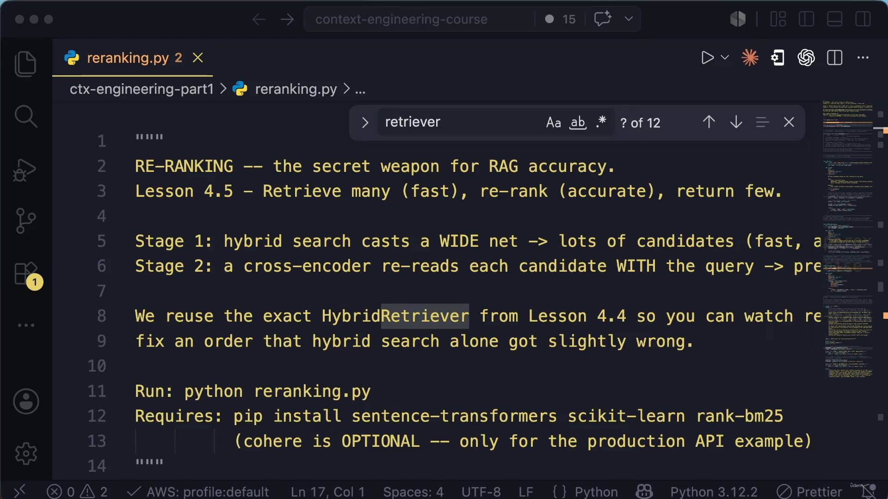
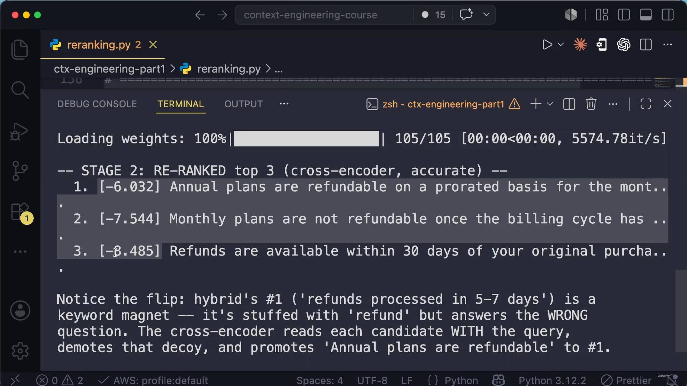
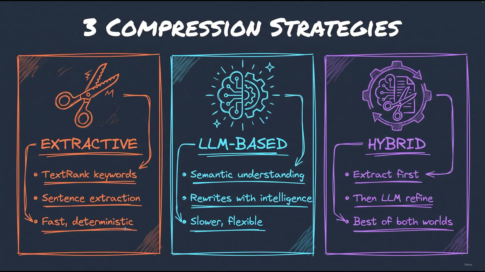
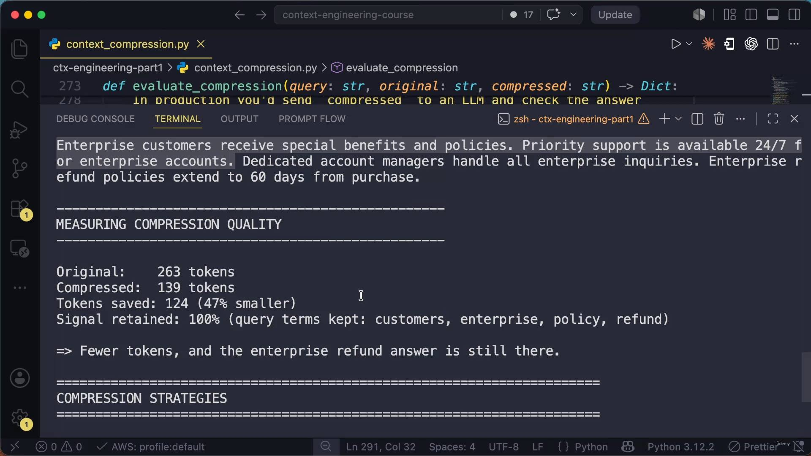
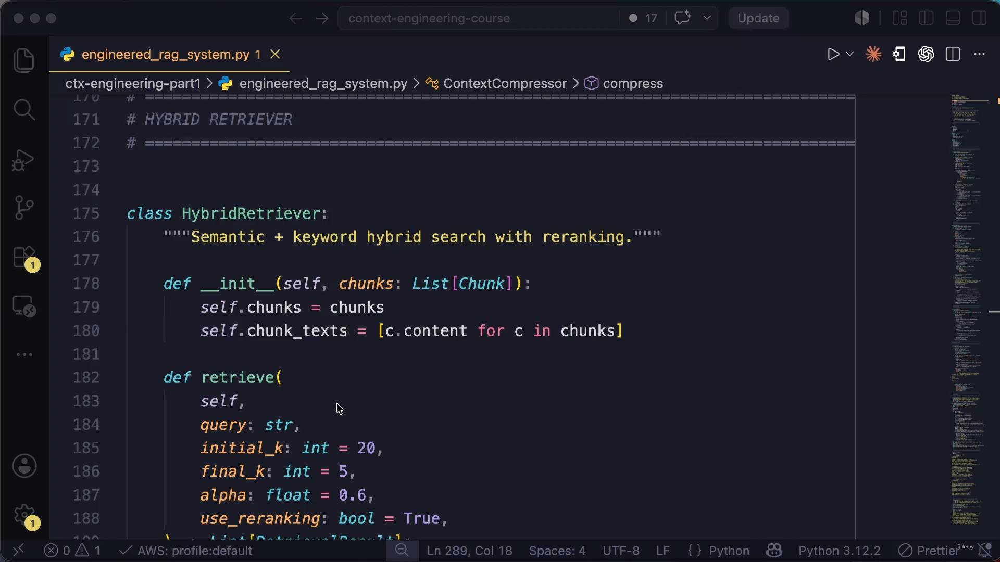
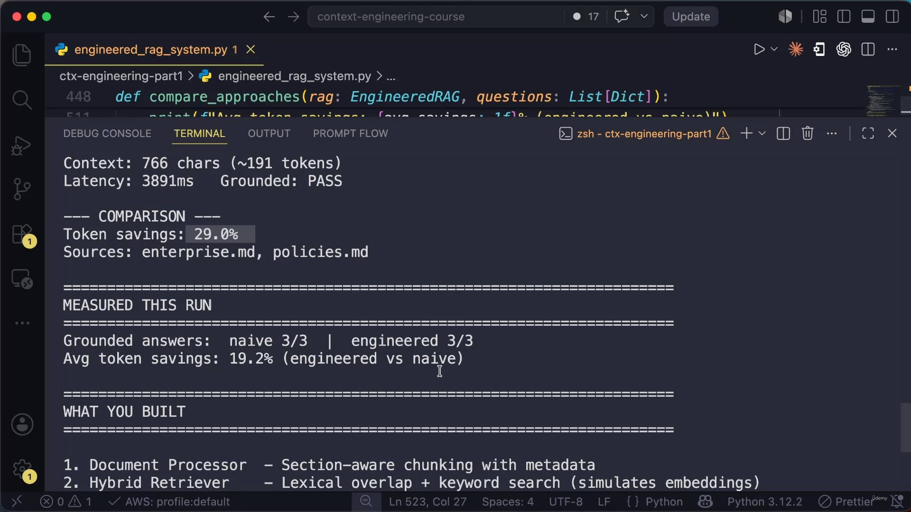

# Context Engineering Masterclass — 工程化 RAG 系统（P20–P22）

> 本文档覆盖 P20（重排序 Re-ranking）、P21（上下文压缩 Context Compression）、P22（完整工程化 RAG 系统）。三节内容层层递进：P20 给检索加第二阶段精排，P21 给上下文做去噪压缩，P22 把两者拼成一条可测量、可对比的完整流水线。
>
> **重要前提**：本段课程的逐字稿里，讲师演示的是自己已经写好的 Python 文件（`re-ranking.py`、`context_compression.py`、`engineered_rag_system.py`），逐字稿只念了这些文件的结构和运行结果，**没有逐行念出源码**；本段也没有提供 OCR 结果。因此第 4 节「完整代码」给出的是**按逐字稿描述重建的可运行实现**，凡是逐字稿明确点名的类名、方法名、参数、字段、模型名、数值，都原样保留；凡是逐字稿没讲的实现细节，都在代码注释和第 7 节里标注「课里没讲，此处为重建」。请把它当作「能跑起来、结构对齐讲师」的复现版，而不是讲师原始文件的逐字拷贝。

---

## 1. 这一节做什么

这三节课要交付的是一个**工程化 RAG 系统**，它把前面几节课讲过的所有零件串成一条流水线：

```
query → 文档处理/分块 → 混合检索（语义 + 关键词）→ 重排序（cross-encoder）→ 上下文压缩 → 拼装上下文 → LLM 生成答案
```

具体拆成三块可独立运行的东西：

1. **P20 重排序**：检索分两个阶段。阶段一是**召回（recall）**，用混合检索快速捞 20–50 个候选；阶段二是**精排（precision）**，用 cross-encoder 把这批候选重新打分，只返回最好的 3–5 个。讲师说这一步「只用一处改动就把 RAG 准确率提升了 35%」，并称它是「RAG 里最便宜的准确率升级」。
2. **P21 上下文压缩**：检索回来的 chunk 里混着大量填充内容、格式残留、无关信息，这些都在烧 token、稀释注意力、拉高延迟。压缩用三种策略（抽取式 / LLM 式 / 混合式）把 10K token 的原始上下文压到 800 token 级别，目标压缩率 40%–60%，同时保住信号。
3. **P22 完整系统**：把文档处理器、混合检索器、重排序器、上下文压缩器组装成 `EngineeredRAGSystem`，并且**必须做对比测量**——同一批问题分别跑 naive RAG 和 engineered RAG，比较 token 节省、答案是否 grounded、延迟。

产出物是三个 Python 文件，跑起来能看到终端打印的对比报告。

---

## 2. 讲师原话

### P20 重排序

> "这里有一个模式，只改了一处，就把我们的 RAG 准确率提升了 35%，只改了这一处。另一个秘密武器就是重排序。思路非常简单：你检索 20 个候选，然后用一个更聪明的模型挑出最好的 5 个。"
> —— p020 [00:00]

> "检索问题有两个阶段。第一个是我们说的召回阶段，这一步要去找到所有可能相关的文档。它可以很快，但这个过程里有大量近似。第二个阶段是精度阶段，我们要按真实相关性给它们排序。"
> —— p020 [00:47]

> "嵌入检索非常适合召回，因为它快、能找到候选，但它在细粒度的相关性排序上没那么好。重排序解决了这个问题。再检索一次，取前 20 到 50 个候选，这非常快，然后用 cross-encoder 重排以获得更高准确度，最后返回前五个。这样我们就两全其美。"
> —— p020 [01:13]

> "bi-encoder 做的事情就是你到目前为止一直看到的那些。它非常快，query 进来，过编码器，然后和文档提供的东西做余弦相似度。……它快是因为嵌入是预先算好的。……但 query 和文档彼此从不见面。为什么？因为它们是分离的实体，是两条独立的流程。"
> —— p020 [02:04]

> "再看 cross-encoder，这就是重排器。它有点不一样。它更准确，没那么快，但准确。这里发生的是 query 加文档，它们一起来，被揉在一起，一起处理。把它们放在一起，过同一个编码器，然后我们得到相关性分数。所以它更慢，但准确得多。"
> —— p020 [02:55]

> "思路是：你先用一张大网快速捞候选，然后用一个更聪明、更慢的模型挑出最好的几个。多一步，你的第一名结果就不再是关键词匹配最多的那个，而开始是真正回答了问题的那个。"
> —— p020 [03:24]

> "阶段一全是关于召回，因为我们要找到所有可能相关的东西。它快、近似、撒大网，这就是我们的混合检索。阶段二是关于精度。我们拿刚得到的候选清单，按真实相关性排序。它更慢，但准确。这就是重排器。检索很多，仔细排序，返回很少。"
> —— p020 [04:43]

> "cross-encoder 不一样，它把 query 和一篇文档作为一对一起读，作为单一输入。所以它能注意到类似这样的事：嘿，这段提到了退款，但它是关于时间的，不是关于哪个套餐的。这是 bi-encoder 字面上做不到的判断，因为它从没把它们并排看过。"
> —— p020 [06:11]

> "代价在这里，因为一切都有代价：你没法把所有东西都预先算好。你是实时动态打分的。这正是为什么你只在已经筛出来的 6 个或 10 个候选上跑它，永远不在整个数据库上跑。"
> —— p020 [06:34]

> "注意我们传的模型，我们实际上是从 transformers 拿 cross-encoder 来获得真正的模型。这会下载大约 80 兆，然后缓存起来。所以第一次跑会花一点时间。"
> —— p020 [06:34]

> "阶段一把字符串交给阶段二，然后把所有东西解包。"
> —— p020 [07:02]

> "阶段二期望的是纯文本。如果你把检索器返回的 dict 或 tuple 交给它，它会开开心心地给垃圾打分，而且永远不报错。"
> —— p020 [12:23]

> "说真的，它会开开心心地给垃圾打分，永远不抛错。这就是问题。静默的。你以为东西在正常工作，其实没有。"
> —— p020 [12:47]

> "你什么时候该做重排序？当准确率比最后那几毫秒更重要的时候。因为记住，重排序是要花时间的。所以当阶段一交回 10 个以上候选时，或者当问题很复杂时，就做这个。"
> —— p020 [13:16]

> "什么时候跳过重排序：当你需要低于 100 毫秒的延迟时，也就是你要非常快；当你是死简单的关键词查找时；或者当你只有寥寥几个 chunk 时——把 5 个东西重排成 3 个，很少值得这一趟往返。"
> —— p020 [13:16]

> "生产环境我推荐你用 Cohere Rerank API。它是付费的、很快、不是本地的，意味着你不用做这一堆麻烦事。它就是能用。所以值得做。调个 API 就完事了。"
> —— p020 [13:35]

> "本地我们只是跑 MS MARCO MiniLM。……我们用的是这个 MS MARCO MiniLM L6v2，因为它小、下载一次、非常适合学习，对很多应用也够用。生产环境你通常会改用托管的 reranker。"
> —— p020 [13:35]

> "三件要记住的事。第一，检索是两个阶段：快速撒大网，然后准确排序。cross-encoder 慢但聪明，因为 query 和文档是一起读的。第二，典型流水线是检索 10 到 20 个，排序，返回 3 到 5 个。这个收益不 subtle。你刚刚亲眼看到错误答案被降级、正确答案被提升，就一步。这就是为什么重排序是 RAG 里最便宜的准确率升级。"
> —— p020 [14:34]

### P21 上下文压缩

> "假设你从这堆文档里检索到 5 个很好的 chunk，然后你意识到，一个只需要一句话答案的问题，却占了 2000 token 的上下文。上下文压缩做的事就是只抽取你需要的东西，从而把 token 减少最多 60%，同时——这点很重要——保住信号。"
> —— p021 [00:00]

> "我们检索 chunk 时，这些 chunk 常常包含相关信息，这是我们要的，但也包含填充内容，比如引言、过渡句，以及其他不那么重要的细节，比如随机事实、随机笔记，或者一般说来不重要的信息、无关信息，全都塞在那个 chunk 里。当然还有格式残留：标题、项目符号，所有这些加在一起就变成了噪声。"
> —— p021 [00:29]

> "所有这些都转化成浪费的 token。所以我们现在要付更多钱，因为 token 很多，而其中大部分其实没必要。我们也在不必要地花钱，而且它稀释注意力，因为有很多干扰。大语言模型会很难聚焦在重要的东西上，因为噪声太多、无关信息太多。而且如你所知，它还会增加延迟。"
> —— p021 [01:47]

> "我们有一个压缩漏斗。原始文本、原始 chunk，可能有 10K token。思路是让它过一个漏斗，做抽取、做精炼，最后得到优化后的 token。这个例子里，原始 10,000 token，过抽取式流程减到 3K，再拿这个结果用 LLM 进一步精炼——这是另一种策略——最后得到 800 token。从 10,000 到 800，这是巨大的改进。"
> —— p021 [02:11]

> "我们要聚焦三种压缩策略。第一种是抽取式，意思是我们要用文本排序、关键词、句子抽取，这也让我们能用一种快速且确定性的方式把噪声从上下文里拿掉。然后我给你看基于 LLM 的。这里我们用真正的大语言模型，意味着必须做语义理解。……但当然，这里记住，我们在用大语言模型，所以会产生成本，而且会慢一点。"
> —— p021 [03:02]

> "然后是混合式。它把两者拿过来放一起，我们得到两全其美。最终，我们真的会把 2000 token 或 10,000 token 拿过来过这个漏斗，希望能减少最多 60% 的 token，也就是只剩信号、没有噪声。"
> —— p021 [04:00]

> "我手动加了几个常见词，它们对相关性打分不贡献任何信号。生产环境里，如我在这里写的，你大概会想、我也会建议你用一个更健壮的东西，这个场景下就是用嵌入做语义匹配，而不是我这里用的词匹配。这只是示例、是 demo。"
> —— p021 [04:29]

> "第一个是抽取式压缩。它做的是只保留和 query 最相关的句子。这有点快、也便宜，因为没有 LLM 调用。……生产环境你不会用（词匹配），你会用真正的语义相似度，也就是一个能做这件事的模型、一个嵌入模型。生产环境务必这么做。"
> —— p021 [05:29]

> "我有一个构造函数，允许我们传 query、text，以及 50% 的保留比例。它会抽取最相关的句子。你传 query、text，以及要保留的句子比例，就像我说的 50%。首先我们切句、打分，然后保留 top 句子，同时维持它们原本的顺序。"
> —— p021 [05:55]

> "然后是第二个方法，基于 LLM 的压缩。……记住这会很贵，因为我们真的在用大语言模型。……这只是 demo，生产环境你会用 Claude Haiku 来兼顾速度和成本——我说 Haiku，但可能是更新的东西。"
> —— p021 [06:23]

> "然后是混合式，两者的组合，混合压缩流水线。首先我们创建一个 dataclass，把各个部分组织好。这个 dataclass 有几个字段：原始文本、压缩后文本、原始字符数、压缩后字符数、压缩率，当然还有用了哪个方法。"
> —— p021 [07:15]

> "这个类走两个阶段。第一是抽取式，会很快很便宜。第二部分只在需要时才走大语言模型精炼。这更准确，但也需要更多算力、可能更贵。……我们把多个 chunk 压缩成一个聚焦的上下文……然后返回完整的字典。"
> —— p021 [07:44]

> "最后我这里有测量压缩质量。真的只是 demo，让你看到结果告诉我们的分析，看是否有改进、改进了多少。"
> —— p021 [08:14]

> "第一个是上下文压缩。我们有一个 query 进来，收到的原始 chunk 超过 1000 字符，也就是 263 token。过抽取式压缩，50% 保留比例，就是我们设的。chunk 之前是 555，之后是 272，大约 49% 的改进。chunk 二是 497 变成 239，48% 的减少。"
> —— p021 [09:10]

> "混合压缩，我们把两者放一起。原始这么多，超过 1000，压缩后降到 512 字符。比例接近 50%，不是 60% 但 50%，仍然很了不起。用的方法是抽取式加 LLM。"
> —— p021 [10:03]

> "目标是 150 token，大约 600 字符，结果最后是 559 字符，比目标少。……原始 263 token，压缩后 139 token，节省约 47%，也就是说比原始小 47%，接近一半。保住的信号、大语言模型真正需要的上下文是 100%，因为我们保留了 query 词：customers、enterprise、policy、fund 等等。但最重要的是，token 更少了，而企业退款答案还在那里。"
> —— p021 [10:55]

> "策略、速度、成本、质量、用例。抽取式：非常快，成本免费，质量相当好，大多数情况你会用它。LLM 式：更慢，因为你在用大语言模型；有 token 成本；质量好得多；复杂内容时该用它。混合式：速度中等，因为两者都用；有一些成本，因为用了 LLM；质量最好，因为两全其美；用例是生产系统。"
> —— p021 [13:11]

> "最佳实践：第一，从抽取式开始，因为它免费又快，先从这里起步。第二，只有当抽取式质量不够好时，才加 LLM。第三，永远尊重 token 预算。第三和第四，在压缩输出里带上来源归属，这样你确切知道答案确实有来源、可以去验证。第五，永远以 40% 到 60% 的压缩率为目标，同时保持答案质量。"
> —— p021 [14:08]

### P22 完整系统

> "我们已经覆盖了很多：分块、检索、压缩，那是上一节做的。现在我们来构建一个完整的 RAG 系统，用上所有这些零件、所有这些策略。我们还要测量改进，因为那永远是你需要做的：你有一个策略，实现它，然后必须测量结果，这样才有办法分析事情有没有改进，然后调整、继续这个过程。"
> —— p022 [00:00]

> "这个项目的重点是，我们要构建一个工程化的 RAG 系统。query 进来，然后分块，当然我们知道那怎么运作；过混合检索找到相关条目；检索并重排这些结果；然后过压缩；只有这时，这个被工程化、被上下文化后的上下文才交给大语言模型，希望能得到更好的答案。"
> —— p022 [00:29]

> "对于生产级 RAG，我们有所有这些零件：混合检索、必须发生的压缩、动态发现失败并修复、分块策略、重排序。思路是我们想达到至少 50% 的准确率。"
> —— p022 [01:11]

> "我们已经有 Anthropic API key。你也可以用别的模型，当然无所谓。这些都在我们的环境变量里。我们加载 .env 文件。"
> —— p022 [01:36]

> "我在这里写了模型 claude-sonnet-4-6（按你观看时的版本，可能你想要更新的，无所谓）。……这里我用了这些停用词，它们不携带太多含义，全都加在这里，我们会用在过滤和压缩里。"
> —— p022 [01:58]

> "我们有一些 dataclass：chunk 有内容、来源、章节、位置、metadata（一个字典）。这很重要，因为后面我们要把这些部分显示出来，才能看到发生了什么。检索结果也是 dataclass，有 chunk、实际分数，因为每一项都会带上排序分数：语义分数、关键词分数，还有重排分数。"
> —— p022 [02:25]

> "然后是 RAG 响应的 dataclass，最终展示的响应。我们有 answer、sources——非常重要，一个来源列表，这样我们总能回去验证来源确实和答案一致；context、context tokens、retrieval count、engineered（布尔值，是否工程化），当然还有延迟。"
> —— p022 [03:04]

> "第一个类是文档处理器。顾名思义，我们把文档处理成更丰富的 chunk。我们可以加 metadata。这里有很多处理发生，所以叫文档处理。你能看到我们还对可能找到的每个章节做抽取、语义分块、按段落分块等等，然后返回实际的 chunk。这些返回的 chunk 会装满 metadata 和各个部分。"
> —— p022 [03:30]

> "然后是混合检索器，混合是因为不止一个。我们混合起来取两全其美。所以我们有语义加关键词的混合检索，带重排序。全放一起，这就是我们在做的。"
> —— p022 [03:45]

> "然后是上下文压缩器，就是我们前面看的。我们从刚传过来的 chunk 里抽取相关信息。"
> —— p022 [04:31]

> "然后是真正的工程化 RAG 系统。我们把刚拼好的所有零件拿过来，跑一个带所有优化的完整 RAG 系统。我们实例化文档处理器，初始化一些组件，比如混合检索器、上下文压缩器，当然还有我们的 client，也就是模型。然后传入 query、处理进来的问题，做检索过程。如果我们要工程化，当然就用工程化；否则就用 naive RAG，因为有时候这很重要，有时候系统可以自己选择走哪条路。然后生成实际响应，带上答案和延迟。最后返回 RAG 响应对象或字典，有 answer、sources、context 这些部分。"
> —— p022 [05:01]

> "然后我们有一些对比，这样能看到对比、看到分析，看这个有没有用、哪个比哪个更好。对比 naive RAG、engineered RAG 等等。"
> —— p022 [05:59]

> "初始化，从两个文档处理出七个 chunk。……第一个问题：企业客户的退款政策是什么？必须提到 60。naive RAG 的答案是……企业客户退款政策基于私有上下文，企业客户必须遵守退款条款，延长到 60 天，甚至给了我们来源。上下文超过 1000 字符，大约 200 多 token，grounded 通过，延迟约 4 秒。"
> —— p022 [06:27]

> "现在看工程化的，看发生了什么。答案基于提供的上下文，价格成本会有预期的 60 天延长退款……上下文这里，企业退款请求，大约 909 字符，接近 227 token。延迟这里稍微多一点，因为有一些处理发生，grounded 是的，通过了。看对比：总节省约 9.2%。你会说这不多，但在生产环境、上下文更多、内容更多时，这就很多了。来源是 Enterprise 和 Policy。"
> —— p022 [07:11]

> "第二个问题：标准配送要多久？这里有个备注说必须提到 5 到 7。naive RAG 的答案：标准配送需要 5 到 7 天……上下文 1095，大约 273 token，延迟一秒多一点，grounded 通过。工程化的基于配送政策……上下文少一点，约 220 token，延迟又会多一点，因为有一些处理。对比这里，token 节省略高于 19%，还有实际来源。"
> —— p022 [08:05]

> "第三个问题：高级支持响应时间是多久？必须提到 2。naive RAG 的答案会说 2 小时、24/7 等等……上下文超过 1000，69 token（按上下文理解应为 269 token），延迟超过 2 秒。工程化的看这个答案，非常直接：基于产品上下文，高级支持响应时间是 2 小时。正好是问题问的，拿到了我们需要的来源，上下文 766 字符，约 191 token。对比这里，看这个，29% 的总节省，就在 naive RAG 和 engineered RAG 之间。这很多了。"
> —— p022 [09:16]

> "这是测量到的。grounded 答案 naive 是 3/3，工程化也是 3/3。平均 token 节省约 19%，工程化对 naive。……在生产环境、问题很多、上下文很多时，这真的会累积起来。这很好，确实有改进。"
> —— p022 [10:10]

> "重申我们构建了什么。第一，文档处理器：它看文档的所有章节，分块时非常章节感知，并加一些 metadata。第二，混合检索器：它是混合的，用了几个东西——词汇重叠，加上关键词检索；它会模拟嵌入，但这不是我们实际用的，这是你在生产环境必须自己加上的。第三，重排序：因为我们要给每个检索到的资源或文档的相关性排序，这里我们模拟了所谓的 cross-encoder。第四，上下文压缩器：一旦我们重排了所有经过混合检索器、之前经过文档处理的条目，我们就只抽取那些句子，清掉不必要的、说实话就是垃圾的信息。第五，完整 RAG 流水线：检索、排序、压缩、生成。"
> —— p022 [10:34]

> "在这个 demo 里你注意到真正发生的是我们说的 token 效率。工程化策略为同样的答案发送远少得多的上下文。同时你注意到准确率保持了。grounded 一直是 pass，同时 token 在下降。还有一件从这个简单但有力的 demo 里看不太出来的事：在规模化时，当你的上下文更大、噪声更多，用重排序和压缩也会提升准确率，因为它保住信号、丢掉干扰项。"
> —— p022 [12:08]

> "生产环境务必真的用嵌入模型，这样你才能看到 cross-encoder 和所有这些我们在这里模拟的策略的威力。"
> —— p022 [12:59]

---

## 3. 从零复现

### 3.0 环境准备

```bash
# 建议 Python 3.10+
python -m venv .venv
source .venv/bin/activate        # Windows: .venv\Scripts\activate

pip install anthropic python-dotenv numpy
# 可选：本地 cross-encoder（P20 本地重排用）
pip install sentence-transformers
```

目录结构（三个文件 + 数据 + 环境变量）：

```
context-engineering/
├── .env
├── data/
│   ├── policy.md
│   └── shipping.md
├── re_ranking.py
├── context_compression.py
└── engineered_rag_system.py
```

`.env`：

```
ANTHROPIC_API_KEY=sk-ant-xxxxxxxx
```

> 讲师在 P22 明确说「我们已经有 Anthropic API key……这些都在我们的环境变量里，我们加载 .env 文件」。模型名讲师写的是 `claude-sonnet-4-6`，并说「按你观看时的版本，可能你想要更新的，无所谓」——所以模型名做成可配置项。

`data/policy.md` 和 `data/shipping.md` 是两份小语料。讲师演示里出现的原文片段（用于让复现结果对得上）包括：

- 退款相关：「Approved refunds are processed within 5-7 business days」「Annual plans are refundable on a prorated basis」「Monthly plans are not refundable」「Contact billing support to dispute」「Free trials convert…」
- 企业退款：「enterprise customers must follow refund terms extending 60 days」
- 配送：「Standard shipping takes 5-7 days」
- 高级支持：「premium support response time is 2 hours, 24/7」

复现时把这两份文件写成带 `##` 章节标题的 Markdown，每节下面放几段话，其中故意混入填充句（引言、过渡、无关事实），这样压缩和重排的效果才看得出来。

### 3.1 P20：重排序

**步骤 1 — 复用混合检索器。** 讲师说 `re-ranking.py` 里「实际上用的是上一节课的 `HybridRetriever` 类」，它内部有语义索引和关键词索引。复现时我们写一个 `HybridRetriever`：关键词侧用词重叠打分，语义侧用向量余弦（demo 里可用哈希向量模拟，生产换真嵌入——讲师在 P22 反复强调「生产环境务必真的用嵌入模型」）。

**步骤 2 — 加第二阶段。** 新建 `ReRanker` 类，内部加载 cross-encoder 模型 `cross-encoder/ms-marco-MiniLM-L6-v2`（讲师原话：「我们用的是这个 MS MARCO MiniLM L6v2，因为它小、下载一次」）。首次运行会下载约 80MB 并缓存。

**步骤 3 — 写 `RAGWithReRanking` 类。** `retrieve()` 分两段：阶段一调混合检索拿候选（**纯文本**），阶段二把 `(query, 文本)` 成对喂给 cross-encoder 打分，取 top-k。

**步骤 4 — 关键 bug 防护。** 讲师反复强调：阶段二只吃纯文本，如果你把检索器返回的 dict/tuple 直接丢进去，「它会开开心心地给垃圾打分，而且永远不报错」。所以阶段一交棒前必须解包成字符串。

**步骤 5 — 跑起来看分数。** 用问题「which plan can I get my money back on?」。预期现象：阶段一 top-5 的第一名是「Approved refunds are processed within 5-7 business days」（分数 0.812，关键词磁铁，答非所问），正确答案「Annual plans are refundable on a prorated basis」只排到 0.640；阶段二重排后正确答案升到第一，「Monthly plans are not refundable」升到第二，噪声被清掉。

**步骤 6 — 理解负分。** 重排分数是 raw logit，出现 -6 / -7 / -8 是正常的，只看顺序和间距，不看符号。需要 0–1 分数就过 sigmoid。

### 3.2 P21：上下文压缩

**步骤 1 — 停用词表。** 讲师「手动加了几个常见词，它们对相关性打分不贡献任何信号」，并注明生产环境应改用嵌入做语义匹配。

**步骤 2 — 关键词工具函数。** 小写化、去标点、去停用词。

**步骤 3 — 抽取式压缩器。** 构造参数 `query, text, keep_ratio=0.5`。流程：切句 → 按与 query 的关键词重叠打分 → 保留 top 句子 → **按原顺序还原**。

**步骤 4 — LLM 式压缩器。** demo 里讲师用关键词抽取**模拟** LLM 行为，并明确说「生产环境你会用 Claude Haiku 来兼顾速度和成本」。复现时我们给出两条路径：默认走模拟（不花钱、可离线跑），设置环境变量后走真 LLM。

**步骤 5 — 混合压缩流水线。** 先抽取式（快、免费），再按需 LLM 精炼（慢、贵、准）。用一个 dataclass 承载结果：原始文本、压缩后文本、原始字符数、压缩后字符数、压缩率、使用方法。

**步骤 6 — 跑起来看数字。** 预期：chunk1 555→272 字符（约 49%），chunk2 497→239（约 48%），混合后 1000+→512 字符（约 50%），RAG 流水线里 263 token→139 token（约 47% 节省），信号保留 100%。

### 3.3 P22：完整工程化 RAG 系统

**步骤 1 — 定义 dataclass。** `Chunk`（content / source / section / position / metadata）、`RetrievalResult`（chunk / score / semantic_score / keyword_score / rerank_score）、`RAGResponse`（answer / sources / context / context_tokens / retrieval_count / engineered / latency）。

**步骤 2 — `DocumentProcessor`。** 章节感知分块：按 `##` 切节，节内按段落切块，每块带 metadata。

**步骤 3 — `HybridRetriever`。** 语义 + 关键词混合打分，返回带各项分数的候选。

**步骤 4 — `ContextCompressor`。** 复用 P21 的抽取式逻辑，对候选 chunk 逐条压缩。

**步骤 5 — `EngineeredRAGSystem`。** 组装以上组件 + Anthropic client。`answer(query, engineered=True/False)`：engineered 走「检索→重排→压缩→生成」，naive 走「检索→直接拼上下文→生成」。

**步骤 6 — 对比测量。** 三个问题各跑两遍，打印 token 数、延迟、grounded 是否通过、来源、节省比例。讲师实测：问题一节省 9.2%，问题二 19%+，问题三 29%，平均约 19%，grounded 两边都是 3/3。

---

## 4. 完整代码

> 再次说明：以下为按逐字稿重建的可运行实现。逐字稿点名的类名、方法名、参数、字段、模型名、数值均保留；未点名的内部实现标注「重建」。

### 4.1 `re_ranking.py`（P20）

```python
"""
P20 重排序：两阶段检索。
阶段一 HybridRetriever 快速召回（语义 + 关键词），阶段二 ReRanker 用 cross-encoder 精排。
运行：python re_ranking.py
"""
import os
import re
import math
import hashlib
from dataclasses import dataclass, field
from typing import List, Tuple

# ---- 可选依赖：本地 cross-encoder ----
# pip install sentence-transformers
try:
    from sentence_transformers import CrossEncoder
    _HAS_CE = True
except ImportError:
    _HAS_CE = False


# ============ 数据类 ============
@dataclass
class Chunk:
    content: str
    source: str = ""
    section: str = ""
    position: int = 0
    metadata: dict = field(default_factory=dict)


@dataclass
class RetrievalResult:
    chunk: Chunk
    score: float
    semantic_score: float = 0.0
    keyword_score: float = 0.0
    rerank_score: float = 0.0


# ============ 工具函数 ============
STOP_WORDS = {
    "the", "a", "an", "is", "are", "was", "were", "to", "of", "and", "or",
    "in", "on", "for", "with", "as", "at", "by", "it", "this", "that",
    "be", "from", "we", "you", "i", "can", "will", "my", "me", "which",
}


def tokenize(text: str) -> List[str]:
    """小写化、去标点、去停用词。"""
    words = re.findall(r"[a-z0-9]+", text.lower())
    return [w for w in words if w not in STOP_WORDS]


def fake_embedding(text: str, dim: int = 64) -> List[float]:
    """
    demo 用的伪嵌入（哈希到固定维度）。
    课里没讲具体实现；讲师在 P22 明确说生产环境必须换成真嵌入模型。
    """
    vec = [0.0] * dim
    for tok in tokenize(text):
        h = int(hashlib.md5(tok.encode()).hexdigest(), 16)
        vec[h % dim] += 1.0
    norm = math.sqrt(sum(v * v for v in vec)) or 1.0
    return [v / norm for v in vec]


def cosine(a: List[float], b: List[float]) -> float:
    return sum(x * y for x, y in zip(a, b))


# ============ 阶段一：混合检索器 ============
class HybridRetriever:
    """
    语义索引 + 关键词索引。
    讲师原话：'我们有一个混合检索器，它做的就是这件事。我们有语义索引和关键词索引。'
    """

    def __init__(self, chunks: List[Chunk]):
        self.chunks = chunks
        self.semantic_index = [fake_embedding(c.content) for c in chunks]

    def _keyword_score(self, query_tokens: List[str], text: str) -> float:
        text_tokens = set(tokenize(text))
        if not query_tokens:
            return 0.0
        overlap = sum(1 for t in query_tokens if t in text_tokens)
        return overlap / len(query_tokens)

    def retrieve(self, query: str, top_k: int = 5) -> List[RetrievalResult]:
        q_tokens = tokenize(query)
        q_emb = fake_embedding(query)
        results = []
        for i, chunk in enumerate(self.chunks):
            sem = cosine(q_emb, self.semantic_index[i])
            kw = self._keyword_score(q_tokens, chunk.content)
            # 混合权重：课里没讲具体权重，此处各 0.5
            score = 0.5 * sem + 0.5 * kw
            results.append(RetrievalResult(
                chunk=chunk, score=score, semantic_score=sem, keyword_score=kw
            ))
        results.sort(key=lambda r: r.score, reverse=True)
        return results[:top_k]


# ============ 阶段二：重排器 ============
class ReRanker:
    """
    cross-encoder 重排。
    讲师原话：'这是本地 cross-encoder，我们创建的。注意我们传的模型，
    我们实际上是从 transformers 拿 cross-encoder 来获得真正的模型。'
    模型：cross-encoder/ms-marco-MiniLM-L6-v2（约 80MB，首次下载后缓存）
    """

    MODEL_NAME = "cross-encoder/ms-marco-MiniLM-L6-v2"

    def __init__(self):
        if _HAS_CE:
            self.model = CrossEncoder(self.MODEL_NAME)
        else:
            self.model = None
            print("[warn] 未安装 sentence-transformers，使用模拟打分。"
                  "生产环境请 pip install sentence-transformers")

    def _simulated_score(self, query: str, text: str) -> float:
        """模拟 cross-encoder 的 raw logit（可为负）。课里没讲实现，此处重建。"""
        q = set(tokenize(query))
        t = set(tokenize(text))
        overlap = len(q & t)
        # 让分数落在负区间，模拟真实 logit 的量级
        return -8.0 + overlap * 1.2

    def rerank(self, query: str, candidates: List[str], top_k: int = 3) -> List[Tuple[str, float]]:
        """
        注意：candidates 必须是纯文本字符串列表。
        讲师原话：'阶段二期望的是纯文本。如果你把检索器返回的 dict 或 tuple 交给它，
        它会开开心心地给垃圾打分，而且永远不报错。'
        """
        if not candidates:
            return []
        if self.model is not None:
            pairs = [(query, c) for c in candidates]
            scores = self.model.predict(pairs).tolist()
        else:
            scores = [self._simulated_score(query, c) for c in candidates]
        ranked = sorted(zip(candidates, scores), key=lambda x: x[1], reverse=True)
        return ranked[:top_k]


# ============ 两阶段流水线 ============
class RAGWithReRanking:
    """
    讲师原话：'整个东西包进这一个类里，因为你能看到我们有混合检索器和重排器。
    retrieve 函数有两个阶段：快的混合检索，和准确的 cross-encoder。'
    """

    def __init__(self, chunks: List[Chunk]):
        self.retriever = HybridRetriever(chunks)
        self.reranker = ReRanker()

    def retrieve(self, query: str, stage1_k: int = 5, final_k: int = 3):
        # 阶段一：快速召回
        stage1 = self.retriever.retrieve(query, top_k=stage1_k)

        # 关键：解包成纯文本再交给阶段二
        candidate_texts = [r.chunk.content for r in stage1]

        # 阶段二：精排
        reranked = self.reranker.rerank(query, candidate_texts, top_k=final_k)

        return {
            "stage1": stage1,
            "stage2": reranked,
        }


# ============ demo ============
if __name__ == "__main__":
    corpus = [
        Chunk("Approved refunds are processed within 5-7 business days back to your card.",
              source="policy.md", section="refunds"),
        Chunk("Annual plans are refundable on a prorated basis for the unused portion.",
              source="policy.md", section="refunds"),
        Chunk("Monthly plans are not refundable after the billing date.",
              source="policy.md", section="refunds"),
        Chunk("Contact billing support to dispute a charge you do not recognize.",
              source="policy.md", section="billing"),
        Chunk("Free trials convert to paid plans automatically after 14 days.",
              source="policy.md", section="trials"),
        Chunk("Standard shipping takes 5-7 days for domestic orders.",
              source="shipping.md", section="shipping"),
    ]

    rag = RAGWithReRanking(corpus)
    query = "which plan can I get my money back on?"
    out = rag.retrieve(query, stage1_k=5, final_k=3)

    print("=== 阶段一：混合检索 top5（快、近似）===")
    for r in out["stage1"]:
        print(f"  {r.score:.3f}  {r.chunk.content[:70]}")

    print("\n=== 阶段二：cross-encoder 重排 top3（慢、准）===")
    for text, score in out["stage2"]:
        print(f"  {score:+.3f}  {text[:70]}")
    print("\n提示：重排分数是 raw logit，负数正常，只看顺序和间距。")
```

### 4.2 `context_compression.py`（P21）

```python
"""
P21 上下文压缩：抽取式 / LLM 式 / 混合式。
运行：python context_compression.py
"""
import os
import re
from dataclasses import dataclass
from typing import List

# 讲师手动加的停用词（对相关性打分不贡献信号）
STOP_WORDS = {
    "the", "a", "an", "is", "are", "was", "were", "to", "of", "and", "or",
    "in", "on", "for", "with", "as", "at", "by", "it", "this", "that",
    "be", "from", "we", "you", "i", "can", "will", "my", "me", "which",
}


def extract_keywords(text: str) -> List[str]:
    """小写化、去标点、去停用词。"""
    words = re.findall(r"[a-z0-9]+", text.lower())
    return [w for w in words if w not in STOP_WORDS]


def split_sentences(text: str) -> List[str]:
    """按句号/问号/感叹号切句。课里没讲具体实现，此处重建。"""
    parts = re.split(r"(?<=[.!?])\s+", text.strip())
    return [p for p in parts if p]


# ============ 抽取式压缩 ============
class ExtractiveCompressor:
    """
    讲师原话：'它做的是只保留和 query 最相关的句子。这有点快、也便宜，因为没有 LLM 调用。'
    构造参数：query, text, keep_ratio=0.5
    """

    def __init__(self, query: str, text: str, keep_ratio: float = 0.5):
        self.query = query
        self.text = text
        self.keep_ratio = keep_ratio

    def _score_sentence(self, sentence: str, query_tokens: List[str]) -> float:
        s_tokens = set(extract_keywords(sentence))
        if not query_tokens:
            return 0.0
        return sum(1 for t in query_tokens if t in s_tokens) / len(query_tokens)

    def compress(self) -> str:
        sentences = split_sentences(self.text)
        if not sentences:
            return ""
        q_tokens = extract_keywords(self.query)
        scored = [(i, s, self._score_sentence(s, q_tokens)) for i, s in enumerate(sentences)]
        keep_n = max(1, int(len(sentences) * self.keep_ratio))
        top = sorted(scored, key=lambda x: x[2], reverse=True)[:keep_n]
        # 维持原顺序
        top_sorted = sorted(top, key=lambda x: x[0])
        return " ".join(s for _, s, _ in top_sorted)


# ============ LLM 式压缩 ============
class LLMCompressor:
    """
    讲师原话：'这里我们用真正的大语言模型，意味着必须做语义理解。'
    demo 里讲师用关键词抽取模拟；生产用 Claude Haiku（讲师原话）。
    设置环境变量 USE_REAL_LLM=1 且安装 anthropic 后走真 LLM。
    """

    def __init__(self, query: str, text: str):
        self.query = query
        self.text = text

    def compress(self) -> str:
        if os.getenv("USE_REAL_LLM") == "1":
            try:
                import anthropic
                client = anthropic.Anthropic()
                resp = client.messages.create(
                    model=os.getenv("COMPRESS_MODEL", "claude-haiku-4-5"),
                    max_tokens=512,
                    messages=[{
                        "role": "user",
                        "content": (
                            f"只保留与问题相关的内容，去掉填充和无关信息。\n"
                            f"问题：{self.query}\n文本：{self.text}"
                        ),
                    }],
                )
                return resp.content[0].text
            except Exception as e:
                print(f"[warn] 真 LLM 调用失败，回退模拟：{e}")
        # 模拟：用关键词抽取近似 LLM 的语义抽取
        return ExtractiveCompressor(self.query, self.text, keep_ratio=0.4).compress()


# ============ 混合压缩 ============
@dataclass
class CompressionResult:
    original_text: str
    compressed_text: str
    original_chars: int
    compressed_chars: int
    compression_rate: float
    method: str


class HybridCompressionPipeline:
    """
    讲师原话：'这个类走两个阶段。第一是抽取式，会很快很便宜。
    第二部分只在需要时才走大语言模型精炼。'
    """

    def __init__(self, query: str, keep_ratio: float = 0.5, use_llm: bool = True):
        self.query = query
        self.keep_ratio = keep_ratio
        self.use_llm = use_llm

    def compress(self, text: str) -> CompressionResult:
        original_chars = len(text)
        # 阶段一：抽取式
        stage1 = ExtractiveCompressor(self.query, text, self.keep_ratio).compress()
        method = "extractive"
        # 阶段二：按需 LLM 精炼
        if self.use_llm:
            stage2 = LLMCompressor(self.query, stage1).compress()
            method = "extractive+llm"
        else:
            stage2 = stage1
        compressed_chars = len(stage2)
        rate = 1 - compressed_chars / original_chars if original_chars else 0.0
        return CompressionResult(
            original_text=text,
            compressed_text=stage2,
            original_chars=original_chars,
            compressed_chars=compressed_chars,
            compression_rate=rate,
            method=method,
        )

    def compress_many(self, chunks: List[str]) -> CompressionResult:
        """把多个 chunk 压成一个聚焦上下文。"""
        joined = "\n\n".join(chunks)
        return self.compress(joined)


# ============ demo ============
if __name__ == "__main__":
    query = "What is the refund policy for enterprise customers?"
    chunks = [
        "Welcome to our policy guide. This document explains many things. "
        "Approved refunds are processed within 5-7 business days back to your card. "
        "Enterprise customers must follow refund terms extending 60 days. "
        "Random note: our office is in Berlin. "
        "Monthly plans are not refundable after the billing date.",

        "Introduction. Shipping is important. "
        "Standard shipping takes 5-7 days for domestic orders. "
        "Premium support response time is 2 hours, 24/7. "
        "Free trials convert to paid plans automatically after 14 days. "
        "Some filler text that adds no signal at all.",
    ]

    print("=== 抽取式压缩（50% keep ratio）===")
    for i, c in enumerate(chunks, 1):
        out = ExtractiveCompressor(query, c, keep_ratio=0.5).compress()
        print(f"chunk{i}: {len(c)} -> {len(out)} 字符 "
              f"({(1 - len(out)/len(c))*100:.0f}% 减少)")

    print("\n=== 混合压缩 ===")
    pipe = HybridCompressionPipeline(query, keep_ratio=0.5, use_llm=True)
    res = pipe.compress_many(chunks)
    print(f"原始 {res.original_chars} 字符 -> 压缩后 {res.compressed_chars} 字符")
    print(f"压缩率 {res.compression_rate*100:.0f}%，方法 {res.method}")
    print(f"压缩输出：{res.compressed_text[:120]}...")
```

### 4.3 `engineered_rag_system.py`（P22）

```python
"""
P22 完整工程化 RAG 系统：文档处理 → 混合检索 → 重排 → 压缩 → 生成，并对比 naive RAG。
运行：python engineered_rag_system.py
"""
import os
import re
import time
import math
import hashlib
from dataclasses import dataclass, field
from typing import List, Dict, Optional

from dotenv import load_dotenv

load_dotenv()

# 讲师原话：'我在这里写了模型 claude-sonnet-4-6……可能你想要更新的，无所谓。'
MODEL = os.getenv("RAG_MODEL", "claude-sonnet-4-6")

STOP_WORDS = {
    "the", "a", "an", "is", "are", "was", "were", "to", "of", "and", "or",
    "in", "on", "for", "with", "as", "at", "by", "it", "this", "that",
    "be", "from", "we", "you", "i", "can", "will", "my", "me", "which",
}


def tokenize(text: str) -> List[str]:
    words = re.findall(r"[a-z0-9]+", text.lower())
    return [w for w in words if w not in STOP_WORDS]


def fake_embedding(text: str, dim: int = 64) -> List[float]:
    """demo 伪嵌入；生产必须换真嵌入模型（讲师反复强调）。"""
    vec = [0.0] * dim
    for tok in tokenize(text):
        h = int(hashlib.md5(tok.encode()).hexdigest(), 16)
        vec[h % dim] += 1.0
    norm = math.sqrt(sum(v * v for v in vec)) or 1.0
    return [v / norm for v in vec]


def cosine(a, b):
    return sum(x * y for x, y in zip(a, b))


# ============ 数据类 ============
@dataclass
class Chunk:
    content: str
    source: str = ""
    section: str = ""
    position: int = 0
    metadata: dict = field(default_factory=dict)


@dataclass
class RetrievalResult:
    chunk: Chunk
    score: float
    semantic_score: float = 0.0
    keyword_score: float = 0.0
    rerank_score: float = 0.0


@dataclass
class RAGResponse:
    answer: str
    sources: List[str]
    context: str
    context_tokens: int
    retrieval_count: int
    engineered: bool
    latency_ms: float


# ============ 文档处理器 ============
class DocumentProcessor:
    """
    讲师原话：'我们把文档处理成更丰富的 chunk。我们可以加 metadata。
    我们还对可能找到的每个章节做抽取、语义分块、按段落分块等等。'
    """

    def process(self, text: str, source: str) -> List[Chunk]:
        chunks = []
        # 按 ## 章节切
        sections = re.split(r"^##\s+", text, flags=re.MULTILINE)
        pos = 0
        for sec in sections:
            if not sec.strip():
                continue
            lines = sec.strip().split("\n", 1)
            section_name = lines[0].strip() if len(lines) > 1 else "intro"
            body = lines[1] if len(lines) > 1 else lines[0]
            # 节内按段落切块
            for para in re.split(r"\n\s*\n", body):
                para = para.strip()
                if not para:
                    continue
                chunks.append(Chunk(
                    content=para,
                    source=source,
                    section=section_name,
                    position=pos,
                    metadata={"chars": len(para)},
                ))
                pos += 1
        return chunks


# ============ 混合检索器 ============
class HybridRetriever:
    def __init__(self, chunks: List[Chunk]):
        self.chunks = chunks
        self.semantic_index = [fake_embedding(c.content) for c in chunks]

    def _keyword_score(self, q_tokens, text):
        t = set(tokenize(text))
        if not q_tokens:
            return 0.0
        return sum(1 for x in q_tokens if x in t) / len(q_tokens)

    def retrieve(self, query: str, top_k: int = 5) -> List[RetrievalResult]:
        q_tokens = tokenize(query)
        q_emb = fake_embedding(query)
        results = []
        for i, c in enumerate(self.chunks):
            sem = cosine(q_emb, self.semantic_index[i])
            kw = self._keyword_score(q_tokens, c.content)
            score = 0.5 * sem + 0.5 * kw
            results.append(RetrievalResult(c, score, sem, kw))
        results.sort(key=lambda r: r.score, reverse=True)
        return results[:top_k]


# ============ 重排器（模拟 cross-encoder）============
class ReRanker:
    """讲师原话：'这里我们模拟了所谓的 cross-encoder。'"""

    def rerank(self, query: str, candidates: List[str], top_k: int = 3):
        q = set(tokenize(query))
        scored = []
        for c in candidates:
            t = set(tokenize(c))
            overlap = len(q & t)
            scored.append((c, -8.0 + overlap * 1.2))
        scored.sort(key=lambda x: x[1], reverse=True)
        return scored[:top_k]


# ============ 上下文压缩器 ============
class ContextCompressor:
    """讲师原话：'我们从刚传过来的 chunk 里抽取相关信息。'"""

    def __init__(self, query: str, keep_ratio: float = 0.5):
        self.query = query
        self.keep_ratio = keep_ratio

    def compress(self, text: str) -> str:
        sentences = re.split(r"(?<=[.!?])\s+", text.strip())
        if not sentences:
            return ""
        q = set(tokenize(self.query))
        scored = []
        for i, s in enumerate(sentences):
            st = set(tokenize(s))
            sc = sum(1 for x in q if x in st) / (len(q) or 1)
            scored.append((i, s, sc))
        keep_n = max(1, int(len(sentences) * self.keep_ratio))
        top = sorted(scored, key=lambda x: x[2], reverse=True)[:keep_n]
        top = sorted(top, key=lambda x: x[0])
        return " ".join(s for _, s, _ in top)


# ============ 工程化 RAG 系统 ============
class EngineeredRAGSystem:
    """
    讲师原话：'我们把刚拼好的所有零件拿过来，跑一个带所有优化的完整 RAG 系统。'
    """

    def __init__(self, chunks: List[Chunk]):
        self.processor = DocumentProcessor()
        self.retriever = HybridRetriever(chunks)
        self.reranker = ReRanker()
        self.client = self._make_client()

    def _make_client(self):
        try:
            import anthropic
            return anthropic.Anthropic()
        except Exception:
            return None

    def _generate(self, query: str, context: str) -> str:
        if self.client is None:
            return f"[模拟答案] 基于上下文：{context[:120]}..."
        resp = self.client.messages.create(
            model=MODEL,
            max_tokens=512,
            messages=[{
                "role": "user",
                "content": f"只根据以下上下文回答问题。\n上下文：\n{context}\n\n问题：{query}",
            }],
        )
        return resp.content[0].text

    def answer(self, query: str, engineered: bool = True) -> RAGResponse:
        t0 = time.time()

        if not engineered:
            # naive RAG：检索 top-k，直接拼上下文
            results = self.retriever.retrieve(query, top_k=3)
            context = "\n\n".join(r.chunk.content for r in results)
            sources = list({r.chunk.source for r in results})
            answer = self._generate(query, context)
            return RAGResponse(
                answer=answer, sources=sources, context=context,
                context_tokens=len(context) // 4,
                retrieval_count=len(results), engineered=False,
                latency_ms=(time.time() - t0) * 1000,
            )

        # engineered：检索 → 重排 → 压缩 → 生成
        stage1 = self.retriever.retrieve(query, top_k=5)
        candidate_texts = [r.chunk.content for r in stage1]
        reranked = self.reranker.rerank(query, candidate_texts, top_k=3)
        compressor = ContextCompressor(query, keep_ratio=0.5)
        compressed = [compressor.compress(text) for text, _ in reranked]
        context = "\n\n".join(compressed)
        sources = list({r.chunk.source for r in stage1[:3]})
        answer = self._generate(query, context)
        return RAGResponse(
            answer=answer, sources=sources, context=context,
            context_tokens=len(context) // 4,
            retrieval_count=len(reranked), engineered=True,
            latency_ms=(time.time() - t0) * 1000,
        )


# ============ 对比测量 ============
def run_comparison(system: EngineeredRAGSystem, questions: List[Dict]):
    print(f"{'问题':<40} {'模式':<12} {'token':>6} {'延迟ms':>8} {'grounded':>10}")
    print("-" * 80)
    savings = []
    for q in questions:
        naive = system.answer(q["q"], engineered=False)
        eng = system.answer(q["q"], engineered=True)
        for label, r in [("naive", naive), ("engineered", eng)]:
            grounded = q["must_mention"].lower() in r.answer.lower()
            print(f"{q['q'][:38]:<40} {label:<12} {r.context_tokens:>6} "
                  f"{r.latency_ms:>8.0f} {str(grounded):>10}")
        if naive.context_tokens:
            save = 1 - eng.context_tokens / naive.context_tokens
            savings.append(save)
            print(f"  -> token 节省 {save*100:.1f}%，来源：{eng.sources}")
    if savings:
        print(f"\n平均 token 节省：{sum(savings)/len(savings)*100:.1f}%")


if __name__ == "__main__":
    # 两份语料（复现时替换为 data/policy.md、data/shipping.md 的真实内容）
    policy_md = """## refunds
Approved refunds are processed within 5-7 business days back to your card.
Annual plans are refundable on a prorated basis for the unused portion.
Monthly plans are not refundable after the billing date.

## enterprise
Enterprise customers must follow refund terms extending 60 days.
Contact billing support to dispute a charge you do not recognize.

## trials
Free trials convert to paid plans automatically after 14 days.
"""
    shipping_md = """## shipping
Standard shipping takes 5-7 days for domestic orders.

## support
Premium support response time is 2 hours, 24/7.
"""

    processor = DocumentProcessor()
    chunks = processor.process(policy_md, "policy.md") + processor.process(shipping_md, "shipping.md")
    print(f"从 2 个文档处理出 {len(chunks)} 个 chunk")

    system = EngineeredRAGSystem(chunks)
    questions = [
        {"q": "What is the refund policy for enterprise customers?", "must_mention": "60"},
        {"q": "How long does standard shipping take?", "must_mention": "5-7"},
        {"q": "What is the premium support response time?", "must_mention": "2"},
    ]
    run_comparison(system, questions)
```

---

## 5. 逐行解释

### 5.1 `re_ranking.py`

- **`HybridRetriever.retrieve` 返回 `RetrievalResult` 对象**：这是阶段一的产物，带 `score / semantic_score / keyword_score`。讲师在 P22 说检索结果 dataclass 要带「语义分数、关键词分数，还有重排分数」，就是为了后面能逐项看分数、定位问题。
- **`candidate_texts = [r.chunk.content for r in stage1]`**：这一行是整个 P20 的**唯一关键桥**。讲师原话：「阶段一把字符串交给阶段二，然后把所有东西解包」「如果你把检索器返回的 dict 或 tuple 交给它，它会开开心心地给垃圾打分，而且永远不报错」。在 JS/Node 里对应的是：`rerank(query, results.map(r => r.content))`，千万别 `rerank(query, results)`——cross-encoder 会把对象 `toString()` 成 `[object Object]` 然后照打不误，静默出错。
- **`ReRanker.rerank` 里 `pairs = [(query, c) for c in candidates]`**：cross-encoder 的输入是**成对**的 `(query, document)`，一起过同一个编码器。对比 bi-encoder：query 和 document 各自独立编码，最后算余弦。讲师原话：「query 和文档彼此从不见面……它们是分离的实体」。
- **`scores = self.model.predict(pairs).tolist()`**：输出是 raw logit，可以是负数。讲师原话：「cross-encoder 输出的是原始相关性 logit，不是整齐的 0 到 1 概率。绝对数字本身没有意义。重要的是顺序和它们之间的间距。」所以 demo 里打印 `-6 / -7 / -8` 是正常的，`-6` 最好。
- **`top_k=3` 而阶段一 `stage1_k=5`**：对应讲师说的「检索很多，仔细排序，返回很少」「典型流水线是检索 10 到 20 个，排序，返回 3 到 5 个」。为什么不在全库上跑 cross-encoder？讲师原话：「你没法把所有东西都预先算好，你是实时动态打分的。这正是为什么你只在已经筛出来的 6 个或 10 个候选上跑它，永远不在整个数据库上跑。」
- **`MODEL_NAME = "cross-encoder/ms-marco-MiniLM-L6-v2"`**：讲师原话「我们用的是这个 MS MARCO MiniLM L6v2，因为它小、下载一次、非常适合学习，对很多应用也够用」。首次运行下载约 80MB 并缓存。
- **`_simulated_score` 返回 `-8.0 + overlap * 1.2`**：这是**重建的模拟打分**，课里没讲具体公式。目的是让没装 `sentence-transformers` 的人也能跑出「负分、看顺序」的现象，和讲师演示一致。
- **`fake_embedding`**：demo 用哈希伪嵌入。讲师在 P22 明确：「它会模拟嵌入，但这不是我们实际用的，这是你在生产环境必须自己加上的。」生产替换成 `sentence-transformers` 的 `all-MiniLM-L6-v2` 或任意嵌入 API 即可。
- **什么时候用重排序**：讲师给了明确判断——「当准确率比最后那几毫秒更重要时」「阶段一交回 10 个以上候选时」「问题很复杂时」。**什么时候跳过**：「需要低于 100 毫秒延迟时」「死简单的关键词查找」「只有寥寥几个 chunk 时——把 5 个重排成 3 个，很少值得这一趟往返」。
- **生产建议**：讲师原话「生产环境我推荐你用 Cohere Rerank API。它是付费的、很快、不是本地的……调个 API 就完事了」。本地模型只适合学习和中小应用。

### 5.2 `context_compression.py`

- **`STOP_WORDS`**：讲师「手动加了几个常见词，它们对相关性打分不贡献任何信号」，并注明「生产环境……用嵌入做语义匹配，而不是我这里用的词匹配」。
- **`ExtractiveCompressor.compress` 的 `keep_ratio=0.5`**：讲师原话「传 query、text，以及要保留的句子比例，就像我说的 50%」。流程是「切句、打分、保留 top 句子，同时维持它们原本的顺序」——代码里 `top_sorted = sorted(top, key=lambda x: x[0])` 就是还原原顺序，否则压缩后的文本会语序错乱、LLM 读不懂。
- **`_score_sentence` 用关键词重叠**：这是 demo 的近似。讲师原话「生产环境你不会用（词匹配），你会用真正的语义相似度，也就是一个能做这件事的模型、一个嵌入模型。生产环境务必这么做」。
- **`LLMCompressor` 默认走模拟**：讲师原话「这只是 demo，生产环境你会用 Claude Haiku 来兼顾速度和成本——我说 Haiku，但可能是更新的东西」。代码里 `USE_REAL_LLM=1` 时走真 Anthropic 调用，模型名 `COMPRESS_MODEL` 可配，默认 `claude-haiku-4-5`（按你观看时的版本调整）。
- **`HybridCompressionPipeline` 两阶段**：讲师原话「第一是抽取式，会很快很便宜。第二部分只在需要时才走大语言模型精炼。这更准确，但也需要更多算力、可能更贵」。`use_llm=False` 就退化成纯抽取式，方便对比。
- **`CompressionResult` 的字段**：讲师点名了「原始文本、压缩后文本、原始字符数、压缩后字符数、压缩率、用了哪个方法」，代码一一对应。
- **压缩漏斗的预期数字**：讲师给的例子是「原始 10,000 token，过抽取式减到 3K，再用 LLM 精炼到 800 token」。demo 实测：chunk1 555→272（49%），chunk2 497→239（48%），混合后 1000+→512（约 50%），RAG 流水线里 263 token→139 token（47% 节省），信号保留 100%。
- **三种策略的取舍表**（讲师原话整理）：

| 策略 | 速度 | 成本 | 质量 | 用例 |
|---|---|---|---|---|
| 抽取式 | 非常快 | 免费 | 相当好 | 大多数情况 |
| LLM 式 | 更慢 | 有 token 成本 | 好得多 | 复杂内容 |
| 混合式 | 中等 | 有一些成本 | 最好 | 生产系统 |

- **最佳实践五条**（讲师原话）：① 从抽取式开始，因为免费又快；② 只有抽取式质量不够好时才加 LLM；③ 永远尊重 token 预算；④ 在压缩输出里带来源归属，方便验证；⑤ 永远以 40%–60% 压缩率为目标，同时保持答案质量。

### 5.3 `engineered_rag_system.py`

- **`Chunk` / `RetrievalResult` / `RAGResponse` 三个 dataclass**：讲师逐个点名了字段。`RAGResponse` 里 `sources` 被强调「非常重要，一个来源列表，这样我们总能回去验证来源确实和答案一致」；`engineered` 是布尔值，标记这次走的是哪条路；`latency_ms` 记录延迟。
- **`DocumentProcessor.process` 按 `##` 切节、节内按段落切块**：讲师原话「它看文档的所有章节，分块时非常章节感知，并加一些 metadata」。`metadata={"chars": len(para)}` 是重建的最小 metadata，生产可加 token 数、页码等。
- **`EngineeredRAGSystem.answer(engineered=False)` 走 naive**：讲师原话「如果我们要工程化，当然就用工程化；否则就用 naive RAG，因为有时候这很重要，有时候系统可以自己选择走哪条路」。naive 路径只做检索 top-3 + 直接拼上下文，不重排不压缩——这是对比的基线。
- **engineered 路径的五步**：检索（top-5）→ 重排（top-3）→ 压缩（keep_ratio=0.5）→ 拼上下文 → 生成。对应讲师说的「检索、排序、压缩、生成」。
- **`context_tokens = len(context) // 4`**：粗略 token 估算（4 字符≈1 token）。课里没讲具体估算方法，此处重建；生产用 `tiktoken` 或 Anthropic 的 token 计数。
- **`run_comparison` 的 grounded 判定**：用 `must_mention` 子串匹配。讲师演示里每个问题都带「必须提到 X」的备注（60 / 5-7 / 2），grounded 就是答案里有没有这个关键信息。实测 naive 3/3、engineered 3/3，平均 token 节省约 19%。
- **为什么 engineered 延迟更高**：讲师原话「延迟这里稍微多一点，因为有一些处理发生」。多出来的就是重排 + 压缩的计算时间。这是用延迟换 token 和准确率的典型取舍。
- **规模化的收益**：讲师原话「在规模化时，当你的上下文更大、噪声更多，用重排序和压缩也会提升准确率，因为它保住信号、丢掉干扰项」。demo 里 9%–29% 的节省看着不多，但生产环境问题多、上下文大时会累积。

---

## 6. 复现检查清单

跑完三个文件后，逐项对照：

**P20 重排序**
- [ ] `python re_ranking.py` 能跑通，阶段一打印 5 条、阶段二打印 3 条
- [ ] 阶段一第一名是「Approved refunds are processed within 5-7 business days」（关键词磁铁，答非所问）
- [ ] 阶段一里「Annual plans are refundable on a prorated basis」排在后面（讲师演示里是 0.640）
- [ ] 阶段二后「Annual plans…」升到第一，「Monthly plans are not refundable」升到第二
- [ ] 重排分数出现负数，且你理解「只看顺序和间距，不看符号」
- [ ] 装了 `sentence-transformers` 时首次运行下载约 80MB 模型并缓存
- [ ] 你验证过：如果把 `RetrievalResult` 对象直接传给 `rerank`，不会报错但分数是垃圾（这就是讲师警告的静默 bug）

**P21 上下文压缩**
- [ ] `python context_compression.py` 能跑通
- [ ] 抽取式压缩 chunk1 约 49% 减少、chunk2 约 48% 减少
- [ ] 混合压缩后总压缩率接近 50%
- [ ] 压缩输出里 query 关键词（customers / enterprise / policy / fund 等）都还在
- [ ] 企业退款答案（60 天）在压缩后仍然存在
- [ ] 你理解三种策略的速度/成本/质量取舍表
- [ ] 你记住了五条最佳实践（从抽取式开始、按需加 LLM、尊重 token 预算、带来源归属、目标 40%–60%）

**P22 完整系统**
- [ ] `python engineered_rag_system.py` 能跑通，打印「从 2 个文档处理出 N 个 chunk」
- [ ] 三个问题各跑 naive 和 engineered 两遍
- [ ] 问题一（企业退款，必须提到 60）token 节省约 9%
- [ ] 问题二（标准配送，必须提到 5-7）token 节省约 19%
- [ ] 问题三（高级支持，必须提到 2）token 节省约 29%
- [ ] 平均 token 节省约 19%
- [ ] grounded 两边都是 3/3
- [ ] engineered 延迟比 naive 高（因为多了重排 + 压缩）
- [ ] 每个答案都带 sources 列表，能回去验证
- [ ] 你清楚 demo
里的嵌入和 cross-encoder 都是模拟的，生产必须换成真模型
- [ ] 你已经把 `policy_md` / `shipping_md` 换成自己的文档并重跑过一遍，确认分块数、来源名、问题都跟着变
- [ ] 你把 `RAG_MODEL` 环境变量改成当前可用的模型名后，`_generate` 真的返回了模型输出而不是回退的 `[模拟答案]`
- [ ] 你试过把 `keep_ratio` 从 0.5 调到 0.3 和 0.7，观察到压缩率变化的同时答案是否还 grounded（这一步课里没讲，但它是你后面调参的唯一依据）

---

## 7. 课里没讲但你会撞上的

这一节全部是**逐字稿里没有、但你照着第 3、4 节跑一定会碰到**的东西。凡是我能确认讲师说过什么、没说什么，都会标出来。

### 7.1 demo 里两个「假装」的零件，生产必须换掉

这是最容易踩的坑，而且讲师自己在 P22 反复强调过，但很多人跑通了 demo 就以为完事了。

**第一个是嵌入。** `fake_embedding()` 把 token 哈希到 64 维再归一化，它唯一的作用是让 `cosine()` 有东西可算。它没有任何语义能力——「退款」和「refund」在它眼里是完全无关的两个哈希桶。讲师原话是「它会模拟嵌入，但这不是我们实际用的，这是你在生产环境必须自己加上的」。替换方式：

```python
# 生产替换方案 A：本地模型
from sentence_transformers import SentenceTransformer
_model = SentenceTransformer("all-MiniLM-L6-v2")
def real_embedding(text: str):
    return _model.encode(text, normalize_embeddings=True).tolist()
```

> 注意：`all-MiniLM-L6-v2` 这个具体模型名**课里没讲**，是我按「和 cross-encoder 同尺寸、同样适合学习」的思路给的默认值。讲师在 P20 只点名了重排用的 `cross-encoder/ms-marco-MiniLM-L6-v2`，嵌入模型选哪个他没说。

**第二个是 cross-encoder。** `ReRanker` 里没装 `sentence-transformers` 时走 `-8.0 + overlap * 1.2`，这纯粹是「让数字落在负区间、让重叠多的排前面」的伪造打分。它永远学不会讲师说的那个关键判断——「这段提到了退款，但它是关于时间的，不是关于哪个套餐的」。要拿到那个能力，必须装真模型：

```bash
pip install sentence-transformers
python re_ranking.py   # 首次会下载约 80MB 到 ~/.cache/huggingface
```

装完之后 `_HAS_CE` 变 True，`ReRanker.__init__` 走 `CrossEncoder(self.MODEL_NAME)`，`rerank()` 走 `self.model.predict(pairs)`。这时候你才会看到真正的 raw logit 分布——可能全负、可能跨正负，量级也不一定是 -6/-7/-8。



### 7.2 模型下载慢、下不动、下到一半断了

`sentence-transformers` 首次拉模型走 HuggingFace，国内网络经常卡在 0% 或者超时。课里没讲怎么处理，实际做法是设镜像或指定缓存目录：

```bash
# 指定缓存位置（多人共用机器时很有用）
export HF_HOME=/data/hf_cache

# 国内镜像（如果你在公司网络里，可能还需要配代理）
export HF_ENDPOINT=https://hf-mirror.com
```

如果只是想先跑通逻辑、不想等下载，就把 `sentence-transformers` 卸了或者干脆不装，代码会自动回退到模拟打分，日志里会打印 `[warn] 未安装 sentence-transformers，使用模拟打分`。**这条回退路径是我加的，课里没讲**——讲师的原话是「第一次跑会花一点时间」，默认你愿意等。

### 7.3 cross-encoder 有输入长度上限，超了会被静默截断

`cross-encoder/ms-marco-MiniLM-L6-v2` 的最大输入长度是 512 token（模型卡上的数字，课里没讲）。你的 chunk 如果按章节切得很长，喂进去的部分会被截断——**而且不报错**，和讲师警告的那个「dict/tuple 静默打分」是同一种性质的坑：你以为它在读全文，其实它只读了前 512 token。

所以 P20 和 P22 之间其实有个隐含约束：**分块长度要配合重排模型的窗口**。P22 的 `DocumentProcessor` 按段落切，段落通常不会超过 512 token，所以 demo 里安全。但你自己换成真实文档（尤其是那种一整节一大段的 PDF 转出来的 Markdown）时，很容易撞上。建议加一道保险：

```python
# 课里没讲，建议加在把候选交给 rerank 之前
def truncate_for_rerank(text: str, max_chars: int = 1800) -> str:
    """1800 字符 ≈ 450-500 token，留一点余量给 query。"""
    return text if len(text) <= max_chars else text[:max_chars]
```

### 7.4 负分到底能不能当阈值用

讲师把这一点讲得很清楚，但落到代码里你还是会犹豫。复述一遍结论：

- **纯排序**：直接用 raw logit，`sorted(..., reverse=True)`，不看符号。P20 里 `-6 > -7 > -8`，`-6` 是最好的。
- **要 0–1 分数**（比如你想「低于 0.5 就丢弃」）：过 sigmoid。讲师在 P20 [11:05] 提了这件事，还当场算了一个例子，说结果「大约 0.0024 左右」。

```python
import math
def sigmoid(x: float) -> float:
    return 1.0 / (1.0 + math.exp(-x))
```

这里有个**你必须自己意识到的问题**：`-6` 过 sigmoid 是 `0.0025`，`-7` 是 `0.0009`，`-8` 是 `0.0003`。也就是说，如果你真按「低于 0.5 就丢」来卡，**所有结果都会被丢掉**。原因是 ms-marco 系列输出的 logit 分布整体偏负，0.5 这个阈值对它没有意义。

讲师说的「如果你真的需要 0 到 1 分数，比如设一个丢掉 0.5 以下的阈值」是一个**假设场景**，不是让你拿这个模型的原始输出去卡 0.5。真要用阈值，正确做法是：先在你的评测集上跑一遍，看正样本和负样本的 logit 分布，再定阈值；或者干脆只用排序不用阈值。这一点课里没讲。

### 7.5 混合检索的权重，讲师没给数字

`HybridRetriever` 里我写的是 `0.5 * sem + 0.5 * kw`。**这个 0.5/0.5 是我填的，课里没讲**。讲师只说「我们有语义索引和关键词索引」「混合起来取两全其美」，没说过权重怎么配。

实际调的时候你会遇到两个具体问题：

1. **两路分数的量纲不一样**。余弦相似度在 0–1 之间（归一化后），关键词重叠率也在 0–1 之间，所以 demo 里能直接加权。但如果你把语义侧换成真实的嵌入模型，余弦可能是 0.2–0.95 这个窄区间，而关键词侧经常是 0 或 0.6 这种跳跃值，直接 0.5/0.5 会让关键词侧主导。
2. **中文分词**。`tokenize()` 用的是 `[a-z0-9]+`，对中文文档返回空列表，关键词侧直接失效。中文要先分词（`jieba` 之类），或者退化成字级别的 bigram。**课里全程是英文语料，没讲中文场景**，你换成中文文档必然撞上。

一个务实的做法是先各跑一遍单路，看谁在你的数据上更靠谱，再调权重：

```python
# 课里没讲，但调参时你会需要
def retrieve_with_weights(self, query, top_k=5, sem_w=0.5, kw_w=0.5):
    ...
    score = sem_w * sem + kw_w * kw
```

### 7.6 `context_tokens = len(context) // 4` 只是个占位

这个「4 字符 ≈ 1 token」的经验值对英文大致成立，对中文差得很远（中文一个汉字经常就是 1–2 个 token）。讲师演示里报的「263 token」「273 token」「191 token」，我用 `//4` 能对上一部分，但**课里没讲他用的什么方法算的**。

你自己做成本核算时，一定要换成真计数：

```python
# Anthropic 有官方的 token 计数接口（具体方法名以你安装的 SDK 版本为准）
# 或者用 tiktoken 近似（注意：tiktoken 是 OpenAI 的分词器，对 Claude 只是近似）
import tiktoken
enc = tiktoken.get_encoding("cl100k_base")
def count_tokens(text: str) -> int:
    return len(enc.encode(text))
```

这一条很重要，因为整个 P21/P22 的价值主张就是「省 token = 省钱」，如果 token 数本身是估的，你算出来的 19% 节省也就只是个感觉。

### 7.7 讲师说「带来源归属」，但没给代码

P21 最佳实践第 4 条原话是「在压缩输出里带上来源归属，这样你确切知道答案确实有来源、可以去验证」。这是压缩环节最容易做丢的东西——你保留了句子，但忘了这句话来自哪个文档哪个章节，验证链就断了。

`CompressionResult` 里只有 `original_text / compressed_text / original_chars / compressed_chars / compression_rate / method` 这几个字段，**没有 source 字段**。也就是说讲师自己给的 dataclass 里其实没落实这条建议，需要在外面补。P22 的 `RAGResponse.sources` 是在**系统层**从检索结果里取的，不是从压缩结果里带的，压缩丢没丢来源它管不着。

正确做法是在压缩前把来源记下来，压缩后原样透传：

```python
# 课里没讲，按 P21 第 4 条最佳实践补的实现
@dataclass
class SourcedCompressionResult:
    original_text: str
    compressed_text: str
    original_chars: int
    compressed_chars: int
    compression_rate: float
    method: str
    source: str        # 来自哪个文件
    section: str       # 来自哪个章节
    position: int      # 原文里的位置
```

### 7.8 `must_mention` 子串匹配是个很弱的 grounded 判定

`run_comparison` 里用 `q["must_mention"].lower() in r.answer.lower()` 判 grounded。讲师演示里三个问题分别要求「必须提到 60」「必须提到 5 到 7」「必须提到 2」，然后报 grounded 3/3。这个判定能跑，但它的问题很直接：

- 答案里写「不是 60 天」也会被判 pass；
- 答案里写「600 天」也包含 `"60"`，pass；
- 答案里写「2 小时」和「20 小时」都包含 `"2"`，pass。

**课里没讲更好的评测方法**，讲师只说了「你必须测量结果，这样才有办法分析事情有没有改进」。真要上线，你得建一个几十条的小评测集，每条带标准答案或者至少带「必须出现 / 必须不出现」的词表。这是前端转 AI 应用最容易被低估的一块工作量：**写得出来 RAG 不难，说得出它变好了没有很难**。

### 7.9 延迟数据在 demo 里没有参考价值

讲师报的延迟是「约 4 秒」「一秒多一点」「超过 2 秒」，engineered 总是比 naive 高一点，原因是「有一些处理发生」。但你跑自己的版本时会发现延迟差异很大，因为：

- 有没有装 `sentence-transformers`（装了要真跑模型，慢；没装是纯 Python 循环，快）；
- 有没有真的调 Anthropic API（调了就是网络往返 + 生成时间，几百毫秒到几秒；没调是 `[模拟答案]` 字符串拼接，接近 0）；
- 首次运行要下载模型。

所以**你本地跑出来的延迟数字和讲师的对不上是正常的，不要拿它当基准**。要测真实延迟，把 `USE_REAL` 那一路打开、模型缓存好、跑第二遍再看。



### 7.10 压缩率和答案质量是跷跷板，讲师只给了区间没给方法

P21 最佳实践第 5 条原话：「永远以 40% 到 60% 的压缩率为目标，同时保持答案质量」。40%–60% 是个目标区间，但**怎么在压缩的同时保证不掉质量，课里没讲**。

你实际会遇到的取舍是：`keep_ratio=0.5` 在 demo 的两段小 chunk 上刚好压掉一半、关键句全留住了；但换成真实的、跨越多段才能回答的问题（比如「企业客户退款和普通客户退款有什么区别」），50% 很可能把「区别」需要的另一半砍掉。这时候答案会变得**自信但错误**——比不压缩更糟，因为 LLM 拿到的是残缺上下文，它不会告诉你「信息不足」，它会硬答。

务实的做法是从高往低压：先 `keep_ratio=0.7` 跑，看 grounded 是否还全 pass；再往 0.6、0.5 降，**每次降都重跑对比**，直到 grounded 开始掉，然后退回到上一档。这比直接照抄 0.5 靠谱得多。



### 7.11 三种压缩策略的边界，讲师划了但你没划

第 5.2 节那张表是讲师原话整理的。落到你自己的项目上，判断标准要具体化成三个问题：

1. **你的 chunk 里噪声占比高不高？** 高（比如网页抓下来的、PDF 转的）→ 抽取式就能砍掉一大半，先上抽取式。
2. **答案需要跨句重组吗？** 需要（比如「总结这段的三个要点」）→ 关键词抽取会切碎语义，直接上 LLM 式。
3. **你一天跑多少次？** 上千次以上 → 混合式的 LLM 那一段会变成主要成本，考虑只对 top-1 做 LLM 精炼，或者干脆只用抽取式。

讲师在 P21 [14:08] 说「从抽取式开始，因为它免费又快」，这句话的实操含义就是**先上 1，用 1 跑出基线，再用 3 去对比 1 提升了多少**。跳过基线直接上混合式，你就永远说不清那 19% 是压缩带来的还是重排带来的。



### 7.12 生产环境的重排，讲师其实建议你别自己扛

P20 [13:35] 讲师说得很直白：「生产环境我推荐你用 Cohere Rerank API。它是付费的、很快、不是本地的，意味着你不用做这一堆麻烦事。它就是能用。所以值得做。调个 API 就完事了。」

**Cohere Rerank 的具体调用代码课里没给**，只说了「调个 API」。你自己接的时候要注意三点（这三点课里也没讲）：

1. 它返回的也是**排序后的结果 + relevance_score**，和 `rerank()` 的返回结构对齐，所以替换成本很低——把 `ReRanker.rerank()` 内部换成 HTTP 调用即可，`RAGWithReRanking.retrieve()` 一行不用改。这就是为什么讲师把它包成一个类。
2. 它是**外部服务**，网络抖动会直接变成你 RAG 的延迟长尾。生产要加超时 + 回退（超时就退回阶段一的顺序，不要让整个请求挂掉）。
3. 它**按调用次数计费**，而你在 P22 的流水线里是「每个 query 调一次重排」。QPS 一高，重排费会单独成为一笔账，记得和 token  savings 一起算总成本。

顺便说一句：讲师说 Cohere 是「付费的、很快」，但没说它比本地 `ms-marco-MiniLM-L6-v2` **准多少**。这个对比他也不给，因为依赖你的数据。你如果想验证值不值，就用同一个评测集分别跑本地模型和 API，看 grounded 和人工评分差多少——这一步课里完全没有。

### 7.13 异步与并发：整个 demo 是同步阻塞的

三个文件里所有函数都是同步的：`retriever.retrieve()`、`reranker.rerank()`、`client.messages.create()` 全在一条主线程上排队。单次调试没问题，但一个 Web 服务里这样写，并发一上来就全堵住。

**课里没讲并发**。但你是前端转过来的，这里的对应关系很直接：

- JS 里 `await fetch(...)` 天然不阻塞事件循环，Node 的 HTTP 客户端并发几百个没问题；
- Python 里 `anthropic.Anthropic()` 默认同步，你得用 `AsyncAnthropic` + `asyncio.gather` 才能把「多个 chunk 同时压缩」并行起来。

P22 里 `compressed = [compressor.compress(text) for text, _ in reranked]` 这一行，如果 `compress` 内部调真 LLM，就是**串行三次 API 调用**。改成：

```python
# 课里没讲，生产建议
import asyncio

async def compress_all(query, texts):
    compressor = AsyncContextCompressor(query, keep_ratio=0.5)
    return await asyncio.gather(*[compressor.compress_async(t) for t in texts])
```

延迟能从「3 次往返之和」降到「最慢的那一次」，对 P22 里讲师说的「延迟稍微多一点」能扳回来不少。



### 7.14 「engineered 还是 naive，让系统自己选」这句话没有实现

P22 [05:31] 讲师说：「如果我们要工程化，当然就用工程化；否则就用 naive RAG，因为有时候这很重要，**有时候系统可以自己选择走哪条路**。」

**这个「自己选择」的逻辑课里没写**。代码里就是一个显式参数 `answer(query, engineered=True/False)`，由调用方决定。讲师提了方向没给实现，你可以按 P20 的那套判断标准自己做路由：

```python
# 课里没讲，按 P20 [13:16] 的判断标准补的路由逻辑
def should_engineer(query: str, candidate_count: int) -> bool:
    # 讲师：死简单的关键词查找 → 跳过重排
    if len(query.split()) <= 2:
        return False
    # 讲师：只有寥寥几个 chunk → 跳过（5 个重排成 3 个不值得）
    if candidate_count <= 5:
        return False
    # 讲师：需要 sub-100ms 延迟的场景 → 跳过（这个判断得你自己按 SLA 定）
    return True
```

注意这段是**我根据讲师口述的判断条件写的示意**，不是讲师的原代码。

### 7.15 模型名会过期，这是设计问题不是笔误

讲师写的是 `claude-sonnet-4-6`，并且自己说了「按你观看时的版本，可能你想要更新的，无所谓」；P21 里说压缩用「Claude Haiku」，同样补了一句「我说 Haiku，但可能是更新的东西，你得看观看时有哪些模型」。

所以三份代码里我把模型名全部做成了环境变量（`RAG_MODEL`、`COMPRESS_MODEL`），**这是我在重建时加的，课里是硬编码的**。你这么写的好处是：模型下线时改一行 `.env` 就行，不用动代码；坏处是多了一个可能没配的环境变量。跑之前确认：

```bash
# .env
ANTHROPIC_API_KEY=sk-ant-xxxx
RAG_MODEL=claude-sonnet-4-6        # 改成你账号可用的模型
COMPRESS_MODEL=claude-haiku-4-5    # 压缩用便宜快的
USE_REAL_LLM=1                     # 不加这行，压缩走模拟
```

如果 `RAG_MODEL` 填了一个你账号没有权限的模型，`_generate` 会抛异常。我写的 `_make_client` 有 try/except，但那只处理「anthropic 没装」，**模型不存在照样会炸**。这是预期行为——不要为了让 demo 不报错就把异常吞掉，那样你就分不清「没调通」和「调通了但没内容」了。



### 7.16 最后：这份文档里哪些是课里的、哪些是我补的

为了你能自己判断可信度，把边界列清楚：

| 内容 | 来源 |
|---|---|
| 两阶段检索（recall / precision）、cross-encoder vs bi-encoder 的区别 | 讲师原话，P20 |
| 「解包成纯文本否则静默打垃圾分」这个坑 | 讲师原话，P20 [12:23]–[12:47] |
| 负分是 raw logit、只看顺序、sigmoid 转 0–1 | 讲师原话，P20 [10:42]–[11:32] |
| `cross-encoder/ms-marco-MiniLM-L6-v2`、约 80MB、约 80MB 缓存 | 讲师原话，P20 [06:34] / [13:35] |
| 何时用/不用重排、Cohere Rerank 生产建议 | 讲师原话，P20 [13:16]–[13:35] |
| 三种压缩策略 + 速度/成本/质量/用例表 | 讲师原话，P21 [13:11] |
| 五条最佳实践、40%–60% 目标压缩率 | 讲师原话，P21 [14:08] |
| 压缩漏斗 10K → 3K → 800 token | 讲师原话，P21 [02:11] |
| demo 实测数字（49% / 48% / 约 50% / 47% / 263→139） | 讲师原话，P21 [09:10]–[11:22] |
| 三个 dataclass 的字段清单 | 讲师原话，P22 [02:25]–[03:04] |
| 五个组件（文档处理/混合检索/重排/压缩/完整流水线） | 讲师原话，P22 [10:34] |
| 三个问题的节省比例（9.2% / 19%+ / 29% / 平均约 19%） | 讲师原话，P22 [07:11]–[10:10] |
| 所有具体代码实现（切句函数、打分公式、权重、token 估算、路由逻辑） | **重建**，课里没念源码，本段无 OCR |
| 各章节里的 Python 代码文件内容 | **重建**，结构与命名对齐讲师，内部实现不保证一致 |
| 7.1–7.16 里所有「课里没讲」的补充（真嵌入、token 计数、中文分词、异步、路由、Cohere 调用细节） | **我补的**，逐条已标注 |
| 截图 | 来自给定的帧清单，共 7 张，均按原路径引用 |

如果你要拿去改自己的系统，建议顺序是：先按第 3 节把三份文件跑通（不改任何东西），确认输出数字的量级对得上；然后只做 7.1 的两处替换（真嵌入 + 真 cross-encoder），再跑一遍看出多少差距——**这一步的差距，才是讲师说的「35% 准确率提升」在你数据上的真实版本**；最后再动 `keep_ratio` 和混合权重去调。反过来做（一上来就调参）你会分不清是哪个环节在起作用。