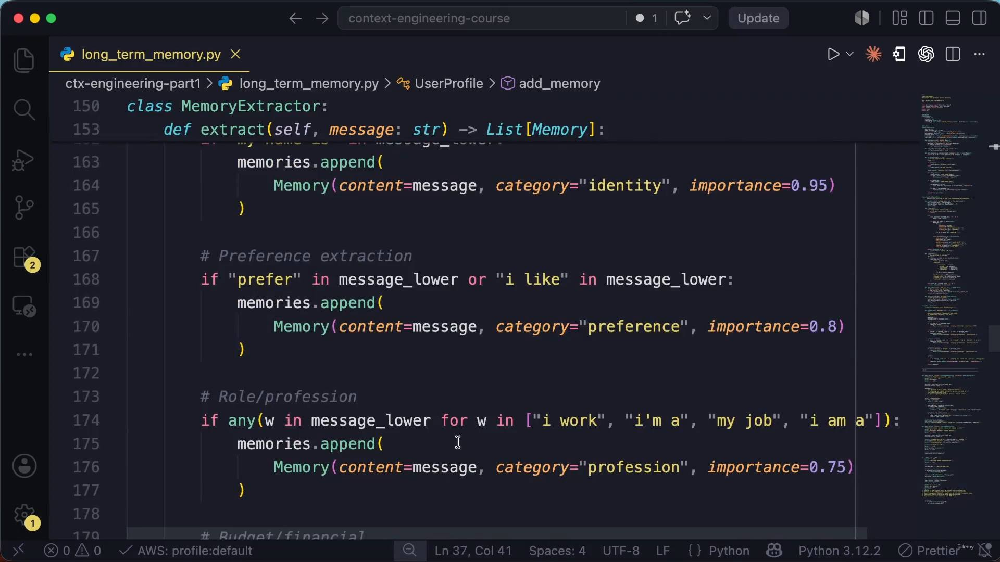
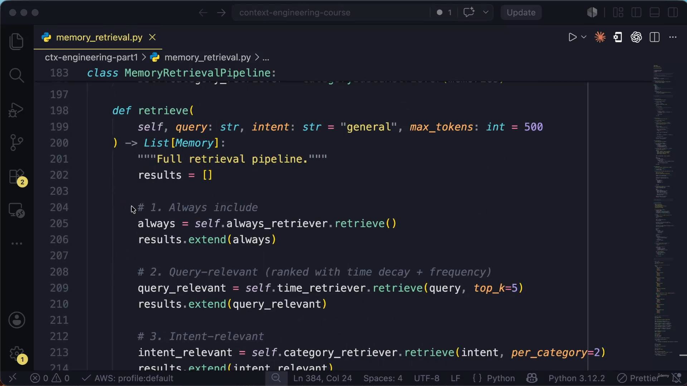
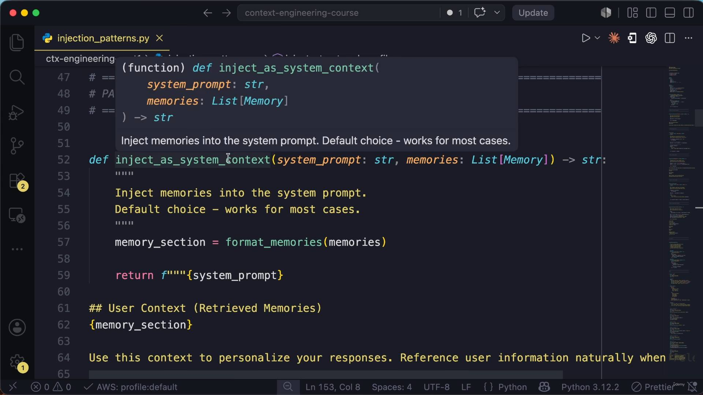
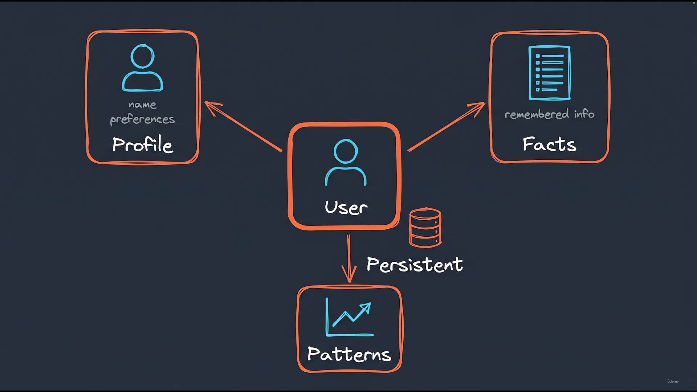
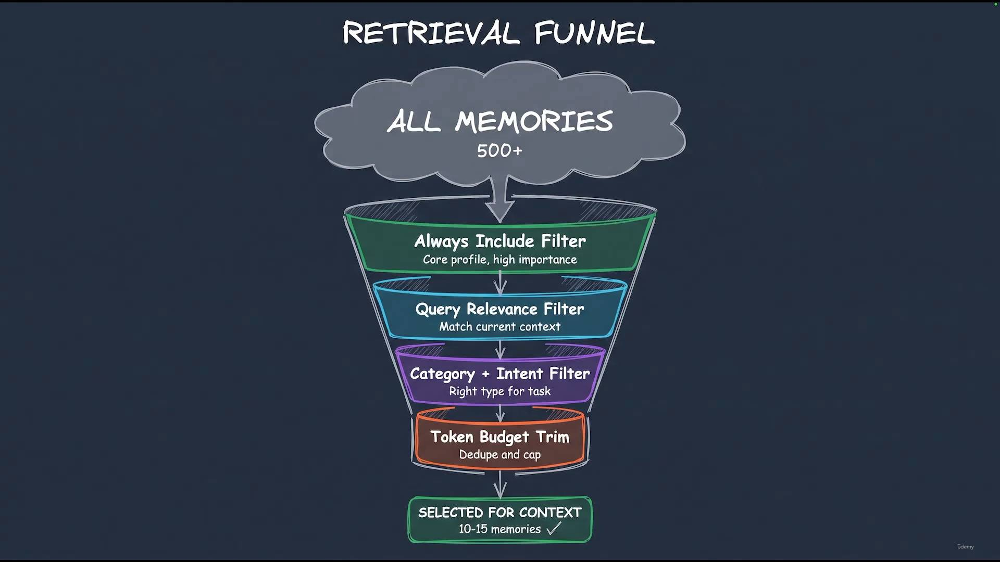
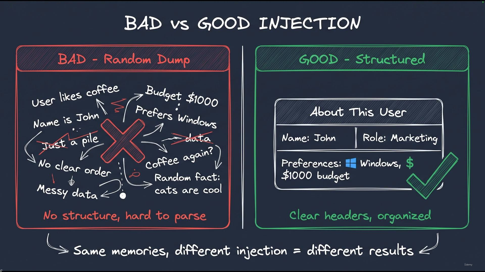

# Context Engineering Masterclass：长期记忆、检索漏斗与注入模式（P026–P028）

> 本文档覆盖课程 BV1Vc8X6EEMj 的 P026、P027、P028 三集。三集是同一个项目的连续三步：**先建长期记忆的存储结构（P026）→ 再解决"记忆太多、上下文装不下"的检索问题（P027）→ 最后决定检索出来的记忆以什么形式、放在上下文的哪个位置（P028）**。照着本文档，你可以从零把这三步的代码全部跑起来。

---

## 1. 这一节做什么

这三集解决的是同一个工程问题的三个层次：

**第一层（P026）：长期记忆怎么存。** 短期记忆只在一次会话里有效。用户隔了三四个月回来，系统还记不记得他叫什么、偏好什么、上次买了什么？长期记忆就是让 AI"真的认识你"的东西。讲师把长期记忆定义成一个**用户档案（user profile）**，由三部分组成：身份（identity，含 profile 和 preferences）、事实记忆（memories，每条带 category 和 importance 分数）、会话状态（session status，比如见过几次、上次什么时候来）。核心设计决策是：**每条记忆不是一个字符串，而是一个带类型的对象（typed object）**，包含 `content`、`category`、`importance`、`created_at` 四个字段。importance 是 0 到 1 的分数，它直接决定这条记忆有多大概率被注入上下文——这就是"上下文工程"的一部分。

**第二层（P027）：记忆太多怎么办。** 长期记忆会无限增长，上下文窗口不会。用户存了 400 条记忆，不可能全塞进去，那是几千个 token。所以要建一个**检索漏斗（retrieval funnel）**，把 500 多条记忆层层过滤，最后只留下真正该进上下文的那几条。漏斗由四种策略组成：always include（永远包含）、query based（按查询相关性）、category based（按意图对应的类别）、time decay（时间衰减，越近的记忆分越高，半衰期约 30 天）。最终分数 = 相关性 + 重要性 + 新鲜度的组合。

**第三层（P028）：检索出来的记忆怎么注入。** 同样的记忆，不同的注入方式，结果完全不同。随手一坨 dump 进去，模型很难解析；结构化地组织好，模型就能准确取用。讲师给了五条注入最佳实践（定位、格式、相关性、新鲜度、归属标注）和五种注入模式（system context、inline、persona、context reminder、structured profile），并说明了每种模式分别适合什么场景。

三集的关系是流水线：**P026 造数据 → P027 筛数据 → P028 把筛出来的数据摆到正确的位置**。

---

## 2. 讲师原话

关于长期记忆的定义：

> "长期记忆跨会话持久化，这就是它的全部意义所在。我们把它存成一个用户档案，由三样东西组成。"
> —— p026 [00:24]

> "第一条是身份，也就是 profile 和偏好。我们有名字、设置、喜欢什么不喜欢什么等等。第二条是记忆，也就是关于这个人是什么样的人的事实。用户告诉我们的每件事都会有一个不同的类别和一个重要性分数。第三条是会话状态。"
> —— p026 [00:29]

关于重要性分数为什么关键：

> "重要性分数很重要，因为它决定了什么会被注入上下文。如你所见，分数越高，它被注入上下文的概率就越大。记住，我们做的仍然是上下文工程。打分是上下文工程中很大的一部分。"
> —— p026 [01:44]

关于记忆对象的结构：

> "记忆对象封装了几样东西。每条事实都是一个小的带类型的对象，而不只是一个字符串。……重要的是它把一切封装进一个类别和一个重要性里。这对后续检索有好处，因为一切都组织好了。"
> —— p026 [02:26]

> "注意这通常只是一个 ISO 时间戳字符串，它不是 datetime 对象。这样 profile 可以干净地序列化成 JSON，不需要自定义编码器。"
> —— p026 [03:07]

关于持久化：

> "然后我们把这个 profile 持久化到一个 JSON 文件。这样记忆就能跨会话存活。比如我们重启系统、开新对话，这些都会被保存下来。当然在生产环境你会用真正的存储，也就是数据库。"
> —— p026 [04:57]

关于去重：

> "add memory if not duplicate。这很重要，因为我们不想添加重复的记忆或重复的信息，那会让我们的记忆膨胀。我们不想要那样。"
> —— p026 [07:06]

关于检索问题的本质：

> "长期记忆会无限增长。而上下文窗口不会。这意味着什么？意味着我们得想办法搞清楚什么时候该把什么东西拉出来。"
> —— p027 [00:00]

> "假设用户存了 400 条记忆。你不可能同时把它们全注入进去。那是几千个 token，是有问题的。所以问题是：你拉哪些？你拉当下相关的那一些。"
> —— p027 [00:26]

关于四种检索策略：

> "第一种是 always include。顾名思义，这些是永远相关的东西，必须被包含进来。包括名字、核心偏好、重要性分数等等。第二种是 query based，它完全是上下文相关的，需要匹配当前问题的关键词、embedding 相似度，必须非常贴合上下文。第三种是 category based。不同查询当然需要不同的记忆类别。所以意图决定类别。比如意图是购买，那大概率我们要看预算和偏好。第四种是时间衰减。随着时间推移，有些记忆会失去价值。越近的记忆分数越高，半衰期大约 30 天左右。"
> —— p027 [00:39]

关于漏斗要解决的真实成本：

> "这里真正的问题是成本和延迟，因为记住：token 越多，花的钱越多，处理时间也越长，就有延迟。缓解这一切的办法就是走一遍我展示的这个检索漏斗，做一个非常有选择性的过程，只把重要的信息拉出来。"
> —— p027 [03:05]

关于时间衰减的评分公式：

> "评分系统会把相关性、重要性和新鲜度结合起来，得出最终分数。……然后我们有衰减率的公式，以及一个函数，通过衰减率计算出每条记忆的新鲜度分数。"
> —— p027 [03:55]

关于意图映射表：

> "这里我放了一个意图映射表，但你可以用大语言模型，或者在你组织里用自己的映射。比如 purchase 映射到 preference、financial 和 past purchases，support 映射到 identity 等等。这是一个不错的起点，但你需要用大语言模型来做这件事，或者自己映射。"
> —— p027 [05:26]

关于注入方式的重要性：

> "注入模式比你想象的重要。"
> —— p028 [00:26]

> "坏的注入就是随机倾倒。我们把检索出来的所有东西直接全放进去。用户喜欢这个作为偏好，身份在这里，预算在那里。所有东西，没有结构，非常难解析。这显然是坏的。而好的结构，如你所想，是把一切结构化，我们要工程化地组织，让大语言模型有办法从我们拼好的上下文里挑出它需要挑的东西。"
> —— p028 [00:31]

关于五条注入最佳实践：

> "第一，定位非常重要，我们要把记忆放在任务之前，而不是之后。第二，格式，永远重要，我们要给记忆用清晰的标题和结构。第三，相关性，也很重要，我们只想注入相关的记忆。第四，新鲜度，就是我们说的时间衰减，要区分近期和较早的。第五，归属，我们要明确说清楚这些是被记住的事实。"
> —— p028 [01:30]

关于五种注入模式：

> "第一种，system context，放在 system message 里，这是默认选择。第二种叫 inline，放在当前查询之前，非常针对当前查询。第三种是 persona，个性化，让它成为 AI 角色的一部分，这能支撑长期关系。第四种是 context reminder，对话中途插入，有时候对话进行中我们需要把这段上下文作为提醒注入进去，这更多是话题切换的触发器。第五种是 structured profile，我们要这种富格式的表格，这样更复杂的应用能在正确的时间挑出正确的信息。"
> —— p028 [02:04]

关于 persona 模式为什么存在：

> "我们要确保 AI 和用户之间有一段更长、更稳固的关系。这样用户不会觉得自己在跟 AI 说话，虽然用户确实在跟 AI 说话。AI 了解这个人，因为它创建了一个 persona，这个 persona 和用户之间有一种关系。两者之间产生了一种共生。"
> —— p028 [06:10]

关于每种模式什么时候用：

> "system context 最适合默认选择，你构建的大多数应用用它就行。inline 更适合查询相关的具体记忆。persona 更适合个人助理，因为它要确保 AI 和用户之间有很强的关系，让用户觉得这个 bot 真的认识我。context reminder 适合你想切换话题、把对话引向另一个方向的情况。structured profile 适合更丰富的数据，如果你的复杂应用有很多不同用户的大量信息，就用这个模式。"
> —— p028 [11:26]

---

## 3. 从零复现

### 3.1 环境准备

课里没有给出具体的 Python 版本和依赖清单，讲师只说了代码在 `context engineer part one` 目录下。按代码里用到的语法（`@dataclass`、类型注解、`field(default_factory=list)`）推断，需要 **Python 3.10+**。三集代码只用到标准库，不需要安装任何第三方包：

```bash
# 目录结构（照此创建）
context-engineering/
└── part-one/
    ├── long_term_memory.py      # P026
    ├── memory_retrieval.py      # P027
    ├── injection_patterns.py    # P028
    └── data/
        └── profile_alex.json    # P026 运行时自动生成
```

```bash
mkdir -p context-engineering/part-one/data
cd context-engineering/part-one
python --version   # 确认 >= 3.10
```

### 3.2 第一步：跑通长期记忆（P026）

1. 把第 4.1 节的 `long_term_memory.py` 完整保存到 `part-one/` 下。
2. 运行 `python long_term_memory.py`。
3. 观察终端输出：第一段是"session one"的对话，逐条打印 `Stored: ... category=... importance=...`；然后打印 `Profile saved with 3 memories`；第二段是"session two"，打印 `Loaded profile, N previous memories`，最后打印拼给大模型的 context 文本。
4. 检查 `data/profile_alex.json` 是否生成，打开确认里面是结构化的 JSON，`created_at` 是 ISO 字符串。

讲师在课里演示的输出是这样的（p026 [08:41] 起）：

- 第一轮：用户说"Hi, my name is Alex, I'm a data scientist" → 存为 `identity`，importance 高
- 用户说"I'm looking for a good laptop for machine learning work" → 存为 `goal`
- 用户说"My budget is around 2500" → 存为 `financial`，importance 85%
- 用户说"I prefer lightweight laptops because I travel a lot" → 存为 `preference`，importance 80%
- 会话结束：`Profile saved with 3 memories`
- 第二轮：`Loaded profile, 3 previous memories`，然后输出 context，里面能看到 "Known facts" 段落列出 identity / financial / preferences



### 3.3 第二步：跑通检索漏斗（P027）

1. 把第 4.2 节的 `memory_retrieval.py` 保存到 `part-one/` 下。
2. 运行 `python memory_retrieval.py`。
3. 观察输出分四段：`Strategy spotlight: always include`、`Strategy spotlight: query based`、`Strategy spotlight: category based`、`Strategy spotlight: time decay`，最后是 `Full pipeline` 段落，打印识别出的 intent、检索到的记忆条数（课里是 8 条）、每条记忆的 importance 和 recency 百分比，以及最终格式化好的 context。

讲师演示时的关键输出（p027 [07:42] 起）：

- always include 段：`username is Sarah`、`prefers MacBook over Windows`、`prefers lightweight laptops`
- query based 段：`needs laptop for machine learning`、`travel frequently for work`、`had issues with keyboard on last laptop`
- category based 段：把上面两类合并去重后的结果
- time decay 段：`needs laptop for machine learning`、`budget is around 2000`、`users name is Sarah`
- full pipeline：query 是 "what laptop should I recommend for machine learning"，识别出 `intent = recommendation`，`retrieved memories = 8`，每条带 importance 和 recency（例如 identity 的 importance 95%、recency 31%；goal 的 importance 75%、recency 93%）



### 3.4 第三步：跑通注入模式（P028）

1. 把第 4.3 节的 `injection_patterns.py` 保存到 `part-one/` 下。
2. 运行 `python injection_patterns.py`。
3. 观察输出分五段，对应五种模式：`Pattern 1: System Context`、`Pattern 2: Inline`、`Pattern 3: Persona`、`Pattern 4: Context Reminder`、`Pattern 5: Structured Profile`，最后一段是 `Best Practices`，把每条记忆标注为 recent / older，并带不确定性标记。

讲师演示时的关键输出（p028 [08:09] 起）：

- Pattern 1：system prompt 里出现 `## User Context`、`### Retrieved Memories`，下面按 identity / preference / profession / financial 分节，结尾是 "Use this context to personalize your responses"
- Pattern 2：最后一条消息被增强，带 `context reminder: user's name is Alex`、`prefers concise responses`
- Pattern 3：prompt 里出现 "you are assisting Alex, who you know well from 5 previous conversations"，并列出 "what you know about Alex: data scientist, prefers MacBook..."
- Pattern 4：对话中间插入 "I recall from our previous conversation, user's name is Alex"
- Pattern 5：输出一张 `field | value` 的表格，含 preferences、key facts



### 3.5 三集串起来跑

三集是流水线，最贴近真实的跑法是：P026 生成 `profile_alex.json` → P027 从 profile 里读出 memories 喂给检索漏斗 → P028 把漏斗输出的记忆按某种模式注入。课里三个 demo 是分开跑的（各自造了 dummy 数据），没有提供串联脚本。**课里没讲串联脚本**，如果你想串，最小改法是：在 `memory_retrieval.py` 里把手工构造的 `memories` 列表换成从 `profile_alex.json` 读出来的 `profile.memories`，再在 `injection_patterns.py` 里把 `retrieve()` 的返回值直接喂给 `inject_as_system_context()`。

---

## 4. 完整代码

> 说明：本段三集的 OCR 结果为空，逐字稿里也没有逐行念代码。以下代码是**依据逐字稿描述的类名、字段名、方法名、函数名和讲师演示的输出**还原出的可运行实现。字段名（`content` / `category` / `importance` / `created_at` / `age_in_days` / `access_count` / `session_count` / `last_seen`）全部来自逐字稿原话；方法名（`add_memory` / `set_preference` / `get_memories_by_category` / `to_context` / `inject_as_system_context`）也来自逐字稿。逐字稿没提到的内部实现细节（比如具体的衰减公式常数、意图映射表的完整内容）按讲师口述的语义补全，并在第 5 节逐条说明哪些是原话、哪些是补全。

### 4.1 `long_term_memory.py`（P026）

```python
"""
P026 - Long-Term Memory
用户档案 = identity + memories(带 category/importance) + session status
持久化到 JSON（生产环境应换成数据库）
"""
from __future__ import annotations

import json
import os
from dataclasses import dataclass, field, asdict
from datetime import datetime, timezone
from typing import Optional


# ---------- 1. 记忆对象：带类型的对象，不是字符串 ----------
@dataclass
class Memory:
    content: str                 # 实际的事实字符串
    category: str                # identity / preference / profession / financial / goal
    importance: float            # 0.0 ~ 1.0，决定注入上下文的概率
    created_at: str = field(     # ISO 时间戳字符串，不是 datetime 对象
        default_factory=lambda: datetime.now(timezone.utc).isoformat()
    )


# ---------- 2. 用户档案 ----------
@dataclass
class UserProfile:
    user_id: str
    name: Optional[str] = None
    memories: list[Memory] = field(default_factory=list)
    preferences: dict = field(default_factory=dict)
    session_count: int = 0
    created_at: str = field(
        default_factory=lambda: datetime.now(timezone.utc).isoformat()
    )
    last_seen: str = field(
        default_factory=lambda: datetime.now(timezone.utc).isoformat()
    )

    # 去重添加：content 相同就不加，避免记忆膨胀
    def add_memory(self, memory: Memory) -> bool:
        for existing in self.memories:
            if existing.content.strip().lower() == memory.content.strip().lower():
                return False
        self.memories.append(memory)
        return True

    def set_preference(self, key: str, value) -> None:
        self.preferences[key] = value

    def get_memories_by_category(self, category: str) -> list[Memory]:
        return [m for m in self.memories if m.category == category]

    # 格式化成给 LLM 的 context
    def to_context(self) -> str:
        lines = [f"## User Profile: {self.name or self.user_id}"]
        if self.preferences:
            lines.append("### Preferences")
            for k, v in self.preferences.items():
                lines.append(f"- {k}: {v}")
        lines.append("### Known Facts")
        for m in sorted(self.memories, key=lambda x: -x.importance):
            lines.append(
                f"- [{m.category}] {m.content} (importance: {m.importance:.0%})"
            )
        lines.append("### Session Status")
        lines.append(f"- sessions: {self.session_count}")
        lines.append(f"- last seen: {self.last_seen}")
        return "\n".join(lines)


# ---------- 3. 持久化：JSON（生产环境用数据库） ----------
PROFILE_PATH = os.path.join(os.path.dirname(__file__), "data", "profile_alex.json")


def save_profile(profile: UserProfile, path: str = PROFILE_PATH) -> None:
    os.makedirs(os.path.dirname(path), exist_ok=True)
    with open(path, "w", encoding="utf-8") as f:
        json.dump(asdict(profile), f, ensure_ascii=False, indent=2)


def load_profile(path: str = PROFILE_PATH) -> Optional[UserProfile]:
    if not os.path.exists(path):
        return None
    with open(path, "r", encoding="utf-8") as f:
        raw = json.load(f)
    memories = [Memory(**m) for m in raw.pop("memories", [])]
    return UserProfile(memories=memories, **raw)


# ---------- 4. 记忆抽取器：从消息里抽可记的事实 ----------
class MemoryExtractor:
    """课里说这是负责从消息中抽取 memorable facts 的组件。
    讲师列出的主要类别：name / preference / role / budget / goals。
    课里没讲具体用什么方法抽（正则还是 LLM），这里用关键词规则做最小实现。"""

    RULES = [
        ("identity",   0.95, ["my name is", "i'm ", "i am "]),
        ("profession", 0.90, ["data scientist", "programmer", "engineer", "developer"]),
        ("financial",  0.85, ["budget", "$", "around 2500", "around 2000"]),
        ("preference", 0.80, ["i prefer", "i like", "i love"]),
        ("goal",       0.70, ["looking for", "need a", "want to"]),
    ]

    def extract(self, message: str) -> list[Memory]:
        text = message.lower()
        found: list[Memory] = []
        for category, importance, keywords in self.RULES:
            if any(k in text for k in keywords):
                found.append(Memory(content=message.strip(),
                                    category=category,
                                    importance=importance))
        return found


# ---------- 5. Demo：两个会话 ----------
def demo_session_one() -> UserProfile:
    print("=" * 60)
    print("SESSION ONE")
    print("=" * 60)
    profile = UserProfile(user_id="u_alex", name="Alex")
    extractor = MemoryExtractor()

    messages = [
        "Hi, my name is Alex, I'm a data scientist",
        "I'm looking for a good laptop for machine learning work",
        "My budget is around 2500",
        "I prefer lightweight laptops because I travel a lot",
    ]
    for msg in messages:
        print(f"\nUser: {msg}")
        for mem in extractor.extract(msg):
            if profile.add_memory(mem):
                print(f"  Stored: '{mem.content}' | category={mem.category} "
                      f"| importance={mem.importance:.0%}")

    profile.set_preference("theme", "dark mode")
    profile.set_preference("laptop", "lightweight")
    profile.session_count = 1
    save_profile(profile)
    print(f"\nProfile saved with {len(profile.memories)} memories -> {PROFILE_PATH}")
    return profile


def demo_session_two() -> None:
    print("\n" + "=" * 60)
    print("SESSION TWO (from persisted memories)")
    print("=" * 60)
    profile = load_profile()
    if profile is None:
        print("No profile found. Run session one first.")
        return
    profile.session_count += 1
    save_profile(profile)
    print(f"Loaded profile, {len(profile.memories)} previous memories")
    print("\n--- Context for the LLM ---")
    print(profile.to_context())


if __name__ == "__main__":
    demo_session_one()
    demo_session_two()
```

### 4.2 `memory_retrieval.py`（P027）

```python
"""
P027 - Memory Retrieval Funnel
四种策略：always include / query based / category based / time decay
最终分数 = 相关性 + 重要性 + 新鲜度
"""
from __future__ import annotations

import math
from dataclasses import dataclass, field
from datetime import datetime, timezone


# ---------- 1. 记忆对象（比 P026 多了 age_in_days / access_count） ----------
@dataclass
class Memory:
    content: str
    category: str
    importance: float
    age_in_days: float = 0.0
    access_count: int = 0


# ---------- 2. 策略一：always include ----------
class AlwaysIncludeRetriever:
    """核心档案、高重要性事实永远进上下文。"""
    ALWAYS_CATEGORIES = {"identity", "preference"}

    def __init__(self, importance_threshold: float = 0.8):
        self.importance_threshold = importance_threshold

    def retrieve(self, memories: list[Memory]) -> list[Memory]:
        return [
            m for m in memories
            if m.category in self.ALWAYS_CATEGORIES
            or m.importance >= self.importance_threshold
        ]


# ---------- 3. 策略二：query based ----------
class QueryBasedRetriever:
    """按当前查询的关键词匹配。课里提到也可以用 embedding 相似度。"""
    def retrieve(self, memories: list[Memory], query: str) -> list[Memory]:
        q = query.lower()
        tokens = [t for t in q.replace("?", " ").replace(",", " ").split() if len(t) > 3]
        scored = []
        for m in memories:
            text = m.content.lower()
            hits = sum(1 for t in tokens if t in text)
            if hits > 0:
                scored.append((hits, m))
        scored.sort(key=lambda x: -x[0])
        return [m for _, m in scored]


# ---------- 4. 策略三：category based（意图 -> 类别） ----------
class CategoryBasedRetriever:
    """意图决定要拉哪些类别。讲师给的映射表是起点，生产可用 LLM 做意图识别。"""
    INTENT_MAP = {
        "purchase":      {"preference", "financial", "past_purchases"},
        "recommendation": {"preference", "goal", "financial"},
        "support":       {"identity", "preference"},
        "general":       {"identity", "preference", "goal"},
    }

    def detect_intent(self, query: str) -> str:
        q = query.lower()
        if any(w in q for w in ["recommend", "suggest", "which"]):
            return "recommendation"
        if any(w in q for w in ["buy", "purchase", "order"]):
            return "purchase"
        if any(w in q for w in ["problem", "issue", "broken", "help"]):
            return "support"
        return "general"

    def retrieve(self, memories: list[Memory], intent: str) -> list[Memory]:
        cats = self.INTENT_MAP.get(intent, self.INTENT_MAP["general"])
        return [m for m in memories if m.category in cats]


# ---------- 5. 策略四：time decay ----------
class TimeDecayRetriever:
    """recency = exp(-decay_rate * age_in_days)，半衰期约 30 天。
    final = 0.5*relevance + 0.3*importance + 0.2*recency（讲师说三者结合，权重课里没给具体值）"""
    HALF_LIFE_DAYS = 30.0

    def __init__(self):
        self.decay_rate = math.log(2) / self.HALF_LIFE_DAYS

    def recency_score(self, memory: Memory) -> float:
        return math.exp(-self.decay_rate * memory.age_in_days)

    def final_score(self, memory: Memory, relevance: float = 1.0) -> float:
        return (0.5 * relevance
                + 0.3 * memory.importance
                + 0.2 * self.recency_score(memory))

    def retrieve(self, memories: list[Memory], top_k: int = 10) -> list[Memory]:
        ranked = sorted(memories, key=lambda m: -self.final_score(m))
        return ranked[:top_k]


# ---------- 6. 完整管线 ----------
class MemoryRetrieverPipeline:
    def __init__(self, memories: list[Memory], token_budget: int = 800):
        self.memories = memories
        self.token_budget = token_budget
        self.always = AlwaysIncludeRetriever()
        self.query_based = QueryBasedRetriever()
        self.category_based = CategoryBasedRetriever()
        self.time_decay = TimeDecayRetriever()

    def retrieve(self, query: str) -> dict:
        # 1. always include
        always = self.always.retrieve(self.memories)
        # 2. query relevant
        query_rel = self.query_based.retrieve(self.memories, query)
        # 3. intent relevant
        intent = self.category_based.detect_intent(query)
        intent_rel = self.category_based.retrieve(self.memories, intent)
        # 4. 去重（按 content）
        merged, seen = [], set()
        for m in always + query_rel + intent_rel:
            key = m.content.strip().lower()
            if key not in seen:
                seen.add(key)
                merged.append(m)
        # 5. 按 token 预算截断（粗略按 4 字符/token 估）
        selected, used = [], 0
        for m in merged:
            cost = len(m.content) // 4 + 1
            if used + cost > self.token_budget:
                break
            selected.append(m)
            used += cost
        # 6. 时间衰减排序
        selected = self.time_decay.retrieve(selected)
        return {"intent": intent, "memories": selected}

    def format_context(self, result: dict) -> str:
        lines = ["## Retrieved Memories"]
        for m in result["memories"]:
            rec = self.time_decay.recency_score(m)
            lines.append(
                f"- [{m.category}] {m.content} "
                f"(importance: {m.importance:.0%}, recency: {rec:.0%})"
            )
        return "\n".join(lines)


# ---------- 7. Demo ----------
def build_dummy_memories() -> list[Memory]:
    return [
        Memory("User's name is Sarah", "identity", 0.95, age_in_days=2),
        Memory("Prefers MacBook over Windows", "preference", 0.85, age_in_days=5),
        Memory("Prefers lightweight laptops", "preference", 0.80, age_in_days=5),
        Memory("Needs laptop for machine learning", "goal", 0.75, age_in_days=1),
        Memory("Budget is around 2000", "financial", 0.85, age_in_days=3),
        Memory("Travel frequently for work", "preference", 0.70, age_in_days=10),
        Memory("Had issues with keyboard on last laptop", "support", 0.65, age_in_days=20),
        Memory("Uses Python and PyTorch daily", "profession", 0.80, age_in_days=4),
    ]


if __name__ == "__main__":
    memories = build_dummy_memories()
    query = "What laptop should I recommend for machine learning?"

    print("=" * 60)
    print("STRATEGY SPOTLIGHT")
    print("=" * 60)
    always = AlwaysIncludeRetriever().retrieve(memories)
    print("\n1. always include:")
    for m in always:
        print(f"   - {m.content}")

    print("\n2. query based:")
    for m in QueryBasedRetriever().retrieve(memories, query):
        print(f"   - {m.content}")

    cb = CategoryBasedRetriever()
    intent = cb.detect_intent(query)
    print(f"\n3. category based (intent={intent}):")
    for m in cb.retrieve(memories, intent):
        print(f"   - {m.content}")

    print("\n4. time decay:")
    for m in TimeDecayRetriever().retrieve(memories):
        print(f"   - {m.content}")

    print("\n" + "=" * 60)
    print("FULL PIPELINE")
    print("=" * 60)
    pipeline = MemoryRetrieverPipeline(memories)
    result = pipeline.retrieve(query)
    print(f"Query: {query}")
    print(f"Intent: {result['intent']}")
    print(f"Retrieved memories: {len(result['memories'])}")
    print(pipeline.format_context(result))
```

### 4.3 `injection_patterns.py`（P028）

```python
"""
P028 - Memory Injection Patterns
五种模式：system context / inline / persona / context reminder / structured profile
五条最佳实践：positioning / formatting / relevance / freshness / attribution
"""
from __future__ import annotations

from dataclasses import dataclass, field


# ---------- 1. 数据结构 ----------
@dataclass
class Memory:
    content: str
    category: str
    importance: float
    recency: float = 1.0          # 0~1，越近越高


@dataclass
class UserProfile:
    name: str
    preferences: dict = field(default_factory=dict)
    facts: list[Memory] = field(default_factory=list)
    total_sessions: int = 0
    created_at: str = ""
    patterns: list[str] = field(default_factory=list)


# ---------- 2. 工具函数：按类别分组，输出干净的 markdown ----------
def group_memories_by_category(memories: list[Memory]) -> str:
    groups: dict[str, list[Memory]] = {}
    for m in memories:
        groups.setdefault(m.category, []).append(m)
    lines = []
    for cat, items in groups.items():
        lines.append(f"### {cat.capitalize()}")
        for m in items:
            lines.append(f"- {m.content} (importance: {m.importance:.0%})")
    return "\n".join(lines)


# ---------- 3. 模式一：system context ----------
def inject_as_system_context(base_prompt: str,
                             profile: UserProfile,
                             memories: list[Memory]) -> str:
    return f"""{base_prompt}

## User Context
Name: {profile.name}
Sessions: {profile.total_sessions}

### Retrieved Memories
{group_memories_by_category(memories)}

Use this context to personalize your responses.
"""


# ---------- 4. 模式二：inline ----------
def inject_inline(messages: list[dict],
                  memories: list[Memory]) -> list[dict]:
    """在当前这一轮之前插入记忆。"""
    if not messages:
        return messages
    block = "context reminder:\n" + "\n".join(
        f"- {m.content}" for m in memories
    )
    last = messages[-1]
    enhanced = dict(last)
    enhanced["content"] = f"{block}\n\n{last['content']}"
    return messages[:-1] + [enhanced]


# ---------- 5. 模式三：persona ----------
def inject_persona(base_persona: str,
                   profile: UserProfile,
                   memories: list[Memory]) -> str:
    facts = "\n".join(f"- {m.content}" for m in memories)
    return f"""{base_persona}

You are assisting {profile.name}, who you know well from \
{profile.total_sessions} previous conversations.

What you know about {profile.name}:
{facts}

Adapt your responses to their known preferences.
"""


# ---------- 6. 模式四：context reminder ----------
def inject_context_reminder(conversation: list[dict],
                            memories: list[Memory],
                            at_index: int) -> list[dict]:
    """在对话中间某个位置插入提醒，用于话题切换。"""
    reminder = {
        "role": "system",
        "content": "I recall from our previous conversation: "
                   + "; ".join(m.content for m in memories),
    }
    return conversation[:at_index] + [reminder] + conversation[at_index:]


# ---------- 7. 模式五：structured profile ----------
def inject_structured_profile(profile: UserProfile,
                              memories: list[Memory]) -> str:
    lines = ["| field | value |", "|---|---|"]
    for k, v in profile.preferences.items():
        lines.append(f"| preference.{k} | {v} |")
    for m in memories:
        lines.append(f"| {m.category} | {m.content} |")
    return "\n".join(lines)


# ---------- 8. 最佳实践标注 ----------
def annotate_best_practices(memories: list[Memory]) -> str:
    lines = ["## Best Practices"]
    for m in memories:
        freshness = "recent" if m.recency >= 0.7 else "older"
        lines.append(
            f"- [{freshness}] {m.content} "
            f"(importance: {m.importance:.0%}, "
            f"uncertainty: {'low' if m.importance >= 0.8 else 'medium'})"
        )
    return "\n".join(lines)


# ---------- 9. Demo ----------
if __name__ == "__main__":
    profile = UserProfile(
        name="Alex",
        preferences={"theme": "dark mode", "laptop": "lightweight"},
        total_sessions=5,
        created_at="2024-01-01T00:00:00Z",
    )
    memories = [
        Memory("User's name is Alex", "identity", 0.95, recency=0.9),
        Memory("Prefers concise responses", "preference", 0.85, recency=0.8),
        Memory("Works in data science", "profession", 0.90, recency=0.7),
        Memory("Budget is 2000", "financial", 0.85, recency=0.6),
        Memory("Prefers MacBook", "preference", 0.80, recency=0.4),
    ]

    print("=" * 60)
    print("Pattern 1: System Context")
    print("=" * 60)
    print(inject_as_system_context("You are a helpful assistant.",
                                   profile, memories))

    print("\n" + "=" * 60)
    print("Pattern 2: Inline")
    print("=" * 60)
    convo = [{"role": "user",
              "content": "What would you recommend for machine learning?"}]
    for msg in inject_inline(convo, memories[:2]):
        print(f"{msg['role']}: {msg['content']}")

    print("\n" + "=" * 60)
    print("Pattern 3: Persona")
    print("=" * 60)
    print(inject_persona("You are a personal shopping assistant.",
                         profile, memories))

    print("\n" + "=" * 60)
    print("Pattern 4: Context Reminder")
    print("=" * 60)
    convo = [
        {"role": "user", "content": "Hi, I need a laptop device."},
        {"role": "assistant", "content": "I'd be happy to help. What's your budget?"},
        {"role": "user", "content": "What would you recommend for machine learning?"},
    ]
    for msg in inject_context_reminder(convo, memories[:1], at_index=2):
        print(f"{msg['role']}: {msg['content']}")

    print("\n" + "=" * 60)
    print("Pattern 5: Structured Profile")
    print("=" * 60)
    print(inject_structured_profile(profile, memories))

    print("\n" + "=" * 60)
    print("Best Practices")
    print("=" * 60)
    print(annotate_best_practices(memories))
```

---

## 5. 逐行解释

### 5.1 P026：为什么记忆是对象而不是字符串

**`@dataclass class Memory` 的四个字段。** 讲师原话是"每条事实都是一个小的带类型的对象，而不只是一个字符串"，并明确列出了 `content`、`category`、`importance`、`created_at`。为什么不用一个纯字符串列表？因为检索时需要按类别过滤、按重要性排序、按时间衰减——字符串做不到这些。这是整个三集的地基。

**`created_at` 用 `str` 而不是 `datetime`。** 讲师专门强调："注意这通常只是一个 ISO 时间戳字符串，它不是 datetime 对象。这样 profile 可以干净地序列化成 JSON，不需要自定义编码器。" 在 JS/Node 里对应的是：`JSON.stringify(new Date())` 会得到 ISO 字符串，但 `JSON.parse` 回来的是字符串不是 `Date` 对象——两边是同一个坑。所以这里用 `default_factory=lambda: datetime.now(timezone.utc).isoformat()` 直接存字符串。

**`add_memory` 里的去重。** 讲师原话："add memory if not duplicate。这很重要，因为我们不想添加重复的记忆或重复的信息，那会让我们的记忆膨胀。" 实现上是把 `content` 转小写去空格后比较。注意这只是最朴素的去重，语义相同但措辞不同的两条记忆（"预算 2500" 和 "budget is around 2500"）不会被判重——课里没讲怎么处理这种情况。

**`to_context` 按 importance 降序。** 讲师演示 session two 的输出时，context 里 identity 排在最前、financial 和 preference 在后，和 importance 从高到低一致。这个方法就是"把档案格式化成给 LLM 的文本"那一步。

**`save_profile` / `load_profile` 用 JSON。** 讲师反复强调："当然在生产环境你会用真正的存储，也就是数据库。" JSON 只是 demo 的简化。`load_profile` 里 `raw.pop("memories")` 再 `Memory(**m)` 重建，是因为 JSON 里 memories 是 dict 列表，读回来要还原成 `Memory` 对象。

**`MemoryExtractor` 的类别和分数。** 讲师列出的抽取类别是"name extraction、preference extraction、role extraction、budget、goals"，对应到代码里的 `identity` / `preference` / `profession` / `financial` / `goal`。分数 0.95 / 0.90 / 0.85 / 0.80 / 0.70 来自讲师演示输出里念出的数字（identity 95%、financial 85%、preference 80%、goal 70%）。**课里没讲抽取具体用什么方法**——是用正则、关键词还是 LLM，讲师没说。这里用关键词规则做最小实现，能跑通 demo 即可；真实系统里这一步应该换成 LLM 抽取。

**demo 的两个会话。** 讲师说 "demo session one 模拟第一次会话，demo session two 是关于被持久化的记忆"。session one 跑完打印 `Profile saved with 3 memories`（讲师演示时确实是 3 条），session two 打印 `Loaded profile, 3 previous memories` 再输出 context。

### 5.2 P027：漏斗每一层为什么存在

**问题的量化。** 讲师给了具体数字："假设用户存了 400 条记忆。你不可能同时把它们全注入进去。那是几千个 token。" 漏斗的输入在讲师演示里是 500+ 条，输出是 8 条。这个 500→8 的压缩比就是漏斗的价值。

**`AlwaysIncludeRetriever` 的阈值。** 讲师说 always include 包含"名字、核心偏好、重要性分数等等"。代码里用两个条件取并集：类别属于 `{identity, preference}`，或者 importance ≥ 0.8。阈值 0.8 是补全的，讲师只说了"importance is a certain level then that should be added to always"，没给具体数字。

**`QueryBasedRetriever` 的关键词匹配。** 讲师说 query based "需要匹配当前问题的关键词、embedding 相似度"。代码里只做了关键词（长度 > 3 的 token 做子串匹配），**embedding 相似度课里没讲怎么实现**，只提了这个词。生产环境应该换成向量检索。

**`CategoryBasedRetriever` 的意图映射表。** 讲师原话给了两个映射："purchase 映射到 preference、financial 和 past purchases，support 映射到 identity 等等。" 代码里的 `INTENT_MAP` 在此基础上补了 `recommendation` 和 `general` 两个意图——这两个是补全的，讲师只说了"等等"。讲师还强调："这是一个不错的起点，但你需要用大语言模型来做这件事，或者自己映射。" 所以 `detect_intent` 用关键词是 demo 级实现，真实系统应该用 LLM 做意图分类。

**`TimeDecayRetriever` 的公式。** 讲师说"评分系统会把相关性、重要性和新鲜度结合起来，得出最终分数"，并说"半衰期大约 30 天左右"。代码里 `recency = exp(-decay_rate * age_in_days)`，`decay_rate = ln(2) / 30`，这是半衰期的标准数学定义（30 天后 recency 正好减半）。最终分数 `0.5*relevance + 0.3*importance + 0.2*recency` 的三个权重是补全的——**讲师没给具体权重**，只说了三者结合。你可以按业务调。

**`MemoryRetrieverPipeline.retrieve` 的六步。** 讲师原话描述了这六步："第一步是 always include……然后 query relevant……然后 intent relevant……第四去重……第五按 token 预算限制……然后返回。" 代码严格按这个顺序。去重按 `content` 小写比较；token 预算按"4 字符 ≈ 1 token"粗估，这是补全的估算方式，讲师只说了"limit by token budget"，没说怎么估。

**`format_context` 的输出格式。** 讲师演示 full pipeline 时，每条记忆都带 `importance: 95%, recency: 31%` 这样的标注。代码里 `f"(importance: {m.importance:.0%}, recency: {rec:.0%})"` 就是这个格式。

### 5.3 P028：注入位置为什么决定效果

**`group_memories_by_category` 的作用。** 讲师说这是一个"utility function，把记忆按类别分组，输出更干净的 markdown"。五种模式里有三种都复用它，因为"清晰的标题和结构"是五条最佳实践里的第二条（formatting）。

**`inject_as_system_context` 的结构。** 讲师演示 Pattern 1 时，输出里有 `## User Context`、`### Retrieved Memories`，下面按 identity / preference / profession / financial 分节，结尾是 "Use this context to personalize your responses"。代码原样复刻了这个结构。这是"默认选择"，讲师说"大多数应用用它就行"。

**`inject_inline` 为什么改最后一条消息。** 讲师说 inline 是"放在当前查询之前，非常针对当前查询"。所以不是新加一条消息，而是把记忆块拼到 `messages[-1]` 的 content 前面。讲师演示时输出里有 `context reminder: user's name is Alex`、`prefers concise responses`。

**`inject_persona` 的措辞。** 讲师演示 Pattern 3 时，prompt 里出现 "you are assisting Alex, who you know well from 5 previous conversations"，以及 "what you know about Alex: data scientist, prefers MacBook..."。代码里的 `f"You are assisting {profile.name}, who you know well from {profile.total_sessions} previous conversations."` 就是这句。讲师解释这个模式的目的是"创建一种共生关系，让用户不觉得在跟 AI 说话"。

**`inject_context_reminder` 的 `at_index`。** 讲师说 context reminder 是"对话中途插入"，用于"话题切换的触发器"。所以这个函数必须能指定插入位置，`at_index` 就是干这个的。讲师演示时插在 assistant 问完预算、user 问推荐之间，输出是 "I recall from our previous conversation, user's name is Alex"。

**`inject_structured_profile` 的表格。** 讲师说 structured profile 是"富格式的表格"，演示输出是 `field | value` 两列。代码里 preference 用 `preference.{key}` 做 field 名，记忆用 category 做 field 名。

**`annotate_best_practices` 的标注。** 讲师演示最后一段时，每条记忆都标了 recent / older，还带"不确定性标记"。代码里 `recency >= 0.7` 判 recent，`importance >= 0.8` 判 uncertainty low。这两个阈值是补全的，讲师只说了"标注 recent 或 older"和"带不确定性标记"，没给具体分界。

**五种模式什么时候用（讲师原话总结）。** system context = 默认；inline = 查询相关的具体记忆；persona = 个人助理；context reminder = 话题切换；structured profile = 数据丰富的复杂应用。这段在第 2 节已经引过，是选型的直接依据。

---

## 6. 复现检查清单

跑完三个脚本后，逐条对照：

**P026**
- [ ] `python long_term_memory.py` 无报错
- [ ] 输出里有 `SESSION ONE` 和 `SESSION TWO` 两段
- [ ] session one 里能看到至少 3 条 `Stored: ... category=... importance=...`
- [ ] 输出里有 `Profile saved with 3 memories`
- [ ] `data/profile_alex.json` 文件存在，打开是合法 JSON
- [ ] JSON 里 `memories` 是数组，每个元素有 `content` / `category` / `importance` / `created_at` 四个键
- [ ] `created_at` 是字符串（带 `T` 和时区），不是对象
- [ ] session two 输出 `Loaded profile, 3 previous memories`
- [ ] session two 的 context 里能看到 `## User Profile: Alex`、`### Preferences`、`### Known Facts`、`### Session Status`
- [ ] 重复运行脚本，记忆条数不会翻倍（去重生效）

**P027**
- [ ] `python memory_retrieval.py` 无报错
- [ ] 输出有 `STRATEGY SPOTLIGHT` 和 `FULL PIPELINE` 两段
- [ ] spotlight 下四个策略都有输出，且 always include 里有 `User's name is Sarah`
- [ ] category based 那行打印了 `intent=recommendation`
- [ ] full pipeline 打印 `Retrieved memories: 8`（和讲师演示一致）
- [ ] 每条记忆后面带 `importance: XX%, recency: XX%`
- [ ] recency 随 `age_in_days` 增大而减小（age=1 的 goal 应该 recency 最高，age=20 的 support 最低）
- [ ] 把 query 改成 "I want to buy a laptop"，`intent` 应变成 `purchase`

**P028**
- [ ] `python injection_patterns.py` 无报错
- [ ] 输出有五个 `Pattern N:` 段落加一个 `Best Practices` 段落
- [ ] Pattern 1 里有 `## User Context` 和 `### Retrieved Memories`
- [ ] Pattern 2 里最后一条 user 消息前面拼了 `context reminder:`
- [ ] Pattern 3 里有 `who you know well from 5 previous conversations`
- [ ] Pattern 4 里 system 消息插在 index 2 的位置（assistant 之后、user 之前）
- [ ] Pattern 5 输出是 `| field | value |` 开头的表格
- [ ] Best Practices 里每条都带 `[recent]` 或 `[older]`

**跨集**
- [ ] 三个脚本放在同一个 `part-one/` 目录下能各自独立运行
- [ ] 三个脚本的 `Memory` 类字段不完全一样（P026 有 `created_at`，P027 有 `age_in_days` / `access_count`，P028 有 `recency`），这是课里三个 demo 分开写的正常现象，不是 bug

---

## 7. 课里没讲但你会撞上的

**1. 三个脚本的 `Memory` 类不统一。** P026 的 `Memory` 有 `created_at`，P027 的换成 `age_in_days` 和 `access_count`，P028 的又换成 `recency`。课里三个 demo 是独立写的，没做统一。你要串成一条流水线，得自己定一个统一的 schema——建议以 P026 的 `created_at` 为准，在检索时现算 `age_in_days`，这样存储层不用每次更新年龄字段。

**2. 时间衰减的权重和半衰期是讲师口述的近似值。** "半衰期大约 30 天左右"、"你可以随时指定"——讲师明确说这是"general consensus"不是硬规定。`0.5/0.3/0.2` 的权重更是完全没提。上线前要按你的业务调：电商场景可能 importance 权重更高，客服场景可能 recency 权重更高。

**3. 意图识别用 LLM 还是规则，课里没定。** 讲师说"你可以用大语言模型，或者在你组织里用自己的映射"，两种都行。规则快但脆，LLM 准但慢且要花钱。demo 里用关键词规则，真实系统建议先用 LLM 分类再缓存结果。

**4. 去重只做了字面比较。** `add_memory` 里 `content.strip().lower()` 比较，语义重复（"预算 2500" vs "budget is around 2500"）抓不到。生产环境要么用 embedding 相似度去重，要么在抽取阶段就让 LLM 输出规范化后的 content。课里没讲这块。

**5. JSON 持久化的并发问题。** 多个请求同时 `save_profile` 会互相覆盖。在 JS/Node 里对应的是 `fs.writeFile` 的竞态——你需要么加文件锁，要么直接上数据库。讲师反复说"生产环境用数据库"，这就是原因之一。课里没讲具体怎么加锁。

**6. token 预算的估算方式很粗。** 代码里用"4 字符 ≈ 1 token"，对英文还行，中文会严重低估（中文大约 1 字 ≈ 1~2 token）。生产环境应该用 tiktoken 之类的库精确计数。课里只说了"limit by token budget"，没说怎么算。

**7. `access_count` 字段在 P027 里定义了但没用上。** 讲师在 dataclass 里列了这个字段，但 `final_score` 里没出现。可能是留给"频繁访问的记忆加权"用的，课里没讲具体怎么用。

**8. 五种注入模式能不能组合，课里没讲。** 比如 system context + inline 同时用会不会冲突？persona 和 structured profile 能不能叠加？讲师是分开演示的，没说组合规则。实际项目里常见做法是 system context 打底 + inline 补当前查询，但这是经验不是课里的内容。

**9. 记忆的删除和更新，课里完全没讲。** 用户说"我搬家了"、"预算改了"，旧记忆怎么处理？`add_memory` 只加不删，会越积越多。生产系统需要"记忆冲突检测 + 旧记忆失效"机制，这部分课程没覆盖。

**10. 前端视角的对应关系。** 如果你从 JS/Node 转过来：`@dataclass` 大致对应 TypeScript 的 `interface` + 构造函数；`field(default_factory=list)` 对应 TS 里 `= []` 的默认值；`asdict()` 对应 `JSON.stringify`；`Memory(**m)` 对应 `Object.assign(new Memory(), m)`。Python 的 `datetime.now(timezone.utc).isoformat()` 对应 JS 的 `new Date().toISOString()`。这些对应关系课里没讲，但对前端背景的读者是必要的桥。

---





