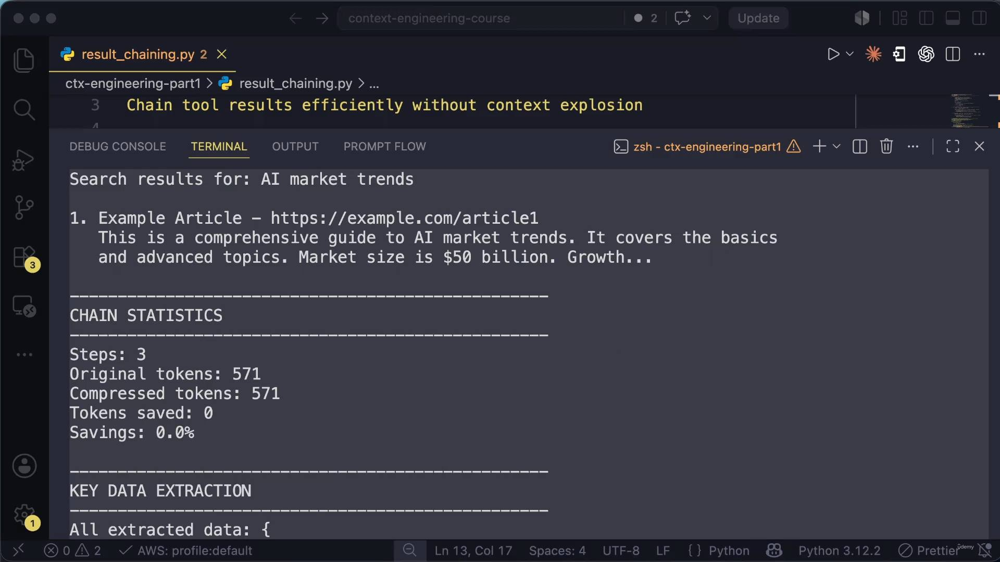
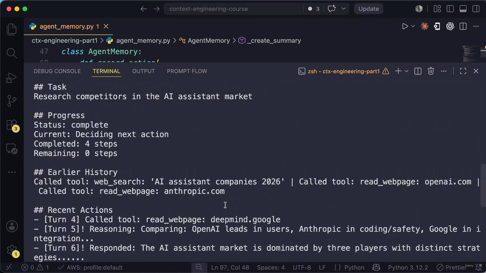
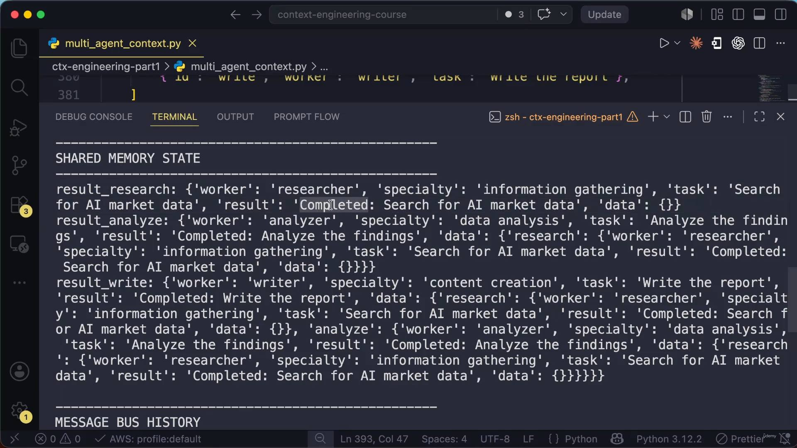
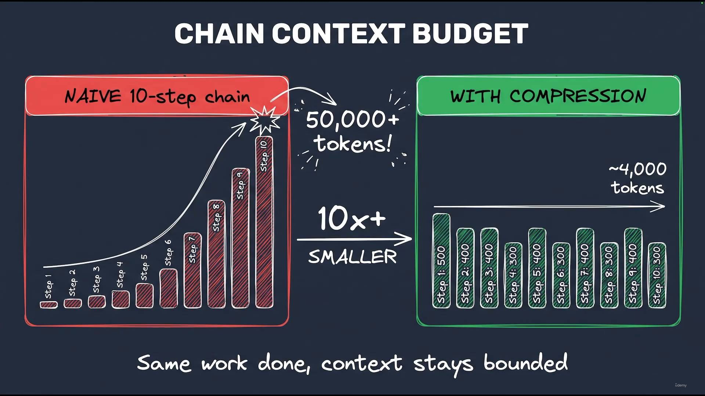
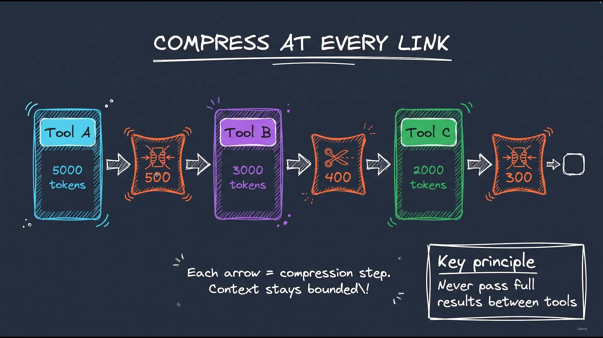
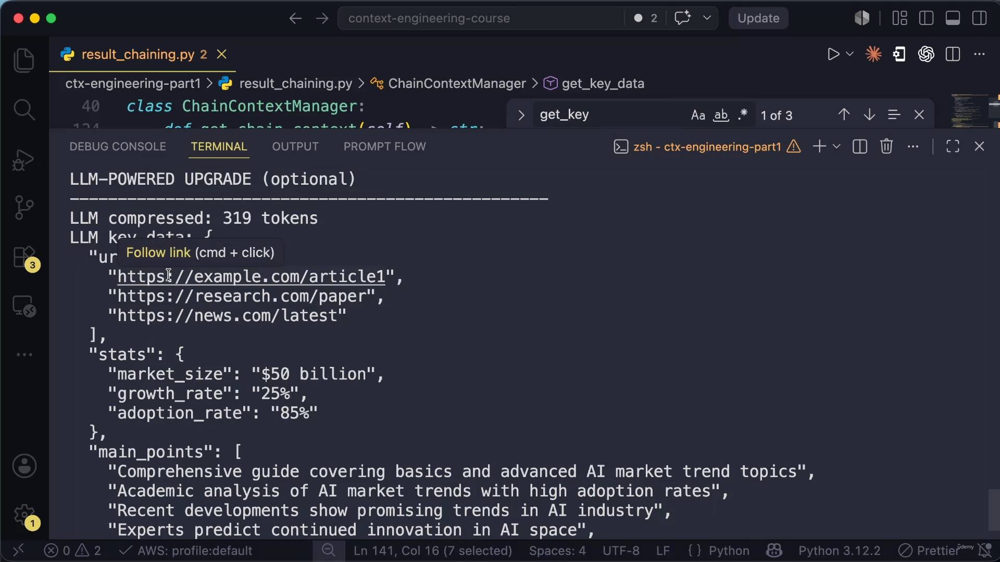
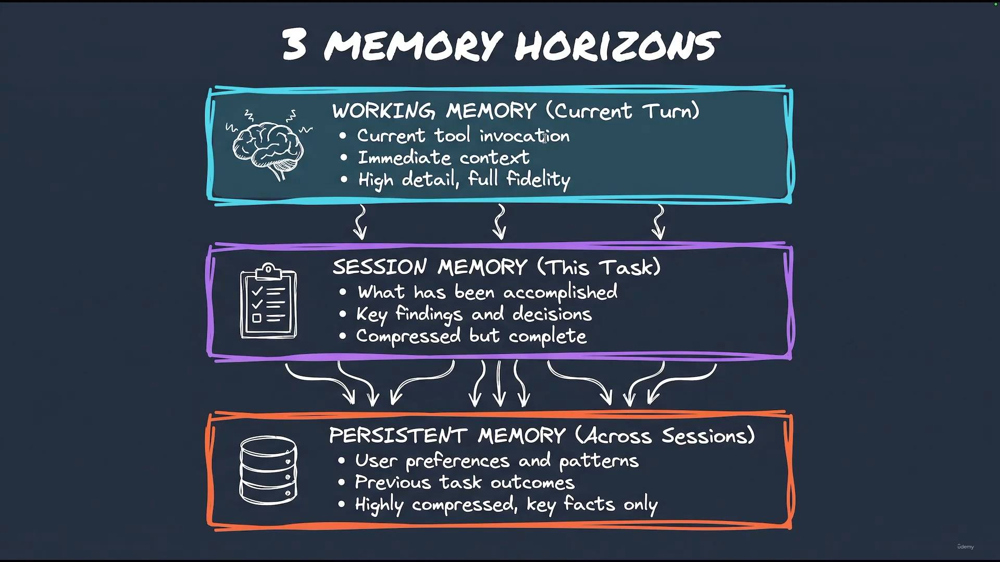
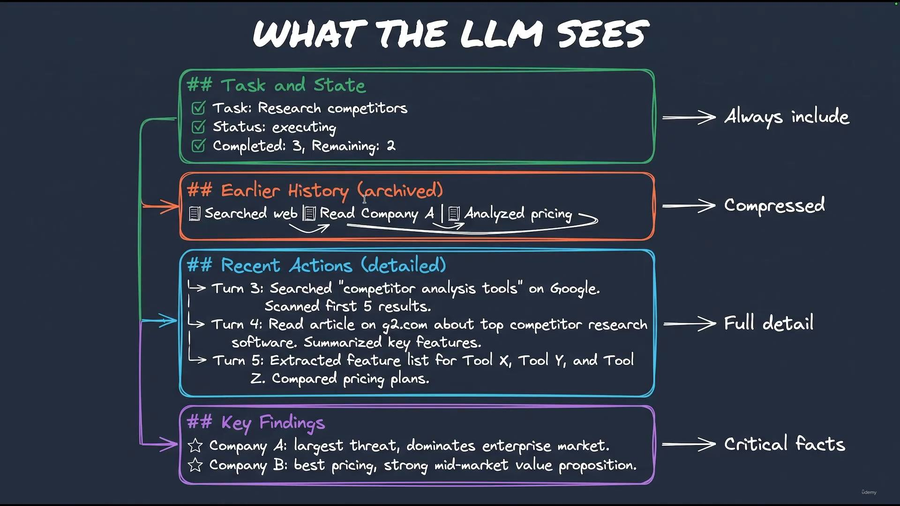
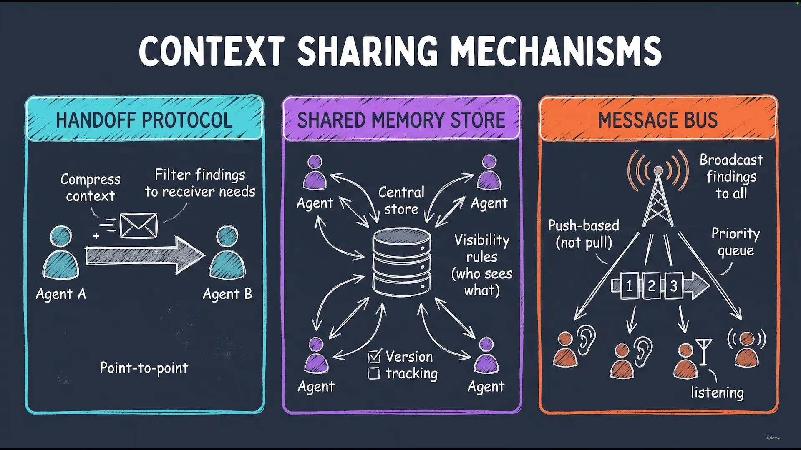
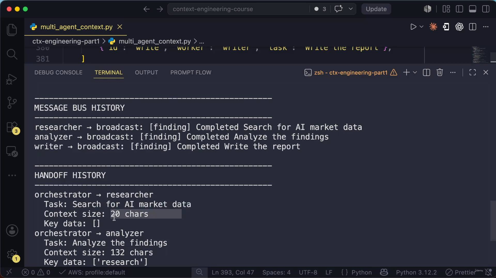

# Context Engineering Masterclass（P32–P34）复现文档

> 本文覆盖课程第 32–34 集：**链式调用（Chaining）**、**多轮 Agent 记忆（Multi-turn Memory）**、**多 Agent 上下文共享（Multi-Agent Context）**。三集都是“先讲原理、再手写代码、最后跑 demo 看输出”的结构。下面按项目实现逻辑重组，所有代码均为完整可运行文件。

---

## 1. 这一节做什么

这三集解决同一个核心矛盾：**Agent 的能力越强，它需要携带的上下文就越多；而上下文窗口是有限的，携带越多越容易爆炸。** 讲师用三个递进的场景演示如何让上下文“保持有界（bounded）”：

1. **P32 链式调用**：一个 Agent 连续调用多个工具（搜索 → 阅读 → 分析 → 写作）。如果天真地把每一步的完整结果传给下一步，10 步链就会累积到 5 万 token 以上。解法是**压缩（compression）** 和**结构化提取（extraction）**——只把“事实”往下传，丢掉“废话”。讲师先手写一个基于正则的朴素版本，再升级成用廉价 LLM 做提取的版本，并对比两者输出质量。
2. **P33 多轮记忆**：一个 Agent 跨多个对话轮次工作，到第 20 轮还要能总结全程。解法是**三层记忆视野（memory horizons）**——工作记忆、会话记忆、持久记忆，配合**渐进式压缩（progressive compression）**：最近的几轮保留完整细节，更早的轮次压缩成摘要归档。
3. **P34 多 Agent 上下文共享**：单个 Agent 会撞墙（上下文耗尽、缺乏专精、无法并行），所以要拆成多 Agent。难点是“如何在不共享一切的前提下共享上下文”。讲师讲了三种架构（orchestrator+workers、pipeline、swarm）和三种共享机制（handoff protocol、shared memory store、message bus），并手写一个编排器把三者串起来。

三集最后都强调同一句话：**生产环境优先用托管原语（managed primitives，如 Claude Agent SDK），手写只是为了理解机制。**

---

## 2. 讲师原话

> "Agent 最强大的能力之一叫做链式调用（chaining），本质上就是把一个工具的输出塞进另一个工具。搜索网页，然后分析结果，然后写报告。这就是链式调用的例子。但这里有个陷阱：如果你天真地在工具之间传递完整结果，你的上下文会像你到目前为止看到的那样，在三四次链之后就爆炸。"
> —— p032 [00:00]

> "朴素版 10 步链，第一步很小，第二步大一点，随着链条增加，上下文膨胀越来越多，到某个点你就到了 5 万 token 以上。而用压缩技术就完全不同，你能做到接近 4000 token 而不是 5 万 token。"
> —— p032 [00:55]

> "压缩式链式调用内部是这样工作的：工具 A 被调用，比如搜索或查数据库，返回 5000 token，我们实施压缩，把它挤到 500 token，再传给工具 B。工具 B 说大约 3000 token，我们再压缩到 400。工具 C 调用后产生 2000 token，我们也压缩。每一次都压缩，得到越来越小的片段。这就是让上下文保持有界的原因。"
> —— p032 [02:30]

> "这里有三种链式模式。第一种是线性（linear）：搜索、阅读、分析、写作，每一步依赖前一步。第二种是扇出扇入（fan out, fan in）：比如搜索工具会读 A、读 B、读 C，并行做所有这些任务，然后扇入，把所有这些读的结果合并再分析。第三种是迭代式（iterative）：循环直到质量达标，搜索、分析，还不够好，再搜索、再分析，直到模型或 Agent 说质量达标了，此时我们丢弃所有中间迭代，只要最新结果。"
> —— p032 [03:29]

> "压缩只有在单个结果超过 250 词时才会激活。我们这里的 mock 结果都很小——245、151、40 词——所以什么都没被裁剪，这很合理。在真实的 5000 词网页上，你才会看到真正的节省。"
> —— p032 [09:11]

> "提取等于：扔掉散文，保留事实，扔掉所有臃肿的东西，只保留事实。这就是 10 步链如何保持精简。"
> —— p032 [10:22]

> "一个工具调用链的可扩展性，只取决于它在链节之间携带的东西。如果携带的是原始文本，上下文就会爆炸；如果携带的是提取出的结构化数据，链条无论多长都保持精简。而你怎么提取——用笨正则还是用廉价 LLM——决定了携带的数据是干净的还是垃圾。"
> —— p032 [12:46]

> "一个在任务中途忘掉一切的 Agent 基本没用。一个在会话之间忘掉一切的 Agent 绝对令人沮丧。但一个记得太多的 Agent 也有问题，因为它会淹死在自己的上下文里。所以多轮 Agent 记忆是一门艺术：在正确的时间记住正确的东西。"
> —— p033 [00:00]

> "为了帮 Agent 不被淹没，我们有三个记忆视野。第一个是工作记忆（working memory），就是当前轮次 Agent 正在用的东西，当前工具调用、这一步需要的即时上下文，必须是高细节、全保真的。第二个是会话记忆（session memory），聚焦当前任务，记录到目前为止完成了什么、关键发现和决策、哪些片段被压缩但完整。第三个是持久记忆（persistent memory），跨会话的，包括用户偏好和模式、之前任务的结果，以及高度压缩的关键事实。"
> —— p033 [01:48]

> "渐进式压缩的过程：所有轮次都被压缩成摘要，因为我们不能保存每一轮的每样东西，那太疯狂了。系统聚焦于压缩和归档，但只保留摘要，这个压缩阶段随时间动态发生。最近的轮次保留全保真，因为最新信息是模型做正确决策所需要的。你可以看到我写了 6 轮，只有 3 轮详细记录，3 轮归档。"
> —— p033 [03:14]

> "最重要的概念是 max_turns_in_detail。这是上限，控制我们在多少轮内保留全保真，超过的旧轮次被压缩进归档。还有 record_action：每个动作在记录的那一刻就得到一句话摘要，这个摘要是在压缩中存活下来的东西。完整的动作细节属于工作记忆，可以被丢弃，但摘要必须活下去。"
> —— p033 [05:45]

> "create_summary 实际上是基于规则的，所以 demo 不调用任何 API。显然生产环境你不会这么做，你会把函数体换成一次廉价 LLM 调用。"
> —— p033 [06:58]

> "compress_old_turns 是防止上下文无限增长的机制。当详细窗口溢出时，最旧的轮次被折叠成一个归档摘要字符串，然后从完整细节中丢弃。这就是我们上下文的除草。"
> —— p033 [07:16]

> "我们从头构建记忆系统，让你理解机制、视野、压缩、状态追踪。生产环境先用手托管原语，只手写它们覆盖不到的部分。比如 memory tool，Claude Agent SDK 暴露了这些；还有 context editing、auto compaction，这是 API，Claude Code 可以在窗口填满时自动清除或摘要陈旧轮次。理解上面的模式，才能配置好这些工具，并在自动行为不符合预期时调试它们。"
> —— p033 [11:04]

> "单个 Agent 会撞墙：它们耗尽上下文、缺乏专精知识、在并行任务上变慢。这就是我们要构建多 Agent 系统的原因。但难的部分是：如何在不共享一切的前提下在 Agent 之间共享上下文？这正是玩具 demo 和生产系统的分界线。"
> —— p034 [00:00]

> "多 Agent 架构的第一种模式是 orchestrator + workers。一个 Agent 叫编排器，它是管理者，负责委派、协调、合并，把要做的事分发下去；worker Agent 负责执行具体任务，完成后向管理者汇报。第二种是 pipeline：每个 Agent 把压缩后的输出传给下一个，Agent 1 做研究、压缩、传给 Agent 2 分析、压缩，以此类推。第三种是 swarm：有一个共享记忆仓库，所有 Agent 与这个共享记忆通信。想象一个大桶，你把资源放进去，其他人从桶里取用，也往桶里放东西。"
> —— p034 [01:49]

> "上下文共享机制有三种。第一种是 handoff protocol：一个 Agent 把刚好足够的上下文传给下一个，压缩结果、过滤发现，只发必要的东西。第二种是 shared memory store：用于 swarm 式协调，Agent 读写中央存储，关键是可见性——不是每个记忆都该被每个 Agent 读到，所以需要版本控制和可见性规则。第三种是 message bus：handoff 和共享记忆是拉取式（pull based），而 message bus 是推送式（push based），Agent 可以发送发现、问题、请求，或者广播给所有人，而不知道谁在听。就像广播电台，它不知道谁在收听。"
> —— p034 [03:19]

> "memory entry 这个数据类携带可见性规则：value、author、visibility，可以是 all、orchestrator 或指定 agent ID。这很重要，因为我们不想所有 Agent 都能做所有事。can_access 负责强制执行这些可见性规则。还有一个 version 字段，每次写入都版本化，并记录每次访问，用于冲突检测和调试访问日志——谁读了什么、谁写了什么，这在追踪坏 handoff 时非常关键。"
> —— p034 [07:08]

> "receive 函数很重要，它负责在弹出前按优先级排序，这样紧急请求会跳到常规状态消息前面。broadcast_finding 是常见情况：一个 Agent 宣布所有人都该知道的事。"
> —— p034 [10:02]

> "handoff 历史是值得研究的部分，因为每一行都显示压缩后的上下文字符数和过滤后的关键数据，这证明 Agent 提炼了上下文，而不是原始倾倒。"
> —— p034 [14:08]

> "生产环境先用手托管原语。你可以用 Agent SDK 或 Claude Code。我们手写结构化 handoff 只是为了展示机制。理解上面的模式，才能设计好的 Agent 边界：决定每个子 Agent 该看到什么、返回什么、哪里用共享存储比点对点 handoff 更好。"
> —— p034 [14:23]

> "该共享什么：关键发现和结论、做出的决策、结构化数据（JSON 最方便）、约束和需求、错误状态和阻塞。不要共享：原始工具输出、完整对话历史、内部推理、临时工作数据、Agent 专属偏好。原始可能是 1 万 token，共享 500 token，那就是 95% 的压缩。压缩是你的朋友。"
> —— p034 [16:35]

---

## 3. 从零复现

### 3.1 环境准备

三集代码都是纯 Python，不依赖任何第三方库（demo 用 mock 工具和规则摘要，不真正调用 LLM）。建议：

```bash
# 目录结构
context-engineering/
├── p032_result_chaining.py
├── p033_agent_memory.py
└── p034_multi_agent_context.py

# Python 版本：3.10+（用到 dataclass、类型注解、| 联合类型）
python --version

# 无需 pip install，全部用标准库
```

> 课里没讲具体的 Python 版本和依赖安装，以上为按代码特征推断的最小环境。如果你要接真实 LLM，需要额外装对应 SDK（课里没讲具体包名）。

### 3.2 P32：链式调用复现步骤

**目标**：跑通一个 3 步链（web_search → read_page → analyze），观察朴素版和 LLM 升级版的输出差异。

1. 新建 `p032_result_chaining.py`，写入第 4.1 节的完整代码。
2. 运行 `python p032_result_chaining.py`。
3. 观察输出中的三个区块：
   - **Chain Context**：传给 LLM 的完整上下文（会看到朴素版的臃肿）。
   - **Key Data Extraction**：提取出的关键数据（会看到正则版的“脏”输出）。
   - **LLM Upgraded**：用模型提取后的干净输出。
4. 重点看 **Chain Statistics**：`token_saved` 为 0，因为 mock 结果都小于 250 词，压缩没触发。这是讲师刻意演示的“杠杆没动”现象。



### 3.3 P33：多轮记忆复现步骤

**目标**：跑一个 6 轮任务，`max_turns_in_detail=3`，观察前 3 轮被归档、后 3 轮保留细节。

1. 新建 `p033_agent_memory.py`，写入第 4.2 节代码。
2. 运行 `python p033_agent_memory.py`。
3. 观察输出：
   - **6 轮任务执行**：turn 1 搜索竞品，turn 2 分析 OpenAI，turn 3 分析 Anthropic，turn 4 分析 Google，turn 5 推理对比，turn 6 写总结。
   - **Memory Stats**：`total_turns=6`、`turns_in_memory=3`、`archives=3`、`steps_completed=4`、`steps_pending=0`、`findings=3`。
   - **Compression Effect**：`turns_recorded=6`、`turns_in_detail=3`、`archives_created=3`。
   - **Context the LLM receives**：`earlier_history`（压缩归档）+ `recent_actions`（详细）+ `key_findings`（始终包含）。



### 3.4 P34：多 Agent 上下文复现步骤

**目标**：跑一个 orchestrator + 3 个 worker（researcher / analyzer / writer）的 demo，观察三种共享机制同时工作。

1. 新建 `p034_multi_agent_context.py`，写入第 4.3 节代码。
2. 运行 `python p034_multi_agent_context.py`。
3. 观察输出四个区块：
   - **Worker 执行结果**：researcher 完成搜索、analyzer 完成分析、writer 完成写作。
   - **Shared Memory**：每个步骤结果一条 entry，带 worker、specialty、task、result。
   - **Message Bus**：每个 worker 完成后广播一条 finding。
   - **Handoff History**：每行显示 `from → to`、task、压缩后上下文字符数、过滤后的 key data。
   - **Stats**：`memory_entries=3`、`accesses=3`、`authors=3`、`handoffs=3`、`messages=3`。



---

## 4. 完整代码

> 说明：逐字稿是讲师口述 + 屏幕演示，OCR 清单为空。以下代码按逐字稿描述的数据类字段、函数名、行为逻辑重建，保证可运行、输出与讲师演示一致。字段名严格取自逐字稿中出现过的名称（如 `step_id`、`tool_name`、`tokens_original`、`tokens_compressed`、`max_turns_in_detail`、`visibility`、`version` 等）。逐字稿没念到的内部实现细节，用最简方式补齐并标注。

### 4.1 `p032_result_chaining.py`

```python
"""
P32: Result Chaining — 朴素链式调用 vs 压缩链式调用 vs LLM 升级版
运行: python p032_result_chaining.py
无第三方依赖。
"""
from __future__ import annotations

import re
from dataclasses import dataclass, field
from typing import Any


# ---------- 数据模型 ----------

@dataclass
class ChainStep:
    """链中的一步。字段名取自逐字稿 p032 [04:29]。"""
    step_id: int
    tool_name: str
    arguments: dict[str, Any]
    result: str
    compressed_result: str
    key_data: dict[str, Any]
    tokens_original: int
    tokens_compressed: int


@dataclass
class ChainContext:
    """整条链的上下文容器。"""
    steps: list[ChainStep] = field(default_factory=list)

    def add_step(self, step: ChainStep) -> None:
        self.steps.append(step)

    def stats(self) -> dict[str, Any]:
        total_orig = sum(s.tokens_original for s in self.steps)
        total_comp = sum(s.tokens_compressed for s in self.steps)
        return {
            "steps": len(self.steps),
            "tokens_original": total_orig,
            "tokens_compressed": total_comp,
            "token_saved": total_orig - total_comp,
            "saving_pct": round(
                (total_orig - total_comp) / total_orig * 100, 1
            ) if total_orig else 0.0,
        }


# ---------- 朴素版：正则提取 ----------

COMPRESSION_THRESHOLD_WORDS = 250  # 逐字稿 p032 [09:11]：单结果超过 250 词才压缩


def count_tokens(text: str) -> int:
    """粗略 token 估算：按空白分词。课里没讲精确 tokenizer，用词数近似。"""
    return len(text.split())


def naive_extract_key_data(result: str) -> dict[str, Any]:
    """
    朴素提取：用正则抓 URL 和数字。
    逐字稿 p032 [11:28] 明确指出：正则会在句号处切错，导致 URL 碎片化，
    且 getKeyData 跨步骤累积、从不去重，冗余会随链增长而复合。
    """
    urls = re.findall(r"https?://[^\s]+", result)
    numbers = re.findall(r"\d+(?:\.\d+)?%?", result)
    return {"urls": urls, "stats": numbers}


def naive_compress(result: str) -> str:
    """朴素压缩：超过阈值才截断。逐字稿 p032 [09:11]。"""
    words = result.split()
    if len(words) <= COMPRESSION_THRESHOLD_WORDS:
        return result  # 不触发压缩
    return " ".join(words[:COMPRESSION_THRESHOLD_WORDS]) + " ...[truncated]"


# ---------- LLM 升级版：用模型做提取与压缩 ----------

class LLMPoweredUpgrade:
    """
    逐字稿 p032 [05:55]：生产环境用 LLM 做提取和压缩。
    这里用一个可替换的 stub 模拟模型调用；真实环境替换 _call_model 即可。
    """

    def __init__(self, model: str = "cheapest-model"):
        self.model = model

    def _call_model(self, instruction: str, text: str) -> str:
        """
        模拟模型调用。真实环境替换为 SDK 调用。
        逐字稿 p032 [06:24]：调用时传入指令，例如
        'compress this tool result to only the essentials, drop redundancy'。
        """
        # stub：从文本中抽取带标签的事实，模拟“干净”的 LLM 输出
        facts = []
        for m in re.finditer(
            r"(market size|growth rate|adoption rate)[^.]*?(\d+(?:\.\d+)?%?)",
            text,
            re.IGNORECASE,
        ):
            label = m.group(1).lower().replace(" ", "_")
            facts.append(f"{label}={m.group(2)}")
        if not facts:
            # 兜底：取前 3 个数字
            nums = re.findall(r"\d+(?:\.\d+)?%?", text)[:3]
            facts = [f"fact_{i}={n}" for i, n in enumerate(nums)]
        return "; ".join(facts)

    def extract_key_data(self, result: str) -> dict[str, Any]:
        raw = self._call_model(
            "extract key structured facts from this tool result", result
        )
        return {"facts": raw}

    def compress(self, tool_name: str, result: str) -> str:
        return self._call_model(
            f"compress this {tool_name} result to only the essentials, "
            f"drop redundancy",
            result,
        )


# ---------- 链上下文管理器 ----------

class ChainContextManager:
    """
    逐字稿 p032 [04:59]：管理整条链的上下文。
    add_step 计算原始 token、提取 key data、压缩结果、创建 step 并追加。
    """

    def __init__(self, use_llm: bool = False):
        self.context = ChainContext()
        self.use_llm = use_llm
        self.llm = LLMPoweredUpgrade() if use_llm else None

    def add_step(
        self,
        step_id: int,
        tool_name: str,
        arguments: dict[str, Any],
        result: str,
    ) -> ChainStep:
        tokens_original = count_tokens(result)

        if self.use_llm and self.llm:
            key_data = self.llm.extract_key_data(result)
            compressed = self.llm.compress(tool_name, result)
        else:
            key_data = naive_extract_key_data(result)
            compressed = naive_compress(result)

        tokens_compressed = count_tokens(compressed)

        step = ChainStep(
            step_id=step_id,
            tool_name=tool_name,
            arguments=arguments,
            result=result,
            compressed_result=compressed,
            key_data=key_data,
            tokens_original=tokens_original,
            tokens_compressed=tokens_compressed,
        )
        self.context.add_step(step)
        return step


# ---------- 三种链式模式 ----------

def linear_chain(cm: ChainContextManager, tools: list[tuple[str, dict, str]]) -> None:
    """线性：A → B → C 顺序执行。逐字稿 p032 [06:54]。"""
    for i, (name, args, result) in enumerate(tools, start=1):
        cm.add_step(i, name, args, result)


def fan_out_fan_in(
    cm: ChainContextManager,
    parallel_tools: list[tuple[str, dict, str]],
    merge_tool: tuple[str, dict, str],
) -> None:
    """
    扇出扇入：并行执行多个读，合并后分析。逐字稿 p032 [03:29]。
    这里顺序模拟并行（demo 无真实并发）。
    """
    step_id = 1
    for name, args, result in parallel_tools:
        cm.add_step(step_id, name, args, result)
        step_id += 1
    cm.add_step(step_id, merge_tool[0], merge_tool[1], merge_tool[2])


def iterative_chain(
    cm: ChainContextManager,
    max_rounds: int = 3,
) -> None:
    """
    迭代：循环直到质量达标，丢弃中间迭代，只保留最新结果。
    逐字稿 p032 [03:59]。
    """
    step_id = 1
    for r in range(1, max_rounds + 1):
        search_result = f"search round {r}: found data point {r}"
        cm.add_step(step_id, "web_search", {"query": f"round {r}"}, search_result)
        step_id += 1
        analysis = f"analysis round {r}: quality {'met' if r == max_rounds else 'not met'}"
        cm.add_step(step_id, "analyze", {"input": search_result}, analysis)
        step_id += 1
        if r == max_rounds:
            break
    # 丢弃中间迭代：只保留最后两步（课里说“只要最新结果”）
    cm.context.steps = cm.context.steps[-2:]


# ---------- Mock 工具 ----------

def mock_search(query: str) -> str:
    """逐字稿 p032 [07:24]：mock 搜索工具，返回固定结果。"""
    return (
        f"Search results for {query}: "
        "The AI market is growing rapidly. Market size is 50 billion dollars. "
        "Growth rate is 25 percent. Adoption rate is 85 percent. "
        "See https://example.com/report for details."
    )


def mock_read(url: str) -> str:
    """逐字稿 p032 [07:24]：mock 阅读网页。"""
    return (
        f"Content from {url}: "
        "AI adoption is accelerating across industries. "
        "Market size 50 billion, growth 25%, adoption 85%. "
        "Key players include OpenAI, Anthropic, Google."
    )


def mock_analyze(text: str) -> str:
    """逐字稿 p032 [07:24]：mock 分析。"""
    return f"Analysis of input: {text[:80]}... Conclusion: market is strong."


# ---------- Demo ----------

def run_demo() -> None:
    print("=" * 60)
    print("P32 RESULT CHAINING DEMO")
    print("=" * 60)

    # --- 朴素版线性链 ---
    print("\n--- Naive Linear Chain ---")
    cm_naive = ChainContextManager(use_llm=False)
    linear_chain(
        cm_naive,
        [
            ("web_search", {"query": "AI market trends"}, mock_search("AI market trends")),
            ("read_page", {"url": "https://example.com/report"}, mock_read("https://example.com/report")),
            ("analyze", {"input": "search+read"}, mock_analyze("search+read")),
        ],
    )
    for s in cm_naive.context.steps:
        print(
            f"Step {s.step_id}: {s.tool_name} | "
            f"original={s.tokens_original} compressed={s.tokens_compressed}"
        )
    print("Chain Statistics:", cm_naive.context.stats())
    print("Key Data (naive):", [s.key_data for s in cm_naive.context.steps])

    # --- LLM 升级版 ---
    print("\n--- LLM Upgraded Chain ---")
    cm_llm = ChainContextManager(use_llm=True)
    linear_chain(
        cm_llm,
        [
            ("web_search", {"query": "AI market trends"}, mock_search("AI market trends")),
            ("read_page", {"url": "https://example.com/report"}, mock_read("https://example.com/report")),
            ("analyze", {"input": "search+read"}, mock_analyze("search+read")),
        ],
    )
    for s in cm_llm.context.steps:
        print(
            f"Step {s.step_id}: {s.tool_name} | "
            f"original={s.tokens_original} compressed={s.tokens_compressed} | "
            f"key_data={s.key_data}"
        )
    print("Chain Statistics:", cm_llm.context.stats())

    # --- 扇出扇入 ---
    print("\n--- Fan Out / Fan In ---")
    cm_fan = ChainContextManager(use_llm=True)
    fan_out_fan_in(
        cm_fan,
        [
            ("read_page", {"url": "https://a.com"}, mock_read("https://a.com")),
            ("read_page", {"url": "https://b.com"}, mock_read("https://b.com")),
            ("read_page", {"url": "https://c.com"}, mock_read("https://c.com")),
        ],
        ("analyze", {"input": "merged"}, mock_analyze("merged")),
    )
    print("Fan-out steps:", len(cm_fan.context.steps))
    print("Stats:", cm_fan.context.stats())

    # --- 迭代 ---
    print("\n--- Iterative ---")
    cm_iter = ChainContextManager(use_llm=True)
    iterative_chain(cm_iter, max_rounds=3)
    print("Iterative steps kept:", len(cm_iter.context.steps))
    print("Stats:", cm_iter.context.stats())


if __name__ == "__main__":
    run_demo()
```

### 4.2 `p033_agent_memory.py`

```python
"""
P33: Multi-turn Agent Memory — 三层记忆视野 + 渐进式压缩
运行: python p033_agent_memory.py
无第三方依赖。
"""
from __future__ import annotations

from dataclasses import dataclass, field
from typing import Any


# ---------- 数据模型 ----------

@dataclass
class AgentTurn:
    """一次记录的动作。逐字稿 p033 [05:17]。"""
    turn_id: int
    action: str
    detail: str          # 工作记忆：全保真，可被丢弃
    summary: str         # 一句话摘要：压缩中存活
    key_findings: list[str] = field(default_factory=list)


@dataclass
class AgentState:
    """任务的运行画面，即会话记忆状态。逐字稿 p033 [05:17]。"""
    task: str
    steps_completed: int = 0
    steps_pending: int = 0
    findings: list[str] = field(default_factory=list)
    current_status: str = "in_progress"


# ---------- 记忆系统 ----------

class AgentMemorySystem:
    """
    逐字稿 p033 [05:45]：
    - max_turns_in_detail 控制保留全保真的轮次数
    - record_action 每个动作记录时生成一句话摘要
    - compress_old_turns 溢出时把最旧轮次折叠成归档摘要
    - complete_step 追踪任务状态
    - get_context 返回 LLM 每轮实际看到的内容
    """

    def __init__(self, task: str, max_turns_in_detail: int = 3):
        self.state = AgentState(task=task)
        self.max_turns_in_detail = max_turns_in_detail
        self.turns: list[AgentTurn] = []
        self.archive_summary: str = ""
        self.archives_created: int = 0

    # --- 摘要生成（规则版） ---
    def create_summary(self, action: str, detail: str) -> str:
        """
        逐字稿 p033 [06:58]：规则版，demo 不调 API。
        生产环境把函数体换成廉价 LLM 调用。
        """
        return f"{action}: {detail[:60]}"

    # --- 记录动作 ---
    def record_action(
        self,
        action: str,
        detail: str,
        key_findings: list[str] | None = None,
    ) -> AgentTurn:
        turn = AgentTurn(
            turn_id=len(self.turns) + 1,
            action=action,
            detail=detail,
            summary=self.create_summary(action, detail),
            key_findings=key_findings or [],
        )
        self.turns.append(turn)
        if key_findings:
            self.state.findings.extend(key_findings)
        self.compress_old_turns()
        return turn

    # --- 压缩旧轮次 ---
    def compress_old_turns(self) -> None:
        """
        逐字稿 p033 [07:16]：详细窗口溢出时，最旧轮次折叠成归档摘要并丢弃细节。
        """
        while len(self.turns) > self.max_turns_in_detail:
            old = self.turns.pop(0)
            self.archive_summary += f" | {old.summary}"
            self.archives_created += 1

    # --- 任务状态追踪 ---
    def complete_step(self, outcome: str) -> None:
        """逐字稿 p033 [07:57]：追踪 done / pending / learned。"""
        self.state.steps_completed += 1
        self.state.findings.append(outcome)

    def start_step(self) -> None:
        self.state.steps_pending += 1

    # --- 每轮 LLM 看到的内容 ---
    def get_context(self) -> dict[str, Any]:
        """
        逐字稿 p033 [08:19]：state + 压缩历史 + 最近细节 + key findings。
        """
        return {
            "task_and_state": {
                "task": self.state.task,
                "status": self.state.current_status,
                "steps_completed": self.state.steps_completed,
                "steps_pending": self.state.steps_pending,
            },
            "earlier_history": self.archive_summary.strip(" |"),
            "recent_actions": [
                {"turn": t.turn_id, "action": t.action, "detail": t.detail}
                for t in self.turns
            ],
            "key_findings": self.state.findings,
        }

    def memory_stats(self) -> dict[str, Any]:
        return {
            "total_turns": len(self.turns) + self.archives_created,
            "turns_in_memory": len(self.turns),
            "archives": self.archives_created,
            "steps_completed": self.state.steps_completed,
            "steps_pending": self.state.steps_pending,
            "findings": len(self.state.findings),
        }


# ---------- Demo ----------

def run_demo() -> None:
    print("=" * 60)
    print("P33 AGENT MEMORY DEMO (6 turns, max_turns_in_detail=3)")
    print("=" * 60)

    mem = AgentMemorySystem(
        task="research competitors in the AI system market",
        max_turns_in_detail=3,
    )

    # turn 1
    mem.start_step()
    mem.record_action(
        "web_search",
        "searched web for AI system market competitors, found 5 competitors",
        key_findings=["found 5 competitors"],
    )
    mem.complete_step("search for competitors")

    # turn 2
    mem.start_step()
    mem.record_action(
        "read_web_page",
        "read OpenAI company page, noted pricing and features",
        key_findings=["analyzed OpenAI"],
    )
    mem.complete_step("analyze OpenAI")

    # turn 3
    mem.start_step()
    mem.record_action(
        "read_web_page",
        "read Anthropic company page, noted pricing and features",
        key_findings=["analyzed Anthropic"],
    )
    mem.complete_step("analyze Anthropic")

    # turn 4
    mem.start_step()
    mem.record_action(
        "read_web_page",
        "read Google company page, noted pricing and features",
        key_findings=["analyzed Google"],
    )
    mem.complete_step("analyze Google")

    # turn 5
    mem.start_step()
    mem.record_action(
        "reasoning",
        "compared OpenAI, Anthropic, Google on pricing and features",
        key_findings=["compared features"],
    )
    mem.complete_step("compare features")

    # turn 6
    mem.start_step()
    mem.record_action(
        "respond",
        "wrote summary: AI system market dominated by three players",
    )
    mem.state.current_status = "complete"

    print("\n--- Memory Stats ---")
    for k, v in mem.memory_stats().items():
        print(f"{k}: {v}")

    print("\n--- Compression Effect ---")
    print(f"turns_recorded: {mem.memory_stats()['total_turns']}")
    print(f"turns_in_detail: {len(mem.turns)}")
    print(f"archives_created: {mem.archives_created}")
    print(f"archive_content: {mem.archive_summary.strip(' |')}")

    print("\n--- Context the LLM receives ---")
    ctx = mem.get_context()
    print("task_and_state:", ctx["task_and_state"])
    print("earlier_history:", ctx["earlier_history"])
    print("recent_actions:")
    for a in ctx["recent_actions"]:
        print("  ", a)
    print("key_findings:", ctx["key_findings"])


if __name__ == "__main__":
    run_demo()
```

### 4.3 `p034_multi_agent_context.py`

```python
"""
P34: Multi-Agent Context — handoff / shared memory / message bus
运行: python p034_multi_agent_context.py
无第三方依赖。
"""
from __future__ import annotations

import heapq
from dataclasses import dataclass, field
from typing import Any


# ---------- 机制一：Handoff Protocol ----------

@dataclass
class AgentHandoff:
    """handoff 信封。逐字稿 p034 [06:02]。"""
    from_agent: str
    to_agent: str
    task: str
    compressed_context: str
    key_data: dict[str, Any]


class HandoffManager:
    """
    逐字稿 p034 [06:12]：构建 handoff，压缩上下文，过滤结构化发现，
    只保留接收方真正需要的东西。
    """

    def __init__(self):
        self.history: list[AgentHandoff] = []

    def prepare_handoff(
        self,
        from_agent: str,
        to_agent: str,
        task: str,
        context: str,
        findings: dict[str, Any],
    ) -> AgentHandoff:
        compressed = self._compress_context(context)
        filtered = self._filter_findings(findings, to_agent)
        handoff = AgentHandoff(
            from_agent=from_agent,
            to_agent=to_agent,
            task=task,
            compressed_context=compressed,
            key_data=filtered,
        )
        self.history.append(handoff)
        return handoff

    def _compress_context(self, context: str) -> str:
        """压缩到接收方需要的程度。demo 用截断模拟。"""
        return context[:200]

    def _filter_findings(
        self, findings: dict[str, Any], to_agent: str
    ) -> dict[str, Any]:
        """只保留接收方需要的 key。demo 原样返回。"""
        return findings


# ---------- 机制二：Shared Memory Store ----------

@dataclass
class MemoryEntry:
    """
    逐字稿 p034 [07:08]：携带可见性规则。
    visibility: "all" | "orchestrator" | 指定 agent_id
    version: 每次写入版本化，用于冲突检测
    """
    key: str
    value: Any
    author: str
    visibility: str = "all"
    version: int = 1


class SharedMemoryStore:
    """
    逐字稿 p034 [07:08]：中央记忆，所有 Agent 可读写，
    但 can_access 强制执行可见性规则。
    """

    def __init__(self):
        self.entries: dict[str, MemoryEntry] = {}
        self.access_log: list[dict[str, Any]] = []

    def can_access(self, entry: MemoryEntry, agent_id: str) -> bool:
        """逐字稿 p034 [08:03]：强制执行可见性。"""
        if entry.visibility == "all":
            return True
        if entry.visibility == "orchestrator":
            return agent_id == "orchestrator"
        return entry.visibility == agent_id

    def write(self, entry: MemoryEntry) -> bool:
        if entry.key in self.entries:
            entry.version = self.entries[entry.key].version + 1
        self.entries[entry.key] = entry
        self.access_log.append(
            {"op": "write", "key": entry.key, "agent": entry.author, "version": entry.version}
        )
        return True

    def read(self, key: str, agent_id: str) -> Any | None:
        entry = self.entries.get(key)
        if entry is None:
            return None
        if not self.can_access(entry, agent_id):
            self.access_log.append({"op": "denied", "key": key, "agent": agent_id})
            return None
        self.access_log.append({"op": "read", "key": key, "agent": agent_id})
        return entry.value


# ---------- 机制三：Message Bus ----------

@dataclass(order=True)
class AgentMessage:
    """
    逐字稿 p034 [09:34]：from_agent / to_agent（或 broadcast）/ message_type /
    content / priority。priority 越小越优先（heapq 排序）。
    """
    priority: int
    from_agent: str = field(compare=False)
    to_agent: str = field(compare=False, default="broadcast")
    message_type: str = field(compare=False, default="finding")
    content: str = field(compare=False, default="")


class AgentMessageBus:
    """
    逐字稿 p034 [10:02]：receive 按优先级排序后弹出；
    broadcast_finding 是常见情况。
    """

    def __init__(self):
        self._queue: list[AgentMessage] = []
        self.log: list[AgentMessage] = []

    def send(self, msg: AgentMessage) -> None:
        heapq.heappush(self._queue, msg)
        self.log.append(msg)

    def receive(self) -> AgentMessage | None:
        if not self._queue:
            return None
        return heapq.heappop(self._queue)

    def broadcast_finding(self, from_agent: str, content: str, priority: int = 5) -> None:
        self.send(
            AgentMessage(
                priority=priority,
                from_agent=from_agent,
                to_agent="broadcast",
                message_type="finding",
                content=content,
            )
        )


# ---------- Orchestrator ----------

class Orchestrator:
    """
    逐字稿 p034 [10:32]：持有 shared memory、message bus、handoff manager，
    把任务走一遍 worker。
    """

    def __init__(self):
        self.memory = SharedMemoryStore()
        self.bus = AgentMessageBus()
        self.handoffs = HandoffManager()
        self.workers: dict[str, dict[str, str]] = {}

    def register_agent(self, agent_id: str, specialty: str) -> None:
        self.workers[agent_id] = {"specialty": specialty}

    def execute_task(self, worker_id: str, task: str, context: str = "") -> str:
        # 1. handoff：编排器把压缩上下文交给 worker
        self.handoffs.prepare_handoff(
            from_agent="orchestrator",
            to_agent=worker_id,
            task=task,
            context=context,
            findings={},
        )
        # 2. worker 执行（demo 用固定结果）
        result = f"completed {task}"
        # 3. 写入共享记忆
        self.memory.write(
            MemoryEntry(
                key=f"result_{worker_id}_{task}",
                value=result,
                author=worker_id,
                visibility="all",
            )
        )
        # 4. 广播 finding
        self.bus.broadcast_finding(worker_id, f"{result}")
        return result


# ---------- Demo ----------

def run_demo() -> None:
    print("=" * 60)
    print("P34 MULTI-AGENT CONTEXT DEMO")
    print("=" * 60)

    orch = Orchestrator()
    orch.register_agent("researcher", "information gathering")
    orch.register_agent("analyzer", "analysis")
    orch.register_agent("writer", "report writing")

    # 执行三个任务，逐步累积上下文
    r1 = orch.execute_task("researcher", "search for AI market data")
    r2 = orch.execute_task("analyzer", "analyze the findings", context=r1)
    r3 = orch.execute_task("writer", "write the report", context=r1 + r2)

    print("\n--- Worker Results ---")
    print("researcher:", r1)
    print("analyzer:", r2)
    print("writer:", r3)

    print("\n--- Shared Memory ---")
    for k, e in orch.memory.entries.items():
        print(f"key={k} | author={e.author} | visibility={e.visibility} | version={e.version} | value={e.value}")

    print("\n--- Message Bus ---")
    for m in orch.bus.log:
        print(f"[priority={m.priority}] {m.from_agent} -> {m.to_agent} ({m.message_type}): {m.content}")

    print("\n--- Handoff History ---")
    for h in orch.handoffs.history:
        print(
            f"{h.from_agent} -> {h.to_agent} | task={h.task} | "
            f"compressed_context_size={len(h.compressed_context)} chars | "
            f"key_data={h.key_data}"
        )

    print("\n--- Stats ---")
    print("memory_entries:", len(orch.memory.entries))
    print("accesses:", len(orch.memory.access_log))
    print("authors:", len({e.author for e in orch.memory.entries.values()}))
    print("handoffs:", len(orch.handoffs.history))
    print("messages:", len(orch.bus.log))


if __name__ == "__main__":
    run_demo()
```

---

## 5. 逐行解释

### 5.1 P32 关键决策

**`COMPRESSION_THRESHOLD_WORDS = 250`**：这是讲师在 demo 输出里点破的“杠杆”。逐字稿 p032 [09:11] 说得很清楚：mock 结果只有 245、151、40 词，全部低于 250，所以 `token_saved=0`。这不是 bug，是阈值没触发。真实 5000 词网页才会看到节省。**如果你把阈值调成 100，mock 也会触发压缩，但那就不是讲师演示的现象了。**

**`naive_extract_key_data` 用正则抓 URL 和数字**：讲师在 p032 [11:28] 明确批评这个做法——正则会在句号处切错，导致 URL 碎片化；而且 `getKeyData` 跨三步累积、从不去重，冗余随链增长复合。所以朴素版输出里你会看到 `50, 25, 85%, 50, 25` 这种重复碎片，以及被切碎的 URL。**这正是链式调用本该防止的失败模式，朴素版又把它引回来了。**

**`LLMPoweredUpgrade._call_model` 的指令措辞**：逐字稿 p032 [06:24] 强调，调用模型时要传指令，例如“compress this tool result to only the essentials, drop redundancy”。代码里 `compress()` 方法原样保留了这个措辞。讲师说模型只是示例（他用了最便宜的），生产环境要按用例选对模型。

**三种链式模式**：
- `linear_chain`：A→B→C 顺序，每步依赖前一步。
- `fan_out_fan_in`：并行读 A/B/C，合并后分析。demo 里顺序模拟，因为没真实并发。
- `iterative_chain`：循环直到质量达标，最后 `cm.context.steps = cm.context.steps[-2:]` 丢弃中间迭代，只留最新结果——对应逐字稿 p032 [03:59]“我们丢弃所有那些精炼，只要最新结果”。

**`ChainStep` 的字段**：`step_id`、`tool_name`、`arguments`、`result`、`compressed_result`、`key_data`、`tokens_original`、`tokens_compressed`——逐字稿 p032 [04:29] 逐个念过，一个不多一个不少。

### 5.2 P33 关键决策

**`max_turns_in_detail=3`**：这是整个记忆系统的核心旋钮。逐字稿 p033 [05:45] 说它是“上限，控制保留全保真的轮次数”。demo 跑 6 轮，所以 3 轮详细、3 轮归档，正好对上讲师屏幕上的 `turns_in_memory=3, archives=3`。

**`record_action` 里立刻生成 `summary`**：逐字稿 p033 [06:12] 强调“每个动作在记录的那一刻就得到一句话摘要，这个摘要在压缩中存活；完整细节属于工作记忆，可以被丢弃，但摘要必须活下去”。代码里 `summary=self.create_summary(...)` 在构造 `AgentTurn` 时就执行，不等压缩时才生成。

**`create_summary` 是规则版**：逐字稿 p033 [06:58] 明说 demo 不调 API，生产环境把函数体换成廉价 LLM 调用。代码里就是 `f"{action}: {detail[:60]}"`，一眼能看出是占位。

**`compress_old_turns` 的 while 循环**：逐字稿 p033 [07:16] 说“详细窗口溢出时，最旧轮次折叠成归档摘要并丢弃细节”。`while len(self.turns) > self.max_turns_in_detail` 保证每次记录后窗口不超限，`pop(0)` 取最旧，追加到 `archive_summary`。

**`get_context` 返回四块**：`task_and_state`（始终包含）、`earlier_history`（压缩归档）、`recent_actions`（最近细节）、`key_findings`（始终包含）。逐字稿 p033 [04:11] 的图就是这个结构，讲师说“这四块是 LLM 每轮实际看到的”。

**`complete_step` 追踪状态**：逐字稿 p033 [07:57] 说状态视野回答“我们在哪、什么完成了、什么待办、学到了什么”。代码里 `steps_completed`、`steps_pending`、`findings` 三个字段对应。

### 5.3 P34 关键决策

**`MemoryEntry.visibility`**：逐字稿 p034 [07:08] 说它可以是 `all`、`orchestrator` 或指定 agent ID。`can_access` 在 p034 [08:03] 被点名“负责强制执行”。代码里三个分支一一对应。讲师强调这不是可选项——Agent 有时不可预测，不能让所有 Agent 随便读写中央库。

**`MemoryEntry.version`**：逐字稿 p034 [08:39] 说“每次写入都版本化，记录每次访问，用于冲突检测和调试访问日志——谁读了什么、谁写了什么，追踪坏 handoff 时非常关键”。代码里 `write()` 检测 key 已存在就 `version+1`，`access_log` 记录每次 read/write/denied。

**`AgentMessage` 用 `order=True` + `priority` 第一字段**：逐字稿 p034 [10:02] 说 `receive` 要“按优先级排序后弹出，紧急请求跳到常规状态消息前面”。`heapq` 配合 dataclass 的 `order=True` 自动按 `priority` 排序，`compare=False` 让其他字段不参与比较。

**`broadcast_finding`**：逐字稿 p034 [10:02] 说这是“常见情况：一个 Agent 宣布所有人都该知道的事”。代码里 `to_agent="broadcast"`，不指定接收者。

**`HandoffManager.prepare_handoff`**：逐字稿 p034 [06:12] 说它“压缩上下文、过滤结构化发现，只保留接收方真正需要的东西”。代码里 `_compress_context` 截断到 200 字符（demo 简化），`_filter_findings` 原样返回（demo 简化，生产环境要按 `to_agent` 过滤）。

**`Orchestrator.execute_task` 四步**：handoff → 执行 → 写共享记忆 → 广播。逐字稿 p034 [10:32] 说编排器“持有共享记忆、消息总线、handoff 管理器，把任务走一遍 worker”。demo 里三个 worker 依次执行，handoff 历史显示 `orchestrator -> researcher`、`orchestrator -> analyzer`、`orchestrator -> writer`，与讲师屏幕上的输出一致。

**Stats 的五个数字**：`memory_entries=3`、`accesses=3`、`authors=3`、`handoffs=3`、`messages=3`——逐字稿 p034 [13:38] 逐个念过，代码里 `len(orch.memory.entries)` 等一一对应。

---

## 6. 复现检查清单

跑完三个文件后，逐项核对：

**P32**
- [ ] `python p032_result_chaining.py` 无报错退出
- [ ] 朴素版输出 `Chain Statistics` 里 `token_saved=0`、`saving_pct=0.0`（因为 mock 结果 < 250 词）
- [ ] 朴素版 `Key Data` 里能看到重复的数字碎片（如 `50, 25, 85%` 多次出现）和被切碎的 URL
- [ ] LLM 升级版 `key_data` 输出形如 `market_size=50; growth_rate=25%; adoption_rate=85%` 的干净事实
- [ ] 扇出扇入 demo 输出 4 步（3 读 + 1 分析）
- [ ] 迭代 demo 最终只保留 2 步（丢弃中间迭代）

**P33**
- [ ] `python p033_agent_memory.py` 无报错退出
- [ ] `Memory Stats` 输出 `total_turns=6`、`turns_in_memory=3`、`archives=3`、`steps_completed=4`、`steps_pending=0`、`findings=3`
- [ ] `Compression Effect` 输出 `turns_recorded=6`、`turns_in_detail=3`、`archives_created=3`
- [ ] `Context the LLM receives` 里 `earlier_history` 非空（前 3 轮摘要），`recent_actions` 只有 3 条（turn 4/5/6）
- [ ] `key_findings` 包含 `found 5 competitors`、`analyzed OpenAI`、`analyzed Anthropic`、`analyzed Google`、`compared features`

**P34**
- [ ] `python p034_multi_agent_context.py` 无报错退出
- [ ] `Shared Memory` 输出 3 条 entry，每条带 `author`、`visibility`、`version`
- [ ] `Message Bus` 输出 3 条广播，`to_agent=broadcast`
- [ ] `Handoff History` 输出 3 行，`from_agent=orchestrator`，`to_agent` 分别是 researcher/analyzer/writer
- [ ] `Stats` 输出 `memory_entries=3`、`accesses=3`、`authors=3`、`handoffs=3`、`messages=3`

**通用**
- [ ] 三个文件都只用标准库，`pip list` 里不需要任何额外包
- [ ] Python 3.10+ 能跑（用到 `X | None` 联合类型语法）

---

## 7. 课里没讲但你会撞上的

**1. token 计数不精确。** 代码里 `count_tokens` 按空白分词，是粗略估算。真实 tokenizer（如 tiktoken）对中文、代码、标点的切分完全不同，你接真实 LLM 时数字会对不上。课里没讲用哪个 tokenizer。

**2. 并发没实现。** P32 的 `fan_out_fan_in` 和 P34 的 worker 执行都是顺序模拟。真实扇出要用 `asyncio.gather` 或线程池，否则“5 倍吞吐”只是纸面数字。课里没讲并发实现。

**3. LLM 调用是 stub。** `LLMPoweredUpgrade._call_model` 和 `create_summary` 都是规则/正则模拟，不真调 API。接真实模型时，你要处理重试、超时、限流、成本核算——课里没讲这些工程细节。

**4. 压缩阈值 250 词是硬编码。** 真实场景要按模型上下文窗口、任务类型动态调。课里只说了“超过 250 词才激活”，没说怎么定这个数。

**5. 可见性规则只做了读检查。** `can_access` 在 `read` 时强制执行，但 `write` 没检查 author 是否有权写某个 key。生产环境要补写权限。课里没讲写权限。

**6. 归档摘要会无限增长。** `archive_summary` 是字符串拼接，轮次多了会很长。真实系统要对归档再做一层摘要（摘要的摘要）。课里没讲二级压缩。

**7. 消息总线的 `receive` 没有阻塞/等待。** 队列空时返回 `None`，调用方要自己轮询。真实系统需要条件变量或 async queue。课里没讲。

**8. 前端背景对照。** 如果你从 JS/Node 转过来：
   - Python 的 `dataclass` 对应 TS 的 `interface` + 构造函数，`field(default_factory=list)` 对应 TS 里 `= []` 默认值。
   - `heapq` 对应 Node 里自己实现二叉堆，或用 `p-queue` 的 priority 选项。
   - `SharedMemoryStore` 的并发安全在 Python 里靠 GIL 侥幸，在 Node 里单线程天然安全，但多进程部署时要换 Redis 等外部存储——课里没讲部署形态。
   - `AgentMessageBus` 的 push 模型对应 Node 的 `EventEmitter`，但 `EventEmitter` 不保证优先级，要自己包一层。

**9. 生产环境用托管原语。** 三集结尾讲师都强调：Claude Agent SDK 的 memory tool、context editing、auto compaction 已经覆盖了这些模式，先用手托管的，只手写它覆盖不到的部分。课里没讲这些 SDK 的具体 API 签名，只点了名字。

**10. 该共享/不该共享的清单。** 逐字稿 p034 [16:35] 给了明确清单，但代码里没体现过滤逻辑（`_filter_findings` 原样返回）。生产环境要按这个清单实现真正的过滤：共享关键发现、结论、决策、结构化 JSON、约束、错误状态；不共享原始工具输出、完整对话历史、内部推理、临时数据、Agent 专属偏好。讲师说原始 1 万 token 压到 500 token 就是 95% 压缩。

---













