# Context Engineering Masterclass — 错误处理、限流与成本管理（P38–P40）

> 本文档覆盖课程第 38–40 集：上下文管线的错误处理、三层限流算法与多级限流器、以及 token 成本追踪与预算强制。所有代码为 Python（讲师使用 Python，前端同学可对照 TypeScript 理解；涉及并发/状态的地方会补一句 JS/Node 对应写法）。

---

## 1. 这一节做什么

这三集把「上下文工程」从「怎么把 prompt 拼好」推进到**生产可用**的三根支柱：

1. **错误处理（P38）**：上下文管线里的错误不是只发生在一个点——检索、embedding、拼装、LLM 调用、解析响应，任何一处都可能失败，而且**每种失败需要不同的应对**。讲师把应对归纳为三种动作：**transient（可重试）/ permanent（硬停）/ partial（降级继续）**，并实现了一个中央错误处理器 + 各阶段 fallback + 面向用户的错误消息映射。
2. **限流（P39）**：一个用户、一个 bug、一个死循环脚本，一分钟 1 万次 API 调用就能在一小时内烧掉月度预算，还会被供应商判定滥用而封号。讲师手写三种限流算法（token bucket、sliding window、token-based），再叠加成**多级限流器**（全局 / 每用户 / 每操作 / token 预算），并用中间件装饰器包住真实 API 调用。
3. **成本管理（P40）**：每一次请求都是一个 cost entry，追踪器按周期/用户/操作/模型聚合，预算执行器在 80% 警告、95% 升级、100% 阻断，优化器给出「换模型 / 加缓存 / 缩上下文」三类建议。

最终产物是三个可独立运行的 Python 文件（`error_handling.py`、`rate_limiter.py`、`cost_management.py`），每个都带 `demo` 入口，跑起来能看到和课程截图一致的终端输出。

---

## 2. 讲师原话

> "在上下文管线里，错误不是只发生在一个点。它们可能发生在检索、embedding 层、大模型调用、解析响应——任何地方。而且每一种失败模式需要不同的应对。"
> —— p038 [00:00]

> "我们尝试那些第二次可能成功的事情；对那些永远不会成功的事情硬停；对介于两者之间的一切优雅降级。"
> —— p038 [01:26]

> "你永远不要泄露堆栈信息，总是映射到友好的消息。非常非常重要。"
> —— p038 [02:24]

> "这个工作流的每一个阶段都必须有备份计划。"
> —— p038 [03:20]

> "如果没有这个替换，rate limit 永远不会出现在消息里，每一个限流错误都会落到通用的默认分支。映射就静默失效了。"
> —— p038 [06:06]

> "再次强调，我们刚构建的分类器会匹配子串、rate、错误消息等等。它对 demo 有效。但在生产里，它是错误的工具。"
> —— p038 [09:55]

> "你可以用 Anthropic Python SDK，它抛出带类型的异常层级。捕获这些类型严格优于抓取消息字符串。"
> —— p038 [10:21]

> "限流不只是限制你的用户，它是保护所有人，包括你自己。"
> —— p039 [00:19]

> "token bucket 从满开始，以稳定速率补充。请求会消耗这些 token。美妙之处在于，突发是可以的，直到桶空。然后调用方等待它补充。"
> —— p039 [00:47]

> "sliding window 的美妙之处在于它比固定窗口更精确，因为不会在窗口边界突发，代价是要为每个请求保存一个时间戳。"
> —— p039 [01:30]

> "token based 算法按每分钟的 token 吞吐量限制，追踪时间戳、token 等等。它的思路是按成本限制，而不是按次数。"
> —— p039 [02:27]

> "在真实世界、生产系统里，你需要某种多级限流系统。"
> —— p039 [03:14]

> "allow 是原子的检查并记录。当这个窗口是唯一的闸门时用它；但当多个限流器守护同一个请求时（就是我们前面看到的多级情况），你不希望一个早期的闸门记录了一个后面会被拒绝的请求。这就是为什么我们还有 has_capacity——只检查不记录——以及 record——真正提交。"
> —— p039 [05:37]

> "先估算，再记录。"
> —— p039 [06:56]

> "限流中间件把整个东西包成一个装饰器。这样限流在调用点是**一行**，而不是散落各处的 if 判断。"
> —— p039 [08:16]

> "这些限流器是客户端侧的，意思是它们在请求离开你的进程之前就保护你自己的预算和基础设施。"
> —— p039 [08:46]

> "SDK 保护你免受供应商的限制；你的限流器保护你免受你自己的伤害——失控的脚本、单个滥用用户、预算爆炸。供应商永远不会阻止你在一个循环里花自己的钱，因为那不是它的责任。那是你的工作。"
> —— p039 [13:20]

> "在生产里，每一个 token 都是钱。如果你不 obsessive 地追踪成本，你就是在盲目飞向破产。"
> —— p040 [00:28]

> "记录一条 entry 做两件事：计算成本，并立即检查更新。第二步是把被动日志变成真正警报的关键。"
> —— p040 [04:31]

> "追踪告诉你发生了什么。执行决定下一步做什么。"
> —— p040 [05:21]

> "在 80% 警告，95% 升级，100% 阻断，通过返回 allowed 的 true/false。调用方在花下一个 token 之前检查这个标志。这就是警告和真正的花费上限之间的分界线。"
> —— p040 [06:08]

> "规则捕获了三个最大的杠杆——错误的模型、没有缓存、臃肿的上下文——而不需要一次 API 调用。"
> —— p040 [07:29]

> "Opus 占了账单的 91%，却只占 33% 的请求。这一行就是模型路由的全部论据。"
> —— p040 [09:50]

> "模式是这样的：追踪每一个 token、做预算、尽早告警、持续优化——这正是你叠加在这些原语之上的东西。"
> —— p040 [12:39]

---

## 3. 从零复现

### 3.1 环境准备

```bash
# 目录结构
context-engineering/
├── error_handling.py
├── rate_limiter.py
└── cost_management.py
```

```bash
# Python 3.10+（用到 dataclass、match、类型注解）
python3 --version

# 三个文件都只用标准库，无需 pip install
# 若要在生产里接真实 API（课里没跑真实调用）：
pip install anthropic
```

三个文件都设计成**离线可跑**：不调用真实 LLM，用模拟数据演示分类、限流、计费逻辑。讲师反复强调这一点——demo 是模拟的，数学是真的。

### 3.2 P38 错误处理：复现步骤

1. **定义三种应对动作**：`ErrorSeverity` 枚举 = `TRANSIENT`（重试）/ `PERMANENT`（硬停）/ `PARTIAL`（降级继续）。
2. **定义错误记录**：`ContextError` dataclass，字段含 `stage`（哪个阶段）、`error_type`、`severity`、`message`、`original`、`timestamp`。用 `__post_init__` 自动打时间戳——"每一个被记录的错误都可追溯，调用方不用记得去设置它"。
3. **写中央处理器 `ContextErrorHandler`**：分类错误 → 包装成 `ContextError` → 记录日志 → 判断该阶段是否有 fallback。
4. **写各阶段处理器**：检索阶段——搜索抛异常时返回「我不知道」的通用文档而不是崩溃；结果太少时扩大查询重试。LLM 阶段——transient 错误重新抛出以便自动重试循环捕获，其他错误回退到安全的罐头回复。
5. **写用户消息映射 `UserFacingErrorHandler`**：内部错误码 → 友好文案。**关键细节**：查找键用下划线（`rate_limit`），但真实错误消息是 `rate limit exceeded - 429`（带空格），所以必须先做 `key.replace("_", " ")` 归一化，否则映射静默失效。
6. **写 fallback 执行流**：`execute_with_fallback(primary, fallback)` —— 先跑 primary，成功返回；失败则分类，有 fallback 就执行 fallback 并记录，没有就返回错误。
7. **跑 demo**：喂 4 种错误（429 限流、401 无效 key、连接超时、空结果），观察分类、fallback 触发、用户消息映射、统计。

### 3.3 P39 限流：复现步骤

1. **TokenBucket**：容量 + 补充速率（tokens/秒）。`_refill()` 按时间差补 token；`acquire()` 拿不到就计算等待时间。
2. **SlidingWindowLimiter**：用 `deque` 存请求时间戳。`allow()` = 原子检查+记录；`has_capacity()` = 只检查不记录；`record()` = 提交；`reset_time()` = 告诉被阻塞的调用方还要等多久。
3. **TokenRateLimiter**：两步协议——`check(estimated_tokens)` 在调用前估算，`record(actual_tokens)` 在调用后记录真实用量。
4. **MultiTierRateLimiter**：组合 global / per-user / per-operation 三层，**先全部 `has_capacity` 检查，全过才 `record` 提交**。
5. **RateLimitMiddleware**：装饰器，一行包住调用点；触发时抛带原因的 typed error，API 层可转成 429。
6. **跑 demo**：token bucket 10 容量 2/秒补充 → 前 10 个通过，第 11、12 个等 0.5 秒；sliding window 5 次/10 秒 → 第 6、7 个被拒并给 10 秒重试提示；多级 → 用户 A 第 6 个被用户级限制挡住，用户 B 放行，全局剩 94，token 预算剩 44000/50000。

### 3.4 P40 成本管理：复现步骤

1. **CostEntry**：每次请求一条记录，含 timestamp、operation、model、input_tokens、output_tokens、cost。这是整个系统聚合的「原子」。
2. **CostTracker**：持有价格表（Sonnet 输入 $3/M、输出 $15/M 等），`record()` 计算成本并**立即检查预算**；`set_budget()`、`get_total_cost()`、`get_user_cost()`、`get_cost_by_operation()`、`get_summary()`。
3. **BudgetEnforcer**：读 tracker，比较花费与预算，返回 status + allowed 标志 + usage 比例。80% 警告、95% 升级、100% 阻断。
4. **CostOptimizer**：读同一份 summary，规则化输出建议——模型降级、高单请求成本（建议缓存）、上下文过大（建议裁剪）。
5. **跑 demo**：20 个模拟请求轮转 Sonnet/Opus/Haiku，故意设紧的用户预算，观察警报触发、Opus 占比、优化建议。

---

## 4. 完整代码

> 说明：以下三个文件按讲师屏幕上的结构还原，可直接保存运行。课里没有 OCR 文本，代码依据逐字稿描述重建；变量名与讲师口述一致（`ContextError`、`has_capacity`、`record`、`get_summary` 等）。价格数字为讲师给的示意值，生产请以 Anthropic 定价页为准。

### 4.1 `error_handling.py`

```python
"""P38: 上下文管线的错误处理。
三种应对：transient(重试) / permanent(硬停) / partial(降级继续)。
"""
from __future__ import annotations

import time
import traceback
from dataclasses import dataclass, field
from enum import Enum
from typing import Any, Callable, Optional


class ErrorSeverity(Enum):
    TRANSIENT = "transient"   # 重试
    PERMANENT = "permanent"   # 硬停
    PARTIAL = "partial"       # 降级继续


class PipelineStage(Enum):
    RETRIEVAL = "retrieval"
    EMBEDDING = "embedding"
    ASSEMBLY = "assembly"
    LLM_CALL = "llm_call"
    PARSING = "parsing"


@dataclass
class ContextError:
    """每个被捕获的错误都包装成这个记录。"""
    stage: PipelineStage
    error_type: str
    severity: ErrorSeverity
    message: str
    original: Optional[BaseException] = None
    timestamp: float = field(default=0.0)

    def __post_init__(self):
        # 自动打时间戳，调用方不用记得设置
        if not self.timestamp:
            self.timestamp = time.time()


class ContextErrorHandler:
    """中央错误处理器：分类、包装、记录、判断 fallback。"""

    def __init__(self):
        self.log: list[ContextError] = []
        self.fallbacks: dict[PipelineStage, Callable[..., Any]] = {}

    def register_fallback(self, stage: PipelineStage, fn: Callable[..., Any]) -> None:
        self.fallbacks[stage] = fn

    def classify(self, exc: BaseException) -> ErrorSeverity:
        msg = str(exc).lower()
        # 注意：这是 demo 用的子串匹配，生产请用 SDK 的 typed exception
        if "rate limit" in msg or "429" in msg or "timeout" in msg or "503" in msg:
            return ErrorSeverity.TRANSIENT
        if "401" in msg or "403" in msg or "404" in msg or "invalid" in msg:
            return ErrorSeverity.PERMANENT
        return ErrorSeverity.PARTIAL

    def wrap(self, stage: PipelineStage, exc: BaseException) -> ContextError:
        err = ContextError(
            stage=stage,
            error_type=type(exc).__name__,
            severity=self.classify(exc),
            message=str(exc),
            original=exc,
        )
        self.log.append(err)
        return err

    def has_fallback(self, stage: PipelineStage) -> bool:
        return stage in self.fallbacks


def execute_with_fallback(
    handler: ContextErrorHandler,
    stage: PipelineStage,
    primary: Callable[[], Any],
    fallback: Optional[Callable[[], Any]] = None,
) -> tuple[Any, Optional[ContextError]]:
    """fallback 执行流：primary -> 分类 -> fallback -> 返回+日志。"""
    try:
        return primary(), None
    except BaseException as exc:  # noqa: BLE001
        err = handler.wrap(stage, exc)
        if fallback is not None:
            result = fallback()
            return result, err
        return None, err


# ---------- 各阶段处理器 ----------

def retrieval_handler(query: str, search_fn: Callable[[str], list[dict]]) -> list[dict]:
    """检索：抛异常返回通用文档；结果太少则扩大查询重试。"""
    try:
        results = search_fn(query)
    except BaseException:  # noqa: BLE001
        return [{"content": "I don't have specific information about the topic.",
                 "source": "fallback", "score": 0.0}]
    if len(results) < 3:
        try:
            results = search_fn(query + " broader")
        except BaseException:  # noqa: BLE001
            pass
    return results


def llm_error_handler(exc: BaseException, severity: ErrorSeverity) -> str:
    """LLM 错误：transient 重新抛出给自动重试循环；其他回退到罐头回复。"""
    if severity is ErrorSeverity.TRANSIENT:
        raise exc
    return "I'm sorry, I can't help with that right now. Please try again."


# ---------- 用户消息映射 ----------

class UserFacingErrorHandler:
    """内部错误 -> 友好消息。绝不泄露堆栈。"""

    MESSAGES = {
        "rate_limit": "We're experiencing high demand. Please try again in a moment.",
        "context_overflow": "Please break your request into smaller parts.",
        "timeout": "Please try simpler questions.",
        "invalid_api_key": "Something went wrong. Please try again.",
        "database_connection": "Something went wrong. Please try again.",
    }
    SUGGESTIONS = ["Try different keywords", "Be more specific", "Check for typos"]

    def to_user_message(self, internal_message: str) -> str:
        key = internal_message.lower()
        # 关键：查找键是下划线，真实消息是空格，必须归一化
        for lookup, friendly in self.MESSAGES.items():
            if lookup.replace("_", " ") in key:
                return friendly
        return "Something went wrong. Please try again."


# ---------- demo ----------

def demo():
    handler = ContextErrorHandler()
    user_handler = UserFacingErrorHandler()

    cases = [
        ("rate limit exceeded - 429", PipelineStage.LLM_CALL),
        ("invalid api key 401", PipelineStage.LLM_CALL),
        ("connection timeout", PipelineStage.LLM_CALL),
        ("null results found", PipelineStage.RETRIEVAL),
    ]
    for msg, stage in cases:
        exc = Exception(msg)
        err = handler.wrap(stage, exc)
        recoverable = err.severity is not ErrorSeverity.PERMANENT
        print(f"{msg}\n  type={err.error_type} severity={err.severity.value} "
              f"recoverable={recoverable}")

    # fallback 演示
    def failing_search(_q):
        raise Exception("null results found")

    result, err = execute_with_fallback(
        handler, PipelineStage.RETRIEVAL,
        primary=lambda: failing_search("x"),
        fallback=lambda: [{"content": "I don't have specific information about the topic.",
                           "source": "fallback", "score": 0.0}],
    )
    print("fallback result:", result)

    # 用户消息映射
    for internal in ["rate limit exceeded - 429", "connection timeout",
                     "invalid api key 401", "database connection failed"]:
        print(f"internal={internal!r} -> user={user_handler.to_user_message(internal)!r}")


if __name__ == "__main__":
    demo()
```

### 4.2 `rate_limiter.py`

```python
"""P39: 三种限流算法 + 多级限流器 + 中间件装饰器。"""
from __future__ import annotations

import time
from collections import deque
from dataclasses import dataclass, field
from typing import Callable


# ---------- 1. Token Bucket ----------

@dataclass
class TokenBucket:
    capacity: int
    refill_rate: float          # tokens / 秒
    tokens: float = field(init=False)
    last_refill: float = field(init=False)

    def __post_init__(self):
        self.tokens = float(self.capacity)   # 从满开始
        self.last_refill = time.monotonic()

    def _refill(self) -> None:
        now = time.monotonic()
        elapsed = now - self.last_refill
        self.tokens = min(self.capacity, self.tokens + elapsed * self.refill_rate)
        self.last_refill = now

    def acquire(self, n: int = 1) -> float:
        """返回需要等待的秒数；0 表示立即可用。"""
        self._refill()
        if self.tokens >= n:
            self.tokens -= n
            return 0.0
        return (n - self.tokens) / self.refill_rate


# ---------- 2. Sliding Window ----------

class SlidingWindowLimiter:
    def __init__(self, max_requests: int, window_seconds: float):
        self.max_requests = max_requests
        self.window = window_seconds
        self.timestamps: deque[float] = deque()

    def _evict(self, now: float) -> None:
        while self.timestamps and now - self.timestamps[0] > self.window:
            self.timestamps.popleft()

    def has_capacity(self) -> bool:
        """只检查，不记录。"""
        self._evict(time.monotonic())
        return len(self.timestamps) < self.max_requests

    def record(self) -> None:
        """提交一个请求槽位。"""
        self.timestamps.append(time.monotonic())

    def allow(self) -> bool:
        """原子检查+记录（窗口是唯一闸门时用）。"""
        if self.has_capacity():
            self.record()
            return True
        return False

    def reset_time(self) -> float:
        """被阻塞的调用方还要等多久。"""
        if not self.timestamps:
            return 0.0
        return max(0.0, self.window - (time.monotonic() - self.timestamps[0]))


# ---------- 3. Token-based ----------

class TokenRateLimiter:
    def __init__(self, max_tokens_per_minute: int):
        self.max = max_tokens_per_minute
        self.window = 60.0
        self.entries: deque[tuple[float, int]] = deque()

    def _evict(self, now: float) -> None:
        while self.entries and now - self.entries[0][0] > self.window:
            self.entries.popleft()

    def _used(self) -> int:
        return sum(t for _, t in self.entries)

    def check(self, estimated_tokens: int) -> bool:
        """调用前：估算。"""
        self._evict(time.monotonic())
        return self._used() + estimated_tokens <= self.max

    def record(self, actual_tokens: int) -> None:
        """调用后：记录真实用量。"""
        self.entries.append((time.monotonic(), actual_tokens))


# ---------- 4. Multi-tier ----------

class MultiTierRateLimiter:
    def __init__(self, global_rpm: int, user_rpm: int, token_budget: int):
        self.global_limiter = SlidingWindowLimiter(global_rpm, 60.0)
        self.user_limiters: dict[str, SlidingWindowLimiter] = {}
        self.user_rpm = user_rpm
        self.token_limiter = TokenRateLimiter(token_budget)

    def _user(self, user_id: str) -> SlidingWindowLimiter:
        if user_id not in self.user_limiters:
            self.user_limiters[user_id] = SlidingWindowLimiter(self.user_rpm, 60.0)
        return self.user_limiters[user_id]

    def acquire(self, user_id: str, estimated_tokens: int) -> tuple[bool, str]:
        """先全部检查，全过才提交。"""
        if not self.global_limiter.has_capacity():
            return False, "global"
        if not self._user(user_id).has_capacity():
            return False, "user"
        if not self.token_limiter.check(estimated_tokens):
            return False, "tokens"
        # 全部通过，提交
        self.global_limiter.record()
        self._user(user_id).record()
        self.token_limiter.record(estimated_tokens)
        return True, "ok"


# ---------- 5. 中间件装饰器 ----------

class RateLimitError(Exception):
    def __init__(self, reason: str):
        super().__init__(f"rate limited: {reason}")
        self.reason = reason


def rate_limit_middleware(limiter: MultiTierRateLimiter, user_id: str,
                          estimated_tokens: int = 1000):
    def decorator(fn: Callable):
        def wrapper(*args, **kwargs):
            ok, reason = limiter.acquire(user_id, estimated_tokens)
            if not ok:
                raise RateLimitError(reason)   # API 层可转成 429
            return fn(*args, **kwargs)
        return wrapper
    return decorator


# ---------- demo ----------

def demo():
    print("== token bucket: capacity=10, refill=2/s ==")
    bucket = TokenBucket(capacity=10, refill_rate=2.0)
    for i in range(1, 13):
        wait = bucket.acquire()
        print(f"req {i}: wait={wait:.2f}s")

    print("\n== sliding window: 5 req / 10s ==")
    sw = SlidingWindowLimiter(5, 10.0)
    for i in range(1, 8):
        ok = sw.allow()
        print(f"req {i}: allowed={ok} retry_in={sw.reset_time():.1f}s")

    print("\n== multi-tier: global=100/min, user=5/min ==")
    mt = MultiTierRateLimiter(global_rpm=100, user_rpm=5, token_budget=50_000)
    for i in range(6):
        ok, reason = mt.acquire("userA", 1000)
        print(f"userA req {i+1}: {ok} ({reason})")
    ok, reason = mt.acquire("userB", 1000)
    print(f"userB req 1: {ok} ({reason})")


if __name__ == "__main__":
    demo()
```

### 4.3 `cost_management.py`

```python
"""P40: 成本追踪 + 预算执行 + 优化建议。"""
from __future__ import annotations

import time
from dataclasses import dataclass, field
from enum import Enum


# 示意价格（美元 / 百万 token），生产请查 Anthropic 定价页
PRICING = {
    "claude-sonnet": {"input": 3.0, "output": 15.0},
    "claude-opus":   {"input": 15.0, "output": 75.0},
    "claude-haiku":  {"input": 0.25, "output": 1.25},
}


@dataclass
class CostEntry:
    timestamp: float
    operation: str
    model: str
    input_tokens: int
    output_tokens: int
    cost: float


class BudgetStatus(Enum):
    OK = "ok"
    WARNING = "warning"     # 80%
    CRITICAL = "critical"   # 95%
    BLOCKED = "blocked"     # 100%


class CostTracker:
    def __init__(self):
        self.entries: list[CostEntry] = []
        self.daily_budget: float = 0.0

    def set_budget(self, amount: float) -> None:
        self.daily_budget = amount

    def record(self, operation: str, model: str,
               input_tokens: int, output_tokens: int) -> CostEntry:
        p = PRICING[model]
        cost = (input_tokens / 1_000_000) * p["input"] + \
               (output_tokens / 1_000_000) * p["output"]
        entry = CostEntry(time.time(), operation, model,
                          input_tokens, output_tokens, cost)
        self.entries.append(entry)
        return entry

    def get_total_cost(self) -> float:
        return sum(e.cost for e in self.entries)

    def get_user_cost(self, user_id: str) -> float:
        return sum(e.cost for e in self.entries if e.operation == user_id)

    def get_cost_by_operation(self) -> dict[str, float]:
        out: dict[str, float] = {}
        for e in self.entries:
            out[e.operation] = out.get(e.operation, 0.0) + e.cost
        return out

    def get_summary(self) -> dict:
        """仪表盘和优化器都读这份 summary。"""
        by_model: dict[str, float] = {}
        for e in self.entries:
            by_model[e.model] = by_model.get(e.model, 0.0) + e.cost
        total = self.get_total_cost()
        return {
            "total_cost": total,
            "request_count": len(self.entries),
            "avg_per_request": total / len(self.entries) if self.entries else 0.0,
            "by_model": by_model,
            "by_operation": self.get_cost_by_operation(),
        }


class BudgetEnforcer:
    def __init__(self, tracker: CostTracker):
        self.tracker = tracker

    def check_budget(self, user_id: str | None = None) -> tuple[BudgetStatus, bool, float]:
        """返回 (status, allowed, usage_ratio)。"""
        spent = self.tracker.get_user_cost(user_id) if user_id else self.tracker.get_total_cost()
        budget = self.tracker.daily_budget
        if budget <= 0:
            return BudgetStatus.OK, True, 0.0
        ratio = spent / budget
        if ratio >= 1.0:
            return BudgetStatus.BLOCKED, False, ratio
        if ratio >= 0.95:
            return BudgetStatus.CRITICAL, True, ratio
        if ratio >= 0.80:
            return BudgetStatus.WARNING, True, ratio
        return BudgetStatus.OK, True, ratio


class CostOptimizer:
    def __init__(self, tracker: CostTracker):
        self.tracker = tracker

    def suggest(self) -> list[str]:
        s = self.tracker.get_summary()
        out: list[str] = []
        by_model = s["by_model"]
        total = s["total_cost"] or 1e-9
        # 1. 模型降级
        for model, cost in by_model.items():
            if "opus" in model and cost / total > 0.5:
                out.append(f"Downgrade heavy {model} usage (${cost:.2f}, "
                           f"{cost/total:.0%} of bill)")
        # 2. 高单请求成本 -> 缓存
        if s["avg_per_request"] > 0.05:
            out.append(f"Cache expensive requests (avg ${s['avg_per_request']:.2f}/req)")
        # 3. 上下文过大
        avg_input = sum(e.input_tokens for e in self.tracker.entries) / max(1, len(self.tracker.entries))
        if avg_input > 5000:
            out.append(f"Trim oversized context (avg input {avg_input:.0f} tokens)")
        return out


def demo():
    tracker = CostTracker()
    tracker.set_budget(2.50)
    enforcer = BudgetEnforcer(tracker)
    optimizer = CostOptimizer(tracker)

    models = ["claude-sonnet", "claude-opus", "claude-haiku"]
    alerts = 0
    for i in range(20):
        model = models[i % 3]
        tracker.record("demo_user", model, 5000, 1000)
        status, allowed, ratio = enforcer.check_budget("demo_user")
        if status is not BudgetStatus.OK:
            alerts += 1
        print(f"req {i+1}: {model} status={status.value} "
              f"allowed={allowed} usage={ratio:.0%}")

    s = tracker.get_summary()
    print(f"\ntotal=${s['total_cost']:.2f} avg=${s['avg_per_request']:.2f}")
    print("by_model:", {k: round(v, 2) for k, v in s["by_model"].items()})
    print(f"alerts fired: {alerts}")
    print("suggestions:", optimizer.suggest())


if __name__ == "__main__":
    demo()
```

---

## 5. 逐行解释

### 5.1 错误处理

- **`ErrorSeverity` 三值**：讲师强调这不是「错误类型」而是「应对动作」。`TRANSIENT` 对应 429/503/timeout，重试到成功或退避；`PERMANENT` 对应 401/403/404/400，重试无意义，硬停；`PARTIAL` 对应空结果、部分解析失败，降级继续。**在 JS/Node 里**，这对应你写 `try/catch` 时先判断 `err.status` 再决定 `retry` 还是 `throw`，而不是一律 `throw`。
- **`__post_init__` 打时间戳**：讲师原话「每一个被记录的错误都可追溯，调用方不用记得去设置它」。这是 dataclass 的钩子，构造后自动执行。
- **`classify` 用子串匹配**：讲师明确说「它对 demo 有效，但在生产里是错误工具」。生产应捕获 SDK 的 typed exception（Anthropic Python SDK 有异常层级），「捕获类型严格优于抓取消息字符串」。
- **`execute_with_fallback`**：对应讲师画的流程图——primary 成功即返回；失败则分类；有 fallback 执行并返回 `(result, err)` 以便记录；无 fallback 返回 `(None, err)`。讲师强调「每个阶段都必须有备份计划」。
- **`retrieval_handler`**：搜索抛异常 → 返回 `"I don't have specific information about the topic."` 的通用文档，`source="fallback"`、`score=0.0`，这样日志里能追溯；结果少于 3 条 → 加 `" broader"` 扩大查询重试。
- **`llm_error_handler`**：transient 重新 `raise`，让外层自动重试循环捕获；其他返回罐头回复。这是「severity 改变控制流」的具体体现。
- **`UserFacingErrorHandler.to_user_message`**：**最容易被忽略的一行**是 `lookup.replace("_", " ")`。查找键是 `rate_limit`（下划线），真实消息是 `rate limit exceeded - 429`（空格）。不做替换，`"rate limit" in "rate_limit..."` 永远为假，所有限流错误都落到默认的 `"Something went wrong"`——映射静默失效。讲师专门停下来讲这一点。
- **安全原则**：绝不把堆栈、内部错误码、`context overflow` 这类词暴露给用户，因为「我们不知道用户是谁，可能在试图攻击系统」。

### 5.2 限流

- **TokenBucket**：`tokens` 初始 = `capacity`（从满开始）；`_refill` 按 `elapsed * refill_rate` 补充并封顶；`acquire` 返回等待秒数而非布尔，方便调用方 `sleep`。讲师 demo：容量 10、2/秒 → 前 10 个 `wait=0`，第 11、12 个 `wait≈0.5s`（1 token ÷ 2/s）。
- **SlidingWindowLimiter 的三个方法**是重点：
  - `allow()` = 原子检查+记录，窗口是唯一闸门时用；
  - `has_capacity()` = 只检查不记录；
  - `record()` = 提交。
  讲师原话解释为什么拆开：多级限流时，「你不希望一个早期的闸门记录了一个后面会被拒绝的请求」。所以多级器里**先全部 `has_capacity`，全过才 `record`**。**在 JS/Node 里**，这类似先 `Promise.all` 做只读校验、再统一写状态，避免部分提交。
- **`reset_time()`**：告诉被阻塞的调用方还要等多久，demo 里第 6、7 个请求返回 `retry_in=10.0s` 并倒计时。
- **TokenRateLimiter 两步协议**：`check(estimated)` 在调用前估算，`record(actual)` 在调用后记录真实用量。讲师原话「先估算，再记录」。因为请求不等价——10 万 token 的请求是 1 千 token 的 100 倍成本，所以按成本限流而非按次数。
- **MultiTierRateLimiter**：global（全系统天花板）+ per-user（防单个滥用者）+ token 预算（防预算爆炸）。`acquire` 返回 `(ok, reason)`，reason 是 `"global"/"user"/"tokens"/"ok"`，方便日志定位是哪一层挡的。
- **`rate_limit_middleware`**：装饰器，调用点一行 `@rate_limit_middleware(limiter, "userA")`。触发时抛 `RateLimitError(reason)`，API 层转 429。讲师强调「限流在调用点是一行，而不是散落各处的 if 判断」。
- **客户端 vs 服务端**：这些限流器是**客户端侧**，在请求离开进程前保护你自己的预算和基础设施；供应商的服务端限制由 SDK 处理。「SDK 保护你免受供应商限制；你的限流器保护你免受你自己伤害」。供应商永远不会阻止你在循环里花自己的钱。

### 5.3 成本

- **CostEntry 是原子**：timestamp、operation、model、input/output tokens、cost。整个系统在这上面聚合。
- **`record()` 做两件事**：算成本 + 立即检查更新。讲师原话「第二步是把被动日志变成真正警报的关键」——如果只记录不检查，就只是日志；检查了才是警报。
- **`get_summary()`**：仪表盘和优化器都读这一份，保证口径一致。
- **BudgetEnforcer 三档**：80% WARNING（allowed=True）、95% CRITICAL（allowed=True）、100% BLOCKED（allowed=False）。调用方在花下一个 token 前检查 `allowed`。「这就是警告和真正花费上限之间的分界线」。
- **CostOptimizer 三条规则**：Opus 占比 > 50% → 建议降级；平均单请求 > $0.05 → 建议缓存；平均输入 > 5000 token → 建议裁剪上下文。讲师说这三条「捕获了三个最大杠杆——错误模型、没缓存、臃肿上下文——不需要一次 API 调用」。生产里可以把同一份 summary 喂给真实模型要排序后的优化计划。
- **demo 数字**：20 个请求轮转三模型，Opus 占 91% 账单但只占 33% 请求——「这一行就是模型路由的全部论据」。用户预算超 100% 被 block，全局 93% 处于 warning（过了 80% 未到 95%），警报触发 7 次。
- **生产接法**：每个响应带 usage block；发送前用 token counting endpoint 预估价；prompt caching 的 cached input token 在读取时按更低价格计；非实时任务用 message batches API。

---

## 6. 复现检查清单

- [ ] `python3 error_handling.py` 输出 4 种错误的 severity（transient/permanent/transient/partial）与 recoverable 标志
- [ ] fallback 演示打印出 `source='fallback', score=0.0` 的通用文档，而不是崩溃
- [ ] 用户消息映射：`rate limit exceeded - 429` → `"We're experiencing high demand..."`；`database connection failed` → 默认 `"Something went wrong..."`
- [ ] 故意删掉 `replace("_", " ")` 再跑，确认限流错误全部落到默认分支（验证讲师强调的坑）
- [ ] `python3 rate_limiter.py`：token bucket 前 10 个 `wait=0.00s`，第 11、12 个 `wait≈0.50s`
- [ ] sliding window 第 6、7 个 `allowed=False` 且 `retry_in≈10.0s`
- [ ] 多级：userA 第 6 个 `False (user)`，userB 第 1 个 `True (ok)`
- [ ] `python3 cost_management.py`：20 条记录、总成本约 $2 量级、Opus 占比最高、警报数 > 0、优化建议含降级/缓存/裁剪
- [ ] 把 `set_budget` 调大，确认 BLOCKED 不再出现（验证 allowed 标志真的控制流）

---

## 7. 课里没讲但你会撞上的

1. **多进程/多实例下的限流状态**：课里的限流器是进程内内存状态。生产多副本部署时，每个副本各算各的，全局限流会失效。需要把 `deque`/`tokens` 挪到 Redis（用 Lua 脚本保证原子性）。课里没讲 Redis 实现。
2. **`time.monotonic()` vs `time.time()`**：限流用 monotonic 防系统时钟回拨；成本记录用 `time.time()` 便于按自然日切分。课里没区分，但混用会出 bug。
3. **并发安全**：Python 的 `deque.append` 在 CPython 下因 GIL 近似原子，但 `has_capacity` + `record` 两步之间不是原子的。多线程下需要锁。**在 JS/Node 里**，单线程事件循环天然串行，但 `await` 之间仍可能交错，同样需要把「检查+提交」放在同一个同步块里。
4. **`classify` 的子串匹配会误判**：比如错误消息里恰好含 `"invalid"` 但实际是 transient。讲师已警告生产用 SDK typed exception。
5. **价格表硬编码**：`PRICING` 是示意值，Anthropic 价格会变。生产应从配置或定价 API 读，并记录价格版本，否则历史成本对不上账。
6. **`get_user_cost` 用 `operation == user_id` 判断**：demo 里把 user_id 塞进 operation 字段，语义混了。生产应给 `CostEntry` 单独加 `user_id` 字段。
7. **预算的「不碰撞」原则**：讲师强调 global/user/project 预算必须各走各的通道，不能一个用满就顺带影响另一个。demo 只演示了 global + user，project 维度课里没实现。
8. **429 的 Retry-After 头**：真实 API 返回 429 时带 `Retry-After`，应优先用它而不是自己算的 `reset_time`。课里没讲。
9. **token counting endpoint 的计费**：Anthropic 的 count_tokens 本身通常不计费，但课里没确认，接入前请查文档。
10. **流式响应的 usage**：流式调用时 usage 在最后一个 chunk 才完整，成本记录要等流结束。课里没讲流式场景。

---

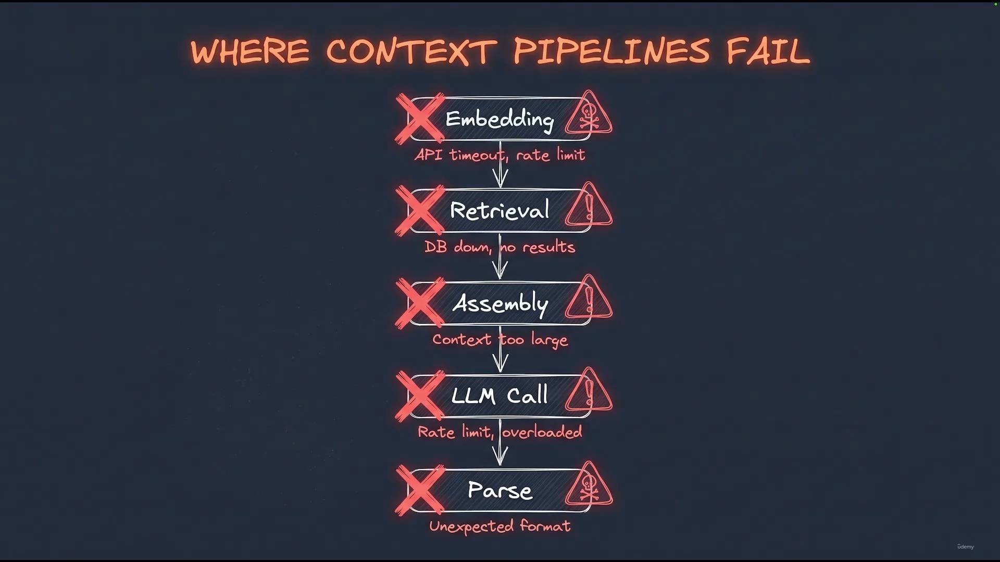

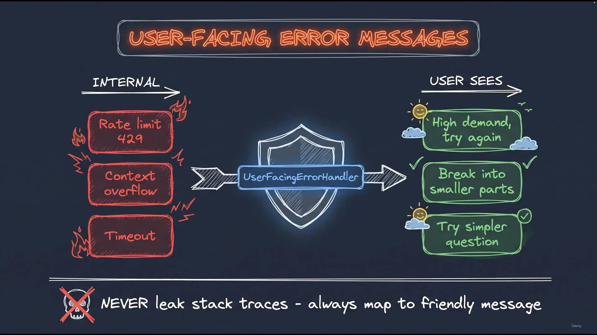


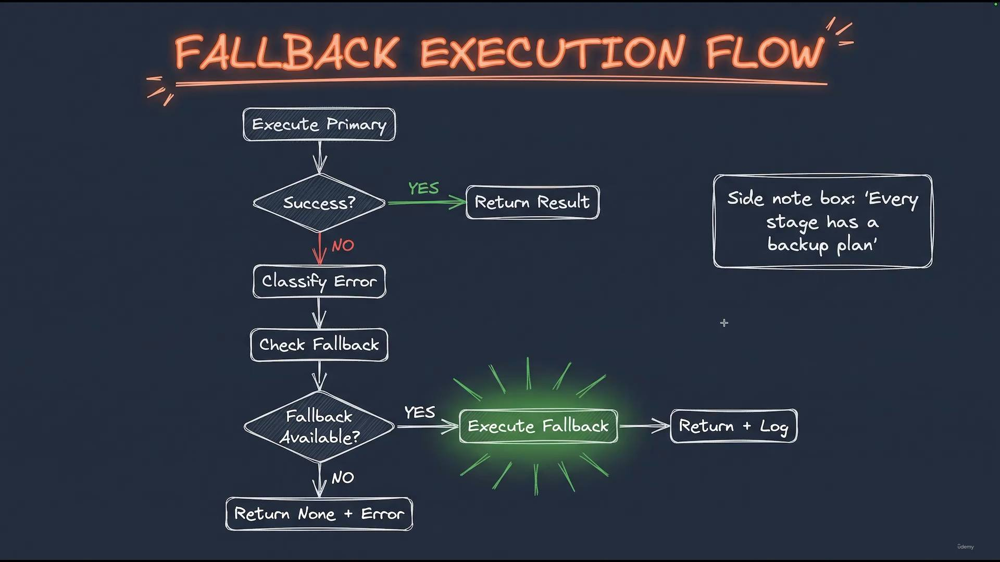

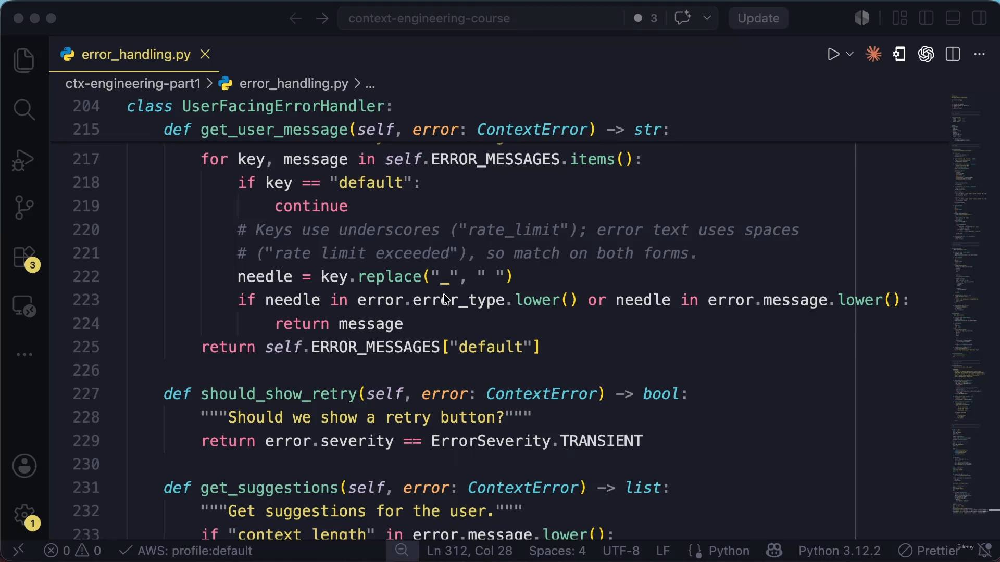

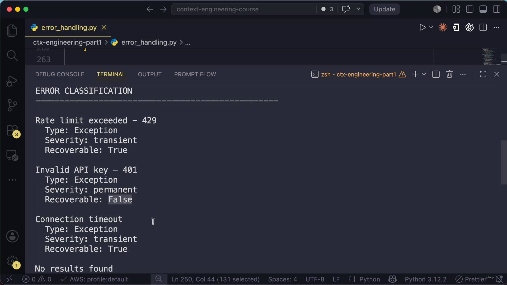

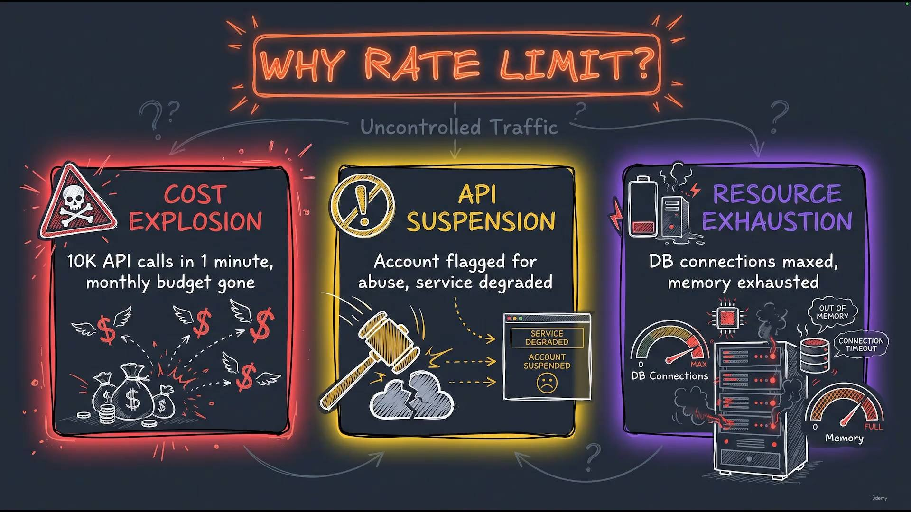


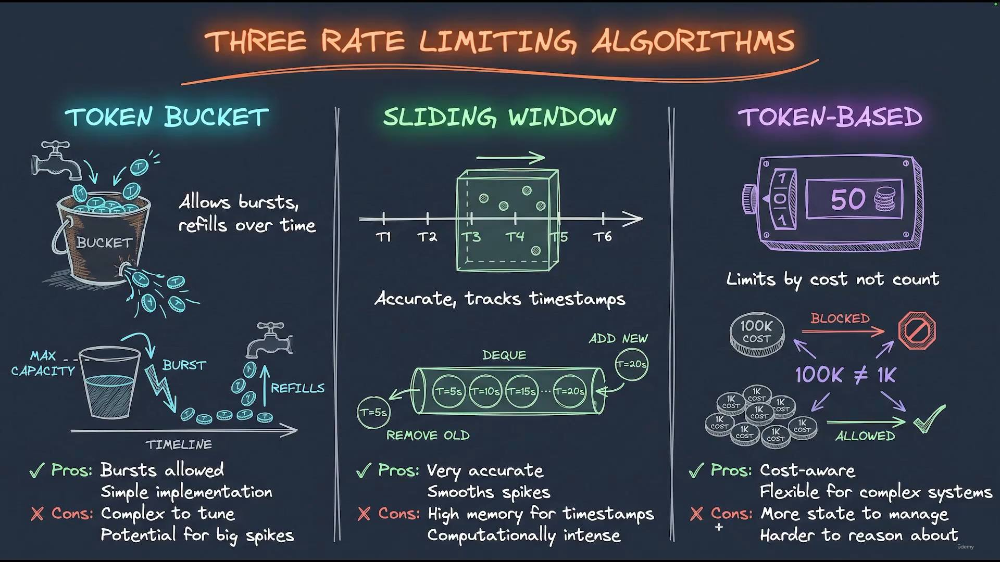

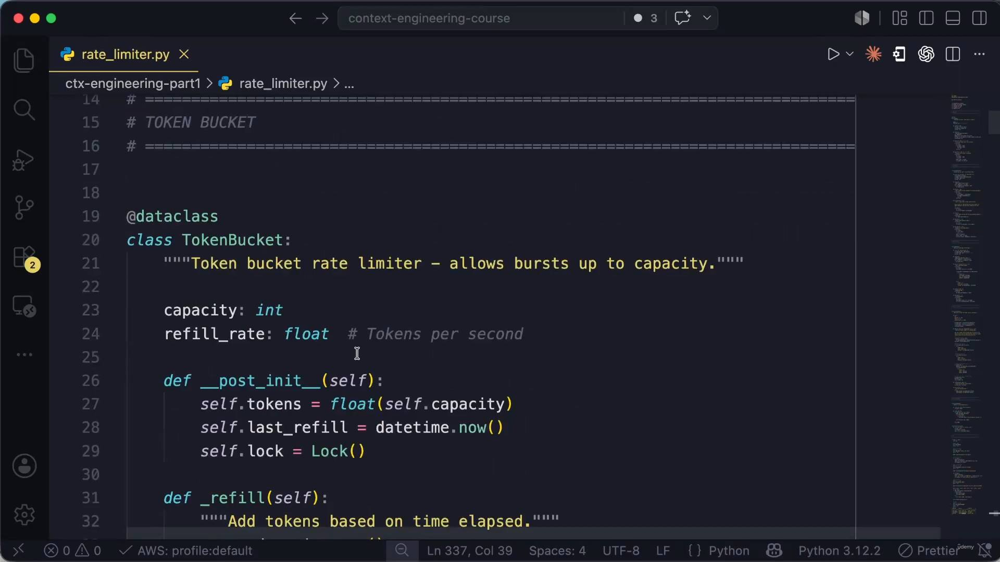

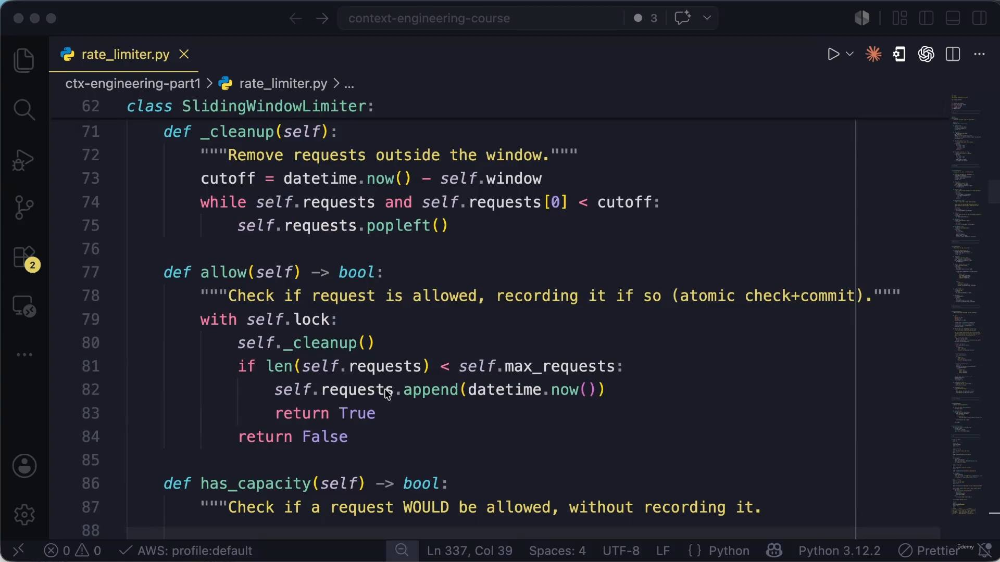

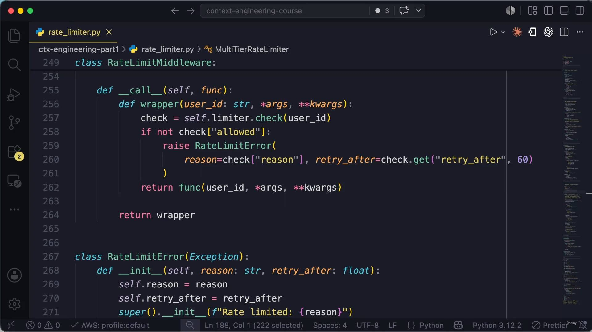

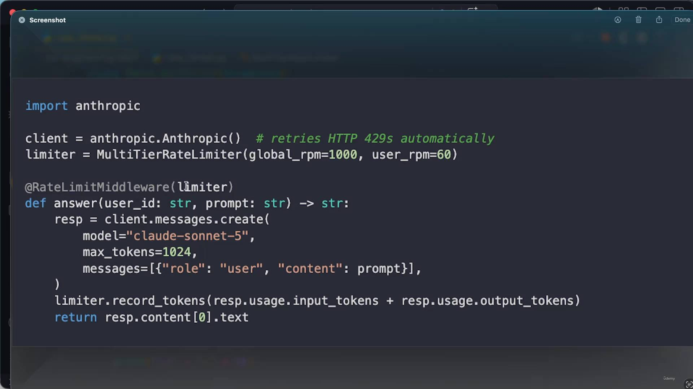

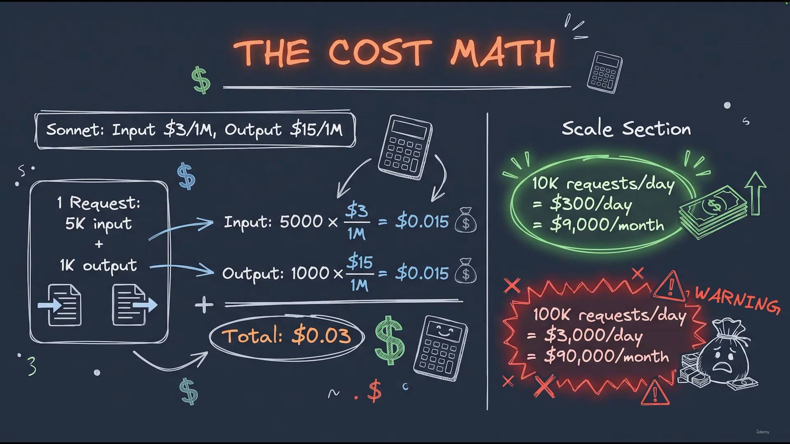

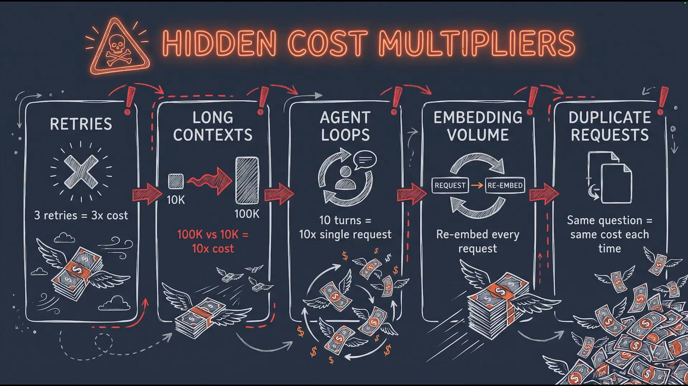

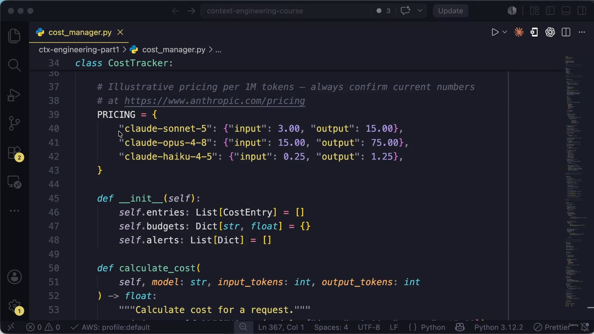

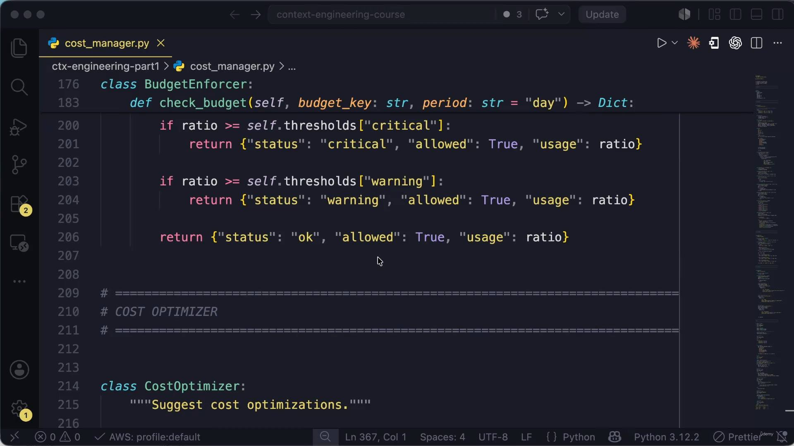

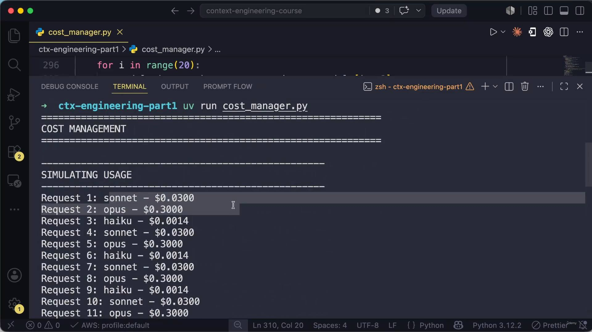

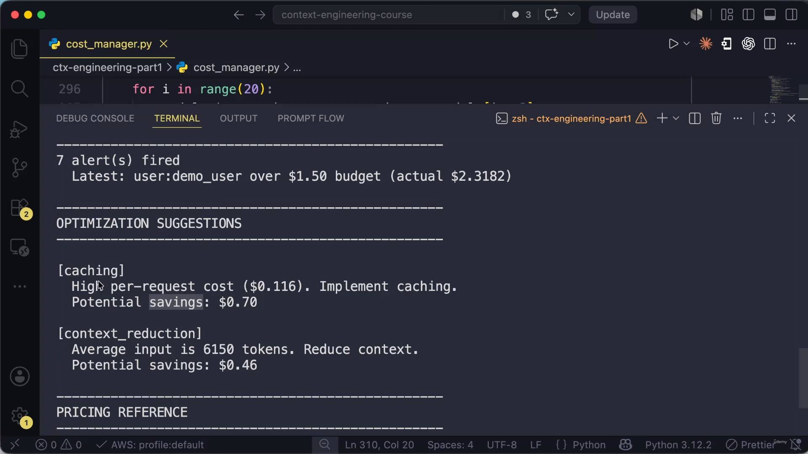