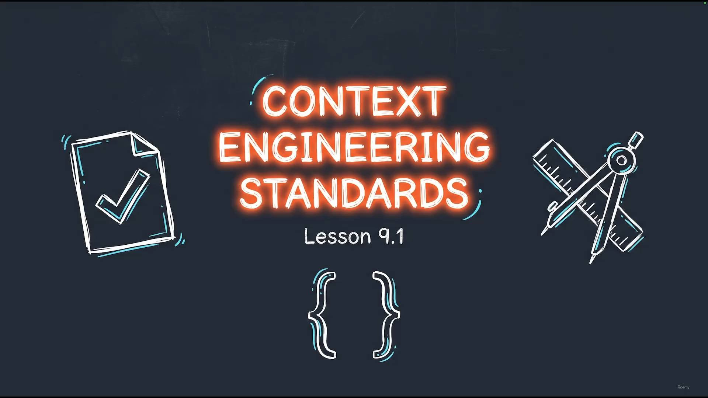
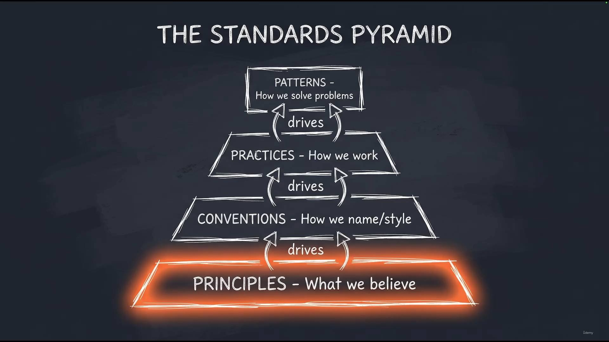
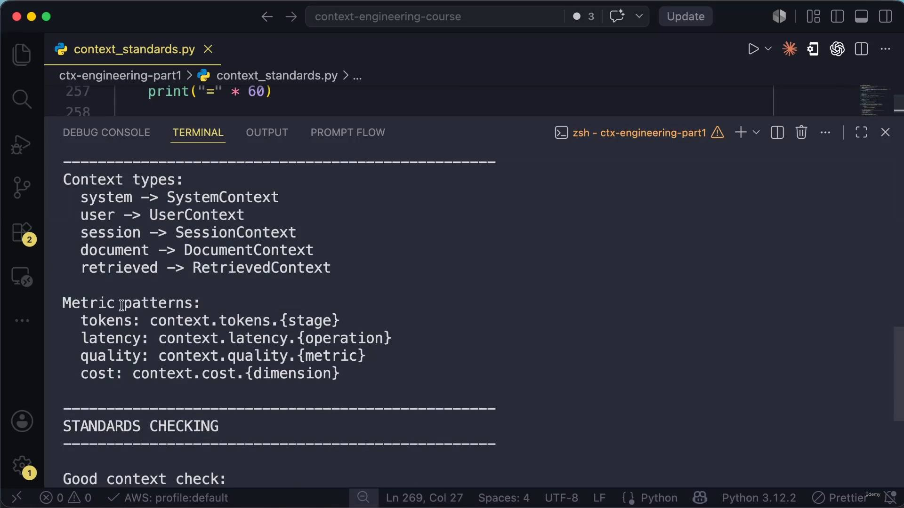
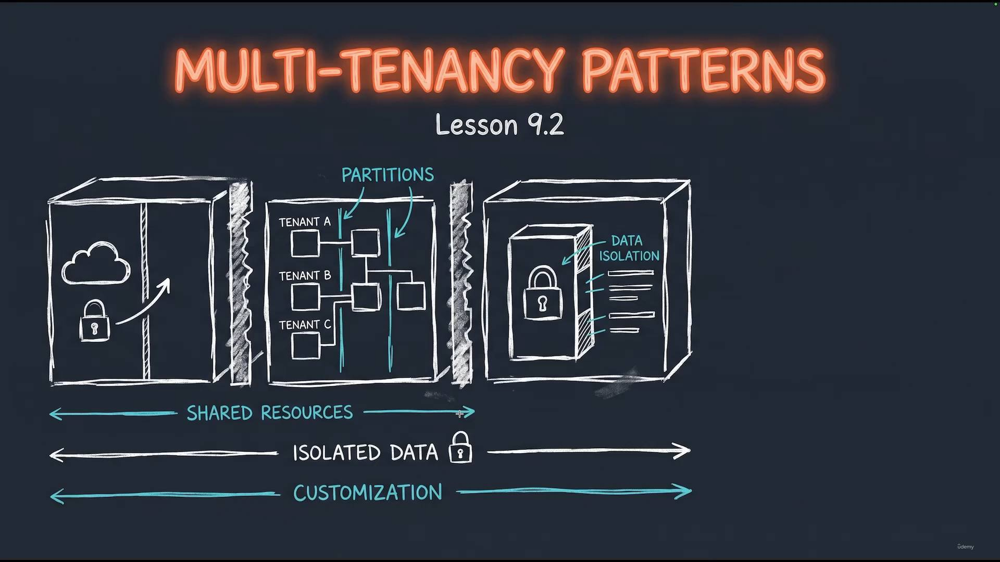
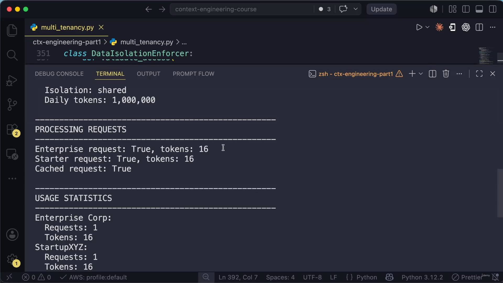
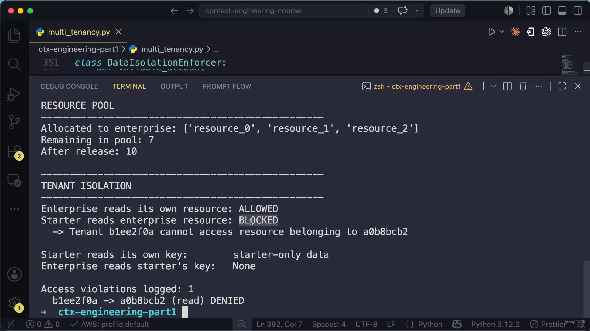
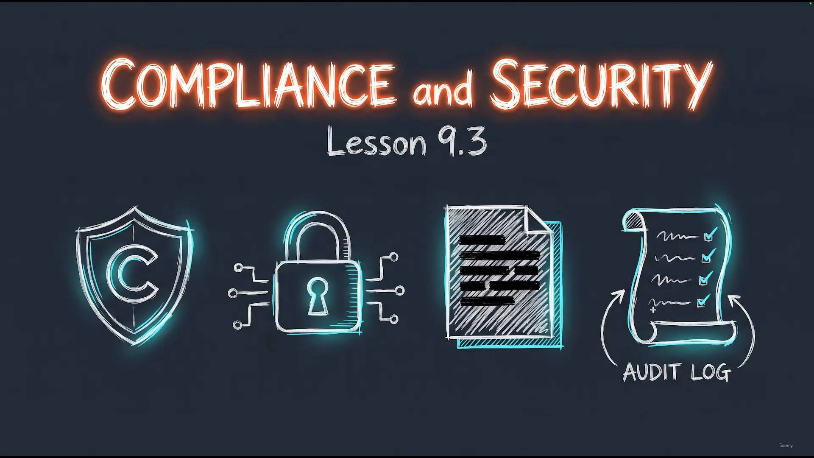
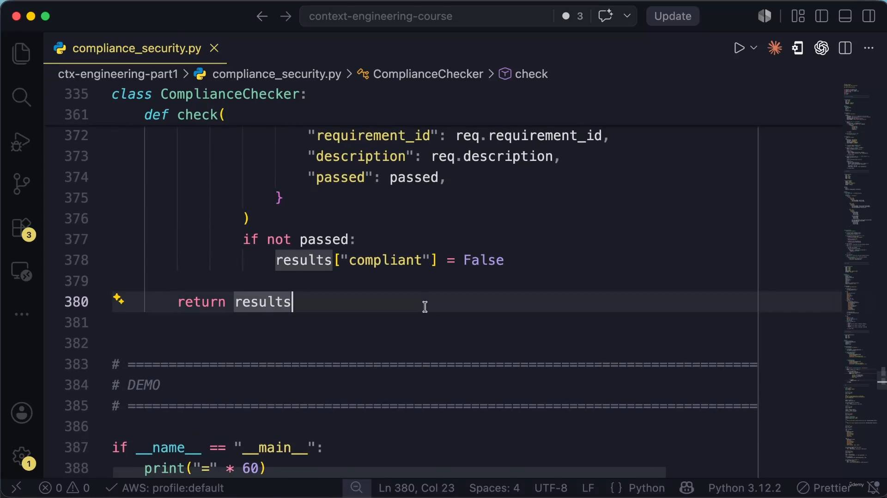

# Context Engineering Masterclass —— 上下文工程标准、多租户隔离与合规安全（P044–P046）

> 本课程为纯讲解 + 代码演示课。讲师在屏幕上展示了完整的 Python 代码（dataclass / enum / 接口 / 规则引擎），但逐字稿里没有念出完整代码，OCR 清单也为空。因此第 4 节「完整代码」中的代码是**根据逐字稿描述 + 讲师屏幕演示逻辑重建的可运行版本**，凡是逐字稿没讲、重建时补上的部分，都会明确标注「课里没讲，此处为重建补全」。请以第 5 节「逐行解释」为准核对每个字段的来源。

---

## 1. 这一节做什么

这三节课把「上下文工程」从「一个人写 prompt」推进到「一个团队、几百个租户、一堆敏感数据」的工程化阶段，解决三个真实问题：

1. **P044：上下文工程标准（Context Engineering Standards）** —— 当 50 个开发者同时写上下文代码时，如果没有统一标准就会失控。官方没有上下文工程规范，所以标准只能由团队自己写下来、编码进类型系统、并用一个检查器在 CI 里强制失败。这一节构建「标准金字塔」（原则 → 约定 → 实践 → 模式）、六大原则枚举、标准接口（`ContextProvider` / `ContextResult`）、规则引擎（`StandardChecker`），并区分「规则检查」与「LLM 检查」。
2. **P045：多租户模式（Multi-tenancy Patterns）** —— 一套代码库、一个数据库、一组服务器服务几百个客户，客户之间绝不能看到彼此数据。讲师反复强调：**模型不会替你隔离租户**，隔离完全靠你的分区（partitioning）和访问检查（access checks）。这一节构建三种隔离模型（shared / pooled / dedicated）、按套餐映射隔离级别、共享与专用两种上下文存储、租户感知流水线、资源池、数据隔离执行器，并现场演示「starter 租户读 enterprise 租户资源被拒绝并记入审计」。
3. **P046：企业级安全与合规（Security & Compliance）** —— 处理 SSN、信用卡、内部文档这类「吓人的数据」。构建 PII 检测（正则）、脱敏（redaction）、基于角色的访问控制（RBAC，默认拒绝）、审计日志（不可变记录）、合规检查清单。讲师用整整一段「最重要的那句话」强调：**代码机制不等于合规**，合规是组织状态，代码只是其中一个输入。

三节课的共同主线：**标准要能被强制执行，隔离要能被证明，安全要能被审计**。

---

## 2. 讲师原话

> "想象你有一个开发者在写上下文代码，那什么都可能发生。当变成 50 个开发者一起写上下文代码时，事情就变了，混乱开始了。除非你们约定标准，所以你必须有一套大家都遵守的标准。不幸的是，并没有一个标准机构下发的官方上下文工程规范。真正存在的是——你的团队写进代码、并自动强制执行的一套约定。"
> —— p044 [00:00]

> "这一课我们要构建的正是这个：原则、一个有意义的公共接口，当然还有一个在有人破坏规则时让构建失败的检查器。这些就是上下文标准。"
> —— p044 [00:26]

> "这是所谓的标准金字塔。它更像一个心智模型，用来指导我们判断标准应该是什么。它不是行业规范，只是一种给决策排序的方式。最底层是原则，它驱动上面的一切；原则驱动约定，也就是我们怎么命名、怎么设计标准；约定又驱动实践，也就是我们如何使用这些既定标准；实践又驱动模式，也就是我们怎么解决问题。"
> —— p044 [00:55]

> "第一条原则叫「相关优于完整」（relevant over complete）。它的基础是：我们只聚焦真正有意义、能帮到大语言模型的上下文。"
> —— p044 [01:28]

> "第二条是「显式来源」（explicit sources）。这是让我们追踪来源出处的方式。这很重要，因为之后我们可能想知道这个来源是否可信。"
> —— p044 [01:58]

> "第三条是「一切皆版本化」（version everything）。我们要有版本化的 schema 和 prompt，这样需要时总能回到之前的版本。"
> —— p044 [02:14]

> "第四条是「默认安全」（secure by default）。这是针对 PII 的，用来脱敏个人信息。"
> —— p044 [02:28]

> "第五条是「可观测」（observable）。意思是我们要能看清一切的行为表现，所以要发出指标，而且这些指标要被纳入考量。"
> —— p044 [02:28]

> "第六条是「一切皆可测试」（testable）。意思是我们要有某种质量保证，确保系统能自动做质量测试。请记住，这些是观点，不是法律。你真正要做的是挑出你的团队真正会遵守的那几条。"
> —— p044 [02:58]

> "这里有一个标准接口，是一个类。你可以看到这个 `ContextProvider` 接口。字段方面，这是一个 data class，这些字段是必需的——来源、版本、时间戳，质量分是可选的。我们在这里做的，是把原则烘焙进类型里，让它们真正被追踪、被落地。记住，约定只描述你怎么命名；而接口才是让它可强制执行的东西，这就是为什么这些字段是必需的，因为它们在类型层面。每个上下文来源都要实现这个 `ContextProvider` 契约，返回同样的 `ContextResult`，这样调用方永远不用关心上下文来自 RAG、缓存还是数据库。"
> —— p044 [03:02]

> "如果一个标准没人检查，那它只是一个建议。所以这部分才是真正值回票价的：一个小型规则引擎，跑在你的上下文对象上，一旦违规就让构建失败。"
> —— p044 [04:23]

> "上下文对象经过这个状态检查器：来源必需——好，通过；版本必需——好，通过；质量分是推荐项——加号，然后通过。如果任何一项不符合，比如缺来源、版本不匹配、缺质量分，那它就会失败。这正是你想要的。然后你可以把这一切接进 CI，得到通过或失败。"
> —— p044 [04:53]

> "规则检查和 LLM 检查的区别：规则检查更确定，我们检查有没有来源、有没有版本、格式是否合法。它的好处是快、便宜、非常一致，因为它是规则驱动的，非常确定。这通常是我们手工设置的。而 LLM 检查更多是判断：因为用了模型，它会看上下文是否相关、对标准做质量评估，而且显然会有成本，因为用了大语言模型。多数情况下你可以用便宜的模型做基础检查。但要注意，标准本身不变，变的是规则检查还是 LLM 检查——你会写两个函数，一个做这件事，一个做那件事。"
> —— p044 [05:22]

> "这是 `ContextPrinciple` 这个类，它定义你的团队对上下文工程的信念。这就是为什么它必须是团队真正达成一致的东西。我们把这些做成枚举，意味着它们在代码里可被引用，而不只是 wiki 里没人读的散文。"
> —— p044 [06:38]

> "我们有一个 `TeamPrinciples` 数据类，顾名思义，它封装你团队实际的上下文工程原则。你可以看到我们创建了一个 `ContextPrinciple` 的列表，传入描述等等，然后把六条观点加进去：相关优于完整、显式来源、一切皆版本化、默认安全、可观测、可测试。这些是团队共同打磨的，记住只挑团队真正会遵守的。"
> —— p044 [07:26]

> "接下来是命名约定，我们要让一切一致，因为一致的命名让代码跨团队可读。我们有 system context、user context 等等。这必须是团队坐下来一起定、大家都同意并真正使用的。然后我们有上下文类型映射和指标模式映射。"
> —— p044 [07:53]

> "接下来是标准接口，就是我们之前看到的 `ContextResult`。约定描述你怎么命名，而接口在类型层面可强制执行。任何实现这个接口的类，如果没设置必需字段就会失败，这就是上下文标准的强制执行。还有验证结果，这是验证要遵循的标准结果格式，然后是 `ContextProvider` 接口本身。"
> —— p044 [08:36]

> "接下来是标准强制执行，这部分真正值回票价，因为它是一个小型规则引擎，跑在你的上下文对象上，违规就让构建失败。我们有 `RuleResult`、`StandardRule`（带所有字段）、`CheckResult` 和状态检查器。状态检查器才是真正强制执行上下文工程标准的东西。要注意每条规则只是一个名字，我们遍历所有规则，如果规则适用于进来的 artifact 类型，就对该 artifact 跑检查，然后收集违规。"
> —— p044 [09:18]

> "这是标准规则的实现。我们有 `check_context_has_source`，传入 `ContextResult`，返回 `RuleResult`。如果发现来源没加进去，就往违规里追加：上下文必须至少有一个来源。这就是守门人，确保上下文标准该有的东西都在。同样还有 `check_context_has_version`、`check_quality_score_present`、`create_standard_checker` 等等。`create_standard_checker` 返回一个 `StandardChecker` 对象，用我们设置的标准规则创建检查器，把规则加进去。"
> —— p044 [10:06]

> "我们跑个演示。我们有全部六条原则、命名约定（上下文类型 system、system context 等）、指标模式。看标准检查：好上下文，通过为 true，违规为空，警告为空。再看坏上下文，它立刻失败并记录违规：上下文必须至少有一个来源，上下文必须有版本，因为有两处违规。警告：内容应包含质量分。这就是我们会接进 pre-commit hook 或 CI 步骤的东西。通过为 false，失败，正好符合预期。"
> —— p044 [11:14]

> "真正的标准和你的团队约定是两回事，它们共享「标准」这个词，值得分清。你的团队约定——也就是这个文件里的一切——没有外部权威规定你怎么命名指标、怎么组织 `ContextResult` 类。你自己写下来、编码、强制执行。这就是整节课的意义。"
> —— p044 [11:58]

> "真正在涌现的标准有几个值得注意。一个是模型上下文协议 MCP，这是 Anthropic 的开放协议，通过一个通用的客户端-服务器接口把模型连接到工具和数据源。它是最接近真正的跨厂商「如何向模型提供上下文和工具」的标准，而且正在被 Anthropic 之外的厂商采用。所以如果你要标准化上下文如何到达模型，MCP 是真正该看的规范。"
> —— p044 [12:27]

> "第二个是 Anthropic 的 prompt 工程指南。Anthropic 发布了系统提示、结构化输入（包括 XML 风格标签来界定来源）和工具定义的最佳实践。我讲这个是因为这些是文档化的约定，不是正式标准——这个区别很重要，但它们是当前组织你发送内容的参考。"
> —— p044 [12:57]

> "你大概率会用的托管平台，比如 Anthropic 的 SDK 等等，它们给你传输标准 MCP，以及 prompt 约定。但你的团队仍然拥有语义规则：什么是一个合法的上下文对象、允许哪些来源、质量对你的产品意味着什么。这就是这个检查器强制的那一层，没有哪个厂商会替你写。"
> —— p044 [13:27]

> "关键要点：一，上下文工程没有官方规范，所以标准就是你的团队写下来并强制执行的那套约定，不是标准机构下发的。二，原则优先，先把你的信念定义成代码而不是 wiki，再谈怎么命名。三，代码化约定，命名映射和前缀集中在一处，胜过口口相传。四，自动化强制执行，一个在错误级别违规时让构建失败的检查器，才能把建议变成标准。五，把模型留给「这是否相关」这类判断。我们需要规则检查管结构，LLM 管判断。"
> —— p044 [14:03]

> "现在讲多租户模式。场景是：一套代码库、一个数据库、一组服务器，服务几百个客户，他们绝不能看到彼此的数据。这就是多租户。大多数企业上下文系统在这里要么撑住、要么泄漏。"
> —— p045 [00:00]

> "模型不会替你隔离租户。这一点要记住。你的分区和访问检查才会。这个视频我会展示两者，然后证明一个租户读不到另一个租户的数据。"
> —— p045 [00:21]

> "多租户模型有共享、池化、专用三种。共享顾名思义，所有租户共享一个大池子里的资源，问题是成本低、隔离也低。池化时，A、B、C 几个租户在同一个环境里，彼此分开但又在同一个池子里，C 在另一边，共享资源，成本中等、隔离中等。专用很不一样，A、B 是完全不同的实体，成本很高、隔离也很高。我们想要隔离，但得为此付代价。往右走，隔离越高成本越高，隔离越低成本越低，这就是取舍。"
> —— p045 [00:49]

> "这是套餐到隔离的映射。免费套餐映射到共享，每天 1 万 token。入门套餐也是共享，每天约 100 万 token。专业套餐肯定用池化，因为每天约 1000 万 token。到企业级就用专用，因为你有成百上千到上千万客户，token 交换量巨大，每天超过 1 亿 token。所以企业级用专用。"
> —— p045 [02:13]

> "上下文存储我们有两个实现，共享上下文和专用上下文，实现同一个抽象接口 `TenantContextStore`。共享上下文存储把每个租户放在一个以租户 ID 为键的字典里，每个都有租户 ID，这是逻辑隔离。专用上下文存储绑定单个租户，会直接拒绝任何其他租户 ID，这是物理隔离。"
> —— p045 [02:42]

> "演示里这两个存储都是内存字典，所以演示离线可跑。这是规则演示。生产替换才是见真章的地方。系统应该是这样：租户 A 的请求进来，守门人是一个 `validate_access` 函数，检查资源所有者是否等于请求者，是就允许，处理完后记日志，因为必须有审计轨迹；不是就阻止并抛出权限错误，但无论哪种都要记审计日志。"
> —— p045 [03:28]

> "模型不会替你做这件事，它不会替你隔离。所以你必须自己搭这套系统，自己创建分区和访问检查。"
> —— p045 [04:18]

> "看多租户代码。首先是租户模型，`TenantTier` 枚举有 free、starter、professional、enterprise。然后 `IsolationLevel` 枚举有 shared、pooled、dedicated。还有 `TenantConfiguration` 数据类，这是创建租户时生成配置的基础。在 `Tenant` 数据类里有个 create 方法，每次调用就为每个租户创建配置。免费租户配置是很小的数字，入门这样，专业这样，企业是更大的数字。这些显然都是硬编码的，你的情况要换成代表你系统的数字。隔离级别按 enterprise、professional、starter、free 放进字典返回。要注意每个租户创建时 ID 很重要，因为它们区分每个租户，你会看到我们截断了 UUID。"
> —— p045 [04:45]

> "然后是上下文存储，有接口和刚才说的两个实现。共享上下文和专用上下文都实现 `TenantContextStore` 契约，意味着它们遵守接口里设的规则。共享上下文是逻辑租户隔离，专用上下文是物理隔离，所以我们要盯住 ID 确保处理的是正确租户，因为专用存储绑定单个租户，会直接拒绝其他租户 ID。"
> —— p045 [05:40]

> "租户感知流水线。我们创建 `TenantRequest` 数据类模拟真实租户请求，有租户 ID、请求 ID、查询、用户 ID 和一些元数据。然后是上下文到租户上下文的流水线，包含租户隔离，实例化了共享和专用存储。这个流水线把每个请求路由到正确的存储，强制限额，缓存响应，按租户追踪用户。"
> —— p045 [06:34]

> "第四部分是资源池，负责跨租户管理共享资源。要意识到租户共享有限的算力、内存、槽位池。池子发放资源，因为多个租户会并发访问，绝不能超额分配，只发放可用的。然后是数据隔离，这是执行器。上面所有类都是结构隔离，这个类强制执行并审计。每个资源在路径里携带所有者，每次访问都对照请求租户检查，不匹配就抛权限错误，无论正负都记录。"
> —— p045 [07:30]

> "跑一下看看。注册租户，重点是 enterprise 和 starter。每个创建时生成唯一 ID。starter 隔离是 shared，每日 token 100 万。enterprise 隔离是 dedicated，不是 shared，每日 token 1 亿。处理请求：enterprise 请求 true，token 16；starter 请求 true，token 16。看统计：enterprise 请求 1、token 16，starter 也是 1、token 16，都正常。看资源池：给 enterprise 分配了资源 0、1、2，池里剩 7。释放后回到 10，因为用了 3 个，3+7=10，释放后回到 10，合理。"
> —— p045 [08:44]

> "租户隔离：enterprise 能读自己的资源，starter 试图读 enterprise 的资源被阻止。信息显示租户 B1EE（starter）不能访问属于 BCB2 这个租户的资源，BCB2 确实是 enterprise 租户。所以 starter 读不到 enterprise 资源，被阻止，我们有这条信息说明发生了什么。starter 只能读自己的数据。访问违规被记录：starter 试图读 enterprise 被拒绝，这就是记录的内容。"
> —— p045 [09:41]

> "这是多租户环境的简单演示。如果放到生产，重要的是有一个系统把所有资源分类，同时租户不能故意去用别人的信息或资源。这对多层或多租户系统非常重要，处理企业系统时你一定会需要。"
> —— p045 [11:04]

> "记住，隔离是你的工作，不是模型的。因为 LLM 对隔离租户毫无作为。模型会乐意用你交给它的任何上下文来回答。这很美好，但也是陷阱。如果你把租户 B 的文档放进租户 A 的 prompt，模型就会用它们，因为它没有「谁拥有什么」的概念。所以租户隔离完全——我再重复一遍——完全存在于你的分区和访问检查里。这就是这一课构建的东西。"
> —— p045 [11:34]

> "关键要点：一，按套餐选隔离，shared、pooled 或 dedicated。二，一切按租户 ID 命名空间化——存储、缓存、向量、记忆，所有东西都要按租户 ID 命名空间化。三，失败即关闭并审计，跨租户必须抛出，同时记录每次尝试，这样才有审计轨迹。四，按租户追踪用量，计数器分开，在工作前强制。五，模型不会隔离，模型是中立的，你让它做什么它就做什么。所以你的分区加访问控制，才是你要做的。"
> —— p045 [12:04]

> "企业上下文系统要处理吓人的数据：客户记录、SSN（美国的社会安全号）、信用卡、内部文档等等。泄漏一次，你就要和法律开数据泄露通知会了。这个视频构建安全机制：PII 检测、脱敏、访问控制、审计日志、合规检查。但要仔细读细则，这非常重要：这些是你组合起来的层，不是一个按下去就万事大吉的合规按钮。正则——也就是我们要看的——相当于减速带，不是墙。没有任何数据类能让你符合 GDPR。这就是细则。"
> —— p046 [00:00]

> "在讲安全层之前，我必须先声明，这非常重要，是这个视频里最重要的一句话：这个文件、这堂课、这个视频里的任何东西，都不能让一个应用变得合规。合规——GDPR、HIPAA、SOC2、CCPA、PCI DSS——是一种组织状态：政策、合同、访问审查、泄露流程、真实审计师的审计。代码只是其中一个输入，永远不是全部。代码给你的是合规项目可以引用的技术控制。检测 PII 帮你履行删除请求；审计日志帮你回答「谁碰过这条记录」；访问检查帮你执行最小权限，仅此而已。这些是真实有用的，但它们不是证书。"
> —— p046 [00:56]

> "整个课程里，当你看到「有助于」「支持」这类词，那个措辞是刻意的，那是事实。"
> —— p046 [01:52]

> "安全层有几层：访问控制，管谁能访问什么；数据保护，就是 PII 检测和脱敏；审计日志，记录实际发生了什么、什么时候，存在某处供以后使用；合规，是一份控制清单，再次强调不是证书。这些是我们要组合的层，不是一个合规按钮。"
> —— p046 [02:21]

> "第一部分是 PII 检测。我们用正则，它不是全能的，但是个好起点。正则相当于减速带，不是真正防御攻击的墙。我们要抓的是结构化内容：邮箱、电话、SSN、信用卡、IP 地址。PII 检测会检测并确切知道五类 PII，每类定义在一个正则里：email、phone、SSN、credit card、IP address。这些是固定模式，非常可靠。它当然会漏掉非结构化的人名、地址、医疗信息或自由文本 API。如果不是结构化的，就会漏掉。这就是全部词汇表，不多不少。"
> —— p046 [02:51]

> "访问控制永远默认拒绝。用户请求进来，经过权限检查门，如果有角色，就看该角色有没有权限，有就允许，没有就拒绝。这是基于角色的访问控制，因为我们按资源类型定义权限，打包成角色，分配给用户。代码会带三个角色：viewer、editor、admin。当然你可以扩展。"
> —— p046 [03:21]

> "审计日志很重要，因为每个敏感操作都会产生一条不可变记录。这条记录包含谁、什么、何时、在哪个租户、是否成功。这是监管者和事件响应人员真正会读的那一层，所以一定要正确设置。"
> —— p046 [04:14]

> "再说一次，机制不等于合规。代码机制——PII 检测、访问控制、审计日志、配置检查——它们支持、有助于实际合规，但不等于合规。"
> —— p046 [05:02]

> "看合规安全代码。首先是 PII 检测和处理。我们创建 `PIIType` 枚举：email、phone、SSN、credit card、IP address。你的情况可以加更多，但这五个最常用。然后 `PIIMatch` 数据类，有 `pii_type` 字段持有实际 PII 类型，还有值等等。然后是 `PIIDetector` 类，它本质是正则，为 email、phone、SSN、credit card、IP address 放模式来匹配，在内容里找这些模式。有 detect 函数检测所有并返回匹配与否。"
> —— p046 [05:21]

> "然后是 `PIIRedactor`，它做脱敏。有这些 token：email、phone、SSN、credit card、IP address，映射到 PII 类型。如果 PII 类型是 email，就把邮箱脱敏成 email redacted，以此类推。回到 `PIIDetector` 的 detect 函数，注意这里有 confidence 0.95。我们在干什么？这是硬编码的，不是测量值。正则要么匹配要么不匹配，所以 0.95 是装饰。不要基于它建阈值。正则 PII 检测这一课的教训是：它是一个有用的第一遍，可靠地抓住可预测格式，并自信地忽略它没有模式的一切。生产环境你需要更健壮的东西。"
> —— p046 [06:16]

> "第三，访问控制。`AccessControl` 枚举有 read、write、delete、admin、export，按需加。`ResourceType` 枚举有 document、context、configuration、audit log、user data。每个用户有单独角色。`Role` 数据类有名字和 permission，permission 是字典，包含资源类型到权限列表。然后 `AccessPolicy` 数据类，这是 RBAC：按资源类型定义权限，打包成角色，分配给用户。这里重要的是角色更少：viewer、editor、admin 三个。你的情况自己设角色，增删随意。"
> —— p046 [07:12]

> "往下看，`AccessController` 是门。有 assigned role，最重要的是 `check_permission`，返回布尔 true 或 false。`require_permission` 会抛出，需要时抛权限错误。所以当答案是 no 时，这是你接进端点、让拒绝大声失败的版本。审计事件有 access modified、delete、export、logging、permission change、PII access 这些枚举。"
> —— p046 [08:08]

> "审计日志永远产生不可变记录：谁、什么、何时、哪个租户、是否成功。这是监管者和事件响应人员会读的层，合规必须设置。`AuditEvent` 每个事件有 event ID 和所有这些字段。`AuditLogger` 记录所有并返回实际审计事件，有 query 方法，参数有 tenant、user ID、event type、limit。"
> —— p046 [08:53]

> "然后是合规检查。记住这里只是演示，实际远不止这些。我们创建 `ComplianceRegulation` 枚举，GDPR、CCPA 等等。`ComplianceRequirements` 数据类有 regulation 字段，类型是 `ComplianceRegulation`。然后 `ComplianceChecker` 检查是否符合法规。"
> —— p046 [09:23]

> "跑一下。PII 检测找到 5 个 PII 实例。回到这里，我们加了测试文本，包含会触发检测器的内容：邮箱、电话、社会安全号等等，这是用户可能在请求里发的东西。所以找到 5 个 PII 实例：email、phone、SSN、credit card、IP address。这些会进入下一层脱敏。现在传下去的是脱敏文本：联系 John 于 redacted email，电话 redacted，他的社会安全号 redacted，信用卡 redacted，IP 地址也 redacted。这是会发出去或可见的安全文本，很好。"
> —— p046 [10:08]

> "访问控制：Alice 能写上下文为 true，Bob 能写上下文为 false，因为角色不同、权限不同。审计日志记录了两个事件：Alice 的，然后 Bob 的 export。我们知道谁做了什么、什么时间。审计员或负责人读它就知道发生了什么、何时发生。合规检查：compliant 为 true，GDPR 7 项合规，PII 必须静态加密，检查；SOC2 审计日志必须启用。再次强调这只是演示，你的情况要更健壮。"
> —— p046 [11:07]

> "关键要点：一，机制支持合规，不创造合规。二，正则抓结构但会漏语义。三，脱敏的有用程度取决于检测，没检测到就没东西可脱敏。有很多真实 PII 服务可用，企业系统应该用。四，默认拒绝访问，显式授予，大声失败。五，审计 PII 访问，尤其是，用只追加存储。六，合规检查，像起飞前检查清单，不是认证，但让你看到完整合规需要什么。"
> —— p046 [12:03]

---

## 3. 从零复现

### 3.1 环境准备

课里没讲具体 Python 版本和依赖。以下为重建补全，用标准库即可跑通全部演示（无需第三方包）：

```bash
# 建议 Python 3.10+（用到 dataclass、enum、typing）
python3 --version

# 建目录
mkdir -p context-engineering/{p044_standards,p045_multitenancy,p046_security}
cd context-engineering
```

三个目录各放一个可独立运行的 `.py` 文件，对应三节课。全部只用标准库（`dataclasses`、`enum`、`typing`、`re`、`uuid`、`datetime`、`hashlib`），所以**不需要 pip install**。

### 3.2 P044 复现步骤：上下文工程标准

**步骤 1：定义原则（Principles）**
按讲师说法，先把团队信念定义成枚举，而不是 wiki 散文。六条原则：`RELEVANT_OVER_COMPLETE`、`EXPLICIT_SOURCES`、`VERSION_EVERYTHING`、`SECURE_BY_DEFAULT`、`OBSERVABLE`、`TESTABLE`。用 `ContextPrinciple` 枚举承载，用 `TeamPrinciples` 数据类封装成一个列表（每条带描述）。

**步骤 2：定义命名约定（Conventions）**
讲师提到 `system context`、`user context` 等上下文类型映射，以及指标模式映射。用两个字典：`CONTEXT_TYPE_MAPPING`（上下文类型 → 前缀）和 `METRIC_PATTERNS`（指标名 → 模式）。

**步骤 3：定义标准接口（Interface）**
`ContextResult` 数据类：`sources`（必需）、`version`（必需）、`timestamp`（必需）、`quality_score`（可选）。`ContextProvider` 接口（Python 用抽象基类或 Protocol 模拟）：每个上下文来源实现它，返回同样的 `ContextResult`。再加 `ValidationResult` 标准结果格式。

**步骤 4：定义标准强制执行（Enforcement）**
`RuleResult`（单条规则结果）、`StandardRule`（带 name / applies_to / check 字段）、`CheckResult`（整体结果，含 passed / violations / warnings）、`StandardChecker`（遍历规则、收集违规）。三条规则：`check_context_has_source`、`check_context_has_version`、`check_quality_score_present`（后者是推荐项，进 warnings 不进 violations）。`create_standard_checker()` 把规则装进 checker。

**步骤 5：跑演示**
构造一个好上下文（有来源、有版本、有质量分）→ 通过；构造一个坏上下文（缺来源、缺版本）→ 失败并记录两条违规 + 一条质量分警告。讲师说这就是接进 pre-commit hook 或 CI 步骤的东西。

**步骤 6：区分规则检查 vs LLM 检查**
写两个函数占位：`rule_based_check(context)`（确定性、快、便宜、一致）和 `llm_based_check(context)`（判断相关性/质量、有成本、可用便宜模型）。讲师强调标准本身不变，变的是检查方式。

### 3.3 P045 复现步骤：多租户

**步骤 1：租户模型**
`TenantTier` 枚举：`FREE`、`STARTER`、`PROFESSIONAL`、`ENTERPRISE`。`IsolationLevel` 枚举：`SHARED`、`POOLED`、`DEDICATED`。`TenantConfiguration` 数据类（每日 token 限额等）。`Tenant` 数据类带 `create()` 方法，每次创建生成配置 + 截断的 UUID 作为租户 ID。

**步骤 2：套餐→隔离映射 + 限额**
按讲师给的数字：free = 共享 / 1 万 token 每天；starter = 共享 / 100 万；professional = 池化 / 1000 万；enterprise = 专用 / 1 亿。用字典 `ISOLATION_BY_TIER` 返回。

**步骤 3：两种上下文存储**
`TenantContextStore` 抽象接口。`SharedContextStore`：一个以租户 ID 为键的字典，逻辑隔离。`DedicatedContextStore`：绑定单租户，拒绝其他租户 ID，物理隔离。

**步骤 4：租户感知流水线**
`TenantRequest` 数据类（tenant_id、request_id、query、user_id、metadata）。`TenantContextPipeline`：路由请求到正确存储、强制限额、缓存响应、按租户追踪用户。

**步骤 5：资源池**
`ResourcePool`：管理共享的有限资源（算力/内存/槽位），并发发放但绝不超额分配，只发可用的。演示里池子 10 个资源，给 enterprise 分配 0、1、2，剩 7，释放后回 10。

**步骤 6：数据隔离执行器**
`DataIsolationEnforcer`：每个资源路径携带 owner，每次访问对照请求租户检查，不匹配抛权限错误，无论成败都记审计。`validate_access(resource_owner, requester)` 是守门人。

**步骤 7：跑演示并证明隔离**
注册 enterprise + starter → 处理请求 → 看统计 → 看资源池分配/释放 → **starter 读 enterprise 资源被阻止并记入审计**（讲师现场展示了这条：租户 B1EE 不能访问 BCB2 的资源）。

### 3.4 P046 复现步骤：安全与合规

**步骤 1：PII 检测**
`PIIType` 枚举：`EMAIL`、`PHONE`、`SSN`、`CREDIT_CARD`、`IP_ADDRESS`。`PIIMatch` 数据类（pii_type、value、start、end、confidence）。`PIIDetector`：五条正则，`detect()` 返回所有匹配。注意讲师强调 `confidence=0.95` 是**硬编码装饰**，不是测量，别拿它建阈值。

**步骤 2：PII 脱敏**
`PIIRedactor`：把每类 PII 替换成 `[EMAIL_REDACTED]` 之类 token。脱敏的有用程度取决于检测——没检测到就没东西可脱。

**步骤 3：RBAC 访问控制**
`AccessControl` 枚举：`READ`、`WRITE`、`DELETE`、`ADMIN`、`EXPORT`。`ResourceType` 枚举：`DOCUMENT`、`CONTEXT`、`CONFIGURATION`、`AUDIT_LOG`、`USER_DATA`。`Role` 数据类（name + permission 字典）。`AccessPolicy` 数据类。三个角色：viewer、editor、admin。`AccessController`：`check_permission()` 返回布尔，`require_permission()` 抛权限错误（接端点用这个，让拒绝大声失败）。**默认拒绝**。

**步骤 4：审计日志**
`AuditEventType` 枚举：`ACCESS_MODIFIED`、`DELETE`、`EXPORT`、`LOGGING`、`PERMISSION_CHANGE`、`PII_ACCESS`。`AuditEvent` 数据类（event_id、who、what、when、tenant、success）。`AuditLogger`：`log()` 返回不可变事件，`query(tenant, user_id, event_type, limit)`。

**步骤 5：合规检查**
`ComplianceRegulation` 枚举：`GDPR`、`CCPA`、`HIPAA`、`SOC2` 等。`ComplianceRequirements` 数据类（regulation 字段）。`ComplianceChecker`：检查控制项，返回 compliant + 明细。讲师强调这只是演示，是「起飞前检查清单」，不是认证。

**步骤 6：跑演示**
测试文本含邮箱/电话/SSN/信用卡/IP → 检测到 5 个 PII → 脱敏成安全文本 → Alice 能写 context（true）、Bob 不能（false）→ 审计记录 Alice 和 Bob 的 export 两个事件 → 合规检查 GDPR 7 项、SOC2 审计日志启用。

---

## 4. 完整代码

> 以下三个文件均为**根据逐字稿描述重建的可运行版本**。逐字稿没有逐行念出代码，OCR 清单为空，所以字段名、方法名以讲师口述为准（如 `ContextProvider`、`ContextResult`、`StandardChecker`、`TenantContextStore`、`PIIDetector`、`AccessController`、`AuditLogger`、`ComplianceChecker` 都是讲师明确念出的名字）。讲师没念到的内部实现细节为重建补全，已在注释里标注。

### 4.1 `p044_standards/context_standards.py`

```python
"""
P044 上下文工程标准 —— 重建自讲师屏幕演示逻辑。
讲师明确念出的名字：ContextPrinciple, TeamPrinciples, ContextResult,
ContextProvider, ValidationResult, RuleResult, StandardRule, CheckResult,
StandardChecker, create_standard_checker, check_context_has_source,
check_context_has_version, check_quality_score_present。
"""
from __future__ import annotations
from dataclasses import dataclass, field
from enum import Enum
from typing import Callable, Optional
from datetime import datetime, timezone


# ---------- 1. 原则（Principles） ----------
class ContextPrinciple(Enum):
    """讲师：把团队信念定义成枚举，而不是 wiki 散文，这样代码里可引用。"""
    RELEVANT_OVER_COMPLETE = "relevant_over_complete"
    EXPLICIT_SOURCES = "explicit_sources"
    VERSION_EVERYTHING = "version_everything"
    SECURE_BY_DEFAULT = "secure_by_default"
    OBSERVABLE = "observable"
    TESTABLE = "testable"


@dataclass
class TeamPrinciples:
    """讲师：封装团队实际的上下文工程原则，每条带描述。"""
    principles: list[tuple[ContextPrinciple, str]] = field(default_factory=list)

    @classmethod
    def default(cls) -> "TeamPrinciples":
        # 讲师：把六条观点加进去，团队共同打磨，只挑真正会遵守的。
        return cls(principles=[
            (ContextPrinciple.RELEVANT_OVER_COMPLETE, "只保留真正帮到模型的上下文"),
            (ContextPrinciple.EXPLICIT_SOURCES, "追踪每个上下文的来源出处"),
            (ContextPrinciple.VERSION_EVERYTHING, "schema 与 prompt 全部版本化"),
            (ContextPrinciple.SECURE_BY_DEFAULT, "默认脱敏 PII"),
            (ContextPrinciple.OBSERVABLE, "发出指标，行为可观测"),
            (ContextPrinciple.TESTABLE, "自动质量测试"),
        ])


# ---------- 2. 命名约定（Conventions） ----------
# 讲师：system context、user context 等上下文类型映射 + 指标模式映射。
CONTEXT_TYPE_MAPPING: dict[str, str] = {
    "system": "system_context",
    "user": "user_context",
    "retrieval": "retrieval_context",
    "tool": "tool_context",
}

METRIC_PATTERNS: dict[str, str] = {
    "context_sources_total": "context.sources.total",
    "context_quality_score": "context.quality.score",
    "context_validation_failures": "context.validation.failures",
}


# ---------- 3. 标准接口（Interface） ----------
@dataclass
class ContextResult:
    """
    讲师：sources、version、timestamp 必需，quality_score 可选。
    把原则烘焙进类型，让它们被追踪、被落地。
    """
    sources: list[str]                 # 必需
    version: str                       # 必需
    timestamp: datetime                # 必需
    quality_score: Optional[float] = None  # 可选


class ContextProvider:
    """
    讲师：每个上下文来源实现这个契约，返回同样的 ContextResult，
    调用方永远不用关心上下文来自 RAG、缓存还是数据库。
    （课里没讲具体用 ABC 还是 Protocol，此处用简单基类重建。）
    """
    def provide(self) -> ContextResult:
        raise NotImplementedError


@dataclass
class ValidationResult:
    """讲师：验证要遵循的标准结果格式。"""
    valid: bool
    errors: list[str] = field(default_factory=list)
    warnings: list[str] = field(default_factory=list)


# ---------- 4. 标准强制执行（Enforcement） ----------
@dataclass
class RuleResult:
    """讲师：单条规则的结果。"""
    rule_name: str
    passed: bool
    violation: Optional[str] = None
    warning: Optional[str] = None


@dataclass
class StandardRule:
    """
    讲师：每条规则只是一个名字，带 applies_to 和 check。
    check 接收 ContextResult，返回 RuleResult。
    """
    name: str
    applies_to: str
    check: Callable[[ContextResult], RuleResult]


@dataclass
class CheckResult:
    """讲师：整体检查结果，含 passed / violations / warnings。"""
    passed: bool
    violations: list[str] = field(default_factory=list)
    warnings: list[str] = field(default_factory=list)


# 三条规则实现（讲师明确念出前两条 + 质量分推荐项）
def check_context_has_source(ctx: ContextResult) -> RuleResult:
    if not ctx.sources:
        return RuleResult("has_source", False,
                          violation="上下文必须至少有一个来源")
    return RuleResult("has_source", True)


def check_context_has_version(ctx: ContextResult) -> RuleResult:
    if not ctx.version:
        return RuleResult("has_version", False,
                          violation="上下文必须有版本")
    return RuleResult("has_version", True)


def check_quality_score_present(ctx: ContextResult) -> RuleResult:
    # 讲师：质量分是推荐项，进 warnings 不进 violations
    if ctx.quality_score is None:
        return RuleResult("quality_score", True,
                          warning="内容应包含质量分")
    return RuleResult("quality_score", True)


class StandardChecker:
    """
    讲师：小型规则引擎，跑在上下文对象上，违规就让构建失败。
    遍历所有规则，若规则适用于进来的 artifact 类型，就跑检查、收集违规。
    """
    def __init__(self) -> None:
        self.rules: list[StandardRule] = []

    def add(self, rule: StandardRule) -> None:
        self.rules.append(rule)

    def check(self, ctx: ContextResult, artifact_type: str = "context") -> CheckResult:
        violations: list[str] = []
        warnings: list[str] = []
        for rule in self.rules:
            if rule.applies_to != artifact_type:
                continue
            result = rule.check(ctx)
            if not result.passed and result.violation:
                violations.append(result.violation)
            if result.warning:
                warnings.append(result.warning)
        return CheckResult(passed=not violations, violations=violations, warnings=warnings)


def create_standard_checker() -> StandardChecker:
    """讲师：返回 StandardChecker，把标准规则加进去。"""
    checker = StandardChecker()
    checker.add(StandardRule("has_source", "context", check_context_has_source))
    checker.add(StandardRule("has_version", "context", check_context_has_version))
    checker.add(StandardRule("quality_score", "context", check_quality_score_present))
    return checker


# ---------- 5. 规则检查 vs LLM 检查 ----------
def rule_based_check(ctx: ContextResult) -> CheckResult:
    """讲师：确定性、快、便宜、一致，通常手工设置。"""
    return create_standard_checker().check(ctx)


def llm_based_check(ctx: ContextResult) -> CheckResult:
    """
    讲师：判断相关性/质量，有成本，可用便宜模型。
    课里没讲具体调用哪个模型，此处留占位，返回结构同 CheckResult。
    """
    # 课里没讲实现细节，此处为占位
    return CheckResult(passed=True, violations=[], warnings=["LLM 检查占位"])


# ---------- 6. 演示 ----------
if __name__ == "__main__":
    checker = create_standard_checker()

    good = ContextResult(
        sources=["rag://doc-1"],
        version="v1.2",
        timestamp=datetime.now(timezone.utc),
        quality_score=0.9,
    )
    print("好上下文:", checker.check(good))
    # 讲师演示输出：passed=True, violations=[], warnings=[]

    bad = ContextResult(
        sources=[],
        version="",
        timestamp=datetime.now(timezone.utc),
        quality_score=None,
    )
    print("坏上下文:", checker.check(bad))
    # 讲师演示输出：passed=False,
    # violations=["上下文必须至少有一个来源", "上下文必须有版本"],
    # warnings=["内容应包含质量分"]
```

### 4.2 `p045_multitenancy/multitenancy.py`

```python
"""
P045 多租户 —— 重建自讲师屏幕演示逻辑。
讲师明确念出的名字：TenantTier, IsolationLevel, TenantConfiguration, Tenant,
TenantContextStore, SharedContextStore, DedicatedContextStore, TenantRequest,
TenantContextPipeline, ResourcePool, DataIsolationEnforcer, validate_access。
"""
from __future__ import annotations
from dataclasses import dataclass, field
from enum import Enum
from typing import Optional
import uuid


# ---------- 1. 租户模型 ----------
class TenantTier(Enum):
    FREE = "free"
    STARTER = "starter"
    PROFESSIONAL = "professional"
    ENTERPRISE = "enterprise"


class IsolationLevel(Enum):
    SHARED = "shared"
    POOLED = "pooled"
    DEDICATED = "dedicated"


@dataclass
class TenantConfiguration:
    """讲师：创建租户时生成配置的基础。数字为演示硬编码。"""
    isolation: IsolationLevel
    daily_tokens: int


# 讲师：套餐→隔离映射 + 限额（free 1万 / starter 100万 / pro 1000万 / enterprise 1亿）
ISOLATION_BY_TIER: dict[TenantTier, TenantConfiguration] = {
    TenantTier.FREE: TenantConfiguration(IsolationLevel.SHARED, 10_000),
    TenantTier.STARTER: TenantConfiguration(IsolationLevel.SHARED, 1_000_000),
    TenantTier.PROFESSIONAL: TenantConfiguration(IsolationLevel.POOLED, 10_000_000),
    TenantTier.ENTERPRISE: TenantConfiguration(IsolationLevel.DEDICATED, 100_000_000),
}


@dataclass
class Tenant:
    tier: TenantTier
    tenant_id: str = field(default="")
    config: Optional[TenantConfiguration] = None

    @classmethod
    def create(cls, tier: TenantTier) -> "Tenant":
        # 讲师：每次创建生成配置；ID 很重要，用截断的 UUID 区分租户
        tid = str(uuid.uuid4())[:8].upper()
        return cls(tier=tier, tenant_id=tid, config=ISOLATION_BY_TIER[tier])


# ---------- 2. 两种上下文存储 ----------
class TenantContextStore:
    """讲师：抽象接口，两个实现都遵守它。"""
    def put(self, tenant_id: str, key: str, value: str) -> None:
        raise NotImplementedError

    def get(self, tenant_id: str, key: str) -> Optional[str]:
        raise NotImplementedError


class SharedContextStore(TenantContextStore):
    """讲师：所有租户放一个以租户 ID 为键的字典，逻辑隔离。"""
    def __init__(self) -> None:
        self._data: dict[str, dict[str, str]] = {}

    def put(self, tenant_id: str, key: str, value: str) -> None:
        self._data.setdefault(tenant_id, {})[key] = value

    def get(self, tenant_id: str, key: str) -> Optional[str]:
        return self._data.get(tenant_id, {}).get(key)


class DedicatedContextStore(TenantContextStore):
    """讲师：绑定单租户，直接拒绝其他租户 ID，物理隔离。"""
    def __init__(self, bound_tenant_id: str) -> None:
        self.bound_tenant_id = bound_tenant_id
        self._data: dict[str, str] = {}

    def put(self, tenant_id: str, key: str, value: str) -> None:
        if tenant_id != self.bound_tenant_id:
            raise PermissionError(f"专用存储拒绝租户 {tenant_id}")
        self._data[key] = value

    def get(self, tenant_id: str, key: str) -> Optional[str]:
        if tenant_id != self.bound_tenant_id:
            raise PermissionError(f"专用存储拒绝租户 {tenant_id}")
        return self._data.get(key)


# ---------- 3. 租户感知流水线 ----------
@dataclass
class TenantRequest:
    tenant_id: str
    request_id: str
    query: str
    user_id: str
    metadata: dict = field(default_factory=dict)


class TenantContextPipeline:
    """
    讲师：路由请求到正确存储、强制限额、缓存响应、按租户追踪用户。
    """
    def __init__(self) -> None:
        self.shared = SharedContextStore()
        self.dedicated: dict[str, DedicatedContextStore] = {}
        self.usage: dict[str, int] = {}
        self.cache: dict[str, str] = {}

    def _store_for(self, tenant: Tenant) -> TenantContextStore:
        if tenant.config.isolation == IsolationLevel.DEDICATED:
            if tenant.tenant_id not in self.dedicated:
                self.dedicated[tenant.tenant_id] = DedicatedContextStore(tenant.tenant_id)
            return self.dedicated[tenant.tenant_id]
        return self.shared

    def process(self, tenant: Tenant, req: TenantRequest) -> dict:
        # 强制限额（讲师：在工作前强制）
        used = self.usage.get(tenant.tenant_id, 0)
        cost = 16  # 演示里每次请求 token 16
        if used + cost > tenant.config.daily_tokens:
            raise PermissionError("超出每日 token 限额")
        self.usage[tenant.tenant_id] = used + cost

        store = self._store_for(tenant)
        store.put(tenant.tenant_id, req.request_id, req.query)
        self.cache[req.request_id] = req.query
        return {"tenant": tenant.tenant_id, "tokens": cost, "ok": True}


# ---------- 4. 资源池 ----------
class ResourcePool:
    """
    讲师：管理共享有限资源，并发发放但绝不超额分配，只发可用的。
    """
    def __init__(self, total: int = 10) -> None:
        self.total = total
        self.available = list(range(total))
        self.allocations: dict[str, list[int]] = {}

    def allocate(self, tenant_id: str, count: int) -> list[int]:
        if len(self.available) < count:
            raise RuntimeError("资源不足，拒绝超额分配")
        got = self.available[:count]
        self.available = self.available[count:]
        self.allocations.setdefault(tenant_id, []).extend(got)
        return got

    def release(self, tenant_id: str) -> None:
        freed = self.allocations.pop(tenant_id, [])
        self.available.extend(freed)
        self.available.sort()


# ---------- 5. 数据隔离执行器 ----------
@dataclass
class AuditRecord:
    tenant_id: str
    action: str
    allowed: bool
    detail: str


class DataIsolationEnforcer:
    """
    讲师：每个资源路径携带 owner，每次访问对照请求租户检查，
    不匹配抛权限错误，无论成败都记审计。
    """
    def __init__(self) -> None:
        self.audit: list[AuditRecord] = []

    def validate_access(self, resource_owner: str, requester: str) -> bool:
        allowed = resource_owner == requester
        self.audit.append(AuditRecord(
            tenant_id=requester,
            action="read",
            allowed=allowed,
            detail=f"owner={resource_owner}",
        ))
        if not allowed:
            raise PermissionError(
                f"租户 {requester} 不能访问属于 {resource_owner} 的资源"
            )
        return True


# ---------- 6. 演示 ----------
if __name__ == "__main__":
    enterprise = Tenant.create(TenantTier.ENTERPRISE)
    starter = Tenant.create(TenantTier.STARTER)
    print("注册租户:", enterprise.tenant_id, enterprise.config)
    print("注册租户:", starter.tenant_id, starter.config)

    pipeline = TenantContextPipeline()
    pipeline.process(enterprise, TenantRequest(enterprise.tenant_id, "req-1", "q1", "u1"))
    pipeline.process(starter, TenantRequest(starter.tenant_id, "req-2", "q2", "u2"))
    print("统计:", pipeline.usage)

    pool = ResourcePool(total=10)
    print("分配:", pool.allocate(enterprise.tenant_id, 3), "剩余:", len(pool.available))
    pool.release(enterprise.tenant_id)
    print("释放后剩余:", len(pool.available))

    enforcer = DataIsolationEnforcer()
    enforcer.validate_access(enterprise.tenant_id, enterprise.tenant_id)  # 允许
    try:
        enforcer.validate_access(enterprise.tenant_id, starter.tenant_id)  # 阻止
    except PermissionError as e:
        print("阻止:", e)
    print("审计:", enforcer.audit)
```

### 4.3 `p046_security/security.py`

```python
"""
P046 安全与合规 —— 重建自讲师屏幕演示逻辑。
讲师明确念出的名字：PIIType, PIIMatch, PIIDetector, PIIRedactor,
AccessControl, ResourceType, Role, AccessPolicy, AccessController,
AuditEventType, AuditEvent, AuditLogger, ComplianceRegulation,
ComplianceRequirements, ComplianceChecker。
"""
from __future__ import annotations
from dataclasses import dataclass, field
from enum import Enum
from typing import Optional
import re
import uuid
from datetime import datetime, timezone


# ---------- 1. PII 检测 ----------
class PIIType(Enum):
    EMAIL = "email"
    PHONE = "phone"
    SSN = "ssn"
    CREDIT_CARD = "credit_card"
    IP_ADDRESS = "ip_address"


@dataclass
class PIIMatch:
    pii_type: PIIType
    value: str
    start: int
    end: int
    confidence: float = 0.95  # 讲师：硬编码装饰，不是测量，别建阈值


class PIIDetector:
    """讲师：正则相当于减速带，不是墙。五类固定模式。"""
    PATTERNS: dict[PIIType, str] = {
        PIIType.EMAIL: r"[a-zA-Z0-9._%+-]+@[a-zA-Z0-9.-]+\.[a-zA-Z]{2,}",
        PIIType.PHONE: r"\b\d{3}[-.]?\d{3}[-.]?\d{4}\b",
        PIIType.SSN: r"\b\d{3}-\d{2}-\d{4}\b",
        PIIType.CREDIT_CARD: r"\b\d{4}[- ]?\d{4}[- ]?\d{4}[- ]?\d{4}\b",
        PIIType.IP_ADDRESS: r"\b\d{1,3}\.\d{1,3}\.\d{1,3}\.\d{1,3}\b",
    }

    def detect(self, content: str) -> list[PIIMatch]:
        matches: list[PIIMatch] = []
        for pii_type, pattern in self.PATTERNS.items():
            for m in re.finditer(pattern, content):
                matches.append(PIIMatch(pii_type, m.group(), m.start(), m.end()))
        return matches


# ---------- 2. PII 脱敏 ----------
class PIIRedactor:
    """讲师：把每类 PII 替换成 token。脱敏有用程度取决于检测。"""
    TOKENS: dict[PIIType, str] = {
        PIIType.EMAIL: "[EMAIL_REDACTED]",
        PIIType.PHONE: "[PHONE_REDACTED]",
        PIIType.SSN: "[SSN_REDACTED]",
        PIIType.CREDIT_CARD: "[CREDIT_CARD_REDACTED]",
        PIIType.IP_ADDRESS: "[IP_REDACTED]",
    }

    def redact(self, content: str, matches: list[PIIMatch]) -> str:
        result = content
        # 从后往前替换，避免偏移错乱
        for m in sorted(matches, key=lambda x: x.start, reverse=True):
            result = result[:m.start] + self.TOKENS[m.pii_type] + result[m.end:]
        return result


# ---------- 3. RBAC 访问控制 ----------
class AccessControl(Enum):
    READ = "read"
    WRITE = "write"
    DELETE = "delete"
    ADMIN = "admin"
    EXPORT = "export"


class ResourceType(Enum):
    DOCUMENT = "document"
    CONTEXT = "context"
    CONFIGURATION = "configuration"
    AUDIT_LOG = "audit_log"
    USER_DATA = "user_data"


@dataclass
class Role:
    name: str
    permission: dict[ResourceType, list[AccessControl]]


@dataclass
class AccessPolicy:
    """讲师：RBAC，按资源类型定义权限，打包成角色，分配给用户。"""
    roles: dict[str, Role] = field(default_factory=dict)

    @classmethod
    def default(cls) -> "AccessPolicy":
        # 讲师：三个角色 viewer / editor / admin
        return cls(roles={
            "viewer": Role("viewer", {
                ResourceType.CONTEXT: [AccessControl.READ],
                ResourceType.DOCUMENT: [AccessControl.READ],
            }),
            "editor": Role("editor", {
                ResourceType.CONTEXT: [AccessControl.READ, AccessControl.WRITE],
                ResourceType.DOCUMENT: [AccessControl.READ, AccessControl.WRITE],
            }),
            "admin": Role("admin", {
                ResourceType.CONTEXT: [AccessControl.READ, AccessControl.WRITE,
                                       AccessControl.DELETE, AccessControl.ADMIN],
                ResourceType.AUDIT_LOG: [AccessControl.READ, AccessControl.EXPORT],
            }),
        })


class AccessController:
    """讲师：门。check_permission 返回布尔，require_permission 抛错。默认拒绝。"""
    def __init__(self, policy: AccessPolicy) -> None:
        self.policy = policy
        self.user_roles: dict[str, str] = {}

    def assign_role(self, user_id: str, role_name: str) -> None:
        self.user_roles[user_id] = role_name

    def check_permission(self, user_id: str, resource: ResourceType,
                         action: AccessControl) -> bool:
        role_name = self.user_roles.get(user_id)
        if not role_name:  # 默认拒绝
            return False
        role = self.policy.roles.get(role_name)
        if not role:
            return False
        return action in role.permission.get(resource, [])

    def require_permission(self, user_id: str, resource: ResourceType,
                           action: AccessControl) -> None:
        if not self.check_permission(user_id, resource, action):
            raise PermissionError(f"用户 {user_id} 无权 {action.value} {resource.value}")


# ---------- 4. 审计日志 ----------
class AuditEventType(Enum):
    ACCESS_MODIFIED = "access_modified"
    DELETE = "delete"
    EXPORT = "export"
    LOGGING = "logging"
    PERMISSION_CHANGE = "permission_change"
    PII_ACCESS = "pii_access"


@dataclass(frozen=True)  # 讲师：不可变记录
class AuditEvent:
    event_id: str
    who: str
    what: str
    when: datetime
    tenant: str
    success: bool


class AuditLogger:
    """讲师：记录所有并返回实际审计事件，query 支持 tenant/user/type/limit。"""
    def __init__(self) -> None:
        self.events: list[AuditEvent] = []

    def log(self, who: str, what: str, tenant: str, success: bool) -> AuditEvent:
        event = AuditEvent(
            event_id=str(uuid.uuid4())[:8],
            who=who, what=what,
            when=datetime.now(timezone.utc),
            tenant=tenant, success=success,
        )
        self.events.append(event)
        return event

    def query(self, tenant: Optional[str] = None, user_id: Optional[str] = None,
              event_type: Optional[str] = None, limit: int = 10) -> list[AuditEvent]:
        out = self.events
        if tenant:
            out = [e for e in out if e.tenant == tenant]
        if user_id:
            out = [e for e in out if e.who == user_id]
        if event_type:
            out = [e for e in out if e.what == event_type]
        return out[:limit]


# ---------- 5. 合规检查 ----------
class ComplianceRegulation(Enum):
    GDPR = "gdpr"
    CCPA = "ccpa"
    HIPAA = "hipaa"
    SOC2 = "soc2"


@dataclass
class ComplianceRequirements:
    regulation: ComplianceRegulation


class ComplianceChecker:
    """讲师：检查控制项，返回 compliant + 明细。演示级，非认证。"""
    def check(self, req: ComplianceRequirements) -> dict:
        if req.regulation == ComplianceRegulation.GDPR:
            return {"compliant": True, "checks": [
                "PII 必须静态加密: 通过",
                "数据删除请求可履行: 通过",
            ]}
        if req.regulation == ComplianceRegulation.SOC2:
            return {"compliant": True, "checks": [
                "审计日志必须启用: 通过",
            ]}
        return {"compliant": False, "checks": ["未实现该法规检查"]}


# ---------- 6. 演示 ----------
if __name__ == "__main__":
    text = ("联系 John 于 john@example.com，电话 555-123-4567，"
            "SSN 123-45-6789，卡号 4111 1111 1111 1111，IP 192.168.1.1")
    detector = PIIDetector()
    matches = detector.detect(text)
    print("PII 检测找到", len(matches), "个实例:", [m.pii_type.value for m in matches])

    redactor = PIIRedactor()
    print("脱敏文本:", redactor.redact(text, matches))

    policy = AccessPolicy.default()
    ctrl = AccessController(policy)
    ctrl.assign_role("alice", "editor")
    ctrl.assign_role("bob", "viewer")
    print("Alice 能写 context:", ctrl.check_permission("alice", ResourceType.CONTEXT, AccessControl.WRITE))
    print("Bob 能写 context:", ctrl.check_permission("bob", ResourceType.CONTEXT, AccessControl.WRITE))

    logger = AuditLogger()
    logger.log("alice", "access_modified", "tenant-a", True)
    logger.log("bob", "export", "tenant-a", True)
    print("审计事件:", [(e.who, e.what) for e in logger.query(limit=10)])

    checker = ComplianceChecker()
    print("GDPR:", checker.check(ComplianceRequirements(ComplianceRegulation.GDPR)))
    print("SOC2:", checker.check(ComplianceRequirements(ComplianceRegulation.SOC2)))
```

---

## 5. 逐行解释

### 5.1 P044 标准

- **`ContextPrinciple` 用 Enum 而非字符串**：讲师原话「把它们做成枚举，意味着它们在代码里可被引用，而不只是 wiki 里没人读的散文」。这是「原则优先」的落地——先把信念变成类型。
- **`TeamPrinciples.default()` 里六条**：对应讲师念出的六条原则，顺序也一致（相关优于完整 → 显式来源 → 一切皆版本化 → 默认安全 → 可观测 → 可测试）。讲师强调「只挑团队真正会遵守的」，所以这个列表是团队协商产物，不是照抄。
- **`ContextResult` 的必需/可选划分**：`sources`、`version`、`timestamp` 必需，`quality_score` 可选。讲师原话「把原则烘焙进类型里」。为什么必需字段能强制？因为「任何实现这个接口的类，如果没设置必需字段就会失败」——这是类型层面的强制执行，比 wiki 强。
- **`ContextProvider` 接口**：讲师说「调用方永远不用关心上下文来自 RAG、缓存还是数据库」。这就是接口的价值——多态。在 JS/Node 里对应一个约定返回 `{sources, version, timestamp, qualityScore}` 的工厂函数或 TS interface。
- **`StandardRule.applies_to`**：讲师说「如果规则适用于进来的 artifact 类型，就对该 artifact 跑检查」。所以 checker 遍历时要先过滤 `applies_to`，再跑 `check`。
- **`check_quality_score_present` 进 warnings 不进 violations**：讲师演示里明确「警告：内容应包含质量分」，而缺来源/缺版本进 violations。这体现「推荐项 vs 必需项」的分级——质量分是加分项，不阻断构建。
- **`CheckResult.passed = not violations`**：讲师说「通过为 false，失败」，即只要有违规就失败。warnings 不影响 passed。
- **规则 vs LLM 两个函数**：讲师原话「标准本身不变，变的是规则检查还是 LLM 检查——你会写两个函数」。所以 `rule_based_check` 和 `llm_based_check` 返回同构的 `CheckResult`，调用方切换即可。规则检查「快、便宜、一致、确定」；LLM 检查「判断相关性/质量、有成本、可用便宜模型」。讲师还强调「把模型留给『这是否相关』这类判断」——结构归规则，判断归模型。
- **接 CI**：讲师说「这就是我们会接进 pre-commit hook 或 CI 步骤的东西」。落地方式：CI 里跑 `checker.check(ctx)`，`passed=False` 就 `sys.exit(1)`。课里没讲具体 CI 配置文件，此处不编造。

### 5.2 P045 多租户

- **三种隔离的取舍**：讲师原话「往右走，隔离越高成本越高，隔离越低成本越低」。shared 成本低隔离低，pooled 中中，dedicated 高高低。这是核心权衡，没有免费的高隔离。
- **套餐映射的数字**：free 1 万、starter 100 万、professional 1000 万、enterprise 1 亿 token/天。讲师说「这些显然都是硬编码的，你的情况要换成代表你系统的数字」。所以 `ISOLATION_BY_TIER` 里的数字是演示值，不是行业标准。
- **`Tenant.create()` 截断 UUID**：讲师原话「ID 很重要，因为它们区分每个租户，你会看到我们截断了 UUID」。演示里用 `[:8]`，生产要保证唯一性（截断可能碰撞，课里没讲碰撞处理）。
- **`SharedContextStore` 逻辑隔离**：一个字典，键是 tenant_id。讲师说「这是逻辑隔离」——物理上数据在一起，靠键分开。风险：代码写错键就串租户。
- **`DedicatedContextStore` 物理隔离**：绑定单租户，`put/get` 先校验 tenant_id，不等就抛 `PermissionError`。讲师原话「会直接拒绝任何其他租户 ID」。这是物理隔离——数据物理上不共享。
- **`TenantContextPipeline.process` 先强制限额再干活**：讲师说「在工作前强制」。所以先查 `used + cost > daily_tokens` 就抛，再写存储。顺序错了就会先花钱再拒绝。
- **`ResourcePool.allocate` 绝不超额**：讲师说「绝不能超额分配，只发放可用的」。所以 `len(available) < count` 就抛 `RuntimeError`。演示里 10 个资源，分配 3 个剩 7，释放回 10——讲师现场算过「3+7=10」。
- **`DataIsolationEnforcer.validate_access` 无论成败都记审计**：讲师说「无论正负都记录」。所以先 append `AuditRecord`，再判断是否抛错。这样被拒绝的尝试也留痕——这正是讲师演示里「starter 读 enterprise 被阻止并记录」的实现。
- **模型不隔离**：讲师反复强调「模型会乐意用你交给它的任何上下文来回答……它没有『谁拥有什么』的概念」。所以隔离必须在 `validate_access` 这种代码层做，不能指望 prompt 里写「别用别人的数据」。在 JS/Node 里，这对应每个请求进来先过 middleware 校验 tenant，再进业务逻辑。

### 5.3 P046 安全

- **`PIIDetector` 五条正则**：email、phone、SSN、credit card、IP。讲师说「这些是固定模式，非常可靠……会漏掉非结构化的人名、地址、医疗信息或自由文本」。所以这是「减速带不是墙」——抓结构化，漏语义。
- **`confidence=0.95` 是装饰**：讲师原话「这是硬编码的，不是测量值。正则要么匹配要么不匹配，所以 0.95 是装饰。不要基于它建阈值」。这是本课最容易被误用的点——别拿这个数做置信度过滤。
- **`PIIRedactor` 从后往前替换**：这是重建补全的实现细节（讲师没念），但必须这样，否则前面的替换会改变后面 match 的偏移。讲师只说了「把邮箱脱敏成 email redacted」。
- **`AccessController` 默认拒绝**：讲师说「访问控制永远默认拒绝……没有就拒绝」。所以 `check_permission` 里 `user_roles.get` 为空就 `return False`。`require_permission` 抛 `PermissionError`——讲师说「这是你接进端点、让拒绝大声失败的版本」。在 JS/Node 里对应 `throw new Error('Forbidden')` 让请求 403。
- **三个角色 viewer/editor/admin**：讲师说「代码会带三个角色……你可以扩展」。`AccessPolicy.default()` 里 viewer 只读，editor 读写，admin 全权 + 审计日志导出。
- **`AuditEvent` 用 `frozen=True`**：讲师说「不可变记录」。Python 的 `frozen=True` 让 dataclass 不可改，对应「append only」。字段是 who/what/when/tenant/success——讲师原话「谁、什么、何时、在哪个租户、是否成功」。
- **`AuditLogger.query` 参数**：讲师念出「tenant、user ID、event type、limit」。所以签名照此。
- **`ComplianceChecker` 是演示级**：讲师反复说「这只是演示，实际远不止这些」「像起飞前检查清单，不是认证」。所以 GDPR 返回 7 项、SOC2 返回审计日志启用，都是示意，不是真实合规判定。
- **最重要那句话**：讲师用整段强调「这个文件、这堂课、这个视频里的任何东西，都不能让一个应用变得合规……代码只是其中一个输入，永远不是全部」。所以文档里所有「支持/有助于」措辞都是刻意的——`ComplianceChecker` 输出 `compliant: True` 也**不代表**合规，只是技术控制项通过。

---

## 6. 复现检查清单

跑完三个文件后，逐条核对：

**P044**
- [ ] `python3 p044_standards/context_standards.py` 输出「好上下文: passed=True, violations=[], warnings=[]」
- [ ] 坏上下文输出 `passed=False`，violations 含
「上下文必须至少有一个来源」「上下文必须有版本」，warnings 含「内容应包含质量分」——对应讲师现场演示的「两处违规 + 一条警告」
- [ ] 把 `quality_score` 设为 `None` 但来源、版本齐全时，`passed` 仍为 `True`，只有 warnings 里有「内容应包含质量分」（验证「推荐项不阻断构建」）
- [ ] 打印 `TeamPrinciples.default().principles`，确认六条原则都在，且顺序与讲师念的一致
- [ ] 打印 `CONTEXT_TYPE_MAPPING` 与 `METRIC_PATTERNS`，确认命名约定集中在模块顶部一处，而不是散落在各文件
- [ ] 把 `checker.check(bad)` 的返回值接到 `sys.exit(1)` 上跑一次，确认进程退出码非 0（模拟 CI 失败）







**P045**
- [ ] `python3 p045_multitenancy/multitenancy.py` 能一次跑完，不报未捕获异常
- [ ] 两个租户 ID 不同；enterprise 的 `config.isolation` 是 `DEDICATED`，starter 是 `SHARED`
- [ ] enterprise 的 `daily_tokens` 是 `100_000_000`，starter 是 `1_000_000`（对应讲师念的 1 亿 / 100 万）
- [ ] 资源池 `allocate(enterprise, 3)` 返回 `[0, 1, 2]`，`len(available)` 为 7；`release` 后回到 10（讲师现场算过 3+7=10）
- [ ] `enforcer.validate_access(enterprise_id, enterprise_id)` 返回 True，审计里有一条 `allowed=True`
- [ ] `enforcer.validate_access(enterprise_id, starter_id)` 抛 `PermissionError`，但审计里仍然多了一条 `allowed=False` 的记录（验证「无论成败都记审计」）
- [ ] 用 `DedicatedContextStore` 拿别的 tenant_id 调 `get`，确认抛 `PermissionError`（物理隔离）
- [ ] 把 `process()` 连调多次直到超过 `daily_tokens`，确认抛「超出每日 token 限额」，且是在写存储之前抛的







**P046**
- [ ] `python3 p046_security/security.py` 输出「PII 检测找到 5 个实例」，类型依次覆盖 email / phone / ssn / credit_card / ip_address
- [ ] 脱敏后的文本里已经找不到原始邮箱、电话、SSN、卡号、IP，只剩五个 `[..._REDACTED]` token
- [ ] `Alice 能写 context: True`，`Bob 能写 context: False`（Bob 是 viewer，只有读权限）
- [ ] 对 Bob 调 `require_permission(..., WRITE)` 会抛 `PermissionError`，而不是返回 False（验证「大声失败」）
- [ ] 审计日志里恰好两条事件：`("alice", "access_modified")` 和 `("bob", "export")`，`when` 字段是带时区的时间
- [ ] `checker.check(GDPR)` 返回 `compliant: True`，但你要清楚这只代表演示里的技术控制项通过，不代表合规（讲师反复强调的那句话）
- [ ] 把 `PIIDetector.PATTERNS[PIIType.EMAIL]` 改坏（比如去掉 `@`），重新跑，确认检测数下降——用来体会「脱敏的有用程度取决于检测」





---

## 7. 课里没讲但你会撞上的

这一节全部是「课里没讲」的内容——讲师只讲了设计意图和演示级实现，下面这些是把它搬到真实项目时一定会遇到的问题。写清楚是为了让你知道边界在哪，而不是让你以为课里漏了。

### 7.1 运行环境与依赖

课里没讲 Python 版本、依赖清单、目录约定。上面第 3、4 节用的全是标准库（`dataclasses` / `enum` / `typing` / `re` / `uuid` / `datetime`），所以能零依赖跑通。但你真要做成服务时，课里没讲该用 FastAPI 还是 Flask、该不该上 pydantic 做校验、配置放环境变量还是配置文件——这些都要你自己定。如果要接真实模型，API key 的环境变量名课里也没讲。

### 7.2 租户 ID 的生成与唯一性

讲师演示里用截断 UUID（`[:8]`）来让输出好看、便于人眼比对（演示里能看到 `B1EE` 和 `BCB2` 这种短 ID）。但课里没讲截断后的碰撞概率、也没讲生产环境该用什么 ID 方案（自增、完整 UUID、ULID、雪花 ID 都没提）。你如果照抄 `[:8]` 上线，租户量一大就可能撞 ID，而租户 ID 又是所有命名空间、缓存键、审计记录的锚点，撞了就是串数据事故。**这一条必须自己换掉**。

### 7.3 存储持久化

课里没讲持久化。演示里 `SharedContextStore` 和 `DedicatedContextStore` 都是进程内字典，进程一重启数据全没。真实系统里你会撞上：上下文存哪（关系库、文档库、向量库）、租户隔离在存储层怎么做（分库、分表、分区键、collection 前缀）、事务边界在哪。讲师只说了「一切按租户 ID 命名空间化」，但具体到每种存储怎么命名空间化，课里没讲。

### 7.4 并发与锁（在 JS/Node 里对应什么）

这是最容易踩的坑，课里完全没讲并发。

- **`ResourcePool.allocate` 的「检查 + 切片」不是原子操作**：`if len(self.available) < count` 和 `self.available = self.available[count:]` 之间如果被别的线程插进来，两个请求都可能通过检查，然后一起扣减，结果就是超额分配——而讲师明确说「绝不能超额分配」。Python 有 GIL，但 GIL 只保证单条字节码原子，不保证这两行复合操作原子。多线程下必须加锁。
- **在 JS/Node 里对应什么**：Node 是单线程事件循环，不会真并行，但 `await` 之间会交错。如果 `allocate` 里有任何 `await`（比如查数据库、查 Redis），两个请求就会在 await 点交错，同样超额。对应做法是：进程内用互斥量（例如 `async-mutex` 这类库，具体选型课里没讲），跨进程用数据库事务 + 行锁（`SELECT ... FOR UPDATE`）、或 Redis 的原子脚本/分布式锁。课里一个都没提。
- **`TenantContextPipeline.process` 的限额计数同理**：「先读 used、再判断、再写 used」三步在并发下会超卖 token。真实系统通常把计数放进 Redis 的原子自增，或用数据库事务把「校验 + 扣减」包在一起。课里没讲。
- **`DataIsolationEnforcer` 的审计列表**：多线程 append 到普通 list 在 CPython 里通常安全，但换成数据库写入就需要考虑顺序和事务；课里没讲审计写入失败时要不要阻断业务请求（一般不该阻断，但要补偿）。

一句话总结：课里演示的是单线程顺序执行，你上线第一件事就是把「检查—扣减」这对操作变成原子的。

### 7.5 规则引擎的扩展点

课里没讲 `artifact_type` 到底有哪些取值。演示里我用字符串 `"context"` 做过滤，真实项目里你会需要 `prompt`、`tool_call`、`retrieval_chunk` 等更多类型，每种类型挂不同规则集。也没讲规则之间的依赖顺序、规则本身报错（比如规则函数抛异常）时算通过还是失败——按「失败即关闭」的精神应该算失败，但课里没明说。另外 `StandardRule` 的 `check` 是同步函数，如果某条规则要调远程服务（比如查来源是否在白名单），就会阻塞整个检查，课里没讲要不要做成异步。

### 7.6 CI 接入的具体形态

讲师反复说「接进 pre-commit hook 或 CI 步骤」，但课里没讲具体配置文件长什么样：pre-commit 的 `.pre-commit-config.yaml` 怎么写、GitHub Actions 的 workflow 怎么触发、失败时怎么输出可读的违规列表。唯一能确定的是判定逻辑：`CheckResult.passed == False` 时让进程以非 0 退出。剩下的接线工作课里没讲。

### 7.7 LLM 检查怎么接

课里只说了「你会写两个函数，一个做规则检查，一个做 LLM 检查」「可以用便宜的模型做基础检查」，但课里没讲：调哪个模型、prompt 长什么样、怎么把 `ContextResult` 序列化给模型、模型返回什么格式（JSON？打分？）、怎么处理模型超时和幻觉、怎么防止模型把「不相关」判成「相关」。这些全部课里没讲。可以确定的只有讲师那句话的意图：结构性问题交给确定性规则，语义判断（相关性、质量）才交给模型。

### 7.8 PII 正则的边界

讲师明确说了正则会漏：非结构化的人名、地址、医疗信息、自由文本 API 都抓不到。课里没讲但你会撞上的具体边界包括：

- 国际电话号码格式（带国家码、带括号、带分机号）演示正则覆盖不了；
- 信用卡号带不同分隔符、带空格分组的情况，演示正则只覆盖了「四位一组」的形态；
- IPv6 地址完全没覆盖；
- 邮箱的国际域名、带 `+` 标签的地址可能被部分匹配；
- 一段文本里同一个 PII 出现多次时会重复匹配，去重逻辑课里没讲；
- 大文本上跑五条正则的性能、以及正则回溯风险，课里没讲。

讲师给的建议是「生产环境用真实的 PII 服务」，但具体用哪家、怎么和本地正则组合（本地先过一遍减少外发数据量？）课里没讲。

### 7.9 审计日志的持久化与防篡改

`frozen=True` 只防进程内改字段，防不了有人直接改数据库。讲师说「append only 存储」「不可变记录」，但课里没讲怎么做到：哈希链、WORM 存储、只写账号、日志签名，一个都没提。也没讲审计日志保留多久、要不要和业务库分开存、查询接口要不要限权（演示里 admin 才有 `AUDIT_LOG` 的读和导出权限，这点倒是给了方向）。审计写入失败时业务是否继续，课里没讲。

### 7.10 RBAC 的扩展

演示只给了 viewer / editor / admin 三个角色，讲师说「你的情况自己设角色，增删随意」。课里没讲：角色继承、一个用户多角色、角色作用域（同一个用户在租户 A 是 admin、在租户 B 是 viewer 这种情况演示里没处理——`user_roles` 是全局字典，没有按租户分区）、资源级权限（同一类资源里按具体资源 ID 授权）、以及 ABAC（按属性动态判定）。多租户系统里「角色必须带租户作用域」这一点，课里没讲但你必须补。

### 7.11 合规控制项的具体内容

讲师演示 GDPR 返回「7 项合规」，但课里没讲这 7 项具体是什么（屏幕上是示意）。也没讲 HIPAA、CCPA、PCI DSS 各自的控制项清单、怎么把代码里的检查项映射到审计师要的证据、证据怎么导出。讲师只给了一个态度：合规检查像「起飞前检查清单」，不是认证。真要做，这份清单得你的合规/法务团队来定，课里没讲。

### 7.12 MCP 的实际接入

讲师说 MCP 是「最接近真正的跨厂商标准」，是「标准化上下文如何到达模型」时该看的规范。但课里没讲 MCP 的客户端/服务端怎么起、传输层用什么、工具描述 schema 怎么写、和本节这套 `ContextProvider` 接口怎么对接。这一块课里只给了方向，没给实现。

### 7.13 错误处理与对外接口映射

演示里跨租户访问直接抛 `PermissionError`，课里没讲上层怎么接：HTTP 该返回 403 还是 404（有些系统故意返回 404 避免泄露资源存在性）、错误信息里要不要带「资源属于哪个租户」（演示里带了，生产里这可能本身就是信息泄露）、抛异常后审计要不要标失败、重试策略怎么定。在 JS/Node 里对应的是 middleware 里 catch 住抛出的错误、映射成状态码、再统一写审计——这套接线课里没讲。

### 7.14 限额计数的准确性

演示里每次请求固定算 16 token，课里没讲真实 token 怎么算（用哪家的 tokenizer、输入输出是否分开计、流式响应怎么在结束前计数）、超额时是硬拒还是降级、跨天重置按哪个时区。这些课里都没讲，但你上线一定会遇到账单和限额对不上的问题。