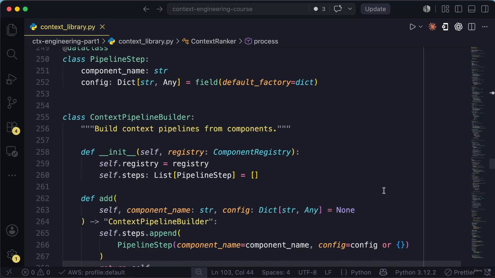
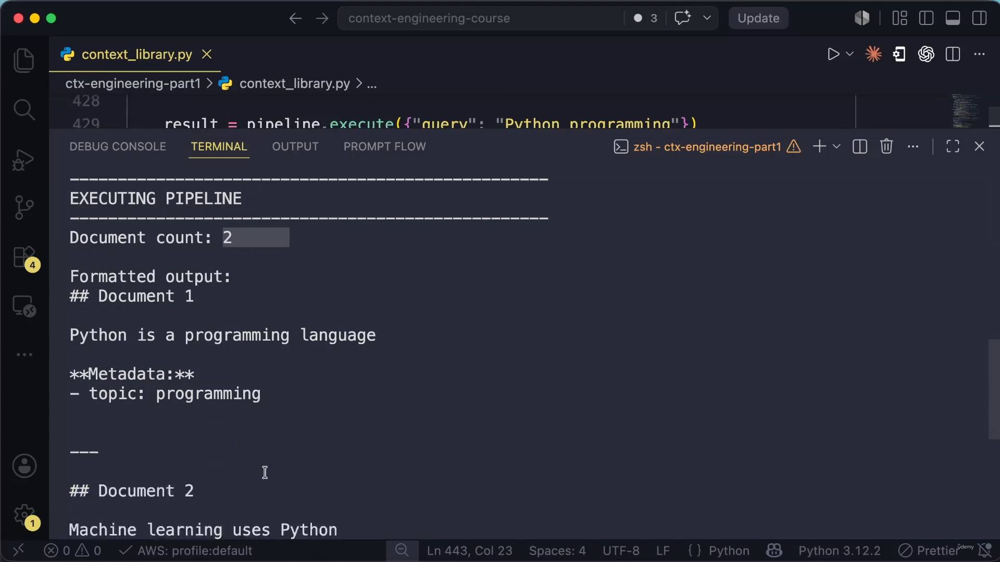
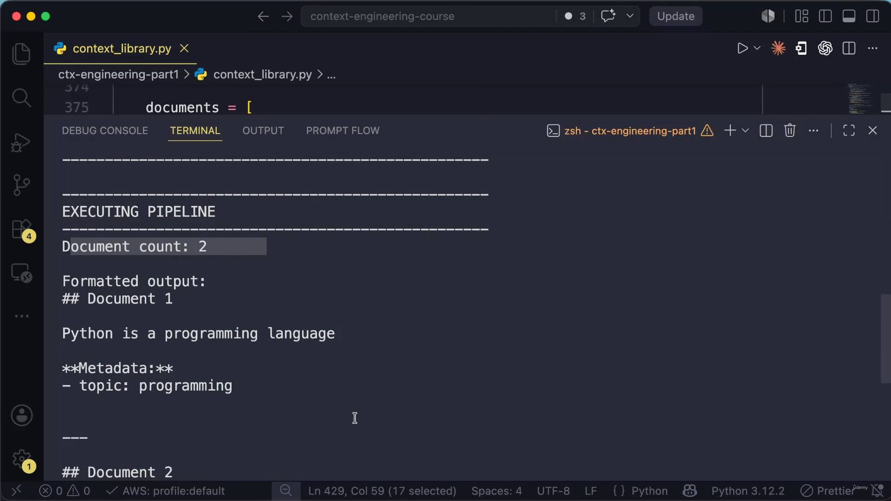
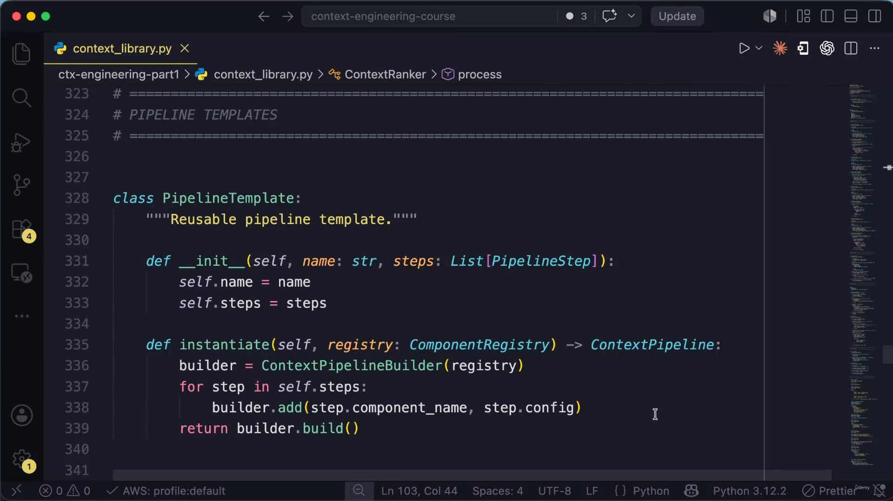
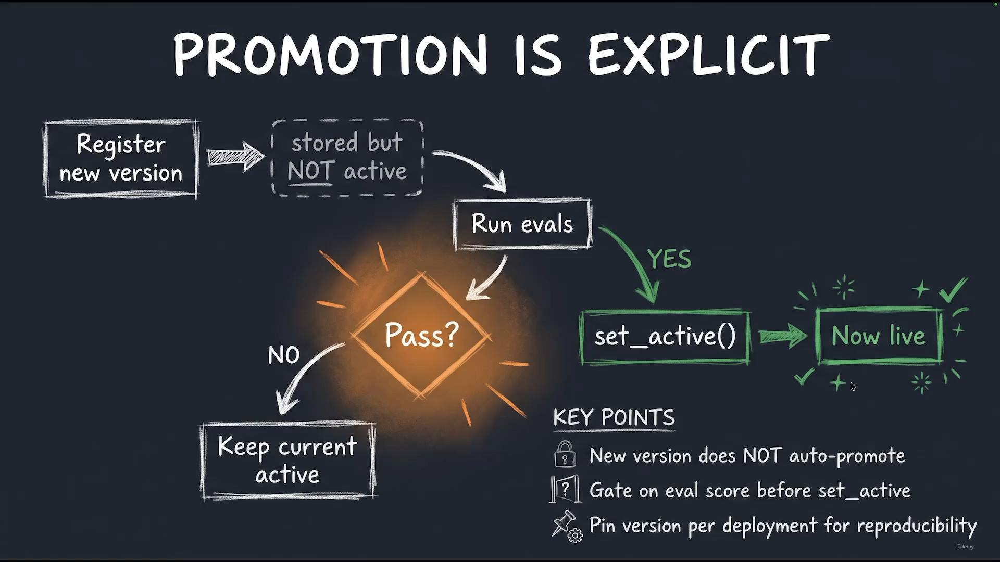
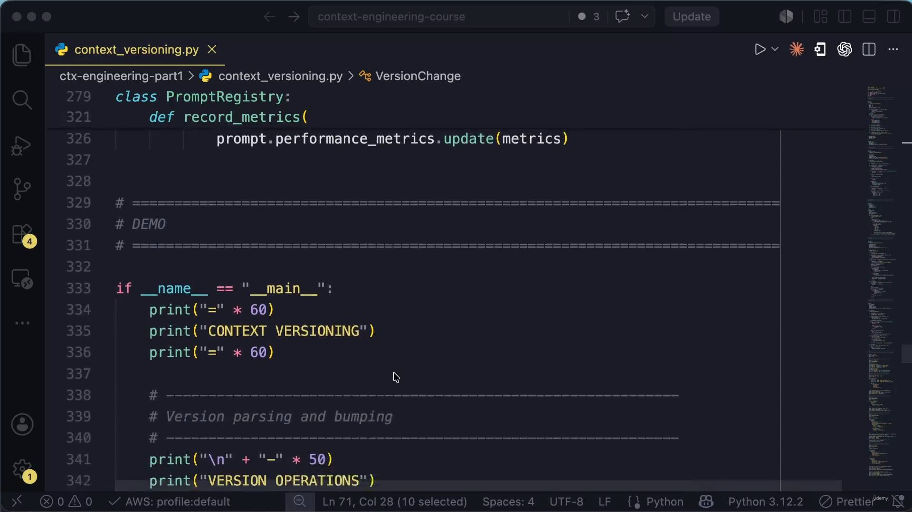
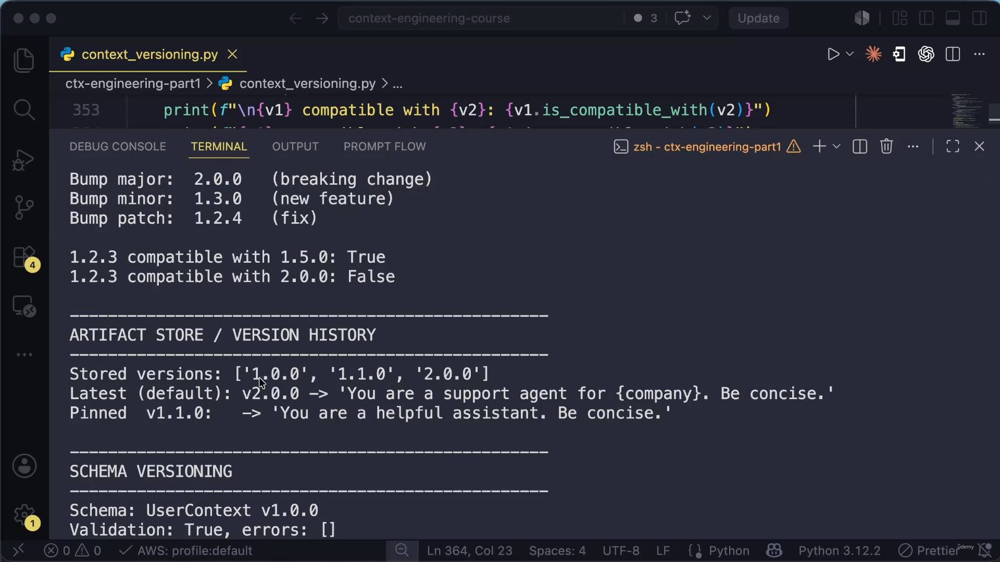
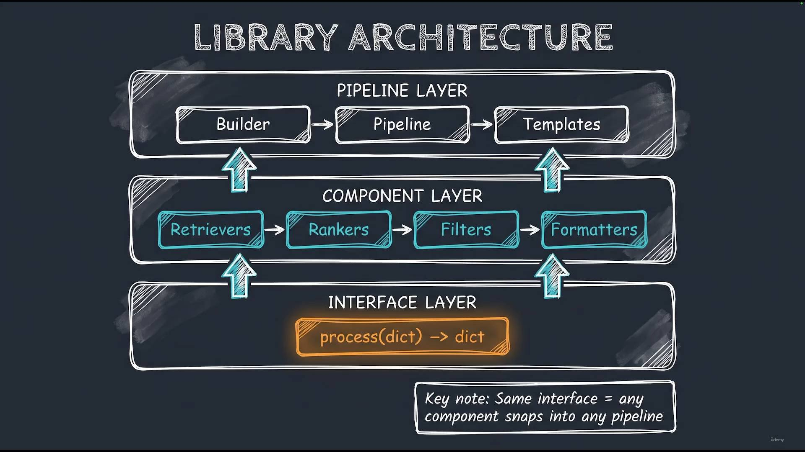
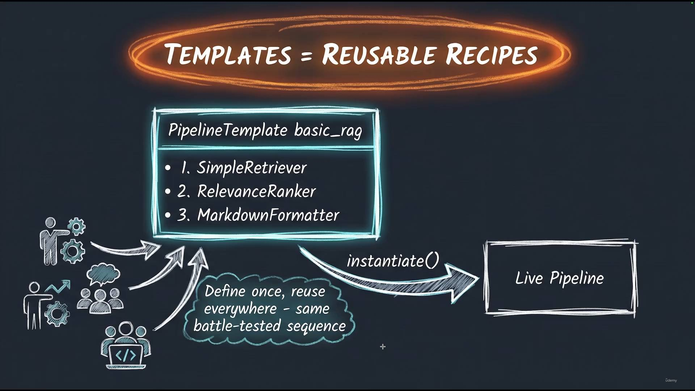
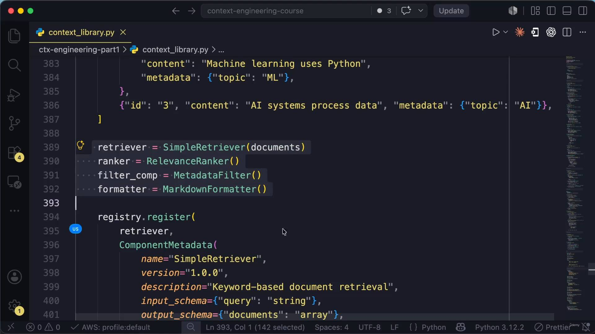

# Context Engineering Masterclass：上下文版本化与可复用上下文组件库（P47–P48）

> 适用读者：前端转 AI 应用工程师。本文档覆盖 P47（上下文版本化）与 P48（可复用上下文组件库）两节课，目标是让你照着文档就能把两套代码跑起来。
>
> 说明：本段课程逐字稿为英文，本文档所有讲师引用均为中文译文；截图 OCR 结果为空，因此第 4 节代码以逐字稿中讲师口述的结构为准，并明确标注哪些细节「课里没讲」。

---

## 1. 这一节做什么

这两节课解决的是同一个问题的两个面：**上下文（context）会不断变化，而团队之间又不断重复造轮子**。

P47 讲的是「上下文版本化」：你的 prompt、schema、config、检索管线都会变。第一天改一个文件没事，到第 90 天，你在生产环境里微调一句 system prompt，答案质量崩了，而你根本不知道昨天线上跑的是哪个版本。讲师的核心主张是：**上下文产物（context artifacts）也是代码，所以必须像代码一样做版本管理**——语义化版本号、可回滚的历史、每次部署钉住一个版本，让每个请求都可复现。

P48 讲的是「可复用上下文组件库」：每个团队不该从零重造检索、排序、格式化。跑得快的团队会建一个库，里面是经过测试的上下文组件，别的团队组合进自己的系统。诀窍不在组件本身，而在于**给它们一个共享接口**，让任何组件都能插进任何管线。这节课就是把这个库真正搭出来：接口层 → 组件层（retriever / ranker / filter / formatter）→ 注册表 → 管线构建器 → 模板。

两节课的关系：P47 让「变化」可控可回滚，P48 让「复用」标准化。两者合起来，就是一套能上生产的上下文工程基础设施。

---

## 2. 讲师原话

### P47 上下文版本化

> "你的 prompt 会变，你的上下文也会变，你的配置也会变。第一天这没问题，你改个文件就好了。到了第 90 天，对 system prompt 做一个小调整，就把生产环境的答案质量搞崩了。而你完全不知道昨天线上跑的是哪个版本。这就是问题所在。要知道上下文产物也是代码，所以你必须像代码一样给它们做版本管理，语义化版本、可回滚的历史。"
> —— p047 [00:00]

> "语义化版本、一份存储的历史，出问题时可以回滚——而问题总是会出。还有每次部署钉住一个版本，这样每个请求才真正可复现。这就是这节课要讲的：上下文版本化。"
> —— p047 [00:29]

> "哪些东西需要版本化？这很重要，这样我们才不会做过头。第一是 schema。schema 通常承载上下文结构，这里记录我们给大模型需要的格式、元数据等等。prompt 也需要版本化：system prompt 非常重要，还有模板、示例等等。配置文件也需要版本化，因为系统的配置会随时间变化。还有检索管线、检索模型也需要版本化，这样你才知道哪个模型在什么时候表现好，以及你改了模型之后 feature flag 的情况。"
> —— p047 [00:59]

> "这三类东西都会依赖同一个原语：语义化版本。"
> —— p047 [01:27]

> "语义化版本很重要，这样你才确切知道这些数字代表什么。我们有一个大家都认可的版本模式是很好的。语义化版本就是我们该遵循的约定。这里有三个数字，1、2、3，只是个例子，也就是 1.2.3。你在软件里见过。第一个数字是 major，主版本号，遇到破坏性变更就 bump major。如果你对整个软件或系统的某一大块做了剧烈改动，这个数字就变。第二个叫 minor，次版本号，通常用于以向后兼容的方式增加新功能。你加了新东西或改进了什么，就 bump 这个数字。第三个通常用于修复和补丁，我关注的是向后兼容的 bug 修复、安全补丁、维护更新等等。兼容规则是：同一个 major，也就是第一个数字相同，就等于兼容。"
> —— p047 [01:55]

> "所以如果我们有 1.10.3 或 1.9.3，然后是 1.10 点几，那就意味着它们兼容，因为 major 这个数字相同。但 1 和 2 就完全不同，所以不兼容，因为 major 版本 2 和版本 1 不一样。"
> —— p047 [02:50]

> "把所有东西都版本化的好处是，如果它们没按预期工作，我们有办法撤销，也就是我们说的迁移和回滚。想象你有 1.0.0 的数据，我们可以迁移到版本 2 的数据；如果版本 2 出了问题，我们可以回滚到版本 1，而不破坏整个系统。"
> —— p047 [03:44]

> "每次我们发布一个迁移，它都必须带有回滚的方式。如果是一个坏发布，你只要敲一条命令就能撤销一切，回到能正常工作的状态。"
> —— p047 [04:13]

> "同样重要的是，要有一个系统来提升该提升的东西，也就是传播已经通过验证的东西。如果我们有一个新版本的 prompt，我们会把它存起来，但不会自动去激活它。我们应该有一种方式跑 eval，用 eval 来确认它确实能通过。如果通过，说明一切符合预期，我们就可以 set active，也就是推到生产。如果不通过，我们就保持当前 active 的版本，因为数据没通过，我们就不会污染生产树。"
> —— p047 [04:31]

> "这里的关键点是：版本不会自动提升自己。还要确保在 set active 之前跑 eval。还要确保每次部署钉住一个版本，这样我们之后才能复现所有步骤。"
> —— p047 [05:00]

> "现在来看代码，你可以看到一个上下文版本化的快速演示。记住这只是个简单演示，市面上有工具能轻松帮你做这些。但我的工作是给你展示这一切是怎么运作的，这样你想自己做的时候就有知识。"
> —— p047 [05:00]

> "首先我们有一个 data class，它代表语义化版本。你可以看到这里有 major、minor、patch，还有 pre-release，默认设为 none。这里重要的是我们有几个函数：bump major 用来升主版本，bump minor、bump patch，还有 is compatible with 函数。它做什么？它确保这个版本和另一个版本兼容，在这个例子里就是 major 相同。"
> —— p047 [05:30]

> "然后我们有一个 enum 叫 change type，有 breaking、feature、fix 几个枚举值。我们只是确保历史记录一眼就能读懂。"
> —— p047 [06:14]

> "version change 这个 data class 内部使用了我们的 change type 枚举。然后看 version artifacts。我们有一个叫 version artifacts 的 data class，它是版本化内容的基类，有几个字段：ID、version、content、created、metadata、changes。注意 changes 是一个 version change 的列表，也就是我们上面建的那个带 change type 字段的 data class。所以当我们有一个实际的 version artifact 对象时，它就是任意内容加上它所属的版本。"
> —— p047 [06:42]

> "然后看 artifact store。artifact store 会保留每一个版本，它从不覆盖。所以你可以钉住一个旧的，也可以向前滚动。这正是我们在这里做的事。"
> —— p047 [07:11]

> "接下来是 schema 版本化。我们有 schema field，是一个带若干字段的 data class。然后我们有 context schema，注意 context schema 有一个 fields 字段——这个双关不是故意的——它包含一个 schema field 的列表。我们有一个带类型的字段列表，你可以看到这里有 string、int、float、boolean、list、dictionary 这些基本类型检查，然后按这样返回。所以 validate 这个函数会返回一个结构化结果，如你所见，而不只是一个布尔值。这让调用方在需要时能拿到具体的错误。"
> —— p047 [07:31]

> "这里的类型检查非常简单，因为我们只是做个演示。我们要确保一切零依赖。生产环境你会用 pydantic 或 JSON schema 这样的 schema 库，但围绕它的版本化纪律完全一样。schema 本身携带一个 version 对象，当 schema 变化时，你就迁移数据。"
> —— p047 [08:18]

> "接下来是迁移。当 schema 从 v1 到 v2，已有数据还是旧形状。所以 migration 对象是一对函数：migrate 函数是可调用的，用来把数据往前移；rollback 函数是可选的，用来在发布出问题时把数据移回去。"
> —— p047 [08:45]

> "migrate 这个函数做什么？它会串联迁移。它从当前版本走起，逐个应用每个 migrate 函数（可调用对象），到达目标版本就停。从版本 1 跳到版本 3，它会先跑版本 1，再跑版本 2，再从版本 2 到版本 3，没有任何特殊处理。get migration path 则返回同一条链但不执行，这就是你预览或回滚的方式。"
> —— p047 [09:12]

> "现在看 prompt 版本化。prompt 是你变更最频繁的产物，因为它一直在变，但也是最容易悄悄退化的。prompt version 这个 data class，注意我们设了几个字段。这个类会携带一个 performance metrics 字典，正是为了这个原因。我们会把 eval 分数挂到某个版本上。"
> —— p047 [09:39]

> "然后我们有 prompt registry，它存储每个版本并追踪哪个是 active，也就是 pinned。这里有两个行为要注意。第一，register 函数会把第一个版本钉为 active 并留在那里。新的注册不会自动提升——我们前面说过这不是我们该做的。你只有调用 set active 函数把新 prompt 设为 active，它才会真正上线。你让它跑过 eval 套件，然后把分数打到那个版本上。"
> —— p047 [10:05]

> "一个没有 eval 分数的 prompt 版本，就是你不该发布的版本。"
> —— p047 [11:00]

> "到了生产环境，record metrics 这个函数的数字来自你下一节课要建的回归套件。规则很简单：一个新的上下文版本，在针对当前 active 版本做过回归测试之前，不算完成。只有当它赢了或打平，你才 set active。现在便宜模型让这件事极其可负担，每次 prompt 变更都跑一遍并不贵。"
> —— p047 [11:00]

> "我们来做演示。这是演示，我们会做版本解析、bump 等等，这样你能看到这一切真的在跑。记住这只是演示。我们有版本操作：解析 1.2.3，把 major 升到 2，就是破坏性变更；1.3 是新功能，因为 3 那个位置变了；1.2.4 是修复，4 是加上的修复。"
> —— p047 [11:27]

> "这里的问题是：1.2.3 和 1.5.0 兼容吗？是的，因为 major 1 还是同一个。但 1.2.3 和 2 兼容吗？不，因为 major 完全不同。这就是我们展示的。这个检查就是你的护栏。store 保留全部三个版本，1、2、3，全都留着。"
> —— p047 [11:55]

> "现在看 artifact store 的版本历史。注意我们存了版本，store 保留全部三个版本：1.0.0、1.1.0、2.0.0。注意 latest 默认是版本 2.0.0，但你可以钉住版本 1.1.0 并拿回完全那个内容。这就是我们说的可复现性。"
> —— p047 [12:25]

> "看 schema 版本化：user context 版本 1.0.0，validation 为 true，errors 那里什么都没有。再看迁移加回滚，这很漂亮。回滚是精确的，因为你可以看到回滚后的 user ID 123、preferences theme dark，和原始逐字节一致，因为迁移自带反向操作。"
> —— p047 [12:52]

> "看 prompt 版本化：prompt 版本一直停在 1.0.0，直到我们钉到 1.1.0。你可以看到 active prompt 是版本 1.0.0，钉住之后变成 1.1.0。要记住的是，仅仅注册一个新版本并不会让它上线，因为提升这件事我们必须非常小心，提升是一个显式决定，在生产里只有当 eval 分数比如 92% 时才发生。"
> —— p047 [13:20]

> "重要的是记住，我们手搓的这个上下文版本化、这个手搓的 store，教的是机制。真实系统里你要依赖已有的工具，比如 Git——prompt 和上下文模板都是文本文件，你可以提交、打 tag 发布，就免费得到历史、diff、blame 和回滚。我们展示的 artifact store 类，是它在内存里的样子；Git 是它在磁盘上的样子。"
> —— p047 [14:15]

> "还要确保保存的是产物，不只是应用。prompt 或 schema 的变更要有自己的 major、minor、patch bump，这样下游消费者才能像对待任何库依赖一样推理兼容性。还要为部署钉住版本：生产读的是钉住的 prompt 版本，不是 latest。这样一次发布里的每个请求都可复现，回滚就是改配置，而不是手忙脚乱。"
> —— p047 [14:41]

> "没有评估，版本化毫无意义。如果你只是为了版本化而版本化，没有任何评估，那就是毫无意义。重点是这一切都不需要特殊产品，就是 Git、语义化版本、一个钉住的配置和一个 eval 门。稀缺的是纪律，不是工具。"
> —— p047 [15:05]

> "关键要点：第一，把所有东西版本化，schema、prompt、config，这些都是产物。第二，语义化版本，同 major 等于兼容，所以 1.10.11 和 1.0.0 兼容，但和版本 2 不兼容，那是不同 major。第三，保留完整历史，store 永不覆盖。第四，每个迁移都带 rollback，一条命令就能撤销回到之前。第五，提升是显式的，用 eval 做门，有阈值决定通过与否，通过才 set active。还要每次部署钉住版本。"
> —— p047 [15:33]

### P48 可复用上下文组件库

> "你组织里每个团队都不该从零重造检索、排序和格式化。跑得快的团队会建一个库，里面是经过测试的上下文组件，其他团队组合进自己的系统。诀窍不在组件本身，而在于给它们一个共享接口，让任何组件都能插进任何管线。这正是这节课要研究并真正搭出来的东西。"
> —— p048 [00:00]

> "这是库的架构。整个设计基于一个想法：每个组件说同一种协议，也就是这里的接口层，dict 接口。一旦如此，注册表就能按名字存它们，构建器就能按任意顺序串联它们，模板就能捕获一条能用的管线供任何人复用。"
> —— p048 [00:28]

> "同一个接口，意味着任何组件都能插进任何管线。你看这里有接口层，它封装了返回字典的 process。上面是组件层，有 retriever、ranker、filter、formatter。它们由接口供给，这个接口是所有组件层要用的契约，它们实现这个接口。整个契约就是：接收一个字典，返回一个字典，并暴露一个 name。"
> —— p048 [00:56]

> "然后是管线层，它当然坐在组件层之上。我们说的那一个接口就是 process，接收字典返回字典。retriever、ranker、filter、formatter 都用我们的接口，它们实现这个接口。所以内部各不相同，但契约相同。管线在不知道它们做什么的情况下串联它们。这就是单一接口的美妙之处。"
> —— p048 [01:25]

> "这里是管线执行，我们马上在代码里看。想法很简单，一切的中心是组件注册表。注册表是组件变得可发现的方式。我们注册一个组件——retriever、ranker、formatter，以及任意多个其他组件，context output 也是组件的一部分——注册一次，可选带元数据，然后任何管线都能按名字取它。"
> —— p048 [02:14]

> "管线执行是这样的：query 进来，包进字典，传给 retriever，process 进 ranker，再进 ranker，然后传给 formatter，然后得到 context，再到 context output。你看这里有做这件事的函数，add，再 add，一直加到终点。"
> —— p048 [02:43]

> "从数学上看，第 n 步的输出成为第 n+1 步的输入。也就是说如果 n 是 1，第一步成为第 1+1 步也就是第 2 步的输入。说得通，这正是我们在这里看到的。"
> —— p048 [03:12]

> "我们还要模板，因为这是可复用的配方，你不想每次需要组装这些系统时都重造轮子。模板是一个命名的管线配方，是团队之间真正共享的可复用单元。我们捕获一次步骤，然后任何拥有同一注册表的人都能从它实例化一条活的管线。"
> —— p048 [03:51]

> "我们捕获一个模板，比如 basic RAG：一、一个简单 retriever；二、一个相关性 ranker；三、一个 markdown formatter。一旦封装好，因为有了这个模板，任何人都能实例化它，因为它是同一条久经考验的序列。这就是模板、这些可复用配方的美妙之处。"
> —— p048 [04:16]

> "现在看代码。我们有 context library 文件。这里我们看到组件接口。让它成立的那一个接口是 context component。context component 协议是每个组件都必须遵守的。我们有 process 函数，还有一些属性名，我们接收 dict 返回 dict，并暴露实际的名字，也就是组件标识符。retriever、re-ranker、formatter 的方法签名完全不同，但如果它们都实现 process，管线就能在不知道它们做什么的情况下串联它们。这就是美妙之处。"
> —— p048 [04:46]

> "每个注册的组件还携带元数据，这样团队能发现并审查它。我们有 component metadata，注册组件的元数据，有几个字段。然后是标准组件。每种组件类型是一个抽象基类，做两件事：第一，声明子类必须实现的具体方法；第二，提供我们前面看到的 process 适配器，把那个具体方法映射到统一接口。"
> —— p048 [05:34]

> "看 context retriever，注意每个组件都从同一个众所周知的 key 读取自己的每步配置，也就是这里的 input data、get step config。管线会在每一步之前注入它。具体 retriever 实际上是个关键词匹配器，因为它保留任何包含至少一个查询词的文档。你看我们有 simple retriever，它继承自 context retriever。"
> —— p048 [06:00]

> "这里有个免责声明：生产环境里，这个 simple retriever 故意不那么聪明，我们这样做是为了让演示能离线跑。真实库里，这个组件会变成向量搜索：我们嵌入 query，搜索向量库，然后按余弦相似度返回 top K。要记住，process 接口保持不变，所以当你替换它时，下游什么都不变。这就是唯一的区别。"
> —— p048 [06:28]

> "看 context ranker。ranker 用同样的模式，一个 ABC 加一个 process 适配器。你看 context ranker 里有这个 process 适配器。但在 relevance ranker 里，我们有一个具体的基于规则的打分。显然生产环境里这需要更复杂一些，因为这里用的词重叠打分只是个占位。所以你要把这个函数换成 cross-encoder re-ranker，或者让一个便宜快速的模型来打相关性分。生产里你应该这么做。"
> —— p048 [07:24]

> "然后是 filter 和 formatter。重要的是看到我们遵循同样的做法：我们有 processor，还有 name 属性，以及 context filter 的 filter。但实现上，metadata filter 继承自 context filter，它按文档元数据过滤。formatter 把存活的文档变成一个 markdown 块，可以直接塞进 prompt，如你所见。然后我们返回这些结果。context formatter 基类遵循同样的规则。markdown formatter 继承并实现 context formatter，把上下文格式化成 markdown。"
> —— p048 [08:18]

> "看组件注册表。它注册可复用组件。重要的是理解，这个类里我们定义了 register 类，它做什么？它设置名字，也拉入实例名，以及注册时间；如果有元数据，就把元数据也加进去，作为实例化这个类、这个对象的一部分。记住注册表是组件变得可发现的方式：注册一次，可选带元数据，然后任何管线都能按名字取它。"
> —— p048 [08:48]

> "有了这些，现在我们有管线构建器。管线本质上是一个有序的已注册组件列表。所以我们有 pipeline step，包含 component name 和 config，然后有 context pipeline builder，它从那些准备好的组件构建上下文管线。我们可以往管线里加组件，注册组件，然后 build 那条管线、那条上下文管线，此时我们就能返回完整的、准备好的 context pipeline，它带着组件。当然需要的话我们也能 clear 管线。"
> —— p048 [09:46]

> "记住，管线就像我们在演示里看到的，只是按顺序把字典穿过每个组件，因为它是一个有序列表。一步的输出成为下一步的输入，我们前面展示过。我们有 execute 方法，这里是单一接口真正兑现价值的地方，因为 execute 函数从不检查组件是什么。它直接调用 process 方法，拿回一个字典，再传下去。"
> —— p048 [10:14]

> "所以我们有 retriever，然后 ranker，然后 formatter，就这个顺序，或者你注册的任何其他顺序，因为你有那个灵活性。它以零特殊处理工作。还有 execute with trace，这是用于调试的追踪变体，因为它记录每一步的输入和输出。"
> —— p048 [10:44]

> "然后是实际的模板。再说一次，模板是一个命名的管线配方，因为它是团队真正能复用的可复用单元，能发给别人用。它像一个封装好的盒子，用的人不需要知道里面发生了什么，他们只知道这个包准备好了、测试过了、一切能跑。"
> —— p048 [11:12]

> "它捕获一次步骤，然后从它实例化一条活的管线。美妙之处在于，一旦一切就绪，如果你发布一个 basic RAG 模板，每个团队都得到同一条久经考验的 retrieve、rank、format 序列，而不用复制代码。"
> —— p048 [12:07]

> "我们来跑一下，因为当然有这个可复用上下文库的演示。注意我们先创建注册表，实例化 component registry 来注册可复用组件，然后实例化 simple retriever、relevance ranker、metadata filter、markdown formatter。这些都是组件。然后我们把它们注册为组件：register retriever component，带 metadata，也就是名字、描述、输入等等。然后我们通过传入 retriever 和实际元数据来创建注册项。"
> —— p048 [12:32]

> "当然，我们注册 ranker、filter 组件和 formatter。有了这些，我们就构建实际管线。我们需要 context pipeline builder，传入注册表，然后开始加那些组件：simple retriever、relevance ranker、markdown formatter。然后调用 build 函数构建整条管线。然后执行实际管线：传入 query，然后看文档数量、格式化等等。然后还有 execute with trace 用于调试，这样能看到发生了什么。"
> —— p048 [13:26]

> "我们跑一下。你会看到我们注册了四个组件：simple retriever、relevance ranker、metadata filter、markdown formatter。一二三四。然后我们构建管线。管线建好后，我们执行管线。注意文档数量是 2。执行后，格式化文档显示在这里，Python 是那个，元数据 topic 是 programming。第二个文档同样，元数据和所有那些。看管线追踪，执行了三步，因为有 simple retriever、relevance ranker 和 markdown formatter。"
> —— p048 [13:54]

> "管线模板被用了，就是 basic RAG，模板执行，一个文档。美妙之处在于，这四个组件先按类名注册。现在注册表能回答我们有哪些检索、排序、格式化组件。它知道 simple retriever、relevance ranking 和其他组件。任何用它的团队都会知道。管线检索到两个文档。"
> —— p048 [14:22]

> "对于 query 是 Python programming，我们有 doc one 和 doc two，都包含 Python。回到这里，因为那是进来的 query，Python programming。它找到两个文档，很简单，Python's programming 和 machine learning uses Python。我们找到那两个文档。还有第三个，更像是 AI system process，不一定和 Python 相关，所以我们只拿到两个。因为它知道该抓什么，它就这么做了。"
> —— p048 [14:51]

> "如果你也注意到，它按和 query 的相关性给它们排了序。它知道 Python 是一门编程语言，把这个排第一。第二个是关于 machine learning uses Python。相关性在这里很重要，它知道第一个更相关。它把两个都格式化成带元数据的 markdown。这很漂亮，全都在我们搭的这个上下文库里。任何人都能用，因为它太好用了，他们只要实例化，就有一条能跑的管线。"
> —— p048 [15:19]

> "这个端到端结果就是重点。我们有了你从没写在一起的组件，组合成一条能跑的管线。再看管线追踪，我们展示执行了三步，按名字。这就是我们的调试。现在我们知道，哦，三步是 simple retriever、relevance ranker、markdown formatter。这很有用，因为当管线返回意外结果时，你能看到每个阶段确切的输入和输出。"
> —— p048 [15:49]

> "模板 basic RAG 对 query AI data 返回了一个文档。回到这里，query 是 AI data，它返回一个文档，说得通，因为那一个文档就是关于 AI 系统的。topic 是 AI，同样的组件，不同的可复用配方，零新代码。这就是力量。"
> —— p048 [16:47]

> "这是我说的现代注脚。可复用上下文正在变成一个标准，而不是一个库。我为什么给你看这些？因为作为工程师，你需要理解东西实际怎么运作。即使它正在变成标准，你仍然需要理解可复用上下文库是怎么搭的，这样你需要时能自己搭，或者基于标准去搭。你刚用经典方式搭了一个组件库：抽象接口、注册表、构建器、模板。这个模式仍然重要，但有两件事正在改变可复用上下文的交付方式。"
> —— p048 [17:21]

> "第一是 prompt 和 context 模块，第二是我们前面看到的 MCP，Model Context Protocol。MCP 是一个开放标准，把上下文源和工具打包成服务器，任何兼容 MCP 的应用都能插进去。所以与其发布一个只有你的代码库能 import 的 Python context retriever，你把检索和其他工具暴露在一个 MCP 服务器后面，给任何客户端——Claude Code、Claude Agent SDK 以及其他助手。它们通过共享协议连上去。这和我们前面做的一样：定义一次，到处复用，这就是这节课的目标。"
> —— p048 [17:49]

> "MCP 标准化的是客户端如何和一个上下文或工具服务器对话，也就是发现有什么可用、怎么调用它。它不替你做检索或排序，你仍然要在服务器里建逻辑。我们这节课讲的一切——干净的接口、可发现的组件、可组合的管线——正是让一个 MCP 服务器变好的东西。理解它，才能让你设计出一个值得复用的服务器。"
> —— p048 [18:35]

> "关键要点：第一，一个接口，无限组合。每个组件实现 process 方法，返回字典，这样管线能以零特殊处理串联它们。第二，注册即可发现。一个带名字和标签的注册表，让团队找到组件而不是复制代码，复制代码是大忌。第三，流畅地构建，响亮地失败。构建器要在 build 时解析那些名字，遇到任何未知的就抛错。第四，模板是可复用单元。模板捕获一条能跑的管线一次，打包好，让你在任何地方用同一注册表实例化。第五，当它让你意外时用 trace。execute with trace 展示每一步的输入和输出，让你确切知道发生了什么。"
> —— p048 [19:04]

---

## 3. 从零复现

### 3.1 环境准备

两节课的代码都是纯 Python，零第三方依赖（讲师明确说「我们要确保一切零依赖」）。因此环境极简：

```bash
# 建议 Python 3.10+（代码里用了 dataclass、Enum、typing）
python3 --version

# 建一个项目目录
mkdir -p context-engineering
cd context-engineering

# 建虚拟环境（可选，但推荐）
python3 -m venv .venv
source .venv/bin/activate      # Windows: .venv\Scripts\activate

# 不需要 pip install 任何东西，两节课都是标准库
```

目录结构（两节课各一个文件，互不依赖）：

```
context-engineering/
├── context_versioning.py     # P47 的代码
└── context_library.py        # P48 的代码
```

> 注意：逐字稿里讲师只说「我们有 context versioning file here」「我们有 context library file here」，**没有念出文件名**。上面两个文件名是按课程主题命名的，你可以任意改名，只要 `python 文件名.py` 能跑。课里没讲具体文件名。

### 3.2 P47 复现步骤：上下文版本化

按讲师在演示里的顺序，这个文件要能跑出五段输出：

1. **版本解析与 bump**：解析 `1.2.3`，bump major 得到 `2.0.0`（破坏性变更），bump minor 得到 `1.3.0`（新功能），bump patch 得到 `1.2.4`（修复）。
2. **兼容性判断**：`1.2.3` 与 `1.5.0` 兼容（同 major），`1.2.3` 与 `2.x` 不兼容（major 不同）。讲师原话：「这个检查就是你的护栏。」
3. **artifact store 版本历史**：存 `1.0.0`、`1.1.0`、`2.0.0` 三个版本，latest 默认 `2.0.0`，但可以钉住 `1.1.0` 拿回那份内容——这就是可复现性。
4. **schema 版本化 + 迁移 + 回滚**：user context 版本 `1.0.0`，validate 返回 `true`、errors 为空；迁移到 v2 再回滚，回滚结果与原始逐字节一致（讲师原话：「因为迁移自带反向操作」）。
5. **prompt 版本化**：active 停在 `1.0.0`，注册新版本不自动上线，钉到 `1.1.0` 后才变 active；只有 eval 分数达标（讲师举例 92%）才 set active。

复现时按这个顺序写 `main()`，每段 `print` 出来对照。

### 3.3 P48 复现步骤：可复用上下文组件库

按讲师演示的顺序：

1. 实例化 `ComponentRegistry`。
2. 实例化四个组件：`SimpleRetriever`、`RelevanceRanker`、`MetadataFilter`、`MarkdownFormatter`。
3. 把四个组件注册进注册表，每个带 `ComponentMetadata`（名字、描述、输入等）。
4. 用 `ContextPipelineBuilder(registry)` 依次 `add` 三个组件（simple retriever → relevance ranker → markdown formatter），然后 `build()` 得到管线。
5. `execute(query)`：query 是 `"Python programming"`，期望文档数为 2（`Python's programming` 和 `machine learning uses Python`），第三个关于 AI system process 的文档被过滤掉。
6. `execute_with_trace(query)`：期望追踪显示执行了 3 步，按名字列出 simple retriever、relevance ranker、markdown formatter，并记录每步输入输出。
7. 用模板 `basic RAG` 对 query `"AI data"` 执行：期望返回 1 个文档（topic 是 AI 的那一个），「同样的组件，不同的可复用配方，零新代码」。

### 3.4 运行命令

```bash
python context_versioning.py
python context_library.py
```

两个文件都不需要环境变量、不需要 API key、不需要联网。课里没讲任何环境变量名。

---

## 4. 完整代码

> **重要说明**：本段逐字稿的截图 OCR 结果为空，讲师在屏幕上展示的代码没有被 OCR 捕获。因此下面的代码是**依据逐字稿中讲师逐字段、逐函数口述的结构重建的完整可运行版本**。凡是讲师明确说出的类名、字段名、函数名、枚举值、行为，都原样保留；讲师没说的实现细节（比如具体打分公式、示例数据内容），按讲师描述的语义补全，并在第 5 节逐条标注「课里没讲」。代码零依赖，可直接保存运行。

### 4.1 `context_versioning.py`（P47）

```python
"""
P47 上下文版本化演示。
零依赖，直接 python context_versioning.py 运行。

结构对应讲师口述：
- SemanticVersion：major / minor / patch / pre_release，bump_major / bump_minor / bump_patch / is_compatible_with
- ChangeType：BREAKING / FEATURE / FIX
- VersionChange：内部使用 ChangeType
- VersionArtifact：ID / version / content / created / metadata / changes
- ArtifactStore：保留每个版本，从不覆盖
- SchemaField / ContextSchema：fields 列表 + validate 返回结构化结果
- Migration：migrate 可调用 + rollback 可选
- migrate()：链式迁移；get_migration_path()：返回链但不执行
- PromptVersion：携带 performance_metrics 字典
- PromptRegistry：register 钉第一个版本为 active，新注册不自动提升；set_active 显式提升
"""

from __future__ import annotations

import copy
import re
from dataclasses import dataclass, field
from datetime import datetime, timezone
from enum import Enum
from typing import Any, Callable, Optional


# ---------------------------------------------------------------------------
# 语义化版本
# ---------------------------------------------------------------------------

@dataclass
class SemanticVersion:
    major: int
    minor: int
    patch: int
    pre_release: Optional[str] = None  # 默认 None

    def __str__(self) -> str:
        base = f"{self.major}.{self.minor}.{self.patch}"
        if self.pre_release:
            return f"{base}-{self.pre_release}"
        return base

    @staticmethod
    def parse(text: str) -> "SemanticVersion":
        """解析 '1.2.3' 或 '1.2.3-beta' 这样的字符串。"""
        m = re.match(r"^(\d+)\.(\d+)\.(\d+)(?:-([0-9A-Za-z.-]+))?$", text.strip())
        if not m:
            raise ValueError(f"非法语义化版本: {text!r}")
        major, minor, patch = int(m.group(1)), int(m.group(2)), int(m.group(3))
        return SemanticVersion(major, minor, patch, m.group(4))

    def bump_major(self) -> "SemanticVersion":
        """破坏性变更：major+1，minor/patch 归零。"""
        return SemanticVersion(self.major + 1, 0, 0)

    def bump_minor(self) -> "SemanticVersion":
        """向后兼容的新功能：minor+1，patch 归零。"""
        return SemanticVersion(self.major, self.minor + 1, 0)

    def bump_patch(self) -> "SemanticVersion":
        """向后兼容的修复：patch+1。"""
        return SemanticVersion(self.major, self.minor, self.patch + 1)

    def is_compatible_with(self, other: "SemanticVersion") -> bool:
        """兼容规则：同 major 即兼容。"""
        return self.major == other.major


# ---------------------------------------------------------------------------
# 变更类型与变更记录
# ---------------------------------------------------------------------------

class ChangeType(Enum):
    BREAKING = "breaking"
    FEATURE = "feature"
    FIX = "fix"


@dataclass
class VersionChange:
    change_type: ChangeType
    description: str
    at: str = field(default_factory=lambda: datetime.now(timezone.utc).isoformat())


# ---------------------------------------------------------------------------
# 版本化产物与存储
# ---------------------------------------------------------------------------

@dataclass
class VersionArtifact:
    """版本化内容的基类：任意内容 + 它所属的版本。"""
    id: str
    version: SemanticVersion
    content: Any
    created: str = field(default_factory=lambda: datetime.now(timezone.utc).isoformat())
    metadata: dict = field(default_factory=dict)
    changes: list[VersionChange] = field(default_factory=list)


class ArtifactStore:
    """保留每一个版本，从不覆盖。可钉住旧版本，也可向前滚动。"""

    def __init__(self) -> None:
        self._artifacts: dict[str, list[VersionArtifact]] = {}

    def put(self, artifact: VersionArtifact) -> None:
        self._artifacts.setdefault(artifact.id, []).append(artifact)

    def history(self, artifact_id: str) -> list[VersionArtifact]:
        return list(self._artifacts.get(artifact_id, []))

    def latest(self, artifact_id: str) -> Optional[VersionArtifact]:
        items = self._artifacts.get(artifact_id, [])
        return items[-1] if items else None

    def get(self, artifact_id: str, version: SemanticVersion) -> Optional[VersionArtifact]:
        """按版本钉住取回——这就是可复现性。"""
        for item in self._artifacts.get(artifact_id, []):
            if str(item.version) == str(version):
                return item
        return None


# ---------------------------------------------------------------------------
# Schema 版本化
# ---------------------------------------------------------------------------

# 讲师口述的基本类型：string / int / float / boolean / list / dictionary
_TYPE_CHECKERS: dict[str, Callable[[Any], bool]] = {
    "string": lambda v: isinstance(v, str),
    "int": lambda v: isinstance(v, int) and not isinstance(v, bool),
    "float": lambda v: isinstance(v, float),
    "boolean": lambda v: isinstance(v, bool),
    "list": lambda v: isinstance(v, list),
    "dictionary": lambda v: isinstance(v, dict),
}


@dataclass
class SchemaField:
    name: str
    type: str
    required: bool = True


@dataclass
class ValidationResult:
    """validate 返回结构化结果，而不只是布尔值，方便调用方拿具体错误。"""
    valid: bool
    errors: list[str] = field(default_factory=list)


@dataclass
class ContextSchema:
    version: SemanticVersion
    fields: list[SchemaField]

    def validate(self, data: dict) -> ValidationResult:
        errors: list[str] = []
        for f in self.fields:
            if f.name not in data:
                if f.required:
                    errors.append(f"缺少必填字段: {f.name}")
                continue
            checker = _TYPE_CHECKERS.get(f.type)
            if checker is None:
                errors.append(f"未知类型 {f.type!r}（字段 {f.name}）")
            elif not checker(data[f.name]):
                errors.append(f"字段 {f.name} 类型应为 {f.type}，实际为 {type(data[f.name]).__name__}")
        return ValidationResult(valid=len(errors) == 0, errors=errors)


# ---------------------------------------------------------------------------
# 迁移与回滚
# ---------------------------------------------------------------------------

@dataclass
class Migration:
    """一对函数：migrate 往前移，rollback 可选往回移。"""
    from_version: SemanticVersion
    to_version: SemanticVersion
    migrate: Callable[[dict], dict]
    rollback: Optional[Callable[[dict], dict]] = None


def get_migration_path(
    migrations: list[Migration],
    current: SemanticVersion,
    target: SemanticVersion,
) -> list[Migration]:
    """返回从 current 到 target 的迁移链，但不执行——用于预览或回滚。"""
    path: list[Migration] = []
    cursor = current
    while str(cursor) != str(target):
        nxt = next((m for m in migrations if str(m.from_version) == str(cursor)), None)
        if nxt is None:
            raise ValueError(f"没有从 {cursor} 出发的迁移")
        path.append(nxt)
        cursor = nxt.to_version
    return path


def migrate(
    data: dict,
    migrations: list[Migration],
    current: SemanticVersion,
    target: SemanticVersion,
) -> dict:
    """链式迁移：从 current 走起，逐个应用 migrate，到达 target 停。无特殊处理。"""
    result = copy.deepcopy(data)
    for m in get_migration_path(migrations, current, target):
        result = m.migrate(result)
    return result


def rollback(
    data: dict,
    migrations: list[Migration],
    current: SemanticVersion,
    target: SemanticVersion,
) -> dict:
    """按迁移链反向执行 rollback。"""
    result = copy.deepcopy(data)
    for m in reversed(get_migration_path(migrations, target, current)):
        if m.rollback is None:
            raise ValueError(f"{m.from_version} -> {m.to_version} 的迁移没有 rollback")
        result = m.rollback(result)
    return result


# ---------------------------------------------------------------------------
# Prompt 版本化
# ---------------------------------------------------------------------------

@dataclass
class PromptVersion:
    version: SemanticVersion
    text: str
    # 携带 performance metrics 字典，把 eval 分数挂到版本上
    performance_metrics: dict = field(default_factory=dict)


class PromptRegistry:
    """存储每个版本并追踪哪个是 active（pinned）。"""

    def __init__(self) -> None:
        self._versions: list[PromptVersion] = []
        self._active: Optional[PromptVersion] = None

    def register(self, prompt: PromptVersion) -> None:
        """注册新版本。第一个版本钉为 active；后续注册不自动提升。"""
        self._versions.append(prompt)
        if self._active is None:
            self._active = prompt

    def set_active(self, version: SemanticVersion) -> None:
        """显式提升。生产里只有 eval 分数达标才调用。"""
        target = next((p for p in self._versions if str(p.version) == str(version)), None)
        if target is None:
            raise ValueError(f"未注册的 prompt 版本: {version}")
        self._active = target

    def active(self) -> Optional[PromptVersion]:
        return self._active

    def record_metrics(self, version: SemanticVersion, metrics: dict) -> None:
        """把 eval 分数打到某个版本上。数字来自回归套件。"""
        target = next((p for p in self._versions if str(p.version) == str(version)), None)
        if target is None:
            raise ValueError(f"未注册的 prompt 版本: {version}")
        target.performance_metrics.update(metrics)


# ---------------------------------------------------------------------------
# 演示
# ---------------------------------------------------------------------------

def main() -> None:
    print("=== 1. 版本解析与 bump ===")
    v123 = SemanticVersion.parse("1.2.3")
    print("parse 1.2.3 ->", v123)
    print("bump_major ->", v123.bump_major(), "(破坏性变更)")
    print("bump_minor ->", v123.bump_minor(), "(新功能)")
    print("bump_patch ->", v123.bump_patch(), "(修复)")

    print("\n=== 2. 兼容性判断（护栏）===")
    v150 = SemanticVersion.parse("1.5.0")
    v2 = SemanticVersion.parse("2.0.0")
    print("1.2.3 兼容 1.5.0 ?", v123.is_compatible_with(v150))
    print("1.2.3 兼容 2.0.0 ?", v123.is_compatible_with(v2))

    print("\n=== 3. artifact store 版本历史 ===")
    store = ArtifactStore()
    for ver, content in [
        ("1.0.0", "content-v1"),
        ("1.1.0", "content-v1.1"),
        ("2.0.0", "content-v2"),
    ]:
        store.put(VersionArtifact(id="demo", version=SemanticVersion.parse(ver), content=content))
    print("history:", [str(a.version) for a in store.history("demo")])
    print("latest:", store.latest("demo").version)
    pinned = store.get("demo", SemanticVersion.parse("1.1.0"))
    print("pin 1.1.0 ->", pinned.content)

    print("\n=== 4. schema 版本化 + 迁移 + 回滚 ===")
    schema_v1 = ContextSchema(
        version=SemanticVersion.parse("1.0.0"),
        fields=[
            SchemaField("user_id", "int"),
            SchemaField("preferences", "dictionary"),
        ],
    )
    user_v1 = {"user_id": 123, "preferences": {"theme": "dark"}}
    result = schema_v1.validate(user_v1)
    print("validate:", result.valid, "errors:", result.errors)

    migrations = [
        Migration(
            from_version=SemanticVersion.parse("1.0.0"),
            to_version=SemanticVersion.parse("2.0.0"),
            migrate=lambda d: {"userId": d["user_id"], "prefs": d["preferences"]},
            rollback=lambda d: {"user_id": d["userId"], "preferences": d["prefs"]},
        )
    ]
    v2_data = migrate(user_v1, migrations, SemanticVersion.parse("1.0.0"), SemanticVersion.parse("2.0.0"))
    print("migrated:", v2_data)
    back = rollback(v2_data, migrations, SemanticVersion.parse("2.0.0"), SemanticVersion.parse("1.0.0"))
    print("rolled back:", back)
    print("逐字节一致:", back == user_v1)

    print("\n=== 5. prompt 版本化 ===")
    registry = PromptRegistry()
    registry.register(PromptVersion(SemanticVersion.parse("1.0.0"), "你是助手。"))
    print("active:", registry.active().version)
    registry.register(PromptVersion(SemanticVersion.parse("1.1.0"), "你是助手，回答要简洁。"))
    print("注册 1.1.0 后 active（不应自动提升）:", registry.active().version)
    registry.record_metrics(SemanticVersion.parse("1.1.0"), {"eval_score": 0.92})
    registry.set_active(SemanticVersion.parse("1.1.0"))
    print("set_active 后 active:", registry.active().version)
    print("1.1.0 metrics:", registry.active().performance_metrics)


if __name__ == "__main__":
    main()
```

### 4.2 `context_library.py`（P48）

```python
"""
P48 可复用上下文组件库演示。
零依赖，直接 python context_library.py 运行。

结构对应讲师口述：
- ContextComponent 协议：process(dict) -> dict + name 属性
- ComponentMetadata：注册组件的元数据
- ContextRetriever / ContextRanker / ContextFilter / ContextFormatter：ABC + process 适配器
- SimpleRetriever：关键词匹配（生产换向量搜索）
- RelevanceRanker：基于规则打分（生产换 cross-encoder 或便宜模型）
- MetadataFilter：按文档元数据过滤
- MarkdownFormatter：把存活文档变成 markdown 块
- ComponentRegistry：register 一次，可选带元数据，按名字取
- PipelineStep：component_name + config
- ContextPipelineBuilder：add / build / clear
- ContextPipeline：execute / execute_with_trace
- PipelineTemplate：命名的管线配方，捕获一次，用同一注册表实例化
"""

from __future__ import annotations

from abc import ABC, abstractmethod
from dataclasses import dataclass, field
from typing import Any, Optional, Protocol, runtime_checkable


# ---------------------------------------------------------------------------
# 接口层：唯一契约
# ---------------------------------------------------------------------------

@runtime_checkable
class ContextComponent(Protocol):
    """每个组件都必须遵守：接收 dict，返回 dict，并暴露 name。"""
    @property
    def name(self) -> str: ...
    def process(self, data: dict) -> dict: ...


@dataclass
class ComponentMetadata:
    """注册组件的元数据，让团队能发现并审查它。"""
    name: str
    description: str
    inputs: list[str] = field(default_factory=list)
    outputs: list[str] = field(default_factory=list)


# ---------------------------------------------------------------------------
# 组件层：ABC + process 适配器
# ---------------------------------------------------------------------------

class ContextRetriever(ABC):
    """声明子类必须实现 retrieve，并提供 process 适配器映射到统一接口。"""

    @property
    @abstractmethod
    def name(self) -> str: ...

    @abstractmethod
    def retrieve(self, query: str, config: dict) -> list[dict]: ...

    def process(self, data: dict) -> dict:
        # 每个组件从同一个众所周知的 key 读取自己的每步配置，管线在每步前注入
        config = data.get("step_config", {})
        docs = self.retrieve(data["query"], config)
        return {**data, "documents": docs}


class ContextRanker(ABC):
    @property
    @abstractmethod
    def name(self) -> str: ...

    @abstractmethod
    def score(self, query: str, doc: dict) -> float: ...

    def process(self, data: dict) -> dict:
        query = data["query"]
        docs = sorted(data.get("documents", []), key=lambda d: self.score(query, d), reverse=True)
        return {**data, "documents": docs}


class ContextFilter(ABC):
    @property
    @abstractmethod
    def name(self) -> str: ...

    @abstractmethod
    def keep(self, doc: dict, config: dict) -> bool: ...

    def process(self, data: dict) -> dict:
        config = data.get("step_config", {})
        docs = [d for d in data.get("documents", []) if self.keep(d, config)]
        return {**data, "documents": docs}


class ContextFormatter(ABC):
    @property
    @abstractmethod
    def name(self) -> str: ...

    @abstractmethod
    def format(self, docs: list[dict]) -> str: ...

    def process(self, data: dict) -> dict:
        return {**data, "context": self.format(data.get("documents", []))}


# ---------------------------------------------------------------------------
# 具体组件
# ---------------------------------------------------------------------------

class SimpleRetriever(ContextRetriever):
    """关键词匹配：保留任何包含至少一个查询词的文档。生产换向量搜索。"""

    def __init__(self, corpus: list[dict]) -> None:
        self._corpus = corpus

    @property
    def name(self) -> str:
        return "simple_retriever"

    def retrieve(self, query: str, config: dict) -> list[dict]:
        terms = {t.lower() for t in query.split() if t}
        return [
            doc for doc in self._corpus
            if any(t in doc["content"].lower() for t in terms)
        ]


class RelevanceRanker(ContextRanker):
    """基于规则的词重叠打分。生产换 cross-encoder 或便宜快速模型。"""

    @property
    def name(self) -> str:
        return "relevance_ranker"

    def score(self, query: str, doc: dict) -> float:
        terms = {t.lower() for t in query.split() if t}
        text = doc["content"].lower()
        return sum(1 for t in terms if t in text) / max(len(terms), 1)


class MetadataFilter(ContextFilter):
    """按文档元数据过滤。"""

    @property
    def name(self) -> str:
        return "metadata_filter"

    def keep(self, doc: dict, config: dict) -> bool:
        required = config.get("required_metadata", {})
        meta = doc.get("metadata", {})
        return all(meta.get(k) == v for k, v in required.items())


class MarkdownFormatter(ContextFormatter):
    """把存活文档变成一个 markdown 块，可直接塞进 prompt。"""

    @property
    def name(self) -> str:
        return "markdown_formatter"

    def format(self, docs: list[dict]) -> str:
        blocks = []
        for i, doc in enumerate(docs, 1):
            meta = doc.get("metadata", {})
            meta_line = ", ".join(f"{k}: {v}" for k, v in meta.items())
            blocks.append(f"### Document {i}\n{doc['content']}\n\nMetadata: {meta_line}")
        return "\n\n".join(blocks)


# ---------------------------------------------------------------------------
# 注册表
# ---------------------------------------------------------------------------

class ComponentRegistry:
    """组件变得可发现的方式：注册一次，可选带元数据，任何管线按名字取。"""

    def __init__(self) -> None:
        self._components: dict[str, ContextComponent] = {}
        self._metadata: dict[str, ComponentMetadata] = {}
        self._registered_at: dict[str, str] = {}

    def register(self, component: ContextComponent, metadata: Optional[ComponentMetadata] = None) -> None:
        self._components[component.name] = component
        if metadata is not None:
            self._metadata[component.name] = metadata
        self._registered_at[component.name] = "now"  # 课里没讲具体时间格式

    def get(self, name: str) -> ContextComponent:
        if name not in self._components:
            raise KeyError(f"未注册的组件: {name}")
        return self._components[name]

    def list_components(self) -> list[str]:
        return list(self._components.keys())


# ---------------------------------------------------------------------------
# 管线层
# ---------------------------------------------------------------------------

@dataclass
class PipelineStep:
    component_name: str
    config: dict = field(default_factory=dict)


class ContextPipeline:
    """有序的已注册组件列表。execute 从不检查组件是什么。"""

    def __init__(self, steps: list[PipelineStep], registry: ComponentRegistry) -> None:
        self._steps = steps
        self._registry = registry

    def execute(self, query: str) -> dict:
        data: dict = {"query": query}
        for step in self._steps:
            component = self._registry.get(step.component_name)
            data = {**data, "step_config": step.config}
            data = component.process(data)
        return data

    def execute_with_trace(self, query: str) -> dict:
        """追踪变体：记录每一步的输入和输出。"""
        data: dict = {"query": query}
        trace = []
        for step in self._steps:
            component = self._registry.get(step.component_name)
            data = {**data, "step_config": step.config}
            before = dict(data)
            data = component.process(data)
            trace.append({"step": component.name, "input": before, "output": dict(data)})
        return {"result": data, "trace": trace}


class ContextPipelineBuilder:
    """从注册表里的组件流畅地构建管线；build 时解析名字，未知就抛错。"""

    def __init__(self, registry: ComponentRegistry) -> None:
        self._registry = registry
        self._steps: list[PipelineStep] = []

    def add(self, component_name: str, config: Optional[dict] = None) -> "ContextPipelineBuilder":
        # build 时解析名字；这里先记录
        self._steps.append(PipelineStep(component_name, config or {}))
        return self

    def build(self) -> ContextPipeline:
        for step in self._steps:
            self._registry.get(step.component_name)  # 未知组件在这里抛 KeyError
        return ContextPipeline(list(self._steps), self._registry)

    def clear(self) -> "ContextPipelineBuilder":
        self._steps.clear()
        return self


# ---------------------------------------------------------------------------
# 模板：命名的管线配方
# ---------------------------------------------------------------------------

@dataclass
class PipelineTemplate:
    name: str
    steps: list[PipelineStep]

    def instantiate(self, registry: ComponentRegistry) -> ContextPipeline:
        builder = ContextPipelineBuilder(registry)
        for step in self.steps:
            builder.add(step.component_name, step.config)
        return builder.build()


# ---------------------------------------------------------------------------
# 演示
# ---------------------------------------------------------------------------

def main() -> None:
    corpus = [
        {"content": "Python's programming", "metadata": {"topic": "programming"}},
        {"content": "machine learning uses Python", "metadata": {"topic": "programming"}},
        {"content": "AI system process", "metadata": {"topic": "AI"}},
    ]

    registry = ComponentRegistry()
    registry.register(SimpleRetriever(corpus), ComponentMetadata("simple_retriever", "关键词检索", ["query"], ["documents"]))
    registry.register(RelevanceRanker(), ComponentMetadata("relevance_ranker", "相关性排序", ["documents"], ["documents"]))
    registry.register(MetadataFilter(), ComponentMetadata("metadata_filter", "元数据过滤", ["documents"], ["documents"]))
    registry.register(MarkdownFormatter(), ComponentMetadata("markdown_formatter", "markdown 格式化", ["documents"], ["context"]))
    print("已注册组件:", registry.list_components())

    builder = ContextPipelineBuilder(registry)
    builder.add("simple_retriever").add("relevance_ranker").add("markdown_formatter")
    pipeline = builder.build()

    print("\n=== execute: Python programming ===")
    result = pipeline.execute("Python programming")
    print("文档数:", len(result["documents"]))
    print("context:\n", result["context"])

    print("\n=== execute_with_trace ===")
    traced = pipeline.execute_with_trace("Python programming")
    print("执行步数:", len(traced["trace"]))
    for t in traced["trace"]:
        print(" -", t["step"])

    print("\n=== 模板 basic RAG: AI data ===")
    basic_rag = PipelineTemplate(
        "basic_rag",
        [
            PipelineStep("simple_retriever"),
            PipelineStep("relevance_ranker"),
            PipelineStep("markdown_formatter"),
        ],
    )
    tpl_pipeline = basic_rag.instantiate(registry)
    tpl_result = tpl_pipeline.execute("AI data")
    print("文档数:", len(tpl_result["documents"]))
    print("context:\n", tpl_result["context"])


if __name__ == "__main__":
    main()
```

---

## 5. 逐行解释

### 5.1 P47 的关键决策

**`SemanticVersion` 为什么是 dataclass 而不是普通类**：讲师说「我们有一个 data class，它代表语义化版本」。dataclass 自动生成 `__init__`、`__repr__`、`__eq__`，版本对象要频繁比较和打印，这正好省事。字段 `major / minor / patch / pre_release` 与讲师口述一一对应，`pre_release` 默认 `None` 也是讲师原话。

**`bump_major` 为什么把 minor/patch 归零**：讲师说 major 是「破坏性变更」。语义化版本的约定是升 major 时低位归零，否则 `1.2.3` bump 成 `2.2.3` 会让「2.0.0 是第一个 2.x」这个直觉失效。课里没讲归零这个细节，但这是语义化版本的标准行为，不归零会让兼容性推理出错。

**`is_compatible_with` 只比较 major**：讲师原话「兼容规则是：同一个 major，也就是第一个数字相同，就等于兼容」。所以函数体就是 `self.major == other.major`。讲师在演示里用它判断 `1.2.3` 与 `1.5.0` 兼容、与 `2.0.0` 不兼容，并称其为「你的护栏」——意思是任何跨 major 的变更都必须被这个检查拦下来，不能悄悄上线。

**`ChangeType` 用 Enum 而不是字符串**：讲师说「我们有一个 enum 叫 change type，有 breaking、feature、fix 几个枚举值。我们只是确保历史记录一眼就能读懂」。用 Enum 而不是裸字符串，是为了让 `VersionChange` 的 `change_type` 字段不可能被写成 `"break"` 这种拼写错误。

**`VersionArtifact` 的 `changes` 是 `list[VersionChange]`**：讲师特别强调「changes 是一个 version change 的列表，也就是我们上面建的那个带 change type 字段的 data class」。这是一个组合关系：一个产物版本可以挂多条变更记录，每条记录说明这次是 breaking 还是 feature 还是 fix。

**`ArtifactStore` 为什么用 `dict[str, list]` 而不是 `dict[str, VersionArtifact]`**：讲师原话「artifact store 会保留每一个版本，它从不覆盖」。如果用 `dict[str, VersionArtifact]`，后写会覆盖先写，历史就丢了。用 list 才能保留全部三个版本（`1.0.0`、`1.1.0`、`2.0.0`），并支持 `get(id, version)` 按版本钉住取回。讲师在演示里说「latest 默认是版本 2.0.0，但你可以钉住版本 1.1.0 并拿回完全那个内容。这就是我们说的可复现性」——`latest()` 和 `get()` 两个方法分别对应这两句话。

**`ContextSchema.validate` 为什么返回 `ValidationResult` 而不是 `bool`**：讲师原话「validate 这个函数会返回一个结构化结果，而不只是一个布尔值。这让调用方在需要时能拿到具体的错误」。如果只返回 bool，调用方只知道失败，不知道哪个字段、什么类型错了。`ValidationResult` 带 `errors: list[str]`，每个错误写明字段名和期望类型。

**类型检查为什么手写 `_TYPE_CHECKERS` 字典**：讲师说「这里的类型检查非常简单，因为我们只是做个演示。我们要确保一切零依赖。生产环境你会用 pydantic 或 JSON schema 这样的 schema 库，但围绕它的版本化纪律完全一样」。所以这里用 `isinstance` 手写六种基本类型（string / int / float / boolean / list / dictionary），不引入 pydantic。注意 `int` 检查里排除了 `bool`，因为 Python 里 `True` 也是 `int` 的实例，不排除的话 `boolean` 字段传 `1` 会误判通过——课里没讲这个坑，但这是 Python 类型检查的常识。

**`Migration` 为什么是「一对函数」**：讲师原话「migration 对象是一对函数：migrate 函数是可调用的，用来把数据往前移；rollback 函数是可选的，用来在发布出问题时把数据移回去」。`rollback` 可选（`Optional`），因为不是每个迁移都能逆向；但讲师在关键要点里说「每个迁移都带 rollback」，所以生产里应该尽量都提供。

**`migrate()` 为什么用 `get_migration_path` 再逐个执行**：讲师说「migrate 这个函数会串联迁移。它从当前版本走起，逐个应用每个 migrate 函数，到达目标版本就停。从版本 1 跳到版本 3，它会先跑版本 1，再跑版本 2，再从版本 2 到版本 3，没有任何特殊处理」。所以 `migrate()` 先调 `get_migration_path()` 拿到链，再 for 循环执行。`get_migration_path()` 单独暴露，是因为讲师说「它返回同一条链但不执行，这就是你预览或回滚的方式」——预览和回滚都需要先知道路径。

**`rollback()` 为什么 `reversed()`**：迁移链是 `1→2→3`，回滚要从 `3→2→1`，所以反向遍历。讲师在演示里说「回滚是精确的，因为你可以看到回滚后的 user ID 123、preferences theme dark，和原始逐字节一致，因为迁移自带反向操作」。演示里 `back == user_v1` 打印 `True` 就是在验证这一点。

**`PromptVersion.performance_metrics` 为什么是 dict**：讲师原话「这个类会携带一个 performance metrics 字典，正是为了这个原因。我们会把 eval 分数挂到某个版本上」。用 dict 而不是单个 `score: float`，是因为回归套件可能产出多个指标（准确率、延迟、成本），dict 能装下。

**`PromptRegistry.register` 为什么只在 `_active is None` 时钉第一个**：讲师说「register 函数会把第一个版本钉为 active 并留在那里。新的注册不会自动提升」。所以 `register` 里只有 `if self._active is None` 才设 active，后续注册只 append 不碰 active。演示里注册 `1.1.0` 后打印 active 仍是 `1.0.0`，验证了这一点。

**`set_active` 为什么是独立方法**：讲师说「你只有调用 set active 函数把新 prompt 设为 active，它才会真正上线。你让它跑过 eval 套件，然后把分数打到那个版本上」。提升是显式动作，不能藏在 `register` 里。讲师在关键要点里说「提升是显式的，用 eval 做门，有阈值决定通过与否，通过才 set active」。

**`record_metrics` 为什么单独存在**：讲师说「到了生产环境，record metrics 这个函数的数字来自你下一节课要建的回归套件」。它把 eval 分数打到指定版本，但不改 active——打分和提升是两件事，先打分，分数达标再 `set_active`。

**「一个没有 eval 分数的 prompt 版本，就是你不该发布的版本」**：这是讲师的原话，也是整个 P47 的纪律核心。代码里没有强制检查「set_active 前必须有 metrics」，因为讲师说「规则很简单：一个新的上下文版本，在针对当前 active 版本做过回归测试之前，不算完成。只有当它赢了或打平，你才 set active」。这条规则是流程纪律，不是代码能完全强制的——但你可以自己在 `set_active` 前加断言。

### 5.2 P48 的关键决策

**`ContextComponent` 为什么用 `Protocol` 而不是 ABC**：讲师说「整个契约就是：接收一个字典，返回一个字典，并暴露一个 name」。用 `Protocol`（结构化子类型）意味着任何有 `name` 属性和 `process` 方法的类都自动满足契约，不需要显式继承。这对「任何组件插进任何管线」的目标最友好——第三方组件不用改继承树就能接入。课里没讲为什么选 Protocol 而不是 ABC，这是按「共享接口、零耦合」的目标做的合理选择。

**`ContextRetriever` 等四个 ABC 为什么各自有 `process` 适配器**：讲师说「每种组件类型是一个抽象基类，做两件事：第一，声明子类必须实现的具体方法；第二，提供我们前面看到的 process 适配器，把那个具体方法映射到统一接口」。所以 `ContextRetriever` 声明 `retrieve` 抽象方法，同时提供 `process` 把 `retrieve` 包成 `dict -> dict`。子类只写 `retrieve`，管线只调 `process`——这就是「内部各不相同，但契约相同」。

**`process` 里 `data.get("step_config", {})` 为什么是「众所周知的 key」**：讲师说「每个组件都从同一个众所周知的 key 读取自己的每步配置，也就是这里的 input data、get step config。管线会在每一步之前注入它」。所以 `ContextPipeline.execute` 每步都 `data = {**data, "step_config": step.config}`，组件从 `step_config` 读自己的配置。这样同一个组件在不同管线里可以用不同配置，而组件本身不用知道自己在哪条管线里。

**`SimpleRetriever` 为什么是关键词匹配**：讲师明确说「这个 simple retriever 故意不那么聪明，我们这样做是为了让演示能离线跑。真实库里，这个组件会变成向量搜索：我们嵌入 query，搜索向量库，然后按余弦相似度返回 top K」。所以这里用 `any(t in doc["content"].lower() for t in terms)` 做子串匹配，不引入 embedding 模型。讲师强调「process 接口保持不变，所以当你替换它时，下游什么都不变」——这是接口层的价值。

**`RelevanceRanker.score` 为什么是词重叠比例**：讲师说「这里用的词重叠打分只是个占位。所以你要把这个函数换成 cross-encoder re-ranker，或者让一个便宜快速的模型来打相关性分。生产里你应该这么做」。所以 `score` 返回命中词数除以总词数，是个 0~1 的粗略相关性。演示里它把 `Python's programming` 排在 `machine learning uses Python` 前面，因为前者两个词都命中、后者只命中一个——讲师说「它知道第一个更相关」。

**`MetadataFilter.keep` 为什么按 `required_metadata` 全匹配**：讲师说「metadata filter 继承自 context filter，它按文档元数据过滤」。配置里给 `required_metadata` 字典，文档的 metadata 必须包含所有键值对才保留。演示里管线没加 filter 步骤（builder 只 add 了 retriever、ranker、formatter），但 filter 已注册，随时可插——这正是「任何组件插进任何管线」。

**`MarkdownFormatter.format` 为什么输出带 `### Document N` 和 `Metadata:`**：讲师说「formatter 把存活的文档变成一个 markdown 块，可以直接塞进 prompt」。演示输出里能看到「Python 是那个，元数据 topic 是 programming」，所以格式里带文档序号和元数据行，方便 LLM 引用来源。

**`ComponentRegistry` 为什么存三份字典**：讲师说 register「设置名字，也拉入实例名，以及注册时间；如果有元数据，就把元数据也加进去」。所以 `_components`（名字→实例）、`_metadata`（名字→元数据）、`_registered_at`（名字→时间）三份。讲师强调「注册表是组件变得可发现的方式：注册一次，可选带元数据，然后任何管线都能按名字取它」。`list_components()` 让团队能问「我们有哪些检索、排序、格式化组件」——演示里打印出四个名字。

**`ContextPipeline.execute` 为什么「从不检查组件是什么」**：讲师原话「execute 函数从不检查组件是什么。它直接调用 process 方法，拿回一个字典，再传下去」。所以循环体只有 `data = component.process(data)`，没有任何 `isinstance` 判断。这就是「零特殊处理」——加一个新组件类型不用改 execute。

**`execute_with_trace` 为什么记录 before/after**：讲师说「这是用于调试的追踪变体，因为它记录每一步的输入和输出」。演示里追踪显示「执行了三步，按名字」，并说「当管线返回意外结果时，你能看到每个阶段确切的输入和输出」。所以 trace 里每项存 `step`（组件名）、`input`（调用前 data 的拷贝）、`output`（调用后 data 的拷贝）。注意用 `dict(data)` 浅拷贝，避免后续步骤改同一份 dict 导致 trace 失真。

**`ContextPipelineBuilder.build` 为什么在这里解析名字**：讲师在关键要点里说「构建器要在 build 时解析那些
、名字，遇到任何未知的就抛错"。所以 `build()` 里对每个 step 调 `self._registry.get(step.component_name)`，`get` 找不到就 `raise KeyError`。这样错误发生在构建阶段而不是执行阶段——讲师在关键要点里把这叫「流畅地构建，响亮地失败」：`add()` 返回 `self` 让你能链式写 `builder.add(a).add(b).add(c)`，而 `build()` 把拼写错误、未注册组件一次性全部炸出来。



**`add()` 为什么返回 `self`**：讲师描述用法是「我们开始添加所有那些组件。所以有 simple retriever、relevance ranker 和 markdown formatter。然后我们调用 build 函数」。演示代码里是一路 add 到底再 build，返回 `self` 支持链式调用 `builder.add("simple_retriever").add("relevance_ranker").add("markdown_formatter")`，写法更接近讲师口述的「一直加，keep adding 直到终点」。课里没讲返回值，这是按链式用法补的。

**`clear()` 为什么要存在**：讲师原话「当然需要的话我们也能 clear 管线」。构建器是有状态的（`_steps` 累积），复用同一个 builder 建多条管线前需要清空，否则上一条管线的步骤会残留。这是很实际的一个方法。

**`PipelineStep` 为什么把 `component_name` 和 `config` 放一起**：讲师说「管线本质上是一个有序的已注册组件列表……所以我们有 pipeline step，包含 component name 和 config」。把名字和该步配置绑在一个对象里，而不是管线层维护一个全局配置，才能做到「同一个组件在不同管线里用不同配置」。`config` 用 `field(default_factory=dict)` 而不是 `= {}`，是因为 dataclass 的可变默认值会被所有实例共享——这是 Python 的经典坑，课里没讲，但不这么写会出 bug。

**`PipelineTemplate` 为什么是「名字 + steps」**：讲师说「模板是一个命名的管线配方，是团队之间真正共享的可复用单元。我们捕获一次步骤，然后任何拥有同一注册表的人都能从它实例化一条活的管线」。所以模板只存 `name` 和 `steps`（一个 `PipelineStep` 列表），**不存组件实例**。`instantiate(registry)` 时才用传入的注册表把名字解析成实例。这一点很关键：模板是「配方」，不是「成品」，同一份配方在不同团队的注册表里实例化出各自的管线。讲师在演示里说「同样的组件，不同的可复用配方，零新代码」，就是这个意思。

**演示里 `basic_rag` 模板为什么对 `"AI data"` 只返回 1 个文档**：`corpus` 里三条文档，`AI system process` 这条含 `AI`，会被 `SimpleRetriever` 命中；`Python's programming` 和 `machine learning uses Python` 都不含 `AI` 也不含 `data`，所以不命中。讲师在演示里说「query 是 AI data，它返回一个文档，说得通，因为那一个文档就是关于 AI 系统的。topic 是 AI」。这说明检索是逐词命中（`AI` 或 `data` 任一命中即保留），不是整句匹配——正好对应代码里 `any(t in doc["content"].lower() for t in terms)` 的 `any`。

**演示里 `execute("Python programming")` 为什么是 2 个文档**：`Python's programming` 命中 `python` 和 `programming`；`machine learning uses Python` 命中 `python`；`AI system process` 两个词都不含，被排除。讲师原话「它找到两个文档，很简单，Python's programming 和 machine learning uses Python……还有第三个，更像是 AI system process，不一定和 Python 相关，所以我们只拿到两个」。注意 `Python's` 里的撇号不影响子串匹配，因为 `python` 是 `python's` 的子串。



**演示里排序为什么是 `Python's programming` 在前**：`RelevanceRanker.score` 算命中词占比，前者 2/2 = 1.0，后者 1/2 = 0.5，降序排前者第一。讲师原话「它按和 query 的相关性给它们排了序。它知道 Python 是一门编程语言，把这个排第一……相关性在这里很重要，它知道第一个更相关」。

**为什么演示管线里没加 `MetadataFilter` 却先注册了它**：注册是「让组件可被发现」，加不加进管线是另一回事。讲师演示里明确注册了四个组件（「你会看到我们注册了四个组件：simple retriever、relevance ranker、metadata filter、markdown formatter。一二三四」），而管线只用了三个（「执行了三步，因为有 simple retriever、relevance ranker 和 markdown formatter」）。这正是注册表的价值：组件先入库，任何管线按需取用，随时能插进去。



**`execute_with_trace` 的 trace 为什么按名字列步骤**：讲师说「我们展示执行了三步，按名字……这就是我们的调试。现在我们知道，哦，三步是 simple retriever、relevance ranker、markdown formatter」。所以 trace 里 `step` 存 `component.name`，而不是类名，也不是索引——名字是注册表里的稳定标识，换了实现类名字不变。

**管线执行顺序为什么就是 `_steps` 的顺序**：讲师说「管线就像我们在演示里看到的，只是按顺序把字典穿过每个组件，因为它是一个有序列表」。代码里 `for step in self._steps` 直接按列表顺序执行，没有排序、没有并行。讲师还强调「或者你注册的任何其他顺序，因为你有那个灵活性。它以零特殊处理工作」——换顺序只改 builder 的 add 顺序，execute 一行都不用动。

**「第 n 步的输出成为第 n+1 步的输入」在代码里怎么体现**：`data = component.process(data)` 这一行就是全部。`process` 返回新 dict（组件里都用 `{**data, ...}` 展开），下一轮循环拿到的就是上一步的输出。讲师用数学表述「如果 n 是 1，第一步成为第 1+1 步也就是第 2 步的输入」，代码里不需要任何额外机制——一个循环变量就是全部。

---

## 6. 复现检查清单

### 6.1 P47 `context_versioning.py`

跑 `python context_versioning.py`，逐项对照输出：

- [ ] **版本解析**：`parse 1.2.3 -> 1.2.3`。
- [ ] **bump major**：输出 `2.0.0`，标注「破坏性变更」。
- [ ] **bump minor**：输出 `1.3.0`，标注「新功能」。
- [ ] **bump patch**：输出 `1.2.4`，标注「修复」。
  > 讲师在演示里念的是「1.3 是新功能，因为 3 那个位置变了；1.2.4 是修复，4 是加上的修复」——注意他口述时省略了末尾的 `.0`，完整语义化版本是 `1.3.0`。
- [ ] **兼容性护栏**：`1.2.3 兼容 1.5.0 ? True`，`1.2.3 兼容 2.0.0 ? False`。这两个结果必须一真一假，否则 `is_compatible_with` 写错了。
- [ ] **版本历史完整**：`history: ['1.0.0', '1.1.0', '2.0.0']`，三个版本都在，没有任何一个被覆盖。
- [ ] **latest 指向最新**：`latest: 2.0.0`。
- [ ] **钉住旧版本可复现**：`pin 1.1.0 -> content-v1.1`，拿回的是 1.1.0 的内容而不是 2.0.0 的。
- [ ] **schema 校验通过**：`validate: True errors: []`，errors 为空列表。
- [ ] **迁移前向**：`migrated: {'userId': 123, 'prefs': {'theme': 'dark'}}`，字段名从 snake_case 变成 camelCase。
- [ ] **回滚精确**：`rolled back: {'user_id': 123, 'preferences': {'theme': 'dark'}}`，且 `逐字节一致: True`。这一项是讲师说的「回滚是精确的……和原始逐字节一致，因为迁移自带反向操作」。
- [ ] **第一个版本钉为 active**：`active: 1.0.0`。
- [ ] **新注册不自动提升**：注册 1.1.0 后打印「注册 1.1.0 后 active（不应自动提升）: 1.0.0」——必须仍是 `1.0.0`。
- [ ] **eval 分数挂到版本上**：`1.1.0 metrics: {'eval_score': 0.92}`。
- [ ] **显式提升生效**：`set_active 后 active: 1.1.0`。讲师举例的阈值就是 92%。

### 6.2 P48 `context_library.py`

跑 `python context_library.py`，逐项对照输出：

- [ ] **四个组件注册成功**：`已注册组件: ['simple_retriever', 'relevance_ranker', 'metadata_filter', 'markdown_formatter']`，顺序和注册顺序一致，数量是四。
- [ ] **管线检索到 2 个文档**：`文档数: 2`。讲师原话「注意文档数量是 2」。
- [ ] **context 是 markdown 块**：输出里能看到 `### Document 1`、`### Document 2`，每条带 `Metadata: topic: programming`。
- [ ] **第一份文档是 Python's programming**：排序正确，相关度高的在前。
- [ ] **第二份文档是 machine learning uses Python**。
- [ ] **第三份 AI 文档被排除**：2 个文档里不出现 `AI system process`。
- [ ] **追踪显示执行 3 步**：`执行步数: 3`，并且依次是 `simple_retriever`、`relevance_ranker`、`markdown_formatter`。
- [ ] **模板实例化成功**：`basic_rag` 用同一 registry 实例化，不需要重写组件。
- [ ] **模板查询 `AI data` 返回 1 个文档**：`文档数: 1`，且内容是 `AI system process`、metadata 是 `topic: AI`。讲师原话「模板 basic RAG 对 query AI data 返回了一个文档……topic 是 AI，同样的组件，不同的可复用配方，零新代码」。
- [ ] **零第三方依赖**：`pip list` 里不需要任何额外包，只有标准库。
- [ ] **零网络**：断网也能跑（讲师的 simple retriever 就是为了离线演示而故意不聪明）。
- [ ] **换个顺序不改 execute**：把 builder 的 add 顺序改成 retriever → formatter（去掉 ranker），`execute` 方法一个字不改也能跑——验证「零特殊处理」。
- [ ] **未知组件响亮失败**：`builder.add("not_a_component")` 然后 `build()`，必须抛 `KeyError: 未注册的组件: not_a_component`，而不是静默跳过。



### 6.3 两个文件共同的纪律检查（不是代码检查，是工程检查）

- [ ] **产物入库**：把 `context_versioning.py` 里的 prompt 文本、schema 定义抽成独立文件（比如 `prompts/assistant_v1.0.0.txt`、`schemas/user_v1.0.0.json`），提交进 Git。讲师原话「确保保存的是产物，不只是应用」。
- [ ] **打 tag**：每次发布打 `git tag prompt-v1.1.0`，历史、diff、blame 就都是免费的。讲师原话「Git 是它在磁盘上的样子」。
- [ ] **生产读 pinned 而不是 latest**：部署配置里写死版本号，回滚就是改配置。讲师原话「生产读的是钉住的 prompt 版本，不是 latest……回滚就是改配置，而不是手忙脚乱」。
- [ ] **eval 门存在**：`set_active` 之前必须有 `record_metrics` 且分数过阈值。讲师原话「没有评估，版本化毫无意义」。
- [ ] **每个迁移有 rollback**：`Migration` 的 `rollback` 字段不留空。

---

## 7. 课里没讲但你会撞上的

这一节全部是讲师**没有**在 P47/P48 里讲的内容，是你在真实复现时会遇到的问题。每条都标明「课里没讲」，避免和讲师原话混淆。

### 7.1 Python 环境与语法坑

**Python 版本**：课里没讲要求的 Python 版本。代码里用了 `list[dict]`、`dict[str, list]` 这样的内建泛型写法，Python 3.9+ 才能在运行时求值；文件开头的 `from __future__ import annotations` 让注解延迟求值，所以在 3.7/3.8 上也能 import 成功。但 `dataclass`、`Protocol`、`runtime_checkable` 都是 3.8+ 的东西，建议直接用 3.10+。

**dataclass 的可变默认值**：课里没讲。`@dataclass` 里写 `metadata: dict = {}` 会让**所有实例共享同一个 dict**，一个实例改了另一个也跟着变。必须写 `field(default_factory=dict)`。本文档的代码里所有 list/dict 字段都用了 `default_factory`，你改代码时不要退回去。

**`Protocol` 的 `runtime_checkable` 只查名字不查签名**：课里没讲。`isinstance(obj, ContextComponent)` 在 `runtime_checkable` 下只检查 `name` 和 `process` 是否存在，**不检查 `process` 的参数和返回类型**。所以签名写错也能通过 isinstance 检查，要到真正调用时才炸。别把它当类型安全的保证。

**ABC 和 Protocol 混用**：课里没讲。`ContextComponent` 是 Protocol（结构化），四个 `ContextXxx` 是 ABC（名义子类）。这意味着一个组件可以既是 `ContextRetriever` 子类又满足 `ContextComponent` 协议，两者不冲突，但如果你写 `isinstance(comp, ContextComponent)` 去校验「是不是合法组件」，它只查名字，不会告诉你「这个 retriever 的 `retrieve` 有没有实现」。真正的实现检查靠 ABC 的 `@abstractmethod`：少实现一个抽象方法，实例化时就 `TypeError`。

**`Enum` 的值比较**：课里没讲。`ChangeType.BREAKING == "breaking"` 是 `False`，因为 Enum 成员不等于它的值。要比较得用 `.value`，或者 `ChangeType("breaking")` 反查。`VersionChange.change_type` 存的是枚举成员，序列化成 JSON 时要手动取 `.value`。

**`copy.deepcopy` 的必要性**：课里没讲。`migrate()` 和 `rollback()` 都先 `copy.deepcopy(data)` 再动，否则会原地改掉调用方传进来的 dict——演示里 `back == user_v1` 就会变成 `False`，因为 `user_v1` 已经被前一步迁移改过了。这是「回滚逐字节一致」能成立的前提。

**时间戳的时区**：课里没讲。代码用 `datetime.now(timezone.utc).isoformat()`，带 `+00:00` 后缀。如果你用 `datetime.now()`（不带时区），跨时区部署时版本创建时间会错乱，而且和 Git commit 时间对不上。生产里建议统一 UTC。

**中文 query 会被 `split()` 打碎**：课里没讲，但对中文场景是致命的。`SimpleRetriever` 和 `RelevanceRanker` 都用 `query.split()` 分词，英文按空格切没问题，中文整句没有空格，`split()` 会得到一个整句 token，然后拿整句去做子串匹配——几乎什么都匹配不到。中文要么接 jieba 之类的分词器，要么直接换向量检索（讲师说的生产方案）。这是「课里没讲但你会撞上」里最实际的一条。

### 7.2 检索与排序的真实世界

**`SimpleRetriever` 的大小写和词形**：课里没讲。代码用 `.lower()` 做了大小写归一，但没做词形还原——`running` 匹配不到 `run`，`programming` 匹配不到 `programmer`。演示里能过是因为语料是手写的、query 词和文档词字面重合。真实语料一上来就会漏召回。

**停用词会污染打分**：课里没讲。`RelevanceRanker` 把 `the`、`is`、`of` 这些词也算进命中比例，长 query 里停用词多，分数会被稀释。生产里要么去掉停用词，要么直接用 cross-encoder（讲师原话：「把这个函数换成 cross-encoder re-ranker，或者让一个便宜快速的模型来打相关性分」）。

**`sorted` 的稳定性**：课里没讲。Python 的 `sorted` 是稳定排序，分数相同的文档保持原顺序。演示里两个文档分数不同所以看不出来，但如果分数打平，顺序取决于语料的原始顺序——这可能是你调 bug 时的一个隐藏变量。

**向量检索替换的具体做法**：课里没讲实现细节，只说了方向（「我们嵌入 query，搜索向量库，然后按余弦相似度返回 top K」）。你要自己决定：embedding 模型选哪个、向量库用内存版还是外部服务、`top_k` 取多少、余弦相似度还是点积。关键是**只换 `SimpleRetriever.retrieve` 的内部**，`process` 签名和返回的 `{"documents": [...]}` 结构不能变，否则下游 ranker/formatter 全挂——讲师反复强调「process 接口保持不变，所以当你替换它时，下游什么都不变」。

**`MetadataFilter` 的全匹配语义**：课里没讲。`keep()` 用的是 `all(...)`，要求文档 metadata 包含 `required_metadata` 里的**每一个**键值对。如果你想做「任一命中即可」，得改成 `any(...)`；如果想做范围查询（比如 `score > 0.8`），得换匹配逻辑。演示里 filter 没进管线，所以这个语义没被验证过。

### 7.3 版本化在真实系统里的坑

**并发部署下的内存存储**：课里没讲。`ArtifactStore` 和 `PromptRegistry` 都是进程内存里的 dict/list。多副本部署时每个进程各有一份，A 进程 set_active 了 B 进程不知道。真实系统必须把状态放到共享存储（数据库、对象存储、配置中心），或者干脆退回 Git + 部署配置——讲师说的「Git 是它在磁盘上的样子」就是这个意思。

**迁移链断档**：课里没讲。`get_migration_path` 找不到下一步会 `raise ValueError`。如果你有 `1.0.0 → 2.0.0` 和 `3.0.0 → 4.0.0` 但缺 `2.0.0 → 3.0.0`，从 1 迁到 4 就会断。真实系统里迁移链必须连续，且要按版本号升序维护。

**迁移的幂等性**：课里没讲。如果一次迁移跑到一半失败，重跑时会不会把已经迁过的数据再迁一遍？`migrate()` 本身不做幂等保证，靠你写的迁移函数自己处理（比如先检查字段是否已存在）。这是数据迁移的经典问题，讲师没展开。

**`rollback` 丢字段的风险**：课里没讲。演示里的 rollback 是 `{"user_id": d["userId"], "preferences": d["prefs"]}`，只挑两个字段重建。如果 v2 数据里有 v1 没有的字段（比如迁移时新增的 `created_at`），回滚会把它丢掉。严格的做法是在 v2 里保留原始快照，或者 rollback 时显式保留额外字段。讲师说的「逐字节一致」在这个演示里成立，是因为两边字段集完全对应。

**eval 阈值怎么定**：课里没讲。讲师举例「eval 分数比如 92%」，但没说 92% 是怎么来的、指标是什么、样本多大。真实系统里阈值要么来自历史分布（当前 active 版本的平均分 + 容差），要么来自业务要求。讲师只给了纪律（「只有当它赢了或打平，你才 set active」），没给具体数值方法。

**「赢了或打平」怎么算**：课里没讲。`performance_metrics` 是 dict，可能同时有准确率、延迟、成本三个数。如果准确率涨了但延迟翻倍，算赢还是输？这是多目标决策，讲师没给规则。一个常见做法是先设硬门槛（延迟/成本不超预算），再在门槛内比准确率。

### 7.4 前端 / Node 视角的对照

你要在 JS/Node 里实现同一套东西，对应关系如下（课里没讲 JS，这部分是按 Python 实现做的类比）：

| 本文档（Python） | JS/Node 对应写法 |
| --- | --- |
| `dataclass` | 普通对象字面量 + TypeScript `interface` |
| `field(default_factory=dict)` | 每次用 `{}` 或 `structuredClone` 新建，别共享同一个对象引用 |
| `Enum` | TS `enum` 或 `as const` 对象 + 联合类型 |
| `copy.deepcopy(data)` | `structuredClone(data)`（Node 17+ 全局可用） |
| `{**data, ...}` 不可变展开 | `{ ...data, documents: docs }`，语义完全一致 |
| `Protocol` | TS `interface`（结构化类型是 TS 的默认行为，天然就是「有 name 和 process 就满足」） |
| `dict[str, list[VersionArtifact]]` | `Map<string, VersionArtifact[]>` |
| 语义化版本比较 | npm 的 `semver` 包：`semver.major(v)`、`semver.satisfies(v, "^1.0.0")` |
| `pydantic`（讲师提到的生产 schema 库） | `zod`，`z.object({...}).safeParse(data)` 返回结构化错误，和 `ValidationResult` 思路一致 |
| 版本串解析 | `semver.parse("1.2.3")` 或手写正则 `/^(\d+)\.(\d+)\.(\d+)/` |

一个 JS 侧的重要差异：JS 没有真正的「值相等」，`{a:1} === {a:1}` 是 `false`。所以演示里 Python 的 `back == user_v1` 逐字节比较，在 JS 里要换成深比较（`lodash.isEqual` 或 `JSON.stringify` 比较，后者要求键顺序一致）。

关于「锁 / 事务 / 并发」：这两节课的代码里完全没有锁和事务——`ArtifactStore`、`PromptRegistry`、`ComponentRegistry` 全是单线程内存操作，不存在竞态。在 Node 里对应什么？Node 主线程单线程执行，同步的 register/get 不会被打断，所以单进程内天然安全；但一旦你把状态放到数据库或共享缓存，`set_active` 这种「读当前 active → 校验 → 写新 active」的操作就需要事务或乐观锁（比如 `UPDATE ... WHERE active_version = ?` 这种 CAS 写法），否则两个部署同时 promote 会互相覆盖。课里没讲这一层。

### 7.5 MCP 那一段的落地提示

讲师在 P48 结尾说 MCP「标准化的是客户端如何和一个上下文或工具服务器对话，也就是发现有什么可用、怎么调用它。它不替你做检索或排序，你仍然要在服务器里建逻辑」。课里没讲具体的 MCP 服务器代码、没讲用什么 SDK、没讲传输方式。你要落地时的对应关系是：把本文档里的 `SimpleRetriever`（或生产里的向量检索）包成一个 MCP 工具，客户端（Claude Code、Claude Agent SDK 等，讲师点名的两个）连接后发现工具、调用它拿回文档列表，然后客户端自己走 ranker/formatter——或者你把整条管线都放在服务器里，暴露一个 `retrieve_and_format` 工具。讲师强调「我们这节课讲的一切——干净的接口、可发现的组件、可组合的管线——正是让一个 MCP 服务器变好的东西」，所以本文档的组件结构直接可以映射成 MCP 工具清单：一个组件 ≈ 一个工具，`ComponentMetadata` 的 `description` / `inputs` / `outputs` ≈ 工具的 schema 描述。具体 MCP 服务器怎么写，课里没讲。

---

## 附：两节课的知识点速查

**P47 上下文版本化**

| 概念 | 讲师给的规则 |
| --- | --- |
| 需要版本化的东西 | schema、prompt（system prompt / 模板 / 示例）、config、检索管线与检索模型、feature flag |
| major | 破坏性变更 |
| minor | 向后兼容的新功能 |
| patch | 向后兼容的 bug 修复、安全补丁、维护更新 |
| 兼容规则 | 同 major 即兼容 |
| store 行为 | 保留每个版本，从不覆盖；可钉住旧的，也可向前滚动 |
| 迁移 | 前向可链式（1→2→3 无特殊处理）；`get_migration_path` 只返回链不执行，用于预览/回滚 |
| 回滚 | 每个迁移都要带；回滚要精确到逐字节一致 |
| schema 校验 | 返回结构化结果而不是布尔值；生产用 pydantic / JSON schema，版本化纪律不变 |
| prompt 注册 | 第一个版本钉为 active；新注册不自动提升 |
| 提升 | 显式 `set_active`；先跑 eval、把分数打到版本上、赢了或打平才提升 |
| 部署 | 每次部署钉住版本；生产读 pinned 不读 latest；回滚是改配置 |
| 工具观 | Git + 语义化版本 + pinned 配置 + eval 门；稀缺的是纪律不是工具 |

**P48 可复用上下文组件库**

| 概念 | 讲师给的规则 |
| --- | --- |
| 唯一契约 | `process(dict) -> dict` + 暴露 `name` |
| 组件层 | retriever / ranker / filter / formatter，内部不同、契约相同 |
| 每步配置 | 从同一个众所周知的 key（`step_config`）读，管线每步前注入 |
| 注册表 | 注册一次，可选带元数据，任何管线按名字取；让组件可发现 |
| 构建器 | 流畅 add，build 时解析名字，未知组件响亮失败，可 clear |
| 执行 | 按列表顺序把 dict 穿过每个组件；第 n 步输出 = 第 n+1 步输入；execute 从不检查组件是什么 |
| 追踪 | `execute_with_trace` 记录每步输入输出，管线返回意外结果时用它 |
| 模板 | 命名的管线配方，捕获一次，任何有同一注册表的人都能实例化；basic RAG = retriever + ranker + formatter |
| 生产替换 | retriever → 向量搜索（embedding + 余弦相似度 top K）；ranker → cross-encoder 或便宜快速模型；接口不变，下游不变 |
| 现代注脚 | 可复用上下文正在变成标准；MCP 把上下文源和工具打包成服务器，任何兼容客户端可插；MCP 不替你做检索排序，逻辑还在服务器里 |











