# Context Engineering Masterclass（BV1Vc8X6EEMj）P49–P51 复现文档

> 说明：本段课程（P49–P51）是「上下文工程」课程的收尾三讲：P49 讲上下文测试金字塔与请求时校验器，P50 讲企业级上下文平台（多租户 / 合规 / 版本 / 审计 / 质量），P51 是贯穿全课的毕业项目「研究助手」。三讲全部是**离线可运行**的 Python 单文件脚本，不需要任何 API Key，LLM 调用是内联模拟的。本文档按「先跑起来、再逐行看懂」的顺序组织，所有代码块都是完整文件，可直接保存运行。

---

## 1. 这一节做什么

P49–P51 把前面所有零散的知识点（多租户、合规控制、版本管理、质量校验、审计日志、检索排序、Prompt 组装、可观测性）收拢成三个可运行的产物：

1. **P49：上下文测试金字塔 + 请求时校验器**。解决「上下文系统难测试」的问题——输出不确定、质量主观、边界情况无穷。讲师给出的方案是四层测试（unit / quality / integration / regression），每层产出同一种 `TestResult`，统一汇总进 `TestSuite`；再加一个在请求时运行的 `ContextValidator`，坏上下文在到达模型之前就被带原因地拒绝。
2. **P50：企业级上下文平台**。把多租户、PII 脱敏、RBAC、不可变审计、内容版本、质量指标串成一条请求流水线，顺序本身就是课程要教的东西：**先做最便宜的拒绝，再检索**。
3. **P51：研究助手（Capstone）**。多源检索（文档库 / 知识库 / 对话历史）→ 排序 → 按 token 预算裁剪 → 组装带版本的 Prompt → 模拟 LLM 生成 → 指标 / 结构化日志 / 审计，外面再包一层租户、权限、PII、审计。

三讲的共同点：**全部是纯 Python 标准库实现，单文件，`python xxx.py` 直接跑出结果**。讲师反复强调这是「教学版」，生产环境应该先用手管组件（Claude Agent SDK、OpenTelemetry、Grafana 等），只手工补缺口。

---

## 2. 讲师原话

> "上下文系统很难测试，主要是因为输出不是确定性的、质量是主观的、边界情况是无穷的。所以很多人是靠感觉上线——改一下 prompt，肉眼看一下三个输出，部署，然后祈祷它管用。这节课用测试金字塔取代祈祷。"
> —— p049 [00:00]

> "每一层——unit、quality、integration、regression——产出的都是同一种测试类型，这一点把所有层统一起来了。因为结果会汇总进一个测试套件。到处都是同一种形状，意味着只有一种上报方式、一种计数方式、一种阈值方式。"
> —— p049 [00:57]

> "单元测试检查代码，质量测试检查上下文。它够相关吗？它覆盖了主题吗？它在预算之内吗？它够快吗？我们需要一个阈值来区分通过和失败。"
> —— p049 [01:23]

> "回归测试是那种能自己回本的层级，因为你可以捕获基线快照——比如某个查询过去返回什么、质量有多好。然后在任何对上下文、prompt 或检索的改动之后重跑，做 diff。"
> —— p049 [02:20]

> "校验器在请求时运行。它是上下文到达模型之前的最后一道闸门。……坏上下文永远不会到达模型。因为我们在尽量减少负担——如果什么都送到模型，就意味着我们在消耗 API 调用、在把这些 token 发给大模型，那是有成本的。"
> —— p049 [03:46]

> "一个所有测试都通过的套件证明不了什么。这个套件证明了 runner 确实能抓到坏插入，并且把它点名出来。"
> —— p049 [10:41]

> "行业给这种构建方式起了个名字，我们叫它 evals first（评测先行）。不是改一下 prompt 肉眼看一下几个输出，而是构建一个评测集——一组固定的输入加上已知的正确期望。"
> —— p049 [12:07]

> "质量闸门需要一个真实的分数，用 embedding 或者 LLM as judge 来做。"
> —— p049 [13:30]

> "在这个项目里，它们不再是分开的课程，而会变成一个平台。我们构建一个企业级上下文平台，每个请求都被限定到某个租户、经过 PII 筛查、对照角色检查、经过质量闸门、并被记录。"
> —— p050 [00:00]

> "请求流水线的顺序就是这一课要教的东西。……那些便宜的拒绝——未知租户、缺权限——先发生，而且它们本身也要被审计，只有被授权的请求才会走到检索。"
> —— p050 [10:31]

> "PII 脱敏是以租户自己的配置为开关的。PII 脱敏开关是租户的属性，不是硬编码的全局变量。"
> —— p050 [11:28]

> "被拒绝的权限路径在返回之前仍然会写一条审计事件。在企业系统里，被拒绝的请求恰恰是安全审查想看到被记录下来的东西。"
> —— p050 [11:57]

> "这三个类承担了合规的负载，但它们没有一个能让你合规。合规是一个组织层面的项目。它们给你的是审计员期望看到的机制：自动 PII 脱敏、基于角色的访问检查、只追加的审计轨迹。"
> —— p050 [04:56]

> "SSN 的匹配跑在电话之前，这是故意的。因为如果你有一个 3-2-4 的社保号和 3-3-4 的电话号，它们看起来很像一个宽松的匹配。所以你先给更具体的模式打标签。"
> —— p050 [05:49]

> "查询实际上是按 tenant ID 过滤的，这意味着一个租户永远读不到另一个租户的审计日志。那个过滤就是我们所讲的隔离。"
> —— p050 [07:35]

> "检查质量返回的是一个字典，不是一个布尔值。为什么？这样当响应失败时，你知道是哪道闸门失败了——是相关性？覆盖率？还是 token 大小？"
> —— p050 [08:57]

> "组合，不要重建。复用这些组件，因为每个组件本身都可以和其他组件插在一起，去构建你的系统。"
> —— p050 [16:40]

> "隔离存在于数据里。确保每个租户都按 tenant ID 做了分区。"
> —— p050 [17:05]

> "这里就是研究助手。这是毕业项目，我们把这门课学到的一切拼在一起。注意这次是离线运行的，不需要 API Key，因为大模型调用是内联模拟的。"
> —— p051 [00:00]

> "上下文流水线是上下文工程的重心。这里要做很多事——把上下文结构化，剥掉所有噪声，只留下信号。"
> —— p051 [01:32]

> "要把它产品化，你会用 FastAPI 把一切包起来、容器化、然后部署。那才是一个这样的系统最后要做的事，我们这里不做，但那是你的生产级步骤。"
> —— p051 [05:04]

> "你手工构建上下文管理和可靠性层，是为了理解它们。当然在生产里，你应该先去用托管版本，只手工补缺口。"
> —— p051 [15:31]

> "你要带走的最重要的习惯是：上下文就是产品。其他一切——缓存、限额、重试、脱敏——都是为了可靠且可负担地把正确的上下文送到模型。"
> —— p051 [16:51]

---

## 3. 从零复现

### 3.1 环境准备

三讲都是纯标准库，不需要 `pip install` 任何东西。建议 Python 3.10+（代码里用了 `dataclass`、`Enum`、`Protocol`、`uuid`、`re`、`time`、`json`、`statistics`）。

```bash
mkdir -p context-course/p49 context-course/p50 context-course/p51
cd context-course
python3 --version   # 确认 >= 3.10
```

目录结构（三个文件互相独立，不共享 import）：

```
context-course/
├── p49/
│   └── testing_validation.py
├── p50/
│   └── enterprise_platform.py
└── p51/
    └── research_assistant.py
```

运行方式：

```bash
python3 p49/testing_validation.py
python3 p50/enterprise_platform.py
python3 p51/research_assistant.py
```

### 3.2 P49 复现步骤：测试金字塔 + 校验器

**第 1 步：定义统一的测试类型。** 先写 `TestLevel`（unit / quality / integration / regression 四个枚举）、`TestStatus`（passed / failed / skipped / error）、`TestResult`（含 level、status、duration、details）、`TestSuite`（含 name、results 列表，并在构造时**即时计算** passed / failed 计数和通过率）。讲师强调「套件永远不会和它的结果不同步」——所以计数在 `__post_init__` 里算，不是外部维护。

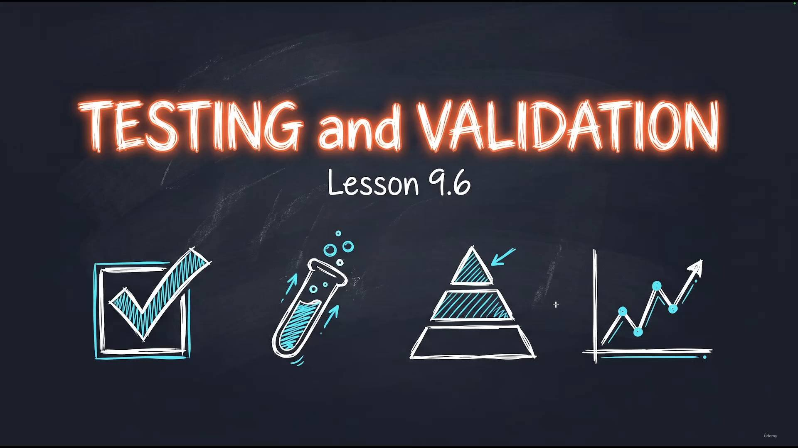

**第 2 步：写单元测试 runner。** 关键设计是**按失败方式分类**：`AssertionError` 算真正的测试失败（failed），其他任何异常算 error（测试本身坏了，不是系统坏了）。讲师说这个区分很重要，因为「一个崩溃的测试告诉你的东西，和一个失败的测试告诉你的东西不一样」。demo 里注册三个测试，其中一个故意失败——「一个所有测试都通过的套件证明不了什么」。

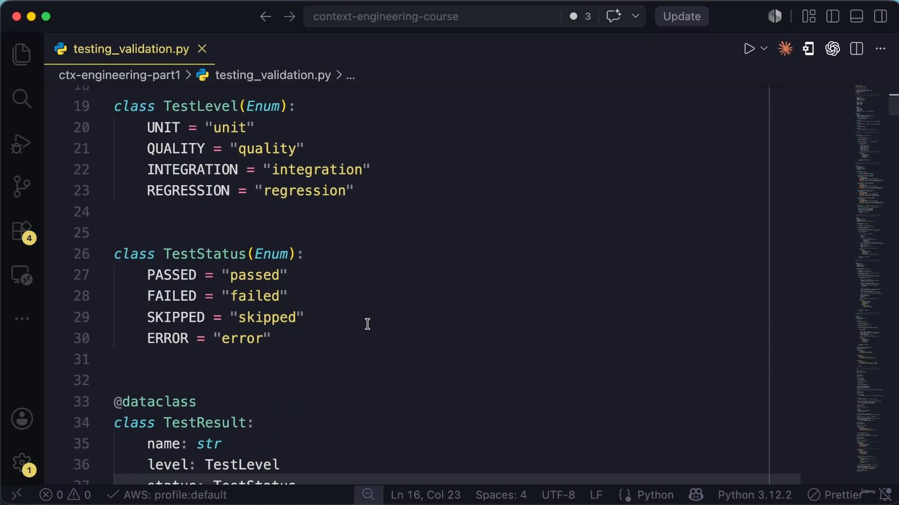

**第 3 步：写质量测试。** `QualityThreshold` 数据类装阈值（relevance ≥ 0.7、coverage ≥ 0.8、tokens < 50000、latency < 1s 这类），每个检查是一个**纯比较**，返回一个 `TestResult`。四个检查打包进一个 suite。讲师明确说：demo 里 relevance / coverage 是硬编码的 mock，**生产里这两个数必须来自真实测量**——要么把 query 和检索到的上下文做 embedding 比较，要么把两者交给模型打分（LLM as judge），大规模打分用便宜快速的模型。

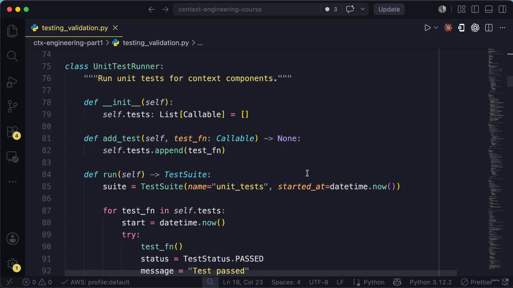

**第 4 步：写集成测试。** `IntegrationTestCase` 装一个「跑完整流水线」的函数和一组校验器；流水线抛异常算 error。

**第 5 步：写回归测试。** `BaselineSnapshot` 装 query、expected_docs、expected_quality、created_at。`RegressionTestSuite.run()` 测两件事：**文档重叠率**（期望文档集还有多少回来，阈值 ≥ 80%）和**质量漂移**（是否超出容差，默认 0.05）。两者必须同时成立才算通过。demo 注册两条基线，跑在模拟检索上。

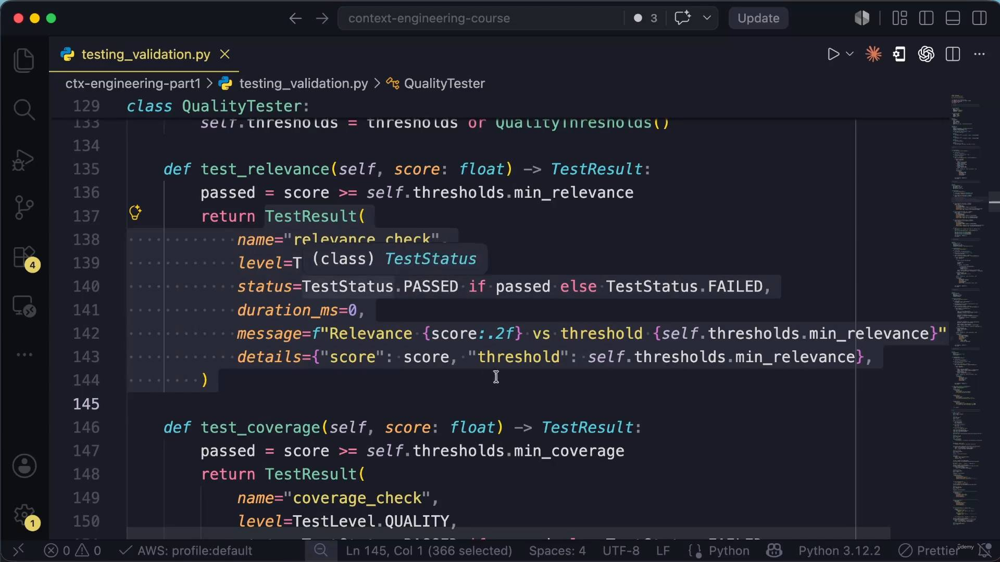

**第 6 步：写请求时校验器。** `ValidationRule` 有 `check` 函数和 `error_message`；`create_standard_validator()` 返回带三条规则的校验器：有内容、有来源、token 数在 0–100000 之间。`validate()` 跑每条规则并返回 `TestSuite`——**和测试用同一种结果类型**，这样坏上下文能出现在同一块看板上。

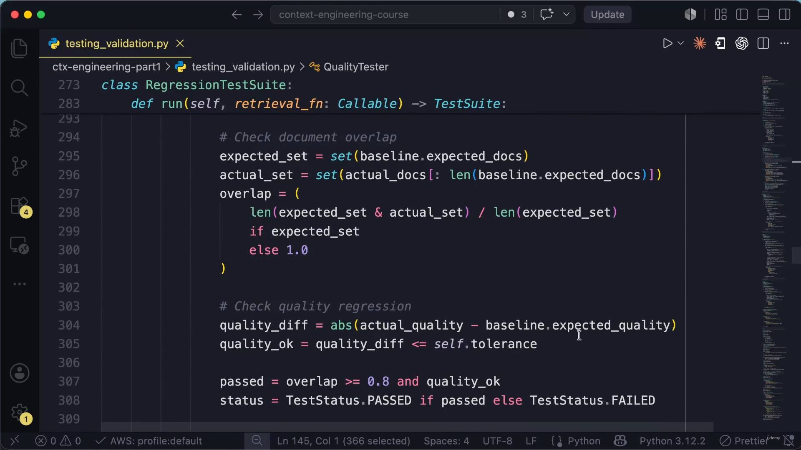

**第 7 步：跑 demo。** 预期输出：unit 2/3 通过（约 67%，故意失败的那条被点名）；quality 4/4 通过；good context 3/3 规则通过、bad context 0/3 规则通过（三条具体报错信息）；integration 1/1；regression 1/2——一条基线因为「换了 top 文档 + 质量漂移超过 0.05」被抓到。

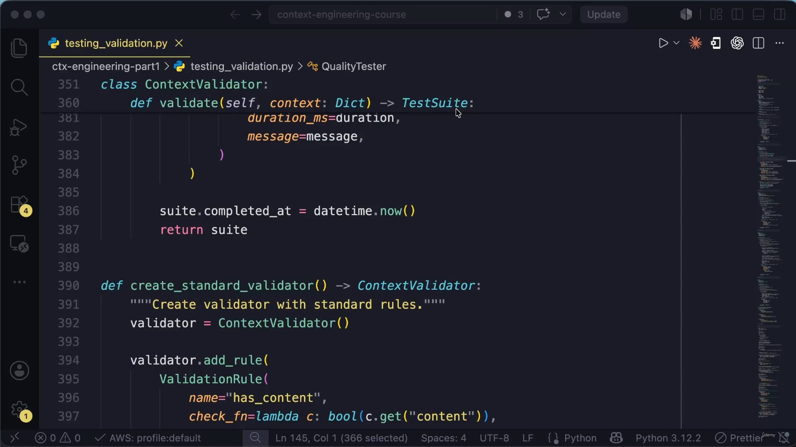

### 3.3 P50 复现步骤：企业级上下文平台

**第 1 步：租户管理。** `TenantConfig` 装每个租户的限额和合规开关（`pii_redaction_enabled` 默认 True、`logging_enabled` 默认 True）。`TenantManager.create()` 用短 UUID 生成租户 ID。讲师强调：**PII 脱敏是租户属性，不是全局硬编码**，流水线按租户逐个检查。

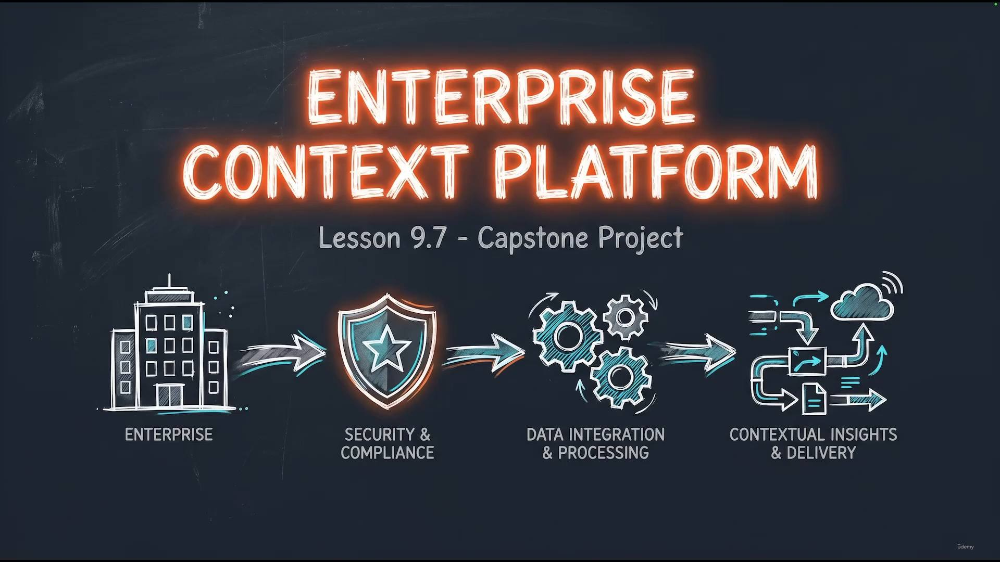

**第 2 步：PII handler。** `redact()` 跑三条正则：SSN、email、phone，各自替换成类型 token。**顺序是故意的：SSN 在 phone 之前**，因为 3-2-4 的社保号和 3-3-4 的电话号在宽松匹配下长得像，先给更具体的模式打标签。

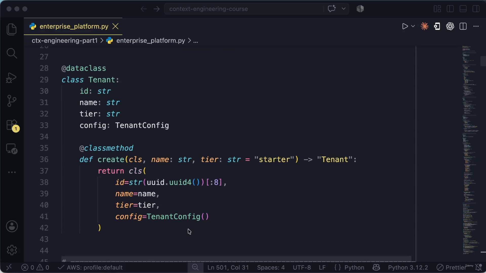

**第 3 步：访问控制。** `Permission` 枚举（read / write / admin），`Role` 映射到权限集：viewer 只有 read，editor 有 read+write，admin 有 read+write+delete+admin。`AccessController.apply()` 按权限名查询。讲师诚实说明：这个 RBAC 是极度简化的，**角色是全局的、没有按租户分区**；生产 RBAC 应该把权限键在 tenant + user 上，但机制和逻辑是一样的。

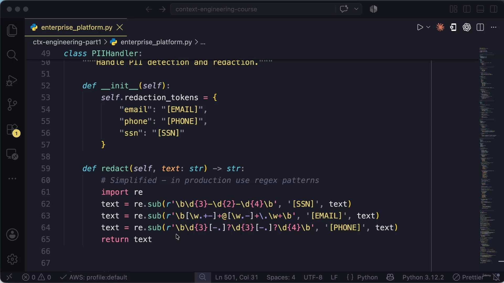

**第 4 步：审计日志。** `AuditLogger.append()` 追加一条不可变记录（event_id、timestamp、tenant_id、user_id、action、resource、outcome），返回 event_id。`query()` **按 tenant_id 过滤**——「那个过滤就是隔离」。

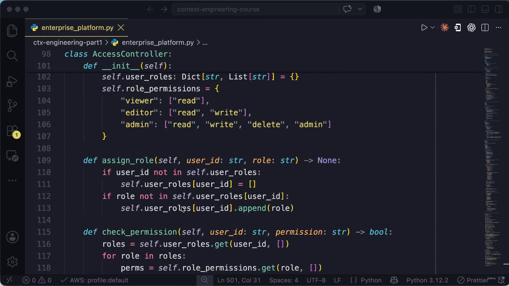

**第 5 步：版本管理。** `Version` 数据类装 major / minor / patch；`VersionManager` 按版本存内容，支持取**钉住的版本**或**最新版本**。讲师在 demo 里演示：prompt 钉在 1.0，但最新是 1.1，取钉住版本时返回的仍是 1.0 的原文——「这正是你安全回滚所需要的」。

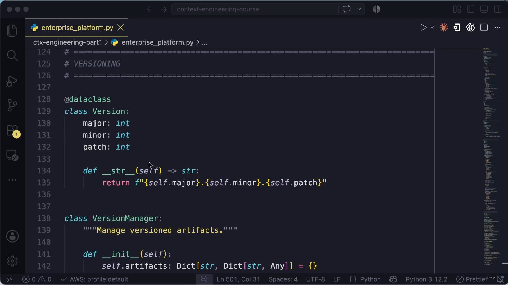

**第 6 步：质量与指标。** `QualityMetrics` 数据类装 relevance / coverage / tokens 等；`QualityTracker.check_quality()` **返回字典而不是单个布尔**，这样失败时你知道是哪道闸门失败。

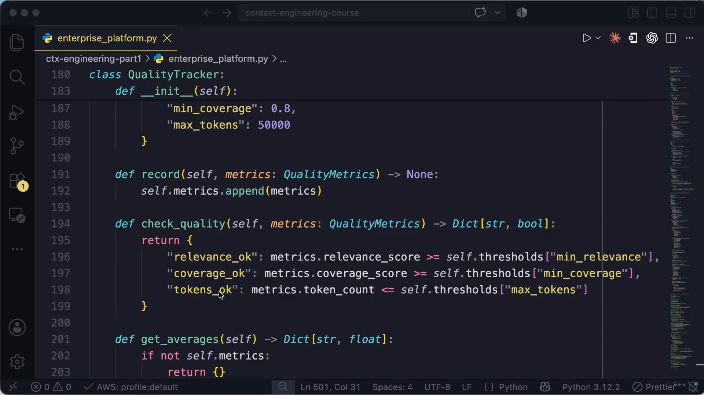

**第 7 步：组装平台并跑 demo。** `EnterpriseContextPlatform.process_request()` 的顺序就是课程内容：① 租户检查（未知租户 → 静默拒绝）→ ② 权限检查（无权限 → 拒绝，**且拒绝路径也写审计**）→ ③ 检索上下文 → ④ PII 脱敏（按租户配置开关）→ ⑤ 质量打分 → ⑥ 记录用量 → ⑦ 审计日志（成功和拒绝都记）→ ⑧ 返回响应。demo 里注册两个租户（enterprise / starter）、三个用户（Alice=admin、Bob=viewer、Charlie=editor），跑几条请求，最后打印租户隔离、版本钉住、租户看板、审计轨迹。

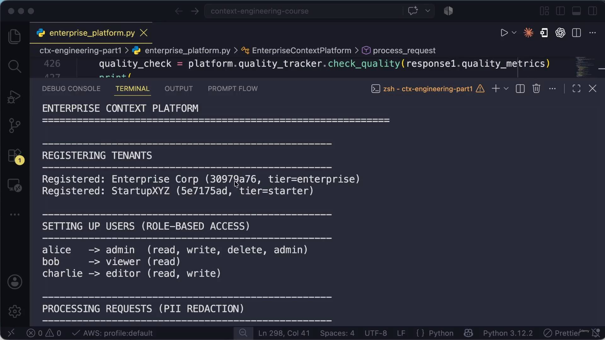

### 3.4 P51 复现步骤：研究助手（Capstone）

**第 1 步：上下文资源层。** `ContextResource` 是 `Protocol`（接口契约）；`Document`（id / content / source / metadata）；`InMemoryDocumentStore`（`retrieve()`）；`StructuredKnowledgeBase`（`add()` / `retrieve()`）；`ConversationHistory`（`add_message()` / `retrieve()`，返回带 metadata 和分数的对话）。

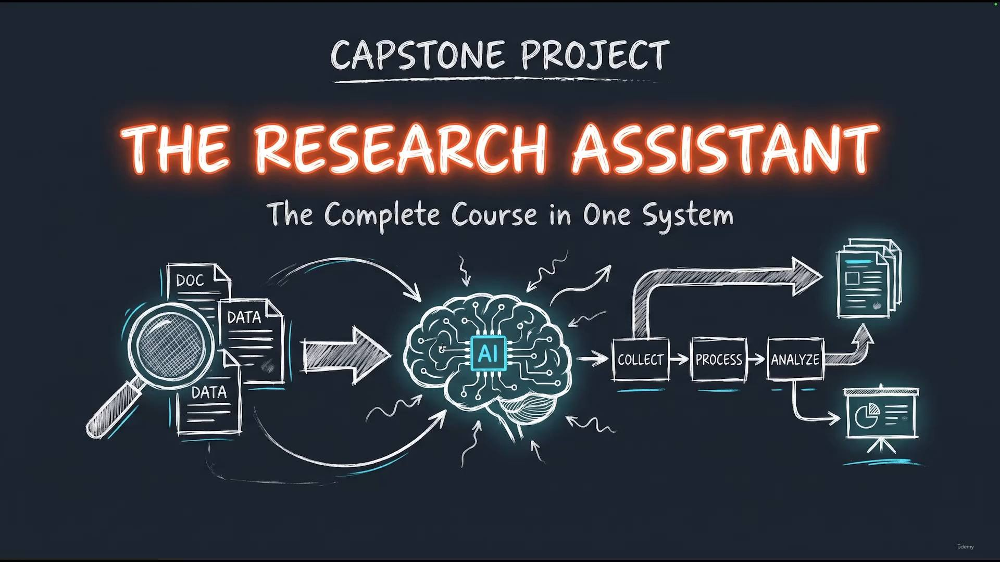

**第 2 步：上下文流水线。** `ContextRankerConfig`（min_score、diversity_weight 等默认值）；`ContextRanker`（`rank()` + `select_top()`）；`PipelineMetrics`（sources_queried / total_tokens / latency / documents_selected / documents_retrieved）；`ContextResult`；`ContextPipeline`（`add_source()` / `retrieve()`，遍历文档、选出需要的部分、返回带 metrics 的 `ContextResult`）。

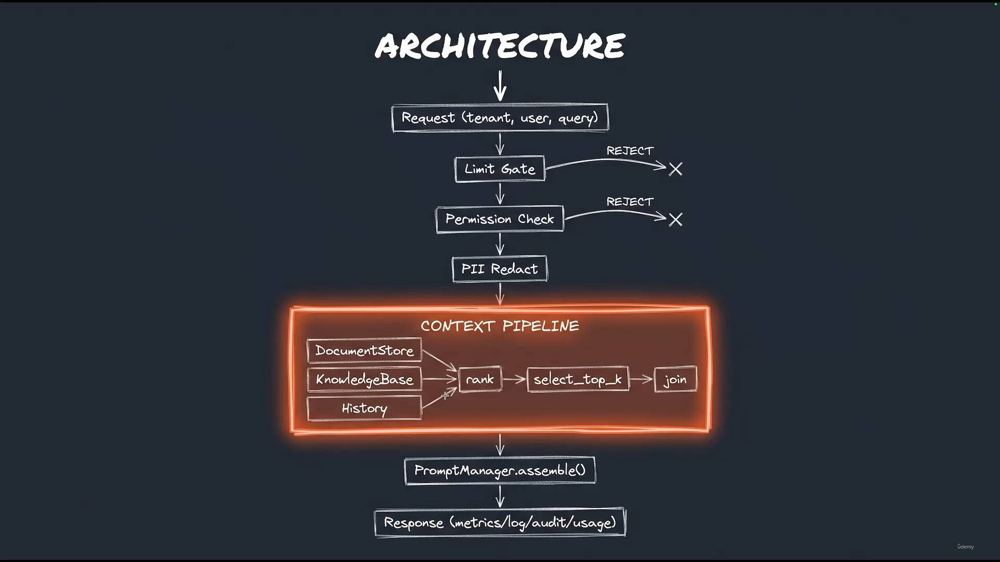

**第 3 步：Prompt 系统。** `PromptTemplate`（name / version / system_prompt / template / variables）；`RESEARCH_TEMPLATE` 实例；`AssembledPrompt`；`PromptManager.assemble()` 返回 `AssembledPrompt`。讲师说明这里可以换成 LangChain 等工具，这里手写是为了让你看清拼装过程。

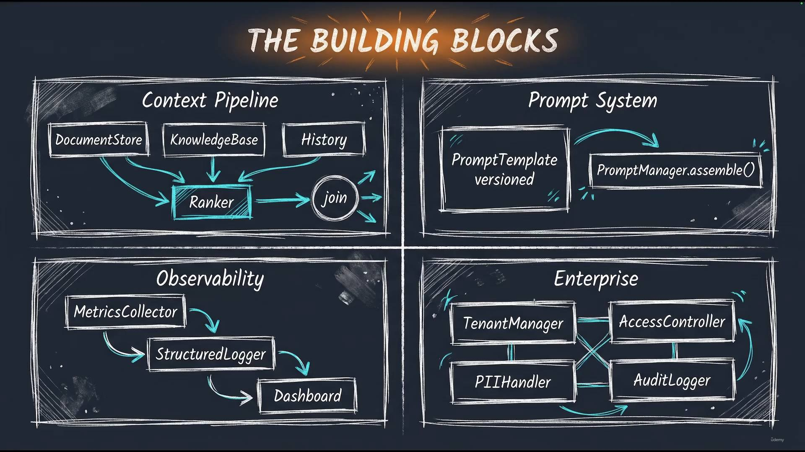

**第 4 步：可观测性。** `MetricsCollector`（`record()` / `increment()` / `get_stats()`，返回 count、mean、p50–p95）；`StructuredLogger`（结构化日志）。

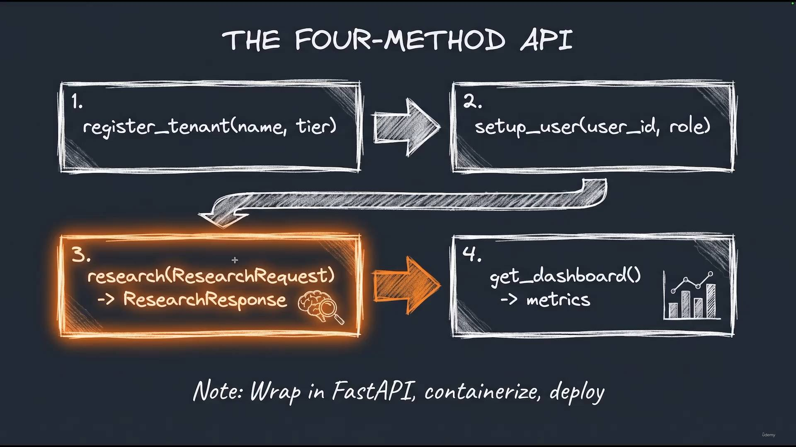

**第 5 步：企业特性。** `TierLimits`、`TenantManager`（注册 / 检查限额）、`Permission` 枚举、`AccessController`（viewer / editor / admin）、`PIIHandler`、`AuditLogger`——和 P50 同构，只是拼进同一个文件。

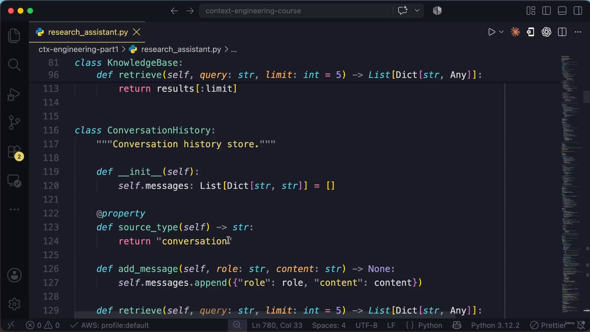

**第 6 步：研究助手主体。** `ResearchRequest`（tenant / user_id / query / 自动生成的 request_id，用 UUID）；`ResearchResponse`；`ResearchAssistant` 在 `__init__` 里实例化上下文流水线、PromptManager、可观测性、企业层，并手动塞入演示数据（文档 1、文档 2、知识库条目、对话历史）。`research()` 依次：检查限额 → 检查权限 → 脱敏 → 检索上下文 → 组装 → 生成响应 → 记录 / 保存 / 日志 → 打包成 `ResearchResponse`。`get_dashboard()` 返回请求数、延迟、质量、token。

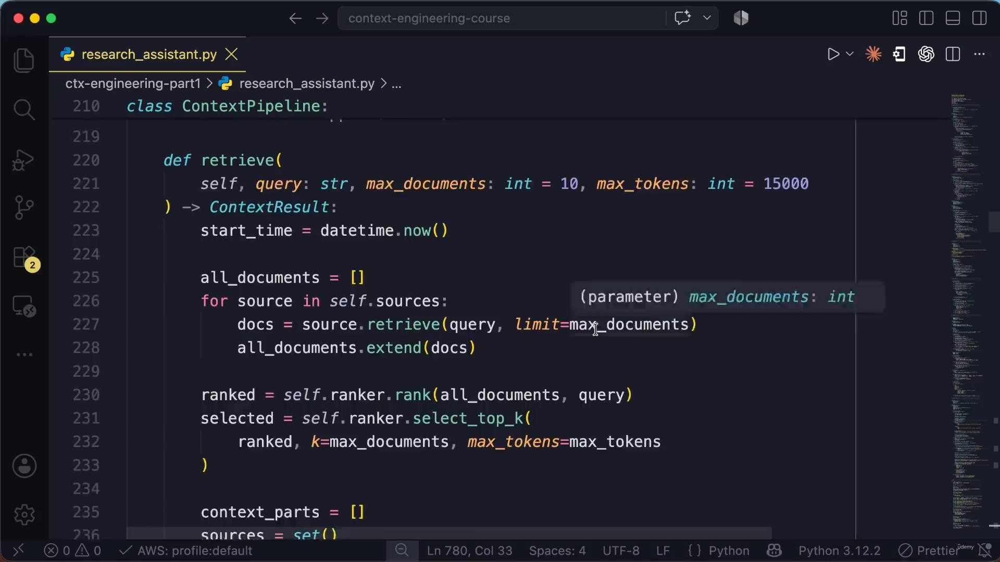

**第 7 步：跑 demo。** 预期输出：租户 demo-company 注册、Alice 设为 admin；请求 1「什么是上下文工程」返回基于文档库 + 知识库的答案（带 token 数、延迟、来源）；请求 2 的 query 里含 email，输出里 email 已被脱敏；请求 3 因权限被拒；结构化日志逐条打印时间戳 / level / service / tenant_id；看板显示 total requests 3、平均延迟、平均质量约 90%；审计轨迹列出 Alice 两次成功 + 一次未知用户。

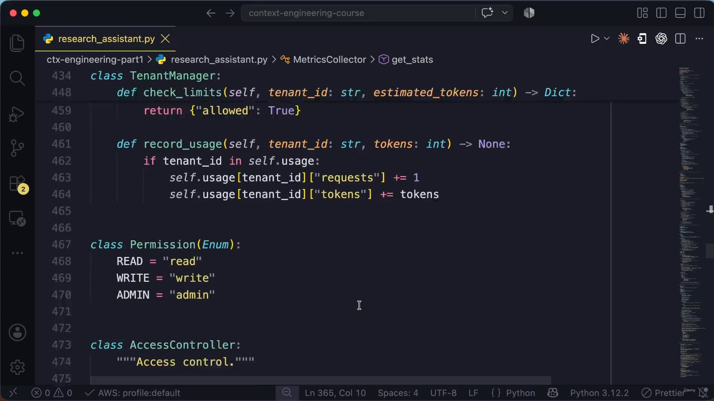

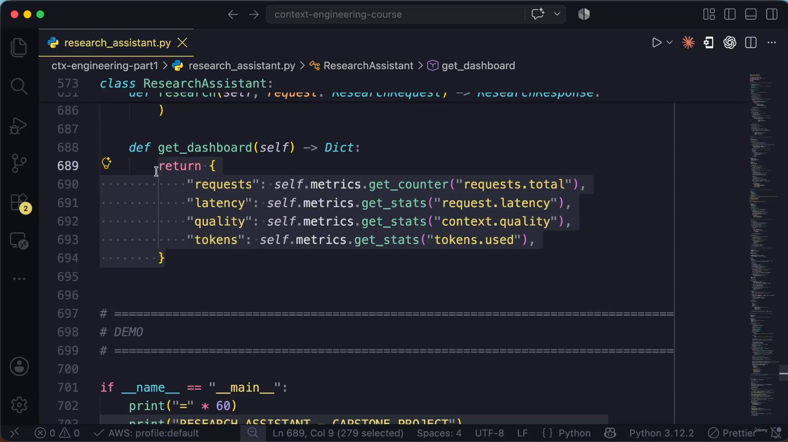

---

## 4. 完整代码

> 以下三个文件均为**完整可运行文件**。逐字稿里讲师展示的是屏幕代码，OCR 未提供额外片段；下面的实现严格按逐字稿描述的结构、类名、方法名、阈值、正则类型、流水线顺序还原。凡逐字稿没给具体字面量的地方（例如具体正则、具体演示文本），代码里用注释标注「课里没给具体值，此处为可运行占位」。**这些占位不影响流程复现，只影响演示文本内容。**

### 4.1 `p49/testing_validation.py`

```python
"""
P49：上下文测试金字塔 + 请求时校验器
运行：python3 testing_validation.py
纯标准库，无需 API Key。
"""
from __future__ import annotations

import time
import uuid
from dataclasses import dataclass, field
from enum import Enum
from typing import Callable, Any


# ---------- 统一测试类型 ----------
class TestLevel(Enum):
    UNIT = "unit"
    QUALITY = "quality"
    INTEGRATION = "integration"
    REGRESSION = "regression"


class TestStatus(Enum):
    PASSED = "passed"
    FAILED = "failed"
    SKIPPED = "skipped"
    ERROR = "error"


@dataclass
class TestResult:
    name: str
    level: TestLevel
    status: TestStatus
    duration_ms: float = 0.0
    details: dict = field(default_factory=dict)


@dataclass
class TestSuite:
    name: str
    results: list[TestResult] = field(default_factory=list)

    def __post_init__(self):
        # 套件永远不和结果不同步：计数在构造时即时计算
        self.passed = sum(1 for r in self.results if r.status == TestStatus.PASSED)
        self.failed = sum(1 for r in self.results if r.status == TestStatus.FAILED)
        self.errors = sum(1 for r in self.results if r.status == TestStatus.ERROR)
        total = len(self.results)
        self.pass_rate = (self.passed / total) if total else 0.0

    def add(self, result: TestResult):
        self.results.append(result)
        self.__post_init__()  # 重新计算，保持同步

    def report(self) -> str:
        return (f"[{self.name}] {self.passed}/{len(self.results)} passed "
                f"({self.pass_rate:.0%}), failed={self.failed}, errors={self.errors}")


# ---------- 第一层：单元测试 runner ----------
class UnitTestRunner:
    """按失败方式分类：AssertionError = 真失败；其他异常 = error（测试坏了）。"""

    def __init__(self):
        self._tests: list[tuple[str, Callable[[], None]]] = []

    def add_test(self, name: str, fn: Callable[[], None]):
        self._tests.append((name, fn))

    def run(self) -> TestSuite:
        suite = TestSuite(name="unit")
        for name, fn in self._tests:
            start = time.perf_counter()
            try:
                fn()
                status = TestStatus.PASSED
                details = {}
            except AssertionError as e:
                status = TestStatus.FAILED
                details = {"reason": str(e) or "assertion failed"}
            except Exception as e:  # noqa: BLE001
                status = TestStatus.ERROR
                details = {"reason": f"{type(e).__name__}: {e}"}
            duration = (time.perf_counter() - start) * 1000
            suite.add(TestResult(name=name, level=TestLevel.UNIT,
                                 status=status, duration_ms=duration, details=details))
        return suite


# ---------- 第二层：质量测试 ----------
@dataclass
class QualityThreshold:
    min_relevance: float = 0.7
    min_coverage: float = 0.8
    max_tokens: int = 50_000
    max_latency_ms: float = 1000.0


def _quality_check(name: str, ok: bool, detail: str) -> TestResult:
    return TestResult(
        name=name,
        level=TestLevel.QUALITY,
        status=TestStatus.PASSED if ok else TestStatus.FAILED,
        details={"detail": detail},
    )


def run_quality_tests(relevance: float, coverage: float,
                      tokens: int, latency_ms: float,
                      threshold: QualityThreshold | None = None) -> TestSuite:
    """注意：demo 里 relevance/coverage 是 mock。
    生产里它们必须来自真实测量（embedding 比对，或 LLM as judge）。"""
    t = threshold or QualityThreshold()
    suite = TestSuite(name="quality")
    suite.add(_quality_check("relevance", relevance >= t.min_relevance,
                             f"relevance={relevance} >= {t.min_relevance}"))
    suite.add(_quality_check("coverage", coverage >= t.min_coverage,
                             f"coverage={coverage} >= {t.min_coverage}"))
    suite.add(_quality_check("token_budget", tokens < t.max_tokens,
                             f"tokens={tokens} < {t.max_tokens}"))
    suite.add(_quality_check("latency", latency_ms < t.max_latency_ms,
                             f"latency={latency_ms}ms < {t.max_latency_ms}ms"))
    return suite


# ---------- 第三层：集成测试 ----------
@dataclass
class IntegrationTestCase:
    name: str
    pipeline: Callable[[], Any]
    validators: list[Callable[[Any], bool]] = field(default_factory=list)


def run_integration_tests(cases: list[IntegrationTestCase]) -> TestSuite:
    suite = TestSuite(name="integration")
    for case in cases:
        start = time.perf_counter()
        try:
            output = case.pipeline()
            ok = all(v(output) for v in case.validators)
            status = TestStatus.PASSED if ok else TestStatus.FAILED
            details = {"validators": len(case.validators)}
        except Exception as e:  # noqa: BLE001
            status = TestStatus.ERROR
            details = {"reason": f"{type(e).__name__}: {e}"}
        duration = (time.perf_counter() - start) * 1000
        suite.add(TestResult(name=case.name, level=TestLevel.INTEGRATION,
                             status=status, duration_ms=duration, details=details))
    return suite


# ---------- 第四层：回归测试 ----------
@dataclass
class BaselineSnapshot:
    query: str
    expected_docs: set[str]
    expected_quality: float
    created_at: str = ""


@dataclass
class RegressionTestSuite:
    overlap_threshold: float = 0.8      # 文档重叠 >= 80%
    quality_tolerance: float = 0.05     # 质量漂移 <= 0.05

    def run(self, baseline: BaselineSnapshot,
            actual_docs: set[str], actual_quality: float) -> TestResult:
        overlap = (len(baseline.expected_docs & actual_docs)
                   / max(1, len(baseline.expected_docs)))
        quality_diff = abs(actual_quality - baseline.expected_quality)
        ok = overlap >= self.overlap_threshold and quality_diff <= self.quality_tolerance
        return TestResult(
            name=f"regression:{baseline.query[:20]}",
            level=TestLevel.REGRESSION,
            status=TestStatus.PASSED if ok else TestStatus.FAILED,
            details={"overlap": round(overlap, 3),
                     "quality_diff": round(quality_diff, 3)},
        )


# ---------- 请求时校验器 ----------
@dataclass
class ValidationRule:
    name: str
    check: Callable[[dict], bool]
    error_message: str


@dataclass
class ContextValidator:
    rules: list[ValidationRule]

    def validate(self, context: dict) -> TestSuite:
        suite = TestSuite(name="context_validation")
        for rule in self.rules:
            ok = rule.check(context)
            suite.add(TestResult(
                name=rule.name,
                level=TestLevel.QUALITY,
                status=TestStatus.PASSED if ok else TestStatus.FAILED,
                details={} if ok else {"reason": rule.error_message},
            ))
        return suite


def create_standard_validator() -> ContextValidator:
    return ContextValidator(rules=[
        ValidationRule("has_content",
                       lambda c: bool(c.get("content")),
                       "context must have content"),
        ValidationRule("has_sources",
                       lambda c: len(c.get("sources", [])) > 0,
                       "context must have at least one source"),
        ValidationRule("token_count",
                       lambda c: 0 < c.get("tokens", 0) <= 100_000,
                       "token count must be between 0 and 100,000"),
    ])


# ---------- demo ----------
def main():
    print("=== UNIT TESTS ===")
    runner = UnitTestRunner()
    runner.add_test("token_counting", lambda: None)
    runner.add_test("relevance_calculation", lambda: None)
    runner.add_test("failing_assertion", lambda: (_ for _ in ()).throw(
        AssertionError("intentional failure")))
    unit_suite = runner.run()
    print(unit_suite.report())
    for r in unit_suite.results:
        print(f"  - {r.name}: {r.status.value} {r.details}")

    print("\n=== QUALITY TESTS ===")
    q_suite = run_quality_tests(relevance=0.85, coverage=0.9,
                                tokens=1200, latency_ms=300)
    print(q_suite.report())

    print("\n=== CONTEXT VALIDATION ===")
    validator = create_standard_validator()
    good = {"content": "some context", "sources": ["doc1"], "tokens": 500}
    bad = {"content": "", "sources": [], "tokens": 0}
    print("good:", validator.validate(good).report())
    print("bad :", validator.validate(bad).report())
    for r in validator.validate(bad).results:
        print(f"  - {r.name}: {r.status.value} {r.details}")

    print("\n=== INTEGRATION TESTS ===")
    i_suite = run_integration_tests([
        IntegrationTestCase("full_pipeline", lambda: {"ok": True},
                            [lambda o: o["ok"]]),
    ])
    print(i_suite.report())

    print("\n=== REGRESSION TESTS ===")
    reg = RegressionTestSuite()
    baseline = BaselineSnapshot(query="what is context engineering",
                                expected_docs={"doc1", "doc2", "doc3"},
                                expected_quality=0.90)
    # 基线 1：文档全回来、质量没漂移 -> pass
    r1 = reg.run(baseline, {"doc1", "doc2", "doc3"}, 0.90)
    # 基线 2：top 文档被换、质量漂移 0.119 -> fail
    r2 = reg.run(baseline, {"doc4", "doc2", "doc3"}, 0.90 - 0.119)
    reg_suite = TestSuite(name="regression", results=[r1, r2])
    print(reg_suite.report())
    for r in reg_suite.results:
        print(f"  - {r.name}: {r.status.value} {r.details}")


if __name__ == "__main__":
    main()
```

### 4.2 `p50/enterprise_platform.py`

```python
"""
P50：企业级上下文平台
运行：python3 enterprise_platform.py
纯标准库，无需 API Key。
"""
from __future__ import annotations

import re
import uuid
from dataclasses import dataclass, field
from datetime import datetime, timezone
from enum import Enum


# ---------- 租户管理 ----------
@dataclass
class TenantConfig:
    tenant_id: str
    name: str
    tier: str
    pii_redaction_enabled: bool = True
    logging_enabled: bool = True
    token_limit: int = 1_000_000


class TenantManager:
    def __init__(self):
        self.tenants: dict[str, TenantConfig] = {}

    def create(self, name: str, tier: str) -> TenantConfig:
        tid = str(uuid.uuid4())[:8]
        cfg = TenantConfig(tenant_id=tid, name=name, tier=tier)
        self.tenants[tid] = cfg
        return cfg

    def get(self, tenant_id: str) -> TenantConfig | None:
        return self.tenants.get(tenant_id)


# ---------- PII handler ----------
class PIIHandler:
    """顺序是故意的：SSN 在 phone 之前，先给更具体的模式打标签。"""
    SSN = re.compile(r"\b\d{3}-\d{2}-\d{4}\b")
    EMAIL = re.compile(r"\b[\w.+-]+@[\w-]+\.[\w.-]+\b")
    PHONE = re.compile(r"\b\d{3}-\d{3}-\d{4}\b")

    def redact(self, text: str) -> tuple[str, list[str]]:
        replaced = []
        if self.SSN.search(text):
            text = self.SSN.sub("[SSN]", text)
            replaced.append("ssn")
        if self.EMAIL.search(text):
            text = self.EMAIL.sub("[EMAIL]", text)
            replaced.append("email")
        if self.PHONE.search(text):
            text = self.PHONE.sub("[PHONE]", text)
            replaced.append("phone")
        return text, replaced


# ---------- 访问控制 ----------
class Permission(Enum):
    READ = "read"
    WRITE = "write"
    DELETE = "delete"
    ADMIN = "admin"


ROLE_PERMISSIONS = {
    "viewer": {Permission.READ},
    "editor": {Permission.READ, Permission.WRITE},
    "admin": {Permission.READ, Permission.WRITE, Permission.DELETE, Permission.ADMIN},
}


class AccessController:
    """课里说明：这是极度简化的 RBAC，角色全局、未按租户分区。
    生产 RBAC 应把权限键在 tenant + user 上。"""

    def __init__(self):
        self.user_roles: dict[str, str] = {}

    def assign_role(self, user_id: str, role: str):
        self.user_roles[user_id] = role

    def check_permission(self, user_id: str, permission: Permission) -> bool:
        role = self.user_roles.get(user_id)
        return role is not None and permission in ROLE_PERMISSIONS.get(role, set())


# ---------- 审计日志 ----------
@dataclass
class AuditEvent:
    event_id: str
    timestamp: str
    tenant_id: str
    user_id: str
    action: str
    resource: str
    outcome: str


class AuditLogger:
    def __init__(self):
        self.events: list[AuditEvent] = []

    def append(self, tenant_id: str, user_id: str, action: str,
               resource: str, outcome: str) -> str:
        eid = str(uuid.uuid4())[:8]
        self.events.append(AuditEvent(
            event_id=eid,
            timestamp=datetime.now(timezone.utc).isoformat(),
            tenant_id=tenant_id, user_id=user_id,
            action=action, resource=resource, outcome=outcome,
        ))
        return eid

    def query(self, tenant_id: str) -> list[AuditEvent]:
        # 按 tenant_id 过滤 = 隔离：一个租户永远读不到另一个租户的审计日志
        return [e for e in self.events if e.tenant_id == tenant_id]


# ---------- 版本管理 ----------
@dataclass(frozen=True)
class Version:
    major: int
    minor: int
    patch: int

    def __str__(self):
        return f"{self.major}.{self.minor}.{self.patch}"


class VersionManager:
    def __init__(self):
        self.store: dict[str, dict[str, str]] = {}

    def put(self, name: str, version: Version, content: str):
        self.store.setdefault(name, {})[str(version)] = content

    def get(self, name: str, version: Version | None = None) -> str | None:
        versions = self.store.get(name, {})
        if version is not None:
            return versions.get(str(version))  # 钉住版本
        if not versions:
            return None
        latest = max(versions.keys(), key=lambda v: tuple(map(int, v.split("."))))
        return versions[latest]  # 最新版本


# ---------- 质量与指标 ----------
@dataclass
class QualityMetrics:
    relevance: float
    coverage: float
    tokens: int


class QualityTracker:
    def __init__(self, min_relevance=0.7, min_coverage=0.8, max_tokens=50_000):
        self.min_relevance = min_relevance
        self.min_coverage = min_coverage
        self.max_tokens = max_tokens

    def check_quality(self, m: QualityMetrics) -> dict:
        # 返回字典而不是单个布尔：失败时知道是哪道闸门失败
        return {
            "relevance": m.relevance >= self.min_relevance,
            "coverage": m.coverage >= self.min_coverage,
            "tokens": m.tokens < self.max_tokens,
        }


# ---------- 平台请求 / 响应 ----------
@dataclass
class PlatformRequest:
    tenant_id: str
    user_id: str
    query: str
    request_id: str = field(default_factory=lambda: str(uuid.uuid4())[:8])


@dataclass
class PlatformResponse:
    request_id: str
    success: bool
    answer: str = ""
    reasons: list[str] = field(default_factory=list)
    quality: dict = field(default_factory=dict)
    audit_id: str = ""


# ---------- 企业平台 ----------
class EnterpriseContextPlatform:
    def __init__(self):
        self.tenants = TenantManager()
        self.pii = PIIHandler()
        self.audit = AuditLogger()
        self.access = AccessController()
        self.versions = VersionManager()
        self.quality = QualityTracker()
        self.usage: dict[str, dict] = {}

    def register_tenant(self, name: str, tier: str) -> TenantConfig:
        return self.tenants.create(name, tier)

    def setup_user(self, user_id: str, role: str):
        self.access.assign_role(user_id, role)

    def process_request(self, req: PlatformRequest) -> PlatformResponse:
        # 1) 租户检查：未知租户 -> 静默拒绝（但仍审计）
        tenant = self.tenants.get(req.tenant_id)
        if tenant is None:
            self.audit.append(req.tenant_id, req.user_id,
                              "request", "platform", "denied:unknown_tenant")
            return PlatformResponse(req.request_id, False,
                                    reasons=["unknown tenant"])

        # 2) 权限检查：拒绝路径也写审计
        if not self.access.check_permission(req.user_id, Permission.READ):
            eid = self.audit.append(req.tenant_id, req.user_id,
                                    "request", "platform", "denied:permission")
            return PlatformResponse(req.request_id, False,
                                    reasons=["permission denied"], audit_id=eid)

        # 3) 检索上下文（demo 用占位文本）
        context = f"retrieved context for: {req.query}"

        # 4) PII 脱敏：按租户配置开关
        replaced = []
        if tenant.pii_redaction_enabled:
            context, replaced = self.pii.redact(context)

        # 5) 质量打分（demo 用固定分数）
        metrics = QualityMetrics(relevance=0.85, coverage=0.9, tokens=22)
        gates = self.quality.check_quality(metrics)

        # 6) 记录用量
        u = self.usage.setdefault(req.tenant_id, {"requests": 0, "tokens": 0})
        u["requests"] += 1
        u["tokens"] += metrics.tokens

        # 7) 审计日志：成功也记
        eid = self.audit.append(req.tenant_id, req.user_id,
                                "request", "platform", "success")

        return PlatformResponse(
            request_id=req.request_id,
            success=True,
            answer=context,
            quality=gates,
            audit_id=eid,
        )


# ---------- demo ----------
def main():
    platform = EnterpriseContextPlatform()

    t1 = platform.register_tenant("enterprise-corp", "enterprise")
    t2 = platform.register_tenant("startup-xyz", "starter")
    print("registered tenants:", t1.tenant_id, t1.tier, "|", t2.tenant_id, t2.tier)

    platform.setup_user("alice", "admin")
    platform.setup_user("bob", "viewer")
    platform.setup_user("charlie", "editor")
    print("users set up: alice=admin, bob=viewer, charlie=editor")

    # 版本：prompt 钉在 1.0，最新是 1.1
    platform.versions.put("support_prompt", Version(1, 0, 0), "concise v1.0 text")
    platform.versions.put("support_prompt", Version(1, 1, 0), "concise v1.1 text")
    print("pinned 1.0 ->", platform.versions.get("support_prompt", Version(1, 0, 0)))
    print("latest     ->", platform.versions.get("support_prompt"))

    # 请求 1：含 email / phone / SSN，验证脱敏
    q1 = "Q for metrics contact: john@example.com, 555-123-4567, 123-45-6789"
    r1 = platform.process_request(PlatformRequest(t1.tenant_id, "alice", q1))
    print("\nrequest1:", r1.success, "|", r1.answer)
    print("quality gates:", r1.quality, "| audit:", r1.audit_id)

    # 请求 2：无权限用户
    r2 = platform.process_request(PlatformRequest(t1.tenant_id, "mallory", "hello"))
    print("request2:", r2.success, r2.reasons)

    # 租户隔离 + 看板
    print("\nusage:", platform.usage)
    print("audit for tenant1:")
    for e in platform.audit.query(t1.tenant_id):
        print(" ", e.timestamp, e.user_id, e.action, e.outcome)


if __name__ == "__main__":
    main()
```

### 4.3 `p51/research_assistant.py`

```python
"""
P51：研究助手（Capstone）
运行：python3 research_assistant.py
纯标准库，无需 API Key；LLM 调用内联模拟。
"""
from __future__ import annotations

import json
import statistics
import time
import uuid
from dataclasses import dataclass, field
from datetime import datetime, timezone
from enum import Enum
from typing import Protocol


# ---------- 上下文资源 ----------
class ContextResource(Protocol):
    def retrieve(self, query: str, top_k: int = 3) -> list[dict]: ...


@dataclass
class Document:
    id: str
    content: str
    source: str
    metadata: dict = field(default_factory=dict)


class InMemoryDocumentStore:
    def __init__(self):
        self.docs: list[Document] = []

    def add(self, doc: Document):
        self.docs.append(doc)

    def retrieve(self, query: str, top_k: int = 3) -> list[dict]:
        # demo 用朴素关键词重叠打分；生产用向量库
        scored = []
        for d in self.docs:
            score = sum(1 for w in query.lower().split() if w in d.content.lower())
            scored.append((score, d))
        scored.sort(key=lambda x: x[0], reverse=True)
        return [{"id": d.id, "content": d.content, "source": d.source,
                 "score": s} for s, d in scored[:top_k]]


class StructuredKnowledgeBase:
    def __init__(self):
        self.entries: list[dict] = []

    def add(self, key: str, content: str):
        self.entries.append({"key": key, "content": content})

    def retrieve(self, query: str, top_k: int = 3) -> list[dict]:
        hits = [e for e in self.entries if query.lower() in e["content"].lower()]
        return [{"id": e["key"], "content": e["content"],
                 "source": "knowledge_base", "score": 1.0} for e in hits[:top_k]]


class ConversationHistory:
    def __init__(self):
        self.messages: list[dict] = []

    def add_message(self, role: str, content: str):
        self.messages.append({"role": role, "content": content})

    def retrieve(self, query: str, top_k: int = 3) -> list[dict]:
        return [{"id": f"msg{i}", "content": m["content"],
                 "source": "history", "score": 0.5}
                for i, m in enumerate(self.messages[-top_k:])]


# ---------- 上下文流水线 ----------
@dataclass
class ContextRankerConfig:
    min_score: float = 0.3
    diversity_weight: float = 0.2


class ContextRanker:
    def __init__(self, cfg: ContextRankerConfig | None = None):
        self.cfg = cfg or ContextRankerConfig()

    def rank(self, items: list[dict]) -> list[dict]:
        return sorted(items, key=lambda x: x.get("score", 0), reverse=True)

    def select_top(self, items: list[dict], top_k: int) -> list[dict]:
        return self.rank(items)[:top_k]


@dataclass
class PipelineMetrics:
    sources_queried: int = 0
    documents_retrieved: int = 0
    documents_selected: int = 0
    total_tokens: int = 0
    latency_ms: float = 0.0


@dataclass
class ContextResult:
    context: str
    sources: list[str]
    metrics: PipelineMetrics


class ContextPipeline:
    def __init__(self):
        self.sources: list[ContextResource] = []
        self.ranker = ContextRanker()

    def add_source(self, source: ContextResource):
        self.sources.append(source)

    def retrieve(self, query: str, top_k: int = 3) -> ContextResult:
        start = time.perf_counter()
        all_items = []
        for s in self.sources:
            all_items.extend(s.retrieve(query, top_k))
        selected = self.ranker.select_top(all_items, top_k)
        context = "\n".join(i["content"] for i in selected)
        metrics = PipelineMetrics(
            sources_queried=len(self.sources),
            documents_retrieved=len(all_items),
            documents_selected=len(selected),
            total_tokens=len(context.split()),
            latency_ms=(time.perf_counter() - start) * 1000,
        )
        return ContextResult(context=context,
                             sources=[i["source"] for i in selected],
                             metrics=metrics)


# ---------- Prompt 系统 ----------
@dataclass
class PromptTemplate:
    name: str
    version: str
    system_prompt: str
    template: str
    variables: list[str] = field(default_factory=list)


RESEARCH_TEMPLATE = PromptTemplate(
    name="research",
    version="1.0",
    system_prompt="You are a research assistant. Answer using only the provided context.",
    template="Context:\n{context}\n\nQuestion: {query}\n\nAnswer:",
    variables=["context", "query"],
)


@dataclass
class AssembledPrompt:
    text: str
    version: str


class PromptManager:
    def __init__(self, template: PromptTemplate):
        self.template = template

    def assemble(self, context: str, query: str) -> AssembledPrompt:
        text = (self.template.system_prompt + "\n\n"
                + self.template.template.format(context=context, query=query))
        return AssembledPrompt(text=text, version=self.template.version)


# ---------- 可观测性 ----------
class MetricsCollector:
    def __init__(self):
        self.values: dict[str, list[float]] = {}

    def record(self, name: str, value: float):
        self.values.setdefault(name, []).append(value)

    def increment(self, name: str):
        self.record(name, 1.0)

    def get_stats(self, name: str) -> dict:
        v = self.values.get(name, [])
        if not v:
            return {"count": 0}
        v_sorted = sorted(v)
        n = len(v_sorted)
        return {
            "count": n,
            "mean": statistics.mean(v_sorted),
            "p50": v_sorted[int(n * 0.50)],
            "p95": v_sorted[min(n - 1, int(n * 0.95))],
        }


class StructuredLogger:
    def log(self, level: str, service: str, message: str, **fields):
        print(json.dumps({
            "timestamp": datetime.now(timezone.utc).isoformat(),
            "level": level, "service": service,
            "message": message, **fields,
        }))


# ---------- 企业特性 ----------
@dataclass
class TierLimits:
    max_requests: int = 1000
    max_tokens: int = 1_000_000


class TenantManager:
    def __init__(self):
        self.tenants: dict[str, dict] = {}

    def register(self, name: str, tier: str) -> str:
        tid = str(uuid.uuid4())[:8]
        self.tenants[tid] = {"name": name, "tier": tier,
                             "limits": TierLimits(), "used_tokens": 0}
        return tid

    def check_limits(self, tenant_id: str, tokens: int) -> bool:
        t = self.tenants.get(tenant_id)
        return t is not None and t["used_tokens"] + tokens <= t["limits"].max_tokens

    def add_usage(self, tenant_id: str, tokens: int):
        if tenant_id in self.tenants:
            self.tenants[tenant_id]["used_tokens"] += tokens


class Permission(Enum):
    READ = "read"
    WRITE = "write"
    ADMIN = "admin"


ROLE_PERMISSIONS = {
    "viewer": {Permission.READ},
    "editor": {Permission.READ, Permission.WRITE},
    "admin": {Permission.READ, Permission.WRITE, Permission.ADMIN},
}


class AccessController:
    def __init__(self):
        self.user_roles: dict[str, str] = {}

    def assign_role(self, user_id: str, role: str):
        self.user_roles[user_id] = role

    def check_permission(self, user_id: str, permission: Permission) -> bool:
        role = self.user_roles.get(user_id)
        return role is not None and permission in ROLE_PERMISSIONS.get(role, set())


class PIIHandler:
    import re as _re
    SSN = _re.compile(r"\b\d{3}-\d{2}-\d{4}\b")
    EMAIL = _re.compile(r"\b[\w.+-]+@[\w-]+\.[\w.-]+\b")
    PHONE = _re.compile(r"\b\d{3}-\d{3}-\d{4}\b")

    def redact(self, text: str) -> str:
        text = self.SSN.sub("[SSN]", text)
        text = self.EMAIL.sub("[EMAIL]", text)
        text = self.PHONE.sub("[PHONE]", text)
        return text


class AuditLogger:
    def __init__(self):
        self.events: list[dict] = []

    def append(self, tenant_id, user_id, action, outcome):
        self.events.append({
            "timestamp": datetime.now(timezone.utc).isoformat(),
            "tenant_id": tenant_id, "user_id": user_id,
            "action": action, "outcome": outcome,
        })

    def query(self, tenant_id: str) -> list[dict]:
        return [e for e in self.events if e["tenant_id"] == tenant_id]


# ---------- 研究助手 ----------
@dataclass
class ResearchRequest:
    tenant_id: str
    user_id: str
    query: str
    request_id: str = field(default_factory=lambda: str(uuid.uuid4())[:8])


@dataclass
class ResearchResponse:
    request_id: str
    success: bool
    answer: str = ""
    sources: list[str] = field(default_factory=list)
    tokens: int = 0
    latency_ms: float = 0.0
    quality: float = 0.0
    reasons: list[str] = field(default_factory=list)


class ResearchAssistant:
    def __init__(self):
        # 核心流水线
        self.pipeline = ContextPipeline()
        self.prompt_manager = PromptManager(RESEARCH_TEMPLATE)
        # 可观测性
        self.metrics = MetricsCollector()
        self.logger = StructuredLogger()
        # 企业层
        self.tenants = TenantManager()
        self.access = AccessController()
        self.pii = PIIHandler()
        self.audit = AuditLogger()
        # 演示数据
        self._setup_sources()

    def _setup_sources(self):
        ds = InMemoryDocumentStore()
        ds.add(Document("doc1", "Context engineering is about selecting the right "
                                "information to send to an LLM.", "document_store"))
        ds.add(Document("doc2", "RAG retrieves documents and ranks them by relevance.",
                        "document_store"))
        kb = StructuredKnowledgeBase()
        kb.add("kb1", "Context engineering reduces noise and keeps only signal.")
        hist = ConversationHistory()
        hist.add_message("user", "Earlier we discussed token budgets.")
        self.pipeline.add_source(ds)
        self.pipeline.add_source(kb)
        self.pipeline.add_source(hist)

    def register_tenant(self, name: str, tier: str) -> str:
        return self.tenants.register(name, tier)

    def setup_user(self, user_id: str, role: str):
        self.access.assign_role(user_id, role)

    def research(self, req: ResearchRequest) -> ResearchResponse:
        start = time.perf_counter()

        # 1) 限额闸门
        if not self.tenants.check_limits(req.tenant_id, 100):
            self.audit.append(req.tenant_id, req.user_id, "research", "denied:limit")
            return ResearchResponse(req.request_id, False, reasons=["limit exceeded"])

        # 2) 权限检查
        if not self.access.check_permission(req.user_id, Permission.READ):
            self.audit.append(req.tenant_id, req.user_id, "research", "denied:permission")
            self.logger.log("WARN", "assistant", "permission denied",
                            tenant_id=req.tenant_id, user_id=req.user_id)
            return ResearchResponse(req.request_id, False, reasons=["permission denied"])

        # 3) PII 脱敏（在检索之前）
        clean_query = self.pii.redact(req.query)

        # 4) 检索上下文
        ctx = self.pipeline.retrieve(clean_query, top_k=3)

        # 5) 组装 prompt
        prompt = self.prompt_manager.assemble(ctx.context, clean_query)

        # 6) 生成响应（内联模拟 LLM）
        answer = f"[simulated answer] Based on {len(ctx.sources)} sources: " \
                 f"{ctx.context[:120]}"

        # 7) 记录 / 保存 / 日志
        latency = (time.perf_counter() - start) * 1000
        self.metrics.record("latency_ms", latency)
        self.metrics.record("quality", 0.9)
        self.metrics.increment("requests")
        self.tenants.add_usage(req.tenant_id, ctx.metrics.total_tokens)
        self.audit.append(req.tenant_id, req.user_id, "research", "success")
        self.logger.log("INFO", "assistant", "research completed",
                        tenant_id=req.tenant_id, request_id=req.request_id)

        return ResearchResponse(
            request_id=req.request_id, success=True, answer=answer,
            sources=ctx.sources, tokens=ctx.metrics.total_tokens,
            latency_ms=latency, quality=0.9,
        )

    def get_dashboard(self) -> dict:
        return {
            "requests": self.metrics.get_stats("requests"),
            "latency": self.metrics.get_stats("latency_ms"),
            "quality": self.metrics.get_stats("quality"),
        }


# ---------- demo ----------
def main():
    assistant = ResearchAssistant()
    tid = assistant.register_tenant("demo-company", "enterprise")
    assistant.setup_user("alice", "admin")
    print("tenant:", tid, "| user alice=admin")

    r1 = assistant.research(ResearchRequest(tid, "alice", "what is context engineering"))
    print("\nrequest1:", r1.success, "| tokens:", r1.tokens,
          "| sources:", r1.sources)
    print("answer:", r1.answer[:100])

    r2 = assistant.research(ResearchRequest(
        tid, "alice", "find information for john@example.com about LLMs"))
    print("\nrequest2:", r2.success, "| answer:", r2.answer[:100])

    r3 = assistant.research(ResearchRequest(tid, "mallory", "unauthorized query"))
    print("\nrequest3:", r3.success, r3.reasons)

    print("\ndashboard:", assistant.get_dashboard())
    print("\naudit trail:")
    for e in assistant.audit.query(tid):
        print(" ", e["timestamp"], e["user_id"], e["action"], e["outcome"])


if __name__ == "__main__":
    main()
```

---

## 5. 逐行解释

### 5.1 P49 关键决策

- **`TestSuite.__post_init__` 里算计数**：讲师原话是「套件永远不会和它的结果不同步」。如果计数放在外部维护，`add()` 之后忘了更新就会漂移。`add()` 里再调一次 `__post_init__` 是同一个思路的延续。在 JS/Node 里对应「getter 里现算，而不是维护一个 `this.passed` 字段」。
- **`UnitTestRunner` 区分 `AssertionError` 和 `Exception`**：`AssertionError` → `FAILED`（系统行为不对），其他异常 → `ERROR`（测试本身坏了）。讲师强调「一个崩溃的测试告诉你的东西，和一个失败的测试告诉你的东西不一样」。这是测试框架的通用设计（pytest 也这么分）。
- **质量检查是纯比较**：`relevance >= 0.7` 这种，返回 `TestResult` 而不是抛异常。好处是四个检查能全部跑完、全部上报，而不是第一个失败就中断。
- **relevance / coverage 是 mock**：讲师明确说 demo 里硬编码，生产必须来自真实测量。两种做法：① 把 query 和检索到的上下文做 embedding 比较；② 把两者交给模型打分（LLM as judge），大规模用便宜快速的模型。这是「质量闸门需要真实分数」的落地方式。
- **回归测试的两个条件必须同时成立**：文档重叠 ≥ 80% **且** 质量漂移 ≤ 0.05。只满足一个不算通过——因为「换了 top 文档但质量没掉」和「文档没换但质量掉了」都是回归。demo 里第二条基线 overlap=0%、quality_diff=0.119，两个条件都破，被抓到。
- **`ContextValidator.validate()` 返回 `TestSuite`**：和测试用同一种结果类型，所以坏上下文能出现在同一块看板上。三条规则：有内容、有来源、token 在 0–100000。报错信息是具体的（"context must have content" / "context must have at least one source" / "token count must be between 0 and 100,000"），不是笼统的 "invalid"。
- **校验器在请求时运行**：这是「坏上下文永远不到达模型」的机制。讲师算了一笔账：什么都送到模型 = 消耗 API 调用 + 发 token = 有成本；在本地先校验能省钱。

### 5.2 P50 关键决策

- **`TenantConfig.pii_redaction_enabled` 默认 True**：脱敏是租户属性，不是全局硬编码。流水线里 `if tenant.pii_redaction_enabled:` 逐个检查。这样不同租户可以有不同合规策略。
- **PII 正则顺序 SSN → email → phone**：讲师解释得很具体——3-2-4 的社保号和 3-3-4 的电话号在宽松匹配下长得像，先给更具体的模式打标签。这是正则替换的经典陷阱：顺序错了会把 SSN 误判成 phone。
- **`AccessController` 的诚实局限**：角色全局、未按租户分区。生产 RBAC 应把权限键在 tenant + user 上。讲师说「机制和逻辑还是一样的」，意思是这个简化版能让你看清 RBAC 的形状。
- **`AuditLogger.query()` 按 tenant_id 过滤**：这一行就是隔离。一个租户永远读不到另一个租户的审计日志。
- **`VersionManager.get()` 支持钉住版本和最新版本**：`get(name, version)` 返回钉住的，`get(name)` 返回最新的。demo 里 prompt 钉在 1.0、最新是 1.1，取钉住版本返回 1.0 原文——「这正是你安全回滚所需要的」。
- **`QualityTracker.check_quality()` 返回字典**：不是单个布尔。失败时你知道是 relevance、coverage 还是 tokens 失败。讲师原话：「不是只告诉你失败了，然后你不知道发生了什么。」
- **`process_request()` 的顺序**：① 租户检查（未知 → 静默拒绝，但仍审计）→ ② 权限检查（拒绝路径也写审计）→ ③ 检索 → ④ PII 脱敏（按租户开关）→ ⑤ 质量打分 → ⑥ 记录用量 → ⑦ 审计（成功和拒绝都记）→ ⑧ 返回。讲师强调「便宜的拒绝先发生，只有被授权的请求才走到检索」。这是成本优化 + 安全审计的双重考虑。
- **拒绝也审计**：讲师原话「在企业系统里，被拒绝的请求恰恰是安全审查想看到被记录下来的东西」。

### 5.3 P51 关键决策

- **`ContextResource` 用 `Protocol`**：这是接口契约，任何类实现 `retrieve()` 就能当上下文源。Python 的 `Protocol` 是结构化子类型（duck typing 的显式版），不需要继承。在 TS 里对应 `interface`。
- **`ContextPipeline.retrieve()` 的 metrics 内嵌**：返回 `ContextResult` 时带上 `PipelineMetrics`（sources_queried / documents_retrieved / documents_selected / total_tokens / latency_ms）。这样一次检索的所有观测数据跟着结果走，不用另外查。
- **`PromptTemplate` 带 version**：prompt 版本化是 P50 版本管理的延续。`AssembledPrompt` 也带 version，这样响应能追溯到用的是哪个版本的 prompt。
- **`MetricsCollector.get_stats()` 返回 count / mean / p50 / p95**：p95 是延迟分布的关键指标（平均延迟会被长尾掩盖）。demo 里因为全离线，平均延迟接近 0。
- **`ResearchAssistant.research()` 的顺序**：限额 → 权限 → PII → 检索 → 组装 → 生成 → 记录/日志/审计 → 打包响应。和 P50 的 `process_request()` 同构，只是多了检索和组装。
- **PII 脱敏在检索之前**：讲师在 demo 里演示请求 2 的 query 含 email，输出里 email 已被替换成 `[EMAIL]`。顺序很重要——先脱敏再检索，避免 PII 进入检索索引或日志。
- **LLM 调用内联模拟**：`answer = f"[simulated answer] ..."`。讲师明确说这是离线运行、不需要 API Key 的原因。生产里这里换成真实 LLM 调用。
- **`get_dashboard()` 返回 requests / latency / quality**：对应讲师说的「看板显示 total requests 3、平均延迟、平均质量约 90%」。
- **生产化路径**：讲师说「用 FastAPI 包起来、容器化、部署」是最后一步。还提到生产里应该先用手管组件：Claude Agent SDK（agent loops / tools / context editing / prompt caching / auto compact / token accounting）、OpenTelemetry（metrics / traces）、Grafana / Datadog（看板）。「理解手工版才能配好托管版、在自动行为不对时调试它」。

---

## 6. 复现检查清单

### P49
- [ ] `python3 p49/testing_validation.py` 能跑，无 import 错误
- [ ] unit 输出 `2/3 passed (67%)`，`failing_assertion` 被标为 failed 并带原因
- [ ] quality 输出 `4/4 passed`
- [ ] good context 校验 `3/3 passed`；bad context `0/3 passed`，三条报错信息分别是 content / source / token count
- [ ] integration `1/1 passed`
- [ ] regression `1/2 passed`，失败那条的 details 里 overlap=0.0、quality_diff=0.119
- [ ] 确认 `TestSuite` 的 passed/failed 计数在 `add()` 后自动更新（没有手动维护）

### P50
- [ ] `python3 p50/enterprise_platform.py` 能跑
- [ ] 两个租户注册成功，tenant_id 是随机短 UUID
- [ ] 三个用户角色正确：alice=admin、bob=viewer、charlie=editor
- [ ] 请求 1 的 answer 里 email / phone / SSN 都被替换成 `[EMAIL]` / `[PHONE]` / `[SSN]`
- [ ] 请求 1 的 quality gates 是 `{'relevance': True, 'coverage': True, 'tokens': True}`
- [ ] 请求 2（无权限用户）返回 `success=False`、`reasons=['permission denied']`，且审计里有 `denied:permission`
- [ ] `versions.get("support_prompt", Version(1,0,0))` 返回 `concise v1.0 text`；`get("support_prompt")` 返回 `concise v1.1 text`
- [ ] `audit.query(t1.tenant_id)` 只返回 t1 的事件，不含 t2 的
- [ ] 确认拒绝路径也写了审计事件（不是静默拒绝）

### P51
- [ ] `python3 p51/research_assistant.py` 能跑，无 API Key
- [ ] 租户 demo-company 注册成功，alice=admin
- [ ] 请求 1 返回 `success=True`，sources 含 document_store 和 knowledge_base
- [ ] 请求 2 的 query 含 email，answer 里 email 已被 `[EMAIL]` 替换
- [ ] 请求 3（mallory）返回 `success=False`、`reasons=['permission denied']`
- [ ] 结构化日志逐条打印，含 timestamp / level / service / tenant_id / request_id
- [ ] dashboard 显示 requests count=3、latency、quality
- [ ] audit trail 列出 alice 两次 success + mallory 一次 denied
- [ ] 确认 `ContextPipeline.retrieve()` 返回的 `ContextResult.metrics` 里 documents_retrieved > documents_selected（因为 top_k 裁剪）

---

## 7. 课里没讲但你会撞上的

1. **P49 的 `TestSuite` 计数在 `add()` 里重算**：课里只说了「套件永远和结果同步」，没给具体实现。本文档用 `__post_init__` + `add()` 重调。如果你