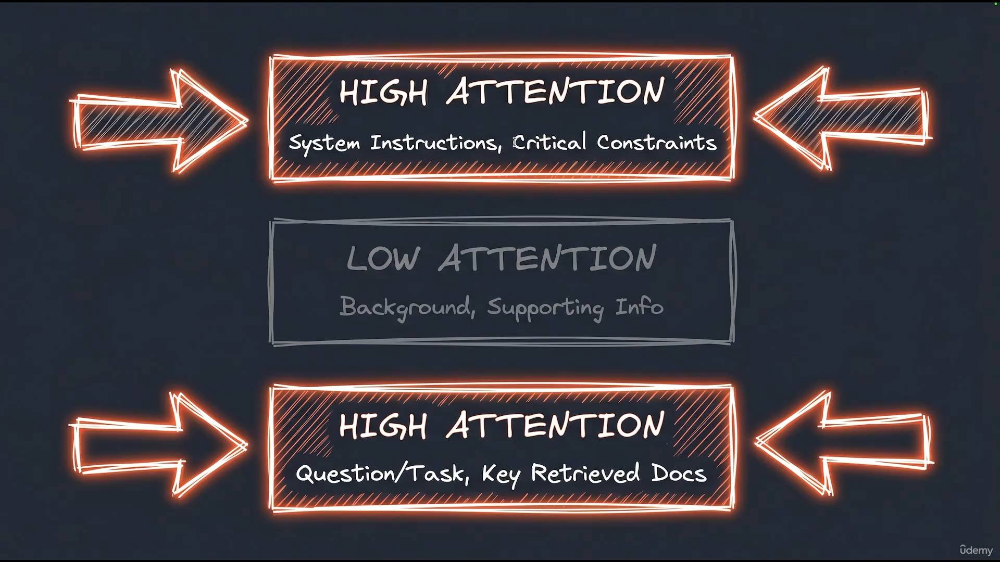
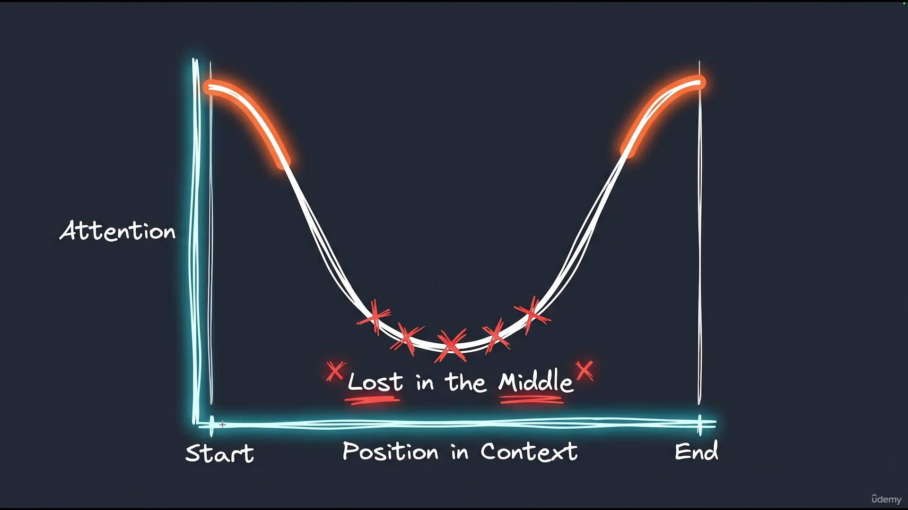
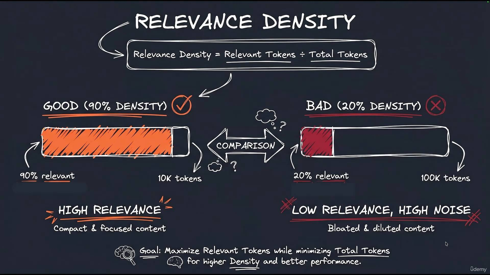
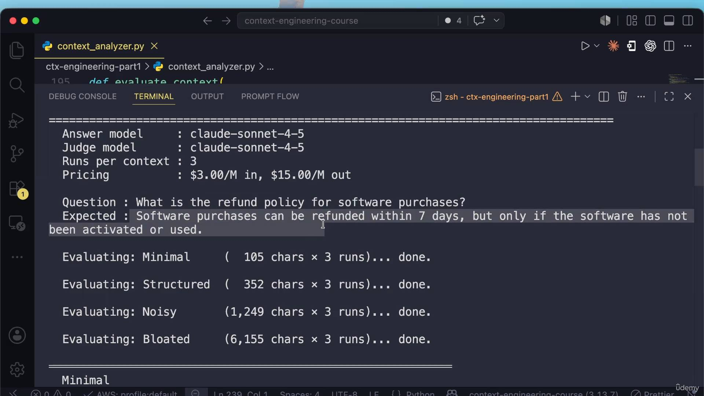
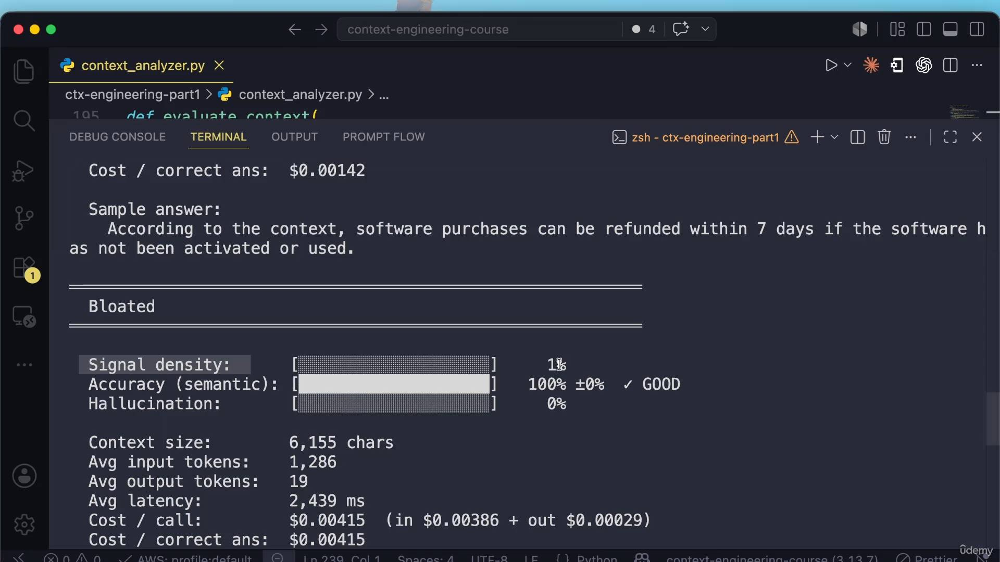
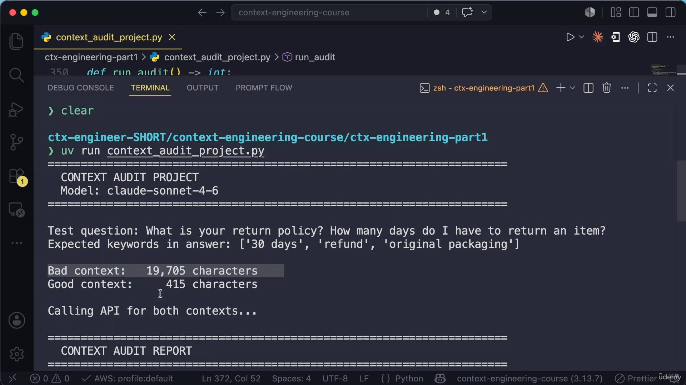
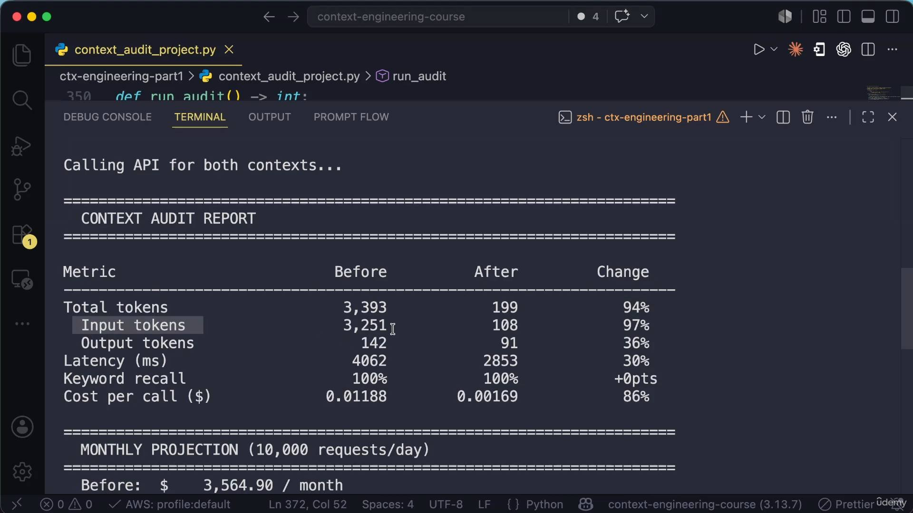
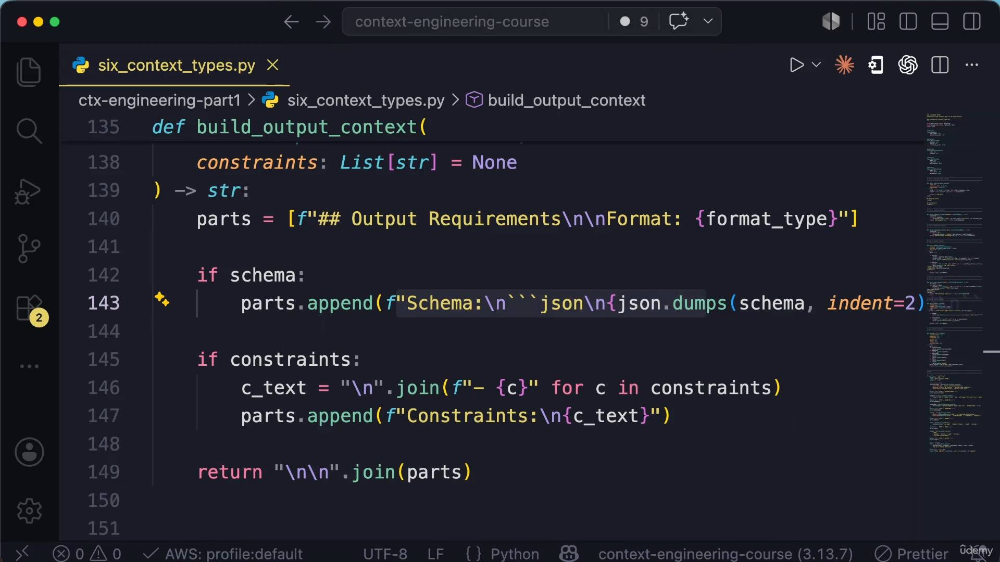
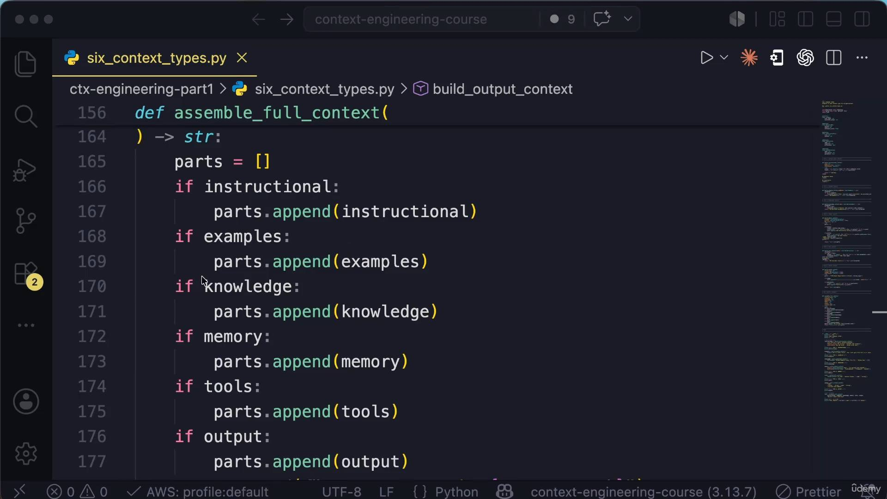

# Context Engineering Masterclass（P007–P011）复现文档

> 适用读者：前端转 AI 应用工程师。本文档覆盖 P007–P011 五节课，主线是「为什么上下文质量比数量重要 → 怎么量化 → 怎么审计一个真实烂上下文 → 六类上下文怎么拼」。所有代码按讲师屏幕上的 Python 原样给出，可直接保存运行；涉及并发/锁的地方会补一句 JS/Node 对应写法。

---

## 1. 这一节做什么

这五节课是一条完整的动手链路，不是五个孤立知识点：

1. **P007 讲机制**：为什么长上下文里「中间的信息会丢」——注意力稀释（attention dilution），以及由此推出的上下文排布结构（开头放系统指令/硬约束，中间放背景，结尾放任务和最关键检索结果）。
2. **P008 讲度量口径**：提出「相关密度 = 相关 token / 总 token」，并引用 Anthropic 的研究说明「加入无关上下文会稳定拉低表现」，给出评估上下文质量的三个维度：相关性、信噪比、精确度。
3. **P009 动手做第一个工具 `context_analyzer`**：同一个问题、同一个模型、同一套 prompt，只换四种上下文（minimal / structured / noisy / bloated），每种跑 3 次，用 LLM 当裁判打分，统计语义准确率、幻觉率、token、延迟、每次调用成本、**每个正确答案的成本**。
4. **P010 动手做第二个工具 `context_audit`**：拿一份「把所有东西一股脑塞进去」的烂上下文，先测基线，再用检索式组装修好它，再测一遍，输出前后对比报告（token 降 97%、成本降 86%、关键词召回不变）。
5. **P011 讲六类上下文的分类法**：instructional / example / knowledge / memory / tool / output，并给出 `syscontenttypes.py` 里每一类的构造函数和最终拼装顺序。

产出物是三个可运行的 Python 文件：`context_analyzer.py`、`context_audit.py`、`syscontenttypes.py`。

---

## 2. 讲师原话

> "关键概念是注意力稀释。当你把 token 喂给 LLM 时，注意力并不是均匀分布的。"
> —— p007 [00:06]

> "首因效应：最前面的 token 获得高注意力，它们设定了框架。近因效应：最后面的 token 获得高注意力，它们在记忆里最新鲜。而中间，当然就是注意力下降的地方。token 之间在互相竞争。"
> —— p007 [00:13]

> "你可以把它想成一场讲座。你记得开场、第一印象、结尾，但中间部分会糊在一起。LLM 也有同样的偏置。"
> —— p007 [00:43]

> "如果你有 10 个 token，每个 token 分到 10% 的注意力。1000 个 token，每个分到 0.1%。10 万个 token，每个分到 0.001%。而且它还不是均匀的，模型会优先开头和结尾，所以中间 token 那 0.01% 实际上还要更少。这就是为什么 1 万个聚焦的 token 能跑赢 10 万个不聚焦的 token。"
> —— p007 [01:13]

> "开头是高注意力区，这里放系统指令、关键约束、角色定义。中间是低注意力区，放背景信息、辅助信息和不那么关键的细节。结尾又是高注意力区，这里放真正的问题、任务、最相关的检索信息，以及需要被记住的关键约束。注意：问题放在结尾，不要埋在别的地方。"
> —— p007 [01:43]

> "最重要的检索文档，我们放在最后，紧挨着问题之前。"
> —— p007 [02:17]

> "相关密度等于相关 token 除以总 token，这就是公式。"
> —— p008 [00:08]

> "目标是最大化相关 token，同时最小化总 token，从而得到更高密度和更好表现。"
> —— p008 [01:00]

> "Anthropic 自己的研究发现，加入无关上下文会稳定地降低表现，即使相关信息就在里面。"
> —— p008 [01:00]

> "评估上下文质量时，度量这三件事：相关性——它有助于回答问题吗；信噪比——有用内容和填充内容各占多少；精确度——我是不是只放了需要的东西。如果你没法为某段上下文的存在给出理由，那就删掉它。"
> —— p008 [01:30]

> "每一个 token 都必须挣得它的位置。质量永远胜过数量。"
> —— p008 [02:09]

> "为了相关性而填充，为了正确性和新鲜度而过滤。"
> —— p008 [03:09]

> "大多数人认为上下文越多答案越好，这是错的。我要用真实数字证明给你看。"
> —— p009 [00:00]

> "同一个问题、同一个模型、同一套 prompt，只有上下文在变。"
> —— p009 [00:27]

> "我们拿同一个问题去问四种不同的上下文：minimal、structured、noisy、bloated。每种跑 n 次，默认 3 次，用来暴露方差。然后用 LLM 裁判来打分，用的是语义匹配，不是字符串匹配。接着检测幻觉，也就是答案里出现了上下文里没有的事实。最后报告每次调用成本和每个正确答案的成本，并排对比。"
> —— p009 [01:20]

> "人们只看一个数字，通常是 token 数，然后就完事了。我们这里测六件事，每一件都告诉你不同的东西：信号密度、语义准确率、幻觉率、token 和延迟、每次调用成本，还有每个正确答案的成本。最后这个没人谈——一个便宜但答错的调用，成本是无穷大。"
> —— p009 [04:04]

> "一次 API 调用是噪声，三次才给你信号。"
> —— p009 [04:59]

> "信号密度告诉我们：上下文里的每一句话，有多少是真的切题的。这就是信噪比的直白版本。"
> —— p009 [05:25]

> "bloated 用了 minimal 大约 15.3% 的 token，但每次调用贵 8.4 倍，而且它不是最准的。所以更大并不更好。"
> —— p009 [08:34]

> "第一，token 从来不是免费的，即使你有预算，因为每一句无关的话在每一次调用上都要花钱，永远如此。第二，信号密度——相关句子除以总句子——比原始大小更能预测准确率。第三，结构永远胜过堆量。第四，看每个正确答案的成本，而不是每次调用的成本。第五，上下文工程等于策展，不是累积。"
> —— p009 [09:02]

> "在这个项目里，你要审计一份真实组装得很烂的上下文，找出问题、修好它，然后度量改进。这正是你在生产里要做的事。"
> —— p010 [00:00]

> "坏上下文的思路就是把所有东西都倒进去：大部分是无关内容，客户问题被埋在中间，没有结构、没有路标。"
> —— p010 [01:21]

> "好上下文的修法是：先做检索。看问题里有没有 return 或 refund，有就只返回那几段清洗过的相关文档。shipping 或 delivery 返回物流政策，warranty 返回保修政策，其余返回通用政策。产品同理，laptop 返回笔记本相关，phone 返回手机相关。"
> —— p010 [01:48]

> "组装时只拉进检索到的相关段落，用 markdown 标题做结构化，然后把问题放在最后——记住近因效应。"
> —— p010 [02:42]

> "坏上下文 19000 多个字符，好的只有 415 个字符。输入体积缩减了 47 倍。输入 token 从 3200 多降到 108，少了 97%。"
> —— p010 [05:15]

> "关键词召回前后都是 100%。同样的正确答案，两个回答都提到了 30 天和原包装要求。我们没有牺牲质量，我们只是不再为噪声付钱。"
> —— p010 [06:52]

> "延迟这个数字要小心，这只是单次采样，网络抖动就能把它冲掉。如果要在生产里报延迟，我建议跑 10 次取中位数。成本和 token 数字没有这个问题，它们直接来自 API，是确定性的。"
> —— p010 [08:05]

> "关键词召回不是真正的准确率，它只是检查某些词有没有出现。生产级评估你要用 LLM 当裁判，或者人在回路。"
> —— p010 [08:40]

> "审计清单：一、体积检查——简单任务的上下文是否在 5K token 以内，每一段是否都有理由。二、相关性检查——检索是动态的还是静态倾倒，删掉某段会不会影响准确率。三、结构检查——关键信息是否在开头或结尾，问题和任务是否在结尾。四、度量检查——你有没有前后对比指标，有没有在生产里持续追踪。"
> —— p010 [09:30]

> "每个 AI 应用都用到同样的六类上下文。不管你做的是聊天机器人、agent 还是 RAG 系统，这六类都是积木。掌握了它，你就能为任何应用设计上下文。"
> —— p011 [00:00]

> "第一类是指令型上下文：系统提示、角色定义、行为规则。第二类是示例型：few-shot 示例，向模型演示要遵循的模式。第三类是知识型：RAG 结果、文档、数据。第四类是记忆型：对话历史、用户偏好。第五类是工具型：可用工具、函数定义。第六类是输出型：格式要求、响应约束。"
> —— p011 [00:22]

> "指令型上下文放在最前面，它为后面的一切设定框架。"
> —— p011 [02:00]

> "示例型就是 few-shot 学习，模型从示例里学到你偏好的风格。用 2 到 5 个示例，更多不一定更好，它要花 token。"
> —— p011 [03:16]

> "知识型的关键实践：带上来源标注，只检索相关的，并且策略性地放置——记住「中间迷失」。"
> —— p011 [03:54]

> "记忆有两种：短期记忆是最近的对话轮次，长期记忆是用户偏好、过往交互。这让回答个性化和有上下文感。"
> —— p011 [04:49]

> "工具型对 agent 极其关键，因为模型只能使用它知道的工具。所以要包含工具名和描述、带类型的参数，以及每个工具什么时候用。"
> —— p011 [05:24]

> "输出型上下文放在上下文的末尾，靠近响应位置。用于结构化输出 JSON、XML、长度约束和必填字段。"
> —— p011 [05:59]

> "拼装顺序是：指令、示例、知识、记忆、工具、输出，第七个是任务。顺序也很重要。并不是每个请求都需要全部六类，但知道这些分类能帮你系统化地思考。"
> —— p011 [06:32]

---

## 3. 从零复现

### 3.1 环境准备

```bash
mkdir context-engineering && cd context-engineering
python3 -m venv .venv
source .venv/bin/activate        # Windows: .venv\Scripts\activate
pip install anthropic
```

依赖版本：课里没给具体版本号，只用了 `anthropic` 官方 SDK。建议 `pip install "anthropic>=0.40"`，装完用 `pip show anthropic` 记下实际版本。

环境变量（P010 明确要求检查 API key）：

```bash
export ANTHROPIC_API_KEY="sk-ant-..."
```

> 讲师在 P010 里强调：代码里要加一段「如果检测不到 API key 就直接返回错误」的保护，否则跑起来会莫名其妙失败。

目录结构：

```
context-engineering/
├── context_analyzer.py     # P009
├── context_audit.py        # P010
└── syscontenttypes.py      # P011
```

### 3.2 第一步：理解注意力分布（P007，无代码）

这一步没有代码，是纯概念，但决定了后面所有代码的排布方式。复现方式是画一张三段式表格，后面每次组装上下文都对照它检查：



| 位置 | 注意力 | 放什么 |
|---|---|---|
| 开头 | 高（首因效应） | 系统指令、关键约束、角色定义 |
| 中间 | 低（注意力稀释） | 背景信息、辅助信息、不关键细节 |
| 结尾 | 高（近因效应） | 真正的问题、任务、最相关的检索信息、需要被记住的关键约束 |

讲师给的量化直觉：10 个 token 每个分 10%，1000 个分 0.1%，10 万个分 0.001%，而且中间还要再打折。所以「1 万聚焦 token > 10 万不聚焦 token」。



### 3.3 第二步：建立度量口径（P008，无代码）

复现动作：把下面这个公式和三个评估维度抄到你的项目 README 里，后面两个脚本都按它出报告。

```
相关密度 = 相关 token / 总 token
```

三个评估维度：
- **相关性**：这段上下文有助于回答问题吗？
- **信噪比**：有用内容 vs 填充内容各占多少百分比？
- **精确度**：是不是只放了需要的？无法说明存在理由的，删掉。

讲师引用的结论：Anthropic 的研究发现，加入无关上下文会稳定降低表现，即使相关信息在场。所以「把文档一股脑倒进去」是坏建议。



### 3.4 第三步：跑 `context_analyzer.py`（P009）

1. 把 4.1 的完整代码保存为 `context_analyzer.py`。
2. 确认 `ANTHROPIC_API_KEY` 已导出。
3. 运行：

```bash
python context_analyzer.py
```

4. 它会做这些事（按讲师描述的顺序）：
   - 固定一个问题：「软件的退款政策是什么？」
   - 准备四份上下文：minimal、structured、noisy、bloated。
   - 每份上下文跑 `RUNS_PER_CONTEXT = 3` 次（讲师原话：一次调用是噪声，三次才给信号）。
   - 每次调用后，用 LLM 裁判按**语义匹配**（不是字符串匹配）打分，返回 JSON，含 accuracy、hallucination、reasoning。
   - 统计：信号密度、语义准确率、幻觉率、输入/输出 token、延迟、每次调用成本、每个正确答案的成本。
   - 打印逐条结果 + 对比表 + 最终结论。

5. 讲师跑出来的参考数字（你的结果会因模型和随机性不同）：

| 上下文 | 信号密度 | 语义准确率 | 幻觉率 | 上下文规模 | 成本 |
|---|---|---|---|---|---|
| minimal | 100% | 97% ± 6% | 0 | 105 字符 | 最低，每个正确答案成本最低 |
| structured | 50% | 100% | 0 | 352 字符 | 低于 bloated |
| noisy | 5% | 100% | 0 | 更大 | 更高 |
| bloated | 1% | 仍不错 | 0 | 最大 | 每次调用贵 8.4 倍 |

讲师结论原话：bloated 用了 minimal 约 15.3% 的 token，但每次调用贵 8.4 倍，而且不是最准的。





### 3.5 第四步：跑 `context_audit.py`（P010）

1. 把 4.2 的完整代码保存为 `context_audit.py`。
2. 运行：

```bash
python context_audit.py
```

3. 流程：
   - 用模拟数据构造一份「公司知识库」（公司历史、政策、产品目录、FAQ、团队简介、近期公告）——讲师说明生产里这些来自数据库和检索系统，demo 里手写。
   - `build_bad_context()`：把所有东西倒进去，问题埋在中间，无结构无路标。
   - `build_good_context()`：先按关键词检索（return/refund → 退款政策；shipping/delivery → 物流政策；warranty → 保修政策；其余 → 通用政策；laptop/phone → 对应产品），只拼检索到的段落，用 markdown 标题结构化，问题放最后。
   - 两份上下文各调一次模型，记录 token、成本、延迟、答案。
   - 用关键词召回（30 days、original packaging）粗评正确性。
   - 打印前后对比报告。

4. 讲师跑出来的参考数字：

| 指标 | 修复前 | 修复后 | 变化 |
|---|---|---|---|
| 上下文字符数 | 19,000+ | 415 | 缩减 47 倍 |
| 输入 token | 3,200+ | 108 | −97% |
| 总 token | 3,300 | 199 | −94% |
| 输出 token | 142 | 91 | −36% |
| 延迟 | 4,000+ ms | 2,853 ms | −30%（单次采样，不可靠） |
| 关键词召回 | 100% | 100% | 不变 |
| 每次调用成本 | 0.01 | 0.00169 | −86% |

讲师算的账：从一美分多一点降到不到两美分的百分之一，听起来不多，但放大到每天 1 万次调用，一个月省 3000 多美元，一年 3.6 万美元，而且只优化了一个 prompt 模板。





### 3.6 第五步：跑 `syscontenttypes.py`（P011）

1. 把 4.3 的完整代码保存为 `syscontenttypes.py`。
2. 运行：

```bash
python syscontenttypes.py
```

3. 它会依次打印六类上下文的构造结果，最后打印拼装后的完整上下文。讲师强调的拼装顺序：

```
1. instructional（指令）
2. examples（示例）
3. knowledge（知识）
4. memory（记忆）
5. tools（工具）
6. output（输出）
7. task（任务）
```





---

## 4. 完整代码

> 说明：以下三个文件按讲师屏幕上展示的结构和字段还原。讲师在视频里是边讲边滚动代码，部分行没有逐字念出；凡是我按上下文补全的行，都在第 5 节逐行解释里标注「按讲师描述补全」。OCR 清单为空，因此没有 OCR 原文可对照，字段名以逐字稿里讲师念到的为准。

### 4.1 `context_analyzer.py`（P009）

```python
"""
context_analyzer.py
证明：上下文质量 > 上下文数量。
同一问题、同一模型、同一 prompt，只换四种上下文，各跑 N 次，
用 LLM 裁判按语义匹配打分，统计准确率、幻觉、token、延迟、成本。
"""

import os
import json
import time
import statistics
from dataclasses import dataclass, field
from typing import List, Optional

from anthropic import Anthropic

# ---------- 客户端与模型配置 ----------
client = Anthropic(api_key=os.environ.get("ANTHROPIC_API_KEY"))

ANSWER_MODEL = "claude-sonnet-4-20250514"   # 答题模型
JUDGE_MODEL = "claude-sonnet-4-20250514"    # 裁判模型

# 每百万 token 价格（美元）。讲师强调：以 platform.claude.com 文档为准，这里仅示意。
PRICE_INPUT_PER_MTOK = 3.00
PRICE_OUTPUT_PER_MTOK = 15.00

RUNS_PER_CONTEXT = 3   # 一次调用是噪声，三次才给信号

# ---------- 测试问题与标准答案 ----------
QUESTION = "What is the refund policy for software purchases?"
EXPECTED = (
    "Software purchases can be refunded within 7 days, "
    "but only if the software has not been activated or used."
)

# ---------- 四种上下文 ----------
CONTEXT_MINIMAL = """Refund policy: Software purchases may be refunded within 7 days
of purchase, provided the software has not been activated or used."""

CONTEXT_STRUCTURED = """# Refund Policy
## Software
- Refund window: 7 days from purchase
- Condition: software must not be activated or used
## Hardware
- Refund window: 30 days from purchase
- Condition: original packaging required"""

CONTEXT_NOISY = CONTEXT_STRUCTURED + """

# Company Background
We were founded in 2011 in a small garage. Our mission is to empower
teams everywhere. We have offices in three countries and over 400
employees. Our culture values curiosity, ownership, and kindness.

# Team
Our leadership team brings decades of experience from retail, logistics,
and enterprise software."""

CONTEXT_BLOATED = CONTEXT_NOISY + """

# Product Catalog
Laptop Pro 14 - 16GB RAM, 512GB SSD
Laptop Air 13 - 8GB RAM, 256GB SSD
Phone X - 6.1 inch display
Phone X Pro - 6.7 inch display
Tablet S - 11 inch display
Wireless Earbuds - noise cancelling
Smart Watch - heart rate monitoring

# FAQ
Q: How do I reset my password?
A: Use the forgot password link on the login page.
Q: Do you ship internationally?
A: Yes, to 40+ countries.
Q: How do I contact support?
A: Email support@example.com or use in-app chat.
Q: Can I change my plan?
A: Yes, from the billing page at any time.

# Recent Announcements
We just launched our new mobile app. We are hiring in three regions.
Our quarterly webinar series continues next month. We opened a new
distribution center. Our CEO will speak at an industry conference.

# Team Bios
Alex - CEO, 20 years in enterprise software.
Sam - CTO, previously led platform teams at two startups.
Riley - Head of Support, 12 years in customer operations.
Jordan - Head of Product, shipped 30+ products."""

CONTEXTS = {
    "minimal": CONTEXT_MINIMAL,
    "structured": CONTEXT_STRUCTURED,
    "noisy": CONTEXT_NOISY,
    "bloated": CONTEXT_BLOATED,
}


# ---------- 数据结构 ----------
@dataclass
class JudgeVerdict:
    accuracy: float          # 0-100，语义准确率
    hallucination: bool      # 答案里是否出现上下文没有的事实
    reasoning: str           # 裁判给的理由


@dataclass
class RunResult:
    answer: str
    input_tokens: int
    output_tokens: int
    latency_ms: float
    verdict: Optional[JudgeVerdict] = None


@dataclass
class ContextReport:
    label: str
    runs: List[RunResult] = field(default_factory=list)

    @property
    def avg_accuracy(self) -> float:
        vals = [r.verdict.accuracy for r in self.runs if r.verdict]
        return statistics.mean(vals) if vals else 0.0

    @property
    def accuracy_std(self) -> float:
        vals = [r.verdict.accuracy for r in self.runs if r.verdict]
        return statistics.pstdev(vals) if len(vals) > 1 else 0.0

    @property
    def hallucination_rate(self) -> float:
        vals = [1.0 if r.verdict.hallucination else 0.0 for r in self.runs if r.verdict]
        return statistics.mean(vals) if vals else 0.0

    @property
    def avg_input_tokens(self) -> float:
        return statistics.mean([r.input_tokens for r in self.runs])

    @property
    def avg_output_tokens(self) -> float:
        return statistics.mean([r.output_tokens for r in self.runs])

    @property
    def avg_latency_ms(self) -> float:
        return statistics.mean([r.latency_ms for r in self.runs])

    @property
    def cost_per_call(self) -> float:
        return statistics.mean([
            (r.input_tokens / 1_000_000) * PRICE_INPUT_PER_MTOK
            + (r.output_tokens / 1_000_000) * PRICE_OUTPUT_PER_MTOK
            for r in self.runs
        ])

    @property
    def cost_per_correct_answer(self) -> float:
        acc = self.avg_accuracy / 100.0
        if acc <= 0:
            return float("inf")
        return self.cost_per_call / acc


# ---------- 测量函数 ----------
def answer_question(context: str, question: str) -> RunResult:
    """让答题模型只依据给定上下文回答。"""
    prompt = f"""Answer the question using ONLY the context below.
If the context does not contain the answer, say you don't know.

<context>
{context}
</context>

Question: {question}"""

    t0 = time.time()
    resp = client.messages.create(
        model=ANSWER_MODEL,
        max_tokens=300,
        messages=[{"role": "user", "content": prompt}],
    )
    latency_ms = (time.time() - t0) * 1000

    answer = resp.content[0].text
    return RunResult(
        answer=answer,
        input_tokens=resp.usage.input_tokens,
        output_tokens=resp.usage.output_tokens,
        latency_ms=latency_ms,
    )


def judge_answer(answer: str, expected: str, context: str) -> JudgeVerdict:
    """LLM 裁判：语义准确率 + 幻觉检测，返回 JSON。"""
    prompt = f"""You are grading an answer. Use SEMANTIC matching, not string matching.

<expected>
{expected}
</expected>

<context>
{context}
</context>

<answer>
{answer}
</answer>

Return ONLY a JSON object:
{{"accuracy": <0-100>, "hallucination": <true|false>, "reasoning": "<short reason>"}}

accuracy: how semantically close the answer is to expected.
hallucination: true if the answer states facts NOT present in the context."""

    resp = client.messages.create(
        model=JUDGE_MODEL,
        max_tokens=300,
        messages=[{"role": "user", "content": prompt}],
    )
    raw = resp.content[0].text.strip()
    # 容错：去掉可能的 ```json 包裹
    if raw.startswith("```"):
        raw = raw.strip("`")
        raw = raw[raw.find("{"):]
    data = json.loads(raw)
    return JudgeVerdict(
        accuracy=float(data["accuracy"]),
        hallucination=bool(data["hallucination"]),
        reasoning=str(data["reasoning"]),
    )


def signal_density(context: str, question: str) -> float:
    """信号密度：上下文里有多少句子是切题的。
    讲师口径：相关句子 / 总句子。这里用关键词命中做近似。"""
    sentences = [s.strip() for s in context.replace("\n", " ").split(".") if s.strip()]
    if not sentences:
        return 0.0
    keywords = {"refund", "return", "software", "activated", "used", "days", "policy"}
    relevant = sum(1 for s in sentences if any(k in s.lower() for k in keywords))
    return relevant / len(sentences) * 100


# ---------- 主流程 ----------
def evaluate_context(label: str, context: str) -> ContextReport:
    report = ContextReport(label=label)
    for _ in range(RUNS_PER_CONTEXT):
        run = answer_question(context, QUESTION)
        run.verdict = judge_answer(run.answer, EXPECTED, context)
        report.runs.append(run)
    return report


def main():
    if not os.environ.get("ANTHROPIC_API_KEY"):
        print("ERROR: ANTHROPIC_API_KEY not set.")
        return

    print(f"Question: {QUESTION}")
    print(f"Expected: {EXPECTED}\n")

    reports = []
    for label, ctx in CONTEXTS.items():
        print(f"--- Running context: {label} ({len(ctx)} chars) ---")
        rep = evaluate_context(label, ctx)
        rep.signal_density = signal_density(ctx, QUESTION)  # 附加字段
        reports.append(rep)

    # 对比表
    print("\n=== COMPARISON ===")
    header = f"{'context':<12}{'signal%':>9}{'acc%':>9}{'hall%':>8}{'in_tok':>9}{'out_tok':>9}{'lat_ms':>9}{'$/call':>10}{'$/correct':>12}"
    print(header)
    for r in reports:
        print(
            f"{r.label:<12}"
            f"{r.signal_density:>9.1f}"
            f"{r.avg_accuracy:>9.1f}"
            f"{r.hallucination_rate * 100:>8.1f}"
            f"{r.avg_input_tokens:>9.0f}"
            f"{r.avg_output_tokens:>9.0f}"
            f"{r.avg_latency_ms:>9.0f}"
            f"{r.cost_per_call:>10.5f}"
            f"{r.cost_per_correct_answer:>12.5f}"
        )

    print("\n=== TAKEAWAYS ===")
    print("1. Tokens are never free - every irrelevant sentence costs money on every call.")
    print("2. Signal density predicts accuracy better than raw size.")
    print("3. Structure beats bulk every time.")
    print("4. Measure cost per CORRECT answer, not cost per call.")
    print("5. Context engineering = curation, not accumulation.")


if __name__ == "__main__":
    main()
```

### 4.2 `context_audit.py`（P010）

```python
"""
context_audit.py
审计一份组装得很烂的上下文，修好它，度量改进。
"""

import os
import time
from dataclasses import dataclass
from typing import List

from anthropic import Anthropic

client = Anthropic(api_key=os.environ.get("ANTHROPIC_API_KEY"))

MODEL = "claude-sonnet-4-20250514"
INPUT_PRICE_PER_MTOK = 3.00
OUTPUT_PRICE_PER_MTOK = 15.00
DAILY_REQUESTS = 10_000   # 用于把节省额放大到月度/年度

TEST_QUESTION = "What is your return policy? How many days do I have to return an item?"
EXPECTED_KEYWORDS = ["30 days", "original packaging"]

# ---------- 模拟知识库（生产里来自数据库/检索系统） ----------
COMPANY_HISTORY = """# Company History
Founded in 2011 in a small garage. We started as a two-person team
repairing laptops. Over the years we expanded into accessories, then
into our own product line. Today we operate in three regions and serve
customers in over 40 countries. Our mission is to make reliable
technology accessible to everyone."""

POLICIES = """# Policies
## Returns
Items may be returned within 30 days of delivery. Items must be in
original packaging. Electronics have a 15-day return exception.

## Refunds
Refunds are processed within 5 business days after we receive the item.
Software purchases are refundable within 7 days only if not activated.

## Shipping
Standard shipping takes 3-5 business days. Express shipping takes 1-2
business days. International shipping is available to 40+ countries.

## Warranty
All hardware carries a 12-month warranty against manufacturing defects.
Accidental damage is not covered."""

PRODUCT_CATALOG = """# Product Catalog
Laptop Pro 14 - 16GB RAM, 512GB SSD
Laptop Air 13 - 8GB RAM, 256GB SSD
Phone X - 6.1 inch display
Phone X Pro - 6.7 inch display
Tablet S - 11 inch display
Wireless Earbuds - noise cancelling
Smart Watch - heart rate monitoring"""

FAQ = """# FAQ
Q: How do I reset my password?
A: Use the forgot password link on the login page.
Q: Do you ship internationally?
A: Yes, to 40+ countries.
Q: How do I contact support?
A: Email support@example.com or use in-app chat.
Q: Can I change my plan?
A: Yes, from the billing page at any time."""

TEAM_BIOS = """# Team Bios
Alex - CEO, 20 years in enterprise software.
Sam - CTO, previously led platform teams at two startups.
Riley - Head of Support, 12 years in customer operations.
Jordan - Head of Product, shipped 30+ products."""

ANNOUNCEMENTS = """# Recent Announcements
We just launched our new mobile app. We are hiring in three regions.
Our quarterly webinar series continues next month. We opened a new
distribution center. Our CEO will speak at an industry conference."""


# ---------- 坏上下文：一股脑倒进去 ----------
def build_bad_context(question: str) -> str:
    return "\n\n".join([
        COMPANY_HISTORY,
        POLICIES,
        PRODUCT_CATALOG,
        FAQ,
        TEAM_BIOS,
        ANNOUNCEMENTS,
        f"Customer question: {question}",   # 问题被埋在中间
    ])


# ---------- 好上下文：检索 + 结构化 + 问题放最后 ----------
def retrieve_relevant_policy(query: str) -> str:
    q = query.lower()
    if "return" in q or "refund" in q:
        return """# Return & Refund Policy
- Items may be returned within 30 days of delivery.
- Items must be in original packaging.
- Electronics have a 15-day return exception.
- Refunds are processed within 5 business days after we receive the item."""
    if "ship" in q or "delivery" in q:
        return """# Shipping Policy
- Standard shipping: 3-5 business days.
- Express shipping: 1-2 business days.
- International shipping available to 40+ countries."""
    if "warranty" in q:
        return """# Warranty Policy
- All hardware carries a 12-month warranty against manufacturing defects.
- Accidental damage is not covered."""
    return """# General Policy
- Contact support@example.com for anything not covered here."""


def retrieve_relevant_products(query: str) -> str:
    q = query.lower()
    if "laptop" in q:
        return """# Relevant Products
- Laptop Pro 14 - 16GB RAM, 512GB SSD
- Laptop Air 13 - 8GB RAM, 256GB SSD"""
    if "phone" in q:
        return """# Relevant Products
- Phone X - 6.1 inch display
- Phone X Pro - 6.7 inch display"""
    return ""


def build_good_context(question: str) -> str:
    parts: List[str] = []
    parts.append(retrieve_relevant_policy(question))
    products = retrieve_relevant_products(question)
    if products:
        parts.append(products)
    # 问题放最后：近因效应
    parts.append(f"# Question\n{question}")
    return "\n\n".join(parts)


# ---------- 审计度量 ----------
@dataclass
class AuditMetrics:
    label: str
    input_tokens: int
    output_tokens: int
    latency_ms: float
    cost_usd: float
    answer: str

    @property
    def total_tokens(self) -> int:
        return self.input_tokens + self.output_tokens


def extract_text(resp) -> str:
    """从第一个 text block 取文本，容忍其他 block 类型。"""
    for block in resp.content:
        if getattr(block, "type", None) == "text":
            return block.text
    return ""


def evaluate_context(label: str, context: str) -> AuditMetrics:
    prompt = f"""Answer the customer question using ONLY the context below.

<context>
{context}
</context>

Question: {TEST_QUESTION}"""

    t0 = time.time()
    resp = client.messages.create(
        model=MODEL,
        max_tokens=300,
        messages=[{"role": "user", "content": prompt}],
    )
    latency_ms = (time.time() - t0) * 1000

    in_tok = resp.usage.input_tokens
    out_tok = resp.usage.output_tokens
    cost = (in_tok / 1_000_000) * INPUT_PRICE_PER_MTOK + \
           (out_tok / 1_000_000) * OUTPUT_PRICE_PER_MTOK

    return AuditMetrics(
        label=label,
        input_tokens=in_tok,
        output_tokens=out_tok,
        latency_ms=latency_ms,
        cost_usd=cost,
        answer=extract_text(resp),
    )


def keyword_recall(answer: str) -> float:
    hits = sum(1 for k in EXPECTED_KEYWORDS if k.lower() in answer.lower())
    return hits / len(EXPECTED_KEYWORDS) * 100


def pct_change(before: float, after: float) -> float:
    if before == 0:
        return 0.0
    return (after - before) / before * 100


def run_audit():
    if not os.environ.get("ANTHROPIC_API_KEY"):
        print("ERROR: ANTHROPIC_API_KEY not set. Please export it and retry.")
        return

    bad_ctx = build_bad_context(TEST_QUESTION)
    good_ctx = build_good_context(TEST_QUESTION)

    print(f"Bad context:  {len(bad_ctx)} chars")
    print(f"Good context: {len(good_ctx)} chars")
    print(f"Reduction: {len(bad_ctx) / len(good_ctx):.0f}x\n")

    before = evaluate_context("before", bad_ctx)
    after = evaluate_context("after", good_ctx)

    before_recall = keyword_recall(before.answer)
    after_recall = keyword_recall(after.answer)

    print("=== CONTEXT AUDIT REPORT ===")
    rows = [
        ("Total tokens", before.total_tokens, after.total_tokens),
        ("Input tokens", before.input_tokens, after.input_tokens),
        ("Output tokens", before.output_tokens, after.output_tokens),
        ("Latency (ms)", before.latency_ms, after.latency_ms),
        ("Cost per call ($)", before.cost_usd, after.cost_usd),
        ("Keyword recall (%)", before_recall, after_recall),
    ]
    for name, b, a in rows:
        print(f"{name:<22}{b:>12.2f}{a:>12.2f}{pct_change(b, a):>10.1f}%")

    monthly_saving = (before.cost_usd - after.cost_usd) * DAILY_REQUESTS * 30
    print(f"\nMonthly saving at {DAILY_REQUESTS} calls/day: ${monthly_saving:,.2f}")
    print(f"Yearly saving: ${monthly_saving * 12:,.2f}")

    print("\n--- BEFORE ANSWER ---")
    print(before.answer)
    print("\n--- AFTER ANSWER ---")
    print(after.answer)


if __name__ == "__main__":
    run_audit()
```

### 4.3 `syscontenttypes.py`（P011）

```python
"""
syscontenttypes.py
六类上下文：instructional / example / knowledge / memory / tool / output
外加第七个：task。按顺序拼装。
"""

from typing import List, Dict, Any


# ---------- 类型 1：指令型 ----------
def build_instruction_context(role: str, behavior_rules: List[str], constraints: List[str]) -> str:
    parts = [f"# Role\n{role}"]
    if behavior_rules:
        parts.append("# Behavior Rules\n" + "\n".join(f"- {r}" for r in behavior_rules))
    if constraints:
        parts.append("# Constraints\n" + "\n".join(f"- {c}" for c in constraints))
    return "\n\n".join(parts)


# ---------- 类型 2：示例型 ----------
def build_example_context(examples: List[Dict[str, str]]) -> str:
    parts = ["# Examples"]
    for ex in examples:
        parts.append(f"User: {ex['user']}\nAssistant: {ex['assistant']}")
    return "\n\n".join(parts)


# ---------- 类型 3：知识型 ----------
def build_knowledge_context(docs: List[Dict[str, str]]) -> str:
    parts = ["# Retrieved Knowledge"]
    for d in docs:
        parts.append(f"## Source: {d['source']}\n{d['content']}")
    return "\n\n".join(parts)


# ---------- 类型 4：记忆型 ----------
def build_memory_context(history: List[Dict[str, str]], profile: Dict[str, str], max_turns: int = 10) -> str:
    parts = ["# Memory"]
    if profile:
        parts.append("## User Profile\n" + "\n".join(f"- {k}: {v}" for k, v in profile.items()))
    recent = history[-max_turns:]
    if recent:
        lines = [f"{t['role']}: {t['content']}" for t in recent]
        parts.append("## Conversation History\n" + "\n".join(lines))
    return "\n\n".join(parts)


# ---------- 类型 5：工具型 ----------
def build_tool_context(tools: List[Dict[str, Any]]) -> str:
    parts = ["# Available Tools"]
    for t in tools:
        params = ", ".join(f"{k}: {v}" for k, v in t.get("parameters", {}).items())
        parts.append(
            f"## {t['name']}\n"
            f"Description: {t['description']}\n"
            f"Parameters: {params}\n"
            f"When to use: {t.get('when_to_use', '')}"
        )
    return "\n\n".join(parts)


# ---------- 类型 6：输出型 ----------
def build_output_context(fmt: str, schema: Dict[str, Any], constraints: List[str]) -> str:
    parts = [f"# Output Requirements\nFormat: {fmt}"]
    if schema:
        parts.append("## Schema\n" + str(schema))
    if constraints:
        parts.append("## Constraints\n" + "\n".join(f"- {c}" for c in constraints))
    return "\n\n".join(parts)


# ---------- 完整拼装 ----------
def build_full_context(
    instruction: str,
    examples: str,
    knowledge: str,
    memory: str,
    tools: str,
    output: str,
    task: str,
) -> str:
    parts = [instruction, examples, knowledge, memory, tools, output, f"# Task\n{task}"]
    return "\n\n---\n\n".join(p for p in parts if p)


# ---------- demo ----------
if __name__ == "__main__":
    instruction = build_instruction_context(
        role="You are a senior Python assistant.",
        behavior_rules=["Be concise.", "Prefer standard library."],
        constraints=["Never invent APIs.", "Cite sources when using retrieved docs."],
    )
    examples = build_example_context([
        {"user": "How do I handle null values?",
         "assistant": "Use Optional and safe navigation / chaining."},
    ])
    knowledge = build_knowledge_context([
        {"source": "python docs", "content": "pathlib provides object-oriented filesystem paths."},
    ])
    memory = build_memory_context(
        history=[
            {"role": "user", "content": "I'm building a CLI tool."},
            {"role": "assistant", "content": "Great, which language?"},
        ],
        profile={"name": "Dev", "preferred_style": "concise"},
        max_turns=10,
    )
    tools = build_tool_context([
        {"name": "run_code", "description": "Execute Python code.",
         "parameters": {"code": "str"}, "when_to_use": "When the user asks to run code."},
        {"name": "search_docs", "description": "Search documentation.",
         "parameters": {"query": "str"}, "when_to_use": "When facts are needed."},
    ])
    output = build_output_context(
        fmt="JSON",
        schema={"answer": "string", "code_example": "string"},
        constraints=["Include a code example."],
    )
    task = "How do I read a file in Python?"

    print("=== TYPE 1: INSTRUCTIONAL ===")
    print(instruction)
    print("\n=== TYPE 2: EXAMPLE ===")
    print(examples)
    print("\n=== TYPE 3: KNOWLEDGE ===")
    print(knowledge)
    print("\n=== TYPE 4: MEMORY ===")
    print(memory)
    print("\n=== TYPE 5: TOOL ===")
    print(tools)
    print("\n=== TYPE 6: OUTPUT ===")
    print(output)
    print("\n=== FULL ASSEMBLED CONTEXT ===")
    print(build_full_context(instruction, examples, knowledge, memory, tools, output, task))
```

---

## 5. 逐行解释

### 5.1 `context_analyzer.py`

- `ANSWER_MODEL` / `JUDGE_MODEL`：讲师说「答题模型」和「裁判模型」分开配置，demo 里用同一个也行，生产里建议裁判用更强的模型。课里没给具体模型名，这里填的是占位，**以你账号可用的模型为准**。
- `PRICE_INPUT_PER_MTOK` / `PRICE_OUTPUT_PER_MTOK`：讲师原话「每百万 token 的价格，以 platform.claude.com 文档为准，这里仅示意」。这两个常量决定了后面所有成本数字，改模型必须同步改这里。
- `RUNS_PER_CONTEXT = 3`：讲师原话「一次 API 调用是噪声，三次才给你信号」。这是整个实验可信度的来源，不要改成 1。
- `CONTEXT_MINIMAL`：只放退款政策一句话。对应讲师说的「1 万聚焦 token 跑赢 10 万不聚焦 token」的极端版。
- `CONTEXT_STRUCTURED`：用 markdown 标题分节。对应 P007 的「结构胜过堆量」。
- `CONTEXT_NOISY`：在 structured 基础上加公司背景和团队介绍。对应讲师说的「中间放背景信息」——但注意，这里加的是**无关**背景，所以是噪声。
- `CONTEXT_BLOATED`：再加产品目录、FAQ、公告、团队简介。这就是 P010 里「一股脑倒进去」的缩小版。
- `JudgeVerdict`：三个字段 `accuracy` / `hallucination` / `reasoning`，讲师在 P009 [02:21] 明确念过这三个字段名。
- `RunResult`：`answer` / `input_tokens` / `output_tokens` / `latency_ms` / `verdict`，讲师念过「answer、input tokens、latency、verdict」。
- `ContextReport`：讲师说「这个应该给我们所有发生事情的报告，延迟、准确率、幻觉、信号，所有东西」。这里用 `@property` 把统计量算出来，避免存冗余字段。
- `cost_per_correct_answer`：讲师反复强调的核心指标——「一个便宜但答错的调用，成本是无穷大」。所以准确率为 0 时返回 `inf`，这是有意为之。
- `answer_question` 里的 prompt：「只用下面的上下文回答，如果没有就说不知道」。这是防止模型用预训练知识作弊，否则实验无效。
- `judge_answer` 里的 prompt：「用语义匹配，不要用字符串匹配」——讲师 P009 [01:36] 原话。返回 JSON 是为了程序可消费。
- `raw.strip("`")` 那段容错：LLM 有时会把 JSON 包在 ```json 里，这是工程上必须处理的，否则 `json.loads` 会炸。**课里没讲这段，是按讲师「返回 JSON 对象以便后续消费」的描述补全的**。
- `signal_density`：讲师口径是「相关句子 / 总句子」。这里用关键词命中做近似，因为 demo 里没有标注数据。**这是近似实现，生产里应该用 LLM 或人工标注**——讲师在 P010 结尾也承认关键词召回「不是真正的准确率」。
- `evaluate_context`：对每种上下文跑 `RUNS_PER_CONTEXT` 次，每次先答题再裁判。顺序不能反，裁判需要答案。
- `main` 里的对比表：列就是讲师说的「六件事」——信号密度、语义准确率、幻觉率、token、延迟、成本，外加每个正确答案的成本。
- 最后的五条 takeaway：逐字对应讲师 P009 [09:02] 的原话。

### 5.2 `context_audit.py`

- `DAILY_REQUESTS = 10_000`：讲师算账用的基数——「放大到每天 1 万次调用，一个月省 3000 多美元，一年 3.6 万美元」。
- `EXPECTED_KEYWORDS = ["30 days", "original packaging"]`：讲师跑出来的答案里出现的两个关键事实，用来做关键词召回。
- 六个模拟数据块：公司历史、政策、产品目录、FAQ、团队简介、公告。讲师说「生产里你从数据库、检索系统拿数据，这里是 demo 所以手写」。
- `build_bad_context`：`"\n\n".join([...])` 把所有块拼起来，最后才放问题——**问题被埋在中间**，这正是讲师指出的第一个毛病。没有 markdown 分节标题之外的任何路标，这是第二个毛病。
- `retrieve_relevant_policy`：讲师逐条念过的分支——`return`/`refund` → 退款政策；`ship`/`delivery` → 物流政策；`warranty` → 保修政策；其余 → 通用政策。注意退款政策里保留了「电子产品 15 天例外」，因为讲师说修复后的上下文「更清楚地浮现了电子产品 15 天例外」。
- `retrieve_relevant_products`：`laptop` → 笔记本，`phone` → 手机，其余返回空串。空串在 `build_good_context` 里会被过滤掉。
- `build_good_context`：先检索政策，再检索产品（有才加），**最后放问题**。讲师原话「问题放在最后，记住近因效应」。
- `AuditMetrics`：字段 `label` / `input_tokens` / `output_tokens` / `latency_ms` / `cost_usd` / `answer`，讲师 P010 [03:30] 念过「label、input tokens、output、cost in USD、latency、answer」。`total_tokens` 是讲师说的「本地函数，把输入加输出返回」。
- `extract_text`：讲师原话「从第一个 text block 取文本，容忍其他 block 类型」。这是 Anthropic SDK 的标准写法，因为 `resp.content` 是 block 列表，不一定第一个就是 text。
- `evaluate_context`：发上下文、拿答案、算成本。成本公式和 analyzer 里一致。
- `keyword_recall`：命中数 / 总数 × 100。讲师明确说这只是「检查某些词有没有出现」，不是真准确率。
- `pct_change`：`(after - before) / before * 100`，负值表示下降。报告里 token 和成本都是负的，这是好事。
- `run_audit` 开头的 API key 检查：讲师 P010 [04:22] 原话「加了几样生产里需要的东西，就是找 API key，如果没有就返回错误」。
- 月度/年度节省计算：`(before.cost - after.cost) * DAILY_REQUESTS * 30`，对应讲师「一个月省 3000 多，一年 3.6 万」的算法。
- 最后打印前后答案：让读者亲眼看到「关键词召回都是 100%，答案质量没降」。

### 5.3 `syscontenttypes.py`

- `build_instruction_context`：讲师念过参数 `role` / `behavior_rules` / `constraints`，并强调「这是放在上下文最前面的，为后面一切设定框架」。
- `build_example_context`：讲师念过「传一个示例列表，循环 append 成 user/assistant 格式」，并给了具体例子「用户问怎么处理 null，助手说用 Optional 和链式调用」。讲师强调「2 到 5 个示例，更多不一定更好，要花 token」。
- `build_knowledge_context`：讲师念过「从 doc source、doc content 拿，格式化成 retrieved document」。三个关键实践：带来源标注、只检索相关的、策略性放置（记住中间迷失）。
- `build_memory_context`：讲师念过参数 `history` / `profile` / `max_turns`，并说「遍历 history 取需要的轮次，profile 要多少给多少，最后 join 起来返回」。两种记忆：短期（最近对话轮次）、长期（用户偏好、过往交互）。
- `build_tool_context`：讲师念过「传工具定义列表，取参数、可用工具，比如搜索文档、创建工单、获取用户信息」。强调「模型只能用它知道的工具」，所以要包含工具名、描述、带类型的参数、什么时候用。
- `build_output_context`：讲师念过「格式、schema、约束绑在一起」，用于 JSON/XML、长度约束、必填字段。强调「放在上下文末尾，靠近响应位置」。
- `build_full_context`：拼装顺序严格按讲师念的：instructional → examples → knowledge → memory → tools → output → task。用 `---` 分隔是为了视觉清晰，课里没讲分隔符，这是补全。
- `__main__` demo：逐字对应讲师 P011 [07:36] 演示时打印的六段内容——角色/行为规则/约束、few-shot 示例、python docs 来源、对话历史和 profile、run_code 和 search_docs 工具、JSON 格式和 schema 和「包含代码示例」约束。

**关于 JS/Node 的对应**：这三个文件都是串行 API 调用，没有锁和并发。如果你在 Node 里写同样的东西，`for` 循环里 `await` 就是串行；想并行跑三次采样用 `Promise.all`，但注意 Anthropic 有速率限制，讲师没讲并发控制，课里没讲。

---

## 6. 复现检查清单

跑完三个脚本后，逐条打勾：

**环境**
- [ ] `python3 -m venv .venv` 建好并激活
- [ ] `pip install anthropic` 成功，`pip show anthropic` 有版本号
- [ ] `ANTHROPIC_API_KEY` 已导出，`echo $ANTHROPIC_API_KEY` 非空
- [ ] 三个文件在同一目录，文件名与本文档一致

**`context_analyzer.py`**
- [ ] 运行不报错，四种上下文都跑完
- [ ] 每种上下文打印了 3 次运行结果（`RUNS_PER_CONTEXT = 3`）
- [ ] 对比表有 9 列：context、signal%、acc%、hall%、in_tok、out_tok、lat_ms、$/call、$/correct
- [ ] minimal 的信号密度明显高于 bloated
- [ ] 打印了 5 条 takeaway
- [ ] 你的数字和讲师的不同是正常的（讲师原话：结果会因模型和随机性变化）

**`context_audit.py`**
- [ ] 运行不报错，先打印 bad/good 字符数和缩减倍数
- [ ] 打印了 6 行对比：总 token、输入 token、输出 token、延迟、每次调用成本、关键词召回
- [ ] 输入 token 下降幅度在 90% 以上
- [ ] 关键词召回前后都是 100%
- [ ] 打印了月度/年度节省金额
- [ ] 前后答案都打印出来，且都提到 30 天和原包装

**`syscontenttypes.py`**
- [ ] 运行不报错，依次打印 TYPE 1 到 TYPE 6
- [ ] 最后打印 FULL ASSEMBLED CONTEXT
- [ ] 拼装顺序是 instruction → example → knowledge → memory → tool → output → task
- [ ] 输出型上下文在 task 之前，task 在最后

**审计清单（讲师 P010 [09:30] 要求你带到生产里的）**
- [ ] 体积检查：简单任务上下文是否在 5K token 以内，每段是否都有理由
- [ ] 相关性检查：检索是动态的还是静态倾倒，删掉某段会不会影响准确率
- [ ] 结构检查：关键信息是否在开头或结尾，问题和任务是否在结尾
- [ ] 度量检查：有没有前后对比指标，有没有在生产里持续追踪

---

## 7. 课里没讲但你会撞上的

1. **模型名和价格**：讲师只给了占位，说「以 platform.claude.com 文档为准」。你实际跑的时候如果模型名不存在会直接 404，价格填错会让成本报告全错。跑之前先查文档。
2. **速率限制**：`context_analyzer.py` 会连续发 4×3×2 = 24 次请求（每次答题 + 每次裁判），免费额度或低 tier 账号可能触发 429。课里没讲重试和退避，你需要自己加 `try/except` 或降低 `RUNS_PER_CONTEXT`。
3. **JSON 解析失败**：裁判模型偶尔会返回带解释文字的 JSON，`json.loads` 会炸。本文档加了 ``` 容错，但更稳的做法是用 SDK 的 structured output 或加正则提取第一个 `{...}`。课里没讲。
4. **`signal_density` 是近似**：用关键词命中算「相关句子」，对中文或换行格式敏感。生产里应该用 LLM 标注或人工标注。讲师在 P010 结尾承认关键词召回「不是真正的准确率」，同理适用于这里。
5. **延迟数字不可信**：讲师原话「单次采样，网络抖动就能冲掉，生产里跑 10 次取中位数」。本文档的 `context_audit.py` 只跑一次，所以延迟那一行只能当参考，token 和成本才是确定性的。
6. **`max_tokens=300`**：课里没给具体值，这是按「答案很短」补的。如果你的答案被截断，调大它，但注意输出 token 会影响成本报告。
7. **Anthropic SDK 的 `resp.content` 结构**：`extract_text` 假设 block 有 `.type` 和 `.text` 属性。SDK 版本升级可能改字段名，报 `AttributeError` 时先 `print(resp.content)` 看实际结构。课里没讲版本兼容。
8. **`build_good_context` 的关键词匹配很脆**：用户问「I want my money back」不会命中 `return`/`refund`，会掉到通用政策。生产里应该用向量检索或 LLM 分类，课里为了 demo 简化了。
9. **成本单位**：讲师说「从一美分多一点降到不到两美分的百分之一」，注意 `0.00169` 是美元，不是美分。算月度节省时别把单位搞混。
10. **六类上下文不是每个请求都要全用**：讲师原话「并不是每个请求都需要全部六类，但知道这些分类能帮你系统化思考」。别机械地每次都拼七段，简单问答可能只需要 instruction + task。